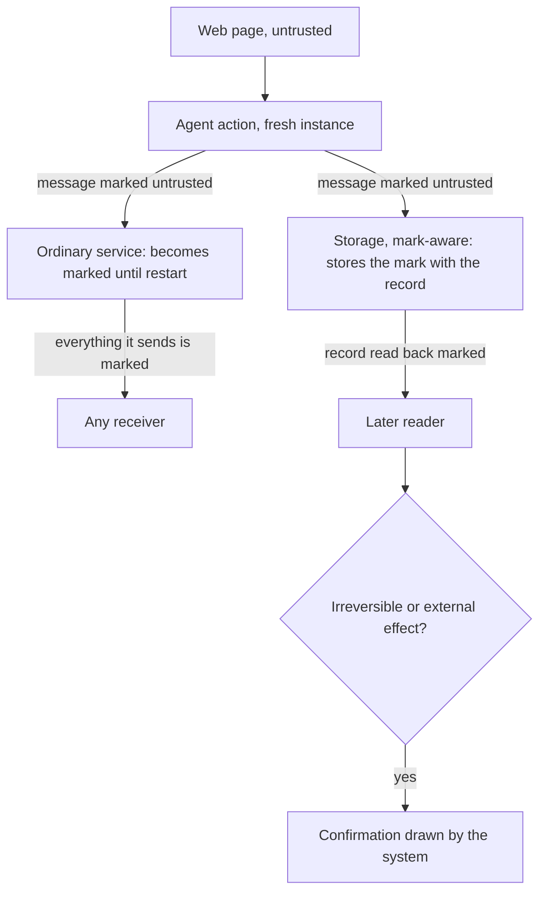
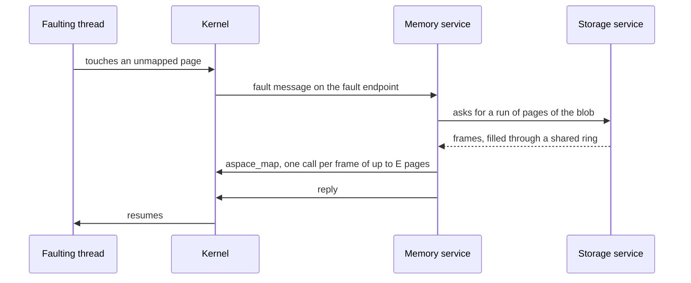
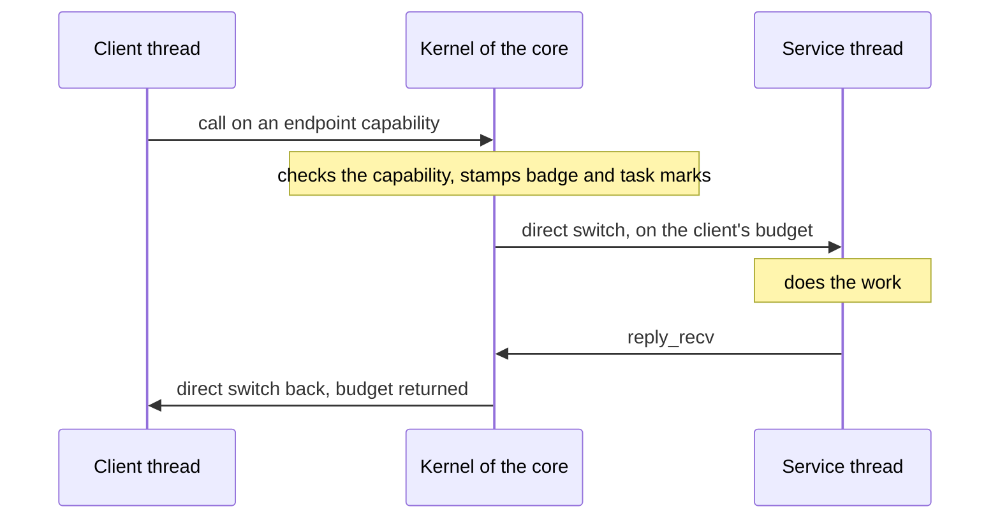

# Kernel interface

Statuses are defined in the [README](../README.md#status-legend).

**Decided, 14 November 2026**: validated by the two humans, except the sections that carry their own status. The numbers stay provisional. This file is the contract of the kernel: its objects, its system calls and the rules that bind them. It is written before any kernel code (**Decided**, 14 November 2026). The executable model, the oracle harness and the kernel are all written from it. Names and counts are provisional; the trials of weeks 1-2 and the one-core model will change them.

The kernel knows nothing about Wasm, WIT or components. The runtime and the services build those on top of this interface.

## Rules

1. **Everything is a capability.** A system call names its target by a slot in the caller's capability space. There is no global name and no ambient right.
2. **Any call can fail with `gone`.** A capability is revocable at any time (rule 1 of the [ABI](wasm-abi.md#abi-rules)).
3. **No kernel memory that grows at run time.** The memory of every object comes from an untyped capability supplied by the creator (see [memory.md](memory.md#kernel-memory)). The only exceptions are fixed when a node starts and never grow (D-110): the start-up objects, which are made from no untyped; the machine objects (`core`, `iommu`, `role`); the kept image and the slot of a replacement kernel image; the beacons of every node and core; the hardware feedback tables; on x86-64, the page of the park stub; the interrupt table of each node and its `irq_control`; the `memory_control` of each node; the machine table, its fixed part and its living part (ownership words, device table, gate words and page classes, member and role tables, grant and use tables, proxies: [Memory and devices between nodes](#memory-and-devices-between-nodes)); the interrupt remapping table; the tables of the IOMMU units and their `iommu` objects; the clock page; the tables through which each kernel maps the memory it holds. Besides these, the kernel holds only its image, its stacks and the block of each node (see [Start-up state](#start-up-state)).
4. **Every call is bounded.** A long operation (revocation, deletion of a large object, clearing of memory) runs in bounded steps and returns `again`; the caller repeats the call.
5. **A call never blocks the kernel.** The kernel has no per-thread stack. A thread that waits is a state of the thread, and the kernel returns to its scheduler.
6. **Calls enter through the kernel-supplied code page.** Call numbers are private to that page and can change between kernel versions.
7. **Objects belong to one core's kernel.** A call on an object held by another kernel becomes a message between kernels. The caller sees the same result, later. The machine objects (`core`, `iommu`, `role`) belong to no node: their state is in the machine table, which every kernel reads and which changes only through the write gates. Memory belongs to one node at a time: each chunk of ordinary memory and each entry of device memory has one owner, recorded in the living part of the machine table, which only the owner's write gate changes; a capability or a frame reaches another node only through a grant ([Memory and devices between nodes](#memory-and-devices-between-nodes)). Calls that change no object state (`debug_write`, `trace_emit`, `ioport_in`, `ioport_out`, `cap_inspect`) are executed by the caller's kernel, whichever kernel holds the object.
8. **Data never crosses IPC.** IPC carries control. Data moves through shared memory objects (see [Data plane](#data-plane)).

## Objects

| Object | Role | Model |
|---|---|---|
| `untyped` | A range of physical memory, not yet typed. The only source of memory for other objects | seL4 |
| `cspace` | A table of capability slots. Flat, and grown by supplying memory (see [Slots and addresses](#slots-and-addresses)). Deliberately simpler than the guarded tables of seL4 | Project |
| `aspace` | An address space: page tables, built from supplied memory. One copy per core in the core group | seL4, CortenMM |
| `frame` | A run of 1 to *E* physical pages of one of the machine's page sizes (the page, or a large page: see [Values of the machine](#values-of-the-machine)), with a memory type. A frame capability records at most one mapping; mapping the same pages twice needs a derived capability | seL4 |
| `thread` | A register set, bound to a `cspace`, an `aspace`, a fault endpoint, a message page, a `task` and a `sched` | seL4 |
| `sched` | A scheduling context: budget, period, class, allowed cores; its current deadline and remaining budget | seL4 MCS |
| `endpoint` | A synchronous rendezvous point for call and reply. A derived capability carries a badge that identifies the caller | seL4 |
| `reply` | A one-shot right to answer one call. It carries the lend of the caller's scheduling context to a passive server | seL4 MCS |
| `notify` | A word of signal bits, asynchronous. Interrupts, timers and ring wake-ups arrive here | seL4 |
| `timer` | A deadline with a tolerance, which signals a `notify` | Project |
| `irq` | One vector of one core, bound to one interrupt source; an entry of the node's interrupt table | seL4 |
| `irq_control` | The authority to claim the vectors of one node | seL4 |
| `ioports` | A range of x86-64 I/O ports, carried by the capability; the kernel executes each access. One per node, made at start (architecture layer only) | seL4 |
| `iospace` | An IOMMU domain: what a device can reach by DMA | seL4, Fuchsia BTI |
| `iommu` | One IOMMU unit, made by the kernel at start. With `manage`, attaches devices of that unit to an `iospace`. A machine object, driven by the holder of its role | Project |
| `memory_control` | The authority to take, give and split the blocks of memory of one node. One per node, made at start-up | Project |
| `task` | The unit of provenance and of stopping: identifier, marks, attached threads. Stopped in one operation ([research axis 4](../research/prior-art.md#kernel-research-axes)) | Project |
| `core` | Control of one node: start, stop, placement, status, watch; with `write`, its idle table and the right to configure and count its scheduling contexts; with `send`, the node's mailbox. A machine object ([Cores](#cores)) | Barrelfish/DC, seL4 MCS |
| `role` | One duty with one holder at a time: an IOMMU unit, an IOAPIC, a memory reserve, a leadership. A machine object ([Roles](#roles)) | Project |
| `debug` | The authority to write into the user trace ring of one's node. One per node, made at start. The rings and the crash records are kept memory, read through kept frames | Project |
| `vcpu` | Reserved name and number (16), not built. It exists only if the [micro-VM fallback](drivers.md#drivers-in-micro-vms-fallback) is opened | — |

Device memory (MMIO) is an `untyped` marked as device memory; it can only become a `frame` that is mapped, or a child `untyped`, never a kernel object. The registers of the interrupt controllers and of the IOMMU units, and of any other device the kernel drives itself, are in no device untyped.

The **memory object** of [memory.md](memory.md#memory-objects) (sharing, copy on write, paging, compression) is not a kernel object. It is built by the memory service from frames (**Decided**, 14 November 2026, see [Memory outside the kernel](#memory-outside-the-kernel)).

## System calls

64 calls. All take capability slots and words. Every call is specified in the [Call reference](#call-reference).

| Group | Calls | Notes |
|---|---|---|
| Capabilities | `cap_derive`, `cap_move`, `cap_delete`, `cap_revoke`, `cap_inspect`, `cspace_grow` | `cap_derive` copies with fewer rights or with a badge. `cap_revoke` deletes everything derived from a capability; it is the distributed two-phase protocol between kernels, and it returns `again` |
| Memory | `untyped_retype`, `aspace_map`, `aspace_unmap`, `aspace_protect`, `memory_take`, `memory_give`, `memory_split` | `aspace_map` maps up to *E* pages of one frame (one table's worth of entries), whatever the page size of the frame. `memory_take` and `memory_give` move memory between nodes in runs of up to *E* chunks |
| IPC | `call`, `reply_recv`, `recv`, `send`, `signal`, `wait`, `poll`, `notify_bind` | `call` and `reply_recv` are the fast path. `send` never blocks and never queues. `recv` on an endpoint with a bound `notify` also returns notifications |
| Threads | `thread_configure`, `thread_read_regs`, `thread_write_regs`, `thread_resume`, `thread_suspend`, `thread_cancel`, `thread_set_features`, `thread_move` | `thread_move` hands a thread's state to a thread of another node ([Unlike cores](#unlike-cores)) |
| Scheduling | `sched_configure`, `sched_bind`, `sched_unbind`, `sched_set_cores`, `sched_read`, `sched_count`, `yield` | Admission and `sched_set_cores` need a `core` capability with `write` |
| Time | `timer_set`, `timer_cancel` | The monotonic clock is read by `clock_now` in the code page, from the clock page, without a call |
| Interrupts and devices | `irq_claim`, `irq_bind`, `irq_ack`, `iospace_map`, `iospace_unmap`, `iospace_attach` | `iospace_attach` takes an `iommu` capability and a device identifier |
| Tasks | `task_attach`, `task_mark`, `task_exempt`, `task_revoke`, `task_read` | A task is made by `untyped_retype`, like every object. See [Tasks and marks](#tasks-and-marks) |
| Cores | `core_start`, `core_stop`, `core_status`, `core_idle`, `core_watch`, `core_place`, `core_perf`, `role_claim`, `role_hand` | Replacement is `core_stop` mode seal followed by `core_start` mode resume; recovery is automatic up to the node's death, and a reload is `core_start` mode fresh ([Cores](#cores)) |
| Debug | `debug_write`, `trace_emit` | Present in every build; the capability decides who may call them. The debugger stub exists only in development images ([Debugging](#debugging-call-reference)) |
| I/O ports (x86-64) | `ioport_in`, `ioport_out`, `ioports_issue` | `unsupported` on the other architectures |
| Entropy | `entropy_read` | No capability ([Entropy](#entropy)) |

Faults are not calls. A page fault, another processor exception, a system call made outside the code page, a thread with no address space and a thread that lost its scheduling context each become a message on the thread's fault endpoint; the handler answers through the `reply` object. The message, its delivery and the answer are specified in [Faults](#faults).

## Call reference

**Decided, 14 November 2026** (D-099): settled by the assistant at the user's request, from the gaps that two independent first models reported (27 by Gemini 4 Hydrogen, 29 by Mistral Large 4); re-read by the two humans. Revised twice the same day (D-100, D-101) after the reference model written from it showed mistakes; the rule against cycles was wrong twice before its present form. It covers the calls of the one-core model: capabilities, object creation, threads (configuration, resumption, suspension, cancellation), IPC and notifications, in the subsections from [Slots and addresses](#slots-and-addresses) to [Notifications](#notifications), and [Registers](#registers). The points marked **(design choice)** are the ones where another answer was reasonable.

**Proposed (D-110), 14 November 2026: written, no reference model yet, not reviewed.** The subsections [Memory and devices](#memory-and-devices), [Threads: bindings, faults and registers](#threads-bindings-faults-and-registers), [Scheduling and time](#scheduling-and-time), [Interrupts](#interrupts), [Tasks and marks](#tasks-and-marks), and the section [Start-up state](#start-up-state). They were drafted as three independent groups and merged by the assistant. The merge changed some rules of the decided subsections; each such sentence carries "(D-110)" where it stands, and the reference model of those subsections needs a new pass. The points that belong to the two humans are gathered in [Points for the two owners](#points-for-the-two-owners): the contract states the recommended rule until they decide. Groups not specified at that date: cores, debugging, `ioports`; they are specified since 16 November 2026 ([Cores](#cores), [Debugging](#debugging-call-reference), [I/O ports](#io-ports)).

**Revised, 16 November 2026: written, no reference model of the changes yet, not reviewed.** The 23 problems that pass 11 of the reference model found in this text are settled by the assistant's rulings of 16 November 2026; each changed sentence keeps its place. The page size became a value of the machine (D-121), through the whole file.

### Values of the machine

**Proposed (D-121), 16 November 2026.** Some values depend on the machine and not on the contract. The kernel chooses them at start-up, by the rule of D-121, and publishes them in the start-up page (entry `Memory`, [Start-up state](#start-up-state)); user space reads them there and never hard-codes them. `abi/` keeps a constant per architecture only where the architecture fixes it, and the reference model is tested with two page sizes.

| Name | Meaning | Reference machine (x86-64, four levels of tables) |
|---|---|---|
| *P*, **a page** | The smallest size the processor protects, which the kernel uses as the unit of every address space, `iospace` excepted | 4 KB |
| **page sizes** | *P*, then the **large pages**: the sizes that one entry of a higher table maps and that the processor supports. A frame names its page size by an index: 0 the page, 1 the first large page, 2 the second, 3 the third | 4 KB, 2 MB, and 1 GB where the processor supports it |
| *E*, **entries per table** | The number of entries of one table page | 512 |
| *L*, **levels** | The number of levels of the tables of an `aspace` | 4 |
| **chunk** | The unit in which memory belongs to a node: the first large page | 2 MB |
| **user range end** | The first address beyond the user range ([Address spaces and their tables](#address-spaces-and-their-tables)) | 0x7F80_0000_0000 |
| **core number** | The position of a physical core in the core list of the start-up page (entry `Cores`). It is the only numbering of cores in this contract; the node whose own core is core *i* is node *i* | — |

- "A page" in this contract means *P* bytes, and "a large page" one of the large page sizes. A count of bytes that bounds the work of one step (the clearing step of 64 KB, a segment of a `cspace`) stays in bytes and does not change with *P*.
- *E* is the number of 8-byte entries of one page (*P* / 8), and at most 4,096: the number of pages of a frame and the fields of a mapping record have 12 bits ([The capability slot](#the-capability-slot)). The kernel refuses to start on a machine whose page would need more (design choice: the 64-byte slot stays as it is). So a 64 KB page (ARM64's largest granule, 8,192 entries per table) is refused: on such a processor the kernel takes its 16 KB or 4 KB granule, by the rule of D-121.
- **Page sizes are one per level (design choice).** A large page is the size one entry of a higher table maps; the kernel does not use contiguous-entry hints that make one size out of several entries of one level (RISC-V Svnapot, ARM64's contiguous bit). Why: the gate's records (page classes, the count of pages not of class *data*, map counts) are per page and per chunk, and its checks are per entry of a level; a size made of several entries would need a second kind of entry in every check. The cost is the TLB reach those hints give, which the large pages give too.
- *L* is at least 2. A run of at most *E* pages crosses at most 2 tables at each level below the root, so a mapping call takes at most 2 × (*L* − 1) tables.

### Slots and addresses

- A **slot address** is a 64-bit word: the low 32 bits are an index, the high 32 bits are `via`. With `via` = 0 the index is in the caller's own capability space. Otherwise `via` is the index, in the caller's own space, of a `cspace` capability, and the index is in that space. There is one level of indirection, never more.
- **Slot 0 of every capability space is never used.** Address 0 therefore means "no capability" wherever an argument is optional.
- A slot is **empty**, **full** or **dead**. A slot becomes dead when its capability is removed by someone else (revocation, or the destruction of what it was derived from). Using a dead slot returns `gone`; using an empty slot returns `invalid`. `cap_delete` on a dead slot makes it empty. A dead slot is not free: nothing can be placed in it. This is what keeps a stale index from silently naming a new object.
- A thread needs no right to use its own capability space. Through a `cspace` capability, reading a slot (as the source of `cap_derive` or `cap_inspect`, or as the target of a call) needs `read`, and changing a slot (placing, moving out, deleting, revoking) needs `write`.
- A `cspace` is created with a maximum number of slots (a non-zero multiple of 128, at most 2^20, provisional: creating the space clears its directory, by the rule of the clean mark (D-110), so the directory is bounded, here to 64 KB), which fixes the size of its directory (8 bytes per 128 slots, rounded up to a power of two), and with no slot. `cspace_grow` adds one segment of 128 slots (8 KB: a slot is 64 bytes, D-110). Slot indexes never change. **(design choice)**
- **A `cspace` grows only from the untyped it was created from.** Any capability for that untyped object is accepted. Its segments then die with it and with that untyped, and no object depends on two untypeds. The creator of a process gives it one untyped for all its kernel objects.
- A destination that is slot 0 or beyond the table is `invalid`.

### The derivation tree

- Every capability has one parent, except the capabilities given at start-up, each of which is the root capability of its object; the frames of the start-up state are the exception, as descendants of the image untyped (D-110, see [Start-up state](#start-up-state)). `untyped_retype` makes the new capability a child of the untyped capability. `irq_claim` makes the new capability a child of the `irq_control` capability (D-110). `cap_derive` makes the new capability a child of its source. There is no separate "copy": a copy is a derivation with the same rights.
- **A capability never outlives the capability it was derived from.** `cap_revoke` removes all the descendants of a capability and keeps the capability. `cap_delete` removes the descendants, then the capability. **(design choice: the alternative, as in seL4, hands the children to the grandparent)**
- **An object lives exactly as long as the capability that `untyped_retype` returned for it** (its root capability), wherever that capability has been moved; for an `irq`, the capability that `irq_claim` returned, and for an object the kernel made at start-up, the start-up capability (D-110). There is no reference count. When the root capability is removed the object is destroyed and its memory goes back to the untyped it came from (an `irq` has no untyped: its entry of the interrupt table becomes free; an object made at start-up from no untyped gives its memory back to no one, D-110).
- `cap_move` moves a capability to an empty slot. Its place in the tree, its rights and its badge do not change. A capability at depth 64 can therefore still be moved, also by IPC; it can no longer be derived.
- **The tree is at most 64 deep** (provisional): a start-up capability is at depth 1, and a derivation or a creation that would go deeper is `invalid` (checked with the plain arguments). With the next rule, the limit bounds the walk that finds the next capability to remove.
- **A capability space holds only what is deeper than itself (design choice, D-103).** The root capability of another capability space can be placed in a capability space only if its depth is greater than the depth of the root capability of that space. An `untyped` capability (a root or a copy) can be placed there only if its depth is not smaller. Otherwise the call is `invalid`, checked with the plain arguments. The check is one comparison of two depths. It applies every time such a capability is placed in a slot: `cap_move`, `cap_derive`, `untyped_retype` and a capability moved or derived by IPC; for IPC the destination is known only at delivery, so a refusal there drops the capabilities.
  - Why: removing a capability removes first what was derived from it and, for the root of a space, what the space holds. Call *restricted* the `untyped` capabilities and the roots of spaces; the others are *ordinary*. The walk goes from a capability to one derived from it (the depth grows by one), or from the root of a space to a capability the space holds. From the root of a space to a root it holds the depth grows; to an `untyped` it holds the depth does not shrink, and the next move from an `untyped` is a derivation, since an `untyped` is not the root of a space. So while the walk is on restricted capabilities the depth never shrinks and stays equal at most once per level: at most 128 capabilities. Once the walk reaches an ordinary capability it stays on ordinary ones, because everything derived from an ordinary capability is a copy, and a copy is the root of nothing: at most 64 more. So no capability can depend on itself, and the walk is shorter than 192 capabilities (the longest one that can be built has 191). The first rule ("not into a space that descends from it") missed two spaces that hold each other's root; the second (creation numbers, D-101) prevented loops but did not bound the walk: any number of spaces at the same depth could be nested.
  - Consequence: to hand memory to a space, its creator makes a child `untyped` of the `untyped` the space came from and hands that; it keeps the parent, and with it the right to take everything back. A space cannot hold the capability its own memory was taken through; it can hold a copy of it, and so grow itself. A new space, for example a restarted supervisor, can take over the roots of spaces that are deeper than itself.
  - Known costs of the rule: the start-up `untyped` capabilities never leave the start-up space, so a memory service in its own space holds only children of them; each layer of spaces that create spaces uses one of the 64 levels; two spaces at the same depth cannot hold each other's root in either direction, so a space that must supervise a sibling is given a copy, or the sibling is created from a deeper `untyped`.
  - A space may hold its own root capability, as the start-up space does; it is removed last. The start-up space was created from no untyped: its size is fixed by the boot image and it never grows.
- A derived capability has a subset of its parent's rights. A capability made by `untyped_retype` does not: it gets the rights of its kind, whatever the rights of the untyped.
- Removal runs in bounded steps: per call, at most 32 units of work are done (a capability removed, a thread woken, or one of the undoings listed under "Destroying an object" below, D-110) and at most 128 slots of dying capability spaces are examined (both provisional), and the call returns `again` while work remains; the step that removes the last capability returns success, never `again`. Segments that were never added hold no slot and are not examined. The sweep of a space starts at slot 1; a slot counts as examined when the sweep moves past it, so a full slot is not counted while its capability is being removed. A step may end on the slot budget alone, having only moved the sweep. The order is fixed by the **derivation list** of the node ([The capability slot](#the-capability-slot)), never by where an object lies or when it was made: the next capability to remove is found by starting at the capability that follows the root of the removal in the list and moving forward while the depth grows; the last one reached is removed. Since a new capability is inserted right after its parent, the most recently derived child goes first, and a capability goes only after all its descendants; the walk is at most 64 slots. Between two steps the tree is well formed.
- **Removal ends.** A capability under `cap_delete` is dying from the first step: any other use of it returns `gone`. An object is dying from the first step of a removal that reaches its root capability, even when that step only removes a copy: every call on it, through any capability, returns `gone`, so its queues only shrink. A capability that is on the path of a removal but is not the root of its object keeps working until it is removed; this difference is wanted, because marking one object is one write and marking a subtree is not bounded. A thread whose capability space is dying gets `gone` from every call except `cap_delete` on its own slots, before any argument is looked at, (a slot address through a capability for a dying space is `gone` as any use of a dying object), and a delivery to a receiver whose receive range is in a dying or destroyed space drops the capabilities (the words are still delivered), so a dying space only shrinks. A server whose space is dying can therefore no longer answer: its callers get `gone` when its reply objects are destroyed. The step that marks a reply object as dying also wakes, with `gone`, the receiver attached to it or the caller that waits for an answer through it (one thread: a reply object is attached or armed, never both), so no caller can meet a waiting receiver whose reply object is dying. This wake is not counted in the 32 of a step: a walk passes through at most one reply object, because below the root of a reply object there are only copies. A call makes at most 32 walks, so it wakes at most 64 threads. `cap_delete` on a capability whose object is dying works as on any other: it acts on the slot, not on the object.
- **To kill a process, its supervisor deletes the root capability of its capability space first.** From the first step the threads bound to that space get `gone` from every call, so they can no longer compete with the removal; the supervisor then deletes the untyped the process was given. The cost is bounded by what the process holds: for a full space of 2^20 slots, 32,768 calls (removing a capability also moves the sweep past its slot, so the two budgets are not added), plus one unit per thread bound to the space (D-110). A killed server keeps its callers waiting until the removal reaches its reply objects; the kernel has no timeout.
- One limit is accepted: while `cap_revoke` or `cap_delete` runs, threads that hold capabilities under it can still derive new ones (not from the capability under `cap_delete` itself, which is dying). Each call removes 32 capabilities against at most four new capabilities per competing call (a message), and a thread that derives 33 capabilities or more per step of the removal can keep it from ending. A supervisor that wants a certain end stops those threads first, by the rule above, with `thread_suspend`, or with `task_revoke`.
- Destroying an object wakes every thread that waits on it, with `gone`. This includes the thread that waits to receive with a reply object, and the caller that waits for an answer through it. A caller is not woken when the server thread alone is destroyed: the reply object is the handle, and another thread can still answer through it. Destroying a `cspace` first removes every capability in it, in index order, by the same steps; the dying space keeps the index where the sweep stands, and a slot examined once is not examined again. `cap_revoke` on the root capability of a space does not sweep the space: it removes only what was derived from the root. A thread whose capability space is dying gets `gone` from every call except `cap_delete`; once the space is destroyed, the thread is bound to no space and gets `gone` from every call (D-110).
- **What else destruction undoes (D-110).** After the waiting threads are woken (and, for a `cspace`, after its sweep), and before the root capability is removed, the kernel undoes each link to the object, most recently made first, one unit of the 32 of a step each: the threads bound to a `cspace`, an `aspace`, an endpoint (as their fault endpoint) or a `task` are unbound (a `sched` loses its one home in the first step of its removal); the records that name an `aspace` or an `iospace` are emptied; the devices of an `iospace` are detached; the lends of a `sched` are cleared; the armed timers of a `notify` are disarmed, then its bound `irq` entries are unbound. The order inside each object, and the cases of `irq_control` and `iommu`, are given in the groups below. Removing a frame capability with a full record undoes its mapping, or the message page binding it holds, in the same unit as the capability.
- **Rights are checked when a call is made.** A thread that already waits is not disturbed when the capability it used is revoked; it is woken with `gone` only when the object itself is destroyed. **(design choice: waking it would need an unbounded search of the wait queues)**
- **A bound endpoint and notify.** When an endpoint or a notify bound by `notify_bind` is destroyed, the binding is undone first among the links of "What else destruction undoes", after the waiting threads are woken: one unit of the 32 of a step. The other object becomes unbound. A pending word stays in the notify. The threads waiting to receive on a surviving endpoint are not woken: they wait for callers, as on any endpoint without a notify.
- **A thread.** When the root capability of a thread is the next to remove, the kernel undoes, one unit each, in this order: its wait, if it waits (it leaves its queue, or its proxy's wait is ended on the other node; a reply object attached to it or armed with it becomes idle, as for `thread_cancel`); the lend whose receiver it is, if any; then its bindings: message page (the frame capability's record is emptied), fault endpoint, address space, capability space, task, and home context (the context keeps its lends). At most 8 units. A step with units left returns `again` and goes on at the next call. Then the root capability is removed.
- **The rights of a kind.** "Every right" of a new object ([rules of `untyped_retype`](#capabilities-and-objects)) and "every right of its kind" (start-up) mean the eight rights of [Rights](#rights), for every kind, with these exceptions: a root made by `untyped_retype` has `exec` only by the rule of that call; a root made at start-up from no untyped, and a root of a machine object, has every right except `exec` (the `memory_control` excepted, which has `exec`); a kept frame has the rights its start-up row gives. So `cap_inspect` of a root returns 0xFF or 0xFB, of a kept frame of the kept image 0x45 (`read`, `exec`, `derive`), and of another kept frame 0x41 (`read`, `derive`).

### Order of checks

Before these checks, a thread bound to no capability space, or attached to a revoked task, gets `gone` from every call, and a thread whose space is dying gets `gone` from every call except `cap_delete` on its own slots (D-110). On an architecture without I/O ports, `ioport_in`, `ioport_out` and `ioports_issue` return `unsupported` right after these, before any argument is looked at. Every call checks in this order and returns the first failure:

1. the capability the call acts on: its slot (`invalid` if empty or out of range, `gone` if dead), its kind (`invalid`), its rights (`denied`);
2. the other capability arguments, in the order of the table below, with the same three checks. A destination or any other slot address is a capability argument: its `via` capability and its range are judged here, and that the slot is empty only with the state. One exception: a message header is read right after the capability the call acts on (whose rights, `grant` included, are judged first with the number of capabilities the header states), because it says how many capabilities the message lists; a header beyond the limits, with a flag bit other than `add_marks` set by the sender, with an added-marks word that has a reserved bit, or that needs a message page the thread does not have (D-110), is `invalid` before any other capability argument is looked at;
3. the plain arguments, in the order of the table (`invalid`); for `untyped_retype` the kind is judged before the size argument: a kind that this version does not make (the reserved `vcpu`) is `unsupported` there, after the rule on device memory, and a kind that is never made from an untyped (`irq`, `irq_control`, `iommu`, `memory_control`, `core`, `role`, `debug`, `ioports`) is `invalid` (D-110); for a thread the size argument is its feature mask, judged by the rules of [The feature mask of a thread](#the-feature-mask-of-a-thread) (`invalid`, then `unsupported`); for a frame the size argument is judged in this order: the page size value (`invalid`), whether the processor supports it (`unsupported`), the memory type (`invalid` if it does not suit the kind of memory), the number of pages (`invalid`) (D-110); the depth checks (the limit of 64 and the rule on what a space holds) come last;
4. the state: `busy`, `no_slot` (the destination slot is not empty), `no_memory`, `would_wait`, `budget` (only `sched_configure` returns it, and it has no other state error, D-110); and `denied` from two state checks that guard a rule of the gate rather than a right of a capability: the class check of a mapping ([Calls on address spaces](#calls-on-address-spaces)) and the owner of a device identifier for `iospace_attach` ([IOMMU](#iommu)).

A call that passes every check may still return `again`, having done a bounded step of its work (removal, clearing of memory), or, for `recv` and `reply_recv` by a thread without an own context, having recorded a fault *no context* that it could not receive ([Faults](#faults)).

### Capabilities and objects

| Call | Arguments | Result | Rights and rules |
|---|---|---|---|
| `cap_derive` | source, destination, rights, badge | | `derive` on the source. The new rights must be a subset of the source's (`denied` otherwise, checked with the plain arguments, so after the destination); a rights word with a bit that names no right is `invalid`, here and in a message, and is judged before the subset. In both places the rights word is a plain argument: it is judged after the three checks of its slot (so a source without `derive` is `denied` whatever the word), and in a message with its slot, before the next listed slot. A badge is accepted only on an `endpoint` or a `notify` (`invalid` otherwise). On an `ioports` capability the new capability keeps the source's range. A capability that already has a badge keeps it: asking for another one is `denied` (checked with the plain arguments); asking for the same one is accepted. Badge 0 means no badge |
| `cap_move` | source, destination | | No right on the capability itself |
| `cap_delete` | slot | | No right on the capability itself. Returns `again` while descendants remain |
| `cap_revoke` | slot | | No right on the capability itself. Returns `again` while descendants remain |
| `cap_inspect` | slot | kind, rights, badge | No right on the capability itself. For an `ioports` capability the badge is its range ([I/O ports](#io-ports)) |
| `untyped_retype` | untyped, kind, size argument, destination | | `write` on the untyped. One object per call. The size argument is: bytes for a child `untyped` (a power of two, at least one page), the page size index, the memory type and the number of pages (1 to *E*) for a `frame` (D-110), the maximum number of slots for a `cspace` (at most 2^20), the feature mask for a `thread` ([Unlike cores](#unlike-cores)), and 0 for the other kinds. A size that does not fit in 64 bits is `invalid`. Device memory can only become a `frame` or a child `untyped` (`invalid` otherwise). An `irq`, an `irq_control`, an `iommu`, a `memory_control`, a `core`, a `role`, a `debug` or an `ioports` is never made by this call (`invalid`, D-110). Returns `again` while it clears memory (rules below) |
| `cspace_grow` | cspace, untyped | new number of slots | `manage` on the cspace, `write` on the untyped, which must be the one the cspace was created from (`invalid`). `no_slot` when the maximum is reached |

Rules of `untyped_retype`:

- Memory is taken at a watermark that only moves up while an object made from the untyped lives. When the last one is destroyed the watermark returns to the start: this is the only moment the memory becomes usable again (as in seL4). Object sizes are rounded up to a power of two (the size of a thread is a value of the machine, read from the start-up page: [Object sizes](#object-sizes)), except a frame, which takes exactly its number of pages times its page size. The watermark is aligned on the size of a child `untyped`, on the page size for a frame, and for the other objects on their size, or on a page if they are larger than a page.
- The new capability has every right, with one exception: it has `exec` only if the untyped capability has `exec`, and never on device memory (the start-up capabilities for device memory have no `exec`). This is how the right to make executable frames stays with the compile service.
- **The kernel clears every object it creates, frames included (design choice, D-110).** This replaces the earlier choice, under which the kernel cleared kernel objects but not frames; it awaits the validation of the two owners (see [Points for the two owners](#points-for-the-two-owners)). Under the earlier choice a frame made from reused memory showed the kernel objects destroyed there before (registers of other threads, message words, kernel addresses), which no holder ever had a right to read; seL4 and Zircon both give cleared memory.
  - Each untyped on ordinary memory has a **clean mark**: the memory from its watermark to its clean mark is known to be all zero. A creation needs the memory from the watermark to the end of the new object to be clear. If the clean mark is below that end, the call clears from the clean mark at most 64 KB (provisional), stopping at the end of the new object if it comes first, and moves the clean mark to where it stopped; if the end is still not reached, it returns `again` and makes nothing. The call that reaches the end makes the object. Each step starts at the clean mark, so a caller may change the arguments between two calls: what was cleared stays cleared.
  - **The padding is cleared with the object (design choice).** The memory between the watermark and the aligned start of the new object is below the end, so it is cleared too. Why: the clean mark says that everything from the watermark to it is zero; skipping the padding would leave dirty memory below the clean mark while the object is not yet made, and the meaning of the mark would depend on the arguments of the call in progress. The alternative, clearing the object only, saves at most the size of the object and needs a second mark. The padding before an object is always smaller than its alignment, so it never costs more than the object itself. When the watermark moves past the clean mark, the clean mark moves with it; when the watermark returns to the start, so does the clean mark.
  - A child `untyped` is not cleared: nothing reads an untyped, and every object made from it is cleared. Its clean mark starts at the end of the part of its range that the parent's clean mark covers.
  - The tables of an address space and the segments of a capability space are taken by `aspace_map`, `iospace_map` and `cspace_grow` by the same rule. Those calls take at most 2 × (*L* − 1) tables (6 tables, 24 KB, on the reference machine) or one segment (8 KB), a constant of the machine, so they clear within the call and never return `again`.
  - Device memory is never cleared: an untyped on device memory has no clean mark, and a frame on it shows what the device shows.
  - A creation from dirty memory therefore costs one call per 64 KB of the object and of its padding: an object of *b* bytes takes at least ⌈*b* / 64 KB⌉ calls and at most ⌈2*b* / 64 KB⌉. On the reference machine a frame of one 2 MB page takes 32 to 64 calls. The memory service makes its pools in advance, off the fault path. A page that moves from one process to another without passing through an untyped is cleared by the memory service, as before.
- An `aspace` and an `iospace` are cleared like every object, and the kernel writes into the root table of an `aspace` the entries it shares with every address space (see [Address spaces and their tables](#address-spaces-and-their-tables)).

### Threads

A new thread is suspended and bound to nothing.

| Call | Arguments | Rights and rules |
|---|---|---|
| `thread_configure` | thread, cspace, aspace, fault endpoint, message page | `manage` on the thread, `manage` on the cspace and on the aspace, `send` on the fault endpoint, `read` and `write` on the message page (D-110). The aspace, the fault endpoint and the message page may be 0. The message page must be a frame of exactly one page (page size index 0, *P* bytes) of ordinary memory (`invalid`, judged with its kind, D-110). The thread must be suspended and must not wait (`busy` otherwise): a wait holds a receive range of the old capability space. Then the record of the message page's capability must be empty, unless it already holds this thread's binding (`busy`, D-110). The bindings are described in [Bindings](#bindings) |
| `thread_resume`, `thread_suspend` | thread | `manage`. Both succeed when the thread is already in the state asked for. `thread_resume` is `busy` if the thread is bound to no capability space (a thread whose space is destroyed is bound to none, D-110); a thread bound to a dying space can be resumed. This `busy` comes before "already in the state asked for"; `thread_suspend` succeeds on a thread bound to no space. A resumed thread that has no scheduling context does not run (D-110, see [The budget follows the call](#the-budget-follows-the-call)) |
| `thread_cancel` | thread, wait number | `manage`. The result says nothing about what the thread was doing: the call succeeds whether or not a wait was ended. A thread has one word, *cancelled up to*, 0 when it is created. With a wait number *n* other than 0, the word becomes the greater of itself and *n*; then, if the thread waits with a wait number that is not 0 and not greater than the word, the wait is ended. With wait number 0, the word does not change and the wait is ended whatever its number: this is for a supervisor, and nothing is remembered. A wait that is ended: the thread is taken out of its queue (of an endpoint, of a notify) and its call returns `cancelled`; a reply object it was attached to, or that was armed with it, becomes idle, so a later answer is dropped as for any reply object that is not armed. A thread whose wait is already over but that has not run since does not wait: it keeps the result it has. A suspended thread whose wait is ended stays suspended and gets `cancelled` when it runs again. A fault wait that is ended leaves the thread suspended (D-110, see [Faults](#faults)). The thread may be bound to no capability space, or to one that is dying |
| `thread_read_regs`, `thread_write_regs` | thread, register block | Specified in [Register calls](#register-calls) (D-110) |

**Suspension and waiting are independent (design choice).** Suspending a thread that waits cancels nothing: the thread keeps its place in its queue, a message can still be delivered to it, and it runs again only when it is resumed. A waiting thread is removed from its queue only when it, or the object it waits on, is destroyed, or by `thread_cancel` (or by a step of `task_revoke`, D-110).

**The kernel has no time limit on a wait; `thread_cancel` with a wait number is how one is built (design choice, D-106, corrected by D-109).** `call`, `recv`, `reply_recv` and `wait` take a wait number, a plain argument of 64 bits chosen by the caller; 0 means that the wait cannot be cancelled by number. When such a call is about to wait, and its wait number is not 0 and not greater than the *cancelled up to* word of the thread, it returns `cancelled` instead of waiting, with the same effects as a wait ended at once: a `call` whose message was delivered has sent it, and the reply object it armed is idle again. A call that ends without waiting does not look at the word.

- How a limit is built: a thread gives each wait that has a limit a number greater than every number it used before, and arms a timer that signals a notify; a second thread, when the notify fires, calls `thread_cancel` once with that number. If the cancel comes before the wait, the wait returns `cancelled` at once. If it comes after the wait is over, it ends nothing, now or later, because every later number is greater. No repetition, no acknowledgement and no rule on priorities are needed. The exact use of the timer is in [Timers](#timers).
- Why: the first form of D-106 remembered nothing, and the fifth review showed two failures that no client protocol short of a handshake per call could close: a cancel that comes just before the wait was lost, and a cancel decided during one call could end the next one. The alternative, a deadline on every wait, needs a sorted queue of deadlines in the kernel; this needs one word per thread and one comparison when a wait begins.
- A thread that waits with wait number 0, or on which no other thread holds `manage`, leaves its wait only by a delivery, a signal, or the destruction of the object it waits on. This is wanted: who can end a wait is decided by capabilities.

### IPC

A thread is in one of these states: ready, waiting to be received (after `call`, in the queue of an endpoint), waiting for a reply, waiting to receive, waiting on a notification.

The `reply` object is supplied by the server, because the kernel has no memory of its own (rule 3). It is **idle**, **attached** to a thread that waits to receive, or **armed** with one caller.

| Call | Arguments | Result | Rights and rules |
|---|---|---|---|
| `call` | endpoint, message, receive range, wait number | the reply | `send`, and `grant` if the message lists capabilities. The endpoint may be a `core` capability with `send`: the call goes to that node's mailbox ([Machine objects](#machine-objects)). If a thread waits to receive, the message is delivered, that thread's reply object is armed with the caller, and the caller waits for the reply; the delivery lends the caller's scheduling context to a receiver that has none of its own (D-110, see [The budget follows the call](#the-budget-follows-the-call)). Otherwise the caller joins the queue of the endpoint, first in, first out |
| `recv` | endpoint, reply object, receive range, wait number | a message, or a notification | `recv` on the endpoint, `recv` on the reply object, which must be idle (`busy`, before anything is received: a pending notification stays pending). In order: the lends of the thread and of the reply object are released (D-110); a pending notification of the bound `notify`, if the thread has an own scheduling context (D-110); the first caller in the queue (a thread without an own context that finds a fault *no context* there gets `again` instead: [Faults](#faults)); otherwise the thread waits, with the reply object attached |
| `reply_recv` | reply object, message, endpoint, receive range, wait number | as `recv` | `send` on the reply object, then as `recv` with the same reply object, which may here be armed or idle (attached to another thread is `busy`). If the reply object is not armed, the reply is dropped without an error and the receive goes on |
| `send` | endpoint or reply object, message | | `send`, and `grant` if the message lists capabilities. A `core` capability with `send` names that node's mailbox, as for `call`. On an endpoint: delivered only if a thread waits to receive and the first one has an own scheduling context (D-110), otherwise `would_wait`; nothing is queued. On a reply object: answers the caller and makes the object idle; `would_wait` if it is not armed |

- **`send` on a reply object is the way to answer without receiving** (a server that answers later, from several reply objects). There is no separate `reply` call.
- **`send` never queues (design choice).** A queue of messages would need kernel memory. The queue of callers needs none: each waiting thread is linked through its own thread object, and its message stays in its own message page. Threads that wait on the same object are served first in, first out. The links go both ways, so taking a thread out of a queue is one step whatever the length of the queue; the length itself is bounded only by the number of threads, each of which was paid for by its creator. A sender that must not lose a message uses `call`, or a ring with a `notify`.
- The receiver gets the header, the words, and what the kernel sets: the badge of the capability the sender used, and the stamp of the sender (its task identifier and its marks) defined in [Tasks and marks](#tasks-and-marks) (D-110). A reply carries badge 0.
- When a caller disappears while its request is being served, or its wait is ended by `thread_cancel`, the reply object becomes idle; a lend it carries stays until its receiver receives again (D-110).
- **What a server must know about a caller that is gone.** `send` on the reply object returns `would_wait`: the server learns that its answer was not delivered. `reply_recv` drops the answer without an error, and moves or derives none of the capabilities the answer lists: a server that must know uses `send`, then `recv`. A reply object that is idle can be given to `recv` again, and is then armed with the next caller: an answer sent through it afterwards goes to that caller. So a server with several threads gives a reply object back to `recv` only after the thread that serves the request has answered through it.

### Transfer of capabilities

This fixes the details of the [capability transfer](#capability-transfer) described under Messages.

- The message lists up to 4 slot addresses, each as *move* or as *derive* with a set of rights. A derived capability is a child of the sender's capability and keeps its badge.
- **Checked when the call is made**, as in [Order of checks](#order-of-checks): each listed slot, `derive` on each capability to derive, and `grant` on the endpoint or reply object. A failure returns an error and sends nothing.
- **Checked again at delivery**, against what the listed slots hold at that moment: the same checks as when the call was made, and the first slots of the receiver's range are empty, one per capability. The kernel does not remember which capability was in a slot while the caller waited; a thread that shares its capability space answers for it. If not, no capability moves, the words are still delivered, and the header the receiver sees has the flag `caps_dropped` and a capability count of 0. If the sender's message page was unbound while it waited, the list is lost: the capabilities are dropped in the same way, and the words that were in the page are delivered as 0 (D-110).
- The sender learns it: `send` returns the flag at once; for `call`, the kernel sets the flag in the header of the reply. The flag in a reply header therefore means that the capabilities of the request or of the reply were dropped. A server that answers with `reply_recv` is not told that the capabilities of its reply were dropped.
- A slot listed twice in one message is `invalid`. This, and the depth of a capability to derive, are checked with the slot, after its three checks and before the next listed slot.
- The receive range (first slot address and count, at most 4) is given with `call`, `recv` and `reply_recv`. An empty range refuses every capability, and its address is not looked at. A range with a slot that is slot 0 or beyond the table is `invalid` when the call is made, as any destination; that the slots are empty is checked only at delivery.

### Notifications

| Call | Arguments | Result | Rights and rules |
|---|---|---|---|
| `signal` | notify | | `send`. Sets in the word the bits of the capability's badge, or bit 0 if it has no badge. If a thread waits, the first one is woken with the whole word and the word is cleared |
| `wait` | notify, wait number | the word | `recv`. Returns the word and clears it, or waits if it is zero |
| `poll` | notify | the word | `recv`. As `wait`, but returns `would_wait` if the word is zero |
| `notify_bind` | notify, endpoint | | `recv` on the notify, `manage` on the endpoint. Endpoint 0 removes the binding, and succeeds if there is none. One notify per endpoint and one endpoint per notify (`busy` otherwise, also for the pair that is already bound). If the word is not zero and a thread already waits to receive on the endpoint, and the first one has an own scheduling context (D-110), the notification is delivered at once. `signal` and the removal of a binding still work when the endpoint is dying: they only take a receiver out of its queue |

- **A bound notify is how one thread serves both requests and interrupts (design choice).** `recv` and `reply_recv` on the endpoint, by a thread that has an own scheduling context (D-110), return a pending notification before any caller: the header has the flag `notification`, label 0, no words and no capabilities; the badge field holds the word, the marks are 0 and the task identifier is 0 (a word can gather signals from several senders); the word is cleared. A `signal` on a bound notify wakes the first thread that waits to receive on the endpoint, if no thread waits on the notify itself and that first thread has an own scheduling context (D-110); that thread's reply object becomes idle.
- `wait` and `poll` take a `notify` only, never an endpoint.
- One thread is woken per `signal`, not all: the bits are consumed once.

### Memory and devices

**Proposed (D-110), 14 November 2026: written, no reference model yet, not reviewed.** It covers frames, address spaces, the IOMMU and the calls `aspace_map`, `aspace_unmap`, `aspace_protect`, `iospace_map`, `iospace_unmap` and `iospace_attach`. The page fault is one kind of [fault](#faults). The rules of the sections above apply unchanged: order of checks, dying objects, removal in bounded steps.

#### Frames

- A frame has a **page size** (one of the machine's page sizes, named by its index: [Values of the machine](#values-of-the-machine)), a **number of pages** from 1 to *E*, a **memory type** and a kind of memory (ordinary or device). All four are fixed by `untyped_retype` and never change. Its pages are physically contiguous and aligned on the page size.
- **At most *E* pages per frame (design choice).** One frame then fills at most one table of *E* entries, so mapping, unmapping or changing the rights of a whole frame writes at most *E* entries, and every one of these calls is bounded without a resumption point. A larger block is several frames. The alternative, frames of any size, needs a mapping that progresses over several calls and a record of how far it got.
- The **memory type** is write-back for ordinary memory (the only value accepted there). For device memory it is uncached or write-combining. It belongs to the frame and not to a mapping, so every mapping of the same physical pages has the same type. So two mappings of the same physical pages never disagree on their type, whatever a processor does with such aliases.
- A frame on device memory never has `exec` (rules of `untyped_retype`).
- A new frame on ordinary memory is all zero (rules of `untyped_retype`). The kernel never reads or writes a frame on device memory.
- **A kept frame** is a frame that the kernel makes at start-up over kept memory: the modules of the kept image, the fixed and living parts of the machine table, the crash areas, the hardware feedback tables. It is ordinary memory, write-back, never cleared, made from no untyped; its root is at depth 1 in every start-up space with the rights its start-up row gives, never `write`, so no mapping of it is writable (`denied`, by the subset rule). Removing its root destroys the frame object and gives the memory back to no one: the memory stays kept until the machine restarts.

#### Mapping records

- **A frame capability holds one record, empty or full.** A full record is either a **mapping** or a **message page binding**. A mapping holds: the space (an `aspace` or an `iospace`), the address of the first mapped page, the first page of the frame that is mapped, the number of pages mapped, and the rights of the mapping. The page size and the memory type come from the frame. The mapped pages are pages *first* to *first + count − 1* of the frame, at consecutive addresses. A message page binding holds the thread the page is bound to (see [Bindings](#bindings)).
- **Every translation in a space belongs to exactly one record**, and every full mapping record names exactly the translations it made. The space keeps a list of the capabilities whose records name it, most recently mapped first. The links of that list live in the capability slots, so they cost no memory beyond the slot (see [Object sizes](#object-sizes)).
- **What happens to the record when the capability changes:**
  - `cap_derive` from a frame capability: the new capability has an empty record. The source keeps its own. This is how the same pages are mapped twice: each mapping needs its own capability.
  - `cap_move`, also by IPC: the record moves with the capability, and the mapping or the binding does not change. The kernel updates the two neighbours in the space's list and the space's head if needed, or the thread's link to the slot. The cost does not depend on the size of the mapping.
  - Removal of a frame capability (by `cap_delete`, as a descendant in `cap_revoke` or `cap_delete`, or in the sweep of a dying capability space): if its record is full, the mapping is undone, or the message page unbound, in the same step, before the slot is freed, exactly as `aspace_unmap`, `iospace_unmap` or `thread_configure` would undo it. This counts as the removal of one capability among the 32 of a step, whatever the number of pages.
  - `cap_revoke` on a frame capability: every descendant is removed, so each mapping made through a descendant is undone. The capability's own record stays.
  - The frame itself is destroyed only once its root capability is removed, which comes after all its descendants. Its memory therefore never returns to the untyped while a translation to it, or a thread's binding to it, exists. The same holds for an untyped revoked with frames made from it.
- `cap_inspect` on a frame capability returns badge 0 and says nothing of the record (**design choice**: whoever mapped the capability knows where; a capability received by IPC can be unmapped at once, and `aspace_unmap` succeeds whether or not it was mapped).

#### Address spaces and their tables

- An `aspace` is made by `untyped_retype` from ordinary memory. It is two pages: its root table and its header, one page each (8 KB in all on the reference machine). The kernel clears it and writes into the root table the entries it shares with every address space: its own half, and the **reserved slot** described below. A new `aspace` translates nothing in the user range.
- **The user range and the reserved slot.** The user range runs from 0 to the user range end, a value of the machine published in the start-up page. The range that the next root entry maps forms the reserved slot. On x86-64 with four levels of tables, the user range runs from 0 to 255 × 512 GB (0x7F80_0000_0000) and the reserved slot is the next 512 GB, the last root entry of the lower half; the architecture layer places the reserved slot in the same way on the other architectures. It holds the pages that the kernel shares with every address space: the kernel-supplied code page (read and execute) and the clock page (read only). Their tables belong to the kernel of the node and are shared by every address space of that node; no capability names them and no call can change them. **This is how the code page and the clock page enter every address space, the start-up one included (design choice, D-110):** the alternative, a mapping that the creator of each address space makes, would need a capability for kernel memory. The start-up page publishes the user range, the addresses of the two pages and the page sizes the processor supports. Any range that goes beyond the user range is `invalid`, so it can never overlap the reserved slot.
- **Lower tables come from the untyped the aspace was created from (design choice).** `aspace_map` takes a capability for that untyped. Any capability for the same untyped object is accepted, as for `cspace_grow`. A table is one page, taken at the watermark (aligned on a page) and cleared by the rule of the clean mark. It counts as a live piece of the untyped, as a segment of a capability space does, until the aspace is destroyed. No object depends on two untypeds, and the tables of a process are paid for by the memory it was given. The alternative, as in seL4, makes page tables objects that user space creates and maps itself. That puts the levels of the architecture into the interface, which [Architectures](#architectures) rejects.
- **A table that becomes empty goes to the free list of its aspace (design choice).** The kernel knows, for every table, the number of its entries that are present (where it keeps that count is up to the architecture layer). When an unmap leaves a table with no present entry, the table is unhooked from its parent and placed at the head of the aspace's free list, and its parent may become empty in turn. An aspace takes tables from its free list first (most recently freed first), then from its untyped. A table never goes back to the untyped before the aspace is destroyed: the watermark rule forbids it. Because of this rule a hooked table always has at least one present entry, so an address range in which nothing is translated holds no table either, and a large page can be mapped wherever nothing is translated. The alternative, never unhooking a table, would forbid a large page for ever in any slot that once held small pages.
- **The start-up aspace** was created from no untyped. The kernel builds it with the tables that the boot image's mappings need, plus the reserve of free tables that the boot image states. It never takes a table from an untyped: for it, an untyped argument other than 0 is `invalid`. This mirrors the start-up `cspace`.

#### Calls on address spaces

| Call | Arguments | Result | Rights and rules |
|---|---|---|---|
| `aspace_map` | aspace, frame, untyped, address, first page, page count, rights | | `write` on the aspace. On the frame, the rights asked for (judged with the plain arguments, `denied`). `write` on the untyped, which may be 0. Otherwise it must be a capability for the untyped the aspace was created from (`invalid`, judged right after its three checks). Maps pages *first page* to *first page + page count − 1* of the frame from *address*, with the frame's page size and memory type |
| `aspace_unmap` | frame | | No right on the capability itself, as for `cap_delete`: it can only take access away. Succeeds without effect if the record is empty. `busy` if the record names an `iospace` or a thread |
| `aspace_protect` | aspace, frame, rights | | `write` on the aspace. On the frame, the rights asked for (`denied`, with the plain argument). Replaces the rights of the whole mapping. `busy` if the record is not a mapping in this aspace |

The checks of `aspace_map`, in the order of [Order of checks](#order-of-checks):

1. The aspace: slot, kind, `write`. A dying aspace is `gone`.
2. The frame: slot, kind. No right is judged here, since the rights needed depend on the rights argument. Then the untyped, unless it is 0: slot, kind, `write`, then that it is the aspace's own untyped (`invalid`; any untyped is `invalid` for the start-up aspace). A dying frame or untyped is `gone`.
3. The plain arguments, in this order, each `invalid` if it fails:
   - the address is a multiple of the frame's page size;
   - the first page is less than the frame's number of pages;
   - the page count is at least 1, and first page + page count does not exceed the number of pages;
   - the range, from the address to the address plus page count times page size, lies inside the user range (computed without overflow);
   - the rights word: a bit other than `read`, `write` and `exec` is `invalid`; a word without `read`, or with both `write` and `exec`, is `invalid` (write or execute, never both, per mapping: **design choice**, see below); a word that is not a subset of the frame capability's rights is `denied`.
4. The state, in this order:
   - the frame capability's record is full (`busy`, even if it names this aspace), unless it is a *partial* mapping made by the same call (this aspace, address, first page and rights: the call goes on from where it stopped, G3);
   - some address of the range not yet written by this call is already translated, by a page of any size (`busy`);
   - a page the mapping targets is of a class that refuses the leaf ([The gate over page tables](#the-gate-over-page-tables), G3 (3) and (4): a table or gate page; a global read-only page for `write`; a device page for `exec` or with a memory type other than a device one) (`denied`; the only `denied` judged with the state: what the frame capability grants and what the page may carry are two separate rules, and a correct kernel never reaches this one, since frames never cover table or gate pages, kept frames have no `write` and device frames no `exec`);
   - a map count of a chunk of the frame would pass `MAP_COUNT_MAX` ([The gate over page tables](#the-gate-over-page-tables), G4) (`busy`);
   - the tables the mapping needs are more than the aspace's free list and its untyped can supply (`no_memory`). An untyped of 0 supplies none. The untyped can supply as many tables (one page each) as fit between its watermark, aligned up to a page, and its end. Nothing is taken when this fails.

Effect of `aspace_map`. The missing tables on the paths to the target entries are taken (free list first, then the untyped) and hooked in. The entries are written: present, user-accessible, with the frame's memory type, the rights asked for, and the page size of the frame. The record is filled and the capability is placed at the head of the aspace's list. A mapping whose leaves touch more than *E* chunks is written in steps (G3): each call writes the leaves whose checks fit, the record holds the pages written so far and the mark *partial*, and the call returns `again`; the last step clears the mark. A partial record is a mapping for every other rule: `aspace_unmap` undoes the pages it holds, `aspace_protect` is `busy` on it, a removal of the capability undoes it. No thread is woken. In particular a thread that waits for the answer to its fault stays waiting: only the answer resumes it (**design choice**: resuming it here would mean searching the threads that faulted in the range).

Effect of `aspace_unmap` on a full record that names an aspace (dying or not). Its entries are cleared. The tables left empty are unhooked and placed on the free list. The translations of the range are invalidated (see [TLB](#tlb-one-core-and-several)). The record is emptied and the capability leaves the aspace's list. Checks: the frame (slot, kind; a dying capability or frame is `gone`), then the state (`busy` if the record names an `iospace` or a thread).

Effect of `aspace_protect`. The entries of the mapping are rewritten with the new rights, the record's rights are replaced, and the translations of the range are invalidated. Asking for the rights the mapping already has succeeds and changes nothing. Checks: the aspace (`write`; dying is `gone`); the frame (slot, kind); the rights word, as for `aspace_map`; the state (`busy` if the record is empty, a binding, a partial mapping or a mapping in another space; then `denied` if a page of the mapping is of a class that refuses the new rights, as in `aspace_map`). Its class reads follow the bound of G3: a mapping touches at most *E* chunks per step, so a protect of a mapping that took several calls to make is refused (`busy`) unless it touches at most *E* chunks; the memory service unmaps and maps again instead **(design choice:** a protect that progresses over calls would need a second mark**)**. Unlike `aspace_unmap`, this call needs the aspace capability, because it can also *add* rights (copy on write gives write back to the last sharer).

- **Write or execute, never both, per mapping (design choice).** The kernel refuses a mapping that is both writable and executable. The same frame can still be writable through one capability and executable through another, in the same space or in two spaces. This is how the compile service hands over code, and a JIT can work the same way. The alternative, no rule in the kernel, leaves the rule of [memory.md](memory.md#other-rules) to every caller. A mapping is always readable (design choice): x86-64 cannot express write-only or execute-only in an ordinary page table, and RISC-V can express execute-only but not write-only; the contract uses neither, so the rule is the same on every architecture.
- **Unmapping and protecting act on a whole record, never on part of one (design choice).** The kernel therefore never splits a large page or a mapping. To change the rights of part of a frame, the memory service maps that part through its own capability, which is derived for the purpose. Unmapping by address range would need a way back from a translation to its record.
- **Bounds.** `aspace_map` writes at most *E* entries and checks at most *E* chunks per call (G3). It takes and clears at most 2 × (*L* − 1) tables: a run of at most *E* pages crosses at most 2 tables at each level below the root (6 tables with four levels). `aspace_unmap` clears at most *E* entries and unhooks at most 2 × (*L* − 1) tables. `aspace_protect` rewrites at most *E* entries. Each call then does one invalidation of at most *E* translations, or of the whole tag (see below).

#### Large pages

- The page size of a mapping is the page size of the frame. The kernel never maps a frame of large pages with entries of a smaller size, or the reverse (**design choice**: one frame, one size, which keeps the record small and removes splitting). Whoever needs the granularity of a page makes frames of pages.
- A page size that the processor does not support is `unsupported` in `untyped_retype` (judged right after the page size value), so no frame of that size exists. The start-up page lists the supported sizes. The memory service decides when to use the largest page sizes ([memory.md](memory.md#page-sizes) places the 1 GB pages of the reference machine after the alpha). The kernel supports them from the first version.
- A large page is placed in a slot of its level only if nothing in that slot is translated. A slot that once held small pages has lost its table, by the free-list rule, once the last of them is unmapped.

#### Device memory

- A frame on device memory can be mapped into an `aspace` (a driver's registers) and into an `iospace` (reserved regions that a device needs at fixed addresses, peer-to-peer transfers). The kernel never reads or writes device memory.
- The memory type of a device frame is uncached or write-combining, chosen in `untyped_retype`. `exec` never exists on device memory.
- The registers of the interrupt controllers and of the IOMMU units, and of any other device the kernel drives itself, are in no device untyped given at start-up. No capability can therefore map them.

#### Destruction of an address space

- An aspace is dying from the first step of a removal that reaches its root capability (rule of [Removal ends](#the-derivation-tree)). In that step the kernel invalidates every translation tagged for it. It never makes it the current space of a core again, since its threads no longer run user code (see [A thread and its address space](#a-thread-and-its-address-space)).
- When the root capability is the next to remove, the kernel first empties the record of each capability in the aspace's list, most recently mapped first. Then it unbinds each thread of its list, most recently bound first: the thread is bound to no aspace. Emptying a record does not touch the tables, which die with the aspace. Each record emptied and each thread unbound counts as one of the 32 of a step. Then the root capability is removed. The aspace is destroyed and its own memory and all its tables, hooked or free, stop counting as live pieces of the untyped, in the same step.
- Between two steps, a record still full names a dying aspace. `aspace_unmap` on it works as usual.

#### TLB, one core and several

- **Guarantee.** When a call returns (or a removal step returns `again`), no thread on any core can use a translation that the call removed or reduced. Translations that were added may cause no fault.
- **One core.** The kernel invalidates the translations of the range on its own core before it returns: page by page, or the whole tag of the space when that is cheaper. The tags (PCID on x86-64) are given by the architecture layer from a fixed table of the node and recycled with a full invalidation. They are invisible to user space.
- **Several cores (the hook, decided now).** An aspace holds a copy per node of its core group ([kernel.md](kernel.md#multi-core-structure)). Its header holds the set of those nodes and the number of acknowledgements outstanding. On one core the set is the own node and the number is 0. A change (map, unmap, protect, removal of a record) is applied to the home copy, then sent to every other node of the group. Each of them applies it to its copy and invalidates its own translations before it acknowledges. The call returns only when every acknowledgement is in. Meanwhile the calling thread waits in the state *waiting for another node* ([Calls on an object of another node](#calls-on-an-object-of-another-node)), which the one-core reference never uses. **Each copy is an `aspace` of the node that holds it** (design choice: a slot never names a slot of another node, so a record names a space of its own node): the other nodes' copies map the frames under grants from the frames' nodes, and their records are in their own remote slots. This is the memory ownership invariant: every remote mapping is recorded on both sides. The tables of a copy are paid by an untyped of the node that holds it, which the memory service gives that node for the process.

#### IOMMU

The kernel programs the IOMMU (rule of [drivers.md](drivers.md#iommu)).

- **IOMMU units.** At start the architecture layer reads the list of IOMMU units from the firmware: on x86-64, only the DRHD entries of the ACPI DMAR table (register address, PCI segment). It turns every unit on before the first process starts. By default every device is blocked: no DMA reaches memory. Each unit is driven by the holder of its unit role ([Roles](#roles)); the tables of every `iospace` are in the memory of the iospace's own node ([Devices and shared hardware](#devices-and-shared-hardware)). The memory for the units' own tables (root and context tables, 1 MB and 4 KB per unit on x86-64) is kept by the kernel at start (see [Start-up state](#start-up-state)), once, and never grows.
- **`iommu` objects.** The kernel makes one `iommu` object per unit at start, with its root capability in the start-up space (see [Start-up state](#start-up-state)). `untyped_retype` never makes one (`invalid`). It names the unit, and with `manage` it gives the right to attach any device identifier of that unit to an `iospace`. The kernel does not check that a device belongs to the unit's scope: discovering the devices is the platform service's job. A device attached through the wrong unit stays blocked, since its own unit still blocks it.
- **Devices the kernel uses itself** (a PCI function that is the stub link of a development image) are attached by the kernel to a domain of its own. Their identifiers are `busy` for `iospace_attach`.
- **`iospace` objects.** An `iospace` is made by `untyped_retype` from ordinary memory, two pages (root table and header, one page each: 8 KB in all on the reference machine). Its tables come from its untyped, with the same rules as for an aspace (free list, `no_memory`). Its address width and page sizes are the ones every unit supports, published in the start-up page (on x86-64, 48 bits if every unit supports four levels, otherwise 39). An iospace serves devices of one unit at a time, at most 16 of them. Its header lists them.

| Call | Arguments | Result | Rights and rules |
|---|---|---|---|
| `iospace_map` | iospace, frame, untyped, device address, first page, page count, rights | | As `aspace_map`, with these differences. `write` on the iospace. The frame's page size must be one that every unit supports (`unsupported`, the first plain check). The range must lie inside the iospace's address width. The rights word is a non-empty subset of `read` and `write` (`invalid` otherwise, `exec` included), and a subset of the frame capability's rights (`denied`). Device memory is accepted |
| `iospace_unmap` | frame | | As `aspace_unmap`. `busy` if the record names an `aspace` or a thread. If the iospace serves devices, the unit's translation cache is invalidated before the call returns, by the holder of the unit's role: a call made on another node waits for it |
| `iospace_attach` | iommu, iospace, device | | `manage` on the iommu, `manage` on the iospace, which may be 0 to detach. The device is a plain identifier whose form the architecture layer fixes (x86-64: bus, device and function in 16 bits, within the unit's segment; higher bits set are `invalid`) |

Rules of `iospace_attach`:

- **A device identifier has an owner (design choice, the device side of D-113).** The living part of the machine table holds one ownership word, in the format of [the ownership words](#chunks-floors-and-the-ownership-words), per device identifier of each PCI segment that an IOMMU unit serves (`IDENTIFIERS_PER_SEGMENT`, 65,536 words of 8 bytes, 512 KB per segment): the **identifier word**. At machine start-up every identifier word is *free*, unclaimed. Attaching a device takes its word for the caller's node by the rules of taking (free and this node's, unclaimed, or of a dead node) and leaves it *taken* while the device is attached to an iospace of the node; detaching writes it *free*, unclaimed. So a node attaches only a device whose identifier no other live node holds, and the gate of the unit's role holder writes a context entry only for the node the identifier word names (G9). Why: the identifier is a plain argument, and without a word that ties it to an owner any node holding the `iommu` capability could point another node's device at its own tables. The alternative, a device table entry per identifier filled by the kernel, needs the PCI enumeration the kernel leaves to the platform service.
- With an iospace, the state is judged in this order:
  - the device is one the kernel uses (`busy`);
  - the device's identifier word is taken by another node that is not dead, or fails its check (`denied`);
  - the device is attached to another iospace (`busy`; detach it first);
  - the device is already attached to this iospace (success, nothing changes);
  - the iospace serves devices of another unit (`busy`);
  - the iospace already serves 16 devices (`busy`);
  - the unit has no free domain number (`busy`).
  Then the unit's context entry for the device points at the iospace's tables, under the iospace's domain number for that unit, given at its first device and freed with its last. The device is added to the iospace's header. The unit's caches are invalidated.
- With iospace 0: if the device is attached to an iospace of the caller's node, its context entry is cleared (the device is blocked again), it leaves the iospace's header, its identifier word becomes *free*, unclaimed, and the caches are invalidated; if it is attached to another node's iospace, `denied`. Otherwise the call succeeds without effect. Detaching a device of a dying iospace works.
- A dying iospace is `gone` for `iospace_map` and `iospace_attach`. Its destruction, when its root capability is the next to remove, first detaches each of its devices (most recently attached first), then empties each record of its list (most recently mapped first). Each counts as one of the 32 of a step. When the first device is detached, the unit's caches for its domain are invalidated, so no device reaches its tables.
- **An `iommu` keeps the list of the devices attached through it**, as an iospace keeps its devices: it is linked through the device entries of the iospaces' headers, most recently attached first, and costs no memory beyond those entries. Destroying an `iommu` object detaches the devices of that list in its order, one unit of the 32 of a step each; an `iommu` with no device attached is destroyed in one step. The unit stays on and blocks every device of its scope until the next start.
- **Invalidations of the IOMMU wait for the hardware (design choice).** An unmap is not over until the unit has confirmed that no device can still use the translation. Otherwise the memory could return to its untyped while a device still writes into it. The kernel waits for the confirmation. A unit that does not confirm within 1 ms (provisional) is a hardware fault of the unit, not of a node: the holder of its role keeps the role and tries again, every change on the unit waits, and the devices behind it keep the translations they have (killing the holder would not repair the unit). The invalidations of one call, or of one removal step, are grouped into one wait before the call returns.
- **No device-side translation caches, no device page faults, no shared process address spaces (design choice).** The kernel enables neither ATS nor PRI nor PASID. A device that caches translations itself could keep using them, and the kernel would depend on each device to invalidate them. A device sees only its iospace. The cost: no shared virtual memory between a process and a device.
- **DMA faults are blocked and not reported (design choice).** The unit blocks the access. The holder of the unit's role clears the fault record and writes it to its kernel ring (code 2), with the rate limit of [Debugging](#debugging-call-reference). User space learns that a device is broken through the class interface (requests that do not finish), and the driver manager restarts it ([drivers.md](drivers.md#restart-of-a-driver)). Reporting to user space would need a `notify` binding and a record queue in the kernel.
- **The caller chooses device addresses (design choice, as seL4; Zircon's `zx_bti_pin` returns addresses chosen by the kernel).** The driver, or its emulation layer for `dma_map`, places its buffers. The kernel keeps no allocator of device addresses.
- **Bounds.** As for the calls on an aspace, plus one wait on the unit per call. `iospace_attach` writes one context entry.
- Interrupt remapping belongs to [Interrupts](#interrupts).

### Threads: bindings, faults and registers

**Proposed (D-110), 14 November 2026: written, no reference model yet, not reviewed.**

#### Bindings

- A thread is bound to at most one of each of these: a capability space, an address space, a fault endpoint (with the badge of the capability given to `thread_configure`, which its fault messages carry), a message page, a task and a scheduling context as its home. Each binding is a link both ways, so undoing it is one step. `thread_configure` replaces the first four bindings at once; `task_attach` and `sched_bind` make the others.
- **A binding is to the object, not to the capability** used to make it: revoking that capability does not undo it ([Rights are checked when a call is made](#the-derivation-tree)). The exception is the message page, below.
- When the object a thread is bound to is destroyed, the binding is undone in the steps of the removal, one unit of the 32 of a step per thread. The thread is then bound to nothing of that kind. A thread whose capability space is destroyed is bound to no space and gets `gone` from every call.
- **The message page is bound through the record of the frame capability given (design choice).** That capability's record names the thread; the thread names the slot. `cap_move` moves the binding with the capability. Removing the capability, by any removal, unbinds the page in the same step. So the frame is never destroyed while a thread uses it, and the kernel never writes into freed memory. The kernel reads and writes the page through the frame, never through a user mapping, so it never faults on it. The thread reads and writes the page through a mapping of its own, made with another capability for the frame (a derived one: the record of the bound capability is taken). The alternative, a binding to the frame object, would need a list of threads in the frame, which has no kernel record.
- **What lives in the message page:** the words of a message beyond the register words, the list of capabilities of a message, the added-marks word ([Tasks and marks](#tasks-and-marks)) and the register block ([Register calls](#register-calls)); where each one sits is fixed by the architecture layer ([Registers](#registers)). A thread may have no message page. A message header that needs one (more words than the registers hold, a capability, or the flag `add_marks`) from a thread without one is `invalid`, judged with the header ([Order of checks](#order-of-checks)). `thread_read_regs` and `thread_write_regs` called by a thread without one are `invalid`, judged right after the three checks of the thread capability: both calls carry their register block in the caller's message page, as the result of the first and the argument of the second. A delivery to a thread without one writes the register words only; the header keeps the number of words sent, so the receiver knows that the others were lost.

#### A thread and its address space

- `thread_configure` places the thread at the head of the aspace's list of bound threads, after it leaves the list of its previous aspace. The fault endpoint, the capability space and the task keep the same kind of list.
- **A thread bound to no aspace, or to a dying one, never runs user code (design choice).** It still runs in the kernel: on x86-64 the kernel uses an address space that maps only the kernel. It raises the fault **no address space** at the choice of the thread to run (step 7 of [Order inside an event](#what-runs-next)): when the choice picks the holder of a context and that thread is bound to no aspace or to a dying one, the fault is raised as by that thread, which then waits on its fault or is suspended, the contexts whose eligibility changed are put in their queues by the rule of step 6, and the choice is made again. Each such round is constant work, and the kernel takes pending interrupts between two rounds, as for the threads of a revoked task. It is not a page fault, so that the memory service does not try to serve it; a supervisor learns of it on the fault endpoint and decides. The alternatives were to suspend the thread silently in the destruction step, which a supervisor cannot see, or to destroy it, which the kernel never does to an object whose root capability lives.

#### Faults

A fault is not a call. The kernel turns it into a message on the thread's fault endpoint, sent on behalf of the faulting thread.

- **Delivery is a `call`** by the faulting thread on its fault endpoint, with an empty receive range and wait number 0. It follows every rule of `call`: the queue of the endpoint, the reply object armed, the lend of the thread's scheduling context to a passive handler ([The budget follows the call](#the-budget-follows-the-call)), and the stamp of task and marks ([Tasks and marks](#tasks-and-marks)). The `send` right was checked by `thread_configure` and is not checked again. A fault is sent even when the thread's capability space is dying, since it carries no capability. The kernel keeps the words of the fault in the thread object, not in the message page, and changes none of the thread's registers.
- **No handler.** If the thread has no fault endpoint, or its endpoint is dying, the thread becomes suspended at once and the fault is not delivered: it is **recorded** in the thread, where a supervisor reads it with `thread_read_regs` ([Register calls](#register-calls)). Its registers are unchanged, so resuming it executes the same instruction again (as in seL4 when no thread can receive a fault). This holds for every kind (design choice: one rule for every fault).
- **A fault *no context* goes one level only (design choice).** It lends nothing, since the faulting thread has no context, so it is delivered only to a receiver that has an own context. If the first thread that waits to receive on the fault endpoint has none, the fault is not delivered: the faulting thread becomes suspended with the fault recorded, and the waiting receiver is not disturbed. If no thread waits, the fault joins the queue of the endpoint as any call. A thread without an own context that then receives on the endpoint, and finds this fault first in the queue, does not receive it: the faulting thread leaves the queue and becomes suspended with the fault recorded, and the receive returns `again`, having received nothing (its reply object stays idle; the lends it released at the start of the receive stay released). No second fault is raised in either case, so the work of one event stays constant. Why: a passive handler that took the fault would itself lose its context and fault, and so on along a chain of handlers. The alternative, marking the passive handler as the earlier text did, made the work of one event grow with the number of threads.
- **Header:** label = the fault kind, 5 words, no capability, no flag. The receiver sees the badge of the fault endpoint capability, which tells it which thread faulted.
- **Words** (5, so a fault fits in the 6 register words and takes the fast path):

  | Word | Content |
  |---|---|
  | 0 | the instruction pointer at which the thread resumes after an answer with label 0: the faulting instruction for a fault, the next one for a trap (breakpoint, single step), and for kinds 7 and 8 the address at which the thread would have resumed, for example just after a call whose result is already in its registers |
  | 1 | the stack pointer |
  | 2 | the architecture's exception number (x86-64: the vector); 0 for kinds 6, 7 and 8 |
  | 3 | for a page fault, the access: bit 0 read, bit 1 write, bit 2 execute, bit 3 *present* (the address was translated, but without the right needed), and the architecture's error code in bits 32-63. For the other exceptions, the architecture's error code, 0 if it has none. 0 for kinds 6, 7 and 8 |
  | 4 | an architecture address: the address of the access for a page fault (CR2 on x86-64), DR6 for a debug exception; for an undefined instruction, 1 + the bit of the feature whose disabled state trapped, or 0 ([Unlike cores](#unlike-cores)); otherwise 0 |

- **Kinds** (the label):

  | Kind | Label | x86-64 |
  |---|---|---|
  | page fault | 1 | #PF: an access to an address that is not translated, or with a right the translation does not give |
  | undefined instruction | 2 | #UD |
  | arithmetic | 3 | #DE, #MF, #XM |
  | protection | 4 | #GP, #SS, #AC, #CP |
  | debug | 5 | #BP, #DB |
  | bad call | 6 | a system call instruction outside the kernel-supplied code page |
  | no address space | 7 | see [A thread and its address space](#a-thread-and-its-address-space) |
  | no context | 8 | a thread marked as having lost its scheduling context, see [The budget follows the call](#the-budget-follows-the-call) |
  | hardware breakpoint | 9 | #DB raised by a breakpoint or watchpoint of the thread's debug registers ([Debugging a component](#debugging-a-component)); word 3 holds the bits of those that hit, word 4 DR6 |

  The kinds are the contract's; the table maps x86-64's exceptions to them. On ARM64 and RISC-V the exceptions that map to each kind are defined when the architecture is brought up ([Open points](#open-points)), with one rule fixed now (design choice): a misaligned access, and an access fault that is not a translation fault, are kind 4, protection, on every architecture. The other exceptions are not faults of the thread. #NM is the kernel's own (vector state), #DF is a bug of the kernel, and #MC is a hardware error handled by the recovery of the node. The exhaustion of a budget is not a fault ([What runs next](#what-runs-next)).
- **The answer.** The handler answers through the reply object, as for any call.
  - **Label 0:** the thread resumes at word 0 of its fault, so a fault is executed again, and a trap continues after the instruction.
  - **Label 1, with at least 2 words:** the thread resumes with its instruction pointer and its stack pointer set to words 0 and 1 of the answer. A handler can thus skip an instruction or redirect the thread without suspending it. A non-canonical address counts as another label.
  - **Any other label:** the thread is left suspended, as `thread_suspend` would, with its registers as at the fault.

  The other words of the answer are ignored. Capabilities in the answer are dropped, since the receive range is empty: `send` returns the flag `caps_dropped`. A thread suspended while it waits for the answer gets the answer's effect and runs when it is resumed.
- **A fault wait that ends without an answer** leaves the thread suspended, with its registers as at the fault, and drops the fault. This happens when the endpoint or the reply object is destroyed (`gone`), or when `thread_cancel` is called with wait number 0. `thread_cancel` with any other number never ends a fault wait, because its number is 0. The thread is not left running: it would only fault again.
- A thread that waits on a fault waits in the sense of `thread_configure` (`busy`).

#### Register calls

| Call | Arguments | Result | Rights and rules |
|---|---|---|---|
| `thread_read_regs` | thread | the register block, then the fault record | `read`. State: `busy` if the thread is not suspended (so a thread never reads its own registers). A waiting thread can be read. The block holds the values the thread will see when it resumes, except the registers in which a call it waits in returns its result |
| `thread_write_regs` | thread, register block | | `write`. The block must have exactly the architecture's number of words, and the words the architecture requires to be canonical addresses must be canonical, the breakpoint address words must lie in the user range and the breakpoint control word must have no bit outside its user mask (`invalid`, judged word by word in order); the word of user interrupts other than 0 is `unsupported`, judged with that word ([User interrupts](#user-interrupts-a-placed-hook)). State: `busy` if the thread is not suspended, then `busy` if it waits: the end of its wait would overwrite registers. Bits of the flags word that user code cannot change are forced to their fixed values without an error |

- **The contract fixes** that the block is a sequence of 64-bit words, at most 64, that travels as the message words of the call (result or argument), so through the caller's message page. Word 0 is the instruction pointer, word 1 the stack pointer and word 2 the flags. The block of a new thread is all zeros, except the flags at their fixed value.
- **The architecture layer fixes** the number of words, the order of the others, which words must be canonical, and the mask of the flags. x86-64: 26 words. In order: rip, rsp, rflags, rax, rbx, rcx, rdx, rsi, rdi, rbp, r8 to r15, fs_base, gs_base (words 0 to 19); the four breakpoint addresses DR0 to DR3 (20 to 23) and the breakpoint control DR7 (24) ([Debugging a component](#debugging-a-component)); the word of user interrupts (25, always 0 today). Words 0, 1, 18 and 19 must be canonical. rflags keeps CF, PF, AF, ZF, SF, TF, DF, OF, AC and ID as given (the user mask, `RFLAGS_USER_MASK`); IF and bit 1 are always 1 (the fixed value 0x202, `RFLAGS_FIXED`); every other bit is 0. So the value a thread sees is (the value given AND the user mask) OR 0x202, and a new thread has rflags 0x202. With APX the block grows by r16 to r31, appended (42 words, still a message).
- **The vector state is not in the block (design choice).** Its size and format depend on the processor and on the features the kernel enables, and the contract would have to version them. The alternative was a frame argument that receives the XSAVE image. The kernel's debugger stub reads the vector state for kernel debugging. A user-space debugger of native services gets the general registers only. The size of the vector state depends on the thread's feature mask ([Unlike cores](#unlike-cores)).
- **The fault record.** After the block, `thread_read_regs` returns six words: word 0 holds in bits 0-31 the kind of the fault recorded in the thread (0 if none) and 0 in the other bits; words 1 to 5 are the five words of that fault ([Faults](#faults)). A fault is recorded when it is not delivered (no handler, or a fault *no context* that found no receiver with an own context), and the record is cleared when the thread is resumed (`thread_resume` on a suspended thread, or an answer to a fault that resumes it). The architecture layer keeps the block at most 58 words, so the block and the record fit in the 64 message words.
- Both calls do constant work (at most 64 words).

#### Suspend and the reserved kind

- **The reserved kind `vcpu`** has the number 16. `untyped_retype` with kind 16 is `unsupported`.
- **A slot number is stable across a whole-machine suspend (design choice).** Capability spaces are in memory, which suspend keeps (s2idle, and S3 if it is ever used). The kernel renumbers nothing and invalidates nothing. Before any thread runs on resume, it restores the state that the hardware lost: the cores, the interrupt controllers and the remapping entries (see [Interrupts](#interrupts)), and the timers. What the devices lost is the drivers' affair (`suspend` and `resume`, [Power states](#power-states)). The alternative was to make every capability that names hardware return `gone` after a resume. Then every driver must rebuild its capabilities, while the driver's own protocol already covers the device. Slots are not stable across the reload of a node: references to its objects return `gone` (rule 2, D-107). There is no hibernation.

### Scheduling and time

**Proposed (D-110), 14 November 2026: written, no reference model yet, not reviewed.** It covers scheduling contexts (`sched`) and their calls, the lending of a context across `call` and the answer, what runs next on one core, budget exhaustion and replenishment, `yield`, the `timer` object, the monotonic clock, and the idle state of a core.

#### Clock

- **The clock.** The kernel has one clock: a count of nanoseconds in 64 bits, monotonic, the same on every core. It is read without a system call, by the function `clock_now` of the kernel-supplied code page, from a read-only **clock page** that the kernel writes and that sits in the reserved slot of every address space, beside the code page ([Address spaces and their tables](#address-spaces-and-their-tables)). The layout of the clock page is in `abi/` (`ClockPage`): a version, a sequence word, and the parameters that turn the processor's counter into nanoseconds. A reader reads the sequence word, the parameters, the counter, then the sequence word again, and starts over if the word was odd or has changed; the value is `ns_base + ((counter - counter_base) * mult >> shift)`, the product taken in 128 bits.
- **The kernel uses the same value.** Every event of a kernel (a call, an interrupt, a fault) has one instant, `now`: the clock read at its entry, with the same parameters. So a deadline that user space computes from `clock_now` is compared by the kernel with the same clock, on every core.
- **Every instant and every duration given to a call is in nanoseconds and must be below 2^63** (`invalid` otherwise, judged with the plain arguments), with one exception: the tolerance of `timer_set`, which is any word, and which the kernel adds to the deadline with saturation ([Timers](#timers)). An instant is a value of the clock; a duration is a difference of two values. 2^63 nanoseconds is 292 years, so no other sum that the kernel makes from valid values overflows 64 bits.
- **Time spent with the machine suspended is not counted (design choice).** After a whole-machine resume the clock continues from the value it had at the suspend; the kernel changes `ns_base` under the sequence word. Why: if suspended time counted, every deadline, budget and timer would fall due at once at resume. The alternative is a clock that counts suspended time, or two clocks; the time of day, which must count it, is a service ([platform.md](platform.md#time)).
- **The architecture layer must give a counter that is invariant and synchronised between cores** (on x86-64, the invariant TSC). A value read on one core, then sent by any means to another core, is never greater than a value read afterwards on that core. A core whose counter does not meet this is not started.

#### Scheduling contexts

A `sched` is a **scheduling context**: the right to use a share of one core's time. A thread runs only on a context.

Words used below:

- A context **bound** to a thread by `sched_bind` is that thread's **own context**; the thread is the context's **home**. A context has at most one home, a thread at most one own context.
- A context can be **lent**: a passive server that receives a call runs on the caller's context (see [The budget follows the call](#the-budget-follows-the-call)). A thread with a context lent to it has no own context.
- A thread's **context** is its own context, or the one lent to it, or none. Never both.
- A thread is **runnable** when it is not suspended and does not wait.
- The **holder** of a context is the one thread that may run on it (rule below). A context is **eligible** when it is configured, not dying, and its holder is runnable.

A context has these parameters, set by `sched_configure`:

| Parameter | Meaning |
|---|---|
| budget *B* | Nanoseconds of the core the context may use in each period. At least 10 µs (provisional) |
| period *T* | Nanoseconds. *B* ≤ *T* ≤ 2^36 ns (about 68 s, provisional). The deadline of each period is its end: the relative deadline is the period |
| class | 0 frame, 1 interactive, 2 background. Used only to share the time that no context with budget wants (see [What runs next](#what-runs-next)) |
| cores | The cores where the context may be placed, by core number ([Values of the machine](#values-of-the-machine)): a window of 64 cores and a mask (`sched_set_cores`) |

and this state:

| State | Meaning |
|---|---|
| configured | A new context is not configured; it runs nothing |
| remaining *r* | Signed nanoseconds left in the current period. The context **has budget** when *r* > 0; otherwise it is **throttled** until its replenishment instant |
| deadline *d* | An instant: the end of the current period. The kernel orders contexts with budget by it |
| replenishment instant | While throttled: the instant at which budget comes back |
| consumed | Nanoseconds the context has run since it was last configured from the state not configured, all kinds of time included; 0 while it is not configured |
| home, chain | Its home thread, if any; its lends, in the order they were made (see below) |

A context made by `untyped_retype` (size argument 0) is not configured, has no home, class 2, and the cores set {the own core of the node that holds it}.

| Call | Arguments | Result | Rights and rules |
|---|---|---|---|
| `sched_configure` | sched, core, budget, period, class | | `manage` on the sched, `write` on the core, which must be the core of the kernel that holds the sched (`invalid`, judged right after its three checks). Budget and period are both 0 (the context becomes not configured) or 10 µs ≤ budget ≤ period ≤ 2^36 ns; class is 0, 1 or 2; any of these failing is `invalid`. `budget` when admission fails (rule below) |
| `sched_bind` | sched, thread | | `manage` on the sched, `manage` on the thread, which must belong to the kernel that holds the sched (`invalid`, judged right after its three checks). `busy` if the sched has a home, if the thread has an own context, or if a context is lent to it. The thread may be suspended, waiting, or bound to no capability space |
| `sched_unbind` | sched | | `manage`. Succeeds when the sched has no home |
| `sched_set_cores` | sched, core, window, mask | | `manage` on the sched, `write` on the core, which must be the core of the kernel that holds the sched (`invalid`, judged right after its three checks). The set is the cores whose core number is 64 × window + *i*, for each bit *i* set in the mask. `invalid` if the window is 1024 or more, if the mask is 0, or if the set does not contain the own core of the node that holds the sched (the core whose number is the node's index) |
| `sched_read` | sched | consumed, remaining, deadline, state, instructions | `read`. Remaining is a signed word. The state word has bit 0 configured, bit 1 throttled, bit 2 has a home, bit 3 lent (its chain is not empty), bit 4 counted, bits 8-15 1 + the last hardware class or 0 ([Unlike cores](#unlike-cores)). Instructions is the count of `sched_count`, 0 when counting is off. A context that is not configured reads consumed 0, remaining 0, deadline 0, and its state bits: becoming not configured sets consumed to 0 |
| `yield` | | | No capability. See [What runs next](#what-runs-next). A thread that has no context never runs, so it never makes this call |

Rules of the calls:

- **Configuration needs a `core` capability with `write` (design choice).** Every configured context takes a share of a core, and that share is refused to others; so who may configure is decided by holding the core, as with the `SchedControl` capability of seL4 MCS (verified, see the sources of D-110). The placement service holds the core capabilities, configures every context, and hands out capabilities to the contexts, with `manage` or without. This is how "the frame class is a capability" holds: only the placement service makes a context of class 0, and the shell hands it to the foreground surface and takes it back. A `core` capability without `manage` gives this right without the right to stop the core.
- **Admission (design choice).** Each context has a bandwidth, *u* = ⌈*B* × 2^32 / *T*⌉ (128-bit arithmetic), and 0 when it is not configured. The kernel of each core keeps the sum of the bandwidths of the contexts it holds that are configured and not dying. `sched_configure` computes the sum with the new bandwidth in place of the old one; if it is greater than 2^32 (one whole core) the call returns `budget` and changes nothing. Removing a configuration never fails. Why every class, not only the frame class: the order by deadline guarantees every budget only while the sum is at most one core; a context outside admission could take the time of a frame-class context. Unused time is not lost: it goes to throttled contexts (see below). How much of a core the frame class may take (half, per [scheduling.md](scheduling.md#classes)) is the placement service's rule, not the kernel's.
- **The effects of `sched_configure`.** On a context that was not configured, with a budget that is not 0: *r* = *B*, *d* = now + *T*. On a context that was configured, with a budget that is not 0: the class changes at once; *r* becomes the smaller of *r* and the new *B*; *d* and a replenishment instant do not change; the new *B* and *T* are **pending**, and come into force at the next replenishment or at the next reset of the wake-up rule, whichever comes first (a later `sched_configure` replaces pending values). With budget 0: the context is not configured, *r* = 0, *d* = 0, consumed = 0, pending values are dropped, and its holder does not run. The new bandwidth counts in the sum from this call.
- `sched_bind`: the thread becomes the home; a thread that was marked as having lost its context (see below) is no longer marked. `sched_unbind`: the home becomes none; the thread has no context. Neither changes the chain: lends go on.
- **Unbinding is how a server becomes passive.** A server thread is bound to a context so that it can run its start-up code and reach `recv`; while it waits, its context is unbound; it then runs only on the contexts lent to it.
- No thread ever waits on a `sched`. A call on a dying `sched` returns `gone`, as on any dying object.
- **Destroying a context** is a removal in bounded steps (see [The derivation tree](#the-derivation-tree)). The first step marks it dying, takes it out of every queue of the scheduler, takes its bandwidth out of the sum, and makes its home have no context (one unbinding, constant work). When its root capability is the next to remove, each step clears up to 32 of its lends, from the top of the chain down; each cleared lend counts as one of the 32 of the step. A thread that loses its context this way is marked as having lost it.
- `sched_set_cores` records the set. The core a context is on changes only by a move between kernels, which belongs to the multi-core part (see [One kernel per core](#one-kernel-per-core)).

#### What runs next

The kernel of a core keeps its contexts in sorted queues linked through the `sched` objects themselves (no kernel memory):

- the **ready queue**: eligible contexts with budget, ordered by deadline;
- three **slack queues**, one per class: eligible throttled contexts, ordered by replenishment instant;
- the **sleeping queue**: throttled contexts that are not eligible, ordered by replenishment instant.

A context is in at most one of them. Equal keys are kept in the order in which the contexts entered the queue: a context that enters a queue goes after every context that has the same key. A context that changes queue, or whose key changes, enters again. When several contexts enter queues in one event (step 6 below), they enter in the order of the node's **change list**: a context is appended to it, linked through its `sched` object, the first time in the event that its eligibility, its budget or its key changes, and the list is emptied at step 6. No order of this group depends on where an object lies or when it was made.

**The choice.** At the end of every event, the kernel runs:

1. the holder of the first context of the ready queue (the nearest deadline; between equal deadlines, the context that entered first);
2. otherwise, the holder of the first context of the slack queue of the smallest class number (the nearest replenishment instant; between equals, the context that entered first);
3. otherwise nothing: the core is idle.

A running context stays in its queue. A context that becomes eligible with a nearer deadline than the running one takes the core at the end of that event (preemption); with an equal deadline it does not.

**Order inside an event.** For every event:

1. `now` is read. The time since the previous event is charged to the context that was running, if any (added to consumed; and taken from *r* if it was running from the ready queue, not from a slack queue). The kernel's own time in an event, an interrupt included, is charged to the context that was running at its entry; a kernel measures it at the exit, and the reference model takes it as zero.
2. A timer interrupt processes the due events (below).
3. The call, the fault or the interrupt, if the event is one.
4. If the context that was running at the entry was running from the ready queue and now has *r* ≤ 0, it is exhausted (below).
5. The faults *no context* are raised (see [The budget follows the call](#the-budget-follows-the-call)), in the order of the node's **no-context list**: a thread is appended to it, linked through its thread object, when in the event it is marked while runnable or becomes runnable while marked; the list is emptied here.
6. Every context whose eligibility or budget changed in the event is put in its queue, in the order of the change list; a context that became eligible with budget gets the wake-up rule first.
7. The choice, then the hardware timer is set (below).

**Exhaustion and replenishment (design choice: a constant bandwidth server, as Linux `SCHED_DEADLINE`; verified, see the sources of D-110).**

- A context is exhausted when *r* ≤ 0. Let *n* = 1 + ⌊−*r* / *B*⌋, the number of budgets needed to make *r* positive. Its replenishment instant is *d* + (*n* − 1) × *T*. If that instant is not after now, it is replenished at once; otherwise it goes to a slack queue or to the sleeping queue.
- At its replenishment instant: pending parameters come into force first; then *r* += *n* × *B*, *d* += *n* × *T*, and if *d* is not after now, *d* = now + *T*. If *r* is still not positive (a budget lowered while the context was throttled), the context is exhausted again at once, in the same event, by the rule above. An overrun is therefore paid back over the following periods, as [D-039](../decisions/README.md) asks for emulated drivers; in practice an overrun is only the kernel's own latency, because a context is stopped when its budget ends.
- **The wake-up rule.** A context with budget that becomes eligible after being not eligible (its holder woke, was resumed, was bound; the context was configured) keeps *r* and *d* if *r* × *T* ≤ (*d* − now) × *B* and *d* is after now (128-bit products, with the *B* and *T* in force); otherwise pending parameters come into force and *r* = *B* and *d* = now + *T*, with the new values. This keeps a context that sleeps and wakes from using more than its bandwidth. A context that passes from one holder to another inside one event (a `call` to a passive server, an answer) is not woken: it was eligible before and after.
- A throttled context gets nothing from waking: it waits for its replenishment instant.
- **Exhaustion is not a fault (design choice).** A context that uses its whole budget waits for its next period; the thread is not told. Why: a periodic thread that uses all its budget is normal, and seL4 MCS also raises its timeout fault only when a handler was set (verified). The alternative, a notification at each exhaustion, is listed for the two owners.

**Slack (design choice).** Time that no context with budget wants goes to throttled contexts whose holder is runnable, frame class first, then interactive, then background, and in a class to the nearest replenishment instant. A context running on slack is charged in consumed, not in *r*. Why: admission makes every budget a guarantee, and without slack a core with little reserved bandwidth would stay idle while threads wait; an interactive thread with a small budget gets the whole core when nothing else wants it. The alternatives were classes with strict priority and no admission below the frame class (a thread that wakes is starved behind contexts whose deadlines lag, when the sum of bandwidths passes one core), or fixed priorities as in seL4 MCS, which the documents do not want.

**`yield`.** The context the caller runs on gives up its remaining budget: if it has budget, *r* = 0 and it is exhausted at once, by the rule above (*n* = 1, replenishment instant *d*). If it was already throttled (running on slack), it enters its slack queue again, behind the contexts that have the same replenishment instant. The call returns `ok` and the choice is made again; on an otherwise idle core the caller runs again at once, on slack. `yield` takes no argument; a thread whose capability space is dying gets `gone`, as from every call. A thread that has no context never runs ([The budget follows the call](#the-budget-follows-the-call)), so the caller's context always exists. Why: on one core a thread that waits for another thread by repeating a call must let it run; this is the rule of Linux `SCHED_DEADLINE` and of seL4 MCS for a context whose budget is smaller than its period (both verified).

**Due events and the hardware timer.**

- A **due event** is a replenishment whose instant is not after now, or a timer whose firing instant is not after now. A timer interrupt processes at most 16 due events (provisional), in this order: the earliest instant first; at equal instants, replenishments before timers, the slack queues by class, then the sleeping queue, then the timers; inside one queue, the order of the queue. If due events remain, the hardware timer is set to now, so the next interrupt comes at once and processes the next 16 before anything else runs.
- After the choice, the hardware timer is set to the earliest of: the instant the running context's budget ends (now + *r*, when it runs from the ready queue), the first replenishment instant of the four throttled queues, and the first firing instant of the timer queue. With nothing armed, it is not set.
- Determinism: the reference model processes every due event at its instant before any call at that instant. A kernel processes them at its interrupt, later by at most its interrupt latency; the differential test compares states at event boundaries. One call reads its own timer state exactly: see `timer_cancel`.

**Bounds.** Each sorted queue is a balanced tree linked through the objects, whose height is at most 2 × ⌈log2(*N* + 1)⌉ for *N* objects in it; *N* is bounded by the memory of the core's kernel (for 2^40 bytes, at most 2^32 contexts of 256 bytes, so at most 66 objects visited). The result never depends on the shape of the tree, only on the keys and the order of entry. A call puts at most 4 contexts in a new queue position, and at most one timer, except a step of a removal, which puts at most 96 (one for each of its 32 units and for each of the 64 threads its reply objects can wake), and a step of `task_revoke`, which puts at most 32; a timer interrupt processes at most 16 due events, each one queue removal and at most one insertion, and a firing timer wakes at most one thread. **(design choice: the alternative, a calendar of time buckets with a bitmap, is constant time but rounds deadlines; a sorted list is linear in its length)**

#### The budget follows the call

**A `call` lends the caller's context to a passive receiver (design choice: seL4 MCS, with the differences below).** This is the mechanism of [the budget follows the call](scheduling.md#the-budget-follows-the-call) (D-039).

- **A lend is made when a call is delivered** to a receiver that has no own context (a **passive** receiver), if the caller's context exists and is not dying. The lend is recorded in the receiver's reply object, the one that the delivery arms: the context, and the receiver. A receiver with an own context gets no lend and runs on its own context.
- **The chain.** The lends of one context are linked through the reply objects, in both directions, in the order they were made; the last one is the **top**. A passive server that, running on a lent context, calls another passive server lends the same context again, on top.
- **The holder.** The holder of a context is: its home, if the home is runnable; otherwise the receiver of the top lend, if the chain is not empty; otherwise none. So the home runs on its own context as soon as it is runnable, whatever servers still work on it; a server runs on a client's context only while the client waits.
- **A lend is released** only when: its receiver begins to receive (`recv` or `reply_recv`, after the answer of `reply_recv` and before anything is received); its reply object is given to `recv` or `reply_recv` by another thread; or its reply object, its receiver or its context is destroyed. Releasing takes the lend out of the chain in one step, wherever it is. **An answer does not release a lend, nor does the end of the caller's wait by `thread_cancel` (design choice).** So a reply object can be idle and still carry a lend, until its receiver receives again; an idle reply object is accepted by `recv` as before.
  - Why: a client whose call is ended by a time limit ([D-109](../decisions/README.md)) is runnable, and by the holder rule it runs at once on its own context. The server is not cut off in the middle of its work: it goes on with the abandoned request on the client's context whenever the client waits, until it receives again, and that time is charged to the client who asked for it. With a rule under which the context comes back only through the chain of answers, a time limit could not free the client while the server worked; with the other obvious rule (the context comes back to the client and the server loses it) every time limit would leave a server thread without a context.
  - The cost: a server that answers with `send` and goes on working runs on its client's context until its next receive. A passive intermediate server whose own call is ended by `thread_cancel` is not freed at once: it runs again when the servers above it in the chain receive again. A time limit frees the home of the context at once, and only the home; a server that needs its own time limits has an own context.
- **What a passive thread does not get.** A passive thread has no time of its own, so nothing that is not a call reaches it: `recv` by a thread without a context does not take a pending notification of the bound `notify` (it stays pending); `signal` on a bound `notify` wakes the first thread that waits to receive only if it has an own context; `send` on an endpoint delivers only if the first thread that waits to receive has an own context, `would_wait` otherwise. Only the first waiting thread is looked at, so each of these is one step. A fault is a call, so it does reach a passive handler.
- **A thread that loses its context.** A thread is **marked as having lost its context** when a lend to it is released by anything other than its own receive (its reply object given to another receiver, its reply object or its context destroyed), when the context of which it is the home becomes dying (at the first step of its removal), and when, passive, it receives a call that brings no lend (the caller had no context, or a dying one). The mark is removed when a context is bound to it or lent to it. At the end of the event in which a marked thread is runnable, it raises the fault **no context** (kind 8, [Faults](#faults)), by the rules of every fault: with no usable fault endpoint, it is suspended.
  - The fault lends nothing, since the thread has no context: a fault endpoint must be served by threads with an own context, and a passive thread never receives this fault ([Faults](#faults): it stays recorded in the faulting thread). An answer with label 0 or 1 makes the thread runnable again: it then runs if it has a context, and otherwise raises the fault again at the end of that event.
  - Why a fault: when a client is killed, the passive server thread that worked for it has no time left; without a fault its supervisor would never learn it. The supervisor binds a context to the thread, or restarts it.
- A thread that has no context and is not marked (a new thread resumed before a context is bound, a thread whose own context was unbound or is not configured) does not run, and raises nothing.
- Destroying a reply object or a thread takes its lend out of the chain in one step; destroying a context takes its lends out in bounded steps (see [Scheduling contexts](#scheduling-contexts)). Destroying the home of a context leaves the context without a home; its lends go on.
- **Cost of the fast path.** A `call` to a passive receiver and its answer move no context between queues: the context stays eligible and only its holder changes, so the direct switch of [Synchronous or asynchronous](#synchronous-or-asynchronous) keeps its cost.
- **What is not provided (design choice).** The kernel does not lend the context of a caller that waits in the queue of an endpoint to the thread that is serving another caller (the "lending" of [scheduling.md](scheduling.md#priority-inversion-on-a-shared-service)), and it does not refuse a call whose remaining budget is below a threshold. A slow request on a passive server holds the other callers for at most the replenishment of the served client's context; a service on the frame path has one thread per core (D-028) or an own context of the frame class.

#### Timers

A `timer` is one deadline that, when it falls due, signals a `notify`. It is **idle** or **armed**. A new timer (size argument 0) is idle.

| Call | Arguments | Result | Rights and rules |
|---|---|---|---|
| `timer_set` | timer, notify, deadline, tolerance | was armed (0 or 1) | `write` on the timer, `send` on the notify, which must belong to the kernel that holds the timer (`invalid`, judged right after its three checks). The deadline is an instant, below 2^63 (`invalid`). The tolerance is a duration, any word |
| `timer_cancel` | timer | was armed (0 or 1) | `write` |

- **Firing.** An armed timer fires at the first event at or after its **firing instant** at which the kernel processes it (a timer interrupt, within the 16 due events). Firing does what `signal` does with the capability given to `timer_set`: it sets in the word of the notify the bits of that capability's badge, or bit 0 if it has none; if a thread waits on the notify, the first one is woken with the whole word and the word is cleared; a bound endpoint is served as for `signal`. The timer becomes idle. A timer is one-shot; a period is built by setting it again, from the deadline it had, which does not drift because the deadline is an instant.
- **The firing instant (design choice).** With *x* the smaller of deadline + tolerance and 2^63 − 1, the firing instant *f* is the number between the deadline and *x* that has the most trailing zero bits: let *m* be the index of the highest bit in which deadline − 1 and *x* differ; *f* is *x* with its *m* lowest bits cleared (and *f* = 0 when the deadline is 0). A timer never fires before its deadline and never after its deadline plus its tolerance, plus the interrupt latency. Timers whose windows overlap tend to choose the same instant without the kernel comparing them, so they fire in one interrupt and the core sleeps longer. With tolerance 0, *f* is the deadline. Why: the grouping costs nothing and does not depend on the other timers, so it is deterministic. The alternatives: a window on both sides of the deadline, as the default of Zircon (verified), would fire a time limit early; choosing the instant from the timers already armed needs a second ordering of the queue.
- **`timer_set`**, in order: if the timer is armed and its firing instant is not after now, it fires first (this is how one call sees its own timer exactly); then the result is 1 if the timer is still armed, and that arming is cancelled; 0 otherwise; then *f* is computed with the new arguments; if *f* is not after now the timer fires in this call, before it returns, and stays idle; otherwise it is armed with *f*, the notify and the bits. Setting a timer again therefore replaces its arming, and never takes back a bit that an earlier firing set.
- **`timer_cancel`**, in order: if the timer is armed and its firing instant is not after now, it fires first; then the result is 1 if the timer was armed, and it becomes idle, 0 otherwise. **A result of 1 means that this arming has not fired and never will. A result of 0 means that the timer was not armed: it never was, it was cancelled, or it has fired, and then its bits are in the notify word or were already taken by a waiter. `timer_cancel` never clears a bit of the notify.**
- The notify is judged when the call is made (rights at call time): revoking the capability afterwards does not disarm the timer. An armed timer is linked into a list of the notify it signals, through the timer objects. **Destroying a notify** disarms its armed timers in the steps of the removal, most recently armed first, each one counted as one of the 32 of a step; a timer whose notify is dying is disarmed, without a signal, when it falls due.
- **Nothing is delivered to a dying notify (design choice: one rule for every source).** A timer that falls due on it is disarmed without a signal; an interrupt that arrives on an irq bound to it is handled as on an idle irq ([Interrupts](#interrupts)); `signal`, `wait` and `poll` on it are `gone`, as every call on a dying object. Why: a dying object only shrinks, and one rule is simpler to check than a delivery that is harmless in one case and refused in another.
- **Destroying an armed timer** takes it out of the queue and of the list of its notify, in one step. No thread ever waits on a timer. A call on a dying timer returns `gone`.
- Armed timers are kept in one sorted queue per core, ordered by firing instant, then by the order in which they were armed; it is linked through the timer objects and has the bounds of the scheduler's queues. At most 16 due events, timers and replenishments together, are processed per timer interrupt; this is also the most timers that fire in one interrupt.

**How a time limit is built, exactly (D-109).** A thread C gives each wait that has a limit a number greater than every number it used before, and writes it in a word that a helper thread H reads. It sets a timer T that signals a notify N on which H waits, then makes its call with that wait number.

- When its call returns, C calls `timer_cancel(T)`. Result 1: T did not fire and will not for this arming; nothing reaches H; C may write its next number and set T again at once. This is the common path, and it needs no exchange with H.
- Result 0: T fired; H has been woken or will be, and calls `thread_cancel(C, n)` with the number it reads. A cancel of a number whose wait is over is harmless, now and later. The one care is the word: C must not write its next number before H has read this one (H can clear the word, and C, on this path only, waits for that), otherwise H would cancel C's next wait. A thread that keeps two timers and two words, used in turn, never waits on this path.
- If H's cancel comes before C's wait begins, the wait returns `cancelled` at once (D-109).

#### Idle

- **A core is idle when no context is eligible.** Its kernel sets the hardware timer to the next instant it must act (the earliest replenishment instant or firing instant, which it knows exactly because there is no periodic tick) and puts the core in the deepest idle state whose exit latency plus minimum residency is shorter than the time until that instant. An interrupt wakes it. With no armed instant, it takes the deepest state.
- The idle states of a processor are described by firmware (ACPI), which the kernel does not read; the table of states (exit latency, minimum residency, how to enter) is given to the kernel of each node by user space with `core_idle` ([Cores](#cores)). Until a table is given, the kernel uses the architecture's plain halt instruction.
- Idle time is charged to no context; each kernel counts its idle time, its slack time and its kernel time, published by `core_status`.

#### One kernel per core

**What is per core.** Each kernel holds, in its node (D-108): the ready, slack and sleeping queues, the timer queue, the sum of admitted bandwidths, the running context, the instant of the previous event, the hardware timer, and the idle table. A `sched`, a `timer`, and the objects a lend links (the reply objects of the chain, the home, the receivers) all belong to that kernel. The clock is the only thing common to all cores, and it is computed, not shared: every kernel uses the same parameters.

**Rules that already hold for several kernels:**

- `sched_configure` and `sched_set_cores` need the core capability of the kernel that holds the sched; admission is per kernel.
- `sched_bind` needs the sched and the thread to belong to the same kernel, and `timer_set` the timer and the notify (rules of the calls above). Why: an interrupt never sends a message between kernels, and no lend crosses kernels.
- **A lend exists only inside one kernel.** A call delivered by another kernel, through a proxy ([Calls on an object of another node](#calls-on-an-object-of-another-node)), brings no lend: a passive receiver gets it and is marked as having lost its context, by the same rule as a caller without a context. The placement service avoids it (a service has a thread per core, D-028).

**What a move of a thread between kernels needs from this group** (the call is `thread_move`, [Unlike cores](#unlike-cores)):

- The context must be movable: its chain empty and its holder its home (no lend crosses kernels). Its state is plain values: *B*, *T*, class, cores, *r*, *d* or its replenishment instant, consumed. The instants are values of the common clock, so they keep their meaning on the other core.
- The source kernel keeps the context's bandwidth reserved in its sum until the destination answers; the destination admits it, and may refuse with `budget` as `sched_configure` does. Only at an answer of success does the source take the context out of its queues (one step) and its bandwidth out of its sum, so a refusal leaves the source's sum as it was. The destination's own core must be in the context's cores set, and its kind must have the features and the vector length of the thread's mask (D-118).
- Timers do not move with a thread: they are not bound to threads. A thread that moves keeps the timers it set on the old kernel, which signal notifies on that kernel.
- **Parked nodes (D-108).** A node parked on another core keeps its own queues and its own sum; the guarantees of admission hold for parked nodes only if the core that runs them gives each node its share. So `core_place` refuses with `budget` a core whose nodes' sums would exceed one core, and refuses a core whose kind lacks a feature or a vector length of the node's own kind ([Cores](#cores)); the core runs its nodes by the same order of deadlines, the earliest deadline among the nodes first.

#### Unlike cores

**Proposed (D-115 point 2, D-118), 16 November 2026: written, no reference model yet, not reviewed.** A machine may have cores that differ in speed, in energy, in instruction-set features and in vector length. The kernel describes each core with numbers and hides nothing (D-115), keeps every thread's register state valid wherever it runs, counts on demand what a context did, and passes on what only the kernel can read. It decides nothing about where work goes: the placement service decides, from these inputs. The rules are the same on the three architectures; the architecture layer gives the bit lists and the registers.

##### Kinds

- **A kind is a set of cores that report the same identification and the same features.** At machine start-up the kernel starts every core long enough to read them: on x86-64 the CPUID leaves 0x1, 0x7, 0xD and 0x1A and the performance-capability register; on ARM64 `MIDR_EL1`, `MPIDR_EL1` and the `ID_AA64*` registers; on RISC-V the hart's ISA string given by firmware and `vlenb`. Kinds are numbered from 0 in the order of their first core in the core list. Two cores that differ in any feature, in the vector length, or in an identification word are of different kinds.
- **The identification of a kind** is up to three raw words, copied as read (x86-64: CPUID.1.EAX and CPUID.1AH.EAX; ARM64: `MIDR_EL1`; RISC-V: `mvendorid`, `marchid` and `mimpid` as firmware gives them). The kernel gives them no meaning.
- **Hardware threads of one physical core** are not separate entries: the core list has one entry per physical core, with its number of hardware threads (D-028: the second one stays idle).

##### Features and vector length

- **A feature is one bit of a 64-bit word whose list is fixed per architecture in `abi/`.** Bits 0 to 31 are **state features**: they add registers that the kernel must enable, save and restore. Bits 32 to 63 are **instruction features**: they add instructions and no register. A feature that is not listed is neither used nor reported by the kernel. State feature bit 31 is reserved on every architecture for processor-delivered user interrupts ([User interrupts](#user-interrupts-a-placed-hook)).
- **One vector length per kind (D-118).** For each state feature that has a length (ARM64 SVE and SME, RISC-V V), the kernel uses one length per kind: the longest length every core of the kind supports, which on ARM64 it sets on each core of the kind. The length is published per kind. Applications never see it: WebAssembly vectors are 128 bits. The lengths must be equal, not merely sufficient (checked on 16 November 2026, [vector-length.md](../research/drafts/vector-length.md)): on RISC-V the length is a constant of the core that no privileged mode can lower, code made for a fixed length corrupts memory without a trap on a longer core, and the specification rules out moving active vector state between harts that differ in length. On ARM64 a longer core can be set to a shorter length, so the kernel there may fold cores of different maximum lengths into one length; the rule a thread sees is the same.
- **Baseline and optional state features.** A state feature that the kind of a node's own core has, and that the architecture layer does not list as *large*, is **baseline** on that node: it is enabled for every thread of the node. Every other state feature is **optional**: a thread may use it only if its feature mask holds it. Large features are always optional (x86-64 AMX; ARM64 SME). Instruction features are never in a mask.

##### The feature mask of a thread

- **A thread has a feature mask** (64 bits): bits 0-30 the optional state features it may use; bit 31 user interrupts (reserved); bits 32-47 the vector length in bytes it uses, which must be the length of the node's own kind when the mask holds a feature with a length, and 0 otherwise; bits 48-63 are 0.
- **The mask is given at creation: it is the size argument of `untyped_retype` for a thread** (it was 0). Judged with the size argument ([Order of checks](#order-of-checks), item 3), in this order: a bit 48-63 set, a bit that names no listed state feature, a length that is not 0 without a feature that has one, or a length of 0 with such a feature, is `invalid`; bit 31, a feature that the node's own kind does not have, or a length other than the kind's, is `unsupported`. A bit for a baseline feature is accepted and has no effect.
- **The size of a thread** is the smallest power of two at least 1 KB + the baseline bytes of the node's kind + the bytes of each optional feature of the mask on that kind, all published in the entries `Kinds` and `Features`. The entry `ObjectSizes` gives the size for mask 0. **Why the mask fixes the size (design choice):** the kernel has no heap, so the save area is paid for when the thread is made. The alternatives were an allocation at first use, as Linux does for AMX and SVE, which rule 3 forbids, or the area of every feature for every thread (AMX and SME at their longest are hundreds of KB).
- **`thread_set_features` changes the mask of a suspended thread and resets its vector state (D-118).** The new mask must fit in the area the thread was made with.

| Call | Arguments | Result | Rights and rules |
|---|---|---|---|
| `thread_set_features` | thread, mask | | `manage` on the thread. The mask is judged as at creation (`invalid`, then `unsupported`). State, in order: `busy` if the thread is not suspended, or waits; `no_memory` if the save area the mask needs is larger than the one the thread was made with. Effect: the mask is replaced and the whole vector state is set to its initial state (x86-64: as after FNINIT, with MXCSR 0x1F80), the baseline included. Resetting the registers does not make any code safe at a new length: a length also reaches ordinary registers and stack frames computed from it, so the caller changes the length only at a point where the thread's code was made for the new one (the compile service knows these points). Constant work |

- **What a core enables for a thread.** On a core, the kernel enables the baseline of the thread's node, plus the optional features of the thread's mask, and nothing else; it saves and restores exactly that set, so the layout of the area is the same on every core where the thread runs. x86-64: an optional feature that the extended feature disable register covers (AMX) is disabled through it; any other through XCR0, written at a switch between two threads whose enabled sets differ. ARM64: through `CPACR_EL1`. RISC-V: through `sstatus.VS`.
- **Using a feature that is not enabled for the thread raises the fault *undefined instruction*** (kind 2), with word 4 = 1 + the feature's bit when the trap names the feature, and 0 when the core does not have the instruction at all. The kernel never emulates an instruction. A handler that receives kind 2 with word 4 = 0 on a thread that runs correctly elsewhere asks the placement service to move it: *fault-and-migrate*, done in user space.
- **Where a thread may run (D-118: the one placement rule the kernel enforces).** A thread runs only on its node, and a node runs on its own core or is parked on a core whose kind has every feature, state and instruction, of the node's own kind, with the same vector lengths ([Parked nodes](#one-kernel-per-core)). So a thread never meets a core that lacks a feature of its mask. A thread goes to another node only by `thread_move` (below), which refuses a destination whose kind lacks a feature or the length of its mask.
- **Instruction features are not enforced for threads.** The kernel cannot know which instructions a thread's code holds. The compile service generates code for the features common to the kinds of the thread's cores set, and the placement service keeps the thread inside that set.

##### What the kernel publishes about the cores

Fixed for a boot, in the machine table and the start-up page:

- **Per core** (`StartCore`): its hardware identifier, the slot of its node's `core` capability, its kind, its fence class ([The fence](#the-fence-stopping-a-core)), whether firmware booted it, its number of hardware threads, its package, and three raw performance values, 0 where the architecture has none: the highest and the most efficient performance level of the performance-capability register (x86-64 `MSR_HWP_CAPABILITIES`, or the AMD CPPC capability register), and the power-efficiency class of the core's MADT GICC entry on ARM64. These differ between cores of one kind.
- **Per kind** (`StartKindRecord`, 56 bytes): its features (u64), its baseline mask (u64), its identification words (three u64), its number of cores, its vector length in bytes (0 if none), its baseline bytes, reserved (u32 each); and in the entry `Features`, the save-area bytes of each state feature.
- **Not published by the kernel (design choice):** caches and clusters, frequency domains, NUMA proximity, idle and power states, and capacity or efficiency figures of firmware. The platform service reads them from firmware and gives them to the placement service. Why: the kernel needs none of them to keep any rule, and reading them would put more firmware parsing in the kernel, against D-054.

Changing at run time:

- **The current performance capabilities** of a node's core are returned by `core_status` ([Cores](#cores)).
- **The hardware feedback table** (Intel HFI, with the Thread Director classes when present) is kept memory, one per package, sized at start from CPUID (rule 3). The kernel points the processor at it and enables it before the first process. A kept frame over it, `read` and `derive` only, is in every start-up space. The processor writes it; the kernel never does. Where the architecture or the processor has no such table, there is no frame.
- **A change is signalled as an interrupt.** Source kind 3, *core event*, is claimed through the `irq_control` of the node whose core it concerns, like any vector ([Interrupts](#interrupts)): bits 0-7 the kind 3, bits 8-15 the event (1: the feedback table or the performance capabilities of the node's core changed), every other bit 0. It is an edge source. On an architecture or a processor without such an event, `irq_claim` with kind 3 is `unsupported`.

##### Scheduling contexts on unlike cores

- **Budgets and periods are nanoseconds of the core the context runs on, and the kernel scales nothing (design choice, the Decided "budgets are counted in time").** Admission stays per node, in time: *B* nanoseconds in each *T*, whatever the core. Why: there is no single speed ratio between two kinds (it depends on the code); a guarantee in work would depend on a number that changes with temperature; time is invariant under frequency changes. The alternative, budgets normalised to work by a scale per core (Linux `SCHED_DEADLINE`, Zircon), gives a guarantee only as good as the scale.
- **Instructions retired, on demand (D-118 point 2).** `sched_count` turns on, for one context, the count of the instructions retired while it runs, in user and kernel mode, charged at the same events as its time; `sched_read` returns it as a fifth result. Counting is off by default, and the kernel reads the counter at a switch of contexts only when the context that stops or starts is counted. Where the processor classifies the running code (x86-64: Intel Thread Director, AMD's workload classification), the kernel also reads the class when a counted context stops running, records it in the context, and resets the processor's history; `sched_read` returns it in bits 8-15 of the state word, as 1 + the class, or 0. The speed of each kind of core is evaluated outside the kernel, once per processor model, and is the default; the count is for the contexts the placement service asks about. The architecture layer names the counter it uses (x86-64: a fixed instructions-retired counter of the performance monitoring unit; RISC-V: `instret`); where it has none, the count reads 0.

| Call | Arguments | Result | Rights and rules |
|---|---|---|---|
| `sched_count` | sched, core, mode | | `manage` on the sched, `write` on the core, which must name the node that holds the sched (`invalid`, judged right after its three checks). Mode 0 off, 1 on (`invalid` otherwise). No state error. Turning it on when it is on, or off when it is off, changes nothing; turning it off sets the count and the class to 0. Constant work |
| `thread_move` | thread, destination thread, destination sched, core, budget, period, class | | Below |

**`thread_move`: a thread goes to another node (design choice).** A thread object never changes node: its memory belongs to the node that made it. A move is a transfer of the whole state of a thread into a thread made beforehand on the destination node, in one call. Why: a slot never names a slot of another node, and a thread whose object lies in another node's memory could only run through a grant of kernel memory. The alternative, a forwarding object on the source node, makes every call on the thread a message between kernels for the rest of its life.

- **Checks,** in the order of [Order of checks](#order-of-checks): the thread (`manage`); the destination thread (`manage`; `invalid` if it belongs to the thread's own node, judged right after its three checks); the destination sched (`manage`; `invalid` if it does not belong to the destination thread's node); the core (`write`; `invalid` if it does not name the destination node). Then the plain arguments: budget, period and class all 0 (the context keeps its own), or the rules of `sched_configure` (`invalid`). Then the state, in order: `busy` if the thread is not suspended or waits; `busy` if it has no own context, or its context is not configured, or has lends; `busy` if the destination thread is not suspended, waits, has a context, or has a feature mask other than the thread's; `busy` if the destination node's own kind lacks a feature of the mask, or its vector length (D-118); `busy` if the destination node's own core is not in the context's cores set (D-040); `busy` if the destination sched is configured or has a home; `budget` if admission on the destination node fails with the bandwidth it will have.
- **Effect.** The caller waits in *waiting for another node* while the two kernels exchange the state, and so does the thread, whose state is in transit: from the sending of its state to the answer, nothing changes it on the source. The source keeps the thread's context configured, bound and admitted, its bandwidth reserved in the source's sum, until the answer. While the thread waits so, `thread_cancel` on it succeeds and ends nothing (its *cancelled up to* word grows as usual, but the destination thread gets the word that was sent); `thread_suspend` succeeds and changes nothing, since the thread is already suspended; `thread_resume` clears its suspension but not its wait, so it runs only after the answer, and only if the move was refused. **The thread and its context are frozen until the answer:** `sched_configure`, `sched_set_cores`, `sched_bind` and `sched_unbind` on the context are `busy` (the state check of each call, first), and a removal step that reaches the root capability of the thread or of the context returns `again`, with no wait and changing nothing, until the answer, which comes or ends with `gone` ([Reclaim](#reclaim), R0) **(design choice:** a removal never fails, so it waits as for a pinned grant; the bandwidth sent is the one the source keeps reserved, so neither node counts it twice or loses it**)**. On the destination node, a destination thread or sched that is dying is `gone`, judged before the state checks of the destination. On success the destination thread gets the registers, the vector state, the *cancelled up to* word, and the thread's effective marks in its own marks word (and, if it is attached to a task, in the task's marks, as `task_attach` adds them), so no mark is lost. The destination sched gets the parameters (the given ones, or the context's), its class and cores set, *r* = min(*r*, *B*), the deadline or the replenishment instant, the count of consumed time and its counting mode; it is configured and admitted on the destination node, and bound to the destination thread. At that answer the thread's wait ends; the thread keeps its bindings, stays suspended (unless `thread_resume` cleared it meanwhile), and its own context is unbound, made not configured and its bandwidth taken out of the source's sum, so it cannot run; its registers are set as for a new thread and its vector state to its initial state. **On refusal** (a state error judged by the destination node, or `budget`), nothing has changed: at the answer the thread's wait ends, the thread and its context are as before the call, and the caller gets the error. If the destination node is accused before it answers, both waits end (the caller's with `gone`, [Reclaim](#reclaim), R0) and nothing has changed either. The destination thread stays suspended: its bindings (a capability space, an address space of the destination node, a fault endpoint, a message page) are the caller's to make before it resumes it.
- **Bound.** Constant work on each node, and one exchange whose size is the register block and the save area.
- Lends are unchanged: a lend never crosses nodes, so a passive server always runs on the core of the client whose context it uses.

##### What stays in the placement service

Which kind each context goes to; the cores set of each context; the budget each context gets on each kind; when to move a thread; when to park a node; how to use the feedback table and the classes; which clusters, frequency domains and NUMA nodes exist; frequency preferences; and the interference between threads that share a cluster's cache or matrix unit. The kernel holds no capacity scalar and no energy model.

### Interrupts

**Proposed (D-110), 14 November 2026: written, no reference model yet, not reviewed.**

An `irq` capability names one entry of the interrupt table of one node: one vector of that node's core, bound to one source. In the kernel an interrupt is a constant amount of work: mask the source or record the arrival, signal one notify, acknowledge the controller. Routing policy, the firmware tables beyond those the kernel needs, and the driver are in user space (the platform service, D-054).

**Objects.**

- `irq_control` is one object per node. It is made at start-up and never from an untyped. It is the authority to claim the vectors of its node.
- An `irq` is one entry of the node's **interrupt table**. The table has one entry for each vector that can be claimed; the claimable range is the architecture's, published in the entry `Interrupts`. On x86-64 those are vectors 48 to 239, so 192 entries of 64 bytes (12 KB) per node; on ARM64 and RISC-V the range (GIC interrupt identifiers, IMSIC identities) is defined when the architecture is brought up ([Open points](#open-points)), and the table is sized from it at start. The table is kept by the kernel for the node at start-up (rule 3). `irq_claim` makes an `irq`. `untyped_retype` never makes one: the kinds `irq` and `irq_control` are `invalid` there. The root capability of an `irq` is a child of the `irq_control` capability used to claim it, so `cap_revoke` on a control capability releases every vector claimed through it. **(design choice:** a vector is a hardware resource that exists whether or not memory is supplied, as in seL4, where IRQ handler capabilities take no untyped. The alternative was an `irq` made from an untyped. That `irq` would be a child of the untyped, and revoking the control capability would not reach it.**)**

**States of an `irq`.** An `irq` is **idle** (bound to no notify), **armed** (bound, and the next arrival is signalled) or **fired** (bound and signalled, and no further signal until `irq_ack`). An entry for an edge source also has a **pending** bit, set by an arrival that was not signalled. A level source is masked at the controller while the `irq` is idle or fired, and unmasked while it is armed. An edge source is never masked at the controller once it is claimed: the kernel records the arrival instead.

| Call | Arguments | Result | Rights and rules |
|---|---|---|---|
| `irq_claim` | irq_control, source, vector, destination | the architecture's message words | `manage` on the irq_control. The source is one word whose format the architecture layer defines (x86-64 below). A source the format refuses is `invalid`, and so is a vector outside the claimable range. Both are judged in that order, after the destination. Then `unsupported` if this machine cannot deliver that source to that core (x86-64 below). The depth checks come last. State: `busy` if the vector is already claimed on this node, then `busy` if the source is a line whose input is already claimed (on any vector), then `no_slot`. The new `irq` is idle, with pending 0, and its root capability has every right. The result is the two words a device must be given to raise the interrupt by a message, and 0 and 0 for a line: on x86-64 the MSI address and data (below); on RISC-V with the AIA, the address of the target hart's IMSIC interrupt file and the interrupt identity as data (the address selects the interrupt file and the data carries the identity: [IMSIC](https://docs.riscv.org/reference/aia/v1.0/IMSIC.html)); on ARM64 defined when the architecture is brought up ([Open points](#open-points)) |
| `irq_bind` | irq, notify | | `manage` on the irq. Notify 0 unbinds. Otherwise `send` on the notify, and the notify must belong to the node of the irq (`invalid` otherwise, judged right after its three checks). State: `busy` if the irq is bound and the notify is not 0. That includes a second bind to the same notify, as for `notify_bind`. Binding records the bits the interrupt will set: the badge of the notify capability, or bit 0 if it has no badge. If pending is set, it is cleared, the notify is signalled at once and the irq is fired. Otherwise the irq is armed and a level source is unmasked. Unbinding makes the irq idle, masks a level source and keeps pending. It succeeds on an idle irq |
| `irq_ack` | irq | | `write` on the irq. State: `busy` if the irq is idle. On an armed irq it succeeds and does nothing. On a fired irq: if pending is set, it is cleared, the notify is signalled again and the irq stays fired. Otherwise the irq is armed and a level source is unmasked |

**An arrival.** When the vector of a claimed entry arrives on its core, the kernel does the following, in this order:

1. If the source is a level source, it is masked at the controller.
2. The interrupt controller is acknowledged (end of interrupt).
3. If the irq is armed, it becomes fired and the notify is signalled with the recorded bits, exactly as `signal` with a capability whose badge is those bits. That wakes at most one thread. Otherwise an edge source sets pending.
4. The time stamp of the arrival is mixed into the entropy pool (D-057).

A vector that is claimed by no entry is acknowledged and ignored. An arrival on an irq whose notify is dying is handled as on an idle irq: nothing is signalled, a level source stays masked (step 1 masked it), an edge source sets pending, and the state of the irq does not change until the removal of the notify unbinds it, which leaves it idle with its pending bit. `irq_ack` on an irq whose notify is dying is `busy`, as on an idle irq; `irq_bind` with notify 0 unbinds it.

- **The work of the interrupt path is constant (design choice).** One table lookup, at most one controller write to mask, one end of interrupt, at most one thread woken, one mix into the entropy pool. There is no loop and no queue. A burst of arrivals on an edge source costs one constant path per arrival and still one signal until the next `irq_ack`. The kernel time of this path is charged to the context that was running when it arrived ([What runs next](#what-runs-next)).
- **Masking is unbinding (design choice).** No separate call masks a vector. `irq_bind` with notify 0 masks a level source at once, and makes an edge source record arrivals without signalling them. Binding again delivers what is pending. The alternative was a pair of calls, mask and unmask, on top of the acknowledgement. Each state they could reach is already one of the three states above.
- **An interrupt is signalled once until it is acknowledged.** This is what bounds an interrupt storm. A driver whose budget is exhausted cannot run, so it cannot call `irq_ack`, and its interrupt is not signalled again (a level source stays masked) until its budget is refilled ([scheduling.md](scheduling.md#time-spent-in-interrupts)). The kernel needs no other mechanism for this.
- **What is destroyed, and what follows.**
  - *The notify.* Each irq bound to it is unbound, as by `irq_bind` with notify 0 (idle, level source masked, pending kept). This is done in the steps of the removal that destroys the notify, after its timers, most recently bound first, one unit of the 32 of a step per irq ([The derivation tree](#the-derivation-tree)). The irqs bound to one notify are linked through the irq entries, so each unbinding is one step whatever their number. A later `irq_ack` on such an irq is `busy`.
  - *The thread that served the interrupt.* Nothing happens to the irq. It stays fired, with its source masked if it is a level source, until someone calls `irq_ack` or `irq_bind`, or the irq is destroyed. Bits already set in the word of the notify stay there.
  - *The irq.* When its root capability is removed, it is unbound from its notify, its source is masked at the controller (on x86-64 the input of the IOAPIC is masked and the remapping entry is cleared), its pending bit is dropped and its vector can be claimed again. This is one unit of a removal step. Bits already set in the notify are not taken back.
  - *The control capability.* `cap_revoke` or `cap_delete` on a control capability removes the irqs claimed through it, by the same steps.
- **Restart of a driver.** The platform service keeps the root capability of each irq and gives the driver a copy with `manage` and `write`. When the driver dies, its notify is destroyed with its untyped, so the irq becomes idle and a level source stays masked. The device is reset at bus level ([drivers.md](drivers.md#restart-of-a-driver)). The new driver then binds its own notify. A device that keeps its line asserted cannot cause a storm meanwhile.
- **Whole-machine suspend.** The interrupt table is the truth. On resume, the kernel programs the controller inputs and the remapping entries again from it before any thread runs. The states (idle, armed, fired, pending) do not change. An edge arrival during the suspend is lost unless the hardware latched it, and the driver's `resume` resynchronises its device.
- **Nodes.** The table, the vectors and `irq_control` belong to one node (rule 7). Each node's `irq_control` is given in the start-up space of that node (see [Start-up state](#start-up-state)). A line can be claimed through the `irq_control` of any node. The inputs of an IOAPIC are programmed through an index and a data register, so they have one writer, the holder of the IOAPIC's role ([Roles](#roles)): the claiming node asks it to program the redirection entry, and waits. Where the local APIC suppresses the broadcast of the end of interrupt and the IOAPIC has an EOI register, a level line is acknowledged from the claiming node by one write of the vector into that register; otherwise the masking and unmasking of a level line are requests to the role holder, slower and still correct. **(design choice:** the alternative, every line on one node, stops every line interrupt while that node is reloaded.**)** When a node is moved to another core ([D-108](kernel.md#nodes-cores-and-load)), its node rewrites the destinations of its claimed remapping entries and asks the role holders to invalidate: at most 192 entries, a bounded step.

**x86-64.** The interrupt controller (the local APIC), the IOAPICs and the interrupt remapping of the IOMMU are driven by the kernel. Their register ranges are kept by the kernel and are in no untyped. The kernel finds them in the ACPI tables MADT and DMAR at start-up, and reads no other ACPI table. Vectors 0 to 47 and 240 to 255 are the kernel's: exceptions, the range of the legacy PIC (masked, its spurious vectors ignored), the timer, the interrupts between kernels and the spurious vector of the APIC. Vectors 48 to 239 can be claimed. The priority class of a vector is its high four bits, so the platform service orders interrupts by the vector it chooses.

The source word:

| Bits | MSI or MSI-X (kind 1) | Line (kind 2) |
|---|---|---|
| 0-7 | 1 | 2 |
| 8 | 0 | trigger: 0 edge, 1 level |
| 9 | 0 | polarity: 0 active high, 1 active low |
| 10-31 | 0 | 0 |
| 32-63 | requester ID: function in bits 32-34, device in 35-39, bus in 40-47, PCI segment in 48-63 | global system interrupt (GSI) |

- **`invalid`**: a kind other than 1 or 2, a reserved bit set, bits 8-9 set for an MSI, or a GSI that no IOAPIC known to the kernel serves.
- **MSI and MSI-X** are edge sources. One `irq` is one message. A device with several MSI-X vectors gets one claim per vector. Multi-message MSI (several vectors in one MSI capability) is refused by construction: the kernel hands out one message at a time, and a driver that needs several uses MSI-X **(design choice:** multi-message MSI needs aligned blocks of vectors, which a claim of one vector cannot express**)**. The per-vector mask bit of MSI-X sits in the device's table, in the driver's memory. The kernel never touches it.
- **With interrupt remapping** (the normal case; [drivers.md](drivers.md#iommu) requires it), each claimable entry of each node has a fixed remapping entry: handle *h* = node index × 192 + (vector − 48). Claiming writes that entry, with the vector, the APIC ID of the node's core, edge or level, and source validation. Source validation checks the requester ID of the source word for an MSI, and the IOAPIC's own source ID for a line. The result of `irq_claim` for an MSI is then address = 0xFEE0_0000 | ((*h* & 0x7FFF) << 5) | (1 << 4) | (((*h* >> 15) & 1) << 2), and data = 0 (remappable format, no subhandle: bit 4 selects the remappable format and bits 19:5 carry the handle's bits 14:0, as the [Zephyr VT-d driver](https://pigweed.googlesource.com/third_party/github/zephyrproject-rtos/zephyr/+/3e5ed41fca0d2d16f2c5a423c21f1075cf016fa2/drivers/interrupt_controller/intc_intel_vtd.h) defines them; bit 2 carries bit 15, as the remappable-format fields of [QEMU's `intel_iommu.h`](https://grok.openbmc.org/search?defs=mr_ir) order them). The device can then raise only that entry: a device cannot forge another interrupt. A line is programmed in the IOAPIC in remappable format with the same handle. The remapping table holds one entry per handle, rounded up to a power of two, at most 65,536. A node of index 341 or more cannot claim (`unsupported`).
- **Without interrupt remapping**, the result is address = 0xFEE0_0000 | (APIC ID << 12) and data = the vector (physical destination, fixed delivery, edge). A core whose APIC ID is greater than 255 cannot be reached this way (`unsupported`). The requester ID is then checked for its format only.
- **A level line** is masked in the IOAPIC before the end of interrupt, and unmasked by `irq_ack` or by binding. If the device still asserts the line, it arrives again at once. This is the mask-then-acknowledge flow of Linux for level interrupts, and the one-shot rule of its threaded handlers ([genericirq](https://docs.kernel.org/core-api/genericirq.html)).
- **The interrupt remapping cache** of the IOMMU is invalidated after a remapping entry is written. Each node writes its own remapping entries through its gate ([Devices and shared hardware](#devices-and-shared-hardware)), and the invalidation is a request to the holder of each unit's role; an arrival never involves the role holder.

### Memory and devices between nodes

**Proposed (D-112 to D-115, D-120), 16 November 2026: written, no reference model yet, not reviewed.** It settles who owns memory and devices when there are several nodes, how a capability and a frame cross from one node to another, and what the one-core kernel and `abi/` must hold now. On one core there is one node: `memory_give` to another node is `invalid`, no grant is ever made, and everything else runs. The reference model takes the number of nodes as a parameter, with phantom nodes, so that the rules of this subsection are explored on one core. Who drives the shared hardware (IOMMU units, IOAPICs) is a role, specified in [Roles](#roles); a node's life (start, failure, reload) is in [Cores](#cores).

#### The machine table

The **machine table** is the state that every kernel of the machine reads (D-107, D-114). It is kept memory, fixed in size at machine start-up, and has two parts.

- **The fixed part** is written once, by the machine start-up ([Start-up state](#start-up-state)), and is read-only from then on in every kernel: the [values of the machine](#values-of-the-machine); the core list (core number, hardware identifier, kind, fence class: [Cores](#cores)); the number of nodes *n*; the floor of each node and the ranges of the reserves; the number of chunks and the capacity of the device table; the IOMMU units, the IOAPICs (x86-64) and the interrupt controllers that need a role (ARM64); the record of each role; the place and the SHA-256 of the kept image and of the kernel images; the times of membership of the boot image.
- **The living part** holds the words that change at run time: the **ownership words** (one per chunk), the **device table**, the **identifier words** of the devices ([IOMMU](#iommu)), the **gate words** and **page classes** ([The gate over page tables](#the-gate-over-page-tables)), the **member table** and the **role table** ([Cores](#cores)), and the **grant table** and **use table** of each node (below). It is mapped read-only in every kernel, the writer's own included, and **it is written only through the write gate of the writing node** (D-115, [The write gate](#the-write-gate)). A read-only frame over it is in slot 13 of every start-up space, so user space reads ownership, membership and roles without a call.
- A word of the living part has one writer at a time, by the rules of its kind: an ownership word is written by its owner, or, while nobody holds it, by the one node whose compare-and-swap wins; a member word by the transitions of [Cores](#cores); a grant entry by its granting node; a use entry by its holding node; the map counts, page classes, grant entries and use entries of a dead node's generation by the node that clears them in step R6 ([Reclaim](#reclaim)), to their cleared values only. Every write is a compare-and-swap against the value the gate read and checked, so a word that changed under the gate is not overwritten.

#### Chunks, floors and the ownership words

- Ordinary memory is cut into **chunks**, each one first large page, aligned on its size (2 MB on the reference machine; [Values of the machine](#values-of-the-machine)). **Why the first large page (design choice):** a frame of large pages never straddles two owners, the kernel maps the memory it holds with large entries, and the table stays small (one word per chunk: 4 MB for 1 TB on the reference machine). The alternative, a size per machine chosen from the amount of memory, falls below the large page on small machines and breaks large pages.
- A **run** is 2^*k* contiguous chunks, naturally aligned, with 0 ≤ *k* ≤ log2 *E* (from 2 MB to 1 GB on the reference machine). A **block** is the untyped that a node makes from a run, or from one entry of the device table, by `memory_take`.
- **The floor of a node** is memory fixed to it at machine start-up that never moves (the share of D-107, made small): enough to restart the node from nothing. Every node has the same floor, `floor_node` bytes rounded up to a chunk, a number of the boot image. A **reserve** is a run of chunks set aside at machine start-up for one replica of the supervisor and of the memory service; there are *k* of them (2 ≤ *k* ≤ 8, from the boot image), each of `reserve_bytes + reserve_per_gib × O` bytes rounded up to a chunk, with *O* the ordinary memory in GiB, and each belongs to a reserve role ([Roles](#roles)). **Why floors from the boot image (design choice):** only the boot image knows what its services need; the kernel applies the rule and chooses no number. Why uniform floors and reserves held by roles: no node matters more than another (D-115 point 3), so the memory of a replica of the supervisor follows a role, not nodes 0 and 1.
- **The ownership word** of a chunk is 64 bits:

  | Bits | Content |
  |---|---|
  | 0-1 | state: 0 **none**, 1 **free**, 2 **taken**, 3 never written (a word with state 3 fails its check) |
  | 2-15 | **check**: the top 14 bits of (*v* × 0x9E37_79B9_7F4A_7C15) mod 2^64, with *v* = state \| owner << 2 \| generation << 18 |
  | 16-31 | **owner**: a node index (below `NODES_MAX`, 1,024); 0xFFFF **unclaimed**; 0xFFF0 + *j* reserve *j* |
  | 32-63 | **generation**: the owner's generation when the word was taken; 0 when it is free |

  - *None* (the word 0, whose check is 0) marks a chunk that is not ordinary memory, or is kept, or lies in a floor. It never changes after machine start-up.
  - *Free*: no block covers the chunk. *Taken*: a block made by that generation of that owner covers it; if the generation is not the owner's current one, or the owner is dead, the block died with that generation and the chunk counts as free.
- **Who may take a word (design choice).** A node *X* of current generation *g* may write *taken* (*X*, *g*) into a word that is free or taken and whose owner is:
  1. *X* itself, if the word is free, or taken by a generation of *X* other than *g*;
  2. unclaimed;
  3. a node whose member word is **dead** ([Cores](#cores)), whatever the state and the generation in the word;
  4. reserve *j*, only if *X* holds reserve role *j*; the word then keeps the owner code of the reserve, with the state *taken* and *X*'s generation in bits 32-63 (so a new holder of the role needs no word rewritten).

  Any other owner is refused. Cases 2 to 4 are compare-and-swaps that more than one node may try; one wins. Why: memory that nobody holds belongs to whoever needs it first, and the memory of a dead node, once nothing alive reaches it ([the reclaim barrier](#the-reclaim-barrier)), is everything that no live node claims (D-115 point 1). The alternative, an initial owner per chunk (node 0 at start), freezes the free memory of a node while it is reloaded.
- **Releasing and giving.** Destroying a block writes *free* with the same owner into its words (the reserve's code for a reserve chunk); `memory_give` writes *free* with the owner it names. Both are written by the node that held the block. A word is never changed from or to *none*.
- **Every read checks the check field.** A word that fails its check counts as owned by another live node (the call that reads it returns `busy`), and the kernel writes an entry in its kernel ring ([Debugging](#debugging-call-reference)). The check catches stray writes of usual values and bit flips; a well-formed word written at the wrong index is stopped by the gate, which refuses to write a word whose owner the rules above do not allow (D-115).

#### The device table

- Device memory is recorded by **entries**, not by chunks, because device ranges span the whole physical address space. An entry is 16 bytes: a word with the base (aligned on the size, at least one page), the log2 of the size in bits 0-5, and bit 6 set when the entry is used; then an ownership word of the format above.
- Its capacity is fixed at machine start-up: the entries cut at start-up ([Start-up state](#start-up-state)) plus 8,192 unused entries (provisional) for splits. At start every used entry is unclaimed, and so is every unused one.
- A device belongs to the node where its driver runs (D-113): that node takes the device's entries with `memory_take`, makes frames from them and maps them; it gives them on or back with `memory_give`. The device's `iospace` and all its tables are made from that node's memory, and its interrupts are claimed through that node's `irq_control`. A device whose register range shares a page with another device's goes to the same node.

#### `memory_control` and its calls

- `memory_control` is one object per node, made at the node's start-up from no untyped, like `irq_control`. Its root capability is in slot 12 of the node's start-up space. It is the authority to take, give and split the blocks of its node. A block's capability is a child of the `memory_control` capability through which it was taken, so `cap_revoke` on a `memory_control` capability destroys every block taken through it. **(design choice:** the alternative, a block made as a root at depth 1, could not be placed in a memory service's space under the depth rule, and could not be revoked from one place.**)**

| Call | Arguments | Result | Rights and rules |
|---|---|---|---|
| `memory_take` | memory_control, kind, place, size, destination | | `manage` on the memory_control. Kind 0: a run of ordinary memory; *place* is its physical base and *size* the log2 of its bytes. Kind 1: an entry of the device table; *place* is its index and *size* is 0. Makes a block: an untyped whose capability is a child of the memory_control capability |
| `memory_give` | memory_control, untyped, node | | `manage` on the memory_control; `write` on the untyped, which must be a block capability of the memory_control's node (`invalid`, judged right after its three checks). Destroys the block and gives its chunks, or its device entry, to the node |
| `memory_split` | memory_control, untyped | index of the new entry | `manage` on the memory_control; `write` on the untyped, which must be a block capability of a device entry of more than one page, of the memory_control's node (`invalid`, judged right after its three checks). Cuts the entry into two halves |

Checks of `memory_take`, in the order of [Order of checks](#order-of-checks):

1. The memory_control: slot, kind, `manage`. A dying one is `gone`.
2. The destination: its `via` capability and its range.
3. The plain arguments, each `invalid` if it fails: the kind is 0 or 1. Kind 0: the size is from log2 of the chunk to log2 of the chunk + log2 *E*; the place is a multiple of 2^size; the run lies inside the ownership table (computed without overflow); no word of the run is *none*. Kind 1: the size is 0; the place is below the capacity of the device table. Then the depth checks: the new capability is one deeper than the memory_control capability, at most 64, and an untyped may be placed only in a space whose root is not deeper.
4. The state, in order: `busy` if a word of the run (kind 0), or the entry's word (kind 1), fails its check, or is taken by the current generation of the caller's node, or has an owner the rules of taking refuse; `busy` if the entry is unused; then `no_slot` if the destination is not empty.

Effect of `memory_take`, through the gate: each word becomes *taken* (this node, its current generation; or the reserve's code), in ascending order. For kind 0 the gate maps the run into the kernel's own address space with large entries, sets the page classes of the run to *data*, and sets its map counts to 0. The new untyped is ordinary (kind 0) or device (kind 1), covers the run or the entry's range, and has its watermark at the start. For ordinary memory the clean mark is at the start, because the memory is dirty: it may hold another node's objects. Device memory has no clean mark. Its capability has every right of an untyped, with `exec` only for ordinary memory taken through a memory_control capability that has `exec`, and records in its slot that it is a block, its kind and its place.

Checks of `memory_give`: the memory_control (slot, kind, `manage`); the untyped (slot, kind, `write`, then whether it is a block capability of this node, `invalid`; a dying one is `gone`); the node, a plain argument (`invalid` unless it is below *n* and is not this node); the state: `busy` if the untyped capability has a descendant, then `busy` if a piece of it lives (its watermark is not at the start), then `busy` if the gate refuses the give ([The gate over page tables](#the-gate-over-page-tables): a map count is not 0).

Effect of `memory_give`: the capability is removed, its slot becomes empty and the block is destroyed. A run is unmapped from the kernel's own space, the local translations are invalidated, and each word becomes *free* (node), in ascending order. **Nothing is sent to the other node (design choice):** it takes the memory with `memory_take` when its memory service asks; the memory services tell each other by IPC. A free chunk holds no object, so the target needs no kernel state before it takes it. Giving to a node that is dead is allowed: the words are then free for any live node, by rule 3 of taking.

`memory_split`: the state, in order: `busy` if the untyped has a descendant, if a piece lives, or if no entry is unused and unclaimed. Effect: the capability is removed; the entry keeps the lower half, with its size halved; the unused entry of lowest index that is unclaimed is taken by compare-and-swap and gets the upper half; both are *free* with this node as owner. The result is the index of the new entry. Entries are never merged: the layout of device memory is fixed for a boot.

- **Destruction of a block**, by any removal, unmaps a run from the kernel's own space and writes *free* (this node, or the reserve's code) into its words, through the gate, after the gate's checks of a give (map counts 0; if one is not, the step returns `again` while the translations are removed): one unit of the 32 of a step. Removing the root capability of a `memory_control` removes the blocks taken through it, then the object; the node takes no block until it is started again.
- **Bounds.** Each call reads and writes at most *E* words and *E* entries of the kernel's own tables, and does at most one local invalidation. None returns `again`.
- **A kernel that dies in a transfer.** Each word is resolved alone. A word *free* (Y) is Y's; a word taken by a dead generation is free; a word that a giver had not yet written stays the giver's, and is free once the giver is dead. A run cut by a crash belongs to two nodes; the memory services reconcile by reading the table (slot 13).
- **What stays with the memory service:** where a process's memory comes from (its home node, to which it moves chunks before it makes the process's frames), the split between movable runs and runs pinned by kernel objects or by DMA, migration, compression and preloading.

#### The write gate

**Proposed (D-115), 16 November 2026.** The **write gate** of a node is the one piece of kernel code that writes the living part of the machine table. Its rules are written here without naming a mechanism (D-120); [The gate over page tables](#the-gate-over-page-tables) extends it to the node's own page tables and to the side doors, and [kernel.md](kernel.md#the-write-gate-mechanisms) names the first mechanisms to prototype on each architecture.

- **No kernel maps the living part writable**, its writer included. Every kernel maps it read-only; the gate writes it.
- **The gate refuses a word whose owner the rules of its kind do not allow** (ownership words above; member and role words in [Cores](#cores); grants below). It reads and checks each word just before it writes it, by compare-and-swap.
- **The gate is also the only code that maps or unmaps a run in the kernel's own address space.** So a node *X* maps a run in its kernel space exactly when every word of the run reads *taken* (*X*, *X*'s current generation), or the run lies in *X*'s floor.
- **The gate decides by the words, not by its caller.** It takes a run's base, a block's or a grant's handle, an entry's index, and judges each by the words it reads: a run is mapped only if every word of the run allows it (rules of taking for a take, *taken* by this node for a mapping), a grant only if its entry is live and names this node. A raw physical base from the caller is therefore harmless: the gate refuses it unless the words say this node may act on it.
- **A node's own gate stops it.** Every write through a node's gate first reads that node's member word, and refuses unless the node is starting, live or sealing with its current generation ([Cores](#cores)); the kernel then parks itself. A node that hung and wakes after it was accused can then change no shared word.
- **A reloaded node trusts only words it may take** (rules 1 to 4 above). What a dead node could damage is the set of words that name it, which after the reclaim barrier nothing alive reaches.
- **Audit.** At each recovery, every live node checks, before it acknowledges, that every word covered by its live blocks still reads *taken* by it with its generation ([Reclaim](#reclaim)). A mismatch is a violation of containment: the machine stops with a record ([The crash record](#the-crash-record)).
- **Cost.** The gate is paid on a take, a give, a destruction of a block, a grant, a change of membership or of a role: rare events, at chunk granularity. It is paid on no memory access and no IPC.

#### Grants: capabilities and memory between nodes

**Proposed (D-120 point 3), 16 November 2026.** A slot never names a slot of another node ([The capability slot](#the-capability-slot)). What crosses nodes goes through a **grant**, written by the granting node's gate in its grant table, which every node reads.

- **The grant table** of a node has `GRANTS` entries (4,096, provisional), fixed at machine start-up, in the living part. An entry is 128 bytes: the **anchor**, a slot of 64 bytes that stands in the granting node's derivation list for the capability that crossed; then the grantee node (16 bits), the grantee's generation (32 bits), a serial (30 bits, one more each time the entry is reused), a state (free, live, revoking, pinned: [Reclaim](#reclaim), R3), and the slot address of the remote capability's root on the grantee (filled by the grantee's answer). **The use table** of a node has `GRANTS` entries of 32 bytes: the granting node, the grant index, the serial, the granting node's generation, and the address of the root remote capability on this node. Both are written only by their own node's gate, except that the entries of a dead generation are cleared by step R6 of [Reclaim](#reclaim).
- **A name that crosses nodes is never reused across the generations of a node (design choice).** A grant is named by the granting node, the granting node's generation and the serial. The serial of an entry grows at every freeing, the freeing of step R6 included, and a fresh start never resets it; the use entry records the granting node's generation, and a remote capability is valid only with that generation (below). So a remote capability, a use entry or a message left from an earlier generation never names a grant of a later one. Why: a holder that was sealed, or a message that was in flight, while the granting node died and started again, would otherwise name the new generation's entry of the same index, and its release could free a grant that a third node maps.
- **A remote capability** is a slot in state 3 (remote, [The capability slot](#the-capability-slot)): its kind, rights, depth and by-kind fields are those of the anchor; its word 1 holds the granting node (bits 0-9), the grant index (10-21), the serial (22-51) and the index of its use entry on the holding node (52-63). It is **valid** when the grant entry is live with that serial and the granting node's member word is live with the generation recorded in the use entry. A use of an invalid remote capability is `gone`, judged with the slot, and the slot becomes dead.
- **What makes a grant.** A capability of node *X* placed in a slot of node *Y* ≠ *X*: by `cap_derive` or `cap_move` whose destination is in a capability space of *Y*, by `untyped_retype` whose destination is there, or by a transfer delivered to a receiver whose receive range is there. The caller's thread waits in *waiting for another node* while *X*'s gate writes the grant entry and *Y*'s gate writes the use entry and the slot. If either table is full, the call returns `no_memory` (a state error, judged last); in a transfer, the capabilities are dropped (`caps_dropped`).
  - A **derivation** makes the anchor a new child of the source in *X*'s list, with the rights and badge asked; the remote capability on *Y* has the anchor's depth.
  - A **move** moves the source's contents and links into the anchor, which takes the source's place in *X*'s list, and empties the source slot; the remote capability on *Y* has the same depth. An object made by `untyped_retype` with a destination on *Y* has its root capability in the anchor.
  - A remote capability placed in a slot of a third node *Z* asks *X* for a new grant to *Z*: for a derivation, a new anchor that is a child of the old anchor; for a move, the old grant is rewritten to name *Z*, which is allowed only if the remote capability has no descendant on *Y* (`busy` otherwise). Placed in a slot of *X* itself, a derivation makes an ordinary child of the anchor, and a move moves the anchor's contents back into that slot and frees the grant. So every grant is between the object's node and one holder, and the use of a remote capability never walks more than one hop.
- **Using a remote capability.** A call whose target capability is remote is sent to *X* ([Calls on an object of another node](#calls-on-an-object-of-another-node)); *X* judges it with the anchor's rights. `cap_derive` and `cap_move` from a remote capability inside *Y* make or move remote capabilities on *Y*, children in *Y*'s list, under the same grant; so all the slots of one grant on *Y* are the root remote capability and its descendants, contiguous in *Y*'s derivation list. `cap_inspect` reads the remote slot without a message.
- **Memory under a grant.** A remote frame capability can be mapped by *Y* (`aspace_map`, `iospace_map`): *Y*'s gate maps a frame of *X* only while the grant is live, and that is the only way a node maps memory it does not own (D-120 point 3). The records of those mappings are in *Y*'s remote slots, so the mapping is recorded on both sides: the grant on *X*, the use entry and the records on *Y*.
- **Revocation.** When a removal on *X* reaches an anchor, the unit is: the grant becomes *revoking*, so every remote capability of it is invalid from that moment; if no remote slot of the grant holds a mapping, the entry is freed at once (its serial grows); otherwise *X* sends *Y* a request to remove its root remote capability of the grant, and the calling thread waits in *waiting for another node*. *Y* removes it in steps of at most 32 units (undoing its mappings, [The derivation tree](#the-derivation-tree)) and answers after each step; the removal step on *X* returns `again` after each answer until *Y* reports the root removed, and then frees the entry. So *X*'s memory never returns to an untyped while *Y* still translates to it, and a chunk under a live grant is never given (D-120 point 3).
  - **A pinned grant.** When the removal reaches an anchor whose grant is *pinned* (its grantee is fenced or unfenced, [Reclaim](#reclaim), R3), the removal step returns `again`, with no message and no wait, until the grantee releases the grant or the grantee's generation is over (it is dead, or its member word names a later generation: R3); the entry is then freed (R3) and the removal goes on. For an unfenced grantee that is not before the machine restarts, as for every frame granted to it. **How the holder learns which grant blocks:** the grant table of *X* is in the living part of the machine table, which user space reads through the frame of slot 13; the entry in state *pinned* whose anchor holds the capability (its kind, object and badge) names the grantee and the grantee's generation, and the grantee's member word says how far its recovery has gone. A `core_watch` notify is signalled when that member word changes, so the holder knows when to try again.
- **Release by the holder.** When *Y* removes the root remote capability of a grant (by any removal), it frees its use entry and sends *X* a message that names the grant and its serial; no thread waits for it. If the use entry records a generation of *X* that is over, no message is sent: that grant died with its generation. *X* acts on the message only if the entry has that serial and names *Y*, with the generation *Y* sent it from, as its grantee ([Who may send what](#calls-on-an-object-of-another-node)); it then frees the entry if its anchor has no descendant in *X*'s list; otherwise the anchor stays, held by nobody, until an ancestor's removal reaches it **(design choice:** a deletion on one node never starts a removal of unbounded length on another; the cost is an entry that stays used**)**.
- **Generations.** A grant made to a generation of *Y* dies with it: when *Y* is reclaimed, *X* frees the grants whose grantee is that generation of *Y* ([Reclaim](#reclaim)); when *X* is reclaimed, every remote capability of *X*'s generation is invalid, and *Y* removes its root remote capabilities of *X* in its reclaim steps. A node that was sealed while *X*'s generation ended did not run those steps: when it resumes (`core_start` mode 1), before it runs any thread, it removes its remote capabilities whose use entry records a generation of their granting node that is over, by the steps of R2, and sends no release for them. So no use entry outlives the generation it names.

#### Calls on an object of another node

**Proposed, 16 November 2026.** Rule 7: a call on an object held by another node becomes a message between kernels, and the caller sees the same result, later.

- **The caller's kernel judges what it holds:** the thread's own state, then the slot of every capability argument (empty, dead, remote and invalid), its kind and its rights, in the order of [Order of checks](#order-of-checks). The remaining checks, the plain arguments and the state of the objects, are judged by the kernel that holds the object acted on, with the arguments carried in the message, and the result comes back in the answer. The order of the errors is therefore the one of a call on one node. Capability arguments that name objects of a third node are refused: `invalid`, judged with that capability (design choice: a call is between two nodes, never three). **A capability argument that belongs to the caller's own node** (an ordinary capability, not a remote capability of a grant of the node that executes the call) is refused the same way: `invalid`, judged with that capability **(design choice:** a kernel never reads another node's slots, so the node that executes the call could not judge it; capabilities reach another node only through the [transfer rules](#transfer-of-capabilities), for the capabilities a message lists, and through grants. The alternative refused: the caller's kernel resolves the argument and sends the object's name, which would let another node act on an object of the caller's node without a grant.**)** So every capability argument of a call executed by another node, other than the target, is a remote capability of a grant of that node.
- **While the call is in another node, the caller waits in the state *waiting for another node*.** It holds the request, so no queue in kernel memory is needed on the caller's side. `thread_cancel` does not end this wait (it succeeds and ends nothing), except a wait on an object of the other node (below); `task_revoke` stops the thread when its call returns. The wait ends when the other node answers, or, if that node is accused, with `gone` ([Reclaim](#reclaim)).
- **Every wait on another node ends when that node is accused, whatever the request** (R0 of [Reclaim](#reclaim)): a call or a wait held by a proxy there, a carried call, an acknowledgement, a request to a role it holds (which is kept and sent again to the next holder instead), the answer of a `thread_move` to it, the grants of a transfer from it, a revocation step or a release that a grant held by it waits for. The waiting thread gets `gone`; nothing that the request would have changed has changed on the waiting node (a move leaves the thread and its context as before the call, a transfer delivers no capability, the grant of a revocation is pinned by R3 like every grant to that generation, and freed when the generation is over).
- **Destroying a thread that waits for another node cancels its request on that node.** A wait held by a proxy there is ended there, as by `thread_cancel` with wait number 0, and its answer is dropped. A request that holds no wait there completes without the thread, so nothing is left half done: its answer changes what it would have changed except the thread's own state; grants that arrive for a destroyed receiver are refused, so the capabilities stay with their sender, whose `send` returns the flag `caps_dropped` and whose proxy is freed; the answer of a revocation step frees the entry once the holder reports the root removed. A thread involved in a `thread_move` in flight is the exception: its destruction waits for the answer ([Unlike cores](#unlike-cores)).
- **Who may send what (design choice).** Every message between kernels carries its sender's node and generation, and a node refuses every message from a node that is not starting, live or sealing with that generation (R0). A message that acts on a grant, a role, a move or a transfer is also checked against the part its sender must have: a release, a refusal of the grants of a transfer, and the answer of a revocation step come only from the grantee the entry names, with the generation the entry records; a request to remove a remote capability, and the return of a grant whose anchor went home, only from the granting node, with the generation the use entry records; the grants of a transfer, the answer of a move, of a call, of a carried call and of a request to a role holder only from the node the request was sent to; a move names grants whose grantee is the sender; the message of step 4 of a hand-over only from the node the handing word names as holder, to its target. A message that fails its check changes nothing and is traced (code 11 of [What the kernel traces](#what-the-kernel-traces)). Why: a node that was sealed, or a message that was in flight, while another node died and started again could otherwise act on the new generation's state.
- **A wait on an object of another node** (a `call` to an endpoint there, a `recv` there, a `wait` on a notify there) is held on that node by a **proxy**: a record of the other node that stands in the object's queue for the waiting thread, with its node, thread, generation, stamp, wait number and message (the header, up to 64 words, and up to 4 capability references). Each node keeps `PROXIES_PER_PEER` proxies (16, provisional) for each other node, fixed at machine start-up. A request that finds no free proxy waits on the caller's node, first in first out, in a list linked through the waiting threads. `thread_cancel` on a thread whose request still waits in that list, when it ends the thread's wait by the rule of `thread_cancel`, takes the request out of the list, and the thread's call returns `cancelled` at once; nothing is sent. `thread_cancel` on a thread whose wait is held by a proxy is sent to that node, which ends the proxy's wait by the rule of `thread_cancel`; its result stays "succeeds".
- **A reply object** given to `recv` or `reply_recv` on an endpoint of another node must belong to that node (`invalid`, judged right after its three checks).
- **No lend crosses nodes** ([One kernel per core](#one-kernel-per-core)): a call delivered through a proxy to a passive receiver brings no lend, and the receiver is marked as having lost its context, as for a caller with no context.
- **Calls that change no object state** (`debug_write`, `trace_emit`, the port calls, `cap_inspect`) are executed by the caller's kernel, whichever node holds the object ([Debugging](#debugging-call-reference)).
- **Bounds.** Each node does constant work per message; the caller's call does its own checks and one message.

#### Devices and shared hardware

- **What stays with the owner of a device** (the node of its driver): its device blocks and their frames; its `iospace` and all the iospace's tables; its vectors, claimed through the owner's `irq_control`; the record of the devices each of its iospaces serves and of its domain numbers; its interrupt remapping entries, which lie in a range of the remapping table that is the node's own (handles *node* × 192 to *node* × 192 + 191 on x86-64), written by the node's gate, which refuses an index outside that range. `iospace_map` writes only the owner's own tables and sends nothing, because a unit that reports caching mode 0 needs no invalidation when a translation is added; if a unit reports caching mode 1 or needs write-buffer flushing, bit 0 of the flags of the entry `Memory` is set, and every `iospace_map` also asks the unit's role holder to invalidate.
- **What goes to the holder of a unit's role** ([Roles](#roles)), as a request for which the caller waits in *waiting for another node*: attaching or detaching a device (the context entry, the domain number); the invalidation after an unmap or the unhooking of a table in an iospace that serves devices, including those done by removal steps; the invalidation of the interrupt entry cache after a remapping entry is written; programming a line's redirection entry in an IOAPIC. A request carries the role's epoch; a request with an old epoch is refused by the holder and sent again to the new one. Requests are idempotent.
- **What needs no role,** so keeps running whoever holds or loses the roles: MMIO of a device by its driver's node; DMA through the tables the iospace's node owns; interrupt arrivals; the acknowledgement at the local interrupt controller; the acknowledgement of a level line through the IOAPIC's EOI register, where the hardware has one ([Interrupts](#interrupts)).

### The gate over page tables

**Proposed (D-117 point 2, D-120), 16 November 2026: written, no reference model yet, not reviewed.** The write gate of D-115 ([The write gate](#the-write-gate)) is extended to the node's own page tables and to every other way to reach memory or another core. The rules below name no mechanism (D-120 point 1); the first mechanisms to prototype on each architecture, with the measures still to make, are in [kernel.md](kernel.md#the-write-gate-mechanisms). The principle of the owners holds: the guarantee is paid at a mapping change, at a switch of address space and at a few privileged writes, never on an ordinary memory access or a TLB miss, which walk the tables natively in one stage.

**The guarantee (G).** At every instant, for every node *X*, every translation that the hardware can use on *X*'s cores leads only to:

1. memory *X* owns: chunks whose ownership word reads *taken* (*X*, *X*'s generation), and *X*'s floor;
2. memory granted to *X* by its owner and not yet revoked ([Grants](#grants-capabilities-and-memory-between-nodes));
3. the **global read-only set**: the kernel image (read and execute), the kept image (read and execute), the fixed and living parts of the machine table (read only), and the beacons and debug areas of other nodes (read only);
4. device memory whose entry *X* owns; and the registers of a unit while *X* holds its role ([Roles](#roles)).

"Translation" covers the CPU page tables and TLBs under every tag, the IOMMU tables *X* writes, and any other walker *X* could configure. Write permission exists only in classes 1, 2 and 4, and never on a page-table page or a gate page. So a kernel bug in *X* can corrupt *X*'s memory, *X*'s devices and what *X* was granted, and nothing else: the unit of failure that D-107 and D-115 already accept. A faulty kernel is bounded to its own memory without two-stage translation (D-117).

The gate makes G follow from three facts, each of which must hold on every architecture: **(a)** only the gate writes the structures that define translations; **(b)** every value the gate writes keeps G; **(c)** no other instruction can redefine translation or reach memory around it (the build-time scan and the configuration locked at start-up).

#### The rules

- **G1. The gate is the only writer** of the page-table entries of the kernel's own space and of every `aspace`; of the tables of every `iospace`; of the gate words and page classes (G2, G4); of the ownership, member and role words (D-115); of the grant and use tables (G6). It is also the only code that loads a translation root and that changes the state that controls translation (the architecture's control registers; [kernel.md](kernel.md#the-write-gate-mechanisms) lists them).
- **G2. Page classes (design choice).** Every page of memory the node holds is in exactly one class: *data*; *page table of level k*; *iospace table*; *gate* (the gate's own words, its save area, the kernel's shadow stacks); *global read-only*; *device*. The class is recorded per page in the **page classes**, one byte per page of ordinary memory in the living part of the machine table, written only by the gate of the page's owner, or cleared after its death by step R6 of [Reclaim](#reclaim) (on the reference machine one byte per 4 KB, 16 MB for 64 GB). The byte is `PageClass` of `abi/`: 0 *data*, 1 *gate*, 2 *global read-only*, 3 *device*, 4 *iospace table*, 16 + *k* *page table of level k* (*k* from 1, the tables whose entries are pages, to *L*); every other value fails the check, as a word with state 3 does. 0 is *data* because *data* is the cleared value: a run taken by `memory_take` and a chunk cleared by R6 are *data*. A page of device memory or of the global read-only set lies in no chunk: its class is not stored but follows from where it lies (an entry of the device table, a kept range), and the gate reads it from there. The gate word of each chunk (G4) also holds the number of pages of the chunk whose class is not *data*, so a leaf that covers a whole chunk reads one word instead of a byte per page. A page-table page is drawn from a page of class *data* that the gate turns into a table page when an `aspace` or an `iospace` takes it ([Address spaces and their tables](#address-spaces-and-their-tables)), and turns back into *data* when the space is destroyed. **Why per page and not per chunk:** this contract takes the tables of an address space from the same untyped as the process's other objects (the rule of `aspace_map`), so one chunk holds both; the alternative of the research draft, a class per chunk and table pages drawn only from table chunks, would need a second untyped per process. The check stays one byte read, so every check is still constant work.
- **G3. Checks on writing an entry.** For each entry, the gate: (1) finds the chunk of the target frame; (2) reads its ownership word, which must read *taken* by this node with its generation, or the frame lies in its floor, or a live grant to this node covers it, or it lies in the global read-only set, or it is a device entry this node owns; a *free* chunk is never mappable; (3) reads the page class of the target: an entry that is not a leaf must point to a table page of the next level down (or an iospace table); a leaf may point to *data*, *device* or *global read-only* pages only, and never to a table or gate page except in the gate's own view; (4) checks the permissions: no kernel leaf is both writable and executable; a kernel-executable leaf points only into the kernel image; global read-only pages are never writable; device pages are never executable and carry a device memory type; user leaves are never kernel-executable; a non-present entry is written as all zeros; the accessed and dirty bits of a leaf are preset; physical-address bits above the platform's limit are zero; (5) adjusts the map counts (G4). **Bound (design choice).** A leaf is checked per chunk it touches: the chunk's ownership word, its gate word, and, for a leaf of one page, that page's class byte; a leaf that covers a whole chunk or more reads the chunk's count of pages not of class *data*, which must be 0. A leaf of ordinary memory touches at most *E* chunks (a run, hence a frame, is at most *E* chunks); a leaf of device memory reads the one ownership word of its entry. One call of the gate checks at most *E* chunks. A mapping whose leaves touch more makes progress in steps: the call writes the leaves whose checks fit, fills the frame capability's record with them, marked *partial*, and returns `again`; the same call again (same frame capability, space, address, first page and rights) goes on from the first leaf not written, and the step that writes the last leaf clears the mark and returns success. Only a frame of a page size larger than a chunk can need more than one call (on the reference machine, a frame of 1 GB pages, one leaf per call). Why: a check per page of a large leaf would be up to *E* × *E* × *E* reads in one call (134 million on the reference machine), and a per-call queue would need kernel memory; the record already holds the count of pages mapped, so the step needs one more bit.
- **G4. One gate word per chunk.** Beside the ownership table, in the living part, a word per chunk holds in bits 0-31 the **map count**: the number of leaves of the owner's tables (CPU and IOMMU) that target pages of the chunk; in bits 32-44 the number of pages of the chunk whose class is not *data* (G2); the other bits are 0 (`GateWord` of `abi/`). It is written only by the owner's gate (or cleared after the owner's death by step R6 of [Reclaim](#reclaim)); a grantee's leaves are counted in its use entry (G6), so each count has one writer. **The map count is 32 bits wide (design choice):** `MAP_COUNT_MAX` = 2^32 − 1 leaves per chunk, more than any space can hold (a chunk has *E* pages, and a leaf costs a table entry of kernel memory paid by an untyped). A count that would pass `MAP_COUNT_MAX` makes the mapping call return `busy` (the state checks "some address of the range is already translated" and the class check come first). The reference model is tested with a smaller maximum so that this rule is reached.
- **G5. Give, destroy and retype.** `memory_give`, the destruction of a block and a change of page class require: map count 0; for table pages, no hooked table; and a local invalidation since the count reached zero (with several cores per node, every core of the node past a flush epoch, G12). The gate does the invalidation itself: these are rare events.
- **G6. Grants.** The granting node's gate writes the grant entry; the grantee's gate maps a frame of another node only under a live grant to it, and counts its leaves under that grant in its use entry, which it alone writes. Revocation is in two steps: the grant becomes *revoking* (the grantee's gate then refuses new mappings under it), and the entry is freed only when the grantee reports no leaf under it, or when the grantee's generation is dead and reclaimed. A chunk under a live grant is never given. Rings between kernels and the copies of a multi-node address space are grants too.
- **G7. Roots and tags.** A root is loaded only if it is a table page of the top level owned by this node. The gate gives out the translation tags (PCID, ASID) and invalidates a tag before it reuses it. The table of tags is sized from the architecture's tag width, read at start (x86-64: 12-bit PCIDs; ARM64: 8 or 16-bit ASIDs; RISC-V: the ASID bits that `satp` accepts), never from a constant.
- **G8. Write or execute for the kernel, and no code generation.** The kernel image is read and execute only, and nothing else in kernel space is executable. The kernel never generates code; WebAssembly is compiled into user pages, which the kernel never executes.
- **G9. IOMMU tables.** The tables of an `iospace` follow G2 to G5 as CPU tables do: class *iospace table*, written only by the gate, leaves checked by G3. The gate of a unit's role holder writes a context entry only if the root it names is a top-level iospace table owned by the node that owns the device, and only with the device's own translation cache (ATS) off, unless the image declares the device trusted. A remapping entry in a format that makes the IOMMU write to memory is written only if that address passes G3. The registers of a unit are mapped only in the gate view of the holder of its role.
- **G10. Interrupts to other cores, ports and firmware.** These go through the gate. An interrupt to another core with an ordinary vector may go to any core; INIT, SIPI and NMI go only to a core whose node the caller drives the fence of, or starts by `core_start` ([Cores](#cores)). Port I/O on x86-64 is executed by the gate ([I/O ports](#io-ports)); the PCI configuration mechanism through ports 0xCF8 and 0xCFC ([OSDev, PCI](https://wiki.osdev.org/PCI)) is an index and a data register, and the chipset's reset control port resets the machine, so the gate allows them only to the node that holds the plain role `platform` ([Roles](#roles)) and refuses them to every other node (`busy`, as a kernel port). Firmware calls are made only by the gate, on an allow-list fixed per architecture ([kernel.md](kernel.md#the-write-gate-mechanisms)) that refuses a call naming a core or memory the caller does not own; the kernel never calls the UEFI runtime services.
- **G11. Build-time scan.** The kernel binary is scanned at every byte offset (x86-64), every 2-byte offset (RISC-V with compressed instructions) or every 4-byte word (ARM64). The scan finds the forbidden instructions (the lists are in [kernel.md](kernel.md#the-write-gate-mechanisms)) and refuses any instance outside the gate and the start-up code that runs before the protection is on. With control-flow protection on, it also checks that every direct branch from outside the gate targets a gate entry or a point outside the gate, and that no landing-pad pattern appears except at intended entries.
- **G12. Several cores per node** (if the trial adopts it: [Open points](#open-points)). The gate's state is shared by the node's cores and protected by one gate lock with a bounded hold time; each core keeps a flush epoch that only its gate increments, and G5's "every core flushed" is checked at give and retype only.
- **G13. Reload.** A node started fresh resets the gate words and page classes of the chunks it takes, and empties its use table. The grants it had made die with its generation; grantees drop them in their reclaim ([Reclaim](#reclaim)).
- **G14. Audit.** The audit of a recovery (R4) also checks, for each chunk the auditing node holds, that its map count equals the number of entries of its tables that point into it. It walks its own tables, bounded by its own memory. A mismatch is a violation of containment: the machine stops with a stop record.

#### What it costs and what it does not cover

- **Cost.** Nothing on an ordinary access or a TLB miss. The gate is paid on a mapping change (up to *E* entries per call, batched in one gate call), on a switch of address space (the root goes through G7), and on the privileged writes of G10, per architecture: on x86-64 the end of interrupt, the timer deadline and interrupts to other cores; on ARM64 every interrupt to another core (`ICC_SGI1R_EL1` and its aliases are written only by the gate, since a fence signal and an ordinary one are one instruction with different operands) and the writes of the debug and vector-length registers; on RISC-V every interrupt to another core (a store to the ACLINT's or the target IMSIC's registers, a region mapped only in the gate's view, since the scan cannot tell such a store from any other). No figure exists for any of them: **not measured**; the measures are listed in [kernel.md](kernel.md#the-write-gate-mechanisms).
- **The start-up page says** which mechanism the gate uses and whether control-flow protection is on (entry `Memory`, flags bits 1-3: bit 1 the gate has no window, bit 2 control-flow protection on, bit 3 the hardening monitor is present). A machine without control-flow protection runs, flagged: the gate is then protected against a wild jump only by improbability.
- **Not covered:** hardware that computes wrongly (the hardening monitor of D-117 is the answer when it matters); DMA from devices that bypass the IOMMU, or from a device declared trusted with its own translation cache; firmware (SMM, EL3, machine mode); bit flips in the tables of memory (the check field of the ownership words and ECC narrow it); a bug in the gate, hence its proof and the audit; misuse of the gate's legal interface by a corrupted kernel, which by construction damages only its own node, what it granted, or availability.
- **What the gate is proved against.** For each call of the gate: if the invariant holds before (every entry reachable from every root of the node satisfies G3; no table or gate page is mapped writable or to user; every map count equals its leaves; every root is a top-level table page of the node; no loaded tag is stale), it holds after, whatever the arguments; the abstract mapping changes exactly as the call says; after a give, no translation to the chunk remains in the node's tables or in its TLB as modelled. The scan, the start-up configuration and the interrupt stubs are checked separately.

### Tasks and marks

**Proposed (D-110), 14 November 2026: written, no reference model yet, not reviewed.** The task is the project's own kernel object.

A **task** is the unit of provenance and of stopping. It carries an identifier and marks, and it can be stopped as a whole. Each thread is attached to at most one task. The supervisor attaches the threads of each process to one task. An agent task spans the processes of one agent action, and all their threads are attached to it.

A task holds:

- an **identifier**: the node index in bits 48-63, and in bits 0-47 a counter of that node that starts at 1 (the start-up task is 1). An identifier is never reused within one generation of the node, and identifier 0 means "no task";
- **marks** (64 bits: bit 0 private, bit 1 untrusted, the others reserved; see [agent.md](agent.md));
- the flag **mark-aware**;
- the flag **revoked**;
- the list of the threads attached to it, with their number.

`untyped_retype` makes a task (size argument 0; 256 bytes). A new task has the next identifier, marks 0, is neither mark-aware nor revoked, and has no thread.

Every thread also has its own marks word, 0 when the thread is created. The **effective marks** of a thread are the marks of its task if it is attached to one, and otherwise its own marks word. **The effective marks of a thread never lose a bit while the thread lives.** Every rule below keeps this invariant. Restarting a process (new threads) is the only way to shed marks.

| Call | Arguments | Result | Rights and rules |
|---|---|---|---|
| `task_attach` | thread, task | | `manage` on the thread. Task 0 detaches. Otherwise `manage` on the task. The thread and the task must belong to the same node (`invalid` otherwise, judged right after the three checks of the task). State: `busy` if the thread is attached to a revoked task. If the thread is already attached to this task, nothing changes. Otherwise, with *m* the effective marks of the thread, the thread leaves its old task if it had one, joins the new one, and the new task's marks become marks \| *m*. This holds even when the new task is mark-aware. Detaching sets the thread's own marks word to the marks of the task it leaves. It succeeds on a thread that is attached to nothing |
| `task_mark` | task, marks | | `write` on the task. A reserved bit is `invalid`. The marks of the task become marks \| the argument. Marks 0 succeeds |
| `task_exempt` | task, aware task | | `manage` on the task. `manage` on the aware task, which must be mark-aware: `denied` otherwise, judged as a right of that slot. The task becomes mark-aware, for the rest of its life. It succeeds on a task that is already mark-aware |
| `task_revoke` | task | | `manage`. Stops every thread attached to the task, then detaches them, in bounded steps. Returns `again` while attached threads remain (below) |
| `task_read` | task | identifier, marks, flags, number of attached threads | `read`. Flags: bit 0 mark-aware, bit 1 revoked |

**A revoked task** answers `gone` to every call that names it, judged with the slot (the first of the three checks of that capability: an empty or out-of-range slot is still `invalid` and a dead one `gone`; a full slot whose object is a revoked task is `gone` before its kind and rights are judged), except `task_read`, `task_revoke` and the capability calls (`cap_*`). That covers the task argument of `task_attach`, `task_mark`, and both arguments of `task_exempt`.

**What the kernel stamps on a message** ([research axis 1](../research/prior-art.md#kernel-research-axes): the receiver reads the stamp and cannot forge it). At delivery, the receiver gets:

- the identifier of the sender's task (0 if the sender is attached to none);
- marks = the effective marks of the sender | the added marks of the message (below).

Delivery means every delivery: of `call`, `send`, `reply_recv`, of an answer by `send` on a reply object, and of a fault message, whose sender is the faulting thread. The values are taken at delivery, not when the call was made: a caller marked while it waited in a queue sends its new marks. A notification returned by `recv` carries marks 0 and identifier 0 (D-109).

- **Sticky by default.** At the same delivery, if the receiver is not attached to a mark-aware task, its effective marks become themselves | the stamped marks. That is the marks of its task, or its own word if it has no task. A thread attached to no task therefore keeps marks too. **(design choice:** the alternative was to treat a thread without a task as mark-aware. That would make a forgotten `task_attach` a way to launder marks.**)**
- **Marks flow both ways with capabilities (design choice).** If at a delivery at least one capability is moved or derived (the transfer was not dropped), and the sender is not attached to a mark-aware task, the sender's effective marks become themselves | the receiver's effective marks as they were before this delivery. Why: a capability given to a marked party, typically a writable frame, is a channel back to the giver, and data never crosses IPC (rule 8). The alternative, marks in one direction only, leaves this channel open: an unmarked process that hands a frame to a marked one by `send` would read back what the marked one writes, and receive no marked message. The cost is that a sender of a read-only capability is marked as well.
- **Added marks.** A sender may set the header flag `add_marks`, the only flag a sender may set. The kernel then reads one word of the sender's message page, whose place the architecture layer fixes with the other fields of that page ([Registers](#registers)). A reserved bit in that word is `invalid`, judged with the header. The word is read when the call is made and kept in the thread with the message. It adds to the stamp of this message only, never to the sender's own marks. The header the receiver sees never has the flag `add_marks`: the kernel clears it at delivery, since the added marks are already in the stamp. Adding a mark is always safe, so no right is needed. This is how a mark-aware service hands back a record with the marks it was stored with. A message with this flag does not take the fast path.
- **Mark-aware tasks.** A thread attached to a mark-aware task takes no marks when it receives. It sends its task's marks, plus the marks it adds. The first mark-aware task is the start-up task. Every other one is made by `task_exempt` from a capability for a mark-aware task, so the right to be mark-aware is delegated through capabilities, from the first process down. Which services hold one is in [Marks and services](#marks-and-services).
- **Fault messages carry marks.** A faulting thread chooses the address and the kind of its fault, so a fault is a channel like a message. A fault handler that must not be marked (the memory service, a supervisor) is attached to a mark-aware task.
- **What carries no marks** (known limits, besides timing): the bits of a notify (`signal`, interrupts, timers), and memory that was shared before one side was marked. A marked thread that holds several notify capabilities with different badges can pass a few bits per `signal`. The defence is the fresh instance of each agent action ([agent.md](agent.md#effect-class)): such an instance shares nothing that was set up before it was marked.

**`task_revoke`: stopped in one operation, removed in bounded steps.** This reconciles "revocable in one operation" with rule 4.

- **The first call on a live task sets the flag revoked.** That is one write, and from that moment every thread attached to the task is stopped:
  - every call it makes returns `gone` before any argument is looked at, `cap_delete` included: unlike a thread whose capability space is dying, it cannot even delete its own slots ([Order of checks](#order-of-checks));
  - it never runs again. When the scheduler would pick it, the kernel sets its suspended flag and picks again. Each such removal is constant work, and the kernel takes pending interrupts between two removals, so a revoked task with many ready threads cannot lengthen the latency of an interrupt;
  - it can still be a receiver or a caller in a queue until its step comes. A message delivered to it in the meantime is simply never acted on. Its callers wait, as for a killed server, until the reply objects are destroyed or the wait is cancelled.
- **Each call, the first included, then detaches up to 32 attached threads**, most recently attached first. For each one:
  - if it waits, its wait ends: it leaves its queue, a reply object attached to it or armed with it becomes idle, and its call returns `gone`;
  - its suspended flag is set;
  - it is detached, keeping the marks of the task in its own word.

  The call returns `again` while attached threads remain. The call that detaches the last one returns success, never `again`. A revoked task with no attached thread returns success.
- **What "every right of the task" means here.** Once the flag is set, no thread of the task can use any capability, map memory, write a shared frame or signal anyone. The capabilities themselves are removed by the supervisor afterwards, with `cap_delete` on the root capabilities of the task's spaces, by the steps of [The derivation tree](#the-derivation-tree). That removal also removes everything the task derived and handed to others, since a capability never outlives the capability it was derived from. A capability the task *moved* out survives. The supervisor therefore gives a task only derived capabilities. **(design choice:** the alternative was a task tag on every capability ("everything derived from it stays under the task"), checked on every use. It costs either a word more per slot, beyond the 64 bytes already used, or one proxy object per attached capability and one more indirection on every call, the fast path included. Stopping the threads gives the property that matters at once, because data never crosses IPC: without its threads a task can do nothing, even through rings it already has mapped.**)**
- `task_revoke` needs no protocol between kernels, because a task and its threads are on one node. An agent task whose processes run on several nodes is one task object per node. The supervisor revokes each of them: one call per node, each stopping at once.

**Destruction.** When the root capability of a task is removed, its attached threads are detached in the steps of the removal, most recently attached first, one unit of the 32 each. Each keeps the task's marks in its own word. If the task was revoked, each one is also treated as by a step of `task_revoke` (wait ended, suspended). When a thread is destroyed, it is unlinked from its task: one step.

**Bound.** `task_attach`, `task_mark`, `task_exempt` and `task_read` do constant work. A step of `task_revoke` detaches at most 32 threads. Stamping and the sticky rule add two loads and at most two writes to a delivery.

#### Marks and services

A service could keep data from a marked call and hand it to an unmarked caller, which would lose the mark. The rule, in the terms above ("a process" is the set of threads attached to one task):

- **Sticky by default.** A process that receives a marked message takes the marks, and keeps them until it is restarted. Everything it sends is marked. Marks only ever add, so the default cannot lose one.
- **Mark-aware services.** A short list of system services (storage, network, clipboard, compositor, and the services that handle faults: the memory service and the supervisor) have their threads attached to a mark-aware task, made by `task_exempt`. For them the marks follow the call, like the budget, and the service stores the marks with the data: a record written by a marked call is read back marked, through the added marks of its answer. Each one is part of the trusted base and has its own attack test.
- **Applications** are not concerned: an agent action runs in a fresh instance (see [agent.md](agent.md)).

How a mark travels:

Known limit, as in every information-flow system: timing and other covert channels are not covered.

### Cores

**Proposed (D-115 point 3, D-116, D-117), 16 November 2026: written, no reference model yet, not reviewed.** It covers the machine objects `core` and `role`, the membership of nodes (how the live nodes agree that a node is dead, how its core is stopped, the order isolate, reset, reclaim, reload), the roles that replace privileged nodes, and the calls `core_start`, `core_stop`, `core_status`, `core_idle`, `core_watch`, `core_place`, `core_perf`, `role_claim` and `role_hand`. The rules of the sections above apply: order of checks, dying objects, bounded calls. On one core there is one node, always live: every role is held by node 0, `core_stop` is always `busy` (it would leave no live node) and `core_start` is always `busy`; the reference model takes the number of nodes as a parameter.

The central rule is the one of clusters, brought inside one machine: **suspicion is cheap and can be wrong; nothing a node held is reused until its core is stopped.** A node is declared dead only after its core is stopped, so a false suspicion costs a node, never safety.

#### Machine objects

- A `core` names one node, by its index. A `role` names one role ([Roles](#roles)). An `iommu` names one IOMMU unit. These three are **machine objects**: made by the kernel at machine start-up, never from an untyped, never destroyed, held by no node. Their state is in the machine table. `untyped_retype` never makes them (`invalid`).
- **A machine object has one root capability in the start-up space of every node (design choice).** Removing such a root removes its descendants and destroys nothing. A node started fresh gets new roots. Why: a machine object must outlive any node, so it cannot live as long as one root held by one node, the rule of every other object. The cost: *n* `core` roots in each of *n* start-up spaces, 64 bytes each (1 MB at 128 nodes). The alternative, one `machine` capability and a call that derives the `core` of an index, costs one more call and kind.
- **Rights on a `core`:** `read` for `core_status` and `core_watch`; `write` for `core_idle`, `core_perf`, `sched_count`, and, as before, to configure the scheduling contexts of that node; `manage` for `core_start`, `core_stop` and `core_place`; `send` to use it as the endpoint of `call` or `send` (the mailbox, below). **On a `role`:** `manage` for `role_claim` and `role_hand`; the role word itself is read in slot 13. **On an `iommu`:** `manage` to attach devices of its unit, as before.
- **The mailbox of a node (design choice).** Each node has a mailbox endpoint, made at its start-up from no untyped; its capability with `recv` is in slot 15 of its start-up space. `call` and `send` accept a `core` capability with `send` in place of an endpoint: the message goes to the mailbox of that node's current generation, and the call is `gone` if the node is not live. The receiver sees badge 0 and the sender's stamp, whose task identifier carries the sender's node. This is the only reference that follows a node across its generations; it is how the first services of the nodes find each other at machine start and after a reload. The alternative, capabilities to every other node's mailbox made at each start, leaves a reloaded node unreachable until someone hands its new mailbox around.

#### The states of a node

Each node has a **member word** in the living part of the machine table:

| Bits | Content |
|---|---|
| 0-3 | state: 0 dead, 1 starting, 2 live, 3 sealing, 4 sealed, 5 fencing, 6 fenced, 7 unfenced (8-15 never written) |
| 4-6 | evidence of the last accusation: 0 none, 1 self, 2 stale, 3 stuck, 4 kill, 5 retire, 6 host |
| 7-15 | 0 |
| 16-31 | driver: the node that drives the fence, 0xFFFF for none |
| 32-63 | generation |

| State | Meaning | Its core | Its objects | Its roles |
|---|---|---|---|---|
| **dead** (*g*) | Generation *g* is over and fully reclaimed. Generation 0 means never started | Parked, or never started | None: references to generation *g* are `gone` | None names it |
| **starting** (*g*) | Being built: start-up state, first thread | Running | Being made | None yet |
| **live** (*g*) | Normal | Running | Valid | May hold roles |
| **sealing** (*g*) | A planned stop is in progress (`core_stop` mode seal) | Running | Valid | Handing its unit roles over |
| **sealed** (*g*) | Stopped cleanly, its block sealed; it can be resumed with the same generation, on the same or another core | Parked | Kept, frozen | Keeps its reserve and plain roles; holds no unit role |
| **fencing** (*g*) | Accused with evidence; its core is being stopped | Unknown | Frozen for others: references are `gone` | Kept until fenced |
| **fenced** (*g*) | Its core is confirmed stopped; every live node is reclaiming | Stopped | Being reclaimed | Unit and plain roles are taken over; reserve roles wait for dead |
| **unfenced** (*g*) | The stop was not confirmed within `FENCE_NS` | Possibly running | Its own memory and the frames granted to it are never reused until the machine restarts | Unit roles taken over after `FENCE_NS` (below) |

The only transitions, each one compare-and-swap through the writing node's gate, which checks the condition of the last column first:

| From | To | Made by | Condition the gate checks |
|---|---|---|---|
| dead (*g*) | starting (*g* + 1) | the node that calls `core_start` mode fresh | No role word names the node; the core it is placed on is usable and runs no node |
| sealed (*g*) | starting (*g*) | the node that calls `core_start` mode resume | The core it is placed on is confirmed parked or runs no node |
| starting (*g*) | live (*g*) | the node itself, at the end of its start-up | — |
| live (*g*) | sealing (*g*) | the node that calls `core_stop` mode seal | At least one other node is live |
| sealing (*g*) | sealed (*g*) | the node itself, as its last write before it parks | No role word of a unit role names it, as holder or as target. A handing word names the node that hands as its holder ([Roles](#roles)), so a seal waits until the target has taken the role (step 5 of the hand-over) |
| starting, live (*g*) | sealed (*g*) | the driver of the fence of another node placed on the same core | The stop of that core is confirmed, the node's save seal is valid, and no role word of a unit role names it, as holder or as target ([The fence](#the-fence-stopping-a-core), after a confirmed stop) |
| starting, live, sealing, sealed (*g*) | fencing (*g*) | any live node, with evidence | The evidence holds; at least one other node is live (except for evidence self) |
| fencing (*g*), driver *D* | fencing (*g*), driver *E* | *E*, a live node | *D* is not starting, live or sealing |
| fencing (*g*) | fenced (*g*) | the driver; or the driver of the fence of another node placed on the same core | The stop is confirmed ([The fence](#the-fence-stopping-a-core)); for the second, the stop of that core, which stops this node too (evidence and driver kept) |
| fencing (*g*) | unfenced (*g*) | the driver | `FENCE_NS` has passed since the first action of the fence without confirmation |
| unfenced (*g*), driver *D* | unfenced (*g*), driver *E* | *E*, a live node | *D* is not starting, live or sealing: an unfenced node whose driver dies is driven again, and the new driver keeps trying its stop |
| unfenced (*g*) | fenced (*g*) | any live node | The stop is confirmed after all |
| fenced (*g*) | dead (*g*) | any live node | The reclaim barrier holds ([The reclaim barrier](#the-reclaim-barrier)) |

- Nothing goes back to live from fenced, unfenced or dead except through dead and a fresh start with a new generation, and nothing starts a node that might still be running. A sealed node does not beat, so only the evidence kill, retire and host can accuse it.
- **A node's own gate stops it** ([The write gate](#the-write-gate)): every write through it reads the node's own member word first, and refuses unless the node is starting, live or sealing with its generation. A node that hung and wakes after its accusation can then change no shared word, take no memory, write no remapping entry and map no unit; it can still write what its page tables already reach, which is why the barrier waits for the stop.
- **Why a word per node and not a log of events (design choice).** The member word is the whole truth about a node: any node, user space included, decides from the current words alone, never from a history it might have missed. The alternative, a membership service with views, needs every node to agree on a sequence of views.
- Generations are compared for equality only, so their wrap-around after 2^32 starts of one node is harmless.

#### Beacons and what each node publishes

- **A core beacon** is one page per physical core, written only by that core: `heartbeat`, a counter written at the exit of every kernel event of the core; `idle_until`, the instant of its next armed timer when it goes idle (the largest value if none), so a core does not have to beat while idle; `running`, the index of the node whose block it runs (0xFFFF while it switches between parked nodes); `vmx` (x86-64), set while the core is in VMX root operation; `parked`, the fence epoch written by the park stub, never by a kernel.
- **A node beacon**, written only by the kernel that runs that node: `panic`, 0 or the code of a failure the node found in itself, with its generation; `save_seal`, written last when a parked node is saved and cleared first when it is loaded (a node whose seal is valid was not running); `acked[n]`, for each node *Y* the generation of *Y* whose reclaim this node has finished (0 again while it must still block *Y* on a unit it has just taken: [Roles](#roles)); `maps_of`, *n* bits, bit *Y* set through the gate before this node makes its first translation (CPU or DMA) to memory owned by *Y*, cleared when it acknowledges *Y*; `observations[8]`, written by the gate only (below); the counters of idle, slack, kernel and recovery time that `core_status` returns.
- **Size.** For *n* nodes: *n* core beacons of one page, and *n* node beacons of one page plus 8*n* + *n*/8 bytes rounded up to pages: about 1 MB for 128 nodes on the reference machine. All of it is kept at machine start and never grows (rule 3).

#### Detection: evidence, not opinion

A node is accused only with **evidence that any other node can check in shared memory**. The accuser needs no one's agreement: the gate checks the evidence when it makes the compare-and-swap. A kernel that is wrong cannot accuse a healthy node, because the evidence would not hold.

| Evidence | Holds when | Who looks |
|---|---|---|
| **self** | The node beacon of *X* has `panic` ≠ 0 with *X*'s generation. *X* writes it when it finds a failure in itself (a kernel assertion, a double fault, an unexpected exception in kernel mode, an uncorrected hardware error on its core), sends an interrupt to the next live node, and parks itself | Every node, at the interrupt or at its next look |
| **stale** | The gate recorded an observation (*X*'s core, heartbeat value *h*, instant *t*), and now the heartbeat still reads *h*, now − *t* ≥ `STALE_NS`, and now > `idle_until` + `STALE_NS` | A node that waits for *X*; the sweep |
| **stuck** | The gate recorded an observation (ring *Y* → *X*, consumer index *c*, instant *t*) taken when the ring was not empty and after *Y* sent *X* an interrupt, and the consumer index still reads *c* with now − *t* ≥ `STUCK_NS` | A node with a message waiting in a ring to *X* |
| **kill** | `core_stop` mode kill, with `manage` on *X*'s `core` capability | The caller's kernel |
| **retire** | `core_stop` mode retire, or *X* reported a hardware fault of its core; the core is marked unusable | The same |
| **host** | *X* was placed on a core whose stop was decided for another node, and *X* was running there or its save seal is invalid | The driver of that fence |

- **A node is judged only when someone needs it.** A thread that waits for *X* (a call to an object of *X*, an acknowledgement of a core group, a request to a role *X* holds) makes its kernel observe *X*; an idle *X* that owes nothing is never woken. So cores sleep (D-108) without heartbeats every millisecond.
- **The sweep.** To find nodes that died silently while nobody needed them, every live node also observes its two successors among the nodes that are starting, live or sealing, in cyclic index order, every `SWEEP_NS`; a sealed node is never observed, by the sweep or by a waiting thread, since it does not beat and only the evidence kill, retire and host can accuse it; a successor that is idle with no armed timer is sent an interrupt and a ping message, which becomes stuck evidence if it is not consumed.
- **Observations** are written by the gate only, at most 8 open per node, stamped with the clock, and expire after 4 × `STALE_NS`; a node cannot invent an old observation.
- **A slow but healthy node may be fenced:** a firmware stall longer than `STALE_NS`, hard throttling, a long run of interrupts. That costs the node and its processes, never safety. `STALE_NS` must therefore be well above the longest stall that the reference machines show (to measure).
- **Why no vote (design choice).** A vote protects against a node that lies about what it sees. Here what is seen is in shared memory and checked by the gate, so one accuser with valid evidence is enough, and the last two nodes of a machine can still recover each other; with a vote, the last live node could recover no one.

#### The fence: stopping a core

**D-117 point 1: the cheapest sufficient mechanism of each architecture, with no cost at run time.** The **driver** is the node that made the accusation. It runs the fence in its recovery reserve (below), in steps; every step is idempotent, and any live node replaces a driver that is no longer live. Let *p* be the physical core that runs *X*.

- **x86-64.**
  1. Send an NMI to *p*. If *X*'s kernel can still run its NMI handler, the handler sees its member word in fencing, writes what it can of its crash record ([The crash record](#the-crash-record)), leaves VMX root operation if it is in it, and stops in a loop with interrupts masked. Wait at most `NMI_GRACE_NS`.
  2. Send INIT to *p*, unless *p* is the core firmware booted (the bootstrap processor): on that core INIT makes it run firmware's boot code again ([Linux commit e1c467e69040](https://github.com/torvalds/linux/commit/e1c467e69040), cited in the recovery draft). **The bootstrap core is stopped by the NMI of step 1 alone**: its own kernel's handler parks it. INIT is blocked while a core is in VMX root operation and held while it is in SMM (recovery draft, part 1.4, with its sources).
  3. Send SIPI, twice, 200 µs apart, with the vector of the **park stub**, a page of kept memory below 1 MB.
  4. The park stub sets machine checks enabled, installs vectors for NMI and machine check that halt, writes the fence epoch into `parked` of the core beacon, and halts with interrupts masked. A core never stays waiting for a SIPI after an INIT: machine checks are broadcast and a core with them disabled would shut the machine down (recovery draft, part 1.4).
  5. **Confirmed** when `parked` holds the epoch. **Also confirmed**, on a core other than the bootstrap core, `SETTLE_NS` after INIT was sent while `vmx` was clear.
  - Whether clearing the bootstrap flag after start-up removes the exception of step 2 is a trial on the reference desktop (D-117; [Open points](#open-points)).
- **ARM64.** No standard call lets one core stop another; the stop is delivered at a priority the dying kernel cannot mask, where firmware gives one, and executed by its own handler. **The kernel runs at the highest non-secure exception level the machine offers** (EL2, with the virtualization host extensions, where EL2 exists; EL1 otherwise), because SDEI requires its client to execute at that level (the physical client in the highest implemented Non-secure exception level: [TF-A's SDEI dispatcher](https://trustedfirmware-a.readthedocs.io/en/v2.12.0/components/sdei.html), after Arm DEN0054). (1) Signal *p* with SDEI event 0 (`SDEI_EVENT_SIGNAL`), every node having registered its handler and unmasked its core at start. (2) The handler calls PSCI `CPU_OFF`, which stops the calling core only. (3) **Confirmed** when PSCI `AFFINITY_INFO` for *p* returns OFF. A core that hosts a resident Trusted OS refuses `CPU_OFF`; its handler parks in a loop and writes `parked`, which is confirmation by the dying kernel's own code. Without a successful SDEI registration the kernel has no signal its peer cannot mask, and the core is of class 0.
- **RISC-V.** Supervisor mode cannot mask an interrupt to machine mode, and no standard SBI call stops another hart: `sbi_hart_stop` stops the calling hart only ([SBI HSM](https://docs.riscv.org/reference/sbi/ext-hsm.html)). So the stop of another hart needs **the DodOS stop extension** `fence_hart`, an SBI extension the project provides for firmware it can replace: the machine mode of *p* stops it whatever the supervisor mode masks, a forced stop, **confirmed** by the extension's answer. Without the extension, the cooperative path only: an interrupt to *p*, whose handler, if it runs, calls `sbi_hart_stop`, **confirmed** when `sbi_hart_get_status` returns STOPPED; such a hart is of class 0.
- **Fence classes.** Each core has a fence class in the fixed part of the machine table, published in `StartCore`. **The class is a value of the machine (design choice): the machine start-up finds it for each core from what the core and the firmware offer, and never assumes it from the architecture.** **2, forced** (another core stops it whatever its kernel does: x86-64 cores other than the bootstrap core while not in VMX root operation; RISC-V harts whose firmware offers `fence_hart`; every core under the hardening monitor); **1, signalled** (a signal its kernel cannot mask, a stop by its own handler, a confirmation by hardware or firmware: the x86-64 bootstrap core and cores in VMX root operation; ARM64 cores whose kernel registered its SDEI handler); **0, cooperative only** (ARM64 cores without a successful SDEI registration, the ARM64 core of a resident Trusted OS, RISC-V harts without the extension). **A machine with a core of class 0 runs more than one node only if the signed image declares the hardening monitor (D-117), which makes every core of class 2, or declares that it accepts an unfenced core, a development setting; otherwise the machine start-up runs one node, on the core firmware booted (D-116: a node whose stop cannot be forced is not left to freeze others).** The start-up page says which (entry `Memory`, flags bit 4: a core of class 0 is accepted).
- **After a confirmed stop**, for every node *Z* placed on *p* other than *X* that is not dead or fenced: a sealed *Z* whose save seal is valid stays sealed; a *Z* already fencing or unfenced becomes fenced, its evidence and driver kept, since the same stop confirms its own; a starting or live *Z* whose save seal is valid, and that no role word of a unit role names, becomes sealed (it was parked, not running: [containment is per node](kernel.md#nodes-cores-and-load); a row of the table of transitions); otherwise *Z* is accused with evidence host and becomes fenced in the same step. A *Z* that a unit role names is accused, because a unit role is never held by a sealed node ([Roles](#roles)).
- **Several nodes on one physical core (D-108).** `core_stop` acts on a node, never on a core, and "fenced" is a property of the node the stop was aimed at. A physical core runs the blocks of the nodes placed on it in turn; the kernel that switches between them reads the member word of a node before it loads its block, and loads no node that is not starting, live or sealing. So when *X* is not the node *p* runs (the core beacon's `running` is not *X*) and *X*'s save seal is valid, *X* cannot execute: its stop is **confirmed** at once by those two words, *X* becomes fenced, and *p* is not stopped. Only when *X* runs on *p*, or its seal is not valid, is *p* itself stopped, by the steps above, and the other nodes placed on *p* are sealed or accused by the rule after a confirmed stop. A physical core is parked only when no node that is starting, live or sealing remains placed on it: a node that seals itself, or stops itself, while other such nodes share its core saves its block and the core goes on running them.
- **An unfenced node (the residue of D-116, bounded by D-120).** Its core may still execute. By [the gate over page tables](#the-gate-over-page-tables), every translation it can use leads only to its own memory, to frames granted to it, to the global read-only set and to its own devices, and its own gate refuses every shared write once its member word is not live. So: its own memory and the frames granted to it are not reused until the machine restarts; its devices are blocked by the unit role holders (blocking DMA needs no stop); its unit roles are taken over by their successors `FENCE_NS` + `SETTLE_NS` after the first fence action (design choice: the gate maps a unit's registers only in the view of the holder named by the role word, so an unfenced holder can no longer reach them through the gate; what remains is a wild jump into the middle of the gate, accepted as improbable for a bug); its other roles move as after a stop. The driver keeps trying every `SWEEP_NS`; a late confirmation moves it to fenced. On the reference desktop this happens only for a kernel on the bootstrap core too damaged to run its NMI handler (D-117), or for a core in VMX root operation. Not covered: a core whose hardware computes wrongly. A machine where a core is of class 0 runs one node, unless its image declares the monitor or accepts an unfenced core (above).
- **The hardening monitor (D-117 point 3).** An image may declare a small monitor at the level made for hypervisors (VMX root, EL2, HS-mode), which stops any core whatever its kernel does and can hold the gate. It is an optional layer: **the contract is the same with or without it**; it only makes every core of fence class 2. The kernel keeps the hooks that cost nothing: the gate is a call, the kernel maps its memory by range and never by a direct map of all memory, and one function sends an interrupt to another node.

#### Reclaim

When a live node *Y* sees *X* in **fencing**, it does at once, in its own kernel, what needs no stop:

- **R0.** It refuses every new message from *X* and every new request from *X* to a role *Y* holds. It ends with `gone` every wait of its threads on *X*, whatever the request ([Calls on an object of another node](#calls-on-an-object-of-another-node)): a call to an object of *X*, an acknowledgement of a core group that includes *X*, a `thread_move` to *X* (the thread's wait ends too, and nothing has changed), the grants of a transfer from *X* (the receiver gets `gone`, and a reply object armed for *X*'s caller becomes idle), a revocation step of a grant *X* holds; and keeps the requests aimed at a role *X* holds, to send them again once the role word names a live holder. It frees the proxies that stood for *X*'s threads: their waits end, and a reply object armed with one becomes idle. A reference to *X*'s generation is `gone` from now on.
- **R1.** If *Y* holds a unit role, it blocks *X*'s devices on that unit: it clears every context entry whose iospace root table lies in memory the ownership table gives to *X* or in *X*'s floor, clears *X*'s remapping entries on that unit (for an IOAPIC role, masks the inputs *X* claimed), and invalidates. Blocking DMA does not depend on *X*'s core.

When *Y* sees *X* in **fenced** (or unfenced, for R2 to R5 only as far as they touch *Y*'s own memory), it finishes, in steps of its recovery reserve:

- **R2.** It removes every translation it holds to memory of *X*: its remote capabilities of *X*'s grants, with their mappings (the invalidation of its own TLB, and of its iospaces through the unit role holders). It destroys its copies of the address spaces whose home is *X* (D-108: the process is lost with its home node); their threads on *Y* raise *no address space* when chosen.
- **R3.** It marks *pinned* the grants it made to *X*'s generation and drops the records of *X*'s use of them. A pinned entry stays used, its anchor in *Y*'s derivation list, and its frames stay pinned (their memory does not return to their untyped) until generation *g* of *X* is over, because *X*'s devices could reach them until every unit holder has blocked them. Generation *g* is over when *X*'s member word reads dead, or names a generation other than *g*: a supervisor may start *X* again before *Y* has seen it dead, and the pinned entry must not wait for a state that will not come back. A removal on *Y* that reaches the anchor of a pinned grant returns `again` until then ([Grants](#grants-capabilities-and-memory-between-nodes), revocation). When generation *g* is over, *Y* frees each pinned entry (its serial grows), one unit each, and removes its anchor if the anchor has no descendant in *Y*'s list; otherwise the anchor stays, held by nobody, until an ancestor's removal reaches it, as after a release by the holder.
- **R4. Audit.** It checks that every ownership word covered by its own live blocks still reads taken by it with its generation, and that its map counts match its tables ([The gate over page tables](#the-gate-over-page-tables), G14). A mismatch is a violation of containment: the machine stops with a stop record.
- **R5.** It clears `maps_of` bit *X* and writes `acked[X]` = *g* in its node beacon: that is its answer, a write to its own page, not a message.

When the barrier holds for *X* ([The reclaim barrier](#the-reclaim-barrier)), one more step, before *X* is dead:

- **R6. Clear.** What *X*'s gate wrote in the living part is cleared by the node that reclaims *X*'s memory, before any of that memory is given out. The live node that sees the barrier hold walks, through its gate and in steps of its recovery reserve: every chunk whose ownership word reads *taken* by *X*'s generation (with *X*'s owner code, or a reserve's code with *X*'s generation in bits 32-63), and every chunk of *X*'s floor, whose map count becomes 0 and whose page classes become *data*; among them, every chunk of a reserve whose role word names *X* as holder and that is taken with *X*'s generation becomes *free* with the reserve's code (only the holder of a reserve role takes its chunks, and the role cannot move while one is taken, so these are *X*'s, and the reserve can be claimed again once *X* is dead); every entry of *X*'s grant table, which becomes free and its serial grows, as at every freeing ([Grants](#grants-capabilities-and-memory-between-nodes)); every entry of *X*'s use table, which becomes free. Then it writes dead. Rule 3 of taking needs dead, so no node takes *X*'s memory before it is clear. The gate allows these writes to a node that is not the owner only with these cleared values and only while *X* is fenced and its barrier holds (the check of the write of dead: at most *n* beacons and the role table); it keeps the cursor of its walk in its own state, and refuses the write of dead until its walk is complete. Several nodes may clear at once: each write is a compare-and-swap to the cleared value, so the second finds it done. If the barrier stops holding during the walk (a unit role changes holder, [Roles](#roles)), the walk waits until it holds again; what is cleared stays cleared. **Bound:** each call of the gate handles one unit, constant work: one chunk visited (its ownership word read and, if the chunk was *X*'s, its map count and its page classes cleared, one byte per page of the chunk: 512 bytes on the reference machine), or one grant entry, or one use entry; a step has at most 32 units. The whole walk visits each chunk of the ownership table once and the 2 × `GRANTS` entries of *X*'s two tables.

#### The reclaim barrier

*X* (generation *g*) goes from fenced to dead when, for every node *Y* ≠ *X*:

| State of *Y* | Required |
|---|---|
| starting, live, sealing | `acked[X]` = *g* in *Y*'s beacon |
| sealed | `maps_of` bit *X* clear (a sealed node that maps *X*'s memory delays *X* until it is resumed, and acknowledges before it runs any thread, or killed) |
| fencing, unfenced | `maps_of` bit *X* clear |
| fenced | `maps_of` bit *X* clear, or every node that is starting, live or sealing has acknowledged *Y* |
| dead | nothing |

and no context entry of any IOMMU unit names *X*'s generation (a root table in memory the ownership table gives to *X* with generation *g*, or in *X*'s floor), so that *X*'s devices can write into no memory reused after its death. That is known from the role table and the beacons: every unit role is held, not handing, by a node that is live or sealing, and that holder has `acked[X]` = *g*. A holder has done R1 for *X* on its units before its R5; a node that takes a unit role writes `acked[X]` = *g* only once it has run R1 for *X* on that unit, and writes it back to 0 first if it had acknowledged *X* before ([Roles](#roles), R1 at every change of holder). So no unit role is held by *X* or is handing to or from *X*, and when the holder of a unit dies at the same time as *X*, *X* waits until the successor has taken the unit and blocked *X*'s devices. Any live node that sees the barrier hold runs R6 ([Reclaim](#reclaim)) and then makes the compare-and-swap; the gate checks it again (at most *n* beacons and the role table). In the same step the reserve roles held by *X* become vacant and the plain roles still naming *X* are vacated; every live node, when it sees generation *g* of *X* over (dead, or started again with a later generation), unpins the frames of R3. **After dead**, every ownership word and device entry owned by *X* is free for any live node, and for *X*'s next generation ([Chunks, floors and the ownership words](#chunks-floors-and-the-ownership-words), rule 3 of taking).

**Why a barrier per dependency and not a global round (design choice).** A global barrier delays every recovery by the slowest one; this one delays *X* only for the nodes that could still write into *X*'s memory, which `maps_of` records. Its cost is one bitmap per node and one gate write before the first remote mapping to a new peer.

#### The recovery reserve

Recovery is work in the kernel that is not a call: the driver's fence, every node's steps R0 to R5, step R6, the rebuild of a unit role, the requests of other nodes. It runs on an internal scheduling context of each node, the **recovery reserve**: bandwidth 1/64 of a core (2^26 in the units of [Admission](#scheduling-contexts)), period 10 ms, admitted in the node's sum from start-up, by the rules of [What runs next](#what-runs-next), in steps of at most 32 units. When there is no such work, its time is slack and goes to others. **Why a reserve (design choice):** recovery charged to whatever thread runs would break the guarantees of admission on every live node at the worst moment; the reserve keeps them, and a node admitted to the hilt still recovers its neighbour. The work of *Y* for *X* is bounded by what *Y* holds of *X*.

#### Concurrency

- **Nobody is designated.** Any live node with valid evidence accuses; one compare-and-swap wins. When a driver is no longer live, the first live node that notices takes the driver field and repeats the fence from step 1.
- **Two nodes die at once.** Each is accused and fenced on its own; where `maps_of` links them, the row *fenced* of the barrier applies. If one of them held a unit role, nobody runs R1 for the other on that unit until the successor takes the role; the barrier of the other waits for it.
- **A node dies during a recovery,** whatever its part: as driver (replaced), as a node that has not acknowledged yet (it leaves the set whose acknowledgement is required as soon as it is accused; its own `maps_of` bits count instead), as the successor of a role (the next candidate takes over).
- **A node dies while starting:** accused with stale (no heartbeat within `START_NS`), fenced, reclaimed; its next fresh start has generation *g* + 2. **While sealing:** accused like a live node; the roles it had not handed over are taken over after the stop.
- **All nodes but one die:** the last live node fences and reclaims all of them and holds every unit role. `core_stop` refuses to kill or seal the last live node (`busy`), so the last node is lost only by its own failure, and then the machine is lost.

#### What user space sees, and the order of recovery

- A node's watchers (`core_watch`, at most 4 per node) are signalled after every change of a member word or a role word that their node processes; they read slot 13. Every capability that names an object of *X*'s generation returns `gone` from the moment *X* is accused. A process whose home is *X* is lost; its threads on other nodes raise *no address space*.
- **The order isolate, reset, reclaim, reload:**

| Step | What | Who | Ends when |
|---|---|---|---|
| isolate | Accusation; DMA and interrupts of *X*'s devices blocked (R1); *X*'s core stopped | The kernel: the accuser drives, unit role holders block | *X* fenced |
| reset | The core: as the fence. The devices: a reset at bus level before a new driver uses them | The kernel for the core; the platform service for the devices, after dead | Core parked; devices reset |
| reclaim | R2 to R5 on every live node; roles taken over; R6 (clear) by the node that sees the barrier hold, before any of *X*'s memory is given out | The kernel, every live node, in its recovery reserve | *X* dead (barrier) |
| reload | `core_start` mode fresh: generation *g* + 1, start-up state from *X*'s floor and the kept image | A supervisor | *X* live |

- **The kernel never reloads a node by itself (design choice):** whether and when to restart a node, and with which first service, is a policy, and a node that fails repeatedly should stay dead or have its core retired. The machine stops only when containment is violated.

#### The calls

| Call | Arguments | Result | Rights and rules |
|---|---|---|---|
| `core_start` | core, mode, kernel image, module | | `manage` on the core. Mode 0 fresh, 1 resume. Kernel image 0 is the boot kernel, 1 the replacement slot. Module: for mode 0, the index in the kept image of the first service to run; for mode 1, 0 |
| `core_stop` | core, mode | | `manage` on the core. Mode 0 kill, 1 seal, 2 retire |
| `core_status` | core | member word, placement, idle, slack, kernel, recovery, performance | `read` on the core |
| `core_idle` | core, table | | `write` on the core. The table travels as the message words of the call |
| `core_watch` | core, index, notify | | `read` on the core, which must name the caller's node. Notify 0 unbinds |
| `core_place` | core, physical core | | `manage` on the core |
| `core_perf` | core, lowest, highest, preference | | `write` on the core |
| `role_claim` | role | epoch | `manage` on the role |
| `role_hand` | role, core | epoch | `manage` on the role. The core names the target node and needs no right; 0 vacates |

Every call of the group checks in the order of [Order of checks](#order-of-checks): the capability the call acts on, the other capabilities, the plain arguments, the state.

**`core_start`.**

- Plain arguments, in order (`invalid`): the mode is 0 or 1; the kernel image is 0 or 1; for mode 0, the module is below the number of modules and is flagged as a first service (only the segments of the boot image's first service are: entry `Modules`, [Start-up state](#start-up-state)); for mode 1, the module is 0.
- State, in order: mode 0: `busy` if the node is not dead, then `busy` if the physical core it is placed on is marked unusable or runs a node that is not sealed; mode 1: `busy` if the node is not sealed or its core is not confirmed parked. Then `busy` if kernel image 1 is asked for and the replacement slot is empty.
- Effect, mode 0: the member word becomes starting (*g* + 1). The caller's kernel starts the physical core (x86-64: a start request written in the park stub's page, then an NMI, which wakes the halted stub and sends it to the kernel's entry; ARM64: PSCI `CPU_ON`; RISC-V: SBI `sbi_hart_start`), in its recovery reserve, and the call returns. The node builds its start-up state from its floor and the kept image ([Start-up state](#start-up-state)) with generation *g* + 1, and its first thread runs the chosen module. A node that does not beat within `START_NS` is accused with stale.
- Effect, mode 1: the member word becomes starting (*g*); the node is loaded from its sealed block, checks that the block's format version is one the kernel image reads, and becomes live with the same generation, its objects as they were. A version it cannot read makes it accuse itself (self): its objects are lost and it is reclaimed as after any failure. **Replacement of a kernel** is `core_stop` mode seal followed by `core_start` mode resume with kernel image 1.
- Bound: constant work in the call, plus one start sequence of a physical core in the caller's recovery reserve.

**`core_stop`.**

- Plain argument (`invalid`): the mode is 0, 1 or 2.
- State, in order: modes 0 and 2: `busy` if the node is dead, fencing, fenced or unfenced; mode 1: `busy` if the node is not live. Then, for every mode, `busy` if no other node would be live afterwards. The check counts nodes, not cores: a live node other than the stopped one stays live, unless the stop must stop the physical core it shares with the stopped node (modes 0 and 2, the stopped node running on that core or its save seal not valid: [The fence](#the-fence-stopping-a-core)), in which case it is sealed or accused and does not count.
- Effect, modes 0 and 2: the node is accused (evidence kill or retire) and the caller's node drives the fence. Mode 2 also marks the physical core that runs the node as unusable until the machine restarts. Stopping the caller's own node is allowed: the call returns, the node parks itself at the end of the event (its core is parked only if no other node that is starting, live or sealing is placed on it; otherwise the core saves its block and goes on running those nodes), and another live node drives the fence.
- Effect, mode 1: the member word becomes sealing. The node hands each unit role it holds to its successor ([Roles](#roles)), finishes or refuses with `gone` the requests it serves, saves and seals its block, writes sealed and parks (its core is parked only if no other node that is starting, live or sealing is placed on it). Its threads, its memory and its plain and reserve roles stay.
- The call returns `ok` when the transition is begun; its end is seen through `core_watch` and the member word. Bound: constant work and one message to each live node.

**`core_status`.** No state error. Words of the result: 0 the member word; 1 the physical core the node is placed on (bits 0-31) and flags (bit 32 parked on a core that is not its own, bit 33 core marked unusable, bits 34-35 the fence class of that core); 2 to 5 the idle, slack, kernel and recovery time of the node in nanoseconds, as last published in its node beacon; 6 the current performance capabilities of the core it runs on, as the architecture reads them (x86-64: the performance-capability register), 0 where it has none. Constant work: it reads shared memory and sends no message.

**`core_idle`.** The table travels as the message words of the call: at most 15 entries of 4 words, in order: exit latency (ns), minimum residency (ns), method in bits 0-31 and parameter in bits 32-63, flags. Methods: 0 the halt instruction; 1 x86-64 MWAIT, parameter the hint; 2 PSCI `CPU_SUSPEND`, parameter the power state; 3 SBI `sbi_hart_suspend`, parameter the suspend type. Flags: bit 0, the state loses the core's context; other bits 0. Plain arguments, entry by entry (`invalid`): the number of words is a multiple of 4 and at most 60; each latency and residency is below 2^63; exit latencies strictly increase; the method is one of this architecture's; reserved flag bits are 0. The table replaces the node's table ([Idle](#idle)); zero entries return the node to the halt instruction. On another node, the call becomes a message (rule 7). Constant work.

**`core_watch`.** Order: the core (slot, kind, `read`, then that it names the caller's node, `invalid`); the notify if not 0 (slot, kind, `send`, then that it belongs to the caller's node, `invalid`); the index below 4 (`invalid`); the state: `busy` if the notify is not 0 and the index is bound. Effect: the notify is signalled, with the badge of its capability or bit 0, at least once after each change of a member word or a role word that the node processes. Notify 0 unbinds, and succeeds if the index is unbound. Destroying a notify unbinds it in the steps of its removal, after its irqs, one unit each.

**`core_perf`.** It sets the performance request of the core the node runs on, by class of work as the placement service decides (D-040, [scheduling.md](scheduling.md#core-load)): the lowest and highest performance levels and the preference between energy and performance, in the units of the architecture's performance-request register (x86-64: the hardware-controlled performance states; the levels the core supports are in `StartCore`). Plain arguments (`invalid`): each value fits the architecture's field; lowest ≤ highest. On an architecture or a core without such a register, `unsupported`, judged first among the plain arguments. No state error. The request is kept in the node block and written again when the node is placed on another core; it is set per core, never at a switch of contexts. On another node, the call becomes a message. Constant work.

**`core_place`.** Plain argument (`invalid`): the physical core is below the number of cores. State, in order: `busy` if the node is not live or sealed; `busy` if the core is marked unusable; `busy` if the core runs a node that is not live; `busy` if the kind of that core lacks a feature or a vector length of the node's own kind ([Unlike cores](#unlike-cores)); `budget` if the sum of the admitted bandwidths of the nodes the core would run exceeds one core. Effect: the node is bound to that core in the machine table; a live node moves at its next event boundary, by the protocol of parked nodes; a sealed node is resumed there by `core_start` mode 1. The node rewrites the destinations of its remapping entries and asks the unit role holders to invalidate (at most 192 entries). Bound: constant work in the call.

#### Roles

A **role** is a duty that must have exactly one holder at a time. Importance belongs to a role, which any live node can take over, not to a node (D-115 point 3). Every role obeys three rules: one holder, recorded in the role word, changed only by compare-and-swap through the gate; nothing that cannot be rebuilt from the kept memory, the hardware and the reports of the live nodes (a new holder never reads the dead holder's memory as truth: D-107); a single writer by construction (a role moves by the holder's own last write, or after the holder's core is stopped, never by a timeout alone).

- **The roles are fixed at machine start-up:** one **unit role** per IOMMU unit, per IOAPIC (x86-64), per GIC ITS and one for the GIC distributor (ARM64), per APLIC interrupt domain (RISC-V), and one for the console if the image declares one ([The console](#the-console)); the *k* **reserve roles**; and the **plain roles**: plain role 0 is always `platform`, whose holder's node alone may use the PCI configuration ports and the reset port ([The gate over page tables](#the-gate-over-page-tables), G10); the others are the ones the boot image names (at most 64 in all: for example the leader of the supervisors, the leader of the memory services). On RISC-V, the APLIC of each interrupt domain has a unit role (its registers are shared by every hart of the domain, as an IOAPIC's are); the registers through which a hart sends an interrupt to another (the ACLINT's software-interrupt registers, or the target's IMSIC) lie in regions every hart could store to, so they are mapped only in the gate view of each node and reached through the gate (G10, [kernel.md](kernel.md#the-write-gate-mechanisms)), never by the role holder alone. Each role has a record in the fixed part of the machine table and a root `role` capability in every start-up space (entry `Roles`).
- **The role word**, in the living part: bits 0-1 the state (0 vacant, 1 held, 2 handing); bits 2-17 the holder (for handing, the node that hands: it stays the holder the word names until the target writes held, so wherever a rule speaks of the holder of a role, a handing word names the node that hands, and a seal of that node waits until the target has taken the role); bits 18-33 the target (handing only, otherwise 0xFFFF); bits 34-63 the epoch, one more at every change.

| Kind | Who moves it | When it may change holder without the holder |
|---|---|---|
| **unit** | The kernel: planned by `role_hand`, after a death by the successor automatically | The holder is fenced or dead, and `SETTLE_NS` has passed since the stop was confirmed; or the holder is unfenced and `FENCE_NS` + `SETTLE_NS` have passed since the first fence action |
| **reserve** | User space: `role_claim`, `role_hand` | The holder is dead |
| **plain** | User space: `role_claim`, `role_hand` | The holder is fenced, unfenced or dead |

- A unit role is never vacant (the last live node holds every unit role) and never held by a sealed node.
- **Phantom nodes.** When the machine table has more places than nodes that run (the other places are phantom nodes, whose member words read live and which run nothing, as in the reference model on one core), node 0 holds every unit role from machine start-up, as on one core: a unit role held by a phantom node would leave every request to it unanswered. For the same reason a phantom node does not count as a live node that stays when `core_stop` judges whether another node would be live afterwards: it could neither drive the fence nor take a role, so stopping the only node that runs is `busy`, as on one core.
- **The successor** of a unit role whose holder *X* is no longer live is the first node after *X* in cyclic index order among the live nodes whose core has the highest fence class found among live nodes. It is a function of the member table and the fixed part, so every node computes the same one. A node that holds a unit role never enters VMX root operation; it hands its roles first. **Why (design choice):** a role is only as safe as the stop of its holder, so unit roles go to cores of fence class 2 wherever the machine has them, and a machine where every core is class 1 (most ARM64 machines) still runs.
- **Requests to a holder** carry the epoch the requester read; the holder refuses a request with another epoch (an answer between kernels that never reaches user space), and the requester reads the role word again and sends it to the holder it names. A request is held by the thread that waits for it (*waiting for another node*); requests are idempotent.
- **Planned hand-over of a unit role *u* from *X* to *Y*** (by `role_hand`, or by *X* while sealing): (1) *X* stops accepting new requests for *u* and finishes those it began; (2) it waits until the unit's queue is drained (at most `IOMMU_WAIT_NS`; a unit that does not drain is a hardware fault of the unit); (3) it unmaps the unit's registers and tables through its gate and invalidates its own TLB; (4) it writes handing (*X* → *Y*, *e* + 1), its last act on *u*, and sends *Y* a message (the gate refuses if *Y* is no longer live; *X* then maps the unit again and stays the holder, and the call returns `busy`); (5) *Y* maps the unit through its gate, which allows it because the word names *Y* as target, checks the queue (drained, no error), and writes held (*Y*, *e* + 2). If *X* dies before step 4, the take-over applies; after step 4, *Y* completes step 5; if *Y* dies after step 4, the successor of *Y* takes over with a rebuild. Step 5 runs R1 as a take-over does (below). **A seal aimed at the target of a hand-over waits for it (design choice):** *Y* may be sealed while a handing word names it as target; *Y*, sealing, still completes step 5, which is bounded (one map, one check of a drained queue), and then hands the role on to its successor with its other unit roles; if *Y* dies first, the take-over applies. So a seal waits for at most one step 5 and one hand-over, and no role word stays handing to a node that will not take it. The alternative, refusing the seal while a hand-over to the node is in flight, would make `core_stop` fail for a reason its caller cannot see.
- **Take-over after a death:** the successor *S* waits for the delay of the table above, writes held (*S*, *e* + 1) (the gate checks the holder's state), maps the unit and **rebuilds** it without reading anything of the old holder's: for an IOMMU unit, it drains the queue, asks every live node for its report on the unit (each iospace that serves devices of the unit: device, root table, domain number; each remapping handle it claimed), keeps the context entries that match, rewrites those that differ, clears those that no live node claims, rebuilds the map of domain numbers and invalidates the whole unit; for an IOAPIC, it compares each redirection entry with the lines the live nodes report and masks the inputs nobody claims; for the GIC distributor, it rewrites the configuration of every interrupt a live node reports; for a GIC ITS, it drains the command queue, issues again the mappings the live nodes report, then invalidates and synchronises; for the console, it takes over the cursors. Then it serves requests and acknowledges the reclaim of the old holder. Each report is bounded (one message per iospace, 192 handles per node), and the comparison is done in steps of the recovery reserve.
- **R1 at every change of holder.** A node that takes a unit role, at step 5 of a planned hand-over or at a take-over, runs R1 ([Reclaim](#reclaim)) on that unit for every node that is already fencing, fenced, unfenced or dead, before it serves any other request for the unit (for an IOMMU unit, the rebuild of a take-over already clears the context entries that no live node claims). For each such node *Z* that is not dead, it does not write `acked[Z]` = *Z*'s generation until that R1 is done; if it had already written it, it writes `acked[Z]` back to 0 before it writes held, and writes it again once that R1 is done; so the reclaim barrier of *Z* never holds while a context entry of the unit still names *Z*. Why: a node that dies with the holder of a unit, or while the unit is handed, is blocked on that unit by nobody else.
- **Plain and reserve roles** move by one compare-and-swap; the call is the commit point, and user space on the old holder stops acting as holder before it calls. A reserve role cannot move while a word of its reserve is taken by a node that is not dead. **The supervisor and the memory service run on the nodes that hold the reserve roles**; they keep no state that only one replica has, a requirement on their design that the kernel cannot enforce.
- **Why two nodes never hold a unit role at once.** A node maps a unit's registers only through its gate, and the gate maps them only while the role word names that node as holder or as target of a handing; the word has one holder; a planned hand-over unmaps before it moves; a take-over waits for a stop, or for the time after which the gate keeps an unfenced holder out; writes posted before the stop are covered by `SETTLE_NS` (that a stopped core's posted writes reach the device within that time is the one hardware assumption, to test).

| Call | Rules |
|---|---|
| `role_claim` | A unit role is `invalid`, judged right after the three checks of its slot. State, in order: if the role is held by the caller's node, success with no change; `busy` if the role is held or handing and its holder or target is starting, live, sealing or sealed (for a reserve role: or fencing, fenced or unfenced); for a reserve role, `busy` also if a word of the reserve is taken by a node that is not dead (a word with the reserve's code was taken by the node the role word names, with the generation the word holds: it is taken by a node that is not dead while that node is not dead with that generation; R6 frees such words when the holder dies). Effect: held (the caller's node, epoch + 1). Result: the new epoch. Constant work |
| `role_hand` | For a unit role, core 0 is `invalid`, judged as the first plain check. State, in order: `busy` if the role is not held by the caller's node; if the target is the caller's node, success with no change; `busy` if the target is not live; for a unit role, `busy` if the target's core has a fence class below the best among live nodes or is in VMX root operation; for a reserve role, `busy` if a word of the reserve is taken. Effect: for a plain or reserve role, held (target, epoch + 1), or vacant for core 0; for a unit role, steps 1 to 4 of the planned hand-over, and the call returns once the word is handing. Result: the new epoch. Bound: constant work, plus for a unit role one wait for the unit's queue of at most `IOMMU_WAIT_NS` |

#### Numbers

Provisional, to measure; the boot image states the times in `BootMembership`, and the kernel refuses values outside the ranges.

| Name | Value | Range or reason |
|---|---|---|
| `NODES_MAX` | 1,024 | Kept memory is *O*(*n*²) through `acked` (8 MB at 1,024) |
| `STALE_NS`, `STUCK_NS` | 100 ms | 10 ms to 1 s; above the longest firmware stall of the reference machines |
| `SWEEP_NS` | 1 s | 100 ms to 60 s; one wake-up per core |
| `NMI_GRACE_NS` | 1 ms | Time for a crash record |
| `FENCE_NS` | 10 ms | Time for INIT, SIPI and the stub, or for `CPU_OFF` |
| `SETTLE_NS` | 1 ms | Writes posted by a stopped core reach their device |
| `START_NS` | 1 s | Time for a started node to beat |
| Recovery reserve | 1/64 of a core, period 10 ms | 156 µs of each 10 ms |
| `CORE_WATCH_SLOTS` | 4 | The node agent and up to three supervisor replicas |
| `IDLE_STATES_MAX` | 15 | Fits the 64 message words |
| `OBSERVATIONS_MAX` | 8 | Open suspicions per node |
| `RESERVES_MAX` | 8 | — |
| `ROLES_PLAIN_MAX` | 64 | — |

**What each node keeps** for this group, in its node block or its beacons, all fixed at start: its member word's last value seen, its core binding, its four watch slots, its idle table, its recovery reserve, its 8 observations, its `acked` array and `maps_of` bitmap, the list heads of its threads waiting for each node, and its write gate.

### Debugging (call reference)

**Proposed, 16 November 2026: written, no reference model yet, not reviewed.** It covers the `debug` object, the calls `debug_write` and `trace_emit`, the trace rings, what the kernel traces, the crash record and how it reaches the next boot, the console (D-118), the two kinds of kernel build and the debugger stub, and the debugging of a component, hardware breakpoints included. The rules of the sections above apply: order of checks, dying objects, bounded calls. The section [Debugging](#debugging) keeps the decided order of the work (D-091).

#### What the kernel keeps for debugging

- **The debug area of a node.** Each node has a debug area of 69,632 bytes (seventeen blocks of 4,096 bytes, a byte size that does not change with *P*) in kept memory. Bytes 0-4,095 hold the area's header (64 bytes) and the node's crash record (4,032 bytes). Bytes 4,096-20,479 hold the **kernel ring**: 256 entries of 64 bytes. Bytes 20,480-69,631 hold the **user ring**: 768 entries of 64 bytes. Only the kernel that runs the node writes its area; every kernel maps every debug area read-only, and its own node's area writable.
- **The crash area.** The debug areas of all nodes sit in one **crash area**: a header of 4,096 bytes, then the debug area of node *i* at offset 4,096 + *i* × 69,632; it starts on a chunk boundary and its length is rounded up to a chunk. It is kept memory, in no untyped, never cleared during the boot. The loader keeps two crash areas, A and B: one is the area of this boot; the other holds what the previous boot wrote and is kept untouched for the whole boot ([The crash record](#the-crash-record)).
- **Why kept memory and not a frame given by user space (design choice).** The kernel must trace before any process exists, and the record must be readable after the node that wrote it is dead and after the machine restarts. A frame of a node's memory dies with the node; a frame given by user space does not exist at machine start. The cost: two areas of 68 KB per node, kept for the whole boot.

#### The trace rings

An **entry** is 8 words of 64 bits:

| Word | Content |
|---|---|
| 0 | the sequence *s*, at least 1. The entry with sequence *s* sits at index (*s* − 1) mod *N* of its ring, where *N* is the ring's number of entries. Word 0 is 0 while the entry is being written |
| 1 | the instant, a value of the [clock](#clock) |
| 2 | bits 0-15 the code, bits 16-31 flags (bit 16 *continued*: the text goes on in the entry with the next sequence of the same ring; the other bits 0), bits 32-63 the generation of the node that wrote it |
| 3 | the task identifier of the thread concerned, 0 if none |
| 4 | the effective marks of the thread concerned ([Tasks and marks](#tasks-and-marks)), 0 if none |
| 5-7 | the payload, by code (below) |

The **header** of a debug area (64 bytes): magic (u32), version (u16, 1), node index (u16), generation of the writing node (u32), reserved (u32, 0), next sequence of the kernel ring (u64), next sequence of the user ring (u64), number of kernel entries suppressed by the rate limit since machine start (u64), then 16 reserved bytes, 0.

- **Writing.** The kernel writes word 0 to 0, then words 1 to 7, then word 0 to *s*, then the ring's next sequence to *s* + 1, each store ordered after the previous one. One kernel writes each area and its events are serial, so no lock is needed. When the ring is full the oldest entry is overwritten: writing never fails and never waits.
- **Reading.** A reader reads the next sequence *n*; for each *s* from max(1, *n* − *N*) to *n* − 1 it reads word 0, copies the entry, then reads word 0 again, and keeps the entry only if both reads give *s*. A reader never stops a writer. Entries of all rings are ordered by their instant; the clock is the same on every core.
- **Two rings (design choice).** The kernel ring receives only the kernel's own entries (codes below 16); the user ring receives only `debug_write` and `trace_emit` (codes 16 and 17). So a holder of a `debug` capability that floods its ring never evicts a DMA fault or a failure. The alternative, one ring, lets any holder erase what the kernel recorded.
- **Across generations.** A node started fresh keeps its debug area: if the header's magic and version are right it sets the generation and goes on from the next sequences found there, otherwise it clears the area and starts at 1. It reads nothing else from the area, and it writes the crash record only for its own failure, so the record of a dead generation stays readable until the next failure of the node.
- **How user space reads them:** through the kept frame of the current crash area, in every start-up space (`read` and `derive` only). Whoever holds it reads every node's rings and records, without a call, whether the writer is alive or not.

#### What the kernel traces

| Code | Event | Words 5, 6, 7 |
|---|---|---|
| 1 | Text of the kernel (boot steps, warnings); its wording is the implementation's | 24 bytes of UTF-8 text, zero-padded |
| 2 | A fault recorded by an IOMMU unit: blocked DMA, or an interrupt refused by remapping. Written by the holder of the unit's role | word 5: the device address, or the remapping handle; word 6: requester ID (bits 0-15), PCI segment (16-31), unit index (32-47), the architecture's reason code (48-55), bit 56 write, bit 57 interrupt remapping |
| 3 | Entries suppressed | word 5: the code suppressed; word 6: the number suppressed, 0 when a unit lost records by overflow and does not say how many; word 7: the unit index for code 2, otherwise 0 |
| 4 | An IOMMU unit did not confirm an invalidation within `IOMMU_WAIT_NS` | word 5: unit index |
| 5 | A fault that was not delivered and was recorded in its thread ([Faults](#faults)) | word 5: the fault kind (low 32 bits) and the architecture's exception number (high 32); word 6: word 0 of the fault; word 7: word 4 of the fault |
| 6 | A failure of the node: the kernel found an error in itself | word 5: the reason of the crash record; word 6: the kernel's instruction pointer; word 7: the architecture's detail word 0 |
| 7 | A hardware error that was corrected or contained | the architecture's record (x86-64: the bank, its status and its address) |
| 8 | An interrupt on a vector that no entry claims, or a spurious one | word 5: the vector; word 6: arrivals since the last entry for this vector |
| 9 | A transition of a member word or a role word made by this node ([Cores](#cores)) | word 5: the node or the role; word 6: the new word; word 7: 0 for a member word, 1 for a role word |
| 10 | An ownership word that failed its check ([Chunks, floors and the ownership words](#chunks-floors-and-the-ownership-words)) | word 5: the chunk's index, or the device entry's index with bit 63 set; word 6: the word read |
| 11 | A message between kernels refused by [Who may send what](#calls-on-an-object-of-another-node): from a node or a generation that may not send it | word 5: the sending node (bits 0-15) and its generation (32-63); word 6: the kind of message, as the implementation numbers it; word 7: the grant, role or request it named |
| 16 | Text of `debug_write` (user ring) | 24 bytes of text |
| 17 | `trace_emit` (user ring) | the three words given |

- **Rate limit of the kernel ring (design choice).** Each code except 6 may write at most 16 entries in each of its windows. Windows are counted per node. A window of a code lasts 1 ms and opens at the first entry of that code, written or not, that comes when the code has no window or its window opened at least 1 ms before; windows of one code never overlap, and time with no entry of the code belongs to no window. Because a window opens at an entry and not at a fixed instant, the limit holds per window, not per sliding millisecond: in any interval of 1 ms a code writes at most 32 entries (twice the limit, the end of one window and the start of the next), plus at most two entries of code 3 for it. An entry over the limit is not written: it adds one to the suppressed counter of the header and to a counter for the code. The first entry of that code allowed in a new window is preceded by one entry of code 3 with that counter, which is then zeroed; this entry of code 3 is not limited. Why: a device that keeps faulting, or a supervisor that resumes a faulting thread in a loop, must not erase the rest of the ring. The counters sit in the node block, fixed at start.
- **DMA faults are read by the holder of the unit's role**, in the unit's fault interrupt (a vector of the kernel): at most 16 fault records per interrupt, which it clears; if records remain, it masks that interrupt of the unit for 1 ms (a due event of its timer queue), then reads again. Faults stay blocked meanwhile, which is the unit's job. Records lost by overflow of the unit are reported by code 3 with number 0.
- **The kernel never traces on the fast path.** `call`, `reply_recv`, `signal`, an interrupt that is signalled and a fault that is delivered write no entry.

#### The `debug` object

- Each node has one `debug` object, made at the node's start-up from no untyped (rule 3). Its root capability is in slot 5 of the node's start-up space, at depth 1. `untyped_retype` never makes one (`invalid`). It holds no state: it is the authority to write into the user ring.
- Its root can be deleted like the root of any object made at start-up: the object is then destroyed and gives its memory back to no one. Nothing waits on it and nothing is linked to it, so the destruction undoes nothing. The kernel ring is not part of the object.

| Call | Arguments | Result | Rights and rules |
|---|---|---|---|
| `debug_write` | debug, length, text | | `write` on the debug. The text is the first ⌈length / 8⌉ message words of the call, byte *k* being byte *k* mod 8 (little-endian) of word *k* div 8. Length at most 512 (`invalid`). Then, if the text needs words of the message page and the thread has none, `invalid`. No state error |
| `trace_emit` | debug, word 0, word 1, word 2 | | `write` on the debug. Any three words. No other check |

- **Effect of `debug_write`.** With length 0, nothing is written and the call succeeds. Otherwise ⌈length / 24⌉ entries of code 16 are written into the user ring of the caller's node, with consecutive sequences, each holding the next 24 bytes, the last one zero-padded; every entry but the last has the flag *continued*. Word 3 is the caller's task identifier, word 4 its effective marks. The kernel does not check that the text is UTF-8.
- **Effect of `trace_emit`.** One entry of code 17, with the three words, the caller's task identifier and effective marks.
- **The ring of the caller's node, whatever node holds the `debug` object (design choice).** These calls change no state of the object, so they send no message between kernels: the capability is checked as for any call (slot, kind, rights, dying, a remote capability's grant), and the caller's kernel writes its own area. So the order of a node's entries is the order of its events, and no kernel writes another node's memory. The alternative, rule 7 applied literally, costs a message per entry.
- **The marks are stamped on each entry.** A ring is a channel from any holder to every reader, like a message; a reader that keeps or forwards entries (the log service) treats them by their marks. Writing an entry marks nobody, since nothing is received.
- `debug_write` and `trace_emit` never wait, never return `would_wait` or `again`, and write at most 22 entries and one entry. A thread whose task is revoked, or whose space is dying, gets `gone` first, as from every call.

#### The crash record

**The node record** is at offset 64 of the node's debug area (4,032 bytes):

| Offset | Content |
|---|---|
| 64 | commit (u64): the boot identifier of the crash area when the record is complete, 0 while it is written |
| 72 | generation (u32), reason (u32) |
| 80 | instant (u64) |
| 88 | the node's member word as last seen (u64) |
| 96 | 32 words of detail, whose layout the architecture layer fixes (x86-64: vector, error code, the instruction and stack pointers, flags, the faulting address, the root of translation, the general registers, the machine-check global status, and the bank, status, address and miscellaneous word of the first bank with a valid error; the rest 0) |
| 352 | 128 bytes of UTF-8 text, zero-padded |
| 480 | a copy of the last 32 entries of the kernel ring at the time of the record |
| 2,528 | a copy of the last 16 entries of the user ring |
| 3,552 | reserved, 0, to the end of the record |

Reasons: 1 assertion of the kernel, 2 unexpected exception in kernel mode, 3 double fault, 4 uncorrected hardware error, 5 stopped by a fence, 6 an IOMMU unit that does not confirm, 7 containment violated, 8 start-up refused.

- **Who writes it:** the kernel of the node, when it finds a failure in itself, before it writes `panic` in its node beacon and parks; and the node's handler of the fence signal (reason 5), within `NMI_GRACE_NS`, only if the record does not already hold a committed record of the same generation. The writer sets commit to 0, writes the rest, then writes commit last. A reader accepts a record whose commit equals the boot identifier in the header of its crash area. A record from a kernel that went wrong may hold anything: it is data, never trusted.
- **The machine record.** The header of the crash area holds: magic (u64), version (u32, 1), number of nodes (u32), boot identifier (u64), sequence (u64), bytes per debug area (u32), build (u32: 0 production, 1 development), 8 reserved bytes, then the **stop record**: commit (u64), node (u32), reason (u32), instant (u64), 128 bytes of text; the rest is reserved, 0. The kernel that stops the whole machine (a containment violation, or a start-up it refuses) writes the stop record before it restarts the machine.
- **The boot identifier** is 64 bits drawn from the kernel's generator at machine start-up, after it has mixed in the loader's seed. It only tells the records of this boot from older ones.
- **The restart after a complete stop** is the architecture's warm reset, which keeps the contents of memory where the machine allows it; the architecture layer names it (x86-64: the chipset's reset control register, then a triple fault if the machine still runs after 1 ms). The kernel reads no firmware table to find it (D-112). That memory survives the warm reset on the reference desktop and the Dell is to test ([Open points](#open-points)).

**How the record reaches the next boot.** The loader and the kernel are one signed image, so this is part of the contract.

1. The loader keeps the two crash areas at addresses recorded in one non-volatile UEFI variable (two pairs of base and length). It writes that variable only when it must place an area again: at the first boot, when the number of nodes needs a larger area, or when an address can no longer be allocated, to spare the firmware's flash.
2. At each boot it allocates both areas at their addresses; an area that cannot be allocated is lost and placed again.
3. The **previous** area is the one whose header has the right magic, version and the greater sequence; if neither header is valid, there is none. The **current** area is the other. The loader hands over the bases and lengths of both, and the previous sequence (0 if none).
4. The machine start-up clears the current area, writes its header with sequence = previous sequence + 1 and a new boot identifier, and starts every debug area at sequence 1. It never writes the previous area. Both areas are kept memory for the whole boot, listed in the entry `Kept`.
5. The previous area is given as a kept frame in every start-up space, and described by the entry `CrashRecord`. A service (the storage service, by the first service's policy) copies the records it finds valid to the raw region of the store ([storage.md](storage.md#partitions)).

- **Why memory and not the disk (design choice).** The kernel has no disk driver, and its failure path must not depend on one. The alternatives are a polled disk writer in the kernel (a storage driver in the trusted base), a second crash kernel per node (a reserved image per node), or the UEFI variable store at failure time (firmware services on a failing core). Within a boot, the record of a node that died while the machine goes on is in memory anyway, and the supervisor copies it when the change of the member word is signalled.
- **Where it is not kept.** A firmware that clears memory at reset, or a machine without a UEFI variable store, gives no previous area; the record of the current boot is then the only one, and a complete stop loses it.

#### The console

**D-118 point 3: the console exists only if the signed image declares one, it only outputs, and production images declare none by default.** The contract fixes what the kernel may write to it.

- **The device** is named by the boot image: none (the default of a production image); a 16550 UART on I/O ports (x86-64; base port); a 16550 UART in memory (physical address, register stride 1 or 4 bytes); a PL011 (ARM64; physical address); the SBI debug console (RISC-V, the DBCN extension). The kernel uses no firmware table to find it (D-112). Its ports, or its page, are kept from user space ([I/O ports](#io-ports)); the kernel never enables its interrupts, never reads it (except the debugger stub of a development image, below) and polls its transmit status.
- **One node drives it:** the holder of the unit role `console` ([Roles](#roles)). Every other node's messages reach it through the rings and the beacons, which the holder reads.
- **What the kernel writes (design choice: a fixed set of numbered messages, no addresses and no memory contents).** Each message is one line of ASCII: the letters `DodOS`, a space, the letter `M` and the message number in decimal, then its fields in decimal separated by spaces, then a line feed. The kernel writes nothing else to the console: no text of `debug_write`, no text of the kernel ring, no address, no register, no memory content.

| Number | Message | Fields |
|---|---|---|
| 1 | The kernel starts | kernel version, build (0 production, 1 development), number of nodes |
| 2 | A node is live | node, generation |
| 3 | A node is accused | node, generation, evidence |
| 4 | A node is dead | node, generation |
| 5 | A node failed (its crash record is written) | node, generation, reason of the crash record |
| 6 | A node is unfenced | node, generation |
| 7 | A role moved | role index, new holder |
| 8 | The start-up is refused | reason (1 segment placement, 2 overlapping or unaligned segments, 3 writable and executable segment, 4 start-up page too large, 5 floors and reserves do not fit, 6 machine values out of range, 7 kept image hash, 8 a development option in a production image) |
| 9 | The machine stops | node, reason of the stop record |
| 10 | IOMMU faults were recorded | unit index, number since the previous message 10 for this unit |
| 11 | An IOMMU unit does not confirm | unit index |
| 12 | Hardware errors were corrected | node, number since the previous message 12 for this node |
| 13 | A fault was recorded in a thread | node, fault kind, task identifier |
| 14 | Kernel entries were suppressed | node, code, number |

- **Pacing (design choice).** While messages wait, the console role holder has a due event every 1 ms (in its timer queue, counted among the 16 due events of an interrupt) at which it writes at most 16 bytes; that matches a 16550's transmit queue at 115,200 baud. Messages 10, 12 and 14 are written at most once per second per unit or node, with the count since the last one. Its time is kernel time of an event, charged as an interrupt is. Direct writes, without pacing, happen only during machine start-up before a second core runs, and when the machine stops.

#### Two builds, and the debugger stub

- **A kernel image is built either for production or for development.** Both give the same result for every call; the start-up page and the crash area header say which one runs.
- **A production image has none of the following**, neither code nor data: the debugger stub; any reading of a device by the kernel; the use of hardware breakpoints and watchpoints by the kernel for itself; the stop of every core for the stub. A production kernel refuses to start, with a stop record of reason 8, if its boot image asks for any of them.
- **Present in every build:** `debug_write`, `trace_emit`, the rings and their codes, the crash records and their handover, the console when the image declares one, and the hardware breakpoints of user threads ([Debugging a component](#debugging-a-component)).
- **The debugger stub** (development images only, D-091) speaks the gdb remote protocol (packets `$data#checksum` acknowledged by `+` or `-`, and at least the commands `?`, `g`, `G`, `m`, `M`, `c` and `s`) over its own **stub link**, a device the development image declares apart from the console (it may be the same UART: the stub then owns its input, and the console keeps its output rules for its messages). **Why apart from the console (design choice):** D-118 makes the console output only and forbids it addresses and memory contents, which a debugger needs; the stub link exists only in images signed by a developer key. The stub is entered when the link receives the byte 0x03, at a kernel breakpoint or watchpoint, or at a failure of any node if the development option *stub on failure* is set. The core that enters it sends the architecture's strongest signal (as the fence does) to every core that runs a node; each saves its registers in a slot of its node kept for the stub and waits on a release word in kept memory; a core that does not stop within 10 ms is shown to gdb as running. Before the release, the stub clears every open observation of every node beacon, so that no node accuses another for the time stopped. The release word is state shared between nodes that exists only in development images.
- **How the stub stays out of a production machine's trusted base:** the production image has no stub code; a development image is signed by a developer key, which the firmware trusts only if the user enrols it ([security.md](security.md#secure-boot)); the disk key is sealed against the system's signing key, so a development image does not unseal a production installation ([security.md](security.md#disk-key)); and the shell draws a permanent mark when the start-up page says development.

#### Debugging a component

- **The kernel has no object for it.** "Debugging a component is a capability" ([security.md](security.md#permissions)) is made of what exists: `read` and `write` on its threads (the register calls, `thread_suspend`, `thread_resume`), frames to map its memory, and its faults. The supervisor is the fault handler of the component's threads and forwards the faults of kinds debug and hardware breakpoint to the debugger it authorised.
- **Hardware breakpoints and watchpoints of user threads (design choice).** They are set through `thread_write_regs` on a suspended thread, with `write` on the thread, in words of the register block that the architecture layer defines ([Register calls](#register-calls)): on x86-64, four address words (the debug address registers) and one control word. Their number is published in the start-up page (entry `Debug`). An address word must lie in the user range (`invalid`, judged word by word with the block); a control word with a bit outside the architecture's user mask (in `abi/`) is `invalid`, so a thread can never watch a kernel address or an I/O port. A hit is a fault of kind 9, *hardware breakpoint*, delivered like every fault, with word 3 the bits of the breakpoints and watchpoints that hit and word 4 the architecture's status word (x86-64: DR6). The kernel saves and restores a thread's debug registers only when its control word enables one, so a thread that is not debugged pays nothing. Why in every build: it gives a holder of `write` on a thread nothing it could not already do by writing the thread's code and registers. The alternative, breakpoint instructions only, gives a user debugger no watchpoint on data.
- **Single step** stays the architecture's (x86-64: TF is in the user mask of rflags); a breakpoint instruction or a single step is a fault of kind 5, as before.

#### Debugging on each architecture

The same on every architecture: the debug areas, the rings and their entries, the codes, the rate limit, the records and their handover, the console messages, the two builds, the calls. The architecture layer fixes: the detail words of the crash record; the console devices it supports; the signal that stops a core for the stub and for the fence; the debug registers of user threads and of the stub; the warm reset; the hardware error records of code 7; and single stepping (on RISC-V there is none, and a debugger places a breakpoint at the next instruction).

### I/O ports

**Proposed, 16 November 2026: written, no reference model yet, not reviewed.** x86-64 only. It covers the `ioports` object and the calls `ioport_in`, `ioport_out` and `ioports_issue`.

- **The object.** Each node has one `ioports` object on x86-64, made at the node's start-up from no untyped. Its root capability is in slot 7 of the node's start-up space, at depth 1. On other architectures slot 7 is empty and no `ioports` object exists. `untyped_retype` never makes one (`invalid`).
- **A capability carries a range** [*first*, *last*] of ports, 0 ≤ *first* ≤ *last* ≤ 65,535, in word 2 of its slot, where other kinds hold their badge. The root's range is [0, 65,535]. `cap_inspect` returns it as the badge: *first* in bits 0-15, *last* in bits 16-31, the other bits 0. `cap_derive` and `cap_move` keep the range; a badge other than 0 asked of `cap_derive` is `invalid`, as on every kind but `endpoint` and `notify`. Only `ioports_issue` narrows a range.
- **Kernel ports.** Some ports are the kernel's for the whole boot: the legacy PIC (0x20-0x21 and 0xA0-0xA1), which the kernel masks, and the 8 ports of the console or of the stub link when they are a UART on I/O ports. The PCI configuration ports (0xCF8-0xCFF) and the chipset's reset control port are allowed only to the node that holds the plain role `platform` ([The gate over page tables](#the-gate-over-page-tables), G10). An access that touches a port refused to the caller's node is `busy`, whatever the capability. A range may contain such ports. They are published in the start-up page (entry `Debug`).

| Call | Arguments | Result | Rights and rules |
|---|---|---|---|
| `ioport_in` | ioports, port, width | value | `read` |
| `ioport_out` | ioports, port, width, value | | `write` |
| `ioports_issue` | ioports, destination, first, last | | `derive` on the ioports |

- **Checks of `ioport_in` and `ioport_out`:** on an architecture without I/O ports, `unsupported` before any argument is looked at (after the checks that come before every call); then the ioports (slot, kind, `read` or `write`; dying is `gone`); then the plain arguments, each `invalid`: the width is 1, 2 or 4; *first* ≤ port and port + width − 1 ≤ *last* (computed without overflow); for `ioport_out`, the value is below 2^(8 × width); then the state: an access that touches a port refused to the caller's node is `busy`. Effect: the gate executes one `in` or `out` of that width at that port; the value read is zero-extended. Constant work.
- **Checks of `ioports_issue`:** `unsupported` as above; the ioports (slot, kind, `derive`); the destination; the plain arguments, each `invalid`: *first* ≤ *last* ≤ 65,535, [*first*, *last*] inside the source's range, then the depth checks; the state: `no_slot`. Effect: the new capability is a child of the source, with the source's rights and the range [*first*, *last*]. Constant work.
- **The kernel executes each access (design choice).** The alternative is the processor's I/O permission bitmap of 8 KB, per thread (Linux) or per address space (Zircon), which adds 8 KB per thread or space and work at each switch. One call per access costs under a microsecond, against devices that are slow and rare: the ACPI registers of the platform service, the PS/2 controller, the CMOS clock, legacy serial ports, the I/O ranges of old PCI devices, and the port accesses of the Linux emulation layer. seL4 does the same.
- **User code cannot execute `in` or `out`.** User threads run with IOPL 0, which they cannot change (IOPL is not in the user mask of rflags), and the TSS of every core has no bitmap. An `in` or `out` from user code is a fault of kind protection.
- **No string I/O, no batch, no exclusive ranges (design choice).** No device of version 1 needs string I/O. The kernel does not check that two capabilities hold disjoint ranges: who may touch which device is the platform service's decision, and revoking the parent capability takes the ranges back. seL4 refuses to issue a port twice, which here would be state shared by every node.
- **Several nodes.** Every node's root covers the same ports. The port calls are executed by the caller's kernel, whatever node holds the object: a port is a resource of the machine, and the call changes no object state.
- **Destruction.** Deleting a capability removes its descendants first. Destroying the object undoes nothing and gives its memory back to no one; a device keeps the state its ports were given.
- **ARM64 and RISC-V** have no I/O ports: the I/O space of PCI is a window of memory there, which the platform service gives a driver as a device frame. The three calls are `unsupported`, and `ioports` is the only object of the contract that exists on one architecture only ([Architectures](#architectures)).

### Entropy

**Proposed, 16 November 2026 (accepted by the owner).** The kernel has a random generator per node (D-057), seeded from the node's seed of the start-up page, always, and from the processor's source where the kernel can read one, and fed with the time stamps of interrupt arrivals ([Interrupts](#interrupts)). The processor's source is not always readable by the kernel: on RISC-V the `seed` CSR of Zkr is readable from supervisor mode only when machine mode has set `mseccfg.SSEED` (otherwise the read is an illegal instruction: [the RISC-V scalar cryptography review](https://groups.google.com/a/groups.riscv.org/g/isa-dev/c/wHsZ986slaU), [OpenSBI's change](https://lists.infradead.org/pipermail/opensbi/2023-October/005780.html)); on ARM64 only with FEAT_RNG. A machine whose loader hands no seed and whose kernel can read no processor source does not start.

| Call | Arguments | Result | Rights and rules |
|---|---|---|---|
| `entropy_read` | length, mix 0, mix 1, mix 2, mix 3 | the bytes | No capability, like `yield`. Length at most 64 (`invalid`). Then, if the result needs words of the message page and the thread has none, `invalid`. The four mix words are mixed into the node's generator first (design choice: this is how the user-space driver of the TPM feeds the kernel, as D-057 asks; mixing input into the generator cannot lower what it already holds). Then the generator fills the first ⌈length / 8⌉ message words of the result with *length* bytes, the rest of the last word 0. Never `unsupported`, never `again`, never `would_wait`. Constant work |

- A thread whose task is revoked, or whose space is dying, gets `gone` first, as from every call. The call is executed by the caller's kernel.
- The differential test does not compare the bytes: the reference model checks only the length, the errors and that the call changes no other state.

### User interrupts: a placed hook

**Proposed, 16 November 2026.** Processors that deliver an interrupt straight to a user thread (Intel's user interrupts and their equivalents) are not used in version 1, and no machine of the project has them to measure. The contract places the hook now, so that they can be added without changing an object size: **state feature bit 31** ([Features and vector length](#features-and-vector-length)) and **one word of the register block**, which the architecture layer places (x86-64: word 25). Today a feature mask with bit 31 is `unsupported`, and `thread_write_regs` with that word other than 0 is `unsupported`, judged with that word; `thread_read_regs` returns it as 0.

### Registers

The tables above fix the arguments and results of each call. Which register or which field of the message page carries each one is defined by the architecture layer and published in the kernel-supplied code page (rule 6). It is not part of this contract.

### Values to add to `abi/`

`abi/` is the reference for values; these are the values the D-110 groups need. Nothing is removed. **The values that the contract of 16 November 2026 adds or changes, and those of this list that it replaces (the sizes and addresses that assumed a page of 4 KB, `SHARE_ALIGN`, `StartCore`, `StartNode`, `StartMemory`, `StartModule`), are in [abi-changes.md](../research/drafts/abi-changes.md).**

- **Calls.** `IrqClaim = 46`, `SchedRead = 47`. `TaskCreate` (35) is renamed `TaskExempt`, at the same place. `ThreadConfigure` gains its fifth argument, the message page.
- **Object kinds.** `Vcpu = 16` (reserved), `IrqControl = 17`, `Iommu = 18`, `MemoryControl = 19`, `Role = 20` (the numbers of every kind are pinned by the tests of `abi/`).
- **Errors.** None new.
- **Header.** `FLAG_ADD_MARKS = 1 << 2`, the only flag a sender may set. `Header::is_fast` also requires `flags() == 0`.
- **Sizes and limits.** `SLOT_BYTES = 64`; an `aspace` and an `iospace` are two pages (`ASPACE_PAGES = 2`), and a table is one page of *E* entries: values of the machine (`Geometry`), with the reference machine's `x86_64::TABLE_ENTRIES = 512` only as its value; a frame holds at most *E* pages (no constant); `CLEAR_STEP_BYTES = 65_536`; `IOSPACE_MAX_DEVICES = 16`; `IOMMU_WAIT_NS = 1_000_000`; `MAP_COUNT_MAX = 2^32 − 1` (G4); `IDENTIFIERS_PER_SEGMENT = 65_536` ([IOMMU](#iommu)). The doc comment of `IRQ_BYTES` becomes "bytes of one entry of the interrupt table". `SCHED_BYTES = 256` ([Object sizes](#object-sizes)); unchanged: `TIMER_BYTES = 64`, `REPLY_BYTES = 64`, `NOTIFY_BYTES = 64`, `TASK_BYTES = 256`.
- **Memory.** `MemoryType { WriteBack = 0, Uncached = 1, WriteCombining = 2 }`. Mapping rights are `READ`, `WRITE`, `EXEC` of `Rights` (no new bit).
- **Faults.** `FaultKind` (u32 labels): `Page = 1`, `Undefined = 2`, `Arithmetic = 3`, `Protection = 4`, `Debug = 5`, `BadCall = 6`, `NoAddressSpace = 7`, `NoContext = 8`. `FAULT_WORDS = 5`. Answer labels: `FAULT_REPLY_RESUME = 0`, `FAULT_REPLY_REDIRECT = 1`. Access bits of word 3: `ACCESS_READ = 1 << 0`, `ACCESS_WRITE = 1 << 1`, `ACCESS_EXEC = 1 << 2`, `ACCESS_PRESENT = 1 << 3`.
- **Scheduling and time.** `TIME_LIMIT: u64 = 1 << 63`; `SCHED_MIN_BUDGET_NS = 10_000`; `SCHED_MAX_PERIOD_NS = 1 << 36`; `SCHED_CLASS_FRAME = 0`, `SCHED_CLASS_INTERACTIVE = 1`, `SCHED_CLASS_BACKGROUND = 2`; `ADMISSION_WHOLE_CORE = 1 << 32`; `CORE_WINDOWS = 1024`, `CORE_WINDOW_BITS = 64`; `TIME_EVENT_STEP = 16`; `START_SCHED_PERIOD_NS = 10_000_000`; `SCHED_STATE_CONFIGURED = 1 << 0`, `SCHED_STATE_THROTTLED = 1 << 1`, `SCHED_STATE_HOME = 1 << 2`, `SCHED_STATE_LENT = 1 << 3`.
- **Clock page.** `ClockPage`, `repr(C)`, 40 bytes: `version: u32` (1), `seq: u32` (odd while the kernel writes), `shift: u32`, `flags: u32` (0, reserved), `mult: u64`, `counter_base: u64`, `ns_base: u64`.
- **Interrupts and tasks.** `IrqSource(u64)` with `msi(segment, bus, device, function)`, `line(gsi, level, active_low)` and `from_raw` returning `Invalid` per the table of [Interrupts](#interrupts). `TaskFlags`: `AWARE = 1`, `REVOKED = 2`. `TaskId(u64)` with `node()` and `counter()`. `NodeGen(u64)`: generation in bits 0-31, node in 32-47, 48-63 zero.
- **Module `x86_64`.** `IRQ_VECTOR_FIRST = 48`, `IRQ_VECTOR_LAST = 239`, `IRQ_TABLE_ENTRIES = 192`, `IRQ_MAX_NODES_REMAPPED = 341`; `REGS_WORDS = 26` ([Register calls](#register-calls)), with the index of each register; `RFLAGS_USER_MASK = 0x0024_0DD5`, `RFLAGS_FIXED = 0x202`; `msi_remapped(handle)` and `msi_direct(apic_id, vector)`, the address and data of the result of `irq_claim` ([Interrupts](#interrupts)), with their test.
- **Start-up slots.** `START_SLOT_IRQ_CONTROL = 6`, `START_SLOT_IOPORTS = 7`, `START_SLOT_TASK = 8`, `START_SLOT_START_PAGE = 9`, `START_SLOT_MESSAGE_PAGE = 10`, `START_SLOT_MESSAGE_PAGE_MAP = 11`; `START_SLOT_FIRST` stays 16; `START_FREE_SLOTS = 4096`.
- **Start-up layout.** `START_VERSION = 1`, `START_PAGE_MAX_PAGES = 63`, `START_RESERVE_BYTES = 256 * 1024`, `START_MESSAGE_PAGE_ADDR = 0x1000`, `START_PAGE_ADDR = 0x2000`, `FIRST_SERVICE_MIN_ADDR = 0x20_0000`, `SHARE_ALIGN = 2 * 1024 * 1024`.
- **`StartKind`.** 0 to 8 unchanged; `Process = 9`, `Modules = 10`, `Node = 11`, `Shares = 12`, `Interrupts = 13`, `Kept = 14`, `Memory = 15`, `Iommu = 16`.
- **Start-up records**, `repr(C)`, sizes asserted in `layouts_are_fixed`, fields in the order of the table of [Start-up state](#start-up-state): `StartUntyped` (16: u64, u32, u8, u8, u16); `StartCore` (24: six u32); `StartModule` (32: u32, u32, u64, u64, u32, u32); `StartProcess` (40: four u64, two u32); `StartNode` (16: four u32); `StartShare` (24: u32, u32, u64, u64); `StartKept` (16: two u64); `StartIoApic` (8: two u32); `StartInterrupts` (16: four u32); `StartFramebuffer` (32: two u64, four u32); `StartBootTimes` (40: five u64); `StartMemory` (40: three u64, four u32); `StartIommu` (16: four u32). `StartHeader` and `StartEntry` are unchanged.
- **Pure functions with a Kani proof.** The check of the plain arguments of a mapping (an accepted range lies inside the user range and holds at most *E* pages); the permission rules of a page class (G3 (4), `PageClass::permits`); `firing_instant(deadline, tolerance)` (deadline ≤ *f* ≤ min(deadline + tolerance, 2^63 − 1), with the most trailing zeros in that range); `bandwidth(budget, period)` (at most 2^32 when budget ≤ period); `IrqSource::from_raw` (reads back what the constructors write).

## Memory outside the kernel

**Decided, 14 November 2026.** The kernel knows frames and mappings, nothing else. A single memory service in user space owns the policy for every core, so memory moves between the per-core kernels by one decision in one place. Memory that is already mapped costs nothing more. The extra cost is on faults only: one IPC round trip to the memory service instead of a path inside the kernel.

Why this stays cheap here:

- **No lazy anonymous memory.** Memory is accounted at reservation, without overcommit (see [memory.md](memory.md#budget-without-overcommit)). The memory service therefore maps a reservation at once, in large pages, from a pool of pages zeroed in advance. The first touch of a page, the most frequent fault on Linux, does not exist.
- **Blobs** are mapped whole or by runs (see [Pager](#pager)).
- **Remaining faults** are those that already wait for something slow: decompression, disk, copy on write.

A page fault on a blob that is not yet in memory:

Gate: the cost of one fault resolved from memory already present, against the same fault on Linux (see [gates](../plan/gates.md#overhead-gates)). If the gate fails, the fall-back is a small in-kernel table for one case, not a full memory object.

## Messages

**Proposed, 14 November 2026.**

A message is a header word, message words, and optionally capabilities.

| Part | Content |
|---|---|
| Header | Label (32 bits, opaque to the kernel: the method), number of words, number of capabilities, flags (`caps_dropped` and `notification`, set by the kernel; `add_marks`, set by the sender and never seen by the receiver) |
| Words in registers | 6 on x86-64. A message that fits here, carries no capability and has no flag takes the fast path |
| Words in the message page | Up to 64 in all. A thread's message page is a frame bound by `thread_configure` (see [Bindings](#bindings)) |
| Capabilities | Up to 4 per message |

Larger data never goes in a message: the sender shares frames (rule 8).

The receiver gets, with the message and set by the kernel:

- the **badge** of the endpoint capability the sender used, which identifies the sender;
- the **marks**: the effective marks of the sender (the marks of its task, or its own if it has none), plus the marks it adds (64 bits; bit 0 private, bit 1 untrusted, the others reserved);
- the **task identifier**, for the log (0 if the sender is attached to no task).

The rules are in [Tasks and marks](#tasks-and-marks).

### Capability transfer

- The sender lists slots in its message page, each one as *move* or *derive* (with reduced rights). It needs the `grant` right on the endpoint.
- The receiver declares a range of empty slots before it waits.
- Transfer is all or nothing. If the receiver has too few slots, no capability moves; the receiver sees the flag `caps_dropped` and the caller is told in the reply. The details are in the [call reference](#transfer-of-capabilities).
- A derived capability stays in the sender's derivation tree, so the sender, or its supervisor, can revoke it.
- Between cores, the transfer is recorded on both kernels before either side uses it (the [memory ownership invariant](kernel.md#multi-core-structure)).

## Rights

A capability carries a set of rights. `cap_derive` can only remove rights.

| Right | Meaning |
|---|---|
| `read`, `write` | Map a frame readable or writable; read or change an object's state. `write` on a `core` allows configuring scheduling contexts on it. Execute an `in` (`read`) or an `out` (`write`) on an `ioports`; write into the user trace ring (`write` on a `debug`); set breakpoints through `thread_write_regs` (`write` on a thread) |
| `exec` | Map a frame executable. Only the compile service receives frames with this right ([research axis 5](../research/prior-art.md#kernel-research-axes)) |
| `send` | Call or send on an endpoint; signal a notification |
| `recv` | Receive on an endpoint; wait on a notification |
| `grant` | Transfer capabilities through an endpoint or a reply object |
| `derive` | Derive further capabilities from this one; narrow a range of ports (`ioports_issue`) |
| `manage` | Configure the object (bind, set parameters, attach to a task); claim a vector (`irq_control`); attach a device (`iommu`); make a task mark-aware (`task`) |

## Errors

A fixed, small set. Every caller handles `gone` and `again`.

| Code | Meaning |
|---|---|
| `ok` | |
| `gone` | The capability was revoked or the object deleted, possibly because its kernel was reloaded |
| `again` | A bounded step was done; repeat the call |
| `denied` | A right is missing |
| `invalid` | Bad slot, wrong object type or bad argument |
| `no_memory` | The supplied untyped memory is exhausted; supply more and repeat |
| `no_slot` | The destination slot is not empty, or the capability space is at its maximum |
| `busy` | The object is in a state that forbids the call |
| `budget` | Admission refused: the bandwidths admitted on the core would exceed one whole core |
| `would_wait` | A non-blocking call found nothing |
| `unsupported` | Not available on this architecture or kernel version |
| `cancelled` | The wait was ended by `thread_cancel`, or was not begun because its wait number was already cancelled |

## Object sizes

Provisional. Sizes are fixed per kernel version and published in the start-up page and the kernel-supplied code page; user space never hard-codes them.

| Object | Size |
|---|---|
| Capability slot | 64 bytes (object, rights, badge or record, links of the derivation tree, links of the list of records of a space): the layout is in [The capability slot](#the-capability-slot) |
| `endpoint`, `notify`, `reply`, `timer` | 64 bytes |
| `sched` | 256 bytes (design choice: the parameters in force and the pending ones, the links of the sorted queues and of the change list, the chain of lends, and the instruction count and hardware class of `sched_count` do not fit in 128; the alternative, 128 bytes without pending parameters or count, loses rules of [Scheduling and time](#scheduling-and-time)) |
| `task` | 256 bytes |
| `thread` | A fixed part of 1 KB, plus the vector state area, whose size is a value of the machine for the kind of core of the node that holds the thread and for the thread's feature mask ([Unlike cores](#unlike-cores)); the sum is rounded up to a power of two. User space reads it in the entries `ObjectSizes` (mask 0), `Kinds` and `Features` of the start-up page. The one-core reference uses the value of x86-64 with x87, SSE and AVX state and no AVX-512 state: the area is 832 bytes (the XSAVE size of those three components, `X86_XSTATE_AVX_SIZE` in [gdb's `x86-xstate.h`](https://gnu.googlesource.com/binutils-gdb/+/master/gdbsupport/x86-xstate.h)), so a thread is 1,856 bytes, rounded up to 2 KB |
| `aspace`, `iospace` | Two pages, the root table and the header, one page each (8 KB in all on the reference machine); lower tables of one page each are taken from the untyped the space was created from |
| `cspace` | 64 bytes per slot, grown by supplying memory, plus the directory (8 bytes per 128 slots of the maximum) |
| `frame` | Its pages (at most *E*), and no kernel record: the capability slot holds the record. A frame follows the rules of an object in everything else (a root capability, memory given back to the untyped when it is removed) |
| `irq` | An entry of the node's interrupt table, 64 bytes per claimable vector (12 KB per node on x86-64), kept at start-up; not made from an untyped |
| `irq_control`, `memory_control` | Kernel memory kept at start-up; not made from an untyped |
| `core`, `iommu`, `role` | Machine objects: kept at machine start-up, never destroyed |
| `debug`, `ioports` | No memory: made at a node's start-up, not from an untyped |
| Kept frame | Kept memory, made at start-up |
| Debug area | 69,632 bytes per node, in each of the two crash areas |
| Machine table | Kept: one ownership word (8 bytes) per chunk, 16 bytes per device entry, the gate words and page classes ([The gate over page tables](#the-gate-over-page-tables)), a member word per node, a role word per role, and per node `GRANTS` grant entries of 128 bytes, `GRANTS` use entries of 32 bytes and `PROXIES_PER_PEER` proxies of 1 KB for each other node |

### The capability slot

**Proposed, 16 November 2026.** A slot is 64 bytes: eight words of 64 bits. The layout is fixed here to show that 64 bytes hold everything the contract asks of a slot; `abi/` gives it as constants, and a kernel may store the same fields in another order only if no rule can tell the difference.

| Word | Bits | Content |
|---|---|---|
| 0 | 0-1 | state: 0 empty, 1 full, 2 dead, 3 remote (full, naming a grant of another node: [Grants](#grants-capabilities-and-memory-between-nodes)) |
| 0 | 2 | dying: the capability is under `cap_delete` |
| 0 | 3 | root: this is the root capability of its object |
| 0 | 4-9 | the kind of the object ([Objects](#objects)) |
| 0 | 10-17 | the rights ([Rights](#rights)) |
| 0 | 18-24 | the depth in the derivation tree, 1 to 64 (0 in an empty slot) |
| 0 | 25-63 | 39 bits that depend on the kind (below) |
| 1 | 0-63 | the object: its physical address; for a `frame` or an `untyped`, the physical address of its first byte; for an `irq`, the index of its entry in the node's interrupt table; for a remote capability, the granting node (bits 0-9), the grant index (10-21), the serial (22-51) and the index of its use entry (52-63) |
| 2-3 | | 16 bytes that depend on the kind (below) |
| 4 | | the previous slot in the derivation list (the physical address of that slot; 0 for none) |
| 5 | | the next slot in the derivation list |
| 6 | | for a frame whose record is a mapping: the previous slot in the space's list of records; for a message page binding: the thread; otherwise 0 |
| 7 | | for a frame whose record is a mapping: the next slot in the space's list of records; otherwise 0 |

What depends on the kind:

- `endpoint`, `notify`: word 2 is the badge (0 for none); the other bits are 0.
- `frame`: in word 0, bits 25-26 the page size index, 27-28 the memory type, 29 device memory, 30-41 the number of pages − 1, 42-53 the first page of the frame that the record maps (0 when the record is empty). Word 2 is the record: bits 0-1 its kind (0 empty, 1 mapping, 2 message page binding), bits 2-4 the rights of a mapping (read, write, exec), bit 5 the mark *partial* of a mapping made in steps (G3), and for a mapping the physical address of the space (an `aspace` or an `iospace`) in the bits above bit 12: the space is aligned on its size of two pages, at least 8 KB, so its address has its low 13 bits 0 whatever the page, and bits 0-12 hold the fields. Word 3 is, for a mapping, the address of the first mapped page with the number of mapped pages − 1 in bits 0-11: the field is 12 bits wide because *E* ≤ 4,096, and the address, a multiple of the page (at least 4 KB), has its low 12 bits 0. The space's list of records is words 6 and 7; a binding names its thread in word 6.
- `untyped`: in word 0, bits 25-30 the log2 of its size, bit 31 device memory, bit 32 it has a clean mark, bit 33 it is a block (made by `memory_take`), bit 34 the block is a device entry; the place of a block is its first byte, in word 1, or for a device entry the entry's index in bits 35-50. Word 2 is the watermark and word 3 the clean mark, as offsets from the first byte.
- Every other kind: the bits that depend on the kind are 0.

**The derivation list.** The capabilities of one node are linked in one doubly linked list in pre-order, with the depth of each slot, as in seL4's mapping database: the descendants of a capability are the slots that follow it in the list, up to the first slot whose depth is not greater than its own. `untyped_retype`, `irq_claim` and `cap_derive` insert the new capability right after its parent, which is constant work. `cap_move` moves the contents and the links to the new slot; the place in the list does not change. The start-up capabilities are placed in the list in the order of their slots. The order of removal ([The derivation tree](#the-derivation-tree)) is read from this list. **A slot never names a slot of another node (design choice):** the list belongs to one node, so a revocation never follows a link into another node's memory.

## Start-up state

**Proposed (D-110), 14 November 2026; revised 16 November 2026 (D-112 to D-121): written, no reference model of the revision yet, not reviewed.**

The start-up state is determined entirely by three things, and no other value is chosen anywhere:

- the machine: memory map, cores, interrupt controllers, IOMMU;
- the boot image;
- the memory the kernel keeps, which it publishes in the start-up page.

The reference model takes the same description as input.

**Machine start-up is a phase, not a node (design choice, D-115 point 3).** Firmware gives the machine to one core. Its kernel runs the **machine start-up**, then the **node start-up** of its own node, the same code that every other core runs for its node. After that, nothing in the machine depends on which core booted it: every node has the same start-up state, and every duty that needs one holder is a role ([Roles](#roles)). The alternative, a boot node that builds the first process and holds every authority, makes that node necessary to the machine (D-107, D-116).

**What the loader hands over.** The loader is the part of the single signed EFI image that runs before the kernel. It hands over:

- the UEFI memory map after `ExitBootServices`;
- the firmware tables of the machine: the ACPI root pointer (x86-64, and ARM64 machines with ACPI), or the physical address of the device tree (RISC-V, and ARM64 machines without ACPI);
- the framebuffer;
- an entropy seed of 64 bytes;
- the boot time stamps;
- the bases and lengths of the current and previous crash areas, and the previous sequence ([The crash record](#the-crash-record));
- the boot image, already in memory, as a list of **modules**:
  - first, the segments of the first service, each with its virtual address, its rights and its length; the loader has already filled in the file contents and zeroed the tail;
  - then the files of the other services of the boot image;
  - the entry point of the first service, and the number of free tables its address space keeps in reserve;
- the records of the boot image that the kernel reads: `BootFloors` (`floor_node`, `reserve_bytes`, `reserve_per_gib`, the number of reserves *k*, the number of plain roles and their names) and `BootMembership` (the times of [Detection](#detection-evidence-not-opinion)), and the optional declarations (a console, the hardening monitor of [Stopping a core](#the-fence-stopping-a-core)).

The loader lays out the modules in order, each on a page boundary, from a physical address aligned on 2^*k*. A module at least one large page long is aligned on the largest large page that is not longer than it; the image builder places a segment of that length so that its virtual address has the same alignment. Here *k* is the smallest number such that 2^*k* is at least the size of the modules. The kernel refuses to start, with a stop record ([The crash record](#the-crash-record)) and, if the boot image declares a console, a message on it, if:

- a segment of the first service lies below the first large page (2 MB on the reference machine) or beyond the user range end;
- two segments overlap, or a segment's virtual address is not on a page boundary;
- a segment is both writable and executable;
- the start-up page would need more than 63 pages;
- the floors, the reserves and the kept memory do not fit in the ordinary memory (rule 4), or *k* is not between 2 and 8 (1 on a machine with one usable core), or a time of `BootMembership` is outside its range;
- *E* would be more than 4,096 or is not the entries of one page, or the processor has no large page, or the user range would not lie in the lower half of the addresses the tables translate ([Values of the machine](#values-of-the-machine)), or the number of usable cores is more than `NODES_MAX` (1,024);
- or the loader hands no entropy seed and the kernel can read no processor source of entropy ([Entropy](#entropy));
- or the kept image's SHA-256 does not match the one the signed image carries.
A core of fence class 0 does not stop the start-up: the machine then runs one node, unless the image declares the hardening monitor or accepts an unfenced core ([The fence](#the-fence-stopping-a-core)).

**The machine start-up**, in this order:

1. reads the MADT and the DMAR (x86-64; the equivalent tables on the other architectures: [Architectures](#architectures)), and builds the fixed part of the machine table: the values of the machine, the core list, the floors, the reserves, the chunk geometry, the units, the IOAPICs, the role records, the kept image's place and SHA-256, the kernel image slots, the times of membership; it zeroes the living part, then writes every ownership word and device entry (rules 4 and 6), every member word (*dead*, generation 0) and every role word (below);
2. turns every IOMMU unit on in blocking mode, programs the remapping table, and masks every IOAPIC input and the legacy PIC;
3. writes the initial role words: unit role *j* held by node *j* mod *n* among the nodes whose cores have the best fence class ([Roles](#roles)); reserve and plain roles vacant;
4. starts every other core long enough to read its identification, its features and its performance capabilities ([Unlike cores](#unlike-cores)) and, on x86-64, brings up every second hardware thread once and parks it ([The fence](#the-fence-stopping-a-core): a parked core keeps machine checks enabled), then starts every core for its node start-up;
5. runs the node start-up of its own node.

A failure during these steps is a failed boot.

**Memory, by rule.**

1. **Kept.** The kernel keeps: its image and the slot for a replacement image (the code page included); the **kept image** (rule 2); the block of every node; the machine table, its fixed and living parts; the start-up objects of every node that are made from no untyped (the start-up `cspace`, the tables of the start-up `aspace` and its reserve, the start-up `thread`, `sched` and `task`, the mailbox endpoint, the `debug`, `ioports`, `irq_control` and `memory_control` objects); the machine objects (`core`, `iommu`, `role`); the interrupt table of every node; the interrupt remapping table; the tables of the IOMMU units; the hardware feedback tables ([Unlike cores](#unlike-cores)); the beacons of every node and core ([Beacons](#beacons-and-what-each-node-publishes)); the two crash areas, the debug area of every node included ([Debugging](#debugging-call-reference)); the proxies; the clock page; on x86-64, the page below 1 MB of the park stub; the kernel's own stacks and page tables; and the register ranges of the interrupt controllers and of the IOMMU units. The kept ranges are listed in the entry `Kept`. Their size is the implementation's own, and publishing it is what lets the oracle rebuild the same state.
2. **The kept image (design choice).** The image region, the modules of the boot image, is kept memory: read-only for every kernel and every process, never reclaimed, common to every node, with its SHA-256 in the fixed part of the machine table. It is given once, as kept frames (rule 5), and never as an untyped. Why: every recovery needs the code of the first service, of the supervisor and of the memory service from a place that no dead node could have written. The cost: the image's size is kept for the life of the machine. The alternative, an image untyped of one node that can be retyped once the boot image is deleted, is lost with that node.
3. **Ordinary memory.** This is the RAM that is usable after `ExitBootServices`: the UEFI types loader code and data, boot services code and data, and conventional memory. The kept ranges are taken out, and each range is shrunk inwards to page boundaries.
4. **Chunks, floors and reserves (D-112, D-114).** Ordinary memory is cut into chunks; the parts of a range smaller than a chunk are left out of the chunks, and become device memory by rule 6, so no usable page is lost (design choice: a device frame of them is uncached or write-combining and never cleared, which suits a buffer; the alternative, keeping them, makes them unreachable for the life of the machine). Let *n* be the number of usable cores and *O* the ordinary memory in GiB. Every node's floor is `floor_node` bytes rounded up to a chunk; the *k* reserves are `reserve_bytes + reserve_per_gib × O` bytes rounded up to a chunk ([Chunks, floors and the ownership words](#chunks-floors-and-the-ownership-words)). Floors are taken in ascending address order, node 0 first, then the reserves in order. A floor never changes (D-107). The chunks of floors are *none*; the free chunks of reserve *j* have the owner code of reserve *j*; every other chunk has the word *free*, unclaimed.
5. **Kept frames.** The kernel makes a **kept frame** over each module: ordinary memory, write-back, never cleared, made from no untyped. A module is covered by a run of kept frames in consecutive slots: at each position the kernel takes the largest page size that the processor supports, on which the physical address of the position (and, for a segment, its virtual address) is aligned, and that is not longer than what remains of the module rounded up to a page. The frame takes pages of that size while they fit in what remains, at most *E*, and ends early at the first position aligned on a larger page size that fits. The last frame ends at the module's length rounded up to a page; the loader has zeroed the bytes after the length. No module is refused for its size. Every kept frame of the kept image has the rights `read`, `exec` and `derive`, never `write`.
6. **Device memory.** Every page below the processor's physical address width that holds no byte of a chunk, no kept byte and no byte of the UEFI type unusable memory is cut into blocks by the rule of rule 7. That includes the parts of usable memory that rule 4 left out of the chunks, and the pages that usable memory shares with another type. That includes MMIO, the framebuffer, the ACPI tables and NVS, firmware-reserved memory and the runtime services of UEFI. Each block is an entry of the device table, unclaimed; 8,192 unused entries follow. No device untyped is given at start-up: the node that will drive a device takes its entries with `memory_take` (D-113).
7. **Untypeds of a node.** Each range of the node's floor, in ascending order, is cut into the fewest blocks that are each a naturally aligned power of two, of at least one page. At address *a*, with *L* bytes left, the block is 2^min(trailing zeros of *a*, floor(log2 *L*)) bytes. The clean mark of every start-up untyped is at its start. The first of them, the node's **start-up untyped**, pays for the frames of the node start-up (below); its watermark and clean mark stand after them.
8. **Rights.** The untypeds of the floor have every right, `exec` included: the first service hands that right to the compile service. The `memory_control` has every right, `exec` included, so that the blocks it takes can carry `exec`.

**The node start-up.** Every node, at machine start and at every fresh start ([Cores](#cores)), builds the same state from its floor, the kept image and the machine table. Its member word becomes *starting* with its generation (1 at machine start), and *live* when its first thread is created. Its first thread runs the module of the boot image flagged as the first service at machine start, or the module that `core_start` names at a fresh start.

**Slots.** The start-up space has every segment present from the start, and it never grows.

| Slot | Capability |
|---|---|
| 0 | never used |
| 1 | its `cspace`, which holds itself |
| 2 | its `aspace` |
| 3 | its `thread` |
| 4 | its `sched` |
| 5 | the `debug` of this node |
| 6 | the `irq_control` of this node |
| 7 | the `ioports` of this node (x86-64; empty on other architectures) |
| 8 | the start-up task of this node (mark-aware) |
| 9 | the frame of the start-up page |
| 10 | the frame of the message page of the first thread, which holds its binding |
| 11 | a copy of slot 10, which holds the mapping of the message page |
| 12 | the `memory_control` of this node |
| 13 | the kept frame of the living part of the machine table, `read` and `derive` only |
| 14 | the kept frame of the fixed part of the machine table, `read` and `derive` only |
| 15 | the mailbox endpoint of this node, with `recv` ([Machine objects](#machine-objects)) |
| 16 onwards | contiguous, in this order: one root `core` capability per node, in index order, so the capability of node *i* is in slot 16 + *i*; one root `iommu` capability per IOMMU unit, in the order of the entry `Iommu`; one root `role` capability per role, in the order of the entry `Roles`; one kept frame per package for its hardware feedback table, in the order of the entry `Feedback`, where the processor has one; then the untypeds of the node's floor by ascending address; then the frames of the writable segments of the first service, copied (below); then the kept frames of the modules, in module order, each module a run of consecutive slots; then the kept frame of the current crash area and, if there is one, the kept frame of the previous crash area, `read` and `derive` only |
| after these | empty slots, to the end |

- **Number of slots:** the multiple of 128 just at or above 16 + *n* + IOMMU units + roles + feedback frames + untypeds + copied segment frames + kept frames + 4,096. So the first service always has at least 4,096 empty slots.
- **Depth and rights.** Every start-up capability except the frames made from the start-up untyped is the root of its object, at depth 1. A root made from no untyped has every right except `exec` (the `memory_control` excepted, rule 8); a kept frame has the rights rule 5 or its row gives; a machine object's root has every right except `exec`. The frames made from the start-up untyped, in the order copied segments, start-up page, message page, are its children at depth 2, with every right except `exec` (a copied segment that is executable gets `exec`); the copy in slot 11 is a child of slot 10, at depth 3.
- **Copied segments.** The read-only and executable segments of the first service are mapped straight from their kept frames. Each writable segment is copied into frames made from the start-up untyped, by the rule of rule 5 for page sizes, and mapped from them. So no node ever writes the kept image.

**Address space.**

- Each segment of the first service is mapped at its virtual address with its rights: always read, plus write or execute.
- The message page is mapped at the address *P* (0x1000 on the reference machine), read and write, through slot 11.
- The start-up page is mapped from the address 2 × *P* (0x2000), read only, up to 63 pages, through slot 9.
- The code page and the clock page are in the reserved slot, as in every address space ([Address spaces and their tables](#address-spaces-and-their-tables)); their addresses are in the entry `Memory`.

Nothing else is mapped. Each frame capability records its mapping. The address space was built by the kernel with the tables these mappings need and the reserve of free tables the boot image states.

**The first thread.**

- **Bindings.** It is bound to the space in slot 1, the address space in slot 2 and the message page in slot 10. It has no fault endpoint. It is attached to the start-up task of its node (identifier 1 of that node, marks 0, mark-aware), and the `sched` in slot 4 is bound to it. Its feature mask is 0 ([Unlike cores](#unlike-cores)).
- **State.** It is not suspended, its *cancelled up to* word is 0 and its own marks are 0.
- **Registers.** The instruction pointer is the entry point of the first service, and the first argument register holds the address of the start-up page (x86-64: rdi = 2 × *P*, 0x2000). Every other register is 0, the flags are at their fixed value (x86-64: 0x202) and the vector state is in its initial state (x86-64: as after FNINIT, with MXCSR 0x1F80). It has no stack: its first instructions set one, from one of its own segments.
- **Scheduling (design choice).** The `sched` is configured with budget 9,843,750 ns and period 10 ms (63/64 of the core: the recovery reserve of [Cores](#cores) holds the other 1/64), class 1, and the cores set {the node's own core}. Its bandwidth fills the node's sum, so the first service lowers it before it configures another context: the first service must run, and only it knows the policy. It configures contexts with its own node's capability in slot 16 + its index.

**The start-up page.** It starts with a header, then a table of entries, then their contents. All integers are little-endian: **the contract requires a little-endian machine (design choice):** the start-up page, the machine table, the slots and the messages between kernels are read by every kernel as little-endian words, and a big-endian machine is not supported; the kernel of an architecture that can run either way runs little-endian. Offsets are in bytes from the start of the page, and every entry starts on an 8-byte boundary. Each kind appears at most once. Entries are sorted by kind, and a kind with nothing to say is left out (no framebuffer, no crash record, no IOMMU). A reader skips a kind it does not know. The header is `StartHeader` as in `abi/`: magic `START_MAGIC`, version 2, number of entries. It is followed by `StartEntry` records (kind, reserved, offset, length).

| Kind | Name | Content |
|---|---|---|
| 0 | ObjectSizes | One u64 per object kind, indexed by its number (0 to 20): the bytes `untyped_retype` takes on this node. That is the bytes per slot for a `cspace`, the minimum for an `untyped`, the size for feature mask 0 for a `thread` (the kind of this node's own core), and 0 for a `frame` and for kinds never made from an untyped |
| 1 | Untyped | `StartUntyped` records (16 bytes): base, slot, log2 of the size, flags (bit 0 device; other bits 0), node |
| 2 | Cores | `StartCore` records (32 bytes), one per physical core, sorted by hardware identifier, so a core's position is its core number: hardware identifier (x86-64 APIC ID, ARM64 `MPIDR_EL1` affinity, RISC-V hart ID) (u64); slot of the `core` capability of the node whose own core it is (u32); kind (u16); flags (u16: bit 0 the core firmware booted, bits 1-2 its fence class); number of hardware threads, highest performance level, most efficient performance level, efficiency class (u8 each, 0 where the architecture has none); package (u32); reserved (u32) |
| 3 | AcpiRoot | One u64: the physical address of the ACPI root pointer, or, on a machine started with a device tree, of the device tree; then one u64 of flags (bit 0: the address is a device tree) |
| 4 | UefiMemoryMap | Descriptor size (u32), descriptor version (u32), then the descriptors as UEFI gave them |
| 5 | Framebuffer | Base and size (u64 each); width, height, bytes per line, format (u32 each; 0 = 32-bit BGRx, 1 = 32-bit RGBx) |
| 6 | EntropySeed | 64 bytes, drawn from the kernel's generator for this node after it has mixed in the loader's seed and the processor's source; each node, and each fresh start, gets its own |
| 7 | BootTimes | Five u64: the frequency of the time stamp counter, then the counter at entry to the loader, at `ExitBootServices`, at entry to the kernel and at the first instruction of the first thread (0 if unknown), for the [boot gates](../plan/gates.md#boot-and-shutdown) |
| 8 | CrashRecord | `StartCrash` (32 bytes): base, length and sequence of the previous crash area (u64 each), slot of its kept frame, flags (bit 0 its stop record is valid, bit 1 at least one node record is valid) (u32 each). Left out when there is no previous area |
| 9 | Process | `StartProcess` (40 bytes): entry point, address of the message page, of the start-up page, length of the start-up page, number of slots of the space, first empty slot after the ranges |
| 10 | Modules | `StartModule` records (40 bytes): first slot, number of slots (u32 each), virtual address (0 if not mapped), length in bytes (u64 each), flags (bit 0 mapped, bit 1 read, bit 2 write, bit 3 exec, bit 4 a first service: set on the segments of the boot image's first service and on no other module), offset and length of its name, reserved (u32 each). The records are followed by the **name area** of the entry: the names, in UTF-8, without terminator; a name's offset is counted from the start of the name area. For a writable segment, the slots are those of its copied frames |
| 11 | Node | `StartNode` (16 bytes): this node's index, number of nodes, generation, flags (bit 0 started fresh after a death, bit 1 resumed) (u32 each) |
| 12 | Floors | `StartShare` records (24 bytes): node, reserved, base, length of each range of each node's floor; sorted by node, then base |
| 13 | Interrupts | First and last claimable vector, flags (bit 0 interrupt remapping on, bit 1 x2APIC, bit 2 directed end of interrupt possible), number of IOAPICs (u32 each); then, per IOAPIC, its first GSI and its number of inputs (u32 each) |
| 14 | Kept | `StartKept` records (16 bytes): base, length of each range the kernel keeps |
| 15 | Memory | `StartMemory` (56 bytes): the user range end (the reserved slot starts there), address of the code page, address of the clock page (u64 each); the log2 of each page size, indexed by page size index, 0 where the processor has none (four u8); *E*, *L*, address width of the iospaces, page sizes of the iospaces (bit *i* for page size index *i*), flags (bit 0 `iospace_map` also asks the unit's role holder to invalidate; bit 1 the gate writes with no window; bit 2 control-flow protection is on; bit 3 the hardening monitor is present: [The gate over page tables](#the-gate-over-page-tables); bit 4 the image accepts a core of fence class 0 beside other nodes: [The fence](#the-fence-stopping-a-core)), two reserved (u32 each). These are the [Values of the machine](#values-of-the-machine); the user range end depends on the machine, and `abi/` keeps only the x86-64 value |
| 16 | Iommu | `StartIommu` records (16 bytes): slot of its `iommu` capability, PCI segment, number of domain numbers, the index of its role (u32 each) |
| 17 | Machine | `StartMachine` (64 bytes): the offsets, in the frame of slot 13, of the ownership words, the device table, the gate words, the page classes, the member table, the role table, the grant tables and the use tables (u32 each); the number of chunks (u64); the capacity of the device table, the number of roles, `GRANTS`, the layout version (0) (u32 each); the offset of the identifier words (u32), reserved (u32). The layouts of the words these offsets name are in `abi/`: `Ownership`, `DeviceEntry`, `GateWord`, `PageClass`, `Member`, `RoleWord` |
| 18 | Roles | `StartRole` records (8 bytes): kind (u8: 0 unit, 1 reserve, 2 plain), what it governs (u8: 0 IOMMU unit, 1 IOAPIC, 2 GIC distributor, 3 GIC ITS, 4 console, 5 reserve, 6 plain, 7 RISC-V APLIC), the index of that object (u16), the slot of its capability (u32) |
| 19 | Reserves | `StartShare` records, one per range of each reserve (the node field holds the reserve's index) |
| 20 | Image | `StartImage` (48 bytes): base and length of the kept image (u64 each), its SHA-256 (32 bytes) |
| 21 | Kinds | `StartKindRecord` records (56 bytes), one per kind of core, by kind number ([Unlike cores](#unlike-cores)) |
| 22 | Features | For each kind, by kind number, 32 u32: the bytes of the save area of each state feature, indexed by its bit (0 if the kind does not have it) |
| 23 | Feedback | `StartFeedback` records (16 bytes): package, slot of its kept frame, bytes, reserved (u32 each) |
| 24 | Debug | `StartDebug` (56 bytes): build (0 production, 1 development), console kind (u32 each); console address (u64: base port, physical address, or 0); base and length of the current crash area (u64 each); slot of its kept frame, bytes per debug area (u32 each); entries of the kernel ring, of the user ring, bytes per entry, hardware breakpoints, hardware watchpoints of a user thread, reserved (u16 each); then the ports refused to this node, as pairs of first and last port (u16 each) |

**Generations and references to another node (D-107, D-108).**

- Every node has a **generation**: 1 at machine start, one more at each fresh start ([Cores](#cores)). It is in its member word and in the entry `Node`.
- A reference held by one node to an object of another node goes through a grant, which records the granting node's generation ([Grants](#grants-capabilities-and-memory-between-nodes)); a reference of an earlier generation names nothing, and its use returns `gone`. `NodeGen` in `abi/` keeps its format for the messages between kernels.
- Task identifiers carry the node index. After a reload, a log that spans the reload records the generation alongside the identifier.

## Synchronous or asynchronous

**Proposed; each line is to be measured** (request of the user, 14 November 2026).

| Path | Form | Reason | Cost to watch |
|---|---|---|---|
| IPC on the same core | Synchronous: `call` switches directly to the server thread, which runs on the caller's context if it is passive, or on its own context | No queue, no scheduler pass, no wake-up. This is the path of the gate "under 1.2 times seL4" | A slow server holds its caller |
| IPC to another core | Asynchronous inside the kernel: a message between kernels, and the caller thread waits | Kernels share no state | Two inter-kernel messages and an interrupt. The placement service avoids it: a service has a thread on the caller's core, or the caller moves |
| Notification | Asynchronous: bits are set, with no payload | Interrupts, timers and wake-ups must never wait for a receiver | Bits merge, so a notification says "look", not "how many" |
| Fault | Synchronous message to the handler | The faulting thread cannot continue anyway | One IPC round trip per fault; see [Pager](#pager) |
| Data plane | No kernel entry on the common path | Rings in shared memory | A `signal` only when a ring goes from empty to non-empty |
| Long operation (revocation, teardown, clearing) | Bounded steps with `again` | A bounded kernel cannot loop | The caller's latency. Other threads are not delayed |
| Call between components (WIT, WASI 0.3) | Asynchronous in its type, synchronous in its execution when the callee finishes without waiting | Short calls must cost a plain IPC | The measured overhead of the asynchronous form (3.5 times, see [gates](../plan/gates.md#overhead-gates)) must apply only to calls that really wait |

A call on one core, from a client to a service and back:

What is measured, in the trials of weeks 1-2 and then at each merge:

- round trip of `call` on one core, against seL4 MCS;
- round trip of a call between two cores;
- latency from `signal` to the wake-up of the waiting thread;
- a short WIT call in its synchronous execution against its asynchronous execution;
- throughput and tail latency of a ring, with and without wake-ups.

A blocking system call (wait in the kernel with a kernel stack) is rejected: it contradicts rule 5 and hot replacement.

## Data plane

**Decided, 14 November 2026.** Data never crosses IPC. Disk blocks, network packets, audio frames and display buffers move through single-producer single-consumer rings in shared frames (model of sDDF; see [drivers.md](drivers.md#driver-framework)). IPC sets the rings up, and a `notify` wakes a side that sleeps.

A gate counts the kernel entries per unit of work: per displayed frame, per disk read, per network packet (see [gates](../plan/gates.md#overhead-gates)).

## Pager

**Decided, 14 November 2026.** Paging stays in user space (see [memory.md](memory.md#paging-in-user-space)), with two rules that keep its cost bounded:

- **Read-ahead.** A fault is answered with a run of pages, not with one page. The pager chooses the run and maps it with one `aspace_map` per frame of up to *E* pages.
- **Large mappings.** A blob that is mapped whole (compiled code, model weights) is supplied in one call per frame of up to *E* pages, in large pages where its size allows.

A gate is added: faults per megabyte read on a cold sequential read.

## Power states

**Decided, 14 November 2026.** Sleep is part of the interface from the first version, not an addition.

- The kernel offers per-core idle and stop (`core_stop`), and a whole-machine suspend entered by the power service once every driver has answered.
- Every driver class interface carries `suspend` and `resume`, and a driver declares the device states it supports. A driver that does not resume is restarted (see [drivers.md](drivers.md#restart-of-a-driver)).
- Across a whole-machine suspend, slot numbers stay valid, the interrupt table is restored before any thread runs, and the clock does not count the time suspended (D-110, see [Suspend and the reserved kind](#suspend-and-the-reserved-kind) and [Clock](#clock)).

## Debugging

**Decided, 14 November 2026.** Debugging comes before features. In order, at the very start of the kernel track:

1. serial console, on QEMU and on the reference desktop;
2. a remote debugger stub in the kernel (gdb protocol), in development images only;
3. a trace ring per node, readable after a panic and after a restart;
4. a crash record written in memory, in the crash area, which the next boot hands over; the storage service copies it to the reserved area (see [storage.md](storage.md#partitions)).

The calls, the rings, the records, the console (output only, a fixed set of messages, only if the image declares one: D-118) and the stub are specified in [Debugging (call reference)](#debugging-call-reference). The serial console of item 1 is a development image's stub link, or a console the image declares.

A small native shell and a few tools (list capabilities, read memory, start and stop a thread, read traces) are ported as soon as the kernel starts a first process. They are native programs, outside the Wasm runtime, and they stay in the rescue image.

Agents drive the same tools: QEMU's console and monitor and the debugger stub are all text. No trial is needed: agents already worked through a virtual machine in the user's earlier kernel benchmarks.

## Architectures

**Proposed, 14 November 2026.** The source layout follows seL4: one directory per architecture and one per platform, chosen at build time, with no run-time abstraction layer. The interface does not follow seL4 on one point: seL4 exposes architecture-specific objects (page-table levels, per-architecture calls), while this interface is the same on every architecture. The kernel builds page tables itself, from supplied memory, behind `aspace_map`. The only architecture-specific object is `ioports`.

The kernel needs only a timer, an interrupt controller, the list of cores and the list of IOMMU units from the platform, and a console only if the image declares one. On x86-64 it reads two ACPI tables at start-up, the MADT (cores, IOAPICs) and the DMAR (IOMMU units and the source IDs of the IOAPICs), and no other (D-110, validated by D-112 as an exception to D-054). On ARM64 and RISC-V it reads the equivalent firmware tables for the same facts (on RISC-V, the hart ISA strings, from the ACPI RHCT or the device tree; on ARM64 with ACPI, the MADT and its GICC entries), exceptions of the same nature. The kinds, features and vector lengths of cores, the fence of a core and the gate are stated in the same terms on every architecture ([Unlike cores](#unlike-cores), [The fence](#the-fence-stopping-a-core), [The gate over page tables](#the-gate-over-page-tables)); each architecture has its own subsection where it differs. Everything else (the other ACPI tables or the device tree, buses) is discovered in user space, so that one image serves a whole architecture rather than one board.

## Language split

**Estimate, to be replaced by a count after the trials.** For x86-64, about 30 % of the kernel's lines in Zig and 70 % in Rust.

| Zig | Rust |
|---|---|
| Boot and platform bring-up; entry and exit; context switch and vector state; page-table primitives and TLB; interrupt controller and timers; the IPC fast path; the rings between kernels; the low part of the debugger stub | Capabilities and the derivation tree; revocation; object life cycle; scheduling policy and admission; memory objects; the IPC slow path; the inter-kernel protocol; tasks and marks; recovery logic |

The Zig part is the architecture layer plus the fast path, so it is rewritten for each new architecture; the Rust part is not. The fast path is checked by the equivalence test against the Rust slow path (see [verification.md](../plan/verification.md#kernel-verification)).

## Points for the two owners

**Proposed (D-110), 14 November 2026.** Each point is a trade-off of product or of measured performance. The contract states the recommended rule until the two humans decide; the other answers stay possible because no kernel code exists yet.

**Decided by the owners on 14 November 2026 (D-111):** who clears frames (the kernel clears every object it creates), marks flow both ways with capabilities (the spread stays to be measured on the injection attack suite), and what "revocable in one operation" means (the rule written). **To measure, with its two alternatives, before it is decided:** the busy shared server. **To measure with the multi-core trial:** whether a node may run on several cores at once (the three candidates of [kernel.md](kernel.md#nodes-cores-and-load)). **Rejected by the owners (D-112):** the equal split of memory between nodes, replaced by chunks that change owner (D-113, D-114); every device on the boot node, replaced by devices that follow their driver (D-113). The other points await an answer.

| Point | Rule written in the contract (recommended) | Alternative | What each costs |
|---|---|---|---|
| Who clears frames | The kernel clears every object it creates, frames included, 64 KB per call with `again` (the clean mark). Replaces the earlier choice | A: the kernel never clears frames (the earlier choice). B: the kernel clears kernel objects at their destruction, not frames. D: the whole untyped is cleared when it is reused (seL4) | Rule: an object of *b* bytes from dirty memory takes from ⌈*b* / 64 KB⌉ to ⌈2*b* / 64 KB⌉ calls, its padding included (on the reference machine a frame of one 2 MB page takes 32 to 64 calls, of one 1 GB page 16,384 to 32,768, about 0.1 to 0.2 s at an assumed 10 GB/s), done in advance by the memory service. A: nothing in the kernel, but registers of other threads and kernel addresses are readable through reused memory, and every holder that hands an untyped on must clear it. B: a clearing budget in removal steps; user data still leaks. D: clears the whole untyped for one small object |
| The kernel reads two ACPI tables | The kernel reads the MADT and the DMAR at start, keeps the registers of the interrupt controllers and IOMMU units out of every untyped, and turns the IOMMU on before the first process | The platform service finds the units and hands them to the kernel by a new call | Rule: a small ACPI parser in the kernel, an exception to D-054. Alternative: every device can reach all memory by DMA until that call, and a new call and a new rule on device memory |
| Capability slots of 64 bytes | 64 bytes: a frame capability holds its record and the links of its space's list | 32-byte slots with shadow tables, or with pools of address-space identifiers (seL4) | Rule: a capability space costs twice as much (64 MB for 2^20 slots, 64 KB for a thousand capabilities). Shadow tables double the memory of page tables and make `cap_move` of a mapped frame cost up to 512 writes. Pools add two object kinds, a table per node and a check of stale records on every use |
| Admission | Every configured context is admitted against one whole core; unused time goes to throttled contexts by class | A: admission of the frame class only, strict classes below. B: fixed priorities, as seL4 MCS | Rule: the placement service keeps the sum under one core and gives every thread a small reservation. A: simpler, but deadlines lose their guarantees beyond one core and a waking thread can starve. B: proven, but the documents chose deadlines |
| Busy shared server | No lending of a waiting client's context to the server, no entry threshold | A: lend the waiting client's context. B: a threshold per endpoint (the RFC-14 idea) | Rule: a frame-class client can wait behind a background client up to that client's replenishment; frame-path services need a thread per core or a frame-class context. A: the kernel must know which thread serves an endpoint, and a second chain per context. B: a word per endpoint, a call to set it, and refused calls retried |
| Signal at exhaustion | None; the load is read with `sched_read` | An optional notify per context, signalled at each exhaustion | Rule: a supervisor polls. Alternative: 16 bytes of the `sched`, one signal per exhaustion, one more argument or call |
| A lend outlives the caller's wait | The lend survives an answer and a `thread_cancel`; the home always runs first | The context returns to the client at once and the server loses it | Rule: abandoned work goes on, charged to the client; an intermediate server is not freed early by its own limit. Alternative: every time limit leaves a server thread without a context |
| Clock across suspend | Suspended time is not counted | Count it; or keep two clocks | Rule: the time of day is a service. Counting: every deadline is due at once at resume. Two clocks: a larger clock page and a clock argument on every deadline |
| The fault *no context* | A lost context raises a fault on the fault endpoint | The thread only stops; supervisors detect stuck threads by their own limits | Rule: one more fault kind. Alternative: a passive server whose client was killed is never noticed |
| Scheduling numbers | Minimum budget 10 µs, maximum period 2^36 ns, 16 due events per interrupt, start-up context of 10 ms over the whole core, 1024 windows of 64 cores | Other values, by measurement | Each is a bound on latency or on work per interrupt |
| Sorted queues | Balanced trees linked through the objects, exact deadlines | A calendar of buckets | Rule: logarithmic, and a balanced tree to verify in Rust. Calendar: constant time, rounded deadlines |
| What "revocable in one operation" means | `task_revoke` stops every thread of the task in one write; the supervisor then removes the capabilities by `cap_delete`, in bounded steps | A: a task tag on every capability, checked on every use. B: keep the old sentence | Rule: nothing on the fast path, honest with rule 4; capabilities the task moved out survive, so tasks get derived ones only. A: a word more per slot, or a proxy per capability and a load on every call. B: contradicts rule 4 |
| Task without budget and log | The kernel task holds marks, an identifier and threads; its time is the contexts of its threads, its log the runtime's journal keyed by the stamped identifier | A CPU-time allowance and a log ring in the task | Rule: research axis 4 is reworded. Alternative: a write per charge of a context, a message between kernels per remote thread, a write per message |
| A task lives on one node | A thread can be attached only to a task of its node; an agent task over *k* nodes is *k* tasks | A task that spans nodes | Rule: *k* calls to revoke. Alternative: stopping is no longer one write, and needs a two-phase protocol with a formal model |
| Marks flow both ways with capabilities | A sender that transfers a capability takes the receiver's marks | One way only; or only for capabilities with `write` | Rule: over-marking, even for a read-only frame. One way: an open channel through writable frames. Finer rule: the kind of every capability judged at delivery, and an endpoint is a channel back too |
| Memory between nodes (D-112, D-113, D-114) | A floor per node and *k* reserves from numbers of the boot image; every other chunk has one owner, recorded in the living part of the machine table and written only through the owner's gate; unclaimed memory and the memory of dead nodes go to whoever takes it first; `memory_give` writes the new owner and sends nothing | A: equal fixed shares and remote frames (rejected by D-112). B: one bitmap per node in its own memory. C: claim pages per node (the fallback of D-115) | Rule: one table every kernel reads, written only through gates; the memory service must separate movable and pinned memory. A: a process dies with any node whose memory it uses. B, C: better containment of a gate bug, *n* maps to read at recovery, an offer protocol |
| Devices follow their driver (D-113) | Devices, their `iospace` tables, their MSI vectors and their remapping entries belong to the driver's node; each IOMMU unit and each IOAPIC has a role held by one node, which serves attach, detach, invalidations and line programming, and is rebuilt from the live nodes' reports after a death | A: every device on the boot node (rejected by D-112). B: a lock between kernels on the shared hardware | Rule: the data path survives the death of a role holder; changes on that unit wait; the holder is trusted by all for DMA on its unit. A: every driver loses its MMIO when the boot node is reloaded. B: contradicts D-026 |
| The interrupt table is fixed kernel memory | An exception to rule 3, 12 KB per node | An `irq` made from an untyped | Rule: 12 KB per node outside any untyped. Alternative: revoking the control capability no longer reaches the vectors, and a vector exists only while someone pays for it |
| No vector state in the register calls | The register calls carry the general registers only | A frame argument that receives the XSAVE image | Rule: a user-space debugger of native services sees only the general registers. Alternative: a format that depends on the processor's features in the contract |
| Roles instead of privileged nodes (D-115 point 3) | Every duty that needs one holder is a role, moved by its holder's last write or after its holder's core is stopped; every node starts the same way from the kept image; a `core`, `iommu` and `role` capability per node in every start-up space | A boot node that holds the root of authority, the shared hardware and the anchors | Rule: *n*² machine roots (1 MB at 128 nodes), more roles to model. Alternative: the boot node is necessary to the machine |
| The kept image | Kept, read-only, common, for the life of the machine | An image untyped of one node, reclaimable after boot | Rule: the image's size is kept for ever. Alternative: recovering the supervisor needs storage, so drivers, so the services recovery is restarting |
| Stopping a core (D-117) | INIT on x86-64 (the bootstrap core by its NMI handler), an unmaskable signal and `CPU_OFF` on ARM64, the `fence_hart` extension or `sbi_hart_stop` on RISC-V; unit roles go to forced-fence cores; an unfenced node keeps only its own memory and its grants frozen, its unit roles move after `FENCE_NS` + `SETTLE_NS` | The hardening monitor everywhere; or never take a unit role from an unfenced holder | Rule: relies on the gate to keep an unfenced holder away from its unit. Monitor: forced stops everywhere, a few thousand trusted lines per architecture. Never: a hung holder freezes its unit's changes until a restart |
| Reload policy | The kernel never reloads a node; a supervisor calls `core_start`; a node that fails repeatedly stays dead or its core is retired | Automatic reload with back-off; or kernel.md's "complete stop if the failure repeats" | Rule: no reload if every supervisor is gone. Alternatives: policy in the kernel; or a machine that dies, against D-116 |
| The mailbox | A `core` capability with `send` reaches the current generation's mailbox | Capabilities to every other node's mailbox, made at each start | Rule: one deliberate exception to "a reference to a reloaded node is `gone`". Alternative: a derivation recorded on both sides for every pair at every start |
| Feature masks (D-118) | The mask is the size argument of `untyped_retype` and fixes the save area; `thread_set_features` changes it within that area on a suspended thread | Allocation at first use; or every feature's area for every thread | Rule: the creator must know which large features a thread may use. Alternatives: kernel memory at fault time (rule 3), or hundreds of KB per thread |
| Moving a thread (D-115, D-118) | `thread_move` hands the whole state to a thread made beforehand on the destination node; objects never change node | A forwarding object on the source node | Rule: the caller makes the destination's bindings, and capabilities to the old thread do not follow. Alternative: every call on the thread a message between kernels for its life |
| Instructions retired (D-118 point 2) | Counted per context on demand (`sched_count`), with the hardware class | Always counted | Rule: no cost on contexts nobody asks about. Alternative: a counter read at every switch of contexts |

## Open points

- **The bootstrap core on x86-64** (D-117). INIT cannot stop the core firmware booted, so a kernel there too damaged to run its NMI handler ends unfenced. A trial on the reference desktop says whether clearing its bootstrap flag after start-up removes this exception; until then that core has fence class 1 and holds no unit role while a core of class 2 lives.
- **The times of membership** (`STALE_NS`, `STUCK_NS`, `SWEEP_NS`, `FENCE_NS`, `SETTLE_NS`) and the recovery reserve, to measure on the reference machines: the longest firmware stall, the time of a fence per architecture, the time for posted writes to reach a device after a stop, the time to reclaim.
- Numbers (error codes, bits of the rights, kinds, calls, layout of the header) are defined in `abi/`, which is the reference for values; this document names them.
- **The protocol of a core group** (D-027): how a node joins and leaves the group of a multi-node address space, and how a change of the home copy reaches the other copies. The hooks are placed (each copy an `aspace` of its node, the frames under grants, the state *waiting for another node*); the protocol needs the formal model of the change of size of a group (kernel.md) before it is written.
- Message words in registers once APX is available (see [kernel.md](kernel.md#hardware-features)).
- The step bound of removal (32), the segment size of a `cspace` (128 slots) and the clearing step (64 KB), to fix by measurement.
- The cost of a fault handled by the memory service, to measure against a fault handled in the kernel (see [Memory outside the kernel](#memory-outside-the-kernel)).
- Copy on write in the memory service: in version 1, or with the snapshot work.
- The spread of sticky marks in practice, including the two-way rule for capabilities: how many services end up marked during normal use, measured on the injection attack suite.
- The numbers of this draft (message words, sizes, slot counts), to fix after the one-core model.
- **User interrupts** are not in version 1; the hook is placed (a feature bit and a word of the register block: [User interrupts](#user-interrupts-a-placed-hook)).
- **Who owns the hardware watchdog** (not decided). What is known: platform.md says it is armed by the kernel; the kernel reads only the MADT and the DMAR (D-112), and the watchdog is described in other tables (the chipset's timer, the ACPI WDAT table); the hang of a node is the cores group's (heartbeats and evidence). Recommended: the platform service arms it and the service manager feeds it, so a whole-machine hang resets the machine through it. Alternative: the kernel arms it, a second exception to D-054.
- **The debugging means on the reference desktop** (not decided, D-058). Recommended: a 16550 (the board's header or a PCIe serial card) as the stub link; the xHCI debug capability as an option. Alternative: the xHCI debug capability only; it shares the PCI function of its controller, so the development image loses the USB ports of that controller.
- **Whether memory survives the warm reset** on the reference desktop and the Dell, which the handover of the crash record needs ([The crash record](#the-crash-record)): to test.
- **A node on several cores** (candidate 1 against candidate 3 of [kernel.md](kernel.md#nodes-cores-and-load)). Not decided: the contract keeps one node per core as written, and the measured trial decides (D-111, D-116 point 2). If several cores per node are adopted, the gate gains its lock and flush epochs (G12).
- **The mechanism of the write gate** on each architecture ([kernel.md](kernel.md#the-write-gate-mechanisms)): the rules are written; the mechanism is chosen after the measures listed there, first on the reference desktop (D-120).
- **The numbers of the multi-node part,** to measure: `GRANTS` (4,096) and `PROXIES_PER_PEER` (16) per node, the 8,192 spare entries of the device table, `floor_node` and the size of a reserve, `NODES_MAX` (1,024, bounded by the *n*² structures), the cost of `thread_move`, of a request to a role holder, and of a take-over of a unit role.
- **Interrupts and faults on ARM64 and RISC-V** (sixth review). Defined when the architecture is brought up, from its specification read at the source: on ARM64 the claimable range (GIC interrupt identifiers) and the two message words of `irq_claim` (recommended: the address of the ITS's translation register and the event identifier, to verify against Arm IHI 0069); on RISC-V the claimable range of the IMSIC identities and the hart contexts of the APLIC; on both, the exceptions that map to each fault kind beyond the rule already fixed (a misaligned access is protection).
- **The end of interrupt of a level line from any node** relies on the IOAPIC's EOI register and on the suppression of the broadcast end of interrupt, which have little field use: to test on the Dell and the reference desktop before lines are claimed from nodes that do not hold the IOAPIC's role.
- **The models of the multi-node part** (D-027): the reference model of each new group with phantom nodes, then the three models checked by state exploration (revocation between nodes, now the grants; change of size of a group; recovery, now membership, roles and reclaim). The research draft on recovery lists their states, faults and invariants; [abi-changes.md](../research/drafts/abi-changes.md) lists what pass 12 must cover.
- **What the reference model does not cover after pass 13** (16 November 2026, D-124), so these rules have no executable check yet: the time recovery takes; console output; DMA faults; the debugger stub; the contents of vector state and of a crash record; `cap_derive`, `cap_move` and `untyped_retype` with a destination on another node; capabilities carried back in a reply across nodes; requests to the holder of an IOAPIC's role.
