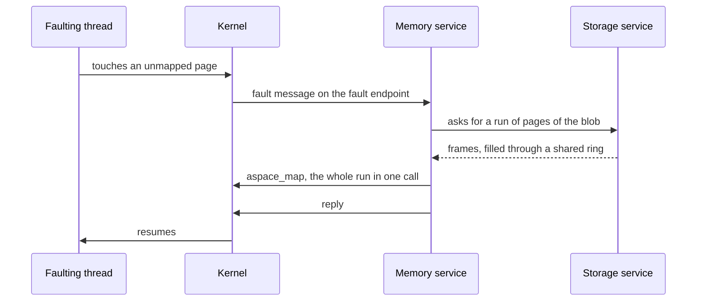
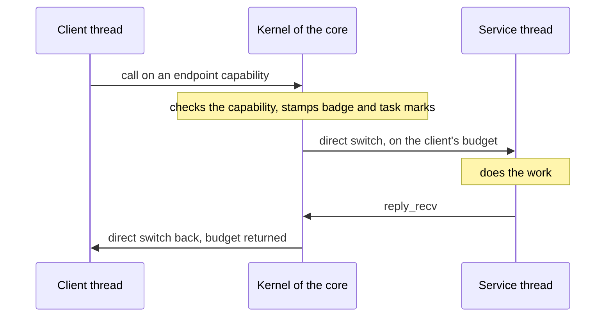
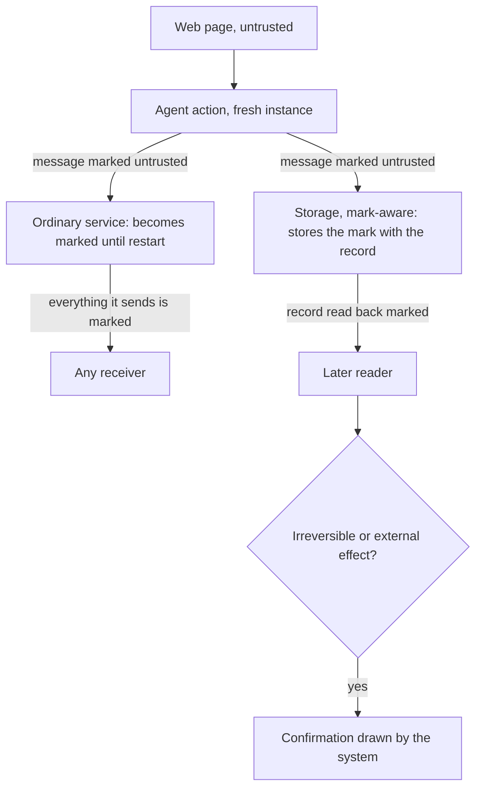

# Kernel interface

Statuses are defined in the [README](../README.md#status-legend).

**Decided, 14 November 2026**: validated by the two humans, except the sections that carry their own status. The numbers stay provisional. This file is the contract of the kernel: its objects, its system calls and the rules that bind them. It is written before any kernel code (**Decided**, 14 November 2026). The executable model, the oracle harness and the kernel are all written from it. Names and counts are provisional; the trials of weeks 1-2 and the one-core model will change them.

The kernel knows nothing about Wasm, WIT or components. The runtime and the services build those on top of this interface.

## Rules

1. **Everything is a capability.** A system call names its target by a slot in the caller's capability space. There is no global name and no ambient right.
2. **Any call can fail with `gone`.** A capability is revocable at any time (rule 1 of the [ABI](wasm-abi.md#abi-rules)).
3. **No kernel heap.** The memory of every object comes from an untyped capability supplied by the creator (see [memory.md](memory.md#kernel-memory)).
4. **Every call is bounded.** A long operation (revocation, deletion of a large object) runs in bounded steps and returns `again`; the caller repeats the call.
5. **A call never blocks the kernel.** The kernel has no per-thread stack. A thread that waits is a state of the thread, and the kernel returns to its scheduler.
6. **Calls enter through the kernel-supplied code page.** Call numbers are private to that page and can change between kernel versions.
7. **Objects belong to one core's kernel.** A call on an object held by another kernel becomes a message between kernels. The caller sees the same result, later.
8. **Data never crosses IPC.** IPC carries control. Data moves through shared memory objects (see [Data plane](#data-plane)).

## Objects

| Object | Role | Model |
|---|---|---|
| `untyped` | A range of physical memory, not yet typed. The only source of memory for other objects | seL4 |
| `cspace` | A table of capability slots. Flat, and grown by supplying memory (see [Slots and addresses](#slots-and-addresses)). Deliberately simpler than the guarded tables of seL4 | Project |
| `aspace` | An address space: page tables, built from supplied memory. One copy per core in the core group | seL4, CortenMM |
| `frame` | A run of physical pages of one size (4 KB, 2 MB, 1 GB). A frame capability records at most one mapping; mapping the same pages twice needs a derived capability | seL4 |
| `thread` | A register set, bound to a `cspace`, an `aspace` and a fault endpoint | seL4 |
| `sched` | A scheduling context: budget, period, deadline, core class, allowed cores | seL4 MCS |
| `endpoint` | A synchronous rendezvous point for call and reply. A derived capability carries a badge that identifies the caller | seL4 |
| `reply` | A one-shot right to answer one call. It returns the caller's budget | seL4 MCS |
| `notify` | A word of signal bits, asynchronous. Interrupts, timers and ring wake-ups arrive here | seL4 |
| `timer` | A deadline with a tolerance, which signals a `notify` | Project |
| `irq` | The right to receive one interrupt line or vector | seL4 |
| `ioports` | A range of x86 I/O ports (architecture layer only) | seL4 |
| `iospace` | An IOMMU domain: what a device can reach by DMA | seL4, Fuchsia BTI |
| `task` | An agent task: delegated rights, time budget, provenance marks, log. Revocable in one operation ([research axis 4](../research/prior-art.md#kernel-research-axes)) | Project |
| `core` | Control of one core's kernel: start, stop, replace, recover, status | Barrelfish/DC |
| `debug` | Console, trace buffer, crash record | Project |
| `vcpu` | Reserved name, not built. It exists only if the [micro-VM fallback](drivers.md#drivers-in-micro-vms-fallback) is opened | — |

Device memory (MMIO) is an `untyped` marked as device memory; it can only become a `frame` that is mapped, never a kernel object.

The **memory object** of [memory.md](memory.md#memory-objects) (sharing, copy on write, paging, compression) is not a kernel object. It is built by the memory service from frames (**Decided**, 14 November 2026, see [Memory outside the kernel](#memory-outside-the-kernel)).

## System calls

About 45 calls. All take capability slots and words. The calls of the one-core model are specified in [Call reference, one core](#call-reference-one-core).

| Group | Calls | Notes |
|---|---|---|
| Capabilities | `cap_derive`, `cap_move`, `cap_delete`, `cap_revoke`, `cap_inspect`, `cspace_grow` | `cap_derive` copies with fewer rights or with a badge. `cap_revoke` deletes everything derived from a capability; it is the distributed two-phase protocol between kernels, and it returns `again` |
| Memory | `untyped_retype`, `aspace_map`, `aspace_unmap`, `aspace_protect` | `aspace_map` accepts a run of frames and a page size, so one call maps a large block |
| IPC | `call`, `reply_recv`, `recv`, `send`, `signal`, `wait`, `poll`, `notify_bind` | `call` and `reply_recv` are the fast path. `send` never blocks and never queues. `recv` on an endpoint with a bound `notify` also returns notifications |
| Threads | `thread_configure`, `thread_read_regs`, `thread_write_regs`, `thread_resume`, `thread_suspend`, `yield` | |
| Scheduling | `sched_configure`, `sched_bind`, `sched_unbind`, `sched_set_cores` | Admission control is in `sched_configure`. `sched_set_cores` is reserved to the placement service |
| Time | `timer_set`, `timer_cancel` | The monotonic clock is read from a shared page, without a call |
| Interrupts and devices | `irq_bind`, `irq_ack`, `iospace_map`, `iospace_unmap`, `iospace_attach` | |
| Tasks | `task_create`, `task_attach`, `task_mark`, `task_revoke`, `task_read` | See [Tasks and provenance](#tasks-and-provenance) |
| Cores | `core_start`, `core_stop`, `core_status` | Replacement and recovery are `core_stop` followed by `core_start` with a kernel image |
| Debug | `debug_write`, `trace_emit` | Present in every build; the capability decides who may call them |

Faults are not calls. A page fault, an illegal instruction or a budget overrun becomes a message on the thread's fault endpoint; the handler answers through the `reply` object.

## Call reference, one core

**Decided, 14 November 2026** (D-099): settled by the assistant at the user's request, from the gaps that two independent first models reported (27 by Gemini 4 Hydrogen, 29 by Mistral Large 4); re-read by the two humans. Revised twice the same day (D-100, D-101) after the reference model written from it showed mistakes; the rule against cycles was wrong twice before its present form. It covers the calls of the one-core model: capabilities, object creation, threads, IPC and notifications. The other groups are specified when their model is written. The points marked **(design choice)** are the ones where another answer was reasonable.

### Slots and addresses

- A **slot address** is a 64-bit word: the low 32 bits are an index, the high 32 bits are `via`. With `via` = 0 the index is in the caller's own capability space. Otherwise `via` is the index, in the caller's own space, of a `cspace` capability, and the index is in that space. There is one level of indirection, never more.
- **Slot 0 of every capability space is never used.** Address 0 therefore means "no capability" wherever an argument is optional.
- A slot is **empty**, **full** or **dead**. A slot becomes dead when its capability is removed by someone else (revocation, or the destruction of what it was derived from). Using a dead slot returns `gone`; using an empty slot returns `invalid`. `cap_delete` on a dead slot makes it empty. A dead slot is not free: nothing can be placed in it. This is what keeps a stale index from silently naming a new object.
- A thread needs no right to use its own capability space. Through a `cspace` capability, reading a slot (as the source of `cap_derive` or `cap_inspect`, or as the target of a call) needs `read`, and changing a slot (placing, moving out, deleting, revoking) needs `write`.
- A `cspace` is created with a maximum number of slots (a non-zero multiple of 128, at most 2^20, provisional: creating the space clears its directory in one call, so the directory is bounded, here to 64 KB), which fixes the size of its directory (8 bytes per 128 slots, rounded up to a power of two), and with no slot. `cspace_grow` adds one segment of 128 slots (4 KB). Slot indexes never change. **(design choice)**
- **A `cspace` grows only from the untyped it was created from.** Any capability for that untyped object is accepted. Its segments then die with it and with that untyped, and no object depends on two untypeds. The creator of a process gives it one untyped for all its kernel objects.
- A destination that is slot 0 or beyond the table is `invalid`.

### The derivation tree

- Every capability has one parent, except the capabilities given at start-up, each of which is the root capability of its object. `untyped_retype` makes the new capability a child of the untyped capability. `cap_derive` makes the new capability a child of its source. There is no separate "copy": a copy is a derivation with the same rights.
- **A capability never outlives the capability it was derived from.** `cap_revoke` removes all the descendants of a capability and keeps the capability. `cap_delete` removes the descendants, then the capability. **(design choice: the alternative, as in seL4, hands the children to the grandparent)**
- **An object lives exactly as long as the capability that `untyped_retype` returned for it** (its root capability), wherever that capability has been moved. There is no reference count. When the root capability is removed the object is destroyed and its memory goes back to the untyped it came from.
- `cap_move` moves a capability to an empty slot. Its place in the tree, its rights and its badge do not change.
- **The tree is at most 64 deep** (provisional): a start-up capability is at depth 1, and a derivation or a creation that would go deeper is `invalid` (checked with the plain arguments). With the next rule, the limit bounds the walk that finds the next capability to remove.
- **A capability space holds only what is deeper than itself (design choice, D-103).** The root capability of another capability space can be placed in a capability space only if its depth is greater than the depth of the root capability of that space. An `untyped` capability (a root or a copy) can be placed there only if its depth is not smaller. Otherwise the call is `invalid`, checked with the plain arguments. The check is one comparison of two depths. It applies every time such a capability is placed in a slot: `cap_move`, `cap_derive`, `untyped_retype` and a capability moved or derived by IPC; for IPC the destination is known only at delivery, so a refusal there drops the capabilities.
  - Why: removing a capability removes first what was derived from it and, for the root of a space, what the space holds. Call *restricted* the `untyped` capabilities and the roots of spaces; the others are *ordinary*. The walk goes from a capability to one derived from it (the depth grows by one), or from the root of a space to a capability the space holds. From the root of a space to a root it holds the depth grows; to an `untyped` it holds the depth does not shrink, and the next move from an `untyped` is a derivation, since an `untyped` is not the root of a space. So while the walk is on restricted capabilities the depth never shrinks and stays equal at most once per level: at most 128 capabilities. Once the walk reaches an ordinary capability it stays on ordinary ones, because everything derived from an ordinary capability is a copy, and a copy is the root of nothing: at most 64 more. So no capability can depend on itself, and the walk is at most 192 capabilities long. The first rule ("not into a space that descends from it") missed two spaces that hold each other's root; the second (creation numbers, D-101) prevented loops but did not bound the walk: any number of spaces at the same depth could be nested.
  - Consequence: to hand memory to a space, its creator makes a child `untyped` of the `untyped` the space came from and hands that; it keeps the parent, and with it the right to take everything back. A space cannot hold the capability its own memory was taken through; it can hold a copy of it, and so grow itself. A new space, for example a restarted supervisor, can take over the roots of spaces that are deeper than itself.
  - Known costs of the rule: the start-up `untyped` capabilities never leave the start-up space, so a memory service in its own space holds only children of them; each layer of spaces that create spaces uses one of the 64 levels; two spaces at the same depth cannot hold each other's root in either direction, so a space that must supervise a sibling is given a copy, or the sibling is created from a deeper `untyped`.
  - A space may hold its own root capability, as the start-up space does; it is removed last. The start-up space was created from no untyped: its size is fixed by the boot image and it never grows.
- A derived capability has a subset of its parent's rights. A capability made by `untyped_retype` does not: it gets the rights of its kind, whatever the rights of the untyped.
- Removal runs in bounded steps: per call, at most 32 capabilities are removed or threads woken and at most 128 slots of dying capability spaces are examined (both provisional), and the call returns `again` while work remains. Segments that were never added hold no slot and are not examined. The order is fixed: the most recently derived child first, and a capability only after all its descendants. Between two steps the tree is well formed.
- **Removal ends.** A capability under `cap_delete` is dying from the first step: any other use of it returns `gone`. An object is dying from the first step of a removal that reaches its root capability, even when that step only removes a copy: every call on it, through any capability, returns `gone`, so its queues only shrink. A capability that is on the path of a removal but is not the root of its object keeps working until it is removed; this difference is wanted, because marking one object is one write and marking a subtree is not bounded. A thread whose capability space is dying gets `gone` from every call except `cap_delete` on its own slots (a slot address through a capability for a dying space is `gone` as any use of a dying object), and a delivery to a receiver whose receive range is in a dying or destroyed space drops the capabilities (the words are still delivered), so a dying space only shrinks. A server whose space is dying can therefore no longer answer: its callers get `gone` when its reply objects are destroyed. The step that marks a reply object as dying also wakes, with `gone`, the receiver attached to it or the caller that waits for an answer through it (one thread: a reply object is attached or armed, never both), so no caller can meet a waiting receiver whose reply object is dying. This wake is not counted in the 32 of a step: a walk passes through at most one reply object, because below the root of a reply object there are only copies. `cap_delete` on a capability whose object is dying works as on any other: it acts on the slot, not on the object.
- One limit is accepted: while `cap_revoke` runs, threads that hold capabilities under it can still derive new ones. Each call removes 32 capabilities against at most four new capabilities per competing call (a message), and a supervisor that wants a certain end suspends those threads first.
- Destroying an object wakes every thread that waits on it, with `gone`. This includes the thread that waits to receive with a reply object, and the caller that waits for an answer through it. A caller is not woken when the server thread alone is destroyed: the reply object is the handle, and another thread can still answer through it. Destroying a `cspace` first removes every capability in it, in index order, by the same steps; the dying space keeps the index where the sweep stands, and a slot examined once is not examined again. `cap_revoke` on the root capability of a space does not sweep the space: it removes only what was derived from the root. A thread whose capability space is dying gets `gone` from every call except `cap_delete`; once the space is destroyed, from every call.
- **Rights are checked when a call is made.** A thread that already waits is not disturbed when the capability it used is revoked; it is woken with `gone` only when the object itself is destroyed. **(design choice: waking it would need an unbounded search of the wait queues)**

### Order of checks

Every call checks in this order and returns the first failure:

1. the capability the call acts on: its slot (`invalid` if empty or out of range, `gone` if dead), its kind (`invalid`), its rights (`denied`);
2. the other capability arguments, in the order of the table below, with the same three checks. One exception: a message header is read right after the capability the call acts on, because it says how many capabilities the message lists; a header beyond the limits, or with a flag bit set by the sender, is `invalid` before any other capability argument is looked at;
3. the plain arguments, in the order of the table (`invalid`); for `untyped_retype` the kind is judged before the size argument;
4. the state: `busy`, `no_slot` (the destination slot is not empty), `no_memory`, `would_wait`.

### Capabilities and objects

| Call | Arguments | Result | Rights and rules |
|---|---|---|---|
| `cap_derive` | source, destination, rights, badge | | `derive` on the source. The new rights must be a subset of the source's (`denied` otherwise, checked with the plain arguments, so after the destination). A badge is accepted only on an `endpoint` or a `notify` (`invalid` otherwise). A capability that already has a badge keeps it: asking for another one is `denied` (checked with the plain arguments); asking for the same one is accepted. Badge 0 means no badge |
| `cap_move` | source, destination | | No right on the capability itself |
| `cap_delete` | slot | | No right on the capability itself. Returns `again` while descendants remain |
| `cap_revoke` | slot | | No right on the capability itself. Returns `again` while descendants remain |
| `cap_inspect` | slot | kind, rights, badge | No right on the capability itself |
| `untyped_retype` | untyped, kind, size argument, destination | | `write` on the untyped. One object per call. The size argument is: bytes for a child `untyped` (a power of two, at least 4 KB), the page size and the number of pages for a `frame`, the maximum number of slots for a `cspace` (at most 2^20), and 0 for the other kinds. A size that does not fit in 64 bits is `invalid`. Device memory can only become a `frame` or a child `untyped` (`invalid` otherwise) |
| `cspace_grow` | cspace, untyped | new number of slots | `manage` on the cspace, `write` on the untyped, which must be the one the cspace was created from (`invalid`). `no_slot` when the maximum is reached |

Rules of `untyped_retype`:

- Memory is taken at a watermark that only moves up while an object made from the untyped lives. When the last one is destroyed the watermark returns to the start: this is the only moment the memory becomes usable again (as in seL4). Object sizes are powers of two. The watermark is aligned on the size of a child `untyped`, on the page size for a frame, and for the other objects on their size, or on 4 KB if they are larger.
- The new capability has every right, with one exception: it has `exec` only if the untyped capability has `exec`, and never on device memory. This is how the right to make executable frames stays with the compile service.
- The kernel clears the memory of kernel objects. It does not clear frames: the holder of an untyped already has authority over that memory, and the memory service clears pages before it hands them out. **(design choice)**

### Threads

A new thread is suspended and bound to nothing.

| Call | Arguments | Rights and rules |
|---|---|---|
| `thread_configure` | thread, cspace, aspace, fault endpoint | `manage` on the thread, `manage` on the cspace and on the aspace, `send` on the fault endpoint. The aspace and the fault endpoint may be 0. The thread must be suspended and must not wait (`busy` otherwise): a wait holds a receive range of the old capability space |
| `thread_resume`, `thread_suspend` | thread | `manage`. Both succeed when the thread is already in the state asked for. `thread_resume` is `busy` if the thread is bound to no capability space, or to one that is destroyed; a thread bound to a dying space can be resumed |
| `thread_read_regs`, `thread_write_regs` | thread, register block | `read`, respectively `write`. The thread must be suspended (`busy`). The register block is defined by the architecture layer; it is not part of the one-core model |

**Suspension and waiting are independent (design choice).** Suspending a thread that waits cancels nothing: the thread keeps its place in its queue, a message can still be delivered to it, and it runs again only when it is resumed. A waiting thread is removed from its queue only when it, or the object it waits on, is destroyed.

### IPC

A thread is in one of these states: ready, waiting to be received (after `call`, in the queue of an endpoint), waiting for a reply, waiting to receive, waiting on a notification.

The `reply` object is supplied by the server, because the kernel has no memory of its own (rule 3). It is **idle**, **attached** to a thread that waits to receive, or **armed** with one caller.

| Call | Arguments | Result | Rights and rules |
|---|---|---|---|
| `call` | endpoint, message, receive range | the reply | `send`, and `grant` if the message lists capabilities. If a thread waits to receive, the message is delivered, that thread's reply object is armed with the caller, and the caller waits for the reply. Otherwise the caller joins the queue of the endpoint, first in, first out |
| `recv` | endpoint, reply object, receive range | a message, or a notification | `recv` on the endpoint, `recv` on the reply object, which must be idle (`busy`). In order: a pending notification of the bound `notify`; the first caller in the queue; otherwise the thread waits, with the reply object attached |
| `reply_recv` | reply object, message, endpoint, receive range | as `recv` | `send` on the reply object, then as `recv` with the same reply object, which may here be armed or idle (attached to another thread is `busy`). If the reply object is not armed, the reply is dropped without an error and the receive goes on |
| `send` | endpoint or reply object, message | | `send`, and `grant` if the message lists capabilities. On an endpoint: delivered only if a thread waits to receive, otherwise `would_wait`; nothing is queued. On a reply object: answers the caller and makes the object idle; `would_wait` if it is not armed |

- **`send` on a reply object is the way to answer without receiving** (a server that answers later, from several reply objects). There is no separate `reply` call.
- **`send` never queues (design choice).** A queue of messages would need kernel memory. The queue of callers needs none: each waiting thread is linked through its own thread object, and its message stays in its own message page. Threads that wait on the same object are served first in, first out. A sender that must not lose a message uses `call`, or a ring with a `notify`.
- The receiver gets the header, the words, and what the kernel sets: the badge of the capability the sender used, the marks and the identifier of the sender's task. A reply carries badge 0.
- When a caller disappears while its request is being served, the reply object becomes idle.

### Transfer of capabilities

This fixes the details of the [capability transfer](#capability-transfer) described under Messages.

- The message lists up to 4 slot addresses, each as *move* or as *derive* with a set of rights. A derived capability is a child of the sender's capability and keeps its badge.
- **Checked when the call is made**, as in [Order of checks](#order-of-checks): each listed slot, `derive` on each capability to derive, and `grant` on the endpoint or reply object. A failure returns an error and sends nothing.
- **Checked again at delivery**, against what the listed slots hold at that moment: the same checks as when the call was made, and the first slots of the receiver's range are empty, one per capability. The kernel does not remember which capability was in a slot while the caller waited; a thread that shares its capability space answers for it. If not, no capability moves, the words are still delivered, and the header the receiver sees has the flag `caps_dropped` and a capability count of 0.
- The sender learns it: `send` returns the flag at once; for `call`, the kernel sets the flag in the header of the reply. The flag in a reply header therefore means that the capabilities of the request or of the reply were dropped. A server that answers with `reply_recv` is not told that the capabilities of its reply were dropped.
- A slot listed twice in one message is `invalid`. This, and the depth of a capability to derive, are checked with the slot, before the next listed slot.
- The receive range (first slot address and count, at most 4) is given with `call`, `recv` and `reply_recv`. An empty range refuses every capability, and its address is not looked at. A range with a slot that is slot 0 or beyond the table is `invalid` when the call is made, as any destination; that the slots are empty is checked only at delivery.

### Notifications

| Call | Arguments | Result | Rights and rules |
|---|---|---|---|
| `signal` | notify | | `send`. Sets in the word the bits of the capability's badge, or bit 0 if it has no badge. If a thread waits, the first one is woken with the whole word and the word is cleared |
| `wait` | notify | the word | `recv`. Returns the word and clears it, or waits if it is zero |
| `poll` | notify | the word | `recv`. As `wait`, but returns `would_wait` if the word is zero |
| `notify_bind` | notify, endpoint | | `recv` on the notify, `manage` on the endpoint. Endpoint 0 removes the binding, and succeeds if there is none. One notify per endpoint and one endpoint per notify (`busy` otherwise, also for the pair that is already bound). If the word is not zero and a thread already waits to receive on the endpoint, the notification is delivered at once |

- **A bound notify is how one thread serves both requests and interrupts (design choice).** `recv` and `reply_recv` on the endpoint return a pending notification before any caller: the header has the flag `notification`, the badge field holds the word, and the word is cleared. A `signal` on a bound notify wakes the first thread that waits to receive on the endpoint, if no thread waits on the notify itself; that thread's reply object becomes idle.
- `wait` and `poll` take a `notify` only, never an endpoint.
- One thread is woken per `signal`, not all: the bits are consumed once.

### Registers

The table above fixes the arguments and results of each call. Which register or which field of the message page carries each one is defined by the architecture layer and published in the kernel-supplied code page (rule 6). It is not part of this contract.

## Memory outside the kernel

**Decided, 14 November 2026.** The kernel knows frames and mappings, nothing else. A single memory service in user space owns the policy for every core, so memory moves between the per-core kernels by one decision in one place. Memory that is already mapped costs nothing more. The extra cost is on faults only: one IPC round trip to the memory service instead of a path inside the kernel.

Why this stays cheap here:

- **No lazy anonymous memory.** Memory is accounted at reservation, without overcommit (see [memory.md](memory.md#budget-without-overcommit)). The memory service therefore maps a reservation at once, in large pages, from a pool of pages zeroed in advance. The first touch of a page, the most frequent fault on Linux, does not exist.
- **Blobs** are mapped whole or by runs (see [Pager](#pager)).
- **Remaining faults** are those that already wait for something slow: decompression, disk, copy on write.

A page fault on a blob that is not yet in memory:

Gate: the cost of one fault resolved from memory already present, against the same fault on Linux (see [gates](../plan/gates.md#overhead-gates)). If the gate fails, the fall-back is a small in-kernel table for one case, not a full memory object.

## Messages

**Proposed, 14 November 2026.**

A message is a header word, message words, and optionally capabilities.

| Part | Content |
|---|---|
| Header | Label (32 bits, opaque to the kernel: the method), number of words, number of capabilities, flags |
| Words in registers | 6 on x86-64. A message that fits here and carries no capability takes the fast path |
| Words in the message page | Up to 64 in all. Each thread has one page shared with the kernel for this |
| Capabilities | Up to 4 per message |

Larger data never goes in a message: the sender shares frames (rule 8).

The receiver gets, with the message and set by the kernel:

- the **badge** of the endpoint capability the sender used, which identifies the sender;
- the **marks** of the sender's task (64 bits; bit 0 private, bit 1 untrusted, the others reserved);
- the **task identifier**, for the log.

### Capability transfer

- The sender lists slots in its message page, each one as *move* or *derive* (with reduced rights). It needs the `grant` right on the endpoint.
- The receiver declares a range of empty slots before it waits.
- Transfer is all or nothing. If the receiver has too few slots, no capability moves; the receiver sees the flag `caps_dropped` and the caller is told in the reply. The details are in the [call reference](#transfer-of-capabilities).
- A derived capability stays in the sender's derivation tree, so the sender, or its task, can revoke it.
- Between cores, the transfer is recorded on both kernels before either side uses it (the [memory ownership invariant](kernel.md#multi-core-structure)).

## Rights

A capability carries a set of rights. `cap_derive` can only remove rights.

| Right | Meaning |
|---|---|
| `read`, `write` | Map a frame readable or writable; read or change an object's state |
| `exec` | Map a frame executable. Only the compile service receives frames with this right ([research axis 5](../research/prior-art.md#kernel-research-axes)) |
| `send` | Call or send on an endpoint; signal a notification |
| `recv` | Receive on an endpoint; wait on a notification |
| `grant` | Transfer capabilities through an endpoint |
| `derive` | Derive further capabilities from this one |
| `manage` | Configure the object (bind, set parameters, attach to a task) |

## Errors

A fixed, small set. Every caller handles `gone` and `again`.

| Code | Meaning |
|---|---|
| `ok` | |
| `gone` | The capability was revoked or the object deleted, possibly because its kernel was reloaded |
| `again` | A bounded step was done; repeat the call |
| `denied` | A right is missing |
| `invalid` | Bad slot, wrong object type or bad argument |
| `no_memory` | The supplied untyped memory is exhausted; supply more and repeat |
| `no_slot` | The destination slot is not empty, or the capability space is at its maximum |
| `busy` | The object is in a state that forbids the call |
| `budget` | Admission refused: the scheduling budgets exceed the period |
| `would_wait` | A non-blocking call found nothing |
| `unsupported` | Not available on this architecture or kernel version |

## Object sizes

Provisional. Sizes are fixed per kernel version and published in the kernel-supplied code page; user space never hard-codes them.

| Object | Size |
|---|---|
| Capability slot | 32 bytes (object, rights, badge, links of the derivation tree) |
| `endpoint`, `notify`, `reply`, `timer`, `irq` | 64 bytes |
| `sched` | 128 bytes |
| `task` | 256 bytes |
| `thread` | 1 KB, plus the vector state area, whose size depends on the processor |
| `aspace`, `iospace` | One root table (4 KB); lower tables are taken from supplied memory as mappings need them |
| `cspace` | 32 bytes per slot, grown by supplying memory, plus the directory (8 bytes per 128 slots of the maximum) |
| `frame` | No object: the capability slot holds the mapping record |

## Start-up information

**Proposed, 14 November 2026.** The kernel of the boot core starts one process, the first service of the boot image, and gives it everything. No other authority exists in the system.

Capabilities, in fixed slots (slot 0 is never used; 1 its `cspace`, 2 its `aspace`, 3 its `thread`, 4 its `sched`, 5 `debug`; the others start at slot 16 and the start-up page gives the slot of each one):

- its own `cspace`, `aspace`, `thread` and `sched`;
- every `untyped`, ordinary and device;
- one `core` capability per core; the other cores are stopped;
- the control capabilities for interrupts, I/O ports and IOMMU domains;
- the `debug` capability;
- the frames of the boot image.

A start-up page, versioned, with a table of entries (kind, offset, length):

- interface version and object sizes;
- the list of `untyped` ranges (address, size, device or not);
- the core list, with the class of each core;
- firmware tables (ACPI root pointer, UEFI memory map, framebuffer);
- an entropy seed;
- the time stamps of the boot so far, for the [boot gates](../plan/gates.md#boot-and-shutdown);
- the crash record of the previous boot, if there is one.

## Synchronous or asynchronous

**Proposed; each line is to be measured** (request of the user, 14 November 2026).

| Path | Form | Reason | Cost to watch |
|---|---|---|---|
| IPC on the same core | Synchronous: `call` switches directly to the server thread, which runs on the caller's budget | No queue, no scheduler pass, no wake-up. This is the path of the gate "under 1.2 times seL4" | A slow server holds its caller |
| IPC to another core | Asynchronous inside the kernel: a message between kernels, and the caller thread waits | Kernels share no state | Two inter-kernel messages and an interrupt. The placement service avoids it: a service has a thread on the caller's core, or the caller moves |
| Notification | Asynchronous: bits are set, with no payload | Interrupts, timers and wake-ups must never wait for a receiver | Bits merge, so a notification says "look", not "how many" |
| Fault | Synchronous message to the handler | The faulting thread cannot continue anyway | One IPC round trip per fault; see [Pager](#pager) |
| Data plane | No kernel entry on the common path | Rings in shared memory | A `signal` only when a ring goes from empty to non-empty |
| Long operation (revocation, teardown) | Bounded steps with `again` | A bounded kernel cannot loop | The caller's latency. Other threads are not delayed |
| Call between components (WIT, WASI 0.3) | Asynchronous in its type, synchronous in its execution when the callee finishes without waiting | Short calls must cost a plain IPC | The measured overhead of the asynchronous form (3.5 times, see [gates](../plan/gates.md#overhead-gates)) must apply only to calls that really wait |

A call on one core, from a client to a service and back:

What is measured, in the trials of weeks 1-2 and then at each merge:

- round trip of `call` on one core, against seL4 MCS;
- round trip of a call between two cores;
- latency from `signal` to the wake-up of the waiting thread;
- a short WIT call in its synchronous execution against its asynchronous execution;
- throughput and tail latency of a ring, with and without wake-ups.

A blocking system call (wait in the kernel with a kernel stack) is rejected: it contradicts rule 5 and hot replacement.

## Data plane

**Decided, 14 November 2026.** Data never crosses IPC. Disk blocks, network packets, audio frames and display buffers move through single-producer single-consumer rings in shared frames (model of sDDF; see [drivers.md](drivers.md#driver-framework)). IPC sets the rings up, and a `notify` wakes a side that sleeps.

A gate counts the kernel entries per unit of work: per displayed frame, per disk read, per network packet (see [gates](../plan/gates.md#overhead-gates)).

## Pager

**Decided, 14 November 2026.** Paging stays in user space (see [memory.md](memory.md#paging-in-user-space)), with two rules that keep its cost bounded:

- **Read-ahead.** A fault is answered with a run of pages, not with one page. The pager chooses the run and maps it in one `aspace_map`.
- **Large mappings.** A blob that is mapped whole (compiled code, model weights) is supplied in one call, in 2 MB pages where its size allows.

A gate is added: faults per megabyte read on a cold sequential read.

## Tasks and provenance

**Proposed.** The task is the project's own kernel object.

- `task_create` makes a task from a time budget and a set of marks (private, untrusted; see [agent.md](agent.md)).
- `task_attach` places a capability or a thread under a task. Everything derived from it stays under the task.
- The kernel stamps every IPC message with the sender's task marks. The receiver reads them; it cannot forge them. This is [research axis 1](../research/prior-art.md#kernel-research-axes).
- `task_mark` only adds marks. A task that has read untrusted data stays marked.
- `task_revoke` removes every right of the task in one operation. It is `cap_revoke` on the root of the task, so it uses the same distributed protocol.

### Marks and services

**Proposed, 14 November 2026.** A service could keep data from a marked call and hand it to an unmarked caller, which would lose the mark. The rule:

- **Sticky by default.** A process that receives a marked message takes the marks, and keeps them until it is restarted. Everything it sends is marked. Marks only ever add, so the default cannot lose one.
- **Mark-aware services.** A short list of system services (storage, network, clipboard, compositor) hold a capability that turns this off. For them the marks follow the call, like the budget, and the service stores the marks with the data: a record written by a marked call is read back marked. Each one is part of the trusted base and has its own attack test.
- **Applications** are not concerned: an agent action runs in a fresh instance (see [agent.md](agent.md)).

How a mark travels:

Known limit, as in every information-flow system: timing and other covert channels are not covered.

## Power states

**Decided, 14 November 2026.** Sleep is part of the interface from the first version, not an addition.

- The kernel offers per-core idle and stop (`core_stop`), and a whole-machine suspend entered by the power service once every driver has answered.
- Every driver class interface carries `suspend` and `resume`, and a driver declares the device states it supports. A driver that does not resume is restarted (see [drivers.md](drivers.md#restart-of-a-driver)).

## Debugging

**Decided, 14 November 2026.** Debugging comes before features. In order, at the very start of the kernel track:

1. serial console, on QEMU and on the reference desktop;
2. a remote debugger stub in the kernel (gdb protocol);
3. a trace buffer per core, readable after a panic;
4. a crash record written to the reserved area (see [storage.md](storage.md#partitions)).

A small native shell and a few tools (list capabilities, read memory, start and stop a thread, read traces) are ported as soon as the kernel starts a first process. They are native programs, outside the Wasm runtime, and they stay in the rescue image.

Agents drive the same tools: QEMU's console and monitor and the debugger stub are all text. No trial is needed: agents already worked through a virtual machine in the user's earlier kernel benchmarks.

## Architectures

**Proposed, 14 November 2026.** The source layout follows seL4: one directory per architecture and one per platform, chosen at build time, with no run-time abstraction layer. The interface does not follow seL4 on one point: seL4 exposes architecture-specific objects (page-table levels, per-architecture calls), while this interface is the same on every architecture. The kernel builds page tables itself, from supplied memory, behind `aspace_map`. The only architecture-specific object is `ioports`.

The kernel needs only a timer, an interrupt controller and a serial port from the platform. Everything else (ACPI or device tree, buses) is discovered in user space, so that one image serves a whole architecture rather than one board.

## Language split

**Estimate, to be replaced by a count after the trials.** For x86-64, about 30 % of the kernel's lines in Zig and 70 % in Rust.

| Zig | Rust |
|---|---|
| Boot and platform bring-up; entry and exit; context switch and vector state; page-table primitives and TLB; interrupt controller and timers; the IPC fast path; the rings between kernels; the low part of the debugger stub | Capabilities and the derivation tree; revocation; object life cycle; scheduling policy and admission; memory objects; the IPC slow path; the inter-kernel protocol; tasks and marks; recovery logic |

The Zig part is the architecture layer plus the fast path, so it is rewritten for each new architecture; the Rust part is not. The fast path is checked by the equivalence test against the Rust slow path (see [verification.md](../plan/verification.md#kernel-verification)).

## Open points

- Message words in registers once APX is available (see [kernel.md](kernel.md#hardware-features)).
- Whether a slot number is stable across a suspend.
- The step bound of removal (32) and the segment size of a `cspace` (128 slots), to fix by measurement.
- The cost of a fault handled by the memory service, to measure against a fault handled in the kernel (see [Memory outside the kernel](#memory-outside-the-kernel)).
- Copy on write in the memory service: in version 1, or with the snapshot work.
- The spread of sticky marks in practice: how many services end up marked during normal use, measured on the injection attack suite.
- The numbers of this draft (message words, sizes, slot counts), to fix after the one-core model.
- User interrupts as a second wake-up path (see [kernel.md](kernel.md#hardware-features)).
