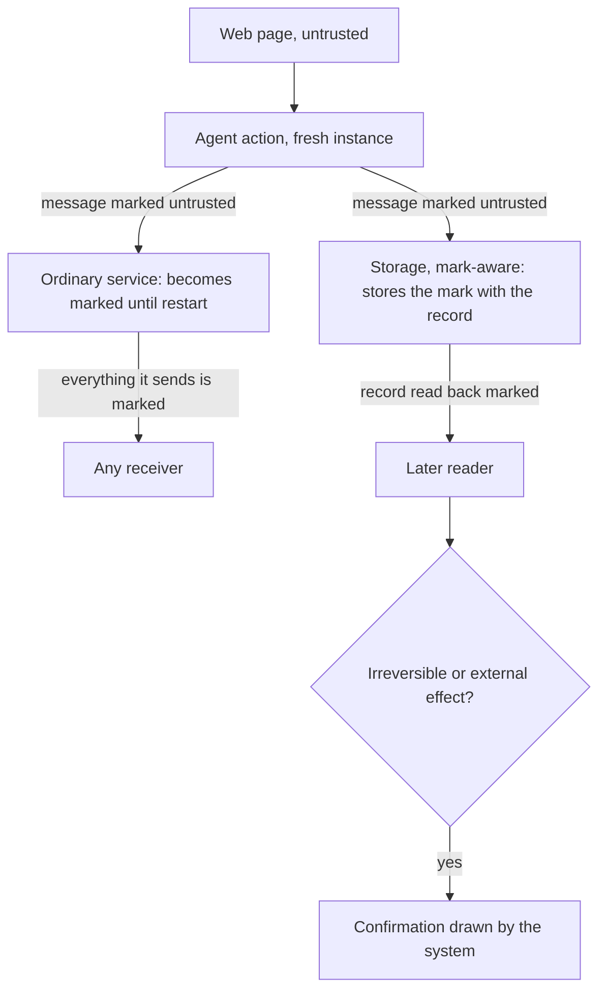
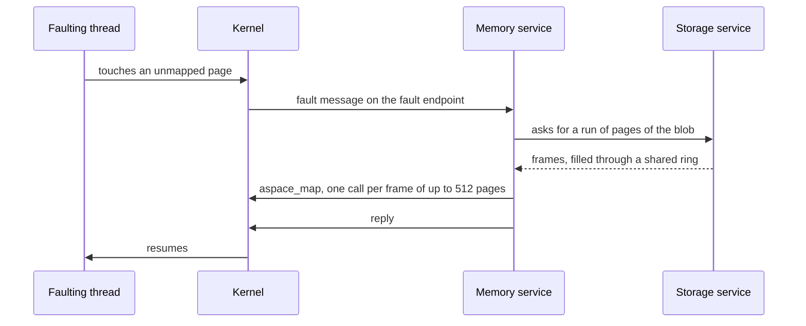
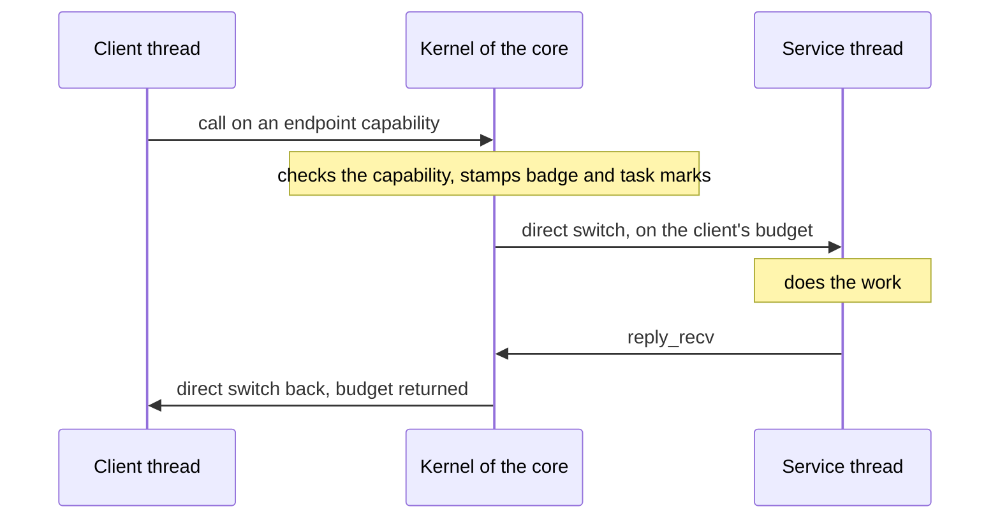

# Kernel interface

Statuses are defined in the [README](../README.md#status-legend).

**Decided, 14 November 2026**: validated by the two humans, except the sections that carry their own status. The numbers stay provisional. This file is the contract of the kernel: its objects, its system calls and the rules that bind them. It is written before any kernel code (**Decided**, 14 November 2026). The executable model, the oracle harness and the kernel are all written from it. Names and counts are provisional; the trials of weeks 1-2 and the one-core model will change them.

The kernel knows nothing about Wasm, WIT or components. The runtime and the services build those on top of this interface.

## Rules

1. **Everything is a capability.** A system call names its target by a slot in the caller's capability space. There is no global name and no ambient right.
2. **Any call can fail with `gone`.** A capability is revocable at any time (rule 1 of the [ABI](wasm-abi.md#abi-rules)).
3. **No kernel memory that grows at run time.** The memory of every object comes from an untyped capability supplied by the creator (see [memory.md](memory.md#kernel-memory)). The only exceptions are fixed when a node starts and never grow (D-110): the start-up objects, which are made from no untyped; the interrupt table of each node and its `irq_control`; the interrupt remapping table; the tables of the IOMMU units and their `iommu` objects; the clock page. Besides these, the kernel holds only its image, its stacks and the block of each node (see [Start-up state](#start-up-state)).
4. **Every call is bounded.** A long operation (revocation, deletion of a large object, clearing of memory) runs in bounded steps and returns `again`; the caller repeats the call.
5. **A call never blocks the kernel.** The kernel has no per-thread stack. A thread that waits is a state of the thread, and the kernel returns to its scheduler.
6. **Calls enter through the kernel-supplied code page.** Call numbers are private to that page and can change between kernel versions.
7. **Objects belong to one core's kernel.** A call on an object held by another kernel becomes a message between kernels. The caller sees the same result, later.
8. **Data never crosses IPC.** IPC carries control. Data moves through shared memory objects (see [Data plane](#data-plane)).

## Objects

| Object | Role | Model |
|---|---|---|
| `untyped` | A range of physical memory, not yet typed. The only source of memory for other objects | seL4 |
| `cspace` | A table of capability slots. Flat, and grown by supplying memory (see [Slots and addresses](#slots-and-addresses)). Deliberately simpler than the guarded tables of seL4 | Project |
| `aspace` | An address space: page tables, built from supplied memory. One copy per core in the core group | seL4, CortenMM |
| `frame` | A run of 1 to 512 physical pages of one size (4 KB, 2 MB, 1 GB), with a memory type. A frame capability records at most one mapping; mapping the same pages twice needs a derived capability | seL4 |
| `thread` | A register set, bound to a `cspace`, an `aspace`, a fault endpoint, a message page, a `task` and a `sched` | seL4 |
| `sched` | A scheduling context: budget, period, class, allowed cores; its current deadline and remaining budget | seL4 MCS |
| `endpoint` | A synchronous rendezvous point for call and reply. A derived capability carries a badge that identifies the caller | seL4 |
| `reply` | A one-shot right to answer one call. It carries the lend of the caller's scheduling context to a passive server | seL4 MCS |
| `notify` | A word of signal bits, asynchronous. Interrupts, timers and ring wake-ups arrive here | seL4 |
| `timer` | A deadline with a tolerance, which signals a `notify` | Project |
| `irq` | One vector of one core, bound to one interrupt source; an entry of the node's interrupt table | seL4 |
| `irq_control` | The authority to claim the vectors of one node | seL4 |
| `ioports` | A range of x86 I/O ports (architecture layer only) | seL4 |
| `iospace` | An IOMMU domain: what a device can reach by DMA | seL4, Fuchsia BTI |
| `iommu` | One IOMMU unit, made by the kernel at start. With `manage`, attaches devices of that unit to an `iospace` | Project |
| `task` | The unit of provenance and of stopping: identifier, marks, attached threads. Stopped in one operation ([research axis 4](../research/prior-art.md#kernel-research-axes)) | Project |
| `core` | Control of one core's kernel: start, stop, replace, recover, status; with `write`, the right to configure scheduling contexts on that core | Barrelfish/DC, seL4 MCS |
| `debug` | Console, trace buffer, crash record | Project |
| `vcpu` | Reserved name and number (16), not built. It exists only if the [micro-VM fallback](drivers.md#drivers-in-micro-vms-fallback) is opened | — |

Device memory (MMIO) is an `untyped` marked as device memory; it can only become a `frame` that is mapped, or a child `untyped`, never a kernel object. The registers of the interrupt controllers and of the IOMMU units, and of any other device the kernel drives itself, are in no device untyped.

The **memory object** of [memory.md](memory.md#memory-objects) (sharing, copy on write, paging, compression) is not a kernel object. It is built by the memory service from frames (**Decided**, 14 November 2026, see [Memory outside the kernel](#memory-outside-the-kernel)).

## System calls

48 calls. All take capability slots and words. Every call is specified in the [Call reference](#call-reference), except those of the groups not yet specified (cores, debugging).

| Group | Calls | Notes |
|---|---|---|
| Capabilities | `cap_derive`, `cap_move`, `cap_delete`, `cap_revoke`, `cap_inspect`, `cspace_grow` | `cap_derive` copies with fewer rights or with a badge. `cap_revoke` deletes everything derived from a capability; it is the distributed two-phase protocol between kernels, and it returns `again` |
| Memory | `untyped_retype`, `aspace_map`, `aspace_unmap`, `aspace_protect` | `aspace_map` maps up to 512 pages of one frame, so one call maps up to 2 MB, 1 GB or 512 GB depending on the page size of the frame |
| IPC | `call`, `reply_recv`, `recv`, `send`, `signal`, `wait`, `poll`, `notify_bind` | `call` and `reply_recv` are the fast path. `send` never blocks and never queues. `recv` on an endpoint with a bound `notify` also returns notifications |
| Threads | `thread_configure`, `thread_read_regs`, `thread_write_regs`, `thread_resume`, `thread_suspend`, `thread_cancel` | |
| Scheduling | `sched_configure`, `sched_bind`, `sched_unbind`, `sched_set_cores`, `sched_read`, `yield` | Admission and `sched_set_cores` need a `core` capability with `write` |
| Time | `timer_set`, `timer_cancel` | The monotonic clock is read by `clock_now` in the code page, from the clock page, without a call |
| Interrupts and devices | `irq_claim`, `irq_bind`, `irq_ack`, `iospace_map`, `iospace_unmap`, `iospace_attach` | `iospace_attach` takes an `iommu` capability and a device identifier |
| Tasks | `task_attach`, `task_mark`, `task_exempt`, `task_revoke`, `task_read` | A task is made by `untyped_retype`, like every object. See [Tasks and marks](#tasks-and-marks) |
| Cores | `core_start`, `core_stop`, `core_status` | Replacement and recovery are `core_stop` followed by `core_start` with a kernel image |
| Debug | `debug_write`, `trace_emit` | Present in every build; the capability decides who may call them |

Faults are not calls. A page fault, another processor exception, a system call made outside the code page, a thread with no address space and a thread that lost its scheduling context each become a message on the thread's fault endpoint; the handler answers through the `reply` object. The message, its delivery and the answer are specified in [Faults](#faults).

## Call reference

**Decided, 14 November 2026** (D-099): settled by the assistant at the user's request, from the gaps that two independent first models reported (27 by Gemini 4 Hydrogen, 29 by Mistral Large 4); re-read by the two humans. Revised twice the same day (D-100, D-101) after the reference model written from it showed mistakes; the rule against cycles was wrong twice before its present form. It covers the calls of the one-core model: capabilities, object creation, threads (configuration, resumption, suspension, cancellation), IPC and notifications, in the subsections from [Slots and addresses](#slots-and-addresses) to [Notifications](#notifications), and [Registers](#registers). The points marked **(design choice)** are the ones where another answer was reasonable.

**Proposed (D-110), 14 November 2026: written, no reference model yet, not reviewed.** The subsections [Memory and devices](#memory-and-devices), [Threads: bindings, faults and registers](#threads-bindings-faults-and-registers), [Scheduling and time](#scheduling-and-time), [Interrupts](#interrupts), [Tasks and marks](#tasks-and-marks), and the section [Start-up state](#start-up-state). They were drafted as three independent groups and merged by the assistant. The merge changed some rules of the decided subsections; each such sentence carries "(D-110)" where it stands, and the reference model of those subsections needs a new pass. The points that belong to the two humans are gathered in [Points for the two owners](#points-for-the-two-owners): the contract states the recommended rule until they decide. Groups still not specified: cores, debugging, `ioports`.

### Slots and addresses

- A **slot address** is a 64-bit word: the low 32 bits are an index, the high 32 bits are `via`. With `via` = 0 the index is in the caller's own capability space. Otherwise `via` is the index, in the caller's own space, of a `cspace` capability, and the index is in that space. There is one level of indirection, never more.
- **Slot 0 of every capability space is never used.** Address 0 therefore means "no capability" wherever an argument is optional.
- A slot is **empty**, **full** or **dead**. A slot becomes dead when its capability is removed by someone else (revocation, or the destruction of what it was derived from). Using a dead slot returns `gone`; using an empty slot returns `invalid`. `cap_delete` on a dead slot makes it empty. A dead slot is not free: nothing can be placed in it. This is what keeps a stale index from silently naming a new object.
- A thread needs no right to use its own capability space. Through a `cspace` capability, reading a slot (as the source of `cap_derive` or `cap_inspect`, or as the target of a call) needs `read`, and changing a slot (placing, moving out, deleting, revoking) needs `write`.
- A `cspace` is created with a maximum number of slots (a non-zero multiple of 128, at most 2^20, provisional: creating the space clears its directory, by the rule of the clean mark (D-110), so the directory is bounded, here to 64 KB), which fixes the size of its directory (8 bytes per 128 slots, rounded up to a power of two), and with no slot. `cspace_grow` adds one segment of 128 slots (8 KB: a slot is 64 bytes, D-110). Slot indexes never change. **(design choice)**
- **A `cspace` grows only from the untyped it was created from.** Any capability for that untyped object is accepted. Its segments then die with it and with that untyped, and no object depends on two untypeds. The creator of a process gives it one untyped for all its kernel objects.
- A destination that is slot 0 or beyond the table is `invalid`.

### The derivation tree

- Every capability has one parent, except the capabilities given at start-up, each of which is the root capability of its object; the frames of the start-up state are the exception, as descendants of the image untyped (D-110, see [Start-up state](#start-up-state)). `untyped_retype` makes the new capability a child of the untyped capability. `irq_claim` makes the new capability a child of the `irq_control` capability (D-110). `cap_derive` makes the new capability a child of its source. There is no separate "copy": a copy is a derivation with the same rights.
- **A capability never outlives the capability it was derived from.** `cap_revoke` removes all the descendants of a capability and keeps the capability. `cap_delete` removes the descendants, then the capability. **(design choice: the alternative, as in seL4, hands the children to the grandparent)**
- **An object lives exactly as long as the capability that `untyped_retype` returned for it** (its root capability), wherever that capability has been moved; for an `irq`, the capability that `irq_claim` returned, and for an object the kernel made at start-up, the start-up capability (D-110). There is no reference count. When the root capability is removed the object is destroyed and its memory goes back to the untyped it came from (an `irq` has no untyped: its entry of the interrupt table becomes free; an object made at start-up from no untyped gives its memory back to no one, D-110).
- `cap_move` moves a capability to an empty slot. Its place in the tree, its rights and its badge do not change. A capability at depth 64 can therefore still be moved, also by IPC; it can no longer be derived.
- **The tree is at most 64 deep** (provisional): a start-up capability is at depth 1, and a derivation or a creation that would go deeper is `invalid` (checked with the plain arguments). With the next rule, the limit bounds the walk that finds the next capability to remove.
- **A capability space holds only what is deeper than itself (design choice, D-103).** The root capability of another capability space can be placed in a capability space only if its depth is greater than the depth of the root capability of that space. An `untyped` capability (a root or a copy) can be placed there only if its depth is not smaller. Otherwise the call is `invalid`, checked with the plain arguments. The check is one comparison of two depths. It applies every time such a capability is placed in a slot: `cap_move`, `cap_derive`, `untyped_retype` and a capability moved or derived by IPC; for IPC the destination is known only at delivery, so a refusal there drops the capabilities.
  - Why: removing a capability removes first what was derived from it and, for the root of a space, what the space holds. Call *restricted* the `untyped` capabilities and the roots of spaces; the others are *ordinary*. The walk goes from a capability to one derived from it (the depth grows by one), or from the root of a space to a capability the space holds. From the root of a space to a root it holds the depth grows; to an `untyped` it holds the depth does not shrink, and the next move from an `untyped` is a derivation, since an `untyped` is not the root of a space. So while the walk is on restricted capabilities the depth never shrinks and stays equal at most once per level: at most 128 capabilities. Once the walk reaches an ordinary capability it stays on ordinary ones, because everything derived from an ordinary capability is a copy, and a copy is the root of nothing: at most 64 more. So no capability can depend on itself, and the walk is shorter than 192 capabilities (the longest one that can be built has 191). The first rule ("not into a space that descends from it") missed two spaces that hold each other's root; the second (creation numbers, D-101) prevented loops but did not bound the walk: any number of spaces at the same depth could be nested.
  - Consequence: to hand memory to a space, its creator makes a child `untyped` of the `untyped` the space came from and hands that; it keeps the parent, and with it the right to take everything back. A space cannot hold the capability its own memory was taken through; it can hold a copy of it, and so grow itself. A new space, for example a restarted supervisor, can take over the roots of spaces that are deeper than itself.
  - Known costs of the rule: the start-up `untyped` capabilities never leave the start-up space, so a memory service in its own space holds only children of them; each layer of spaces that create spaces uses one of the 64 levels; two spaces at the same depth cannot hold each other's root in either direction, so a space that must supervise a sibling is given a copy, or the sibling is created from a deeper `untyped`.
  - A space may hold its own root capability, as the start-up space does; it is removed last. The start-up space was created from no untyped: its size is fixed by the boot image and it never grows.
- A derived capability has a subset of its parent's rights. A capability made by `untyped_retype` does not: it gets the rights of its kind, whatever the rights of the untyped.
- Removal runs in bounded steps: per call, at most 32 units of work are done (a capability removed, a thread woken, or one of the undoings listed under "Destroying an object" below, D-110) and at most 128 slots of dying capability spaces are examined (both provisional), and the call returns `again` while work remains; the step that removes the last capability returns success, never `again`. Segments that were never added hold no slot and are not examined. The sweep of a space starts at slot 1; a slot counts as examined when the sweep moves past it, so a full slot is not counted while its capability is being removed. A step may end on the slot budget alone, having only moved the sweep. The order is fixed: the most recently derived child first, and a capability only after all its descendants. Between two steps the tree is well formed.
- **Removal ends.** A capability under `cap_delete` is dying from the first step: any other use of it returns `gone`. An object is dying from the first step of a removal that reaches its root capability, even when that step only removes a copy: every call on it, through any capability, returns `gone`, so its queues only shrink. A capability that is on the path of a removal but is not the root of its object keeps working until it is removed; this difference is wanted, because marking one object is one write and marking a subtree is not bounded. A thread whose capability space is dying gets `gone` from every call except `cap_delete` on its own slots, before any argument is looked at, (a slot address through a capability for a dying space is `gone` as any use of a dying object), and a delivery to a receiver whose receive range is in a dying or destroyed space drops the capabilities (the words are still delivered), so a dying space only shrinks. A server whose space is dying can therefore no longer answer: its callers get `gone` when its reply objects are destroyed. The step that marks a reply object as dying also wakes, with `gone`, the receiver attached to it or the caller that waits for an answer through it (one thread: a reply object is attached or armed, never both), so no caller can meet a waiting receiver whose reply object is dying. This wake is not counted in the 32 of a step: a walk passes through at most one reply object, because below the root of a reply object there are only copies. A call makes at most 32 walks, so it wakes at most 64 threads. `cap_delete` on a capability whose object is dying works as on any other: it acts on the slot, not on the object.
- **To kill a process, its supervisor deletes the root capability of its capability space first.** From the first step the threads bound to that space get `gone` from every call, so they can no longer compete with the removal; the supervisor then deletes the untyped the process was given. The cost is bounded by what the process holds: for a full space of 2^20 slots, 32,768 calls (removing a capability also moves the sweep past its slot, so the two budgets are not added), plus one unit per thread bound to the space (D-110). A killed server keeps its callers waiting until the removal reaches its reply objects; the kernel has no timeout.
- One limit is accepted: while `cap_revoke` or `cap_delete` runs, threads that hold capabilities under it can still derive new ones (not from the capability under `cap_delete` itself, which is dying). Each call removes 32 capabilities against at most four new capabilities per competing call (a message), and a thread that derives 33 capabilities or more per step of the removal can keep it from ending. A supervisor that wants a certain end stops those threads first, by the rule above, with `thread_suspend`, or with `task_revoke`.
- Destroying an object wakes every thread that waits on it, with `gone`. This includes the thread that waits to receive with a reply object, and the caller that waits for an answer through it. A caller is not woken when the server thread alone is destroyed: the reply object is the handle, and another thread can still answer through it. Destroying a `cspace` first removes every capability in it, in index order, by the same steps; the dying space keeps the index where the sweep stands, and a slot examined once is not examined again. `cap_revoke` on the root capability of a space does not sweep the space: it removes only what was derived from the root. A thread whose capability space is dying gets `gone` from every call except `cap_delete`; once the space is destroyed, the thread is bound to no space and gets `gone` from every call (D-110).
- **What else destruction undoes (D-110).** After the waiting threads are woken (and, for a `cspace`, after its sweep), and before the root capability is removed, the kernel undoes each link to the object, most recently made first, one unit of the 32 of a step each: the threads bound to a `cspace`, an `aspace`, an endpoint (as their fault endpoint) or a `task` are unbound (a `sched` loses its one home in the first step of its removal); the records that name an `aspace` or an `iospace` are emptied; the devices of an `iospace` are detached; the lends of a `sched` are cleared; the armed timers of a `notify` are disarmed, then its bound `irq` entries are unbound. The order inside each object, and the cases of `irq_control` and `iommu`, are given in the groups below. Removing a frame capability with a full record undoes its mapping, or the message page binding it holds, in the same unit as the capability.
- **Rights are checked when a call is made.** A thread that already waits is not disturbed when the capability it used is revoked; it is woken with `gone` only when the object itself is destroyed. **(design choice: waking it would need an unbounded search of the wait queues)**

### Order of checks

Before these checks, a thread bound to no capability space, or attached to a revoked task, gets `gone` from every call, and a thread whose space is dying gets `gone` from every call except `cap_delete` on its own slots (D-110). Every call checks in this order and returns the first failure:

1. the capability the call acts on: its slot (`invalid` if empty or out of range, `gone` if dead), its kind (`invalid`), its rights (`denied`);
2. the other capability arguments, in the order of the table below, with the same three checks. A destination or any other slot address is a capability argument: its `via` capability and its range are judged here, and that the slot is empty only with the state. One exception: a message header is read right after the capability the call acts on (whose rights, `grant` included, are judged first with the number of capabilities the header states), because it says how many capabilities the message lists; a header beyond the limits, with a flag bit other than `add_marks` set by the sender, with an added-marks word that has a reserved bit, or that needs a message page the thread does not have (D-110), is `invalid` before any other capability argument is looked at;
3. the plain arguments, in the order of the table (`invalid`); for `untyped_retype` the kind is judged before the size argument: a kind that this version does not make (`ioports`, `core`, `debug` and the reserved `vcpu`) is `unsupported` there, after the rule on device memory, and a kind that is never made from an untyped (`irq`, `irq_control`, `iommu`) is `invalid` (D-110); for a frame the size argument is judged in this order: the page size value (`invalid`), whether the processor supports it (`unsupported`), the memory type (`invalid` if it does not suit the kind of memory), the number of pages (`invalid`) (D-110); the depth checks (the limit of 64 and the rule on what a space holds) come last;
4. the state: `busy`, `no_slot` (the destination slot is not empty), `no_memory`, `would_wait`, `budget` (only `sched_configure` returns it, and it has no other state error, D-110).

A call that passes every check may still return `again`, having done a bounded step of its work (removal, clearing of memory).

### Capabilities and objects

| Call | Arguments | Result | Rights and rules |
|---|---|---|---|
| `cap_derive` | source, destination, rights, badge | | `derive` on the source. The new rights must be a subset of the source's (`denied` otherwise, checked with the plain arguments, so after the destination); a rights word with a bit that names no right is `invalid`, here and in a message, and is judged before the subset. In both places the rights word is a plain argument: it is judged after the three checks of its slot (so a source without `derive` is `denied` whatever the word), and in a message with its slot, before the next listed slot. A badge is accepted only on an `endpoint` or a `notify` (`invalid` otherwise). A capability that already has a badge keeps it: asking for another one is `denied` (checked with the plain arguments); asking for the same one is accepted. Badge 0 means no badge |
| `cap_move` | source, destination | | No right on the capability itself |
| `cap_delete` | slot | | No right on the capability itself. Returns `again` while descendants remain |
| `cap_revoke` | slot | | No right on the capability itself. Returns `again` while descendants remain |
| `cap_inspect` | slot | kind, rights, badge | No right on the capability itself |
| `untyped_retype` | untyped, kind, size argument, destination | | `write` on the untyped. One object per call. The size argument is: bytes for a child `untyped` (a power of two, at least 4 KB), the page size, the memory type and the number of pages (1 to 512) for a `frame` (D-110), the maximum number of slots for a `cspace` (at most 2^20), and 0 for the other kinds. A size that does not fit in 64 bits is `invalid`. Device memory can only become a `frame` or a child `untyped` (`invalid` otherwise). An `irq`, an `irq_control` or an `iommu` is never made by this call (`invalid`, D-110). Returns `again` while it clears memory (rules below) |
| `cspace_grow` | cspace, untyped | new number of slots | `manage` on the cspace, `write` on the untyped, which must be the one the cspace was created from (`invalid`). `no_slot` when the maximum is reached |

Rules of `untyped_retype`:

- Memory is taken at a watermark that only moves up while an object made from the untyped lives. When the last one is destroyed the watermark returns to the start: this is the only moment the memory becomes usable again (as in seL4). Object sizes are rounded up to a power of two (a thread in the one-core reference: 1 KB), except a frame, which takes exactly its number of pages times its page size. The watermark is aligned on the size of a child `untyped`, on the page size for a frame, and for the other objects on their size, or on 4 KB if they are larger.
- The new capability has every right, with one exception: it has `exec` only if the untyped capability has `exec`, and never on device memory (the start-up capabilities for device memory have no `exec`). This is how the right to make executable frames stays with the compile service.
- **The kernel clears every object it creates, frames included (design choice, D-110).** This replaces the earlier choice, under which the kernel cleared kernel objects but not frames; it awaits the validation of the two owners (see [Points for the two owners](#points-for-the-two-owners)). Under the earlier choice a frame made from reused memory showed the kernel objects destroyed there before (registers of other threads, message words, kernel addresses), which no holder ever had a right to read; seL4 and Zircon both give cleared memory.
  - Each untyped on ordinary memory has a **clean mark**: the memory from its watermark to its clean mark is known to be all zero. A creation needs the memory from the watermark to the end of the new object to be clear. If the clean mark is below that end, the call clears from the clean mark, at most 64 KB (provisional), and moves the clean mark; if the end is still not reached, it returns `again` and makes nothing. The call that reaches the end makes the object. The work does not depend on the arguments, so a caller may change them between two calls. When the watermark moves past the clean mark, the clean mark moves with it; when the watermark returns to the start, so does the clean mark.
  - A child `untyped` is not cleared: nothing reads an untyped, and every object made from it is cleared. Its clean mark starts at the end of the part of its range that the parent's clean mark covers.
  - The tables of an address space and the segments of a capability space are taken by `aspace_map`, `iospace_map` and `cspace_grow` by the same rule. Those calls take at most 6 tables (24 KB) or one segment (8 KB), so they clear within the call and never return `again`.
  - Device memory is never cleared: an untyped on device memory has no clean mark, and a frame on it shows what the device shows.
  - A creation from dirty memory therefore costs one call per 64 KB: 32 calls for a 2 MB frame. The memory service makes its pools in advance, off the fault path. A page that moves from one process to another without passing through an untyped is cleared by the memory service, as before.
- An `aspace` and an `iospace` are cleared like every object, and the kernel writes into the root table of an `aspace` the entries it shares with every address space (see [Address spaces and their tables](#address-spaces-and-their-tables)).

### Threads

A new thread is suspended and bound to nothing.

| Call | Arguments | Rights and rules |
|---|---|---|
| `thread_configure` | thread, cspace, aspace, fault endpoint, message page | `manage` on the thread, `manage` on the cspace and on the aspace, `send` on the fault endpoint, `read` and `write` on the message page (D-110). The aspace, the fault endpoint and the message page may be 0. The message page must be a frame of exactly one 4 KB page of ordinary memory (`invalid`, judged with its kind, D-110). The thread must be suspended and must not wait (`busy` otherwise): a wait holds a receive range of the old capability space. Then the record of the message page's capability must be empty, unless it already holds this thread's binding (`busy`, D-110). The bindings are described in [Bindings](#bindings) |
| `thread_resume`, `thread_suspend` | thread | `manage`. Both succeed when the thread is already in the state asked for. `thread_resume` is `busy` if the thread is bound to no capability space (a thread whose space is destroyed is bound to none, D-110); a thread bound to a dying space can be resumed. This `busy` comes before "already in the state asked for"; `thread_suspend` succeeds on a thread bound to no space. A resumed thread that has no scheduling context does not run (D-110, see [The budget follows the call](#the-budget-follows-the-call)) |
| `thread_cancel` | thread, wait number | `manage`. The result says nothing about what the thread was doing: the call succeeds whether or not a wait was ended. A thread has one word, *cancelled up to*, 0 when it is created. With a wait number *n* other than 0, the word becomes the greater of itself and *n*; then, if the thread waits with a wait number that is not 0 and not greater than the word, the wait is ended. With wait number 0, the word does not change and the wait is ended whatever its number: this is for a supervisor, and nothing is remembered. A wait that is ended: the thread is taken out of its queue (of an endpoint, of a notify) and its call returns `cancelled`; a reply object it was attached to, or that was armed with it, becomes idle, so a later answer is dropped as for any reply object that is not armed. A thread whose wait is already over but that has not run since does not wait: it keeps the result it has. A suspended thread whose wait is ended stays suspended and gets `cancelled` when it runs again. A fault wait that is ended leaves the thread suspended (D-110, see [Faults](#faults)). The thread may be bound to no capability space, or to one that is dying |
| `thread_read_regs`, `thread_write_regs` | thread, register block | Specified in [Register calls](#register-calls) (D-110) |

**Suspension and waiting are independent (design choice).** Suspending a thread that waits cancels nothing: the thread keeps its place in its queue, a message can still be delivered to it, and it runs again only when it is resumed. A waiting thread is removed from its queue only when it, or the object it waits on, is destroyed, or by `thread_cancel` (or by a step of `task_revoke`, D-110).

**The kernel has no time limit on a wait; `thread_cancel` with a wait number is how one is built (design choice, D-106, corrected by D-109).** `call`, `recv`, `reply_recv` and `wait` take a wait number, a plain argument of 64 bits chosen by the caller; 0 means that the wait cannot be cancelled by number. When such a call is about to wait, and its wait number is not 0 and not greater than the *cancelled up to* word of the thread, it returns `cancelled` instead of waiting, with the same effects as a wait ended at once: a `call` whose message was delivered has sent it, and the reply object it armed is idle again. A call that ends without waiting does not look at the word.

- How a limit is built: a thread gives each wait that has a limit a number greater than every number it used before, and arms a timer that signals a notify; a second thread, when the notify fires, calls `thread_cancel` once with that number. If the cancel comes before the wait, the wait returns `cancelled` at once. If it comes after the wait is over, it ends nothing, now or later, because every later number is greater. No repetition, no acknowledgement and no rule on priorities are needed. The exact use of the timer is in [Timers](#timers).
- Why: the first form of D-106 remembered nothing, and the fifth review showed two failures that no client protocol short of a handshake per call could close: a cancel that comes just before the wait was lost, and a cancel decided during one call could end the next one. The alternative, a deadline on every wait, needs a sorted queue of deadlines in the kernel; this needs one word per thread and one comparison when a wait begins.
- A thread that waits with wait number 0, or on which no other thread holds `manage`, leaves its wait only by a delivery, a signal, or the destruction of the object it waits on. This is wanted: who can end a wait is decided by capabilities.

### IPC

A thread is in one of these states: ready, waiting to be received (after `call`, in the queue of an endpoint), waiting for a reply, waiting to receive, waiting on a notification.

The `reply` object is supplied by the server, because the kernel has no memory of its own (rule 3). It is **idle**, **attached** to a thread that waits to receive, or **armed** with one caller.

| Call | Arguments | Result | Rights and rules |
|---|---|---|---|
| `call` | endpoint, message, receive range, wait number | the reply | `send`, and `grant` if the message lists capabilities. If a thread waits to receive, the message is delivered, that thread's reply object is armed with the caller, and the caller waits for the reply; the delivery lends the caller's scheduling context to a receiver that has none of its own (D-110, see [The budget follows the call](#the-budget-follows-the-call)). Otherwise the caller joins the queue of the endpoint, first in, first out |
| `recv` | endpoint, reply object, receive range, wait number | a message, or a notification | `recv` on the endpoint, `recv` on the reply object, which must be idle (`busy`, before anything is received: a pending notification stays pending). In order: the lends of the thread and of the reply object are released (D-110); a pending notification of the bound `notify`, if the thread has an own scheduling context (D-110); the first caller in the queue; otherwise the thread waits, with the reply object attached |
| `reply_recv` | reply object, message, endpoint, receive range, wait number | as `recv` | `send` on the reply object, then as `recv` with the same reply object, which may here be armed or idle (attached to another thread is `busy`). If the reply object is not armed, the reply is dropped without an error and the receive goes on |
| `send` | endpoint or reply object, message | | `send`, and `grant` if the message lists capabilities. On an endpoint: delivered only if a thread waits to receive and the first one has an own scheduling context (D-110), otherwise `would_wait`; nothing is queued. On a reply object: answers the caller and makes the object idle; `would_wait` if it is not armed |

- **`send` on a reply object is the way to answer without receiving** (a server that answers later, from several reply objects). There is no separate `reply` call.
- **`send` never queues (design choice).** A queue of messages would need kernel memory. The queue of callers needs none: each waiting thread is linked through its own thread object, and its message stays in its own message page. Threads that wait on the same object are served first in, first out. The links go both ways, so taking a thread out of a queue is one step whatever the length of the queue; the length itself is bounded only by the number of threads, each of which was paid for by its creator. A sender that must not lose a message uses `call`, or a ring with a `notify`.
- The receiver gets the header, the words, and what the kernel sets: the badge of the capability the sender used, and the stamp of the sender (its task identifier and its marks) defined in [Tasks and marks](#tasks-and-marks) (D-110). A reply carries badge 0.
- When a caller disappears while its request is being served, or its wait is ended by `thread_cancel`, the reply object becomes idle; a lend it carries stays until its receiver receives again (D-110).
- **What a server must know about a caller that is gone.** `send` on the reply object returns `would_wait`: the server learns that its answer was not delivered. `reply_recv` drops the answer without an error, and moves or derives none of the capabilities the answer lists: a server that must know uses `send`, then `recv`. A reply object that is idle can be given to `recv` again, and is then armed with the next caller: an answer sent through it afterwards goes to that caller. So a server with several threads gives a reply object back to `recv` only after the thread that serves the request has answered through it.

### Transfer of capabilities

This fixes the details of the [capability transfer](#capability-transfer) described under Messages.

- The message lists up to 4 slot addresses, each as *move* or as *derive* with a set of rights. A derived capability is a child of the sender's capability and keeps its badge.
- **Checked when the call is made**, as in [Order of checks](#order-of-checks): each listed slot, `derive` on each capability to derive, and `grant` on the endpoint or reply object. A failure returns an error and sends nothing.
- **Checked again at delivery**, against what the listed slots hold at that moment: the same checks as when the call was made, and the first slots of the receiver's range are empty, one per capability. The kernel does not remember which capability was in a slot while the caller waited; a thread that shares its capability space answers for it. If not, no capability moves, the words are still delivered, and the header the receiver sees has the flag `caps_dropped` and a capability count of 0. If the sender's message page was unbound while it waited, the list is lost: the capabilities are dropped in the same way, and the words that were in the page are delivered as 0 (D-110).
- The sender learns it: `send` returns the flag at once; for `call`, the kernel sets the flag in the header of the reply. The flag in a reply header therefore means that the capabilities of the request or of the reply were dropped. A server that answers with `reply_recv` is not told that the capabilities of its reply were dropped.
- A slot listed twice in one message is `invalid`. This, and the depth of a capability to derive, are checked with the slot, after its three checks and before the next listed slot.
- The receive range (first slot address and count, at most 4) is given with `call`, `recv` and `reply_recv`. An empty range refuses every capability, and its address is not looked at. A range with a slot that is slot 0 or beyond the table is `invalid` when the call is made, as any destination; that the slots are empty is checked only at delivery.

### Notifications

| Call | Arguments | Result | Rights and rules |
|---|---|---|---|
| `signal` | notify | | `send`. Sets in the word the bits of the capability's badge, or bit 0 if it has no badge. If a thread waits, the first one is woken with the whole word and the word is cleared |
| `wait` | notify, wait number | the word | `recv`. Returns the word and clears it, or waits if it is zero |
| `poll` | notify | the word | `recv`. As `wait`, but returns `would_wait` if the word is zero |
| `notify_bind` | notify, endpoint | | `recv` on the notify, `manage` on the endpoint. Endpoint 0 removes the binding, and succeeds if there is none. One notify per endpoint and one endpoint per notify (`busy` otherwise, also for the pair that is already bound). If the word is not zero and a thread already waits to receive on the endpoint, and the first one has an own scheduling context (D-110), the notification is delivered at once. `signal` and the removal of a binding still work when the endpoint is dying: they only take a receiver out of its queue |

- **A bound notify is how one thread serves both requests and interrupts (design choice).** `recv` and `reply_recv` on the endpoint, by a thread that has an own scheduling context (D-110), return a pending notification before any caller: the header has the flag `notification`, label 0, no words and no capabilities; the badge field holds the word, the marks are 0 and the task identifier is 0 (a word can gather signals from several senders); the word is cleared. A `signal` on a bound notify wakes the first thread that waits to receive on the endpoint, if no thread waits on the notify itself and that first thread has an own scheduling context (D-110); that thread's reply object becomes idle.
- `wait` and `poll` take a `notify` only, never an endpoint.
- One thread is woken per `signal`, not all: the bits are consumed once.

### Memory and devices

**Proposed (D-110), 14 November 2026: written, no reference model yet, not reviewed.** It covers frames, address spaces, the IOMMU and the calls `aspace_map`, `aspace_unmap`, `aspace_protect`, `iospace_map`, `iospace_unmap` and `iospace_attach`. The page fault is one kind of [fault](#faults). The rules of the sections above apply unchanged: order of checks, dying objects, removal in bounded steps.

#### Frames

- A frame has a **page size** (4 KB, 2 MB or 1 GB), a **number of pages** from 1 to 512, a **memory type** and a kind of memory (ordinary or device). All four are fixed by `untyped_retype` and never change. Its pages are physically contiguous and aligned on the page size.
- **At most 512 pages per frame (design choice).** One frame then fills at most one table of 512 entries, so mapping, unmapping or changing the rights of a whole frame writes at most 512 entries, and every one of these calls is bounded without a resumption point. A larger block is several frames. The alternative, frames of any size, needs a mapping that progresses over several calls and a record of how far it got.
- The **memory type** is write-back for ordinary memory (the only value accepted there). For device memory it is uncached or write-combining. It belongs to the frame and not to a mapping, so every mapping of the same physical pages has the same type. Processors do not support one physical page mapped with two types (from memory: Intel SDM, volume 3, on page attribute aliasing).
- A frame on device memory never has `exec` (rules of `untyped_retype`).
- A new frame on ordinary memory is all zero (rules of `untyped_retype`). The kernel never reads or writes a frame on device memory.

#### Mapping records

- **A frame capability holds one record, empty or full.** A full record is either a **mapping** or a **message page binding**. A mapping holds: the space (an `aspace` or an `iospace`), the address of the first mapped page, the first page of the frame that is mapped, the number of pages mapped, and the rights of the mapping. The page size and the memory type come from the frame. The mapped pages are pages *first* to *first + count − 1* of the frame, at consecutive addresses. A message page binding holds the thread the page is bound to (see [Bindings](#bindings)).
- **Every translation in a space belongs to exactly one record**, and every full mapping record names exactly the translations it made. The space keeps a list of the capabilities whose records name it, most recently mapped first. The links of that list live in the capability slots, so they cost no memory beyond the slot (see [Object sizes](#object-sizes)).
- **What happens to the record when the capability changes:**
  - `cap_derive` from a frame capability: the new capability has an empty record. The source keeps its own. This is how the same pages are mapped twice: each mapping needs its own capability (as in seL4, from memory).
  - `cap_move`, also by IPC: the record moves with the capability, and the mapping or the binding does not change. The kernel updates the two neighbours in the space's list and the space's head if needed, or the thread's link to the slot. The cost does not depend on the size of the mapping.
  - Removal of a frame capability (by `cap_delete`, as a descendant in `cap_revoke` or `cap_delete`, or in the sweep of a dying capability space): if its record is full, the mapping is undone, or the message page unbound, in the same step, before the slot is freed, exactly as `aspace_unmap`, `iospace_unmap` or `thread_configure` would undo it. This counts as the removal of one capability among the 32 of a step, whatever the number of pages.
  - `cap_revoke` on a frame capability: every descendant is removed, so each mapping made through a descendant is undone. The capability's own record stays.
  - The frame itself is destroyed only once its root capability is removed, which comes after all its descendants. Its memory therefore never returns to the untyped while a translation to it, or a thread's binding to it, exists. The same holds for an untyped revoked with frames made from it.
- `cap_inspect` on a frame capability returns badge 0 and says nothing of the record (**design choice**: whoever mapped the capability knows where; a capability received by IPC can be unmapped at once, and `aspace_unmap` succeeds whether or not it was mapped).

#### Address spaces and their tables

- An `aspace` is made by `untyped_retype` from ordinary memory. It is 8 KB: its root table (4 KB) and a header. The kernel clears it and writes into the root table the entries it shares with every address space: its own half, and the **reserved slot** described below. A new `aspace` translates nothing in the user range.
- **The user range and the reserved slot.** On x86-64 with four levels of tables, the user range runs from 0 to 255 × 512 GB (0x7F80_0000_0000). The next 512 GB, the last root entry of the lower half, form the reserved slot. It holds the pages that the kernel shares with every address space: the kernel-supplied code page (read and execute) and the clock page (read only). Their tables belong to the kernel of the node and are shared by every address space of that node; no capability names them and no call can change them. **This is how the code page and the clock page enter every address space, the start-up one included (design choice, D-110):** the alternative, a mapping that the creator of each address space makes, would need a capability for kernel memory. The start-up page publishes the user range, the addresses of the two pages and the page sizes the processor supports. Any range that goes beyond the user range is `invalid`, so it can never overlap the reserved slot.
- **Lower tables come from the untyped the aspace was created from (design choice).** `aspace_map` takes a capability for that untyped. Any capability for the same untyped object is accepted, as for `cspace_grow`. A table is 4 KB, taken at the watermark (aligned on 4 KB) and cleared by the rule of the clean mark. It counts as a live piece of the untyped, as a segment of a capability space does, until the aspace is destroyed. No object depends on two untypeds, and the tables of a process are paid for by the memory it was given. The alternative, as in seL4, makes page tables objects that user space creates and maps itself. That puts the levels of the architecture into the interface, which [Architectures](#architectures) rejects.
- **A table that becomes empty goes to the free list of its aspace (design choice).** The kernel knows, for every table, the number of its entries that are present (where it keeps that count is up to the architecture layer). When an unmap leaves a table with no present entry, the table is unhooked from its parent and placed at the head of the aspace's free list, and its parent may become empty in turn. An aspace takes tables from its free list first (most recently freed first), then from its untyped. A table never goes back to the untyped before the aspace is destroyed: the watermark rule forbids it. Because of this rule a hooked table always has at least one present entry, so an address range in which nothing is translated holds no table either, and a large page can be mapped wherever nothing is translated. The alternative, never unhooking a table, would forbid a large page for ever in any slot that once held small pages.
- **The start-up aspace** was created from no untyped. The kernel builds it with the tables that the boot image's mappings need, plus the reserve of free tables that the boot image states. It never takes a table from an untyped: for it, an untyped argument other than 0 is `invalid`. This mirrors the start-up `cspace`.

#### Calls on address spaces

| Call | Arguments | Result | Rights and rules |
|---|---|---|---|
| `aspace_map` | aspace, frame, untyped, address, first page, page count, rights | | `write` on the aspace. On the frame, the rights asked for (judged with the plain arguments, `denied`). `write` on the untyped, which may be 0. Otherwise it must be a capability for the untyped the aspace was created from (`invalid`, judged right after its three checks). Maps pages *first page* to *first page + page count − 1* of the frame from *address*, with the frame's page size and memory type |
| `aspace_unmap` | frame | | No right on the capability itself, as for `cap_delete`: it can only take access away. Succeeds without effect if the record is empty. `busy` if the record names an `iospace` or a thread |
| `aspace_protect` | aspace, frame, rights | | `write` on the aspace. On the frame, the rights asked for (`denied`, with the plain argument). Replaces the rights of the whole mapping. `busy` if the record is not a mapping in this aspace |

The checks of `aspace_map`, in the order of [Order of checks](#order-of-checks):

1. The aspace: slot, kind, `write`. A dying aspace is `gone`.
2. The frame: slot, kind. No right is judged here, since the rights needed depend on the rights argument. Then the untyped, unless it is 0: slot, kind, `write`, then that it is the aspace's own untyped (`invalid`; any untyped is `invalid` for the start-up aspace). A dying frame or untyped is `gone`.
3. The plain arguments, in this order, each `invalid` if it fails:
   - the address is a multiple of the frame's page size;
   - the first page is less than the frame's number of pages;
   - the page count is at least 1, and first page + page count does not exceed the number of pages;
   - the range, from the address to the address plus page count times page size, lies inside the user range (computed without overflow);
   - the rights word: a bit other than `read`, `write` and `exec` is `invalid`; a word without `read`, or with both `write` and `exec`, is `invalid` (write or execute, never both, per mapping: **design choice**, see below); a word that is not a subset of the frame capability's rights is `denied`.
4. The state, in this order:
   - the frame capability's record is full (`busy`, even if it names this aspace);
   - some address of the range is already translated, by a page of any size (`busy`);
   - the tables the mapping needs are more than the aspace's free list and its untyped can supply (`no_memory`). An untyped of 0 supplies none. The untyped can supply as many 4 KB tables as fit between its watermark, aligned up to 4 KB, and its end. Nothing is taken when this fails.

Effect of `aspace_map`. The missing tables on the paths to the target entries are taken (free list first, then the untyped) and hooked in. The entries are written: present, user-accessible, with the frame's memory type, the rights asked for, and the page size of the frame. The record is filled and the capability is placed at the head of the aspace's list. No thread is woken. In particular a thread that waits for the answer to its fault stays waiting: only the answer resumes it (**design choice**: resuming it here would mean searching the threads that faulted in the range).

Effect of `aspace_unmap` on a full record that names an aspace (dying or not). Its entries are cleared. The tables left empty are unhooked and placed on the free list. The translations of the range are invalidated (see [TLB](#tlb-one-core-and-several)). The record is emptied and the capability leaves the aspace's list. Checks: the frame (slot, kind; a dying capability or frame is `gone`), then the state (`busy` if the record names an `iospace` or a thread).

Effect of `aspace_protect`. The entries of the mapping are rewritten with the new rights, the record's rights are replaced, and the translations of the range are invalidated. Asking for the rights the mapping already has succeeds and changes nothing. Checks: the aspace (`write`; dying is `gone`); the frame (slot, kind); the rights word, as for `aspace_map`; the state (`busy` if the record is empty, a binding, or a mapping in another space). Unlike `aspace_unmap`, this call needs the aspace capability, because it can also *add* rights (copy on write gives write back to the last sharer).

- **Write or execute, never both, per mapping (design choice).** The kernel refuses a mapping that is both writable and executable. The same frame can still be writable through one capability and executable through another, in the same space or in two spaces. This is how the compile service hands over code, and a JIT can work the same way. The alternative, no rule in the kernel, leaves the rule of [memory.md](memory.md#other-rules) to every caller. A mapping is always readable, because the processors of version 1 cannot express write-only or execute-only in an ordinary page table.
- **Unmapping and protecting act on a whole record, never on part of one (design choice).** The kernel therefore never splits a large page or a mapping. To change the rights of part of a frame, the memory service maps that part through its own capability, which is derived for the purpose. Unmapping by address range would need a way back from a translation to its record.
- **Bounds.** `aspace_map` writes at most 512 entries. It takes and clears at most 6 tables: with four levels, a run of at most 512 pages crosses at most 2 tables at each of the three lower levels. `aspace_unmap` clears at most 512 entries and unhooks at most 6 tables. `aspace_protect` rewrites at most 512 entries. Each call then does one invalidation of at most 512 translations, or of the whole tag (see below).

#### Large pages

- The page size of a mapping is the page size of the frame. The kernel never maps a 2 MB frame with 4 KB entries, or the reverse (**design choice**: one frame, one size, which keeps the record small and removes splitting). Whoever needs 4 KB granularity makes 4 KB frames.
- A page size that the processor does not support is `unsupported` in `untyped_retype` (judged right after the page size value), so no frame of that size exists. The start-up page lists the supported sizes. The memory service decides when to use 1 GB pages ([memory.md](memory.md#page-sizes) places that after the alpha). The kernel supports them from the first version.
- A large page is placed in a slot of its level only if nothing in that slot is translated. A slot that once held small pages has lost its table, by the free-list rule, once the last of them is unmapped.

#### Device memory

- A frame on device memory can be mapped into an `aspace` (a driver's registers) and into an `iospace` (reserved regions that a device needs at fixed addresses, peer-to-peer transfers). The kernel never reads or writes device memory.
- The memory type of a device frame is uncached or write-combining, chosen in `untyped_retype`. `exec` never exists on device memory.
- The registers of the interrupt controllers and of the IOMMU units, and of any other device the kernel drives itself, are in no device untyped given at start-up. No capability can therefore map them.

#### Destruction of an address space

- An aspace is dying from the first step of a removal that reaches its root capability (rule of [Removal ends](#the-derivation-tree)). In that step the kernel invalidates every translation tagged for it. It never makes it the current space of a core again, since its threads no longer run user code (see [A thread and its address space](#a-thread-and-its-address-space)).
- When the root capability is the next to remove, the kernel first empties the record of each capability in the aspace's list, most recently mapped first. Then it unbinds each thread of its list, most recently bound first: the thread is bound to no aspace. Emptying a record does not touch the tables, which die with the aspace. Each record emptied and each thread unbound counts as one of the 32 of a step. Then the root capability is removed. The aspace is destroyed and its own memory and all its tables, hooked or free, stop counting as live pieces of the untyped, in the same step.
- Between two steps, a record still full names a dying aspace. `aspace_unmap` on it works as usual.

#### TLB, one core and several

- **Guarantee.** When a call returns (or a removal step returns `again`), no thread on any core can use a translation that the call removed or reduced. Translations that were added may cause no fault.
- **One core.** The kernel invalidates the translations of the range on its own core before it returns: page by page, or the whole tag of the space when that is cheaper. The tags (PCID on x86-64) are given by the architecture layer from a fixed table of the node and recycled with a full invalidation. They are invisible to user space.
- **Several cores (the hook, decided now).** An aspace holds a copy per node of its core group ([kernel.md](kernel.md#multi-core-structure)). Its header holds the set of those nodes and the number of acknowledgements outstanding. On one core the set is the own node and the number is 0. A change (map, unmap, protect, removal of a record) is applied to the home copy, then sent to every other node of the group. Each of them applies it to its copy and invalidates its own translations before it acknowledges. The call returns only when every acknowledgement is in. Meanwhile the calling thread waits in a state reserved for this, *waiting for the core group*, which the one-core reference never uses. A record names its space by node and address, so a record can name the copy of another node. This is the memory ownership invariant: every remote mapping is recorded on both sides. Which untyped pays for the tables of a remote copy is settled by the multi-core part.

#### IOMMU

The kernel programs the IOMMU (rule of [drivers.md](drivers.md#iommu)).

- **IOMMU units.** At start the architecture layer reads the list of IOMMU units from the firmware: on x86-64, only the DRHD entries of the ACPI DMAR table (register address, PCI segment). It turns every unit on before the first process starts. By default every device is blocked: no DMA reaches memory. The units are driven by the kernel of the boot node. The memory for the units' own tables (root and context tables, 1 MB and 4 KB per unit on x86-64) is kept by the kernel at start (see [Start-up state](#start-up-state)), once, and never grows.
- **`iommu` objects.** The kernel makes one `iommu` object per unit at start, with its root capability in the start-up space (see [Start-up state](#start-up-state)). `untyped_retype` never makes one (`invalid`). It names the unit, and with `manage` it gives the right to attach any device identifier of that unit to an `iospace`. The kernel does not check that a device belongs to the unit's scope: discovering the devices is the platform service's job. A device attached through the wrong unit stays blocked, since its own unit still blocks it.
- **Devices the kernel uses itself** (the USB debug port, if the kernel drives it) are attached by the kernel to a domain of its own. Their identifiers are `busy` for `iospace_attach`.
- **`iospace` objects.** An `iospace` is made by `untyped_retype` from ordinary memory, 8 KB (root table and header). Its tables come from its untyped, with the same rules as for an aspace (free list, `no_memory`). Its address width and page sizes are the ones every unit supports, published in the start-up page (on x86-64, 48 bits if every unit supports four levels, otherwise 39). An iospace serves devices of one unit at a time, at most 16 of them. Its header lists them.

| Call | Arguments | Result | Rights and rules |
|---|---|---|---|
| `iospace_map` | iospace, frame, untyped, device address, first page, page count, rights | | As `aspace_map`, with these differences. `write` on the iospace. The frame's page size must be one that every unit supports (`unsupported`, the first plain check). The range must lie inside the iospace's address width. The rights word is a non-empty subset of `read` and `write` (`invalid` otherwise, `exec` included), and a subset of the frame capability's rights (`denied`). Device memory is accepted |
| `iospace_unmap` | frame | | As `aspace_unmap`. `busy` if the record names an `aspace` or a thread. If the iospace serves devices, the unit's translation cache is invalidated before the call returns |
| `iospace_attach` | iommu, iospace, device | | `manage` on the iommu, `manage` on the iospace, which may be 0 to detach. The device is a plain identifier whose form the architecture layer fixes (x86-64: bus, device and function in 16 bits, within the unit's segment; higher bits set are `invalid`) |

Rules of `iospace_attach`:

- With an iospace, the state is judged in this order:
  - the device is one the kernel uses (`busy`);
  - the device is attached to another iospace (`busy`; detach it first);
  - the device is already attached to this iospace (success, nothing changes);
  - the iospace serves devices of another unit (`busy`);
  - the iospace already serves 16 devices (`busy`);
  - the unit has no free domain number (`busy`).
  Then the unit's context entry for the device points at the iospace's tables, under the iospace's domain number for that unit, given at its first device and freed with its last. The device is added to the iospace's header. The unit's caches are invalidated.
- With iospace 0: if the device is attached, its context entry is cleared (the device is blocked again), it leaves the iospace's header, and the caches are invalidated. Otherwise the call succeeds without effect. Detaching a device of a dying iospace works.
- A dying iospace is `gone` for `iospace_map` and `iospace_attach`. Its destruction, when its root capability is the next to remove, first detaches each of its devices (most recently attached first), then empties each record of its list (most recently mapped first). Each counts as one of the 32 of a step. When the first device is detached, the unit's caches for its domain are invalidated, so no device reaches its tables.
- Destroying an `iommu` object detaches the devices attached through it, in increasing order of identifier. A step detaches at most 32 and examines at most 128 identifiers (the budgets of a sweep). The unit stays on and blocks every device of its scope until the next start.
- **Invalidations of the IOMMU wait for the hardware (design choice).** An unmap is not over until the unit has confirmed that no device can still use the translation. Otherwise the memory could return to its untyped while a device still writes into it. The kernel waits for the confirmation. A unit that does not confirm within 1 ms (provisional) is a hardware fault of the node that owns it, handled by [recovery](kernel.md#recovery-of-one-cores-kernel). The invalidations of one call, or of one removal step, are grouped into one wait before the call returns.
- **No device-side translation caches, no device page faults, no shared process address spaces (design choice).** The kernel enables neither ATS nor PRI nor PASID. A device that caches translations itself could keep using them, and invalidating them can take up to a minute under the PCIe rules (from memory). A device sees only its iospace. The cost: no shared virtual memory between a process and a device.
- **DMA faults are blocked and not reported (design choice).** The unit blocks the access. The kernel clears the fault record and writes it to the trace buffer. User space learns that a device is broken through the class interface (requests that do not finish), and the driver manager restarts it ([drivers.md](drivers.md#restart-of-a-driver)). Reporting to user space would need a `notify` binding and a record queue in the kernel.
- **The caller chooses device addresses (design choice, as seL4; Zircon's `zx_bti_pin` returns addresses chosen by the kernel).** The driver, or its emulation layer for `dma_map`, places its buffers. The kernel keeps no allocator of device addresses.
- **Bounds.** As for the calls on an aspace, plus one wait on the unit per call. `iospace_attach` writes one context entry.
- Interrupt remapping belongs to [Interrupts](#interrupts).

### Threads: bindings, faults and registers

**Proposed (D-110), 14 November 2026: written, no reference model yet, not reviewed.**

#### Bindings

- A thread is bound to at most one of each of these: a capability space, an address space, a fault endpoint (with the badge of the capability given to `thread_configure`, which its fault messages carry), a message page, a task and a scheduling context as its home. Each binding is a link both ways, so undoing it is one step. `thread_configure` replaces the first four bindings at once; `task_attach` and `sched_bind` make the others.
- **A binding is to the object, not to the capability** used to make it: revoking that capability does not undo it ([Rights are checked when a call is made](#the-derivation-tree)). The exception is the message page, below.
- When the object a thread is bound to is destroyed, the binding is undone in the steps of the removal, one unit of the 32 of a step per thread. The thread is then bound to nothing of that kind. A thread whose capability space is destroyed is bound to no space and gets `gone` from every call.
- **The message page is bound through the record of the frame capability given (design choice).** That capability's record names the thread; the thread names the slot. `cap_move` moves the binding with the capability. Removing the capability, by any removal, unbinds the page in the same step. So the frame is never destroyed while a thread uses it, and the kernel never writes into freed memory. The kernel reads and writes the page through the frame, never through a user mapping, so it never faults on it. The thread reads and writes the page through a mapping of its own, made with another capability for the frame (a derived one: the record of the bound capability is taken). The alternative, a binding to the frame object, would need a list of threads in the frame, which has no kernel record.
- **What lives in the message page:** the words of a message beyond the register words, the list of capabilities of a message, the added-marks word ([Tasks and marks](#tasks-and-marks)) and the register block ([Register calls](#register-calls)); where each one sits is fixed by the architecture layer ([Registers](#registers)). A thread may have no message page. A message header that needs one (more words than the registers hold, a capability, or the flag `add_marks`) from a thread without one is `invalid`, judged with the header ([Order of checks](#order-of-checks)). `thread_read_regs` and `thread_write_regs` from a thread without one are `invalid`, judged first among the plain arguments. A delivery to a thread without one writes the register words only; the header keeps the number of words sent, so the receiver knows that the others were lost.

#### A thread and its address space

- `thread_configure` places the thread at the head of the aspace's list of bound threads, after it leaves the list of its previous aspace. The fault endpoint, the capability space and the task keep the same kind of list.
- **A thread bound to no aspace, or to a dying one, never runs user code (design choice).** It still runs in the kernel: on x86-64 the kernel uses an address space that maps only the kernel. Each time it would return to user mode, it raises the fault **no address space** instead. It is not a page fault, so that the memory service does not try to serve it; a supervisor learns of it on the fault endpoint and decides. The alternatives were to suspend the thread silently in the destruction step, which a supervisor cannot see, or to destroy it, which the kernel never does to an object whose root capability lives.

#### Faults

A fault is not a call. The kernel turns it into a message on the thread's fault endpoint, sent on behalf of the faulting thread.

- **Delivery is a `call`** by the faulting thread on its fault endpoint, with an empty receive range and wait number 0. It follows every rule of `call`: the queue of the endpoint, the reply object armed, the lend of the thread's scheduling context to a passive handler ([The budget follows the call](#the-budget-follows-the-call)), and the stamp of task and marks ([Tasks and marks](#tasks-and-marks)). The `send` right was checked by `thread_configure` and is not checked again. A fault is sent even when the thread's capability space is dying, since it carries no capability. The kernel keeps the words of the fault in the thread object, not in the message page, and changes none of the thread's registers.
- **No handler.** If the thread has no fault endpoint, or its endpoint is dying, the thread becomes suspended at once and the fault is dropped. Its registers are unchanged, so resuming it executes the same instruction again (as in seL4 when no thread can receive a fault). This holds for every kind (design choice: one rule for every fault).
- **Header:** label = the fault kind, 5 words, no capability, no flag. The receiver sees the badge of the fault endpoint capability, which tells it which thread faulted.
- **Words** (5, so a fault fits in the 6 register words and takes the fast path):

  | Word | Content |
  |---|---|
  | 0 | the instruction pointer at which the thread resumes after an answer with label 0: the faulting instruction for a fault, the next one for a trap (breakpoint, single step), and for kinds 7 and 8 the address at which the thread would have resumed, for example just after a call whose result is already in its registers |
  | 1 | the stack pointer |
  | 2 | the architecture's exception number (x86-64: the vector); 0 for kinds 6, 7 and 8 |
  | 3 | for a page fault, the access: bit 0 read, bit 1 write, bit 2 execute, bit 3 *present* (the address was translated, but without the right needed), and the architecture's error code in bits 32-63. For the other exceptions, the architecture's error code, 0 if it has none. 0 for kinds 6, 7 and 8 |
  | 4 | an architecture address: the address of the access for a page fault (CR2 on x86-64), DR6 for a debug exception, otherwise 0 |

- **Kinds** (the label):

  | Kind | Label | x86-64 |
  |---|---|---|
  | page fault | 1 | #PF: an access to an address that is not translated, or with a right the translation does not give |
  | undefined instruction | 2 | #UD |
  | arithmetic | 3 | #DE, #MF, #XM |
  | protection | 4 | #GP, #SS, #AC, #CP |
  | debug | 5 | #BP, #DB |
  | bad call | 6 | a system call instruction outside the kernel-supplied code page |
  | no address space | 7 | see [A thread and its address space](#a-thread-and-its-address-space) |
  | no context | 8 | a thread marked as having lost its scheduling context, see [The budget follows the call](#the-budget-follows-the-call) |

  The other exceptions are not faults of the thread. #NM is the kernel's own (vector state), #DF is a bug of the kernel, and #MC is a hardware error handled by the recovery of the node. The exhaustion of a budget is not a fault ([What runs next](#what-runs-next)).
- **The answer.** The handler answers through the reply object, as for any call.
  - **Label 0:** the thread resumes at word 0 of its fault, so a fault is executed again, and a trap continues after the instruction.
  - **Label 1, with at least 2 words:** the thread resumes with its instruction pointer and its stack pointer set to words 0 and 1 of the answer. A handler can thus skip an instruction or redirect the thread without suspending it. A non-canonical address counts as another label.
  - **Any other label:** the thread is left suspended, as `thread_suspend` would, with its registers as at the fault.

  The other words of the answer are ignored. Capabilities in the answer are dropped, since the receive range is empty: `send` returns the flag `caps_dropped`. A thread suspended while it waits for the answer gets the answer's effect and runs when it is resumed.
- **A fault wait that ends without an answer** leaves the thread suspended, with its registers as at the fault, and drops the fault. This happens when the endpoint or the reply object is destroyed (`gone`), or when `thread_cancel` is called with wait number 0. `thread_cancel` with any other number never ends a fault wait, because its number is 0. The thread is not left running: it would only fault again.
- A thread that waits on a fault waits in the sense of `thread_configure` (`busy`).

#### Register calls

| Call | Arguments | Result | Rights and rules |
|---|---|---|---|
| `thread_read_regs` | thread | the register block | `read`. State: `busy` if the thread is not suspended (so a thread never reads its own registers). A waiting thread can be read. The block holds the values the thread will see when it resumes, except the registers in which a call it waits in returns its result |
| `thread_write_regs` | thread, register block | | `write`. The block must have exactly the architecture's number of words, and the words the architecture requires to be canonical addresses must be canonical (`invalid`, judged word by word in order). State: `busy` if the thread is not suspended, then `busy` if it waits: the end of its wait would overwrite registers. Bits of the flags word that user code cannot change are forced to their fixed values without an error |

- **The contract fixes** that the block is a sequence of 64-bit words, at most 64, that travels as the message words of the call (result or argument), so through the caller's message page. Word 0 is the instruction pointer, word 1 the stack pointer and word 2 the flags. The block of a new thread is all zeros, except the flags at their fixed value.
- **The architecture layer fixes** the number of words, the order of the others, which words must be canonical, and the mask of the flags. x86-64: 20 words. In order: rip, rsp, rflags, rax, rbx, rcx, rdx, rsi, rdi, rbp, r8 to r15, fs_base, gs_base. Words 0, 1, 18 and 19 must be canonical. rflags keeps CF, PF, AF, ZF, SF, TF, DF, OF, AC and ID as given; IF is always 1 and the other bits are 0, so a new thread has rflags 0x202. With APX the block grows by r16 to r31 (36 words, still a message).
- **The vector state is not in the block (design choice).** Its size and format depend on the processor and on the features the kernel enables, and the contract would have to version them. The alternative was a frame argument that receives the XSAVE image. The kernel's debugger stub reads the vector state for kernel debugging. A user-space debugger of native services gets the general registers only.
- Both calls do constant work (at most 64 words).

#### Suspend and the reserved kind

- **The reserved kind `vcpu`** has the number 16. `untyped_retype` with kind 16 is `unsupported`.
- **A slot number is stable across a whole-machine suspend (design choice).** Capability spaces are in memory, which suspend keeps (s2idle, and S3 if it is ever used). The kernel renumbers nothing and invalidates nothing. Before any thread runs on resume, it restores the state that the hardware lost: the cores, the interrupt controllers and the remapping entries (see [Interrupts](#interrupts)), and the timers. What the devices lost is the drivers' affair (`suspend` and `resume`, [Power states](#power-states)). The alternative was to make every capability that names hardware return `gone` after a resume. Then every driver must rebuild its capabilities, while the driver's own protocol already covers the device. Slots are not stable across the reload of a node: references to its objects return `gone` (rule 2, D-107). There is no hibernation.

### Scheduling and time

**Proposed (D-110), 14 November 2026: written, no reference model yet, not reviewed.** It covers scheduling contexts (`sched`) and their calls, the lending of a context across `call` and the answer, what runs next on one core, budget exhaustion and replenishment, `yield`, the `timer` object, the monotonic clock, and the idle state of a core.

#### Clock

- **The clock.** The kernel has one clock: a count of nanoseconds in 64 bits, monotonic, the same on every core. It is read without a system call, by the function `clock_now` of the kernel-supplied code page, from a read-only **clock page** that the kernel writes and that sits in the reserved slot of every address space, beside the code page ([Address spaces and their tables](#address-spaces-and-their-tables)). The layout of the clock page is in `abi/` (`ClockPage`): a version, a sequence word, and the parameters that turn the processor's counter into nanoseconds. A reader reads the sequence word, the parameters, the counter, then the sequence word again, and starts over if the word was odd or has changed; the value is `ns_base + ((counter - counter_base) * mult >> shift)`, the product taken in 128 bits.
- **The kernel uses the same value.** Every event of a kernel (a call, an interrupt, a fault) has one instant, `now`: the clock read at its entry, with the same parameters. So a deadline that user space computes from `clock_now` is compared by the kernel with the same clock, on every core.
- **Every instant and every duration given to a call is in nanoseconds and must be below 2^63** (`invalid` otherwise, judged with the plain arguments). An instant is a value of the clock; a duration is a difference of two values. 2^63 nanoseconds is 292 years, so no sum that the kernel makes from valid values overflows 64 bits.
- **Time spent with the machine suspended is not counted (design choice).** After a whole-machine resume the clock continues from the value it had at the suspend; the kernel changes `ns_base` under the sequence word. Why: if suspended time counted, every deadline, budget and timer would fall due at once at resume. The alternative is a clock that counts suspended time (Linux keeps both, `CLOCK_MONOTONIC` and `CLOCK_BOOTTIME`, from memory); the time of day, which must count it, is a service ([platform.md](platform.md#time)).
- **The architecture layer must give a counter that is invariant and synchronised between cores** (on x86-64, the invariant TSC). A value read on one core, then sent by any means to another core, is never greater than a value read afterwards on that core. A core whose counter does not meet this is not started.

#### Scheduling contexts

A `sched` is a **scheduling context**: the right to use a share of one core's time. A thread runs only on a context.

Words used below:

- A context **bound** to a thread by `sched_bind` is that thread's **own context**; the thread is the context's **home**. A context has at most one home, a thread at most one own context.
- A context can be **lent**: a passive server that receives a call runs on the caller's context (see [The budget follows the call](#the-budget-follows-the-call)). A thread with a context lent to it has no own context.
- A thread's **context** is its own context, or the one lent to it, or none. Never both.
- A thread is **runnable** when it is not suspended and does not wait.
- The **holder** of a context is the one thread that may run on it (rule below). A context is **eligible** when it is configured, not dying, and its holder is runnable.

A context has these parameters, set by `sched_configure`:

| Parameter | Meaning |
|---|---|
| budget *B* | Nanoseconds of the core the context may use in each period. At least 10 µs (provisional) |
| period *T* | Nanoseconds. *B* ≤ *T* ≤ 2^36 ns (about 68 s, provisional). The deadline of each period is its end: the relative deadline is the period |
| class | 0 frame, 1 interactive, 2 background. Used only to share the time that no context with budget wants (see [What runs next](#what-runs-next)) |
| cores | The cores where the context may be placed: a window of 64 cores and a mask (`sched_set_cores`) |

and this state:

| State | Meaning |
|---|---|
| configured | A new context is not configured; it runs nothing |
| remaining *r* | Signed nanoseconds left in the current period. The context **has budget** when *r* > 0; otherwise it is **throttled** until its replenishment instant |
| deadline *d* | An instant: the end of the current period. The kernel orders contexts with budget by it |
| replenishment instant | While throttled: the instant at which budget comes back |
| consumed | Nanoseconds the context has run since it was created, all kinds of time included |
| home, chain | Its home thread, if any; its lends, in the order they were made (see below) |

A context made by `untyped_retype` (size argument 0) is not configured, has no home, class 2, and the cores set {the core of the kernel that holds it}.

| Call | Arguments | Result | Rights and rules |
|---|---|---|---|
| `sched_configure` | sched, core, budget, period, class | | `manage` on the sched, `write` on the core, which must be the core of the kernel that holds the sched (`invalid`, judged right after its three checks). Budget and period are both 0 (the context becomes not configured) or 10 µs ≤ budget ≤ period ≤ 2^36 ns; class is 0, 1 or 2; any of these failing is `invalid`. `budget` when admission fails (rule below) |
| `sched_bind` | sched, thread | | `manage` on the sched, `manage` on the thread, which must belong to the kernel that holds the sched (`invalid`, judged right after its three checks). `busy` if the sched has a home, if the thread has an own context, or if a context is lent to it. The thread may be suspended, waiting, or bound to no capability space |
| `sched_unbind` | sched | | `manage`. Succeeds when the sched has no home |
| `sched_set_cores` | sched, core, window, mask | | `manage` on the sched, `write` on the core, which must be the core of the kernel that holds the sched (`invalid`, judged right after its three checks). The set is the cores numbered 64 × window + *i*, for each bit *i* set in the mask. `invalid` if the window is 1024 or more, if the mask is 0, or if the set does not contain the core of the kernel that holds the sched |
| `sched_read` | sched | consumed, remaining, deadline, state | `read`. Remaining is a signed word. The state word has bit 0 configured, bit 1 throttled, bit 2 has a home, bit 3 lent (its chain is not empty). A context that is not configured reads 0, 0, 0 and its state bits |
| `yield` | | | No capability. See [What runs next](#what-runs-next) |

Rules of the calls:

- **Configuration needs a `core` capability with `write` (design choice).** Every configured context takes a share of a core, and that share is refused to others; so who may configure is decided by holding the core, as with the `SchedControl` capability of seL4 MCS (verified, see the sources of D-110). The placement service holds the core capabilities, configures every context, and hands out capabilities to the contexts, with `manage` or without. This is how "the frame class is a capability" holds: only the placement service makes a context of class 0, and the shell hands it to the foreground surface and takes it back. A `core` capability without `manage` gives this right without the right to stop the core.
- **Admission (design choice).** Each context has a bandwidth, *u* = ⌈*B* × 2^32 / *T*⌉ (128-bit arithmetic), and 0 when it is not configured. The kernel of each core keeps the sum of the bandwidths of the contexts it holds that are configured and not dying. `sched_configure` computes the sum with the new bandwidth in place of the old one; if it is greater than 2^32 (one whole core) the call returns `budget` and changes nothing. Removing a configuration never fails. Why every class, not only the frame class: the order by deadline guarantees every budget only while the sum is at most one core; a context outside admission could take the time of a frame-class context. Unused time is not lost: it goes to throttled contexts (see below). How much of a core the frame class may take (half, per [scheduling.md](scheduling.md#classes)) is the placement service's rule, not the kernel's.
- **The effects of `sched_configure`.** On a context that was not configured, with a budget that is not 0: *r* = *B*, *d* = now + *T*. On a context that was configured, with a budget that is not 0: the class changes at once; *r* becomes the smaller of *r* and the new *B*; *d* and a replenishment instant do not change; the new *B* and *T* are used from the next replenishment. With budget 0: the context is not configured, *r* = 0, *d* = 0, and its holder does not run. The new bandwidth counts in the sum from this call.
- `sched_bind`: the thread becomes the home; a thread that was marked as having lost its context (see below) is no longer marked. `sched_unbind`: the home becomes none; the thread has no context. Neither changes the chain: lends go on.
- **Unbinding is how a server becomes passive.** A server thread is bound to a context so that it can run its start-up code and reach `recv`; while it waits, its context is unbound; it then runs only on the contexts lent to it.
- No thread ever waits on a `sched`. A call on a dying `sched` returns `gone`, as on any dying object.
- **Destroying a context** is a removal in bounded steps (see [The derivation tree](#the-derivation-tree)). The first step marks it dying, takes it out of every queue of the scheduler, takes its bandwidth out of the sum, and makes its home have no context (one unbinding, constant work). When its root capability is the next to remove, each step clears up to 32 of its lends, from the top of the chain down; each cleared lend counts as one of the 32 of the step. A thread that loses its context this way is marked as having lost it.
- `sched_set_cores` records the set. The core a context is on changes only by a move between kernels, which belongs to the multi-core part (see [One kernel per core](#one-kernel-per-core)).

#### What runs next

The kernel of a core keeps its contexts in sorted queues linked through the `sched` objects themselves (no kernel memory):

- the **ready queue**: eligible contexts with budget, ordered by deadline;
- three **slack queues**, one per class: eligible throttled contexts, ordered by replenishment instant;
- the **sleeping queue**: throttled contexts that are not eligible, ordered by replenishment instant.

A context is in at most one of them. Equal keys are kept in the order in which the contexts entered the queue: a context that enters a queue goes after every context that has the same key. A context that changes queue, or whose key changes, enters again.

**The choice.** At the end of every event, the kernel runs:

1. the holder of the first context of the ready queue (the nearest deadline; between equal deadlines, the context that entered first);
2. otherwise, the holder of the first context of the slack queue of the smallest class number (the nearest replenishment instant; between equals, the context that entered first);
3. otherwise nothing: the core is idle.

A running context stays in its queue. A context that becomes eligible with a nearer deadline than the running one takes the core at the end of that event (preemption); with an equal deadline it does not.

**Order inside an event.** For every event:

1. `now` is read. The time since the previous event is charged to the context that was running, if any (added to consumed; and taken from *r* if it was running from the ready queue, not from a slack queue). The kernel's own time in an event, an interrupt included, is charged to the context that was running at its entry; a kernel measures it at the exit, and the reference model takes it as zero.
2. A timer interrupt processes the due events (below).
3. The call, the fault or the interrupt, if the event is one.
4. If the context that was running at the entry was running from the ready queue and now has *r* ≤ 0, it is exhausted (below).
5. The faults *no context* are raised (see [The budget follows the call](#the-budget-follows-the-call)).
6. Every context whose eligibility or budget changed in the event is put in its queue; a context that became eligible with budget gets the wake-up rule first.
7. The choice, then the hardware timer is set (below).

**Exhaustion and replenishment (design choice: a constant bandwidth server, as Linux `SCHED_DEADLINE`; verified, see the sources of D-110).**

- A context is exhausted when *r* ≤ 0. Let *n* = 1 + ⌊−*r* / *B*⌋, the number of budgets needed to make *r* positive. Its replenishment instant is *d* + (*n* − 1) × *T*. If that instant is not after now, it is replenished at once; otherwise it goes to a slack queue or to the sleeping queue.
- At its replenishment instant: *r* += *n* × *B*, *d* += *n* × *T*, and if *d* is not after now, *d* = now + *T*. An overrun is therefore paid back over the following periods, as [D-039](../decisions/README.md) asks for emulated drivers; in practice an overrun is only the kernel's own latency, because a context is stopped when its budget ends.
- **The wake-up rule.** A context with budget that becomes eligible after being not eligible (its holder woke, was resumed, was bound; the context was configured) keeps *r* and *d* if *r* × *T* ≤ (*d* − now) × *B* and *d* is after now (128-bit products); otherwise *r* = *B* and *d* = now + *T*. This keeps a context that sleeps and wakes from using more than its bandwidth. A context that passes from one holder to another inside one event (a `call` to a passive server, an answer) is not woken: it was eligible before and after.
- A throttled context gets nothing from waking: it waits for its replenishment instant.
- **Exhaustion is not a fault (design choice).** A context that uses its whole budget waits for its next period; the thread is not told. Why: a periodic thread that uses all its budget is normal, and seL4 MCS also raises its timeout fault only when a handler was set (verified). The alternative, a notification at each exhaustion, is listed for the two owners.

**Slack (design choice).** Time that no context with budget wants goes to throttled contexts whose holder is runnable, frame class first, then interactive, then background, and in a class to the nearest replenishment instant. A context running on slack is charged in consumed, not in *r*. Why: admission makes every budget a guarantee, and without slack a core with little reserved bandwidth would stay idle while threads wait; an interactive thread with a small budget gets the whole core when nothing else wants it. The alternatives were classes with strict priority and no admission below the frame class (a thread that wakes is starved behind contexts whose deadlines lag, when the sum of bandwidths passes one core), or fixed priorities as in seL4 MCS, which the documents do not want.

**`yield`.** The context the caller runs on gives up its remaining budget: if it has budget, *r* = 0 and it is exhausted at once, by the rule above (*n* = 1, replenishment instant *d*). If it was already throttled (running on slack), it enters its slack queue again, behind the contexts that have the same replenishment instant. The call returns `ok` and the choice is made again; on an otherwise idle core the caller runs again at once, on slack. `yield` takes no argument; a thread whose capability space is dying gets `gone`, as from every call. Why: on one core a thread that waits for another thread by repeating a call must let it run; this is the rule of Linux `SCHED_DEADLINE` and of seL4 MCS for a context whose budget is smaller than its period (both verified).

**Due events and the hardware timer.**

- A **due event** is a replenishment whose instant is not after now, or a timer whose firing instant is not after now. A timer interrupt processes at most 16 due events (provisional), in this order: the earliest instant first; at equal instants, replenishments before timers, the slack queues by class, then the sleeping queue, then the timers; inside one queue, the order of the queue. If due events remain, the hardware timer is set to now, so the next interrupt comes at once and processes the next 16 before anything else runs.
- After the choice, the hardware timer is set to the earliest of: the instant the running context's budget ends (now + *r*, when it runs from the ready queue), the first replenishment instant of the four throttled queues, and the first firing instant of the timer queue. With nothing armed, it is not set.
- Determinism: the reference model processes every due event at its instant before any call at that instant. A kernel processes them at its interrupt, later by at most its interrupt latency; the differential test compares states at event boundaries. One call reads its own timer state exactly: see `timer_cancel`.

**Bounds.** Each sorted queue is a balanced tree linked through the objects, whose height is at most 2 × ⌈log2(*N* + 1)⌉ for *N* objects in it; *N* is bounded by the memory of the core's kernel (for 2^40 bytes, at most 2^33 contexts of 128 bytes, so at most 68 objects visited). The result never depends on the shape of the tree, only on the keys and the order of entry. A call puts at most 4 contexts in a new queue position, and at most one timer; a timer interrupt processes at most 16 due events, each one queue removal and at most one insertion, and a firing timer wakes at most one thread. **(design choice: the alternative, a calendar of time buckets with a bitmap, is constant time but rounds deadlines; the sorted queue of seL4's release queue is a list, linear in its length, from memory)**

#### The budget follows the call

**A `call` lends the caller's context to a passive receiver (design choice: seL4 MCS, with the differences below).** This is the mechanism of [the budget follows the call](scheduling.md#the-budget-follows-the-call) (D-039).

- **A lend is made when a call is delivered** to a receiver that has no own context (a **passive** receiver), if the caller's context exists and is not dying. The lend is recorded in the receiver's reply object, the one that the delivery arms: the context, and the receiver. A receiver with an own context gets no lend and runs on its own context.
- **The chain.** The lends of one context are linked through the reply objects, in both directions, in the order they were made; the last one is the **top**. A passive server that, running on a lent context, calls another passive server lends the same context again, on top.
- **The holder.** The holder of a context is: its home, if the home is runnable; otherwise the receiver of the top lend, if the chain is not empty; otherwise none. So the home runs on its own context as soon as it is runnable, whatever servers still work on it; a server runs on a client's context only while the client waits.
- **A lend is released** only when: its receiver begins to receive (`recv` or `reply_recv`, after the answer of `reply_recv` and before anything is received); its reply object is given to `recv` or `reply_recv` by another thread; or its reply object, its receiver or its context is destroyed. Releasing takes the lend out of the chain in one step, wherever it is. **An answer does not release a lend, nor does the end of the caller's wait by `thread_cancel` (design choice).** So a reply object can be idle and still carry a lend, until its receiver receives again; an idle reply object is accepted by `recv` as before.
  - Why: a client whose call is ended by a time limit ([D-109](../decisions/README.md)) is runnable, and by the holder rule it runs at once on its own context. The server is not cut off in the middle of its work: it goes on with the abandoned request on the client's context whenever the client waits, until it receives again, and that time is charged to the client who asked for it. With seL4's rule (from memory) the context comes back only through the chain of answers, so a time limit could not free the client while the server worked; with the other obvious rule (the context comes back to the client and the server loses it) every time limit would leave a server thread without a context.
  - The cost: a server that answers with `send` and goes on working runs on its client's context until its next receive. A passive intermediate server whose own call is ended by `thread_cancel` is not freed at once: it runs again when the servers above it in the chain receive again. A time limit frees the home of the context at once, and only the home; a server that needs its own time limits has an own context.
- **What a passive thread does not get.** A passive thread has no time of its own, so nothing that is not a call reaches it: `recv` by a thread without a context does not take a pending notification of the bound `notify` (it stays pending); `signal` on a bound `notify` wakes the first thread that waits to receive only if it has an own context; `send` on an endpoint delivers only if the first thread that waits to receive has an own context, `would_wait` otherwise. Only the first waiting thread is looked at, so each of these is one step. A fault is a call, so it does reach a passive handler.
- **A thread that loses its context.** A thread is **marked as having lost its context** when a lend to it is released by anything other than its own receive (its reply object given to another receiver, its reply object or its context destroyed), when the context of which it is the home is destroyed, and when, passive, it receives a call that brings no lend (the caller had no context, or a dying one). The mark is removed when a context is bound to it or lent to it. At the end of the event in which a marked thread is runnable, it raises the fault **no context** (kind 8, [Faults](#faults)), by the rules of every fault: with no usable fault endpoint, it is suspended.
  - The fault lends nothing, since the thread has no context: a fault endpoint must be served by threads with an own context, and a passive thread that receives the fault is itself marked. An answer with label 0 or 1 makes the thread runnable again: it then runs if it has a context, and otherwise raises the fault again at the end of that event.
  - Why a fault: when a client is killed, the passive server thread that worked for it has no time left; without a fault its supervisor would never learn it. The supervisor binds a context to the thread, or restarts it.
- A thread that has no context and is not marked (a new thread resumed before a context is bound, a thread whose own context was unbound or is not configured) does not run, and raises nothing.
- Destroying a reply object or a thread takes its lend out of the chain in one step; destroying a context takes its lends out in bounded steps (see [Scheduling contexts](#scheduling-contexts)). Destroying the home of a context leaves the context without a home; its lends go on.
- **Cost of the fast path.** A `call` to a passive receiver and its answer move no context between queues: the context stays eligible and only its holder changes, so the direct switch of [Synchronous or asynchronous](#synchronous-or-asynchronous) keeps its cost.
- **What is not provided (design choice).** The kernel does not lend the context of a caller that waits in the queue of an endpoint to the thread that is serving another caller (the "lending" of [scheduling.md](scheduling.md#priority-inversion-on-a-shared-service)), and it does not refuse a call whose remaining budget is below a threshold. A slow request on a passive server holds the other callers for at most the replenishment of the served client's context; a service on the frame path has one thread per core (D-028) or an own context of the frame class.

#### Timers

A `timer` is one deadline that, when it falls due, signals a `notify`. It is **idle** or **armed**. A new timer (size argument 0) is idle.

| Call | Arguments | Result | Rights and rules |
|---|---|---|---|
| `timer_set` | timer, notify, deadline, tolerance | was armed (0 or 1) | `write` on the timer, `send` on the notify, which must belong to the kernel that holds the timer (`invalid`, judged right after its three checks). The deadline is an instant, below 2^63 (`invalid`). The tolerance is a duration, any word |
| `timer_cancel` | timer | was armed (0 or 1) | `write` |

- **Firing.** An armed timer fires at the first event at or after its **firing instant** at which the kernel processes it (a timer interrupt, within the 16 due events). Firing does what `signal` does with the capability given to `timer_set`: it sets in the word of the notify the bits of that capability's badge, or bit 0 if it has none; if a thread waits on the notify, the first one is woken with the whole word and the word is cleared; a bound endpoint is served as for `signal`. The timer becomes idle. A timer is one-shot; a period is built by setting it again, from the deadline it had, which does not drift because the deadline is an instant.
- **The firing instant (design choice).** With *x* the smaller of deadline + tolerance and 2^63 − 1, the firing instant *f* is the number between the deadline and *x* that has the most trailing zero bits: let *m* be the index of the highest bit in which deadline − 1 and *x* differ; *f* is *x* with its *m* lowest bits cleared (and *f* = 0 when the deadline is 0). A timer never fires before its deadline and never after its deadline plus its tolerance, plus the interrupt latency. Timers whose windows overlap tend to choose the same instant without the kernel comparing them, so they fire in one interrupt and the core sleeps longer. With tolerance 0, *f* is the deadline. Why: the grouping costs nothing and does not depend on the other timers, so it is deterministic. The alternatives: a window on both sides of the deadline, as the default of Zircon (verified), would fire a time limit early; choosing the instant from the timers already armed needs a second ordering of the queue.
- **`timer_set`**, in order: if the timer is armed and its firing instant is not after now, it fires first (this is how one call sees its own timer exactly); then the result is 1 if the timer is still armed, and that arming is cancelled; 0 otherwise; then *f* is computed with the new arguments; if *f* is not after now the timer fires in this call, before it returns, and stays idle; otherwise it is armed with *f*, the notify and the bits. Setting a timer again therefore replaces its arming, and never takes back a bit that an earlier firing set.
- **`timer_cancel`**, in order: if the timer is armed and its firing instant is not after now, it fires first; then the result is 1 if the timer was armed, and it becomes idle, 0 otherwise. **A result of 1 means that this arming has not fired and never will. A result of 0 means that the timer was not armed: it never was, it was cancelled, or it has fired, and then its bits are in the notify word or were already taken by a waiter. `timer_cancel` never clears a bit of the notify.**
- The notify is judged when the call is made (rights at call time): revoking the capability afterwards does not disarm the timer. An armed timer is linked into a list of the notify it signals, through the timer objects. **Destroying a notify** disarms its armed timers in the steps of the removal, most recently armed first, each one counted as one of the 32 of a step; a timer whose notify is dying is disarmed, without a signal, when it falls due.
- **Destroying an armed timer** takes it out of the queue and of the list of its notify, in one step. No thread ever waits on a timer. A call on a dying timer returns `gone`.
- Armed timers are kept in one sorted queue per core, ordered by firing instant, then by the order in which they were armed; it is linked through the timer objects and has the bounds of the scheduler's queues. At most 16 due events, timers and replenishments together, are processed per timer interrupt; this is also the most timers that fire in one interrupt.

**How a time limit is built, exactly (D-109).** A thread C gives each wait that has a limit a number greater than every number it used before, and writes it in a word that a helper thread H reads. It sets a timer T that signals a notify N on which H waits, then makes its call with that wait number.

- When its call returns, C calls `timer_cancel(T)`. Result 1: T did not fire and will not for this arming; nothing reaches H; C may write its next number and set T again at once. This is the common path, and it needs no exchange with H.
- Result 0: T fired; H has been woken or will be, and calls `thread_cancel(C, n)` with the number it reads. A cancel of a number whose wait is over is harmless, now and later. The one care is the word: C must not write its next number before H has read this one (H can clear the word, and C, on this path only, waits for that), otherwise H would cancel C's next wait. A thread that keeps two timers and two words, used in turn, never waits on this path.
- If H's cancel comes before C's wait begins, the wait returns `cancelled` at once (D-109).

#### Idle

- **A core is idle when no context is eligible.** Its kernel sets the hardware timer to the next instant it must act (the earliest replenishment instant or firing instant, which it knows exactly because there is no periodic tick) and puts the core in the deepest idle state whose exit latency plus minimum residency is shorter than the time until that instant. An interrupt wakes it. With no armed instant, it takes the deepest state.
- The idle states of a processor are described by firmware (ACPI), which the kernel does not read; the table of states (exit latency, minimum residency, how to enter) is given to the kernel of each core by user space through a call of the Cores group. Until a table is given, the kernel uses the architecture's plain halt instruction.
- Idle time is charged to no context; each kernel counts its idle time, its slack time and its kernel time, published by `core_status`.

#### One kernel per core

**What is per core.** Each kernel holds, in its node (D-108): the ready, slack and sleeping queues, the timer queue, the sum of admitted bandwidths, the running context, the instant of the previous event, the hardware timer, and the idle table. A `sched`, a `timer`, and the objects a lend links (the reply objects of the chain, the home, the receivers) all belong to that kernel. The clock is the only thing common to all cores, and it is computed, not shared: every kernel uses the same parameters.

**Rules that already hold for several kernels:**

- `sched_configure` and `sched_set_cores` need the core capability of the kernel that holds the sched; admission is per kernel.
- `sched_bind` needs the sched and the thread to belong to the same kernel, and `timer_set` the timer and the notify (rules of the calls above). Why: an interrupt never sends a message between kernels, and no lend crosses kernels.
- **A lend exists only inside one kernel.** A call delivered by another kernel brings no lend. The multi-core part must say what a passive receiver does with such a call; the recommendation is that the placement service avoids it (a service has a thread per core, D-028), and that the call is then delivered and the receiver marked, by the same rule as a caller without a context.

**What a move of a thread between kernels needs from this group** (the protocol itself is the multi-core part's):

- The context must be movable: its chain empty and its holder its home (no lend crosses kernels). Its state is plain values: *B*, *T*, class, cores, *r*, *d* or its replenishment instant, consumed. The instants are values of the common clock, so they keep their meaning on the other core.
- The source kernel takes the context out of its queues (one step) and its bandwidth out of its sum; the destination admits it, and may refuse with `budget` as `sched_configure` does. The destination must be in the context's cores set.
- Timers do not move with a thread: they are not bound to threads. A thread that moves keeps the timers it set on the old kernel, which signal notifies on that kernel.
- **Parked nodes (D-108).** A node parked on another core keeps its own queues and its own sum; the guarantees of admission hold for parked nodes only if the core that runs them gives each node its share. The parking protocol must therefore park only nodes whose sums add up to at most one core, and run them by the same order of deadlines; this is the multi-core part's.

### Interrupts

**Proposed (D-110), 14 November 2026: written, no reference model yet, not reviewed.**

An `irq` capability names one entry of the interrupt table of one node: one vector of that node's core, bound to one source. In the kernel an interrupt is a constant amount of work: mask the source or record the arrival, signal one notify, acknowledge the controller. Routing policy, the firmware tables beyond those the kernel needs, and the driver are in user space (the platform service, D-054).

**Objects.**

- `irq_control` is one object per node. It is made at start-up and never from an untyped. It is the authority to claim the vectors of its node.
- An `irq` is one entry of the node's **interrupt table**. The table has one entry for each vector that can be claimed. On x86-64 those are vectors 48 to 239, so 192 entries of 64 bytes (12 KB) per node. The table is kept by the kernel for the node at start-up (rule 3). `irq_claim` makes an `irq`. `untyped_retype` never makes one: the kinds `irq` and `irq_control` are `invalid` there. The root capability of an `irq` is a child of the `irq_control` capability used to claim it, so `cap_revoke` on a control capability releases every vector claimed through it. **(design choice:** a vector is a hardware resource that exists whether or not memory is supplied, as in seL4, where IRQ handler capabilities take no untyped. The alternative was an `irq` made from an untyped. That `irq` would be a child of the untyped, and revoking the control capability would not reach it.**)**

**States of an `irq`.** An `irq` is **idle** (bound to no notify), **armed** (bound, and the next arrival is signalled) or **fired** (bound and signalled, and no further signal until `irq_ack`). An entry for an edge source also has a **pending** bit, set by an arrival that was not signalled. A level source is masked at the controller while the `irq` is idle or fired, and unmasked while it is armed. An edge source is never masked at the controller once it is claimed: the kernel records the arrival instead.

| Call | Arguments | Result | Rights and rules |
|---|---|---|---|
| `irq_claim` | irq_control, source, vector, destination | MSI address, MSI data | `manage` on the irq_control. The source is one word whose format the architecture layer defines (x86-64 below). A source the format refuses is `invalid`, and so is a vector outside the claimable range. Both are judged in that order, after the destination. Then `unsupported` if this machine cannot deliver that source to that core (x86-64 below). The depth checks come last. State: `busy` if the vector is already claimed on this node, then `busy` if the source is a line whose input is already claimed (on any vector), then `no_slot`. The new `irq` is idle, with pending 0, and its root capability has every right. The result is the address and data the device must be given for an MSI, and 0 and 0 for a line |
| `irq_bind` | irq, notify | | `manage` on the irq. Notify 0 unbinds. Otherwise `send` on the notify, and the notify must belong to the node of the irq (`invalid` otherwise, judged right after its three checks). State: `busy` if the irq is bound and the notify is not 0. That includes a second bind to the same notify, as for `notify_bind`. Binding records the bits the interrupt will set: the badge of the notify capability, or bit 0 if it has no badge. If pending is set, it is cleared, the notify is signalled at once and the irq is fired. Otherwise the irq is armed and a level source is unmasked. Unbinding makes the irq idle, masks a level source and keeps pending. It succeeds on an idle irq |
| `irq_ack` | irq | | `write` on the irq. State: `busy` if the irq is idle. On an armed irq it succeeds and does nothing. On a fired irq: if pending is set, it is cleared, the notify is signalled again and the irq stays fired. Otherwise the irq is armed and a level source is unmasked |

**An arrival.** When the vector of a claimed entry arrives on its core, the kernel does the following, in this order:

1. If the source is a level source, it is masked at the controller.
2. The interrupt controller is acknowledged (end of interrupt).
3. If the irq is armed, it becomes fired and the notify is signalled with the recorded bits, exactly as `signal` with a capability whose badge is those bits. That wakes at most one thread. Otherwise an edge source sets pending.
4. The time stamp of the arrival is mixed into the entropy pool (D-057).

A vector that is claimed by no entry is acknowledged and ignored. An arrival on a notify that is dying is delivered as on a live one: it can only take a waiter out of its queue, so the notify still only shrinks.

- **The work of the interrupt path is constant (design choice).** One table lookup, at most one controller write to mask, one end of interrupt, at most one thread woken, one mix into the entropy pool. There is no loop and no queue. A burst of arrivals on an edge source costs one constant path per arrival and still one signal until the next `irq_ack`. The kernel time of this path is charged to the context that was running when it arrived ([What runs next](#what-runs-next)).
- **Masking is unbinding (design choice).** No separate call masks a vector. `irq_bind` with notify 0 masks a level source at once, and makes an edge source record arrivals without signalling them. Binding again delivers what is pending. The alternative was a pair of calls, mask and unmask, on top of the acknowledgement. Each state they could reach is already one of the three states above.
- **An interrupt is signalled once until it is acknowledged.** This is what bounds an interrupt storm. A driver whose budget is exhausted cannot run, so it cannot call `irq_ack`, and its interrupt is not signalled again (a level source stays masked) until its budget is refilled ([scheduling.md](scheduling.md#time-spent-in-interrupts)). The kernel needs no other mechanism for this.
- **What is destroyed, and what follows.**
  - *The notify.* Each irq bound to it is unbound, as by `irq_bind` with notify 0 (idle, level source masked, pending kept). This is done in the steps of the removal that destroys the notify, after its timers, most recently bound first, one unit of the 32 of a step per irq ([The derivation tree](#the-derivation-tree)). The irqs bound to one notify are linked through the irq entries, so each unbinding is one step whatever their number. A later `irq_ack` on such an irq is `busy`.
  - *The thread that served the interrupt.* Nothing happens to the irq. It stays fired, with its source masked if it is a level source, until someone calls `irq_ack` or `irq_bind`, or the irq is destroyed. Bits already set in the word of the notify stay there.
  - *The irq.* When its root capability is removed, it is unbound from its notify, its source is masked at the controller (on x86-64 the input of the IOAPIC is masked and the remapping entry is cleared), its pending bit is dropped and its vector can be claimed again. This is one unit of a removal step. Bits already set in the notify are not taken back.
  - *The control capability.* `cap_revoke` or `cap_delete` on a control capability removes the irqs claimed through it, by the same steps.
- **Restart of a driver.** The platform service keeps the root capability of each irq and gives the driver a copy with `manage` and `write`. When the driver dies, its notify is destroyed with its untyped, so the irq becomes idle and a level source stays masked. The device is reset at bus level ([drivers.md](drivers.md#restart-of-a-driver)). The new driver then binds its own notify. A device that keeps its line asserted cannot cause a storm meanwhile.
- **Whole-machine suspend.** The interrupt table is the truth. On resume, the kernel programs the controller inputs and the remapping entries again from it before any thread runs. The states (idle, armed, fired, pending) do not change. An edge arrival during the suspend is lost unless the hardware latched it, and the driver's `resume` resynchronises its device.
- **Nodes.** The table, the vectors and `irq_control` belong to one node (rule 7). Each node's `irq_control` is given in the start-up space of that node (see [Start-up state](#start-up-state)). Line interrupts can be claimed only through the `irq_control` of the boot node (`invalid` elsewhere, judged with the source). The inputs of the IOAPICs are shared by the whole machine, and one owner avoids a protocol between kernels for a legacy path (the ACPI SCI, PS/2, legacy INTx). **(design choice:** the alternative was a protocol between kernels that hands each input to the node that asks for it.**)** When a node is moved to another core ([D-108](kernel.md#nodes-cores-and-load), proposed), the kernel rewrites the destination of its claimed entries: at most 192, a bounded step.

**x86-64.** The interrupt controller (the local APIC), the IOAPICs and the interrupt remapping of the IOMMU are driven by the kernel. Their register ranges are kept by the kernel and are in no untyped. The kernel finds them in the ACPI tables MADT and DMAR at start-up, and reads no other ACPI table. Vectors 0 to 47 and 240 to 255 are the kernel's: exceptions, the range of the legacy PIC (masked, its spurious vectors ignored), the timer, the interrupts between kernels and the spurious vector of the APIC. Vectors 48 to 239 can be claimed. The priority class of a vector is its high four bits, so the platform service orders interrupts by the vector it chooses.

The source word:

| Bits | MSI or MSI-X (kind 1) | Line (kind 2) |
|---|---|---|
| 0-7 | 1 | 2 |
| 8 | 0 | trigger: 0 edge, 1 level |
| 9 | 0 | polarity: 0 active high, 1 active low |
| 10-31 | 0 | 0 |
| 32-63 | requester ID: function in bits 32-34, device in 35-39, bus in 40-47, PCI segment in 48-63 | global system interrupt (GSI) |

- **`invalid`**: a kind other than 1 or 2, a reserved bit set, bits 8-9 set for an MSI, a GSI that no IOAPIC known to the kernel serves, or a line on a node other than the boot node.
- **MSI and MSI-X** are edge sources. One `irq` is one message. A device with several MSI-X vectors gets one claim per vector. Multi-message MSI (several vectors in one MSI capability) is refused by construction: the kernel hands out one message at a time, and a driver that needs several uses MSI-X **(design choice:** multi-message MSI needs aligned blocks of vectors, which a claim of one vector cannot express**)**. The per-vector mask bit of MSI-X sits in the device's table, in the driver's memory. The kernel never touches it.
- **With interrupt remapping** (the normal case; [drivers.md](drivers.md#iommu) requires it), each claimable entry of each node has a fixed remapping entry: handle *h* = node index × 192 + (vector − 48). Claiming writes that entry, with the vector, the APIC ID of the node's core, edge or level, and source validation. Source validation checks the requester ID of the source word for an MSI, and the IOAPIC's own source ID for a line. The result of `irq_claim` for an MSI is then address = 0xFEE0_0000 | ((*h* & 0x7FFF) << 5) | (1 << 4) | (((*h* >> 15) & 1) << 2), and data = 0 (remappable format, no subhandle; Intel VT-d, from memory). The device can then raise only that entry: a device cannot forge another interrupt. A line is programmed in the IOAPIC in remappable format with the same handle. The remapping table holds one entry per handle, rounded up to a power of two, at most 65,536. A node of index 341 or more cannot claim (`unsupported`).
- **Without interrupt remapping**, the result is address = 0xFEE0_0000 | (APIC ID << 12) and data = the vector (physical destination, fixed delivery, edge). A core whose APIC ID is greater than 255 cannot be reached this way (`unsupported`). The requester ID is then checked for its format only.
- **A level line** is masked in the IOAPIC before the end of interrupt, and unmasked by `irq_ack` or by binding. If the device still asserts the line, it arrives again at once. This is the mask-then-acknowledge flow of Linux for level interrupts, and the one-shot rule of its threaded handlers ([genericirq](https://docs.kernel.org/core-api/genericirq.html)).
- **The interrupt remapping cache** of the IOMMU is invalidated after a remapping entry is written. The IOMMU units are driven by the kernel of the boot node ([IOMMU](#iommu)), so a claim on another node writes its remapping entry by a message between kernels (rule 7).

### Tasks and marks

**Proposed (D-110), 14 November 2026: written, no reference model yet, not reviewed.** The task is the project's own kernel object.

A **task** is the unit of provenance and of stopping. It carries an identifier and marks, and it can be stopped as a whole. Each thread is attached to at most one task. The supervisor attaches the threads of each process to one task. An agent task spans the processes of one agent action, and all their threads are attached to it.

A task holds:

- an **identifier**: the node index in bits 48-63, and in bits 0-47 a counter of that node that starts at 1 (the start-up task is 1). An identifier is never reused within one generation of the node, and identifier 0 means "no task";
- **marks** (64 bits: bit 0 private, bit 1 untrusted, the others reserved; see [agent.md](agent.md));
- the flag **mark-aware**;
- the flag **revoked**;
- the list of the threads attached to it, with their number.

`untyped_retype` makes a task (size argument 0; 256 bytes). A new task has the next identifier, marks 0, is neither mark-aware nor revoked, and has no thread.

Every thread also has its own marks word, 0 when the thread is created. The **effective marks** of a thread are the marks of its task if it is attached to one, and otherwise its own marks word. **The effective marks of a thread never lose a bit while the thread lives.** Every rule below keeps this invariant. Restarting a process (new threads) is the only way to shed marks.

| Call | Arguments | Result | Rights and rules |
|---|---|---|---|
| `task_attach` | thread, task | | `manage` on the thread. Task 0 detaches. Otherwise `manage` on the task. The thread and the task must belong to the same node (`invalid` otherwise, judged right after the three checks of the task). State: `busy` if the thread is attached to a revoked task. If the thread is already attached to this task, nothing changes. Otherwise, with *m* the effective marks of the thread, the thread leaves its old task if it had one, joins the new one, and the new task's marks become marks \| *m*. This holds even when the new task is mark-aware. Detaching sets the thread's own marks word to the marks of the task it leaves. It succeeds on a thread that is attached to nothing |
| `task_mark` | task, marks | | `write` on the task. A reserved bit is `invalid`. The marks of the task become marks \| the argument. Marks 0 succeeds |
| `task_exempt` | task, aware task | | `manage` on the task. `manage` on the aware task, which must be mark-aware: `denied` otherwise, judged as a right of that slot. The task becomes mark-aware, for the rest of its life. It succeeds on a task that is already mark-aware |
| `task_revoke` | task | | `manage`. Stops every thread attached to the task, then detaches them, in bounded steps. Returns `again` while attached threads remain (below) |
| `task_read` | task | identifier, marks, flags, number of attached threads | `read`. Flags: bit 0 mark-aware, bit 1 revoked |

**A revoked task** answers `gone` to every call that names it, at the check of its capability, except `task_read`, `task_revoke` and the capability calls (`cap_*`). That covers the task argument of `task_attach`, `task_mark`, and both arguments of `task_exempt`.

**What the kernel stamps on a message** ([research axis 1](../research/prior-art.md#kernel-research-axes): the receiver reads the stamp and cannot forge it). At delivery, the receiver gets:

- the identifier of the sender's task (0 if the sender is attached to none);
- marks = the effective marks of the sender | the added marks of the message (below).

Delivery means every delivery: of `call`, `send`, `reply_recv`, of an answer by `send` on a reply object, and of a fault message, whose sender is the faulting thread. The values are taken at delivery, not when the call was made: a caller marked while it waited in a queue sends its new marks. A notification returned by `recv` carries marks 0 and identifier 0 (D-109).

- **Sticky by default.** At the same delivery, if the receiver is not attached to a mark-aware task, its effective marks become themselves | the stamped marks. That is the marks of its task, or its own word if it has no task. A thread attached to no task therefore keeps marks too. **(design choice:** the alternative was to treat a thread without a task as mark-aware. That would make a forgotten `task_attach` a way to launder marks.**)**
- **Marks flow both ways with capabilities (design choice).** If at a delivery at least one capability is moved or derived (the transfer was not dropped), and the sender is not attached to a mark-aware task, the sender's effective marks become themselves | the receiver's effective marks as they were before this delivery. Why: a capability given to a marked party, typically a writable frame, is a channel back to the giver, and data never crosses IPC (rule 8). The alternative, marks in one direction only, leaves this channel open: an unmarked process that hands a frame to a marked one by `send` would read back what the marked one writes, and receive no marked message. The cost is that a sender of a read-only capability is marked as well.
- **Added marks.** A sender may set the header flag `add_marks`, the only flag a sender may set. The kernel then reads one word of the sender's message page, whose place the architecture layer fixes with the other fields of that page ([Registers](#registers)). A reserved bit in that word is `invalid`, judged with the header. The word is read when the call is made and kept in the thread with the message. It adds to the stamp of this message only, never to the sender's own marks. Adding a mark is always safe, so no right is needed. This is how a mark-aware service hands back a record with the marks it was stored with. A message with this flag does not take the fast path.
- **Mark-aware tasks.** A thread attached to a mark-aware task takes no marks when it receives. It sends its task's marks, plus the marks it adds. The first mark-aware task is the start-up task. Every other one is made by `task_exempt` from a capability for a mark-aware task, so the right to be mark-aware is delegated through capabilities, from the first process down. Which services hold one is in [Marks and services](#marks-and-services).
- **Fault messages carry marks.** A faulting thread chooses the address and the kind of its fault, so a fault is a channel like a message. A fault handler that must not be marked (the memory service, a supervisor) is attached to a mark-aware task.
- **What carries no marks** (known limits, besides timing): the bits of a notify (`signal`, interrupts, timers), and memory that was shared before one side was marked. A marked thread that holds several notify capabilities with different badges can pass a few bits per `signal`. The defence is the fresh instance of each agent action ([agent.md](agent.md#effect-class)): such an instance shares nothing that was set up before it was marked.

**`task_revoke`: stopped in one operation, removed in bounded steps.** This reconciles "revocable in one operation" with rule 4.

- **The first call on a live task sets the flag revoked.** That is one write, and from that moment every thread attached to the task is stopped:
  - every call it makes returns `gone` before any argument is looked at, as for a thread whose capability space is dying;
  - it never runs again. When the scheduler would pick it, the kernel sets its suspended flag and picks again. Each such removal is constant work, and the kernel takes pending interrupts between two removals, so a revoked task with many ready threads cannot lengthen the latency of an interrupt;
  - it can still be a receiver or a caller in a queue until its step comes. A message delivered to it in the meantime is simply never acted on. Its callers wait, as for a killed server, until the reply objects are destroyed or the wait is cancelled.
- **Each call, the first included, then detaches up to 32 attached threads**, most recently attached first. For each one:
  - if it waits, its wait ends: it leaves its queue, a reply object attached to it or armed with it becomes idle, and its call returns `gone`;
  - its suspended flag is set;
  - it is detached, keeping the marks of the task in its own word.

  The call returns `again` while attached threads remain. The call that detaches the last one returns success, never `again`. A revoked task with no attached thread returns success.
- **What "every right of the task" means here.** Once the flag is set, no thread of the task can use any capability, map memory, write a shared frame or signal anyone. The capabilities themselves are removed by the supervisor afterwards, with `cap_delete` on the root capabilities of the task's spaces, by the steps of [The derivation tree](#the-derivation-tree). That removal also removes everything the task derived and handed to others, since a capability never outlives the capability it was derived from. A capability the task *moved* out survives. The supervisor therefore gives a task only derived capabilities. **(design choice:** the alternative was a task tag on every capability ("everything derived from it stays under the task"), checked on every use. It costs either a word more per slot, beyond the 64 bytes already used, or one proxy object per attached capability and one more indirection on every call, the fast path included. Stopping the threads gives the property that matters at once, because data never crosses IPC: without its threads a task can do nothing, even through rings it already has mapped.**)**
- `task_revoke` needs no protocol between kernels, because a task and its threads are on one node. An agent task whose processes run on several nodes is one task object per node. The supervisor revokes each of them: one call per node, each stopping at once.

**Destruction.** When the root capability of a task is removed, its attached threads are detached in the steps of the removal, most recently attached first, one unit of the 32 each. Each keeps the task's marks in its own word. If the task was revoked, each one is also treated as by a step of `task_revoke` (wait ended, suspended). When a thread is destroyed, it is unlinked from its task: one step.

**Bound.** `task_attach`, `task_mark`, `task_exempt` and `task_read` do constant work. A step of `task_revoke` detaches at most 32 threads. Stamping and the sticky rule add two loads and at most two writes to a delivery.

#### Marks and services

A service could keep data from a marked call and hand it to an unmarked caller, which would lose the mark. The rule, in the terms above ("a process" is the set of threads attached to one task):

- **Sticky by default.** A process that receives a marked message takes the marks, and keeps them until it is restarted. Everything it sends is marked. Marks only ever add, so the default cannot lose one.
- **Mark-aware services.** A short list of system services (storage, network, clipboard, compositor, and the services that handle faults: the memory service and the supervisor) have their threads attached to a mark-aware task, made by `task_exempt`. For them the marks follow the call, like the budget, and the service stores the marks with the data: a record written by a marked call is read back marked, through the added marks of its answer. Each one is part of the trusted base and has its own attack test.
- **Applications** are not concerned: an agent action runs in a fresh instance (see [agent.md](agent.md)).

How a mark travels:

Known limit, as in every information-flow system: timing and other covert channels are not covered.

### Registers

The tables above fix the arguments and results of each call. Which register or which field of the message page carries each one is defined by the architecture layer and published in the kernel-supplied code page (rule 6). It is not part of this contract.

### Values to add to `abi/`

`abi/` is the reference for values; these are the values the D-110 groups need. Nothing is removed.

- **Calls.** `IrqClaim = 46`, `SchedRead = 47`. `TaskCreate` (35) is renamed `TaskExempt`, at the same place. `ThreadConfigure` gains its fifth argument, the message page.
- **Object kinds.** `Vcpu = 16` (reserved), `IrqControl = 17`, `Iommu = 18`.
- **Errors.** None new.
- **Header.** `FLAG_ADD_MARKS = 1 << 2`, the only flag a sender may set. `Header::is_fast` also requires `flags() == 0`.
- **Sizes and limits.** `SLOT_BYTES = 64`; `ASPACE_BYTES = 8192`, `IOSPACE_BYTES = 8192`; `TABLE_BYTES = 4096`, `TABLE_ENTRIES = 512`; `FRAME_MAX_PAGES = 512`; `CLEAR_STEP_BYTES = 65_536`; `IOSPACE_MAX_DEVICES = 16`; `IOMMU_WAIT_NS = 1_000_000`. The doc comment of `IRQ_BYTES` becomes "bytes of one entry of the interrupt table". Unchanged: `SCHED_BYTES = 128`, `TIMER_BYTES = 64`, `REPLY_BYTES = 64`, `NOTIFY_BYTES = 64`, `TASK_BYTES = 256`.
- **Memory.** `MemoryType { WriteBack = 0, Uncached = 1, WriteCombining = 2 }`. Mapping rights are `READ`, `WRITE`, `EXEC` of `Rights` (no new bit).
- **Faults.** `FaultKind` (u32 labels): `Page = 1`, `Undefined = 2`, `Arithmetic = 3`, `Protection = 4`, `Debug = 5`, `BadCall = 6`, `NoAddressSpace = 7`, `NoContext = 8`. `FAULT_WORDS = 5`. Answer labels: `FAULT_REPLY_RESUME = 0`, `FAULT_REPLY_REDIRECT = 1`. Access bits of word 3: `ACCESS_READ = 1 << 0`, `ACCESS_WRITE = 1 << 1`, `ACCESS_EXEC = 1 << 2`, `ACCESS_PRESENT = 1 << 3`.
- **Scheduling and time.** `TIME_LIMIT: u64 = 1 << 63`; `SCHED_MIN_BUDGET_NS = 10_000`; `SCHED_MAX_PERIOD_NS = 1 << 36`; `SCHED_CLASS_FRAME = 0`, `SCHED_CLASS_INTERACTIVE = 1`, `SCHED_CLASS_BACKGROUND = 2`; `ADMISSION_WHOLE_CORE = 1 << 32`; `CORE_WINDOWS = 1024`, `CORE_WINDOW_BITS = 64`; `TIME_EVENT_STEP = 16`; `START_SCHED_PERIOD_NS = 10_000_000`; `SCHED_STATE_CONFIGURED = 1 << 0`, `SCHED_STATE_THROTTLED = 1 << 1`, `SCHED_STATE_HOME = 1 << 2`, `SCHED_STATE_LENT = 1 << 3`.
- **Clock page.** `ClockPage`, `repr(C)`, 40 bytes: `version: u32` (1), `seq: u32` (odd while the kernel writes), `shift: u32`, `flags: u32` (0, reserved), `mult: u64`, `counter_base: u64`, `ns_base: u64`.
- **Interrupts and tasks.** `IrqSource(u64)` with `msi(segment, bus, device, function)`, `line(gsi, level, active_low)` and `from_raw` returning `Invalid` per the table of [Interrupts](#interrupts). `TaskFlags`: `AWARE = 1`, `REVOKED = 2`. `TaskId(u64)` with `node()` and `counter()`. `NodeGen(u64)`: generation in bits 0-31, node in 32-47, 48-63 zero.
- **Module `x86_64`.** `IRQ_VECTOR_FIRST = 48`, `IRQ_VECTOR_LAST = 239`, `IRQ_TABLE_ENTRIES = 192`, `IRQ_MAX_NODES_REMAPPED = 341`; `REGS_WORDS = 20`, with the index of each register; `RFLAGS_USER_MASK = 0x0024_0DD5`, `RFLAGS_FIXED = 0x202`.
- **Start-up slots.** `START_SLOT_IRQ_CONTROL = 6`, `START_SLOT_IOPORTS = 7`, `START_SLOT_TASK = 8`, `START_SLOT_START_PAGE = 9`, `START_SLOT_MESSAGE_PAGE = 10`, `START_SLOT_MESSAGE_PAGE_MAP = 11`; `START_SLOT_FIRST` stays 16; `START_FREE_SLOTS = 4096`.
- **Start-up layout.** `START_VERSION = 1`, `START_PAGE_MAX_PAGES = 63`, `START_RESERVE_BYTES = 256 * 1024`, `START_MESSAGE_PAGE_ADDR = 0x1000`, `START_PAGE_ADDR = 0x2000`, `FIRST_SERVICE_MIN_ADDR = 0x20_0000`, `SHARE_ALIGN = 2 * 1024 * 1024`.
- **`StartKind`.** 0 to 8 unchanged; `Process = 9`, `Modules = 10`, `Node = 11`, `Shares = 12`, `Interrupts = 13`, `Kept = 14`, `Memory = 15`, `Iommu = 16`.
- **Start-up records**, `repr(C)`, sizes asserted in `layouts_are_fixed`, fields in the order of the table of [Start-up state](#start-up-state): `StartUntyped` (16: u64, u32, u8, u8, u16); `StartCore` (24: six u32); `StartModule` (32: u32, u32, u64, u64, u32, u32); `StartProcess` (40: four u64, two u32); `StartNode` (16: four u32); `StartShare` (24: u32, u32, u64, u64); `StartKept` (16: two u64); `StartIoApic` (8: two u32); `StartInterrupts` (16: four u32); `StartFramebuffer` (32: two u64, four u32); `StartBootTimes` (40: five u64); `StartMemory` (40: three u64, four u32); `StartIommu` (16: four u32). `StartHeader` and `StartEntry` are unchanged.
- **Pure functions with a Kani proof.** The check of the plain arguments of a mapping (an accepted range lies inside the user range and holds at most 512 pages); `firing_instant(deadline, tolerance)` (deadline ≤ *f* ≤ min(deadline + tolerance, 2^63 − 1), with the most trailing zeros in that range); `bandwidth(budget, period)` (at most 2^32 when budget ≤ period); `IrqSource::from_raw` (reads back what the constructors write).

## Memory outside the kernel

**Decided, 14 November 2026.** The kernel knows frames and mappings, nothing else. A single memory service in user space owns the policy for every core, so memory moves between the per-core kernels by one decision in one place. Memory that is already mapped costs nothing more. The extra cost is on faults only: one IPC round trip to the memory service instead of a path inside the kernel.

Why this stays cheap here:

- **No lazy anonymous memory.** Memory is accounted at reservation, without overcommit (see [memory.md](memory.md#budget-without-overcommit)). The memory service therefore maps a reservation at once, in large pages, from a pool of pages zeroed in advance. The first touch of a page, the most frequent fault on Linux, does not exist.
- **Blobs** are mapped whole or by runs (see [Pager](#pager)).
- **Remaining faults** are those that already wait for something slow: decompression, disk, copy on write.

A page fault on a blob that is not yet in memory:

Gate: the cost of one fault resolved from memory already present, against the same fault on Linux (see [gates](../plan/gates.md#overhead-gates)). If the gate fails, the fall-back is a small in-kernel table for one case, not a full memory object.

## Messages

**Proposed, 14 November 2026.**

A message is a header word, message words, and optionally capabilities.

| Part | Content |
|---|---|
| Header | Label (32 bits, opaque to the kernel: the method), number of words, number of capabilities, flags (`caps_dropped` and `notification`, set by the kernel; `add_marks`, set by the sender) |
| Words in registers | 6 on x86-64. A message that fits here, carries no capability and has no flag takes the fast path |
| Words in the message page | Up to 64 in all. A thread's message page is a frame bound by `thread_configure` (see [Bindings](#bindings)) |
| Capabilities | Up to 4 per message |

Larger data never goes in a message: the sender shares frames (rule 8).

The receiver gets, with the message and set by the kernel:

- the **badge** of the endpoint capability the sender used, which identifies the sender;
- the **marks**: the effective marks of the sender (the marks of its task, or its own if it has none), plus the marks it adds (64 bits; bit 0 private, bit 1 untrusted, the others reserved);
- the **task identifier**, for the log (0 if the sender is attached to no task).

The rules are in [Tasks and marks](#tasks-and-marks).

### Capability transfer

- The sender lists slots in its message page, each one as *move* or *derive* (with reduced rights). It needs the `grant` right on the endpoint.
- The receiver declares a range of empty slots before it waits.
- Transfer is all or nothing. If the receiver has too few slots, no capability moves; the receiver sees the flag `caps_dropped` and the caller is told in the reply. The details are in the [call reference](#transfer-of-capabilities).
- A derived capability stays in the sender's derivation tree, so the sender, or its supervisor, can revoke it.
- Between cores, the transfer is recorded on both kernels before either side uses it (the [memory ownership invariant](kernel.md#multi-core-structure)).

## Rights

A capability carries a set of rights. `cap_derive` can only remove rights.

| Right | Meaning |
|---|---|
| `read`, `write` | Map a frame readable or writable; read or change an object's state. `write` on a `core` allows configuring scheduling contexts on it |
| `exec` | Map a frame executable. Only the compile service receives frames with this right ([research axis 5](../research/prior-art.md#kernel-research-axes)) |
| `send` | Call or send on an endpoint; signal a notification |
| `recv` | Receive on an endpoint; wait on a notification |
| `grant` | Transfer capabilities through an endpoint or a reply object |
| `derive` | Derive further capabilities from this one |
| `manage` | Configure the object (bind, set parameters, attach to a task); claim a vector (`irq_control`); attach a device (`iommu`); make a task mark-aware (`task`) |

## Errors

A fixed, small set. Every caller handles `gone` and `again`.

| Code | Meaning |
|---|---|
| `ok` | |
| `gone` | The capability was revoked or the object deleted, possibly because its kernel was reloaded |
| `again` | A bounded step was done; repeat the call |
| `denied` | A right is missing |
| `invalid` | Bad slot, wrong object type or bad argument |
| `no_memory` | The supplied untyped memory is exhausted; supply more and repeat |
| `no_slot` | The destination slot is not empty, or the capability space is at its maximum |
| `busy` | The object is in a state that forbids the call |
| `budget` | Admission refused: the bandwidths admitted on the core would exceed one whole core |
| `would_wait` | A non-blocking call found nothing |
| `unsupported` | Not available on this architecture or kernel version |
| `cancelled` | The wait was ended by `thread_cancel`, or was not begun because its wait number was already cancelled |

## Object sizes

Provisional. Sizes are fixed per kernel version and published in the start-up page and the kernel-supplied code page; user space never hard-codes them.

| Object | Size |
|---|---|
| Capability slot | 64 bytes (object, rights, badge or record, links of the derivation tree, links of the list of records of a space) |
| `endpoint`, `notify`, `reply`, `timer` | 64 bytes |
| `sched` | 128 bytes |
| `task` | 256 bytes |
| `thread` | 1 KB, plus the vector state area (1 KB in the one-core reference, which has no vector state), whose size depends on the processor |
| `aspace`, `iospace` | 8 KB (root table and header); lower tables of 4 KB each are taken from the untyped the space was created from |
| `cspace` | 64 bytes per slot, grown by supplying memory, plus the directory (8 bytes per 128 slots of the maximum) |
| `frame` | Its pages (at most 512), and no kernel record: the capability slot holds the record. A frame follows the rules of an object in everything else (a root capability, memory given back to the untyped when it is removed) |
| `irq` | An entry of the node's interrupt table, 64 bytes per claimable vector (12 KB per node on x86-64), kept at start-up; not made from an untyped |
| `irq_control`, `iommu` | Kernel memory kept at start-up; not made from an untyped |

## Start-up state

**Proposed (D-110), 14 November 2026: written, no reference model yet, not reviewed.**

The kernel of the boot core starts one process, the first service of the boot image, and gives it everything. No other authority exists in the system. The start-up state is determined entirely by three things, and no other value is chosen anywhere:

- the machine: memory map, cores, interrupt controllers, IOMMU;
- the boot image;
- the memory the kernel keeps, which it publishes in the start-up page.

The reference model takes the same description as input.

**What the loader hands over.** The loader is the part of the single signed EFI image that runs before the kernel. It hands over:

- the UEFI memory map after `ExitBootServices`;
- the ACPI root pointer;
- the framebuffer;
- an entropy seed of 64 bytes;
- the boot time stamps;
- the crash record of the previous boot, if there is one;
- the boot image, already in memory, as a list of **modules**:
  - first, the segments of the first service, each with its virtual address, its rights and its length; the loader has already filled in the file contents and zeroed the tail;
  - then the files of the other services of the boot image;
  - the entry point of the first service, and the number of free tables its address space keeps in reserve.

The loader lays out the modules in order, each on a 4 KB boundary, from a physical address aligned on 2^*k*. Here *k* is the smallest number such that 2^*k* is at least the size of the modules plus 256 KB, the reserve for the start-up page and the message page. The kernel refuses to start, with a message on the serial console, if:

- a segment of the first service lies below 2 MB or beyond the user range;
- a segment is both writable and executable;
- the start-up page would need more than 63 pages;
- or the start-up space would exceed 2^20 slots.

**Memory, by rule.**

1. **Kept.** The kernel keeps: its image (the code page included), the block of the boot node, the machine table (below), the start-up objects that are made from no untyped (the start-up `cspace`, the tables of the start-up `aspace` and its reserve, the start-up `thread`, `sched` and `task`, the `irq_control` and the `iommu` objects), the interrupt table of the node, the interrupt remapping table, the tables of the IOMMU units, the clock page, its own stacks and page tables, and the register ranges of the local APIC, the IOAPICs and the IOMMU units. The kept ranges are listed in the entry `Kept`. Their size is the implementation's own, and publishing it is what lets the oracle rebuild the same state.
2. **Image region.** This is the 2^*k* bytes that hold the boot image.
3. **Ordinary memory.** This is the RAM that is usable after `ExitBootServices`: the UEFI types loader code and data, boot services code and data, and conventional memory. The kept ranges and the image region are taken out, and each range is shrunk inwards to 4 KB boundaries.
4. **Shares (D-107).** Let *n* be the number of usable cores and *O* the size of the ordinary memory. Each node gets *S* = floor(*O* / *n* / 2 MB) × 2 MB bytes, taken in order of ascending address: node 0 takes the first *S* bytes, node 1 the next *S*, and so on. The last node takes the rest. The image region is added to the share of the boot node, which is node 0. A share does not change after start-up. It is recorded, with the core list, in the **machine table**, which is read-only after start-up and is read by every kernel, a reloaded one included.
5. **Untypeds of the boot node.**
   - The **image untyped** comes first: one ordinary untyped of exactly the image region.
   - Then each range of the boot share, in ascending order, is cut into the fewest blocks that are each a naturally aligned power of two, of at least 4 KB. At address *a*, with *L* bytes left, the block is 2^min(trailing zeros of *a*, floor(log2 *L*)) bytes.
   - The other nodes' shares give no capability to the first process. They become the untypeds of the start-up space of their node when that node is started (`core_start`, cores group).
   - The clean mark of every start-up untyped is at its start, except the image untyped, whose clean mark is at its watermark ([rules of `untyped_retype`](#capabilities-and-objects)).
6. **Device untypeds.** Every physical address below 2^MAXPHYADDR that is not RAM of any share, not in the image region, not kept, and not of the UEFI type unusable memory, is cut into blocks by the same rule and given as device untypeds. That includes MMIO, the framebuffer, the ACPI tables and NVS, firmware-reserved memory and the runtime services of UEFI. They all belong to the boot node.
7. **Rights.** Ordinary untypeds have every right, `exec` included: the first process hands that right to the compile service. Device untypeds have every right except `exec`.

**Slots.** The start-up space has every segment present from the start, and it never grows.

| Slot | Capability |
|---|---|
| 0 | never used |
| 1 | its `cspace`, which holds itself |
| 2 | its `aspace` |
| 3 | its `thread` |
| 4 | its `sched` |
| 5 | `debug` |
| 6 | the `irq_control` of the boot node |
| 7 | `ioports` (x86-64; empty on other architectures): every I/O port except those the kernel uses itself (its serial port and the legacy PIC) |
| 8 | the start-up task (mark-aware) |
| 9 | the frame of the start-up page |
| 10 | the frame of the message page of the first thread, which holds its binding |
| 11 | a copy of slot 10, which holds the mapping of the message page |
| 12-15 | empty |
| 16 onwards | contiguous, in this order: one `core` capability per core, in the order of the core list, so the boot core's is in slot 16; one `iommu` capability per IOMMU unit, in the order of the entry `Iommu`; then the untypeds: the image untyped, the ordinary ones by ascending address, the device ones by ascending address; then one frame per module, in module order |
| after these | empty slots, to the end |

- **Number of slots:** the multiple of 128 just at or above 16 + cores + IOMMU units + untypeds + modules + 4,096. So the first process always has at least 4,096 empty slots.
- **Depth and rights.** Every start-up capability except the frames is the root of its object, at depth 1, with every right of its kind (device untypeds without `exec`). The frames are made from the image untyped, in the order modules, start-up page, message page. They are its children at depth 2, with every right; the copy in slot 11 is a child of slot 10, at depth 3. The watermark of the image untyped stands after the message page, so the rest of the image region can be retyped. When every frame of the boot image has been deleted, that memory is usable again, by the ordinary rule of the watermark.

**Address space.**

- Each segment of the first service is mapped at its virtual address with its rights: always read, plus write or execute.
- The message page is mapped at 0x1000, read and write, through slot 11.
- The start-up page is mapped from 0x2000, read only, up to 63 pages, through slot 9.
- The code page and the clock page are in the reserved slot, as in every address space ([Address spaces and their tables](#address-spaces-and-their-tables)); their addresses are in the entry `Memory`.

Nothing else is mapped. Each frame capability records its mapping. The address space was built by the kernel with the tables these mappings need and the reserve of free tables the boot image states.

**The first thread.**

- **Bindings.** It is bound to the space in slot 1, the address space in slot 2 and the message page in slot 10. It has no fault endpoint. It is attached to the start-up task (identifier 1 of node 0, marks 0, mark-aware), and the `sched` in slot 4 is bound to it.
- **State.** It is not suspended, its *cancelled up to* word is 0 and its own marks are 0.
- **Registers.** The instruction pointer is the entry point of the first service, and the first argument register holds the address of the start-up page (x86-64: rdi = 0x2000). Every other register is 0, the flags are at their fixed value (x86-64: 0x202) and the vector state is in its initial state (x86-64: as after FNINIT, with MXCSR 0x1F80). It has no stack: its first instructions set one, from one of its own segments, as the root task of seL4 does (from memory).
- **Scheduling (design choice).** The `sched` is configured with budget = period = 10 ms, class 1, and the cores set {boot core}. Its bandwidth is the whole core, so the first process lowers it before it configures another context: the first process must run, and only it knows the policy. It configures contexts with the boot core's capability in slot 16.

**The start-up page.** It starts with a header, then a table of entries, then their contents. All integers are little-endian. Offsets are in bytes from the start of the page, and every entry starts on an 8-byte boundary. Each kind appears at most once. Entries are sorted by kind, and a kind with nothing to say is left out (no framebuffer, no crash record, no IOMMU). A reader skips a kind it does not know. The header is `StartHeader` as in `abi/`: magic `START_MAGIC`, version 1, number of entries. It is followed by `StartEntry` records (kind, reserved, offset, length).

| Kind | Name | Content |
|---|---|---|
| 0 | ObjectSizes | One u64 per object kind, indexed by its number (0 to 18): the bytes `untyped_retype` takes. That is the bytes per slot for a `cspace`, the minimum for an `untyped`, the vector state included for a `thread`, and 0 for a `frame` and for kinds never made from an untyped |
| 1 | Untyped | `StartUntyped` records (16 bytes): base, slot, log2 of the size, flags (bit 0 device, bit 1 image), node |
| 2 | Cores | `StartCore` records (24 bytes): APIC ID, node, class (0 performance, 1 efficiency, 0 for every core of a processor that has one type), flags (bit 0 boot core), slot of its `core` capability, reserved. The boot core comes first, then the others by ascending APIC ID; a core's position in the list is its node index. At start-up the boot kernel starts each other core long enough to read its type (x86-64: CPUID leaf 0x1A), then stops it |
| 3 | AcpiRoot | One u64: the physical address of the ACPI root pointer |
| 4 | UefiMemoryMap | Descriptor size (u32), descriptor version (u32), then the descriptors as UEFI gave them |
| 5 | Framebuffer | Base and size (u64 each); width, height, bytes per line, format (u32 each; 0 = 32-bit BGRx, 1 = 32-bit RGBx) |
| 6 | EntropySeed | 64 bytes, drawn from the kernel's generator after it has mixed in the loader's seed and the processor's source |
| 7 | BootTimes | Five u64: the frequency of the time stamp counter, then the counter at entry to the loader, at `ExitBootServices`, at entry to the kernel and at the first instruction of the first thread (0 if unknown), for the [boot gates](../plan/gates.md#boot-and-shutdown) |
| 8 | CrashRecord | The bytes of the record; its format is the debugging group's |
| 9 | Process | `StartProcess` (40 bytes): entry point, address of the message page, of the start-up page, length of the start-up page, number of slots of the space, first empty slot after the ranges |
| 10 | Modules | `StartModule` records (32 bytes): slot, flags (bit 0 mapped, bit 1 read, bit 2 write, bit 3 exec), virtual address (0 if not mapped), length, offset and length of its name (UTF-8, in the page) |
| 11 | Node | `StartNode` (16 bytes): this node's index, number of nodes, generation, index of the boot node |
| 12 | Shares | `StartShare` records (24 bytes): node, reserved, base, length; sorted by node, then base |
| 13 | Interrupts | First and last claimable vector, flags (bit 0 interrupt remapping on, bit 1 x2APIC), number of IOAPICs (u32 each); then, per IOAPIC, its first GSI and its number of inputs (u32 each) |
| 14 | Kept | `StartKept` records (16 bytes): base, length of each range the kernel keeps |
| 15 | Memory | `StartMemory` (40 bytes): end of the user range (the reserved slot starts there), address of the code page, address of the clock page (u64 each); page sizes of the processor (bit *i* for `PageSize` *i*), address width of the iospaces, page sizes of the iospaces, reserved (u32 each) |
| 16 | Iommu | `StartIommu` records (16 bytes): slot of its `iommu` capability, PCI segment, number of domain numbers, reserved |

**Hooks for a reloaded kernel (D-107, D-108).** They are placed now, without designing the protocol between kernels.

- The share of each node and the core list are in the machine table, read-only from the end of start-up, and are copied into the entries `Shares` and `Cores`. A kernel that is reloaded on a node rebuilds the start-up state of that node from its share by the same rules: the same slots 1 to 11, its own share's untypeds, no `core` capability, no `iommu` capability and no device untyped. What its first thread runs is fixed by `core_start`.
- Every node has a **generation**: 1 for every node at machine boot, incremented each time the node is reloaded. It is given in the entry `Node`.
- A reference held by one node to an object of another node carries the index and the generation of that node (`NodeGen` in `abi/`). A reference whose generation is not the node's current one names nothing, and its use returns `gone`.
- Task identifiers carry the node index. After a reload, a log that spans the reload records the generation alongside the identifier.

## Synchronous or asynchronous

**Proposed; each line is to be measured** (request of the user, 14 November 2026).

| Path | Form | Reason | Cost to watch |
|---|---|---|---|
| IPC on the same core | Synchronous: `call` switches directly to the server thread, which runs on the caller's context if it is passive, or on its own context | No queue, no scheduler pass, no wake-up. This is the path of the gate "under 1.2 times seL4" | A slow server holds its caller |
| IPC to another core | Asynchronous inside the kernel: a message between kernels, and the caller thread waits | Kernels share no state | Two inter-kernel messages and an interrupt. The placement service avoids it: a service has a thread on the caller's core, or the caller moves |
| Notification | Asynchronous: bits are set, with no payload | Interrupts, timers and wake-ups must never wait for a receiver | Bits merge, so a notification says "look", not "how many" |
| Fault | Synchronous message to the handler | The faulting thread cannot continue anyway | One IPC round trip per fault; see [Pager](#pager) |
| Data plane | No kernel entry on the common path | Rings in shared memory | A `signal` only when a ring goes from empty to non-empty |
| Long operation (revocation, teardown, clearing) | Bounded steps with `again` | A bounded kernel cannot loop | The caller's latency. Other threads are not delayed |
| Call between components (WIT, WASI 0.3) | Asynchronous in its type, synchronous in its execution when the callee finishes without waiting | Short calls must cost a plain IPC | The measured overhead of the asynchronous form (3.5 times, see [gates](../plan/gates.md#overhead-gates)) must apply only to calls that really wait |

A call on one core, from a client to a service and back:

What is measured, in the trials of weeks 1-2 and then at each merge:

- round trip of `call` on one core, against seL4 MCS;
- round trip of a call between two cores;
- latency from `signal` to the wake-up of the waiting thread;
- a short WIT call in its synchronous execution against its asynchronous execution;
- throughput and tail latency of a ring, with and without wake-ups.

A blocking system call (wait in the kernel with a kernel stack) is rejected: it contradicts rule 5 and hot replacement.

## Data plane

**Decided, 14 November 2026.** Data never crosses IPC. Disk blocks, network packets, audio frames and display buffers move through single-producer single-consumer rings in shared frames (model of sDDF; see [drivers.md](drivers.md#driver-framework)). IPC sets the rings up, and a `notify` wakes a side that sleeps.

A gate counts the kernel entries per unit of work: per displayed frame, per disk read, per network packet (see [gates](../plan/gates.md#overhead-gates)).

## Pager

**Decided, 14 November 2026.** Paging stays in user space (see [memory.md](memory.md#paging-in-user-space)), with two rules that keep its cost bounded:

- **Read-ahead.** A fault is answered with a run of pages, not with one page. The pager chooses the run and maps it with one `aspace_map` per frame of up to 512 pages.
- **Large mappings.** A blob that is mapped whole (compiled code, model weights) is supplied in one call per frame of up to 512 pages, in 2 MB pages where its size allows.

A gate is added: faults per megabyte read on a cold sequential read.

## Power states

**Decided, 14 November 2026.** Sleep is part of the interface from the first version, not an addition.

- The kernel offers per-core idle and stop (`core_stop`), and a whole-machine suspend entered by the power service once every driver has answered.
- Every driver class interface carries `suspend` and `resume`, and a driver declares the device states it supports. A driver that does not resume is restarted (see [drivers.md](drivers.md#restart-of-a-driver)).
- Across a whole-machine suspend, slot numbers stay valid, the interrupt table is restored before any thread runs, and the clock does not count the time suspended (D-110, see [Suspend and the reserved kind](#suspend-and-the-reserved-kind) and [Clock](#clock)).

## Debugging

**Decided, 14 November 2026.** Debugging comes before features. In order, at the very start of the kernel track:

1. serial console, on QEMU and on the reference desktop;
2. a remote debugger stub in the kernel (gdb protocol);
3. a trace buffer per core, readable after a panic;
4. a crash record written to the reserved area (see [storage.md](storage.md#partitions)).

A small native shell and a few tools (list capabilities, read memory, start and stop a thread, read traces) are ported as soon as the kernel starts a first process. They are native programs, outside the Wasm runtime, and they stay in the rescue image.

Agents drive the same tools: QEMU's console and monitor and the debugger stub are all text. No trial is needed: agents already worked through a virtual machine in the user's earlier kernel benchmarks.

## Architectures

**Proposed, 14 November 2026.** The source layout follows seL4: one directory per architecture and one per platform, chosen at build time, with no run-time abstraction layer. The interface does not follow seL4 on one point: seL4 exposes architecture-specific objects (page-table levels, per-architecture calls), while this interface is the same on every architecture. The kernel builds page tables itself, from supplied memory, behind `aspace_map`. The only architecture-specific object is `ioports`.

The kernel needs only a timer, an interrupt controller, a serial port and the list of IOMMU units from the platform. On x86-64 it reads two ACPI tables at start-up, the MADT (cores, IOAPICs) and the DMAR (IOMMU units and the source IDs of the IOAPICs), and no other (D-110, an exception to D-054 that awaits the owners). Everything else (the other ACPI tables or the device tree, buses) is discovered in user space, so that one image serves a whole architecture rather than one board.

## Language split

**Estimate, to be replaced by a count after the trials.** For x86-64, about 30 % of the kernel's lines in Zig and 70 % in Rust.

| Zig | Rust |
|---|---|
| Boot and platform bring-up; entry and exit; context switch and vector state; page-table primitives and TLB; interrupt controller and timers; the IPC fast path; the rings between kernels; the low part of the debugger stub | Capabilities and the derivation tree; revocation; object life cycle; scheduling policy and admission; memory objects; the IPC slow path; the inter-kernel protocol; tasks and marks; recovery logic |

The Zig part is the architecture layer plus the fast path, so it is rewritten for each new architecture; the Rust part is not. The fast path is checked by the equivalence test against the Rust slow path (see [verification.md](../plan/verification.md#kernel-verification)).

## Points for the two owners

**Proposed (D-110), 14 November 2026.** Each point is a trade-off of product or of measured performance. The contract states the recommended rule until the two humans decide; the other answers stay possible because no kernel code exists yet.

**Decided by the owners on 14 November 2026 (D-111):** who clears frames (the kernel clears every object it creates), marks flow both ways with capabilities (the spread stays to be measured on the injection attack suite), and what "revocable in one operation" means (the rule written). **To measure, with its two alternatives, before it is decided:** the busy shared server. **To measure with the multi-core trial:** whether a node may run on several cores at once (the three candidates of [kernel.md](kernel.md#nodes-cores-and-load)), and with it the share of memory per node and the node that owns the devices. The other points await an answer.

| Point | Rule written in the contract (recommended) | Alternative | What each costs |
|---|---|---|---|
| Who clears frames | The kernel clears every object it creates, frames included, 64 KB per call with `again` (the clean mark). Replaces the earlier choice | A: the kernel never clears frames (the earlier choice). B: the kernel clears kernel objects at their destruction, not frames. D: the whole untyped is cleared when it is reused (seL4) | Rule: a 2 MB frame from dirty memory takes 32 calls, a 1 GB frame 16,384 (about 0.1 s at 10 GB/s, from memory), done in advance by the memory service. A: nothing in the kernel, but registers of other threads and kernel addresses are readable through reused memory, and every holder that hands an untyped on must clear it. B: a clearing budget in removal steps; user data still leaks. D: clears the whole untyped for one small object |
| The kernel reads two ACPI tables | The kernel reads the MADT and the DMAR at start, keeps the registers of the interrupt controllers and IOMMU units out of every untyped, and turns the IOMMU on before the first process | The platform service finds the units and hands them to the kernel by a new call | Rule: a small ACPI parser in the kernel, an exception to D-054. Alternative: every device can reach all memory by DMA until that call, and a new call and a new rule on device memory |
| Capability slots of 64 bytes | 64 bytes: a frame capability holds its record and the links of its space's list | 32-byte slots with shadow tables, or with pools of address-space identifiers (seL4) | Rule: a capability space costs twice as much (64 MB for 2^20 slots, 64 KB for a thousand capabilities). Shadow tables double the memory of page tables and make `cap_move` of a mapped frame cost up to 512 writes. Pools add two object kinds, a table per node and a check of stale records on every use |
| Admission | Every configured context is admitted against one whole core; unused time goes to throttled contexts by class | A: admission of the frame class only, strict classes below. B: fixed priorities, as seL4 MCS | Rule: the placement service keeps the sum under one core and gives every thread a small reservation. A: simpler, but deadlines lose their guarantees beyond one core and a waking thread can starve. B: proven, but the documents chose deadlines |
| Busy shared server | No lending of a waiting client's context to the server, no entry threshold | A: lend the waiting client's context. B: a threshold per endpoint (the RFC-14 idea) | Rule: a frame-class client can wait behind a background client up to that client's replenishment; frame-path services need a thread per core or a frame-class context. A: the kernel must know which thread serves an endpoint, and a second chain per context. B: a word per endpoint, a call to set it, and refused calls retried |
| Signal at exhaustion | None; the load is read with `sched_read` | An optional notify per context, signalled at each exhaustion | Rule: a supervisor polls. Alternative: 16 bytes of the `sched`, one signal per exhaustion, one more argument or call |
| A lend outlives the caller's wait | The lend survives an answer and a `thread_cancel`; the home always runs first | The context returns to the client at once and the server loses it | Rule: abandoned work goes on, charged to the client; an intermediate server is not freed early by its own limit. Alternative: every time limit leaves a server thread without a context |
| Clock across suspend | Suspended time is not counted | Count it; or keep two clocks | Rule: the time of day is a service. Counting: every deadline is due at once at resume. Two clocks: a larger clock page and a clock argument on every deadline |
| The fault *no context* | A lost context raises a fault on the fault endpoint | The thread only stops; supervisors detect stuck threads by their own limits | Rule: one more fault kind. Alternative: a passive server whose client was killed is never noticed |
| Scheduling numbers | Minimum budget 10 µs, maximum period 2^36 ns, 16 due events per interrupt, start-up context of 10 ms over the whole core, 1024 windows of 64 cores | Other values, by measurement | Each is a bound on latency or on work per interrupt |
| Sorted queues | Balanced trees linked through the objects, exact deadlines | A calendar of buckets | Rule: logarithmic, and a balanced tree to verify in Rust. Calendar: constant time, rounded deadlines |
| What "revocable in one operation" means | `task_revoke` stops every thread of the task in one write; the supervisor then removes the capabilities by `cap_delete`, in bounded steps | A: a task tag on every capability, checked on every use. B: keep the old sentence | Rule: nothing on the fast path, honest with rule 4; capabilities the task moved out survive, so tasks get derived ones only. A: a word more per slot, or a proxy per capability and a load on every call. B: contradicts rule 4 |
| Task without budget and log | The kernel task holds marks, an identifier and threads; its time is the contexts of its threads, its log the runtime's journal keyed by the stamped identifier | A CPU-time allowance and a log ring in the task | Rule: research axis 4 is reworded. Alternative: a write per charge of a context, a message between kernels per remote thread, a write per message |
| A task lives on one node | A thread can be attached only to a task of its node; an agent task over *k* nodes is *k* tasks | A task that spans nodes | Rule: *k* calls to revoke. Alternative: stopping is no longer one write, and needs a two-phase protocol with a formal model |
| Marks flow both ways with capabilities | A sender that transfers a capability takes the receiver's marks | One way only; or only for capabilities with `write` | Rule: over-marking, even for a read-only frame. One way: an open channel through writable frames. Finer rule: the kind of every capability judged at delivery, and an endpoint is a channel back too |
| Share of memory per node | Equal split by address in 2 MB units, the boot node first with the image region | A: weights by core class. B: a table in the boot image. C: most to the boot node, a fixed reserve to the others | Rule: on 24 cores and 64 GB each node has about 2.6 GB, so large processes need remote mappings from the first day. B: a signed table per machine. C: losing the boot node loses most processes |
| Devices and lines on the boot node | Every device untyped and every IOAPIC input belongs to the boot node | Partition the device ranges and PCI segments between nodes | Rule: while the boot node is reloaded, every driver loses its MMIO and line interrupts stop. Alternative: the platform service places each driver on the node of its device |
| The interrupt table is fixed kernel memory | An exception to rule 3, 12 KB per node | An `irq` made from an untyped | Rule: 12 KB per node outside any untyped. Alternative: revoking the control capability no longer reaches the vectors, and a vector exists only while someone pays for it |
| No vector state in the register calls | The register calls carry the general registers only | A frame argument that receives the XSAVE image | Rule: a user-space debugger of native services sees only the general registers. Alternative: a format that depends on the processor's features in the contract |

## Open points

- **The depth rule and a machine that does not die.** The start-up `untyped` capabilities never leave the start-up space, which lives in one core's kernel. The multi-core part must say how the root of authority survives the loss of that kernel: one start-up space per core, each able to recreate the supervisor and the memory service, or another answer. The hooks are placed ([Start-up state](#start-up-state): machine table, shares, generations); the protocol is not. Until then the first process is a single point of failure, as the root task of seL4 is.
- Numbers (error codes, bits of the rights, kinds, calls, layout of the header) are defined in `abi/`, which is the reference for values; this document names them.
- The groups not yet specified: cores (`core_start`, `core_stop`, `core_status`, and the call that gives a kernel its table of idle states), debugging (`debug_write`, `trace_emit`), and `ioports` (no call uses it yet: how it opens ports to a thread).
- Left to the multi-core part by the D-110 groups: which untyped pays for the tables of a remote copy of an address space; what a passive receiver does with a call delivered by another kernel (recommended: delivered, and the receiver marked as having lost its context); how parked nodes keep the guarantees of admission; the protocols that move a context and a node.
- Message words in registers once APX is available (see [kernel.md](kernel.md#hardware-features)).
- The step bound of removal (32), the segment size of a `cspace` (128 slots) and the clearing step (64 KB), to fix by measurement.
- The cost of a fault handled by the memory service, to measure against a fault handled in the kernel (see [Memory outside the kernel](#memory-outside-the-kernel)).
- Copy on write in the memory service: in version 1, or with the snapshot work.
- The spread of sticky marks in practice, including the two-way rule for capabilities: how many services end up marked during normal use, measured on the injection attack suite.
- The numbers of this draft (message words, sizes, slot counts), to fix after the one-core model.
- User interrupts as a second wake-up path (see [kernel.md](kernel.md#hardware-features)).
