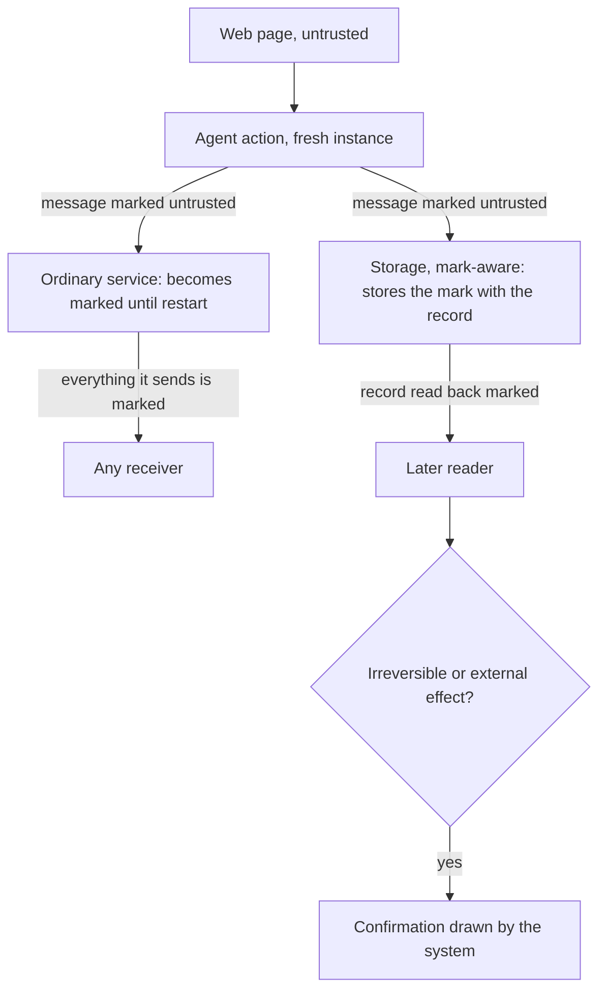
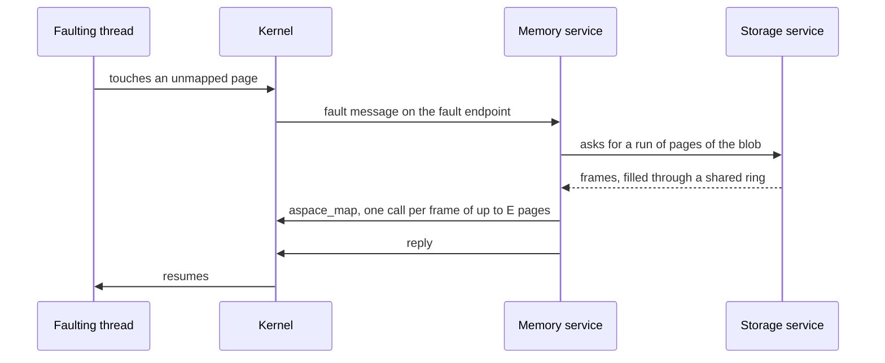
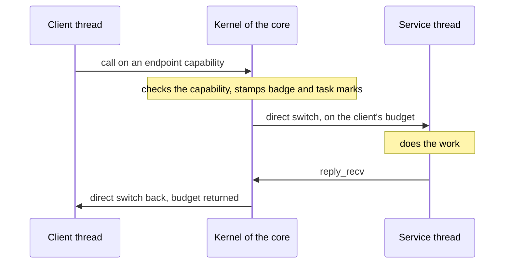

# Kernel interface

Statuses are defined in the [README](../README.md#status-legend).

**Decided, 14 November 2026**: validated by the two humans, except the sections that carry their own status. The numbers stay provisional. This file is the contract of the kernel: its objects, its system calls and the rules that bind them. It is written before any kernel code (**Decided**, 14 November 2026). The executable model, the oracle harness and the kernel are all written from it. Names and counts are provisional; the trials of weeks 1-2 and the one-core model will change them. **The shape of nodes and cores was decided by the owners on 16 November 2026 (D-128)**: a node is one kernel over a set of cores fixed when it starts, a process lives in one node, only one-shot operations cross between nodes, and no node runs on another node's core. The rules that follow from it, where no decision spoke, are proposed by the assistant (D-129).

The kernel knows nothing about Wasm, WIT or components. The runtime and the services build those on top of this interface.

## Rules

1. **Everything is a capability.** A system call names its target by a slot in the caller's capability space. There is no global name and no ambient right.
2. **Any call can fail with `gone`.** A capability is revocable at any time (rule 1 of the [ABI](wasm-abi.md#abi-rules)).
3. **No kernel memory that grows at run time.** The memory of every object comes from an untyped capability supplied by the creator (see [memory.md](memory.md#kernel-memory)). The only exceptions are fixed when a node starts and never grow (D-110): the start-up objects, which are made from no untyped; the machine objects (`node`, `iommu`, `role`); the kept image and the slot of a replacement kernel image; the beacons of every node and core; the hardware feedback tables; the page of the park stub and the pages of the `parked` words beside it (D-149, D-151); the interrupt table of each physical core, and the `irq_control` of each node; the `memory_control` of each node; the machine table, its fixed part and its living part (ownership words, device table, identifier, attach and line words, gate words and page classes, core words, park requests and retired words, member and role tables, fence records, grant and use tables: [Memory and devices between nodes](#memory-and-devices-between-nodes)); the two rings of every ordered pair of nodes ([What crosses between nodes](#what-crosses-between-nodes)); the interrupt remapping table of each IOMMU unit; the tables of the IOMMU units and their `iommu` objects; the clock page; the tables through which each kernel maps the memory it holds. Besides these, the kernel holds only its image, its stacks and the block of each node (see [Start-up state](#start-up-state)).
4. **Every call is bounded.** A long operation (revocation, deletion of a large object, clearing of memory) runs in bounded steps and returns `again`; the caller repeats the call.
5. **A call never blocks the kernel.** The kernel has no per-thread stack. A thread that waits is a state of the thread, and the kernel returns to its scheduler.
6. **Calls enter through the kernel-supplied code page.** Call numbers are private to that page and can change between kernel versions.
7. **Objects belong to one node, and only one-shot operations cross between nodes (D-128).** A **node** is one kernel: its block of state and the set of physical cores it runs on, fixed when the node starts ([Cores](#cores)). Every object belongs to one node and only that node's kernel acts on it: a call names objects of the caller's own node, and the only thing of another node a slot can name is a frame, through a grant written by its owner ([Grants](#grants-frames-between-nodes)). Inside a node the cores share the node's state, under one node lock (D-138; [A node of several cores](#a-node-of-several-cores)). Between nodes the kernels share no mutable state except the single-writer words of the living part of the machine table, written through the gates, and they exchange only the messages listed in [What crosses between nodes](#what-crosses-between-nodes). The receiving kernel answers each in one bounded step; two kinds, a `Revoke` and a `UnitRequest`, leave bounded state at the receiver until an invalidation completes, and that table lists the state, who holds it, its bound and what ends it ([What a receiver keeps](#what-a-receiver-keeps-the-one-shot-rule-as-it-holds), D-131); every other kind leaves nothing. The machine objects (`node`, `iommu`, `role`) belong to no node: their state is in the machine table, which every kernel reads and which changes only through the write gates. Memory belongs to one node at a time: each chunk of ordinary memory and each entry of device memory has one owner, recorded in the living part of the machine table, which only the owner's write gate changes. Calls that change no object state (`debug_write`, `trace_emit`, `ioport_in`, `ioport_out`, `cap_inspect`) are executed by the caller's kernel; `cap_inspect` reads a remote frame capability without a message.
8. **Data never crosses IPC.** IPC carries control. Data moves through shared memory objects (see [Data plane](#data-plane)).

## Objects

| Object | Role | Model |
|---|---|---|
| `untyped` | A range of physical memory, not yet typed. The only source of memory for other objects | seL4 |
| `cspace` | A table of capability slots. Flat, and grown by supplying memory (see [Slots and addresses](#slots-and-addresses)). Deliberately simpler than the guarded tables of seL4 | Project |
| `aspace` | An address space: page tables, built from supplied memory. One table per address space, used by every core of its node ([TLB](#tlb-one-core-and-several)) | seL4, CortenMM |
| `frame` | A run of 1 to *E* physical pages of one of the machine's page sizes (the page, or a large page: see [Values of the machine](#values-of-the-machine)), with a memory type. A frame capability records at most one mapping; mapping the same pages twice needs a derived capability | seL4 |
| `thread` | A register set, bound to a `cspace`, an `aspace`, a fault endpoint, a message page, a `task` and a `sched` | seL4 |
| `sched` | A scheduling context: budget, period, class, allowed cores, and the core of its node where it is placed; its current deadline and remaining budget | seL4 MCS |
| `endpoint` | A synchronous rendezvous point for call and reply. A derived capability carries a badge that identifies the caller | seL4 |
| `reply` | A one-shot right to answer one call. It carries the lend of the caller's scheduling context to a passive server | seL4 MCS |
| `notify` | A word of signal bits, asynchronous. Interrupts, timers and ring wake-ups arrive here | seL4 |
| `timer` | A deadline with a tolerance, which signals a `notify` | Project |
| `irq` | One vector of one physical core of the node, bound to one interrupt source; an entry of that core's interrupt table | seL4 |
| `irq_control` | The authority to claim the vectors of one node | seL4 |
| `ioports` | A range of x86-64 I/O ports, carried by the capability; the kernel executes each access. One per node, made at start (architecture layer only) | seL4 |
| `iospace` | An IOMMU domain: what a device can reach by DMA | seL4, Fuchsia BTI |
| `its_table` | The interrupt translation table of one device behind a GIC ITS (ARM64): 2^*k* pages, *k* ≤ 4, made by `untyped_retype` from a table untyped (D-154, D-156), of class *ITS table*, pinned to its device by the first `irq_claim` of an LPI that names it (D-152 complement) | Project |
| `iommu` | One IOMMU unit, made by the kernel at start. With `manage`, attaches devices of that unit to an `iospace`. A machine object, driven by the holder of its role | Project |
| `memory_control` | The authority to take, give and split the blocks of memory of one node. One per node, made at start-up | Project |
| `task` | The unit of provenance and of stopping: identifier, marks, attached threads. Stopped in one operation ([research axis 4](../research/prior-art.md#kernel-research-axes)) | Project |
| `node` | Control of one node slot: start, stop, status, watch; with `write`, the idle tables and performance requests of its cores and the right to configure and count its scheduling contexts; with `send`, the node's mailbox, reached by `node_send` from another node. A machine object ([Cores](#cores)). Called `core` before D-128, when a node had one core | Barrelfish/DC, seL4 MCS |
| `role` | One duty with one holder at a time: an IOMMU unit, an IOAPIC, a memory reserve, a leadership. A machine object ([Roles](#roles)) | Project |
| `debug` | The authority to write into the user trace ring of one's node. One per node, made at start. The rings and the crash records are kept memory, read through kept frames | Project |
| `vcpu` | Reserved name and number (16), not built. It exists only if the [micro-VM fallback](drivers.md#drivers-in-micro-vms-fallback) is opened | — |

Device memory (MMIO) is an `untyped` marked as device memory; it can only become a `frame` that is mapped, or a child `untyped`, never a kernel object. The registers of the interrupt controllers and of the IOMMU units, and of any other device the kernel drives itself, are in no device untyped.

The **memory object** of [memory.md](memory.md#memory-objects) (sharing, copy on write, paging, compression) is not a kernel object. It is built by the memory service from frames (**Decided**, 14 November 2026, see [Memory outside the kernel](#memory-outside-the-kernel)).

## System calls

64 calls. All take capability slots and words. Every call is specified in the [Call reference](#call-reference).

| Group | Calls | Notes |
|---|---|---|
| Capabilities | `cap_derive`, `cap_move`, `cap_delete`, `cap_revoke`, `cap_inspect`, `cspace_grow` | `cap_derive` copies with fewer rights or with a badge. `cap_revoke` deletes everything derived from a capability, and returns `again`; on a frame granted to another node it is the two-phase protocol of [Grants](#grants-frames-between-nodes) |
| Memory | `untyped_retype`, `aspace_map`, `aspace_unmap`, `aspace_protect`, `memory_take`, `memory_give`, `memory_split` | `aspace_map` maps up to *E* pages of one frame (one table's worth of entries), whatever the page size of the frame. `memory_take` and `memory_give` move memory between nodes in runs of up to *E* chunks |
| IPC | `call`, `reply_recv`, `recv`, `send`, `signal`, `wait`, `poll`, `notify_bind` | `call` and `reply_recv` are the fast path. `send` never blocks and never queues. `recv` on an endpoint with a bound `notify` also returns notifications |
| Threads | `thread_configure`, `thread_read_regs`, `thread_write_regs`, `thread_resume`, `thread_suspend`, `thread_cancel`, `thread_set_features` | A thread never leaves its node; inside its node it runs on the core where its context is placed ([A node of several cores](#a-node-of-several-cores)) |
| Scheduling | `sched_configure`, `sched_bind`, `sched_unbind`, `sched_set_cores`, `sched_read`, `sched_count`, `yield` | Admission and `sched_set_cores` need a `node` capability with `write`; admission is per physical core |
| Time | `timer_set`, `timer_cancel` | The monotonic clock is read by `clock_now` in the code page, from the clock page, without a call |
| Interrupts and devices | `irq_claim`, `irq_bind`, `irq_ack`, `iospace_map`, `iospace_unmap`, `iospace_attach` | `iospace_attach` takes an `iommu` capability and a device identifier |
| Tasks | `task_attach`, `task_mark`, `task_exempt`, `task_revoke`, `task_read` | A task is made by `untyped_retype`, like every object. See [Tasks and marks](#tasks-and-marks) |
| Nodes and cores | `node_start`, `node_stop`, `node_status`, `node_idle`, `node_watch`, `node_perf`, `role_claim`, `role_hand` | A node starts on a set of free physical cores, which it keeps until it ends. Replacement is `node_stop` mode seal followed by `node_start` mode resume; recovery is automatic up to the node's death, and a reload is `node_start` mode fresh ([Cores](#cores)) |
| Between nodes | `node_send`, `grant_signal` | The stamped send into another node's mailbox, which may carry grants of frames, and the signal of a grant's doorbell ([Calls between nodes](#calls-between-nodes)). Nothing else crosses: no call, wait or capability other than a frame |
| Debug | `debug_write`, `trace_emit` | Present in every build; the capability decides who may call them. The debugger stub exists only in development images ([Debugging](#debugging-call-reference)) |
| I/O ports (x86-64) | `ioport_in`, `ioport_out`, `ioports_issue` | `unsupported` on the other architectures |
| Entropy | `entropy_read` | No capability ([Entropy](#entropy)) |

Faults are not calls. A page fault, another processor exception, a system call made outside the code page, a thread with no address space and a thread that lost its scheduling context each become a message on the thread's fault endpoint; the handler answers through the `reply` object. The message, its delivery and the answer are specified in [Faults](#faults).

## Call reference

**Decided, 14 November 2026** (D-099): settled by the assistant at the user's request, from the gaps that two independent first models reported (27 by Gemini 4 Hydrogen, 29 by Mistral Large 4); re-read by the two humans. Revised twice the same day (D-100, D-101) after the reference model written from it showed mistakes; the rule against cycles was wrong twice before its present form. It covers the calls of the one-core model: capabilities, object creation, threads (configuration, resumption, suspension, cancellation), IPC and notifications, in the subsections from [Slots and addresses](#slots-and-addresses) to [Notifications](#notifications), and [Registers](#registers). The points marked **(design choice)** are the ones where another answer was reasonable.

**Proposed (D-110), 14 November 2026: written, no reference model yet, not reviewed.** The subsections [Memory and devices](#memory-and-devices), [Threads: bindings, faults and registers](#threads-bindings-faults-and-registers), [Scheduling and time](#scheduling-and-time), [Interrupts](#interrupts), [Tasks and marks](#tasks-and-marks), and the section [Start-up state](#start-up-state). They were drafted as three independent groups and merged by the assistant. The merge changed some rules of the decided subsections; each such sentence carries "(D-110)" where it stands, and the reference model of those subsections needs a new pass. The points that belong to the two humans are gathered in [Points for the two owners](#points-for-the-two-owners): the contract states the recommended rule until they decide. Groups not specified at that date: cores, debugging, `ioports`; they are specified since 16 November 2026 ([Cores](#cores), [Debugging](#debugging-call-reference), [I/O ports](#io-ports)).

**Revised, 16 November 2026: written, no reference model of the changes yet, not reviewed.** The 23 problems that pass 11 of the reference model found in this text are settled by the assistant's rulings of 16 November 2026; each changed sentence keeps its place. The page size became a value of the machine (D-121), through the whole file. **Revised again the same day (D-124)** after the sixth review of the contract and of its reference model (four reports, 38 findings): the protocols between nodes, the gate over page tables, ARM64 and RISC-V, and the start-up layout; the reference model covers the changes (pass 13). **Revised again the same day (D-125 to D-127)** after the seventh review (four reports and their cross-verifications): words held by a generation that is over, the geometry and the gate's words, the order of messages, the hardware facts of ARM64 and RISC-V, the neutral hand-over and the language split; the reference model covers the changes (pass 14), except the protocols between nodes, which are being redesigned. **Revised again the same day for the shape of nodes and cores (D-128, decided by the owners; D-129, proposed by the assistant): written, no reference model of the changes yet, not reviewed.** A node is one kernel over a set of physical cores fixed when it starts; rule 7 in its old form (a call on an object of another node works as if it were local) is withdrawn, rule 7 of [Rules](#rules) stands in its place, and only one-shot operations cross between nodes; parking, co-hosting, `core_place`, `thread_move`, proxies, remote calls and the transfer of capabilities other than grants of frames are gone. What the next pass of the reference model must cover is in [Changes for `abi/` and the model](#changes-for-abi-and-the-model-d-128-d-129). **Corrected the same day after the eighth review (D-131, proposed by the assistant, to be read by the two owners)**: two reports and three verifications in `reviews/` (`2026-11-16-contract-review-8-*`). The one-shot rule is restated as it holds (two kinds keep bounded state at the receiver: [What a receiver keeps](#what-a-receiver-keeps-the-one-shot-rule-as-it-holds)); the flush epoch is gone, and a count of leaves is lowered only once their invalidation is complete ([TLB](#tlb-one-core-and-several), G4, G5, G12); a wait for an IOMMU unit is never inside a kernel event and a unit that does not confirm is the faulty party ([IOMMU](#iommu)); each protocol of several steps has a table of what happens when a party dies at each step. The state explorer of these protocols is [node-protocol-explorer.py](../research/drafts/node-protocol-explorer.py). **Revised again the same day (pass 16, D-133): written, not reviewed.** The sixteen gaps that the reference model of pass 15 found in this text ([model-15-contract-gaps.md](../research/drafts/model-15-contract-gaps.md)) are settled by one owner, each sentence at its place and marked "gap *n*"; the lost wake-up of the park stub found by the multicore trial (pull request 8 of `dodos-kernel`) is closed by `started` and `START_RETRY_NS`; the Intel SDM citations follow one edition; the hardware facts of [Mistral's eighth review](../reviews/2026-11-16-contract-review-8-mistral.md) and four corrections of [the verification of the first security review](../reviews/2026-11-16-security-review-1-verify-hydrogen-by-opus.md) are written in. **Corrected the same day after the ninth review (D-134, decided by one owner, written by the assistant): written, not reviewed.** [Hydrogen's ninth review](../reviews/2026-11-16-contract-review-9-gemini-hydrogen.md) and [its verification by Opus](../reviews/2026-11-16-contract-review-9-verify-hydrogen-by-opus.md), and the contract fault of [DeepSeek's eighth model review](../reviews/2026-11-16-model-review-8-deepseek.md) as [Hydrogen verified it](../reviews/2026-11-16-model-review-8-verify-deepseek-by-hydrogen.md): the fence signal parks a core only on a marked word; the layout and the writer of the start request and of `started`; the fence record indexed by core number; domain numbers split by node slot and the operands of every unit request; a lock found out of the order of L2 is tried, and a call makes at most two rounds; the unit sequence of a claim, its cursor and the invalidation for a remapped line; the stamp of a sender attached to no task; the one-node fallback and the watch of a node's own cores. **Corrected the same day after the tenth review (D-135, decided by one owner, written by the assistant): written, not reviewed.** [DeepSeek's tenth review](../reviews/2026-11-17-contract-review-10-deepseek.md), [its verification by Mistral](../reviews/2026-11-17-contract-review-10-verify-deepseek-by-mistral.md), and what the assistant's judgement of [Hydrogen's ninth model review](../reviews/2026-11-17-model-review-9-gemini-hydrogen.md) found in this text: an owner word for each claimable line; `signal` never returns `again`, and under L2 a call writes nothing before its last try; the quiet word, after two `again` of the rule of tries; the entry word of each core; the retry of a start and the sweep at due events, and the `Ping` removed; the debugger's stop suspends the clocks of membership; the watermark's return; the state word of an invalidation request; one edition of each specification. **Corrected the same day after the eleventh review (D-137, decided by one owner where the decision says so, the rest settled by the assistant): written, not reviewed.** [Mistral's eleventh review](../reviews/2026-11-17-contract-review-11-mistral.md) and [its verification by Hydrogen](../reviews/2026-11-17-contract-review-11-verify-mistral-by-hydrogen.md), whose attack on pass 18 the assistant judged: a class per level of an iospace and a class for its root with its count of devices, and the attach word of each device identifier; an unhooked table joins its free list only once its invalidation is complete; the store-load order of the entry word and the quiet word, interrupts masked while a core waits for the word, the closed bound of an escalation and the start-up checks of `CORE_ANSWER_NS`, `STALE_NS` and `STUCK_NS`; marks ORed without a lock, every try of `recv` before its lends, the bound *k* counted again, the fault delivery out of the calls, the first call of `task_revoke` bounded by the cores; the removal of an `irq` that needs a holder as a request, the `Report` of a line, the index of the line words; the stopped time of the debugger, the sweep of sealed successors and two citations of the Arm manual. **Revised again the same day: the variant L2 leaves version 1 (D-138, decided by one owner, the other to confirm), and the corrections of the twelfth review: written, not reviewed.** One node lock locks a node of several cores, with its two lock-free paths; what the corrections above gave L2 alone (the tries and their two rounds, the writes after the last try, the quiet word, the entry word, marks ORed without a lock, the tries of `recv`, the bound *k*) is withdrawn and kept in [locking-l2.md](../research/drafts/locking-l2.md), and the words L2 needs stay reserved ([A node of several cores](#a-node-of-several-cores)); the watermark returns after a barrier instead of the entry words; [Hydrogen's twelfth review](../reviews/2026-11-17-contract-review-12-gemini-hydrogen.md) and [its verification by DeepSeek](../reviews/2026-11-17-contract-review-12-verify-hydrogen-by-deepseek.md) are judged against the text that remains (D-139): the attach word against every event, the tables a change unhooks listed in its request, the mask state in a line's `Report`, the vector of a failed invalidation kept, `idle_until` written on the clock it is compared on, the sections that could not be opened marked to verify. **Corrected the same day after the thirteenth review (D-140, decided by one owner on the brief of pass 21, the rest settled by the assistant): written, not reviewed.** [Hydrogen's thirteenth review](../reviews/2026-11-17-contract-review-13-gemini-hydrogen.md) and [its verification by Mistral](../reviews/2026-11-17-contract-review-13-verify-hydrogen-by-mistral.md), with no new mechanism but one word per core: `signal` keeps no lock and the bind's order is written; the retired word of each core keeps a failed unit's handles through R6 and the next start; a detach is tied to its requester as an attach is, and every unit request's check is listed; R1 on a failed unit holds only the nodes whose devices sat behind it; the attach word's table filled for a device out of the header and a lying holder; the start instant of a request read under the lock; the route's target core checked on ARM64 and RISC-V, and an ITS mapping tied to its requester; one wave per barrier and `idle_until` from the hardware timer; the leftovers of D-138 and D-139; the three editions opened and every section cited from them read again. **Corrected the same day after the final review of the reference model (D-141, decided by the owners on the brief of pass 22, the rest settled by the assistant, the two owners to review): written, not reviewed.** [The verifications of that review](../reviews/2026-11-17-final-ver2-AD-deepseek.md) (prefix `2026-11-17-final-` in `reviews/`): a message's sender is its ring's writer; a grant is freed only on the count of the use entry the holder's gate wrote, whose index the granting node recorded before the first leaf; a holder maps what the anchor says, and the granting node's gate writes an anchor only over memory it holds; the `memory_control` restricted by the depth rule as an `untyped` is; a debug area and a crash header read as a faulty kernel's data; the request's credits, the reserve of answers, the producer index behind the consumer, the `Report`'s count, keys and ITS items and its tie to the device's owner; a context marked *moving*; a level line on another node held by the controller; the orders of the rings, the slot read, the clock and the interrupts between cores; the fence's waits as due events; the RMRR devices on the unit's own domain; and the rows of the verifications of the contract alone. **Sources opened after pass 24 (under D-142, 18 November 2026; facts, no new decision).** The sentences pass 22 marked to verify were read in their sources ([Open points](#open-points)): the GIC's active state of a level SPI, the IOAPIC's EOI register and Remote IRR, the `fence w,o` before an IPI, the masks of SDEI after `CPU_ON`, the trigger registers of Sdtrig and the SDM's IST sentence are confirmed with their quotations; the order of the stores before `ICC_SGI1R_EL1` is cited from the Arm ARM (B2.6.9), not the GIC's specification; the DeviceID of an ITS write is supplied as the system defines, not by the bus; the non-Secure priority mask leaves event 0 unmasked only at a priority in the Secure range; one PSCI quotation is given whole. Three facts touched a rule and were left marked for the assistant, who decided them in D-143: an APLIC in MSI mode does not signal a level source again; SDEI asks the client to mask the PE before `CPU_OFF` and a power-down `CPU_SUSPEND`, which the gate refused; the SDM does not settle a `SYSCALL` begun with TF set. **Decided the same day (D-143, decided by the assistant, the two owners to review): written, not reviewed.** `irq_ack` of a level line on an APLIC in MSI mode, and a bind that arms it, write the source's number to `setipnum`, by the claiming node's gate; the park routine of the kept image masks the PE and disables event 0 before `CPU_OFF`, the handler and the park routine safe to enter again; a #DB at CPL0 with BS set on the first instruction of the system-call entry, naming no breakpoint of the thread, returns to the entry. Left open then: the mask before a power-down `CPU_SUSPEND`, since a fence signal lost at each wake of a core that idles in its deepest state is not confirmed whatever the mask; a #DB at the entry with both BS and a thread's breakpoint, and the reset of DR6, against rule (1) of D-142. **Completed the same day (D-143):** on ARM64 the gate masks the PE and reads the park request before a `CPU_SUSPEND` that loses the context, and reads it again at every way out of a suspend, running the park routine when it is raised, so a signal lost at a wake still parks the core; the ARM64 fence signals once per round of 11.2 ms, which gives a floor of 22.4 ms while a core's exit latency plus its park fit in one round; RISC-V reads the park request at every way out of `sbi_hart_suspend`; x86-64 needs no read, the NMI ending MWAIT; each cause of a #DB at CPL0 is judged alone, a breakpoint of the thread a fault of kind 9 and BS at the system-call entry ignored, and the handler loads DR6 with its reset value; the 16550's queue is read in TI's PC16550D datasheet. Accepted (D-143): a node whose idle table understates an exit latency is unfenced until a sweep, and a healthy node that granted it frames waits as long, a delay of at most one sweep and no loss. **Decided the same day (D-144, decided by the assistant, the two owners to review): written, not reviewed.** Four gaps the model's combined exploration of recoveries found (pass 25, `CONTRACT-GAP` 17 to 20): the node that hands a unit role runs R1 for a node accused during steps 1 to 3, and leaves it undone once it has unmapped, until step 4 or the end of the hand-over; every hand-over that ends without step 4 writes held (*X*, *e* + 1), so a request answered *elsewhere* is sent again; evidence stuck against a starting node waits `START_NS`; and "a chunk" corrected to a device-entry block for `memory_split` under a grant. Not written then: gap 20, a message to a starting node's new generation skipped by the reset of its consumer indices, since the decided remedy would read from an index a faulty dead kernel can leave inside a message. **Completed the same day (D-144):** the member word gains a resume bit (bit 9), set only by the write of sealed → starting; no node writes toward a node starting with the bit clear until it is live, except an answer to the starting generation's own message; a resuming node is written to like a live node; the reset of the consumer index at a fresh start stays, with its single writer. **Decided the same day (D-145, decided by the assistant, the two owners to review): written, not reviewed.** Gap 21 of the model (pass 26): a seal hands a failed unit's role without the drain, answering *failed* from step 1, the target mapping the unit at step 5 as a successor does at a take-over and answering *failed*; a unit that fails during a seal's drain is handed at the seal's next step, so a seal waits at most one `IOMMU_WAIT_NS` per unit; `role_hand` on a failed unit stays `busy`. **Completed the same day (D-145):** a take-over of a failed unit's role is not a rebuild: the successor writes held with bit 63, then maps the unit (order corrected by D-146), skips the drain and the closing invalidation, runs R1 and answers *failed* at once, which wins over "kept until the rebuild ends". **Corrected the same day (D-146, decided by the assistant, the two owners to review): written, not reviewed.** After a review of D-143 to D-145 by Gemini 4 Neon from the specification alone and its re-judgement by Claude Fable 5.2 with the primary documents (7 findings real, 4 in part, 1 refuted): the park read at a way out of a suspend tests the fence mark, not "the request differs from `parked`", which parked healthy cores after a seal and resume or a fence; the RISC-V cooperative fence repeats its interrupt per round; context loss is read from the suspend's parameter, and the gate's wake path is the entry point of every suspend; a RISC-V level line works whoever holds its APLIC domain's role, through a G9 exception for `setipnum`, `setienum` and `clrienum`, and `setipnum` is written before the enable; a take-over of a failed unit writes held before it maps, and its R1 never writes `acked`; the text left by D-145 qualified; a starting node holds no unit role and `node_stop` from it is `busy`; a kind 9 from a #DB at CPL0 is kept in the thread until it would return to user mode; an observation holds only while the member word it read is unchanged, and none is taken of a sealed node; messages held for a fresh start are work of the recovery reserve. H1 (single step after `MOV SS`) is refuted by the SDM, with one case added to the trial. **Corrected again the same day (D-147, decided by the assistant, the two owners to review): written, not reviewed.** After a review of D-146 by Gemini 4 Neon from the specification alone (16 findings) and its re-judgement by Claude Fable 5.2 with PSCI, SDEI, AIA, SBI and the SDM opened (6 real, 8 in part, 2 not real): a take-over's R1 only stops holding back R5; the ARM64 unmask after a wake, and in the entry stub, comes once the translation, the vectors and the stack are in place; a negative `PSCI_FEATURES` is the original format; a message held for a fresh start is sent once the word no longer reads starting with the resume bit clear; an APLIC rebuild never clears a reported level source's enable, and a masked APLIC source is `sourcecfg` 0; on x86-64 with a directed end of interrupt and on ARM64 no node masks a level line at its arrival, so a rebuild never leaves a claimed line masked that only its claimer could unmask (the lead the re-judgement left open, found real); every ARM64 park runs the park routine through the gate and every RISC-V park is `sbi_hart_stop`, with a refused stop outside a fence confirmed through `panic` and the fence; a kept kind 9 holds the enabled hits judged at the #DB, comes before any user instruction, after kind 8, and ends when raised; the wording of the observations' bound, the registers *written, never mapped*, the unit roles of the machine start-up and the reason of the RISC-V round. Left open: a level line of an IOAPIC holder whose role moves, on x86-64 without a directed end of interrupt. **Corrected the next day (D-148, decided by the assistant, the two owners to review): written, not reviewed.** After a review of D-139 to D-142 by Gemini 4 Neon from the specification alone (11 findings) and its re-judgement by Claude Fable 5.2 with the GIC, the Arm register and A64 pages, Zicsr, the SDM, the 82093AA and VT-d opened (6 real, 5 in part): a grant count in the gate word, so the gate itself refuses to give, split, destroy or retype a granted chunk, which only the node kernel's derivation list had protected; one interrupt flow per machine, never per role (ARM64 deactivation of every interrupt, the distributor's holder deactivating what it disables; x86-64 without a directed end of interrupt only where one node runs); the RISC-V clock's fences name device input; ARM64 without FEAT_LSE uses an exclusive loop and a full barrier; a root remote capability has depth 1; a rebuild keeps the unit's own domain; R3 does not wait for R2; a signal acts on the notify its OR reached; row 17 of `StartMachine` reads layout 5. The search for other rules whose safety rests on the node kernel's own writes found three, recorded in [Open points](#open-points). **Settled the same day (D-149, decided by the assistant, the two owners to review): written, not reviewed.** What D-148 left in Open points: one principle, G15, that no confirmation of a reuse rests on a word the node judged can write while its kernel runs; the reclaim barrier becomes the signal and R6 the proof, reading the grantees' use entries and the attach words R1's gate writes; on x86-64 every class-2 core gets INIT and the SIPIs every round, the NMI confirms nothing, and `parked` moves to a kept page no node kernel maps writable; the bootstrap core is of class 2 once its cleared BSP flag is declared honoured, of class 0 and left out of every node otherwise; an ARM64 `DENIED` is never confirmed; a core that enters a node without an INIT clears its local APIC's in-service bits; and a table of every word that confirms a reuse. **The gate owns every completion and every hook (D-150, decided by the assistant, the two owners to review, 19 November 2026):** the class byte of a table page holds its hook state in bits 6-7 (*loose*, *hooked*, *unhooking*; a root *live* or *dying*), the iospace root moving to 40 + *n*; the words of a core's invalidation request, its idle word and its loaded root, and each tag's set of cores, move into the gate part of the node block, so the gate computes who is asked and lowers counts at the acknowledgement it records itself; each IOMMU domain number gets a domain word (its root, bound at the first pin, and an invalidation sequence the holder's gate raises at submission and completion), and the requester's gate lowers its counts only after an invalidation begun after its clearing; an aspace's destruction tears its tables down by gate calls under a *dying* root; an ITS table is a page class with an ITS word; the gate composes remapping entries and refuses the posted format; a leaf under a grant carries only the anchor's rights, and a grant's use index is written once per serial; any node may stop the machine through the gate's stop entry, while a cold reset, a power-off and the ports no port entry names are `platform`'s, and kill and retire need a reserve role; observations and the instant of a seal move to words the gate writes; the clock page joins the global read-only set; and the items of the re-judged review of D-135 to D-138 (attach words, removal, idle latencies, the stopped time, the sweep, the replacement image). **What the holder, the seal and the GIC still left to the node judged (D-151, decided by the assistant, the two owners to review, 19 November 2026):** on x86-64 a seal's park is a gate call that does not return and writes `seal_parked`, which only a resume reads, `parked` staying the fence's; every unit request has a request record its requester's gate writes and a done word only the holder's gate writes, after the operation and the unit's confirmation, which replaces D-150's invalidation sequences; R1 is the holder's gate's walk, recorded in an R1 word the write of dead requires; what trust in a holder remains is stated; on ARM64 `ICC_DIR_EL1` and `ICC_CTLR_EL1` are the gate's, one gate call per interrupt taken; a rebuild keeps a sealed node's lines, remapping entries and ITS mappings, and an RMRR device's own domain; the bootstrap core clears its own BSP flag and a class-0 one parks; `parked` fills as many pages below 1 MB as the cores need; the counts are cleared whole; unfenced marks its unconfirmed cores unusable; a remapping table per unit; an ITS table of up to 16 pages; and the whole-machine suspend and resume, written. **The gate words, defined once (D-152, decided by the assistant, the two owners to review, 19 November 2026):** a new section, [Gate words](#gate-words), defines every word a gate alone writes with one table of transitions and one of events, and the prose points to it; the request record gains its state word, the tags a binding to one root and a teardown that unloads before it invalidates, the kept kernel tables a fixed class and the shared entries a rule, the gate part a reset at a fresh start, the free list a gate-written link, ports a layout, the drop bit a key on the line, the gate lock its place, the teardown and R1 their bounds; the whole-machine suspend goes back to a draft, its call `unsupported`; and `./verify` checks a list of withdrawn terms. **Its complement, the same day:** the ITS table becomes an object, `its_table`, pinned by a device's first LPI claim; an idle ARM64 core loads a kept empty table in `TTBR0`; a detach invalidates its device's context and the whole domain, as VT-d's Table 28 asks, so an iospace's teardown needs no request; the line bitmap keeps one writer; on x86-64 an event inside a gate call enters stubs from a read-only IDT, an NMI there is deferred to the call's exit, and a node of several cores uses mechanism 2 until the frame's RFLAGS and RSP are protected under mechanism 1; and the whole-machine suspend is `busy` while a node is sealed. **Pass 29's gaps (D-153, decided by the assistant, the two owners to review, 20 November 2026):** gaps 26 to 39 of the reference model, each settled in a cell of [Gate words](#gate-words): the caller's own invalidation, an unbind's whole set, G5's map count and no give in flight before a page leaves *data*, the kernel's own leaf made read-only first (a chunk split when a large leaf maps it), the free-list link's source alone held, R1 and R6 covering every handle of a node's cores, an identifier freed with both its words 0, an ITS unmapping served only from *attached* or *detached*, records answered only from a node not accused, kept counts held per generation, one open record per device, `ItsTable = 21`; the suspend draft gains the model's answers and stays a draft. **Dedicated table chunks and D-153 review corrections (D-154, decided by the assistant, the two owners to review, 20 November 2026):** option (d) replaces D-153's kernel-space split and merge (closing pass 30's gaps 40 to 46 and sixteen split/merge review findings): bit 58 of `GateWord` marks a table chunk, set at `memory_take` kind 2 (**table untyped**, slot word 0 bit 51, `StartUntyped.flags` bit 1) and for `floor_tables`, mapped read-only as one large leaf in the kernel's own space (`R/W = 0, D = 1` under former x86-64 mechanism 1, now mechanism 2 after D-155), holding all page, IOMMU and ITS tables (`aspace`/`iospace` `size argument` names the table untyped; `its_table` comes from a table untyped only), refusing CPU/IOMMU data leaves (G3) and grant anchors (G6); independent review corrections F9 to F16, S1 and M3 (RISC-V `SFENCE.VMA` with `rs1 = x0` when unhooking a non-leaf entry). **Gate call sequences v4 transcribed into the normative contract (D-155, decided by the assistant, the two owners to review, 20 November 2026):** adopts [gate-call-sequence.md](../research/drafts/gate-call-sequence.md) v4 (`9d97159`, audited by Gemini 4 Argon and 5/5 verified): x86-64 per-core gate page-table root with reserved `GATE_PCID` becomes the primary mechanism (former mechanism 1 kept as a one-core page-table prototype note only); uniform evacuate-and-free IST discipline (V1 to V13, replacing rules (1) to (6), eliminating Row G1, freeing `IST3` before clearing `MCIP`, deferring `#DB` at `N0` with `DR6.{BS,BD,BT} == 0`, clearing `IST1..IST4` onto `PARK_RSHSTK` at `T0..T26` to close OPEN-2); variant (a) closes F1 via gate-composed returns (`ret_user`, `ret_user_fast`, `ret_kernel`) on shadow-stack-typed `RFRAME_OF` (OPEN-6 closed), with variant (c) under the hardening monitor; adversarial-kernel promise on x86-64 requires supervisor shadow stacks + IBT (`NO_TRACK_EN = 0`), variant (a) or (c), interrupt remapping with compatibility-format blocking (`Interrupts` flags bit 0) and gate-composed ICR (`IKV_FIRST..IKV_LAST`, G10), while ARM64 (twin vector page, `POR_EL1` `0b0101` + `ISB` closing OPEN-8, `EIS`/`EOS`, `TCR_ELx.A1`, A-V10, `_EL12` & `HCRX_EL2`) and RISC-V (direct-mode `stvec` twin trap page, R-V10, reserved ASID) carry the faulty-kernel promise only (BTI and Zicfilp do not change this); reserved gate tag per architecture (G7: 4,095 usable PCIDs on x86-64), class *gate* and kept pages (`RFRAME_OF`, machine-check log, `mc_collect`, `RBLOCK_OF`, CPL-3 IST user blocks, last linear page never mapped), start-up configuration and kernel entry table, debugging rules (`DR7.GD = 1`, `R/Wn = 10` refused; full dev allow-range exclusions), x86-64 fence step 4 (INIT clearing `CR4`, Table 12-1, wait-for-SIPI `CR4.MCE = 0`), `NMI_GRACE_NS > H`, and machine-check policy B.5.2 (OPEN-4, OPEN-7 and trials T1 to T19 tracked in [Open points](#open-points)). **Cross-review corrections to D-154 and D-155 (D-156, decided by the assistant, the two owners to review, 20 November 2026):** fixes all thirteen findings (F1 to F13) of Gemini 4 Argon's independent cross-review of D-154 and D-155: accurate `V1..V13` transcription in [kernel.md](kernel.md) (F1); live-piece wait for every table untyped root (child or block), two-pass `cspace` sweep skipping pinned `table untyped`/`its_table` roots on pass 1, and failed-unit `iospace` hold carried by `GateWord` non-data counts and non-returning table-untyped watermarks without deadlocking `cspace` deletion (F2); mechanism 1 table-chunk mapping (`R/W = 0, D = 0` in kernel root, writable `G = 0` in gate root(s), unmapped with `VIEW_EPOCH`/gate-tag invalidation on give/destruction) separated from x86-64 mechanism 2 shadow-stack leaves (F3); gate `#DB` stub owning `DR6` read/reset into `deferred_dr6` and `kernel_syscall`/`thread_write_regs` consuming pending `DB_BIT` before changing `DR7` (F4); `untyped_retype` (`aspace`/`iospace`) applying the watermark-return barrier rule to both primary and named table untypeds before `no_memory` (F5); accurate ARM64 `A-V10` and RISC-V `R-V10` exit rules (F6); `G3 (3)` qualified for the kernel's read-only large leaf over table chunks (F7); reserved gate tag in `Gate words → The tag table` and `TLB` (F8); stale `its_table`, grant table-bit, clean-mark, `GateWord`/`Ownership` table and `IRQ_MAX_CORES_REMAPPED` corrections (F9 to F13).

**Editions cited (D-135).** Each specification is cited in one edition, the current one on 17 November 2026, named here once; a citation elsewhere gives only the document and the section: the Intel SDM, combined volumes, order 325462-093 (September 2026); the *Arm Architecture Reference Manual for A-profile architecture*, Arm DDI 0487, version M.d (30 September 2026); the *Arm Power State Coordination Interface*, DEN0022F.b (PSCI 1.3); the *Intel Virtualization Technology for Directed I/O Architecture Specification* (VT-d), revision 5.20, order D51397-019 (April 2026). Every section cited from these four was read again in these editions on 17 November 2026. **Pass 20 could not open any of the four editions (D-139); pass 21 opened three of them from the vendors' own servers (D-140)** and read again every section the contract cites from them: the Intel SDM 325462-093 ([Intel's download](https://cdrdv2.intel.com/v1/dl/getContent/671200), whose title page reads "Order Number: 325462-093US, September 2026"): §7.7.2, §11.2.2, §11.4.2, §11.4.4.1 with Table 11-1, §26.8, §34.5.1 and §34.14.2; VT-d D51397-019 ([Intel's download](https://cdrdv2.intel.com/v1/dl/getContent/671081), "April 2026, Revision 5.20, Order Number: D51397-019"): §5.1.5.1, §6.2.2.1, §6.5.2.8 with figure 6-8 and §11.4.2; Arm DDI 0487 M.d ([Arm's documentation service](https://documentation-service.arm.com/documentation/ddi0487/md/?lang=en), the PDF it lists, "30/Sep/2026 M.d"): B2.3.1, B2.3.7, C5.2.1, C5.5.11, C5.5.60, D8.2.9 with Table D8-26, D8.17 (rule IWZCBG), D8.17.1 and D8.17.8. Each quoted sentence was found as quoted, except two corrected where they stand: the broadcast scope of a TLBI is in D8.17.8, not D8.17.7, and the quotation of SDM §11.4.2 now gives the sentence whole. The PSCI edition was not opened again (it was read in pass 18). The one citation of an older edition of the SDM (§8.2.3.4 of 253668-032, in the quiet word's paragraph) left the contract with L2 ([Hydrogen's twelfth review](../reviews/2026-11-17-contract-review-12-gemini-hydrogen.md), finding 11).

### Values of the machine

**Proposed (D-121), 16 November 2026.** Some values depend on the machine and not on the contract. The kernel chooses them at start-up, by the rule of D-121, and publishes them in the start-up page (entry `Memory`, [Start-up state](#start-up-state)); user space reads them there and never hard-codes them. `abi/` keeps a constant per architecture only where the architecture fixes it, and the reference model is tested with two page sizes.

| Name | Meaning | Reference machine (x86-64, four levels of tables) |
|---|---|---|
| *P*, **a page** | The smallest size the processor protects, which the kernel uses as the unit of every address space, `iospace` excepted | 4 KB |
| **page sizes** | *P*, then the **large pages**: the sizes that one entry of a higher table maps and that the processor supports. A frame names its page size by an index: 0 the page, 1 the first large page, 2 the second, 3 the third | 4 KB, 2 MB, and 1 GB where the processor supports it |
| *E*, **entries per table** | The number of entries of one table page | 512 |
| *L*, **levels** | The number of levels of the tables of an `aspace` | 4 |
| **chunk** | The unit in which memory belongs to a node: the first large page | 2 MB |
| **user range end** | The first address beyond the user range ([Address spaces and their tables](#address-spaces-and-their-tables)) | 0x7F80_0000_0000 |
| **core number** | The position of a physical core in the core list of the start-up page (entry `Cores`). It is the only numbering of the machine's cores; a node also numbers its own cores by their **position** in the node, 0 to *N* − 1 in the order of core numbers ([A node of several cores](#a-node-of-several-cores)), and every rule says which it uses: a `sched`'s cores set, `node_start`, `irq_claim` and `node_status` use core numbers, and the fence record core numbers modulo 64 ([The fence](#the-fence-stopping-the-cores-of-a-node)); the parts of the node block and the bitmaps of a node's cores use positions. A core belongs to at most one node at a time, recorded by its core word ([Node slots and core words](#node-slots-and-core-words)) | — |
| **node slot** | The index of a node in the machine table, 0 to *n* − 1, where *n* is the number of node slots the boot image asks for (at most the number of usable cores). A slot keeps its floor, its member word and its tables across the generations of the nodes that run in it; it is not a core | — |

- **"Per core" in this contract means per physical core; what belongs to a kernel is said per node (D-129).** A node is one kernel and the physical cores it runs on; what each physical core holds of its own, and what the cores of a node share, is listed in [A node of several cores](#a-node-of-several-cores).
- "A page" in this contract means *P* bytes, and "a large page" one of the large page sizes. A count of bytes that bounds the work of one step (the clearing step of 64 KB, a segment of a `cspace`) stays in bytes and does not change with *P*.
- *E* is the number of 8-byte entries of one page (*P* / 8), and at most 4,096: the number of pages of a frame and the fields of a mapping record have 12 bits ([The capability slot](#the-capability-slot)). The kernel refuses to start on a machine whose page would need more (design choice: the 64-byte slot stays as it is). So a 64 KB page (ARM64's largest granule, 8,192 entries per table) is refused: on such a processor the kernel takes its 16 KB or 4 KB granule, by the rule of D-121.
- **Page sizes are one per level (design choice).** A large page is the size one entry of a higher table maps; the kernel does not use contiguous-entry hints that make one size out of several entries of one level (RISC-V Svnapot, ARM64's contiguous bit). Why: the gate's records (page classes, the count of pages not of class *data*, map counts) are per page and per chunk, and its checks are per entry of a level; a size made of several entries would need a second kind of entry in every check. The cost is the TLB reach those hints give, which the large pages give too. So each page size is *E* times the one before: page size *i* is *P* × *E*^*i*, a leaf of level *i* + 1, and exists only if *i* < *L*; the first large page, the chunk, is required.
- **No page is larger than *E* chunks (design choice, seventh review).** The page sizes stop at the second large page (*E* chunks: 1 GB on the reference machine); a third (512 GB with 4 KB pages) is never used, even where the processor has one. Why: one call of the gate checks at most *E* chunks (G3), and a leaf is written whole by one call; a page of *E*² chunks would be one leaf that no call can check. The start-up page lists only the sizes the kernel uses.
- **The reserved slot and canonical addresses.** The tables translate *B* = log2 *P* + *L* × log2 *E* bits (48 on the reference machine). The user range end is a multiple of the chunk and leaves, below the half of those addresses, the whole range of one root entry, the reserved slot: user range end ≤ 2^(*B* − 1) − *P* × *E*^(*L* − 1). An address is canonical when its bits from bit *B* − 1 to bit 63 are all equal, whatever the user range end (the words of the register block that must be canonical: [Register calls](#register-calls)). The kernel refuses to start on values that break these rules (`Geometry::valid` of `abi/`).
- *L* is at least 2. A run of at most *E* pages crosses at most 2 tables at each level below the root, so a mapping call takes at most 2 × (*L* − 1) tables.

### Slots and addresses

- A **slot address** is a 64-bit word: the low 32 bits are an index, the high 32 bits are `via`. With `via` = 0 the index is in the caller's own capability space. Otherwise `via` is the index, in the caller's own space, of a `cspace` capability, and the index is in that space. There is one level of indirection, never more.
- **Slot 0 of every capability space is never used.** Address 0 therefore means "no capability" wherever an argument is optional.
- A slot is **empty**, **full** or **dead**. A slot becomes dead when its capability is removed by someone else (revocation, or the destruction of what it was derived from). Using a dead slot returns `gone`; using an empty slot returns `invalid`. `cap_delete` on a dead slot makes it empty. A dead slot is not free: nothing can be placed in it. This is what keeps a stale index from silently naming a new object.
- A thread needs no right to use its own capability space. Through a `cspace` capability, reading a slot (as the source of `cap_derive` or `cap_inspect`, or as the target of a call) needs `read`, and changing a slot (placing, moving out, deleting, revoking) needs `write`.
- A `cspace` is created with a maximum number of slots (a non-zero multiple of 128, at most 2^20, provisional: creating the space clears its directory, by the rule of the clean mark (D-110), so the directory is bounded, here to 128 KB), which fixes the size of its directory (16 bytes per 128 slots since D-129, the segment's address and its sequence word, rounded up to a power of two), and with no slot. `cspace_grow` adds one segment of 128 slots (8 KB: a slot is 64 bytes, D-110). Slot indexes never change. **(design choice)**
- **A `cspace` grows only from the untyped it was created from.** Any capability for that untyped object is accepted. Its segments then die with it and with that untyped, and no `cspace` depends on two untypeds. The creator of a process gives it an ordinary untyped for its kernel objects and frames, and a **table untyped** for its address-space, IOMMU and ITS tables (D-154).
- A destination that is slot 0 or beyond the table is `invalid`.

### The derivation tree

- Every capability has one parent, except the capabilities given at start-up, each of which is the root capability of its object; the frames made from the node's start-up untyped are the exception, as its children, and so is the copy in slot 11, a child of slot 10 (D-110, see [Start-up state](#start-up-state); D-141: the "image untyped" was the alternative the kept image rejected). `untyped_retype` makes the new capability a child of the untyped capability. `irq_claim` makes the new capability a child of the `irq_control` capability (D-110). `cap_derive` makes the new capability a child of its source. There is no separate "copy": a copy is a derivation with the same rights.
- **A capability never outlives the capability it was derived from.** `cap_revoke` removes all the descendants of a capability and keeps the capability. `cap_delete` removes the descendants, then the capability. **(design choice: the alternative, as in seL4, hands the children to the grandparent)**
- **An object lives exactly as long as the capability that `untyped_retype` returned for it** (its root capability), wherever that capability has been moved; for an `irq`, the capability that `irq_claim` returned, and for an object the kernel made at start-up, the start-up capability (D-110). There is no reference count. When the root capability is removed the object is destroyed and its memory goes back to the untyped it came from (an `irq` has no untyped: its entry of the interrupt table becomes free; an object made at start-up from no untyped gives its memory back to no one, D-110).
- `cap_move` moves a capability to an empty slot. Its place in the tree, its rights and its badge do not change. A capability at depth 64 can therefore still be moved, also by IPC; it can no longer be derived.
- **The tree is at most 64 deep** (provisional): a start-up capability is at depth 1, and a derivation or a creation that would go deeper is `invalid` (checked with the plain arguments). With the next rule, the limit bounds the walk that finds the next capability to remove.
- **A capability space holds only what is deeper than itself (design choice, D-103).** The root capability of another capability space can be placed in a capability space only if its depth is greater than the depth of the root capability of that space. An `untyped` or `memory_control` capability (a root or a copy) can be placed there only if its depth is not smaller (D-141: a `memory_control` derives untypeds, its blocks). Otherwise the call is `invalid`, checked with the plain arguments. The check is one comparison of two depths. It applies every time such a capability is placed in a slot: `cap_move`, `cap_derive`, `untyped_retype` and a capability moved or derived by IPC; for IPC the destination is known only at delivery, so a refusal there drops the capabilities.
  - Why: removing a capability removes first what was derived from it and, for the root of a space, what the space holds. Call *restricted* the `untyped` and `memory_control` capabilities and the roots of spaces; the others are *ordinary*. The walk goes from a capability to one derived from it (the depth grows by one), or from the root of a space to a capability the space holds. From the root of a space to a root it holds the depth grows; to an `untyped` or a `memory_control` it holds the depth does not shrink, and the next move from either is a derivation, since neither is the root of a space. So while the walk is on restricted capabilities the depth never shrinks and stays equal at most once per level: at most 128 capabilities. Once the walk reaches an ordinary capability it stays on ordinary ones, because everything derived from an ordinary capability is a copy, the root of nothing, or an `irq` claimed through an `irq_control`, the root of an object that holds no capability: at most 64 more (the depth rule constrains only roots of spaces, `untyped` and `memory_control`, so a space may hold an ordinary capability of any depth, and the ordinary part may start again from depth 1: D-142). So no capability can depend on itself, and the walk is shorter than 192 capabilities (the longest one that can be built has 191). The first rule ("not into a space that descends from it") missed two spaces that hold each other's root; the second (creation numbers, D-101) prevented loops but did not bound the walk: any number of spaces at the same depth could be nested. The third (D-103 to D-140) restricted the `untyped` alone, and a space made from a block could hold the `memory_control` the block was taken through: the `memory_control`, its block, the space's root and the `memory_control` again were a cycle, and the next removal of the block never ended (D-141, [the final review's verification of lot F1](../reviews/2026-11-17-final-ver-F1.md)). Of the kinds from which something that is not a copy is derived, the `untyped` and the root of a space were restricted already, the `memory_control` is now, and the `irq_control` need not be: an `irq` holds nothing, so a walk that reaches one ends in copies; every other kind derives copies only (a task, a thread, a node, a role, an `iommu`, an `ioports` whose child narrows its range, and a frame, whose anchor is a copy in its node's kernel space).
  - Consequence: to hand memory to a space, its creator makes a child `untyped` of the `untyped` the space came from and hands that; it keeps the parent, and with it the right to take everything back. A space cannot hold the capability its own memory was taken through; it can hold a copy of it, and so grow itself. A new space, for example a restarted supervisor, can take over the roots of spaces that are deeper than itself.
  - Known costs of the rule: the start-up `untyped` and `memory_control` capabilities never leave the start-up space, so a memory service in its own space holds only children of them (a copy of the `memory_control`, D-141); each layer of spaces that create spaces uses one of the 64 levels; two spaces at the same depth cannot hold each other's root in either direction, so a space that must supervise a sibling is given a copy, or the sibling is created from a deeper `untyped`.
  - A space may hold its own root capability, as the start-up space does; it is removed last. The start-up space was created from no untyped: its size is fixed by the boot image and it never grows.
- A derived capability has a subset of its parent's rights. A capability made by `untyped_retype` does not: it gets the rights of its kind, whatever the rights of the untyped.
- Removal runs in bounded steps: per call, at most 32 units of work are done (a capability removed, a thread woken, or one of the undoings listed under "Destroying an object" below, D-110) and at most 128 slots of dying capability spaces are examined (both provisional), and the call returns `again` while work remains; the step that removes the last capability returns success, never `again`. Segments that were never added hold no slot and are not examined. The sweep of a space starts at slot 1; a slot counts as examined when the sweep moves past it, so a full slot is not counted while its capability is being removed. A step may end on the slot budget alone, having only moved the sweep. The order is fixed by the **derivation list** of the node ([The capability slot](#the-capability-slot)), never by where an object lies or when it was made: the next capability to remove is found by starting at the capability that follows the root of the removal in the list and moving forward while the depth grows; the last one reached is removed. Since a new capability is inserted right after its parent, the most recently derived child goes first, and a capability goes only after all its descendants; the walk is at most 64 slots. Between two steps the tree is well formed.
- **Removal ends.** A capability under `cap_delete` is dying from the first step: any other use of it returns `gone`. An object is dying from the first step of a removal that reaches its root capability, even when that step only removes a copy: every call on it, through any capability, returns `gone`, so its queues only shrink. A capability that is on the path of a removal but is not the root of its object keeps working until it is removed; this difference is wanted, because marking one object is one write and marking a subtree is not bounded. A thread whose capability space is dying gets `gone` from every call except `cap_delete` on its own slots, before any argument is looked at, (a slot address through a capability for a dying space is `gone` as any use of a dying object), and a delivery to a receiver whose receive range is in a dying or destroyed space drops the capabilities (the words are still delivered), so a dying space only shrinks. A server whose space is dying can therefore no longer answer: its callers get `gone` when its reply objects are destroyed. The step that marks a reply object as dying also wakes, with `gone`, the receiver attached to it or the caller that waits for an answer through it (one thread: a reply object is attached or armed, never both), so no caller can meet a waiting receiver whose reply object is dying. This wake is not counted in the 32 of a step: a walk passes through at most one reply object, because below the root of a reply object there are only copies. A call makes at most 32 walks, so it wakes at most 64 threads. `cap_delete` on a capability whose object is dying works as on any other: it acts on the slot, not on the object.
- **To kill a process, its supervisor deletes the root capability of its capability space first.** From the first step the threads bound to that space get `gone` from every call, so they can no longer compete with the removal; the supervisor then deletes the ordinary untyped and the table untyped the process was given (deleting the ordinary untyped destroys the spaces whose headers came from it, releasing their tables from the table untyped; a table untyped — child or block — whose live pieces still belong to a surviving space waits on their destruction at `cap_delete`, returning `again`, and `memory_give` returns `busy`, D-154, D-156). The cost is bounded by what the process holds: for a full space of 2^20 slots, 32,768 calls on a single-pass sweep (removing a capability also moves the sweep past its slot, so the two budgets are not added), plus at most 8,192 empty-slot sweep calls if a second pass is needed for deferred slots (D-156), plus one unit per thread bound to the space (D-110). A killed server keeps its callers waiting until the removal reaches its reply objects; the kernel has no timeout.
- One limit is accepted: while `cap_revoke` or `cap_delete` runs, threads that hold capabilities under it can still derive new ones (not from the capability under `cap_delete` itself, which is dying). Each call removes 32 capabilities against at most four new capabilities per competing call (a message), and a thread that derives 33 capabilities or more per step of the removal can keep it from ending. A supervisor that wants a certain end stops those threads first, by the rule above, with `thread_suspend`, or with `task_revoke`.
- Destroying an object wakes every thread that waits on it, with `gone`. This includes the thread that waits to receive with a reply object, and the caller that waits for an answer through it. A caller is not woken when the server thread alone is destroyed: the reply object is the handle, and another thread can still answer through it. Destroying a `cspace` first removes every capability in it, in index order, by the same steps, in a **bounded two-pass sweep** (at most 2 × `max_slots` examinations, D-156): the dying space keeps the index where the sweep stands and a *first deferred slot* (0 when none). On pass 1, if the sweep reaches the root capability of a table untyped that still has live or dying spaces naming it, or the root capability of an `its_table` whose ITS word is still non-zero, it defers that slot (recording it as *first deferred* if none yet) and moves past it so higher-index `aspace`, `iospace`, ordinary `untyped`, and LPI `irq` slots in the same dying space are removed first. Once pass 1 reaches the end and a slot was deferred, pass 2 resumes from *first deferred* without deferring again (returning `again` only if an external space or LPI outside the dying `cspace` still pins it); a slot examined in pass 2 is never examined again. The deferral is **per dying `cspace`** (D-157): if an inner `cspace` at slot *i* of an outer dying `cspace` holds the root capability of a table untyped (or `its_table`) pinned by an `aspace`, `iospace` or LPI `irq` at slot *j* > *i* of the outer `cspace` (reachable under the depth rule), the inner `cspace`'s pass 2 treats the outer pinning object as external and returns `again`; a supervisor avoids that layout, or destroys the pinning object first, by deleting the ordinary untyped its header came from, before it deletes the root capability of the outer `cspace` (D-161: "deletes the outer space" named the very deletion that waits). `cap_revoke` on the root capability of a space does not sweep the space: it removes only what was derived from the root. A thread whose capability space is dying gets `gone` from every call except `cap_delete`; once the space is destroyed, the thread is bound to no space and gets `gone` from every call (D-110).
- **What else destruction undoes (D-110).** After the waiting threads are woken (and, for a `cspace`, after its sweep), and before the root capability is removed, the kernel undoes each link to the object, most recently made first, one unit of the 32 of a step each: the threads bound to a `cspace`, an `aspace`, an endpoint (as their fault endpoint) or a `task` are unbound (a `sched` loses its one home in the first step of its removal); the records that name an `aspace` or an `iospace` are emptied; the devices of an `iospace` are detached; the lends of a `sched` are cleared; the armed timers of a `notify` are disarmed, then its bound `irq` entries are unbound. Before the root capability of **any** table untyped (child or block) is removed, the step returns `again` while any live or dying `aspace` or `iospace` still names it as its table untyped (preventing premature parent watermark return, D-156); similarly, before the root capability of an `its_table` is removed, the step returns `again` while its ITS word is non-zero ([The ITS word](#the-its-word), D-156). The order inside each object, and the cases of `irq_control` and `iommu`, are given in the groups below. Removing a frame capability with a full record undoes its mapping, or the message page binding it holds, in the same unit as the capability.
- **Rights are checked when a call is made.** A thread that already waits is not disturbed when the capability it used is revoked; it is woken with `gone` only when the object itself is destroyed. **(design choice: waking it would need an unbounded search of the wait queues)**
- **A bound endpoint and notify.** When an endpoint or a notify bound by `notify_bind` is destroyed, the binding is undone first among the links of "What else destruction undoes", after the waiting threads are woken: one unit of the 32 of a step. The other object becomes unbound. A pending word stays in the notify. The threads waiting to receive on a surviving endpoint are not woken: they wait for callers, as on any endpoint without a notify.
- **A thread.** When the root capability of a thread is the next to remove, the kernel undoes, one unit each, in this order: its place on a core, if it is running on another core of its node (that core is asked to leave it, the step that asks also sets the thread's suspended flag, and the step returns `again` until it has: [A node of several cores](#a-node-of-several-cores), gap 14); its wait, if it waits (it leaves its queue; a reply object attached to it or armed with it becomes idle, as for `thread_cancel`; a wait for an answer of another node, for a unit or for its node's cores ends, and the answer, the unit's confirmation or the completion of the request, when it comes, finds no thread to wake: its effect on grants, records, counts and credits is applied as if the thread still waited, D-131); the lend whose receiver it is, if any; then its bindings: message page (the frame capability's record is emptied), fault endpoint, address space, capability space, task, and home context (the context keeps its lends). At most 9 units. A step with units left returns `again` and goes on at the next call. Then the root capability is removed.
- **The rights of a kind.** "Every right" of a new object ([rules of `untyped_retype`](#capabilities-and-objects)) and "every right of its kind" (start-up) mean the eight rights of [Rights](#rights), for every kind, with these exceptions: a root made by `untyped_retype` has `exec` only by the rule of that call; a root made at start-up from no untyped, and a root of a machine object, has every right except `exec` (the `memory_control` excepted, which has `exec`); a kept frame has the rights its start-up row gives. So `cap_inspect` of a root returns 0xFF or 0xFB, of a kept frame of the kept image 0x45 (`read`, `exec`, `derive`), and of another kept frame 0x41 (`read`, `derive`).

### Order of checks

Before these checks, a thread bound to no capability space, or attached to a revoked task, gets `gone` from every call, and a thread whose space is dying gets `gone` from every call except `cap_delete` on its own slots (D-110). On an architecture without I/O ports, `ioport_in`, `ioport_out` and `ioports_issue` return `unsupported` right after these, before any argument is looked at. Every call checks in this order and returns the first failure:

1. the capability the call acts on: its slot (`invalid` if empty or out of range, `gone` if dead), its kind (`invalid`), its rights (`denied`);
2. the other capability arguments, in the order of the table below, with the same three checks. A destination or any other slot address is a capability argument: its `via` capability and its range are judged here, and that the slot is empty only with the state. One exception: a message header is read right after the capability the call acts on (whose rights, `grant` included, are judged first with the number of capabilities the header states), because it says how many capabilities the message lists; a header beyond the limits, with a flag bit other than `add_marks` set by the sender, with an added-marks word that has a reserved bit, or that needs a message page the thread does not have (D-110), is `invalid` before any other capability argument is looked at;
3. the plain arguments, in the order of the table (`invalid`); for `untyped_retype` the kind is judged before the size argument: a kind that this version does not make (the reserved `vcpu`) is `unsupported` there, after the rules on device memory and table untypeds, and a kind that is never made from an untyped (`irq`, `irq_control`, `iommu`, `memory_control`, `node`, `role`, `debug`, `ioports`) is `invalid` (D-110); a table untyped makes only a child table `untyped` or an `its_table`, and an `its_table` is `invalid` from an ordinary or device untyped (D-154); for an `aspace` or `iospace`, the size argument is the slot address of a table untyped with `write` (checked here as a capability argument: slot, kind, table bit, `write`; dying is `gone`, D-154); for an `its_table` the size argument is *k* ≤ 4 (`invalid` otherwise, D-154); for a thread the size argument is its feature mask, judged by the rules of [The feature mask of a thread](#the-feature-mask-of-a-thread) (`invalid`, then `unsupported`); for a frame the size argument is judged in this order: the page size value (`invalid`), whether the processor supports it (`unsupported`), the memory type (`invalid` if it does not suit the kind of memory), the number of pages (`invalid`) (D-110); the depth checks (the limit of 64 and the rule on what a space holds) come last;
4. the state, in the order each call's own rules list its state checks (this item names the codes, not an order among them; a call whose rules list one state check has no order to give): `busy`, `no_slot` (the destination slot is not empty), `no_memory`, `would_wait`, `budget` (only `sched_configure` returns it, and it has no other state error, D-110); and `denied` from two state checks that guard a rule of the gate rather than a right of a capability, each judged at its place in its call's list: the class check of a mapping, after the two `busy`s of the record and of an address already translated and before the `busy` of a map count ([Calls on address spaces](#calls-on-address-spaces)), and the owner of a device identifier for `iospace_attach`, after the `busy` of a failed unit and that of a device the kernel uses, and before the other `busy`s ([IOMMU](#iommu)) (seventh review).

A call that passes every check may still return `again`, having done a bounded step of its work (removal, clearing of memory), or, for `recv` and `reply_recv` by a thread without an own context, having recorded a fault *no context* that it could not receive ([Faults](#faults)), or, in a node of several cores, having changed nothing because the request of its core is in use or has just been started for the barrier of a watermark ([A node of several cores](#a-node-of-several-cores), D-138); the table of [Errors](#errors) gives the general rule: a request, a credit or an entry in use (the unit request table full, the credits toward a peer all in use, a thread still marked *leaving its core*), a barrier started, or a map under a grant not yet *answered* ([Grants](#grants-frames-between-nodes), D-141), each with nothing changed (D-140).

### Capabilities and objects

| Call | Arguments | Result | Rights and rules |
|---|---|---|---|
| `cap_derive` | source, destination, rights, badge | | `derive` on the source. The new rights must be a subset of the source's (`denied` otherwise, checked with the plain arguments, so after the destination); a rights word with a bit that names no right is `invalid`, here and in a message, and is judged before the subset. In both places the rights word is a plain argument: it is judged after the three checks of its slot (so a source without `derive` is `denied` whatever the word), and in a message with its slot, before the next listed slot. A badge is accepted only on an `endpoint` or a `notify` (`invalid` otherwise). On an `ioports` capability the new capability keeps the source's range. A capability that already has a badge keeps it: asking for another one is `denied` (checked with the plain arguments); asking for the same one is accepted. Badge 0 means no badge |
| `cap_move` | source, destination | | No right on the capability itself. `busy` if the source is the root capability of an untyped that has a descendant, whose copies name its slot ([The capability slot](#the-capability-slot), D-131) |
| `cap_delete` | slot | | No right on the capability itself. Returns `again` while descendants remain |
| `cap_revoke` | slot | | No right on the capability itself. Returns `again` while descendants remain |
| `cap_inspect` | slot | kind, rights, badge | No right on the capability itself. For an `ioports` capability the badge is its range ([I/O ports](#io-ports)) |
| `untyped_retype` | untyped, kind, size argument, destination | | `write` on the untyped. One object per call. The size argument is: bytes for a child `untyped` (a power of two, at least one page), the page size index, the memory type and the number of pages (1 to *E*) for a `frame` (D-110), the maximum number of slots for a `cspace` (at most 2^20), the feature mask for a `thread` ([Unlike cores](#unlike-cores)), the slot address of a **table untyped** (with `write`, checked as a capability argument) for an `aspace` or `iospace` (D-154), *k* (0 to 4, for 2^*k* pages, 1 to 16 pages) for an `its_table` (kind 21, D-152, D-154), and 0 for the other kinds. A size that does not fit in 64 bits is `invalid`. Device memory can only become a `frame` or a child device `untyped` (`invalid` otherwise). A **table untyped** (D-154) can only become a child table `untyped` or an `its_table` (`invalid` otherwise), and an `its_table` is `invalid` from an ordinary or device untyped. An `irq`, an `irq_control`, an `iommu`, a `memory_control`, a `node`, a `role`, a `debug` or an `ioports` is never made by this call (`invalid`, D-110). Returns `again` while it clears memory (rules below) |
| `cspace_grow` | cspace, untyped | new number of slots | `manage` on the cspace, `write` on the untyped, which must be the one the cspace was created from (`invalid`). `no_slot` when the maximum is reached; then `no_memory` if the segment, aligned on its size, would end beyond the end of the untyped (D-141) |

Rules of `untyped_retype`:

- Memory is taken at a watermark that only moves up while an object made from the untyped lives. When the last one is destroyed the watermark is *ready to return*; it returns to the start (and the clean mark with it, on an ordinary untyped) at the first `untyped_retype` using that untyped once every other core of the node has left the kernel event it was in at that destruction, which a barrier of the caller's core makes sure of (at once on a node of one core: [A node of several cores](#a-node-of-several-cores), D-134, D-135, D-138), and that is the only moment the memory becomes usable again (as in seL4); until then `untyped_retype` returns `again` with nothing changed. For an `aspace` or `iospace`, this watermark-return rule applies to **both** the primary ordinary untyped and the named table untyped (resetting each ready watermark whose barrier epoch has already passed, or starting/joining the barrier and returning `again` with nothing changed if either still waits on a barrier) before the `no_memory` check below (D-156). Object sizes are rounded up to a power of two (the size of a thread is a value of the machine, read from the start-up page: [Object sizes](#object-sizes)), except a frame, which takes exactly its number of pages times its page size, and an `aspace` or `iospace`, which takes one page (its header) from the ordinary untyped and one page (its root table) from the table untyped named in `size argument` (D-154). An `its_table` takes 2^*k* pages from its table untyped (aligned on a page, or on 2^*k* pages where the ITS requires alignment). The watermark is aligned on the size of a child `untyped`, on the page size for a frame, and for the other objects on their size, or on a page if they are larger than a page. If the new object, at the watermark so aligned, would end beyond the end of the untyped (or, for an `aspace` or `iospace`, if its 1-page root table would end beyond the end of the named table untyped), the call returns `no_memory` with nothing changed: a state check after `no_slot` and after the `again` of a watermark ready to return on either untyped, before any clearing (D-141: the model decided it and the contract did not: [the final review's verification of the contract's consistency](../reviews/2026-11-17-final-ver-V3-consistency.md), finding 8; D-156).
- The new capability has every right, with one exception: it has `exec` only if the untyped capability has `exec`, and never on device memory or on a table untyped (the start-up capabilities for device memory and table untypeds have no `exec`, D-154). This is how the right to make executable frames stays with the compile service.
- **The kernel clears every object it creates, frames included (design choice, D-110).** This replaces the earlier choice, under which the kernel cleared kernel objects but not frames; it awaits the validation of the two owners (see [Points for the two owners](#points-for-the-two-owners)). Under the earlier choice a frame made from reused memory showed the kernel objects destroyed there before (registers of other threads, message words, kernel addresses), which no holder ever had a right to read; seL4 and Zircon both give cleared memory.
  - Each untyped on ordinary memory has a **clean mark**: the memory from its watermark to its clean mark is known to be all zero. A creation needs the memory from the watermark to the end of the new object to be clear. If the clean mark is below that end, the call clears from the clean mark at most 64 KB (provisional), stopping at the end of the new object if it comes first, and moves the clean mark to where it stopped; if the end is still not reached, it returns `again` and makes nothing. The call that reaches the end makes the object. Each step starts at the clean mark, so a caller may change the arguments between two calls: what was cleared stays cleared.
  - **The padding is cleared with the object (design choice).** The memory between the watermark and the aligned start of the new object is below the end, so it is cleared too. Why: the clean mark says that everything from the watermark to it is zero; skipping the padding would leave dirty memory below the clean mark while the object is not yet made, and the meaning of the mark would depend on the arguments of the call in progress. The alternative, clearing the object only, saves at most the size of the object and needs a second mark. The padding before an object is always smaller than its alignment, so it never costs more than the object itself. When the watermark moves past the clean mark, the clean mark moves with it; when the watermark returns to the start, so does the clean mark.
  - A child `untyped` is not cleared: nothing reads an untyped, and every object made from it is cleared. Its clean mark starts at the end of the part of its range that the parent's clean mark covers.
  - The segments of a capability space are taken by `cspace_grow` by the same rule (one segment, 8 KB, cleared within the call, never returning `again`). A **table untyped** has no clean mark (D-154): the kernel maps table chunks read-only, and the gate clears every page taken from a table untyped (root tables, lower tables in `aspace_map` and `iospace_map` — at most 2 × (*L* − 1) tables, 24 KB on the reference machine — and `its_table` pages, at most 16 pages, 64 KB on the reference machine) as it leaves *data*, within the call, never returning `again`.
  - Device memory is never cleared: an untyped on device memory has no clean mark, and a frame on it shows what the device shows.
  - A creation from dirty memory therefore costs one call per 64 KB of the object and of its padding: an object of *b* bytes takes at least ⌈*b* / 64 KB⌉ calls and at most ⌈2*b* / 64 KB⌉. On the reference machine a frame of one 2 MB page takes 32 to 64 calls. The memory service makes its pools in advance, off the fault path. A page that moves from one process to another without passing through an untyped is cleared by the memory service, as before.
- An `aspace` and an `iospace` have their header cleared by the rule of the clean mark and their root table cleared by the gate on its transition from *data*, and the gate writes into the root table of an `aspace` the entries it shares with every address space (see [Address spaces and their tables](#address-spaces-and-their-tables), D-154).

### Threads

A new thread is suspended and bound to nothing.

| Call | Arguments | Rights and rules |
|---|---|---|
| `thread_configure` | thread, cspace, aspace, fault endpoint, message page | `manage` on the thread, `manage` on the cspace and on the aspace, `send` on the fault endpoint, `read` and `write` on the message page (D-110). The aspace, the fault endpoint and the message page may be 0. The message page must be a frame of exactly one page (page size index 0, *P* bytes) of ordinary memory (`invalid`, judged with its kind, D-110). The thread must be suspended, must not wait and must not be marked *leaving its core* (`busy` otherwise): a wait holds a receive range of the old capability space, and a marked thread's registers are still on another core (D-131). Then the record of the message page's capability must be empty, unless it already holds this thread's binding (`busy`, D-110). The bindings are described in [Bindings](#bindings) |
| `thread_resume`, `thread_suspend` | thread | `manage`. Both succeed when the thread is already in the state asked for. `thread_resume` is `busy` if the thread is bound to no capability space (a thread whose space is destroyed is bound to none, D-110); a thread bound to a dying space can be resumed. This `busy` comes before "already in the state asked for"; `thread_suspend` succeeds on a thread bound to no space. A resumed thread that has no scheduling context does not run (D-110, see [The budget follows the call](#the-budget-follows-the-call)). `thread_suspend` on a thread that is running on another core of its node sets the flag, marks the thread *leaving its core*, sends that core the leave interrupt and returns `again`; a `thread_suspend` on a thread marked *leaving its core*, the first one repeated or any other, returns `again` while the mark is set, and success once it is clear, so a `thread_suspend` that succeeds has a thread that executes nothing (D-131: the second suspend of the eighth review returned success on a thread still running). Its bound and what follows if the core does not answer: [A node of several cores](#a-node-of-several-cores) |
| `thread_cancel` | thread, wait number | `manage`. The result says nothing about what the thread was doing: the call succeeds whether or not a wait was ended. A thread has one word, *cancelled up to*, 0 when it is created. With a wait number *n* other than 0, the word becomes the greater of itself and *n*; then, if the thread waits with a wait number that is not 0 and not greater than the word, the wait is ended. With wait number 0, the word does not change and the wait is ended whatever its number: this is for a supervisor, and nothing is remembered. A wait that is ended: the thread is taken out of its queue (of an endpoint, of a notify) and its call returns `cancelled`; a reply object it was attached to, or that was armed with it, becomes idle, so a later answer is dropped as for any reply object that is not armed. A thread whose wait is already over but that has not run since does not wait: it keeps the result it has. A suspended thread whose wait is ended stays suspended and gets `cancelled` when it runs again. A fault wait that is ended leaves the thread suspended (D-110, see [Faults](#faults)). The thread may be bound to no capability space, or to one that is dying |
| `thread_read_regs`, `thread_write_regs` | thread, register block | Specified in [Register calls](#register-calls) (D-110) |

**Suspension and waiting are independent (design choice).** Suspending a thread that waits cancels nothing: the thread keeps its place in its queue, a message can still be delivered to it, and it runs again only when it is resumed. A waiting thread is removed from its queue only when it, or the object it waits on, is destroyed, or by `thread_cancel` (or by a step of `task_revoke`, D-110).

**The kernel has no time limit on a wait; `thread_cancel` with a wait number is how one is built (design choice, D-106, corrected by D-109).** `call`, `recv`, `reply_recv` and `wait` take a wait number, a plain argument of 64 bits chosen by the caller; 0 means that the wait cannot be cancelled by number. When such a call is about to wait, and its wait number is not 0 and not greater than the *cancelled up to* word of the thread, it returns `cancelled` instead of waiting, with the same effects as a wait ended at once: a `call` whose message was delivered has sent it, and the reply object it armed is idle again. A call that ends without waiting does not look at the word.

- How a limit is built: a thread gives each wait that has a limit a number greater than every number it used before, and arms a timer that signals a notify; a second thread, when the notify fires, calls `thread_cancel` once with that number. If the cancel comes before the wait, the wait returns `cancelled` at once. If it comes after the wait is over, it ends nothing, now or later, because every later number is greater. No repetition, no acknowledgement and no rule on priorities are needed. The exact use of the timer is in [Timers](#timers).
- Why: the first form of D-106 remembered nothing, and the fifth review showed two failures that no client protocol short of a handshake per call could close: a cancel that comes just before the wait was lost, and a cancel decided during one call could end the next one. The alternative, a deadline on every wait, needs a sorted queue of deadlines in the kernel; this needs one word per thread and one comparison when a wait begins.
- A thread that waits with wait number 0, or on which no other thread holds `manage`, leaves its wait only by a delivery, a signal, or the destruction of the object it waits on. This is wanted: who can end a wait is decided by capabilities.

### IPC

A thread is in one of these states: ready, waiting to be received (after `call`, in the queue of an endpoint), waiting for a reply, waiting to receive, waiting on a notification. Three more waits hold no queue of an object (D-131): **waiting for another node**, for the answer of a `node_send` or of a revocation step ([What crosses between nodes](#what-crosses-between-nodes)), which ends at the answer or with `gone` when that node is accused; **waiting for a unit**, for the confirmation of a unit request ([Devices and shared hardware](#devices-and-shared-hardware)), which ends at the confirmation, with `busy` when the unit is found failed, and never at the death of the role's holder, since the request is kept and sent to the next holder; and **waiting for its node's cores**, for the completion of the invalidation request of its core ([TLB](#tlb-one-core-and-several)). `thread_cancel` ends none of them: each is bounded. A thread that must wait for another core to leave a thread does not wait: its call returns `again` ([A node of several cores](#a-node-of-several-cores)).

The `reply` object is supplied by the server, because the kernel has no memory of its own (rule 3). It is **idle**, **attached** to a thread that waits to receive, or **armed** with one caller.

| Call | Arguments | Result | Rights and rules |
|---|---|---|---|
| `call` | endpoint, message, receive range, wait number | the reply | `send`, and `grant` if the message lists capabilities. The endpoint is an endpoint of the caller's node: a call never crosses nodes (rule 7). If a thread waits to receive, the message is delivered, that thread's reply object is armed with the caller, and the caller waits for the reply; the delivery lends the caller's scheduling context to a receiver that has none of its own (D-110, see [The budget follows the call](#the-budget-follows-the-call)). Otherwise the caller joins the queue of the endpoint, first in, first out |
| `recv` | endpoint, reply object, receive range, wait number | a message, or a notification | `recv` on the endpoint, `recv` on the reply object, which must be idle (`busy`, before anything is received: a pending notification stays pending). In order: the lends of the thread and of the reply object are released (D-110); a pending notification of the bound `notify`, if the thread has an own scheduling context (D-110); the first caller in the queue (a thread without an own context that finds a fault *no context* there gets `again` instead: [Faults](#faults)); otherwise the thread waits, with the reply object attached |
| `reply_recv` | reply object, message, endpoint, receive range, wait number | as `recv` | `send` on the reply object, then as `recv` with the same reply object, which may here be armed or idle (attached to another thread is `busy`). If the reply object is not armed, the reply is dropped without an error and the receive goes on |
| `send` | endpoint or reply object, message | | `send`, and `grant` if the message lists capabilities. The object is of the caller's node; another node's mailbox is reached by `node_send` ([Calls between nodes](#calls-between-nodes)). On an endpoint: delivered only if a thread waits to receive and the first one has an own scheduling context (D-110), otherwise `would_wait`; nothing is queued. On a reply object: answers the caller and makes the object idle; `would_wait` if it is not armed |

- **`send` on a reply object is the way to answer without receiving** (a server that answers later, from several reply objects). There is no separate `reply` call.
- **`send` never queues (design choice).** A queue of messages would need kernel memory. The queue of callers needs none: each waiting thread is linked through its own thread object, and its message stays in its own message page. Threads that wait on the same object are served first in, first out. The links go both ways, so taking a thread out of a queue is one step whatever the length of the queue; the length itself is bounded only by the number of threads, each of which was paid for by its creator. A sender that must not lose a message uses `call`, or a ring with a `notify`.
- The receiver gets the header, the words, and what the kernel sets: the badge of the capability the sender used, and the stamp of the sender (its task identifier and its marks) defined in [Tasks and marks](#tasks-and-marks) (D-110). A reply carries badge 0.
- When a caller disappears while its request is being served, or its wait is ended by `thread_cancel`, the reply object becomes idle; a lend it carries stays until its receiver receives again (D-110).
- **What a server must know about a caller that is gone.** `send` on the reply object returns `would_wait`: the server learns that its answer was not delivered. `reply_recv` drops the answer without an error, and moves or derives none of the capabilities the answer lists: a server that must know uses `send`, then `recv`. A reply object that is idle can be given to `recv` again, and is then armed with the next caller: an answer sent through it afterwards goes to that caller. So a server with several threads gives a reply object back to `recv` only after the thread that serves the request has answered through it.

### Transfer of capabilities

This fixes the details of the [capability transfer](#capability-transfer) described under Messages.

- The message lists up to 4 slot addresses, each as *move* or as *derive* with a set of rights. A derived capability is a child of the sender's capability and keeps its badge.
- **Checked when the call is made**, as in [Order of checks](#order-of-checks): each listed slot, `derive` on each capability to derive, and `grant` on the endpoint or reply object; a *move* of the root capability of an untyped that has a descendant is `busy`, as for `cap_move` (D-131). A failure returns an error and sends nothing.
- **Checked again at delivery**, against what the listed slots hold at that moment: the same checks as when the call was made, and the first slots of the receiver's range are empty, one per capability. The kernel does not remember which capability was in a slot while the caller waited; a thread that shares its capability space answers for it. If not, no capability moves, the words are still delivered, and the header the receiver sees has the flag `caps_dropped` and a capability count of 0. If the sender's message page was unbound while it waited, the list is lost: the capabilities are dropped in the same way, and the words that were in the page are delivered as 0 (D-110).
- The sender learns it: `send` returns the flag at once; for `call`, the kernel sets the flag in the header of the reply. The flag in a reply header therefore means that the capabilities of the request or of the reply were dropped. A server that answers with `reply_recv` is not told that the capabilities of its reply were dropped.
- A slot listed twice in one message is `invalid`. This, and the depth of a capability to derive, are checked with the slot, after its three checks and before the next listed slot.
- The receive range (first slot address and count, at most 4) is given with `call`, `recv` and `reply_recv`. An empty range refuses every capability, and its address is not looked at. A range with a slot that is slot 0 or beyond the table is `invalid` when the call is made, as any destination; that the slots are empty is checked only at delivery.

### Notifications

| Call | Arguments | Result | Rights and rules |
|---|---|---|---|
| `signal` | notify | | `send`. Sets in the word the bits of the capability's badge, or bit 0 if it has no badge. If a thread waits, the first one is woken with the whole word and the word is cleared |
| `wait` | notify, wait number | the word | `recv`. Returns the word and clears it, or waits if it is zero |
| `poll` | notify | the word | `recv`. As `wait`, but returns `would_wait` if the word is zero |
| `notify_bind` | notify, endpoint | | `recv` on the notify, `manage` on the endpoint. Endpoint 0 removes the binding, and succeeds if there is none. One notify per endpoint and one endpoint per notify (`busy` otherwise, also for the pair that is already bound). If the word is not zero and a thread already waits to receive on the endpoint, and the first one has an own scheduling context (D-110), the notification is delivered at once. `signal` and the removal of a binding still work when the endpoint is dying: they only take a receiver out of its queue |

- **A bound notify is how one thread serves both requests and interrupts (design choice).** `recv` and `reply_recv` on the endpoint, by a thread that has an own scheduling context (D-110), return a pending notification before any caller: the header has the flag `notification`, label 0, no words and no capabilities; the badge field holds the word, the marks are 0 and the task identifier is 0 (a word can gather signals from several senders); the word is cleared. A `signal` on a bound notify wakes the first thread that waits to receive on the endpoint, if no thread waits on the notify itself and that first thread has an own scheduling context (D-110); that thread's reply object becomes idle.
- `wait` and `poll` take a `notify` only, never an endpoint.
- One thread is woken per `signal`, not all: the bits are consumed once.

### Memory and devices

**Proposed (D-110), 14 November 2026: written, no reference model yet, not reviewed.** It covers frames, address spaces, the IOMMU and the calls `aspace_map`, `aspace_unmap`, `aspace_protect`, `iospace_map`, `iospace_unmap` and `iospace_attach`. The page fault is one kind of [fault](#faults). The rules of the sections above apply unchanged: order of checks, dying objects, removal in bounded steps.

#### Frames

- A frame has a **page size** (one of the machine's page sizes, named by its index: [Values of the machine](#values-of-the-machine)), a **number of pages** from 1 to *E*, a **memory type** and a kind of memory (ordinary or device). All four are fixed by `untyped_retype` and never change. Its pages are physically contiguous and aligned on the page size.
- **At most *E* pages per frame (design choice).** One frame then fills at most one table of *E* entries, so mapping, unmapping or changing the rights of a whole frame writes at most *E* entries, and every one of these calls writes a bounded number of entries. A larger block is several frames. A frame of large pages still touches more than *E* chunks, and its mapping is then written in at most *E* steps that return `again`, the record marked *partial* meanwhile (`aspace_map`, G3); the alternative, frames of any size, would have no bound on the number of steps either.
- The **memory type** is write-back for ordinary memory (the only value accepted there). For device memory it is uncached or write-combining. It belongs to the frame and not to a mapping, so every mapping of the same physical pages has the same type. So two mappings of the same physical pages never disagree on their type, whatever a processor does with such aliases.
- A frame on device memory never has `exec` (rules of `untyped_retype`).
- A new frame on ordinary memory is all zero (rules of `untyped_retype`). The kernel never reads or writes a frame on device memory.
- **A kept frame** is a frame that the kernel makes at start-up over kept memory: the modules of the kept image, the fixed and living parts of the machine table, the crash areas, the hardware feedback tables. It is ordinary memory, write-back, never cleared, made from no untyped; its root is at depth 1 in every start-up space with the rights its start-up row gives, never `write`, so no mapping of it is writable (`denied`, by the subset rule). Removing its root destroys the frame object and gives the memory back to no one: the memory stays kept until the machine restarts.

#### Mapping records

- **A frame capability holds one record, empty or full.** A full record is a **mapping**, a **message page binding**, or a mapping that is **unmapping**: its entries are cleared and their invalidation, on other cores of the node or by an IOMMU unit, is not yet complete ([TLB](#tlb-one-core-and-several), [IOMMU](#iommu)). An unmapping record keeps its space and its range; `aspace_map`, `iospace_map`, `aspace_unmap`, `iospace_unmap` and `aspace_protect` are `busy` on it, and a removal that reaches it returns `again`, until the invalidation completes and empties it (D-131). A mapping holds: the space (an `aspace` or an `iospace`), the address of the first mapped page, the first page of the frame that is mapped, the number of pages mapped, and the rights of the mapping. The page size and the memory type come from the frame. The mapped pages are pages *first* to *first + count − 1* of the frame, at consecutive addresses. A message page binding holds the thread the page is bound to (see [Bindings](#bindings)).
- **Every translation in a space belongs to exactly one record**, and every full mapping record names exactly the translations it made. The space keeps a list of the capabilities whose records name it, most recently mapped first. The links of that list live in the capability slots, so they cost no memory beyond the slot (see [Object sizes](#object-sizes)).
- **What happens to the record when the capability changes:**
  - `cap_derive` from a frame capability: the new capability has an empty record. The source keeps its own. This is how the same pages are mapped twice: each mapping needs its own capability.
  - `cap_move`, also by IPC: the record moves with the capability, and the mapping or the binding does not change. The kernel updates the two neighbours in the space's list and the space's head if needed, or the thread's link to the slot. The cost does not depend on the size of the mapping.
  - Removal of a frame capability (by `cap_delete`, as a descendant in `cap_revoke` or `cap_delete`, or in the sweep of a dying capability space): if its record is full, the mapping is undone, or the message page unbound, in the same step, before the slot is freed, exactly as `aspace_unmap`, `iospace_unmap` or `thread_configure` would undo it. This counts as the removal of one capability among the 32 of a step, whatever the number of pages.
  - `cap_revoke` on a frame capability: every descendant is removed, so each mapping made through a descendant is undone. The capability's own record stays.
  - The frame itself is destroyed only once its root capability is removed, which comes after all its descendants. Its memory therefore never returns to the untyped while a translation to it, or a thread's binding to it, exists. The same holds for an untyped revoked with frames made from it.
- `cap_inspect` on a frame capability returns badge 0 and says nothing of the record (**design choice**: whoever mapped the capability knows where; a capability received by IPC can be unmapped at once, and `aspace_unmap` succeeds whether or not it was mapped).

#### Address spaces and their tables

- An `aspace` is made by `untyped_retype` from an ordinary untyped, taking its 1-page header from that ordinary untyped and its 1-page root table from the **table untyped** named in the `size argument` (D-154; two pages in all, 8 KB on the reference machine). The kernel clears the header by the rule of the clean mark, and the gate clears the root table on its transition from *data* and writes into it the entries it shares with every address space: its own half, and the **reserved slot** described below. A new `aspace` translates nothing in the user range.
- **The user range and the reserved slot.** The user range runs from 0 to the user range end, a value of the machine published in the start-up page. The range that the next root entry maps forms the reserved slot. On x86-64 with four levels of tables, the user range runs from 0 to 255 × 512 GB (0x7F80_0000_0000) and the reserved slot is the next 512 GB, the last root entry of the lower half; the architecture layer places the reserved slot in the same way on the other architectures. It holds the pages that the kernel shares with every address space: the kernel-supplied code page (read and execute) and the clock page (read only). Their tables belong to the kernel of the node and are shared by every address space of that node; no capability names them and no call can change them. **This is how the code page and the clock page enter every address space, the start-up one included (design choice, D-110):** the alternative, a mapping that the creator of each address space makes, would need a capability for kernel memory. The start-up page publishes the user range, the addresses of the two pages and the page sizes the processor supports. Any range that goes beyond the user range is `invalid`, so it can never overlap the reserved slot.
- **Lower tables come from the aspace's table untyped (design choice, D-154).** `aspace_map` takes a capability for the **table untyped** named when the aspace was created. Any capability for that same table untyped object is accepted, as for `cspace_grow`. A table is one page, taken at the table untyped's watermark (aligned on a page) and cleared by the gate on its transition from *data* (a table untyped has no clean mark, since the kernel's own space maps table chunks read-only). It counts as a live piece of that table untyped, together with the root table, until the aspace is destroyed. The tables of a process are paid for by the table untyped it was given, and keeping page, IOMMU and ITS tables in dedicated table chunks removes large-leaf splitting in the kernel's own space ([Gate words](#the-page-class-byte-tables-roots-and-its-tables), D-154). The alternative, as in seL4, makes page tables objects that user space creates and maps itself. That puts the levels of the architecture into the interface, which [Architectures](#architectures) rejects.
- **A table that becomes empty goes to the free list of its aspace (design choice).** The kernel knows, for every table, the number of its entries that are present (where it keeps that count is up to the architecture layer); that count is the kernel's and decides nothing, since the gate unhooks a table only once it has read every entry of it non-present (G16, D-150). When an unmap leaves a table with no present entry, the table is unhooked from its parent and placed at the head of the aspace's free list once the invalidation of the unmap is complete, and its parent may become empty in turn. **An unhooked table joins the free list only at the completion of the invalidation that covers its unhooking (D-137)**, its hook state *unhooking* until then and *loose* after, both written by the gate, which knows the completion itself (G16, D-150): in the call on a node of one core and on ARM64 (the sequence of break-before-make below), at the completion of its core's request on x86-64 and RISC-V in a node of several cores ([TLB](#tlb-one-core-and-several)), and for an iospace at the unit's confirmation ([IOMMU](#iommu)); until then the request (or the entry of the unit request table) holds the addresses of the tables the change unhooked, at most 2 × (*L* − 1) for an aspace and 2 × (*L_io* − 1) for an iospace, since a change that unhooks tables is one record (a removal step that would unhook tables of an iospace clears that one record, starts its unit request and returns `again`, as on several cores). **No word of a table that a walker may still read is written non-zero (D-139):** the chain is kept outside the tables; the free list links its tables through their first word, written only by the gate call `table_link` ([Gate words](#the-page-class-byte-tables-roots-and-its-tables), D-152), only once their invalidation is complete, when no walker reaches them, and the gate call that takes a table from the free list to hook it again writes that word 0 before the hooking store, so G3 (4) holds after every store. Nothing is added to a map but that one store, in the gate call that writes the table's entries; the request grows by 2 × (*L* − 1) words. (D-137 had linked the unhooked tables through their own first word while a core or a unit with a stale parent entry could still walk them, and no rule cleared that word when the table was hooked again: [Hydrogen's twelfth review](../reviews/2026-11-17-contract-review-12-gemini-hydrogen.md), finding 5, and [its verification](../reviews/2026-11-17-contract-review-12-verify-hydrogen-by-deepseek.md).) Why: a core, or a unit, that still holds a cached entry of the old parent would walk the table at its old place, and a table hooked again meanwhile, at another level or for another range, would hand it translations no record names, to table pages or to memory already given back (the assistant's check of D-137: the rule of break-before-make covered ARM64 only). An aspace takes tables from its free list first (most recently freed first), then from its table untyped. A table never goes back to the table untyped before the aspace is destroyed: the watermark rule forbids it. Because of this rule a hooked table always has at least one present entry, so an address range in which nothing is translated holds no table either, and a large page can be mapped wherever nothing is translated. The alternative, never unhooking a table, would forbid a large page for ever in any slot that once held small pages.
- **The start-up aspace** was created from no untyped; its header lies in `floor_node`, and its root and tables in `floor_tables` (D-154). The kernel builds it with the tables that the boot image's mappings need, plus the reserve of free tables that the boot image states. It never takes a table from an untyped: for it, an untyped argument other than 0 is `invalid`. This mirrors the start-up `cspace`.

#### Calls on address spaces

| Call | Arguments | Result | Rights and rules |
|---|---|---|---|
| `aspace_map` | aspace, frame, untyped, address, first page, page count, rights | | `write` on the aspace. On the frame, the rights asked for (judged with the plain arguments, `denied`). `write` on the untyped, which may be 0. Otherwise it must be a capability for the space's table untyped (`invalid`, judged right after its three checks, D-154). Maps pages *first page* to *first page + page count − 1* of the frame from *address*, with the frame's page size and memory type |
| `aspace_unmap` | frame | | No right on the capability itself, as for `cap_delete`: it can only take access away. Succeeds without effect if the record is empty. `busy` if the record names an `iospace` or a thread, or is unmapping |
| `aspace_protect` | aspace, frame, rights | | `write` on the aspace. On the frame, the rights asked for (`denied`, with the plain argument). Replaces the rights of the whole mapping. `busy` if the record is not a mapping in this aspace |

The checks of `aspace_map`, in the order of [Order of checks](#order-of-checks):

1. The aspace: slot, kind, `write`. A dying aspace is `gone`.
2. The frame: slot, kind. No right is judged here, since the rights needed depend on the rights argument. Then the untyped, unless it is 0: slot, kind, `write`, then that it is the aspace's own table untyped (`invalid`; any untyped is `invalid` for the start-up aspace, D-154). A dying frame or untyped is `gone`.
3. The plain arguments, in this order, each `invalid` if it fails:
   - the address is a multiple of the frame's page size;
   - the first page is less than the frame's number of pages;
   - the page count is at least 1, and first page + page count does not exceed the number of pages;
   - the range, from the address to the address plus page count times page size, lies inside the user range (computed without overflow);
   - the rights word: a bit other than `read`, `write` and `exec` is `invalid`; a word without `read`, or with both `write` and `exec`, is `invalid` (write or execute, never both, per mapping: **design choice**, see below); a word that is not a subset of the frame capability's rights is `denied`.
4. The state, in this order:
   - the frame capability's record is full (`busy`, even if it names this aspace), unless it is a *partial* mapping made by the same call (this aspace, address, first page, page count and rights: the call goes on from where it stopped, G3; a call with another page count is `busy`, so a partial mapping always ends with the pages its first call asked for);
   - some address of the range not yet written by this call is already translated, by a page of any size (`busy`);
   - a page the mapping targets is of a class that refuses the leaf ([The gate over page tables](#the-gate-over-page-tables), G3 (3) and (4): a table or gate page; a global read-only page for `write`; a device page for `exec` or with a memory type other than a device one) (`denied`; the only `denied` judged with the state: what the frame capability grants and what the page may carry are two separate rules, and a correct kernel never reaches this one, since frames never cover table or gate pages, kept frames have no `write` and device frames no `exec`);
   - a map count of a chunk of the frame would pass `MAP_COUNT_MAX` ([The gate over page tables](#the-gate-over-page-tables), G4) (`busy`);
   - the tables the mapping needs are more than the aspace's free list and its table untyped can supply (`no_memory`). An untyped of 0 supplies none. The table untyped can supply as many tables (one page each) as fit between its watermark, aligned up to a page, and its end. Nothing is taken when this fails.

Effect of `aspace_map`. The missing tables on the paths to the target entries are taken (free list first, then the table untyped, cleared by the gate on transition from *data*) and hooked in. The entries are written: present, user-accessible, with the frame's memory type, the rights asked for, and the page size of the frame. The record is filled and the capability is placed at the head of the aspace's list. A mapping whose leaves touch more than *E* chunks is written in steps (G3): each call writes the leaves whose checks fit, the record holds the pages written so far and the mark *partial*, and the call returns `again`; the last step clears the mark. A partial record is a mapping for every other rule: `aspace_unmap` undoes the pages it holds, `aspace_protect` is `busy` on it, a removal of the capability undoes it. No thread is woken. In particular a thread that waits for the answer to its fault stays waiting: only the answer resumes it (**design choice**: resuming it here would mean searching the threads that faulted in the range).

Effect of `aspace_unmap` on a full record that names an aspace (dying or not). Its entries are cleared. The tables left empty are unhooked, and placed on the free list once the invalidation is complete (D-137). The translations of the range are invalidated (see [TLB](#tlb-one-core-and-several)); where other cores of the node must acknowledge, the record is *unmapping* and the caller waits in *waiting for its node's cores*. When the invalidation is complete (in the call itself on one core and on ARM64; at the completion of its core's request otherwise), the map counts of its leaves are lowered, the unhooked tables join the free list, the record is emptied and the capability leaves the aspace's list. Checks: the frame (slot, kind; a dying capability or frame is `gone`), then the state (`busy` if the record names an `iospace` or a thread, or is unmapping; then, on x86-64 and RISC-V in a node of several cores, `again` with nothing changed if the request of the caller's core is in use).

Effect of `aspace_protect`. The entries of the mapping are rewritten with the new rights, the record's rights are replaced, and the translations of the range are invalidated; where other cores of the node must acknowledge a reduction, the caller waits in *waiting for its node's cores* until the request of its core completes, and the call is `again` with nothing changed if that request is in use ([TLB](#tlb-one-core-and-several)). Asking for the rights the mapping already has succeeds and changes nothing. Checks: the aspace (`write`; dying is `gone`); the frame (slot, kind); the rights word, as for `aspace_map`; the state (`busy` if the record is empty, a binding, unmapping, a partial mapping, a mapping in another space, or a complete mapping that touches more than *E* chunks: one that was made in steps, which only a frame of pages larger than a chunk can need, for example a frame of several 1 GB pages from a floor larger than one run; then `denied` if a page of the mapping is of a class that refuses the new rights, as in `aspace_map`). So a protect stays within the bound of one gate call (G3); to change the rights of a mapping made in steps, the memory service unmaps it and maps it again **(design choice:** a protect that progresses over calls would need a second mark**)**. Unlike `aspace_unmap`, this call needs the aspace capability, because it can also *add* rights (copy on write gives write back to the last sharer).

- **Write or execute, never both, per mapping (design choice).** The kernel refuses a mapping that is both writable and executable. The same frame can still be writable through one capability and executable through another, in the same space or in two spaces. This is how the compile service hands over code, and a JIT can work the same way. The alternative, no rule in the kernel, leaves the rule of [memory.md](memory.md#other-rules) to every caller. A mapping is always readable (design choice): x86-64 cannot express write-only or execute-only in an ordinary page table, and RISC-V can express execute-only but not write-only; the contract uses neither, so the rule is the same on every architecture.
- **Unmapping and protecting act on a whole record, never on part of one (design choice).** The kernel therefore never splits a large page or a mapping. To change the rights of part of a frame, the memory service maps that part through its own capability, which is derived for the purpose. Unmapping by address range would need a way back from a translation to its record.
- **Bounds.** `aspace_map` writes at most *E* entries and checks at most *E* chunks per call (G3). It takes and clears at most 2 × (*L* − 1) tables: a run of at most *E* pages crosses at most 2 tables at each level below the root (6 tables with four levels). `aspace_unmap` clears at most *E* entries and unhooks at most 2 × (*L* − 1) tables. `aspace_protect` rewrites at most *E* entries. Each call then does one invalidation of at most *E* translations, or of the whole tag, on each core that loaded the tag, with at most one round of acknowledgements (see below).

#### Large pages

- The page size of a mapping is the page size of the frame. The kernel never maps a frame of large pages with entries of a smaller size, or the reverse (**design choice**: one frame, one size, which keeps the record small and removes splitting). Whoever needs the granularity of a page makes frames of pages.
- A page size that the processor does not support is `unsupported` in `untyped_retype` (judged right after the page size value), so no frame of that size exists. The start-up page lists the supported sizes. The memory service decides when to use the largest page sizes ([memory.md](memory.md#page-sizes) places the 1 GB pages of the reference machine after the alpha). The kernel supports them from the first version.
- A large page is placed in a slot of its level only if nothing in that slot is translated. A slot that once held small pages has lost its table, by the free-list rule, once the last of them is unmapped.

#### Device memory

- A frame on device memory can be mapped into an `aspace` (a driver's registers) and into an `iospace` (reserved regions that a device needs at fixed addresses, peer-to-peer transfers). The kernel never reads or writes device memory.
- The memory type of a device frame is uncached or write-combining, chosen in `untyped_retype`. `exec` never exists on device memory.
- The registers of the interrupt controllers and of the IOMMU units, and of any other device the kernel drives itself, are in no device untyped given at start-up. No capability can therefore map them.

#### Destruction of an address space

- An aspace is dying from the first step of a removal that reaches its root capability (rule of [Removal ends](#the-derivation-tree)). In that step the kernel invalidates every translation tagged for it, on every core of its node that loaded the tag; where that takes acknowledgements, it does so by the request of its core, and the step returns `again` until the request is complete ([TLB](#tlb-one-core-and-several)). It never makes it the current space of a core again, since its threads no longer run user code (see [A thread and its address space](#a-thread-and-its-address-space)).
- When the root capability is the next to remove, the kernel first empties the record of each capability in the aspace's list, most recently mapped first. Then it unbinds each thread of its list, most recently bound first: the thread is bound to no aspace. Emptying a record does not touch the tables, and lowers no count: the gate lowers the counts as it tears the root down (G16, D-150). The first step writes the root *dying* by a gate call, which asks every core of its tag's set and every core whose loaded root it is; each asked core loads the kernel's own root before it invalidates and acknowledges, and on ARM64 the call that completes the request makes the broadcast after the last one unloaded (D-152); the gate loads the root no more (G7). Once that request is complete, each later unit is one teardown call, bounded by *E* chunks ([Gate words](#the-page-class-byte-tables-roots-and-its-tables)): the gate clears entries, lowering the count of each leaf it clears, turns an emptied table into *data* and the root last, and never touches the shared entries; a *loose* table of the aspace's free list is turned into *data* the same way. Each record emptied, each thread unbound and each table torn down counts as one of the 32 of a step. Then the root capability is removed. (D-150: the counts were lowered on the kernel's word that the aspace was never loaded again, which G7 did not enforce, and the tables died with no walk, so a faulty kernel could turn a table still hooked under another root into *data*.) The aspace is destroyed: its header stops counting as a live piece of its ordinary untyped, and its root and all its lower tables, hooked or free, stop counting as live pieces of its table untyped, in the same step (D-154).
- Between two steps, a record still full names a dying aspace. `aspace_unmap` on it clears leaves as usual and unhooks no table, since the root is *dying*; the teardown frees the tables (D-152).

#### TLB, one core and several

- **Guarantee (corrected by D-131).** When a call returns success, no thread on any core of the node, and no device, can use a translation that the call removed or reduced. A call that waits, and a call or a removal step that returns `again`, may leave removed translations whose invalidation is not yet complete on another core of the node or on an IOMMU unit: their record is *unmapping* until it is, and every count that covers their leaves (the map count of a chunk, the leaf count of a device entry, the count of a use entry: G4, G6) still counts them, so the memory they lead to is not given, destroyed, retyped or freed by its granter before the invalidation is complete (G5). The eighth review found the earlier sentence ("or a removal step returns `again`") false on x86-64 and RISC-V, where a removal step returns `again` with the invalidation still in flight. Translations that were added may cause no fault.
- **One core.** The kernel invalidates the translations of the range on its own core before it returns: page by page, or the whole tag of the space when that is cheaper. The tags (PCID on x86-64, ASID on ARM64 and RISC-V) are given by the architecture layer from a fixed table of the node — holding at most 4,095 usable tags (entry 0 for the kernel's own root and up to 4,094 user tags), with one tag reserved exclusively for the gate on every architecture (`GATE_PCID` on x86-64; one reserved ASID on ARM64 and RISC-V, or full `SFENCE.VMA` when `ASIDLEN` = 0: G7, [The tag table](#the-tag-table), D-155, D-156) — and recycled with a full invalidation. They are invisible to user space.
- **Several cores of one node (D-128, D-129, corrected by D-131).** A process lives in one node, so an address space has one set of tables, used only by the cores of its node; no copy of an address space exists on another node. The gate keeps, for each tag of the node, the set of the node's cores that have loaded it since it was last invalidated on them (a bitmap over the node's core positions, `CORES_PER_KERNEL_MAX` bits), in the gate part of the node block (G16; in the header of the aspace before D-150), with the root the tag is bound to; the words of this section and their transitions are defined in [Gate words](#gate-words) (D-152). A change that removes or reduces translations (an unmap, a protect, the removal of a record, the first step of the destruction of an aspace) is invalidated on every core of that set that is not idle (an idle core: below), by the means of each architecture:
  - **ARM64:** a broadcast invalidation inside the call (`TLBI VAE1IS` for a range, `TLBI ASIDE1IS` for a tag; when the kernel runs at EL2 with `HCR_EL2.{E2H, TGE}` = {1, 1} the same instructions act on the EL2&0 translation regime: Arm DDI 0487, C5.5.60 for `TLBI VAE1IS`, C5.5.11 for `TLBI ASIDE1IS`, each of whose descriptions says "If the Effective value of HCR_EL2.{E2H, TGE} is {1, 1}, the entry would be required to translate" an address "using the EL2&0 translation regime", read in M.d on 17 November 2026, D-140), completed by `DSB ISH`. "The invalidation applies to all PEs in the same Inner Shareable shareability domain as the PE that executes this System instruction" ([Arm's description of `TLBI ASIDE1IS`](https://df.lth.se/~getz/ARM/SysReg/AArch64-tlbi-aside1is.html), the mirror [kernel.md](kernel.md#the-write-gate-mechanisms) cites), and a TLBI effect is complete once a DSB follows it (Arm DDI 0487, D8.17.8: "the instruction is only guaranteed to be finished for a PE other than PEx after the execution of DSB by the PEx", rule IYNJCP, and the broadcast scope, "A TLB maintenance instruction executed by a PE causes a TLB maintenance operation to occur on each PE within the Shareability domain specified by the instruction", rule RQRNJC, which the contract placed in D8.17.7 before D-140, a section on AArch32 and AArch64 PEs; the definitions in B2.3.1, under the heading "TLBI Effects, Completed TLBI Effects and Invalidation Scopes": "A TLBI Effect E1 is a Completed TLBI Effect if E1 appears in program order before a DSB FULL Effect"; read in M.d on 17 November 2026, D-140; D-137, after the eleventh review and its verification). No interrupt and no wait. A broadcast also removes entries of the same ASID on cores of other nodes, which use their own tables of tags: that costs them a refill, never safety, since an invalidation never adds a translation. **`CnP` is 0 (D-131).** The kernel writes 0 in the `CnP` bit of every translation table base register it loads (`TTBR0_EL1` and `TTBR1_EL1`, or `TTBR0_EL2` and `TTBR1_EL2` when it runs at EL2): two nodes give tags from tables of their own (G7), so cores of two nodes may use one ASID for different tables, and if `CnP` is 1 on both and the tables differ "the results of translations are CONSTRAINED UNPREDICTABLE"; on a warm reset the bit "resets to an architecturally UNKNOWN value", so the kernel writes it at every load ([`TTBR0_EL1`](https://df.lth.se/~getz/ARM/SysReg/AArch64-ttbr0_el1.html), [`TTBR0_EL2`](https://df.lth.se/~getz/ARM/SysReg/AArch64-ttbr0_el2.html), the same mirror of Arm's register descriptions, copyright 2010-2024). With `CnP` 0, a broadcast that reaches another node's core only removes entries there, which costs a refill (the second round's verification by Hydrogen had found this condition missing: [C5](../reviews/2026-11-16-verify-multicore-challenge-opus-by-hydrogen.md)). **Every core of the machine is in one Inner Shareable domain: an assumption of the contract, not checked.** The broadcast reaches only the PEs of the caller's domain, and the machine table, its compare-and-swaps and the rings between nodes already need that coherence between all the machine's cores; the contract has no value of the machine for a core's domain, so the machine start-up does not check it, and a machine whose cores are in two domains is not supported (D-131).
  - **x86-64 and RISC-V: the request of a core (D-131).** Each core of the node has one **invalidation request** in the gate part of the node block (G16; D-150: the request, its sets and its list of tables were the kernel's words, on which the gate lowered counts), which only that core's gate calls start, for one change at a time: what to invalidate (a range under a tag, a whole tag, the translations of a run in the kernel's own space, or nothing, for the barrier before a watermark returns, which carries the kernel epoch it covers and is the request's only use on ARM64: [A node of several cores](#a-node-of-several-cores), D-138), the set of the node's cores asked and the set that has acknowledged (64 bits each, by position), the instant it was started, read from the clock under the node lock when the request is written, before the asked cores' interrupts are sent, and not the `now` of the call's entry, which comes before the call's wait for the lock (D-140: from the entry, `CORE_ANSWER_NS` would also count the requester's own wait for the lock, which 2 × *W* + *D* leaves out; [Hydrogen's thirteenth review](../reviews/2026-11-17-contract-review-13-gemini-hydrogen.md), finding 6), what it completes (the record of one frame capability, *unmapping* meanwhile; a protect; the first step of the destruction of an aspace; the unmapping of a run from the kernel's own space for `memory_give` or the destruction of a block), the addresses of the tables the change unhooked, at most 2 × (*L* − 1) (D-137, D-139), and the thread that waits for it, if any. The calling core invalidates on itself in the call, as on one core; its gate writes the request, computes the asked set (G16), sets the calling core's position in the **pending set** of each core asked, then sends each the kernel's invalidation interrupt (G10). On RISC-V, whenever a change unhooks a non-leaf page-table entry, the invalidation on the calling core and on every asked core uses `SFENCE.VMA` with `rs1 = x0` (for the space's ASID, or `rs2 = x0` for the kernel's own space): per the RISC-V Privileged Specification, `SFENCE.VMA` with `rs1 != x0` invalidates only leaf PTEs for that virtual address, whereas unhooking a non-leaf entry requires `rs1 = x0` to flush cached non-leaf entries (D-154). A request that asks no core (every other core of the set is idle and owes it instead) completes in the call that starts it. At that interrupt a core makes one gate call, which does on that core what each request pending on it asks, clears that request's bit in its pending set, and sets the core's position in the request's acknowledged set (G16, D-150). The gate call whose acknowledgement makes the acknowledged set equal to the asked set completes the request: the gate lowers the counts of the run it recorded at the clearing (G4, G6) and writes the tables it recorded *loose*, and the kernel, in the same event, puts them on their space's free list (D-137, D-139), empties the record and takes it out of its space's list (or lets the destruction step, the give or the destruction of the block go on), makes the waiting thread runnable with its result, and the gate frees the request ([Gate words](#a-cores-invalidation-request-pending-set-and-idle-word), D-135, D-152). A call that waits for its request (`aspace_unmap`, `aspace_protect`, `memory_give`) is in *waiting for its node's cores*, holding no lock. A removal step never waits: a step that must clear a record whose invalidation needs other cores clears that one record, starts the request and returns `again`, and its next call finds the record empty or still unmapping. A call or a step that needs the request of its core while it is in use returns `again` with nothing changed. **Work at one interrupt:** at most *N* − 1 pending requests, each one invalidation of at most *E* pages or of one tag, and at most *N* − 1 completions of at most *E* counts each. RISC-V uses the kernel's own interrupt rather than the SBI remote fence (design choice: no firmware call on the common path, and one way to acknowledge on two architectures). **Why one request per core (design choice):** a core finds what it owes by reading at most *N* − 1 requests, with no queue and no list that grows with the number of waiting threads, and a request names the one thing it completes; a second change on the same core waits only for the first, at most `CORE_ANSWER_NS`. **Why the counts are lowered at the completion and not when the leaf is cleared (D-131):** that is what makes "map count 0" mean that no translation to the chunk exists or is in flight, so a give, the destruction of a block, a change of page class and the freeing of a grant need no other test; the flush epoch of D-129 that this replaces had no place to be stored and never moved on ARM64 ([Opus's verification of the eighth review](../reviews/2026-11-16-contract-review-8-verify-deepseek-by-opus.md), N2), and a count lowered at the clearing let a granting node read a use entry's count of 0 and free its grant while a core of the holder still translated to the frame.
  - **An idle core is not asked (design choice).** A core that is idle runs no thread. Each core has an **idle word** in the gate part of the node block (G16, D-150), with two bits, the **idle mark** and the **owes** bit, changed only by compare-and-swap. Before it goes idle the core loads the kernel's own root and sets its idle mark in one gate call, and then reads its pending set and answers what is pending. A requester that reads the idle mark set does not ask that core: it sets the owes bit by a compare-and-swap that expects the mark still set, and sends nothing; if the mark was cleared meanwhile, it asks the core as any other (its pending bit, then the interrupt). A core that wakes clears both bits by one compare-and-swap, in the gate call that loads its next root, and, if the owes bit was set, invalidates every translation under the tags of its node before it loads a root of the node again; loading a root is the gate's (G1), so a translation a core kept from before it went idle is never used. A requester sets its pending bit and then reads the idle word, and the core sets its mark and then reads its pending set, each by a compare-and-swap that orders the two, so one of them sees the other. (D-131: with the mark and the bit apart, a requester could set the owes bit just after the waking core had read it, and its request was then done by nobody; found by the assistant's own attack on this pass.) **The kernel's own space and the barrier are the exceptions:** an idle core runs on the kernel's own root, so the unmapping of a run from the kernel's own space asks every other core of the node, idle ones included, and so does the barrier before a watermark returns, rarer still (D-138), which the interrupt wakes (at a give or the destruction of a block, both rare: the eighth review's verification found this unmapping invalidated on one core only, [N1](../reviews/2026-11-16-contract-review-8-verify-deepseek-by-opus.md)). Why: waking a core from a deep idle state takes hundreds of microseconds (Linux v6.12 gives exit latencies of 220 µs for C6 and 680 µs for C10 on Alder Lake: `adl_cstates` in `drivers/idle/intel_idle.c`), which every unmap would otherwise pay. Linux skips cores in its lazy TLB mode in the same way, but still interrupts them when tables are freed, since they keep their last address space loaded (`native_flush_tlb_multi` in `arch/x86/mm/tlb.c`, v6.12); loading the kernel's root removes that case. Cost: one root load when a core goes idle, and the invalidation it owes when it wakes after a change, paid on idle transitions only.
- **A core that does not acknowledge** a request within `CORE_ANSWER_NS` of its start is a failure of the node, not of the call: the core that starts a request arms a due event of its timer queue at that instant, and if the request is not complete then, the node accuses itself ([A node of several cores](#a-node-of-several-cores)).
- **Clean cores.** A physical core invalidates its whole TLB (every tag and every level) when it starts in a node, before the node's first instruction on it ([Cores](#cores)), so no translation of an earlier node, or of an earlier generation, survives on it.
- **A spurious fault (D-129).** A page fault on an address that the node's own tables translate with the access asked is not delivered: the kernel invalidates that address on the faulting core and resumes the thread, without a message. It covers a core that kept an older, more restricted entry when the change came from another core. The check is one walk of the thread's tables, at most *L* entries. ARM64 never caches an entry that faults ("an entry that generates one of the listed faults is never cached in a TLB", Arm DDI 0487, D8.17, rule IWZCBG, read in M.d on 17 November 2026, D-140), so there the path is rare.
- **Break-before-make on ARM64 (D-129).** When several cores use the same tables, the architecture requires a break-before-make sequence for a change of memory type, shareability or cacheability, for a change of the output address of a translation that is writable or whose contents differ, for a change of block size, and for a global entry that may overlap non-global ones (Arm DDI 0487, D8.17.1, rule RWHZWS, the sequence in rule RDDMVT, read in M.d on 17 November 2026, D-140). The contract makes none of these changes on a live entry: a frame's memory type and page size never change; a mapping is written only into empty entries (`aspace_map` is `busy` on an address already translated); an unmap writes an invalid entry; `aspace_protect` changes only the permissions of the same output address, which the list does not include; user leaves are never global. The one change of size is a table followed later by a large page in the same slot: the table is unhooked only when it is empty (the free-list rule), its entry becomes invalid, and the gate invalidates the range at every lookup level (`TLBI VAE1IS`, not its last-level form `VALE1IS`) and completes it with `DSB ISH` before the slot can take a large page or the table page is hooked again: that is the sequence of D8.17.1 (an invalid entry, DSB, broadcast invalidation, DSB, the new entry, DSB).
- **Cost.** A node of one core: nothing beyond the one-core rule (no request, no idle mark, no owes bit, no set of cores of a tag: [A node of several cores](#a-node-of-several-cores)). A node of *N* > 1 cores: on ARM64 a broadcast invalidation in place of a local one; on x86-64 and RISC-V one interrupt, one gate call and one acknowledgement per other core that loaded the tag and is not idle, the counts lowered at the completion instead of at the clearing (the same gate writes, made later), a wait of the caller bounded by `CORE_ANSWER_NS`, and at a give or a block's destruction an interrupt to every other core. All of it is paid on unmaps, protects, gives and destructions, never on a memory access, a TLB miss or a map. D-150 moves these words into the gate part of the node block and adds no gate call: the load of a root also writes the core's loaded root and tag and its position in the tag's set, two or three stores in a gate call already made (G16).

#### IOMMU

The kernel programs the IOMMU (rule of [drivers.md](drivers.md#iommu)).

- **IOMMU units.** At start the architecture layer reads the list of IOMMU units from the firmware: on x86-64, only the DRHD entries of the ACPI DMAR table (register address, PCI segment). It turns every unit on before the first process starts. By default every device is blocked: no DMA reaches memory, except the reserved regions below (D-141). Each unit is driven by the holder of its unit role ([Roles](#roles)); the tables of every `iospace` are in the memory of the iospace's own node ([Devices and shared hardware](#devices-and-shared-hardware)). The memory for the units' own tables (in legacy translation mode, a root table of 4 KB and up to 256 context tables of 4 KB, 1 MB and 4 KB in all (D-142: "1 MB in all" left out the root table), per unit on x86-64: "The root-table is 4-KByte in size and contains 256 root-entries", "Each context-table contains 256 entries", VT-d §3.4.2; D-141: the two sizes were swapped) is kept by the kernel at start (see [Start-up state](#start-up-state)), once, and never grows.
- **`iommu` objects.** The kernel makes one `iommu` object per unit at start, with its root capability in the start-up space (see [Start-up state](#start-up-state)). `untyped_retype` never makes one (`invalid`). It names the unit, and with `manage` it gives the right to attach any device identifier of that unit to an `iospace`. The kernel does not check that a device belongs to the unit's scope: discovering the devices is the platform service's job. A device attached through the wrong unit stays blocked, since its own unit still blocks it.
- **Devices the kernel uses itself** (a PCI function that is the stub link of a development image) are attached by the kernel to a domain of its own, the unit's last domain number ([Devices and shared hardware](#devices-and-shared-hardware)). Their identifiers are `busy` for `iospace_attach`.
- **`iospace` objects.** An `iospace` is made by `untyped_retype` from an ordinary untyped, taking its 1-page header from that ordinary untyped and its 1-page root table from the **table untyped** named in the `size argument` (D-154; two pages in all, 8 KB on the reference machine). Its lower tables come from that same table untyped, with the same rules as for an aspace (free list, `no_memory`). Its address width and page sizes are the ones every unit supports, published in the start-up page (on x86-64, 48 bits if every unit supports four levels, otherwise 39). An iospace serves devices of one unit at a time, at most 16 of them. Its header lists them.

| Call | Arguments | Result | Rights and rules |
|---|---|---|---|
| `iospace_map` | iospace, frame, untyped, device address, first page, page count, rights | | As `aspace_map`, with these differences. `write` on the iospace. The untyped, if not 0, must be a capability for the iospace's table untyped (D-154). The frame's page size must be one that every unit supports (`unsupported`, the first plain check). The range must lie inside the iospace's address width. The rights word is a non-empty subset of `read` and `write` (`invalid` otherwise, `exec` included), and a subset of the frame capability's rights (`denied`). Device memory is accepted. **Where bit 0 of the flags of the entry `Memory` is set** and the iospace serves devices, the call writes the mapping, then asks the holder of the unit's role for an invalidation of translations (operation 3, the iospace's domain number) by a unit request and waits in *waiting for a unit*: its last state check, after those of `aspace_map`, is `again` with nothing changed if the unit request table is full; done ends the call with success, *failed* with `busy`, the mapping kept and counted, as for a claim; an iospace that serves no device sends nothing, the invalidation of its first attach covering it (D-141: "every `iospace_map` also asks" had no rule: [the final review's verifications of the contract alone](../reviews/2026-11-17-final-ver-V3-attack.md), finding 5, and [of its consistency](../reviews/2026-11-17-final-ver-V3-consistency.md), finding 9) |
| `iospace_unmap` | frame | | As `aspace_unmap`. `busy` if the record names an `aspace` or a thread, or is unmapping. If the iospace serves devices, or keeps a unit for a device that left its header with its attach word *attached* (the table of the attach word below, D-141), the unit's translation cache is invalidated by the holder of the unit's role, by a unit request ([Devices and shared hardware](#devices-and-shared-hardware)): the record is *unmapping* until the unit confirms, the caller waits in *waiting for a unit*, and at the confirmation the counts of the leaves are lowered, the tables the unmap unhooked join the iospace's free list (D-137), and the record is emptied (D-131). If the unit is found failed, the call returns `busy`, the record is emptied with its counts kept and the unhooked tables never join the free list, keeping their class (below) |
| `iospace_attach` | iommu, iospace, device | | `manage` on the iommu, `manage` on the iospace, which may be 0 to detach. The device is a plain identifier whose form the architecture layer fixes (x86-64: bus, device and function in 16 bits, within the unit's segment; higher bits set are `invalid`) |

Rules of `iospace_attach`:

- **A device identifier has an owner (design choice, the device side of D-113).** The living part of the machine table holds one ownership word, in the format of [the ownership words](#chunks-floors-and-the-ownership-words), per device identifier of each PCI segment that an IOMMU unit serves (`IDENTIFIERS_PER_SEGMENT`, 65,536 words of 8 bytes, 512 KB per segment): the **identifier word**. At machine start-up every identifier word is *free*, unclaimed. Attaching a device takes its word for the caller's node by the rules of taking (free and this node's, unclaimed, of a dead node, or taken by a generation that is over) and leaves it *taken* while the device is attached to an iospace of the node; detaching writes it *free*, unclaimed only when its ITS word also reads 0 (D-153, gap 34; D-154). So a node attaches only a device whose identifier no other live node holds, and the gate of the unit's role holder writes a context entry only for the node the identifier word names (G9). Why: the identifier is a plain argument, and without a word that ties it to an owner any node holding the `iommu` capability could point another node's device at its own tables. The alternative, a device table entry per identifier filled by the kernel, needs the PCI enumeration the kernel leaves to the platform service.
- **A device identifier also has an attach word (D-137).** Beside each identifier word, the living part holds one **attach word**: 0, or a state and the physical address of the root table of an iospace, *pinned* (root), *attached* (root) or *detached* (root) (`AttachWord` of `abi/`: the state in bits 0-1, 1 *pinned*, 2 *attached*, 3 *detached*; the root's address, aligned on a page, in the other bits; a word with a state of 0 and an address, or an address not aligned on a page, fails its check). Every change is a compare-and-swap through a gate, and only these:
  - 0 → *pinned* (root), by the gate of the owner of the device, in the gate call of `iospace_attach` that takes the identifier word: it checks that the identifier word names its node with its generation and that the root is of class *iospace root with n devices attached* (G2) with *n* < 16, in memory its node holds, and it raises *n* by one, so the root's class becomes 40 + *n* + 1; at *n* = 0 it binds the root to its unit and domain number by writing the domain word, which must read 0, and at *n* > 0 it checks that the domain word names the root (G16, D-150);
  - *pinned* (root) → *attached* (root), by the gate of the unit's role holder, which serves an attach (operation 1) only by this compare-and-swap, with the root the request names, before it writes the context entry (a word that reads *attached* with that root already is a request served again, which is idempotent);
  - *attached* (root) → *detached* (root), by the gate of the holder, at a detach and at R1 for a node that is fencing, fenced, unfenced or dead, once an invalidation it submitted after the clearing of the context entry is complete, as its gate reads it from the unit (G16, D-149, D-150, D-151);
  - *pinned* (root) or *detached* (root) → 0, by the gate of the owner, which lowers *n* in the same gate call, clears the domain word if *n* reaches 0, and writes the identifier word *free*, unclaimed if its ITS word also reads 0 (D-153, gap 34; D-154); never from *attached*;
  - *pinned* (root) or *detached* (root) → 0, by step R6 for an identifier word taken by a generation that is over, after the barrier of that generation holds; never from *attached*, which stops R6's walk ([G15](#the-rules), D-149; D-150: "any value" predated D-149).

  So the context entry of a device names a root only while the device's attach word reads *attached* (root), and a root is turned back into *data* only from class 40 + 0 (G2), which no root reaches while a device is pinned or attached to it: G9 rests on words written by the gates, never on what the requester's kernel writes by plain stores into its ring or keeps in its own iospace header. Why: the holder's gate judged an attach by the root's class alone, and a faulty requester could name a lower table, which the unit then read as a root whose leaf entries it took for table pointers into pages the node can write, or name the root of an iospace it then destroyed with no detach, since only its own header said a device was attached; both let a device reach any memory ([Hydrogen's verification of the eleventh review](../reviews/2026-11-17-contract-review-11-verify-mistral-by-hydrogen.md), B.3.1 and B.3.2). Paid at an attach and a detach only, two gate writes each, never on a map.
  **The attach word against every event (D-139).** One request at a time per device: the gate refuses a second while a record of the node whose unit's segment and device identifier select the same identifier word is *open* ([Gate words](#the-request-record-and-its-state-word), D-153, D-154), and the attach word and the *detaching* mark of the device's entry in the iospace header refuse it first (`busy`), and a step of a destruction waits for the request in flight (`again`) instead of sending one. A device enters the iospace's header only when its attach (operation 1) is answered done, and leaves it when its detach (operation 2) is answered, done or *failed*. The requester's gate judges an answer by the attach word as it reads then, never by the answer alone. A cell "none in flight" is a state in which the rules above leave no request of the device in flight, so no answer of that kind reaches it; if a faulty holder sends one, it changes nothing and the requester traces it (code 11). **No step repeats for ever while the holder is healthy (D-140):** each request is answered done or *failed* within `IOMMU_WAIT_NS` and the latency of the rings (outside a change of holder: a new holder first runs R1 for each node fencing, fenced, unfenced or dead, within the bound of [Gate words](#the-r1-word-and-the-identifier-and-line-bitmaps), which a request then waits for, D-152), and every answer ends the device's request; a step of a destruction that meets a request in flight returns `again` until that answer, and then moves on. A lying holder costs the node its pages, never a step that repeats: the refused detach of a destruction takes the device out of the header as a *failed* one does. Every cell below is filled ([Hydrogen's thirteenth review](../reviews/2026-11-17-contract-review-13-gemini-hydrogen.md), finding 4, with [Mistral's verification](../reviews/2026-11-17-contract-review-13-verify-hydrogen-by-mistral.md)).

  | Event | 0 | *pinned* (root) | *attached* (root) | *detached* (root) |
  |---|---|---|---|---|
  | attach asked (`iospace_attach` with an iospace) | the checks above pass: *pinned* with this iospace's root, *n* + 1, the identifier word *taken*; operation 1 sent; the device not yet in the header | `busy`: an attach is in flight | success with nothing changed if the root is this iospace's and its entry is present in the header and not *detaching*; otherwise `busy` (a device that left the header at an answer *failed* is `busy` for ever, its unit failed: D-140) | `busy`: a detach is in flight, its answer not consumed |
  | attach answered done | none in flight | the holder refused the request (it traces it): as an attach answered *failed* on *pinned* | the device enters the header; the call succeeds | none in flight |
  | attach answered *failed* | none in flight | → 0 by the requester's gate, *n* − 1, the identifier word *free*, unclaimed if its ITS word also reads 0 (D-154); the device never entered the header; `busy` | stays *attached* (the holder served the attach, then the unit did not confirm its invalidation): *n* and the identifier word stay, the device stays out of the header, `busy`; the root and its tables keep their class until the machine restarts; the iospace keeps the unit and its domain number, so an unmap on it is judged as on an iospace that serves a device of a failed unit (`busy`, the record emptied with its counts kept; D-141) | none in flight |
  | detach asked (`iospace_attach` with iospace 0, or a step of the destruction) | the device is in no header of the node: success with nothing changed (a step has nothing to detach) | `busy`: an attach is in flight; a step returns `again` | the entry is marked *detaching* and operation 2 is sent; if it is already *detaching*, `busy` and a step returns `again`; a device in no header (it left at an answer *failed*) is `busy` while the unit named is failed and otherwise succeeds with nothing changed, and a step has nothing to detach (D-140) | `busy`; a step returns `again` |
  | detach answered done | none in flight | none in flight | the holder refused the request (it traces it): the *detaching* mark is cleared; at a call the device stays in the header, `busy`; at a step of a destruction the device leaves the header as at a detach answered *failed*, its word left *attached* and the root's class kept, and the destruction goes on (D-140: a holder that answered so for ever made every step ask again; a healthy holder never does, since it writes *detached* before done and refuses only a request whose checks fail) | → 0 by the requester's gate if the root is the one the entry names, *n* − 1, the identifier word *free*, unclaimed if its ITS word also reads 0 (D-154); the device leaves the header; success |
  | detach answered *failed* | none in flight | none in flight | stays *attached*: *n* and the identifier word stay; the device leaves the header; `busy`; the root and its tables keep their class until the machine restarts (the unit cannot confirm that the device is blocked: paid at a failure), and the destruction goes on; the iospace keeps the unit and its domain number while its root's count of devices is above 0, so an unmap on it is judged as on an iospace that serves a device of a failed unit (`busy`, the record emptied with its counts kept: D-141, since the device may still reach the translation the unit was never asked to drop) | as at done: the holder blocked the device and confirmed it before the unit failed |
  | iospace destroyed (its root capability the next to remove) | nothing: the device is not the iospace's | the step returns `again` until the attach's answer, which an entry of the node's unit request table names | the step asks the detach of a device in the header, as above; a device that left the header is not the iospace's: nothing (D-140) | the step returns `again` until the detach's answer |
  | node dead (the device's owner) | nothing | R1: every holder of a unit role clears the context entries of the dead node's devices; R6, once the barrier holds, writes the attach word 0 and (if its ITS word is also not *attached*, D-154) the identifier word *free* | R1: the holder's gate clears the context entry if one is present and writes *detached* once an invalidation begun after it is complete (G16); R6 waits for it, and a word left *attached* stops its walk (D-150) | as for *pinned* |
  | holder dead | nothing | the requester keeps its request and sends it again to the next holder with its epoch (R0, [Devices and shared hardware](#devices-and-shared-hardware)); the word is unchanged | unchanged; a request in flight is sent again as for *pinned* | as for *pinned* |
  | rebuild (a new holder takes the role) | no context entry; one that no report claims is cleared | no context entry is written: the device is in no header, so no report names it; the kept attach is served once the rebuild ends | the context entry is written from the report of the device's owner if its header holds the device (*detaching* or not); otherwise no report claims it, and it is cleared with the word left *attached*, which R1 writes *detached* if the device's node dies (the rebuild's closing invalidation counts, D-150) | no context entry is written; the kept detach is served once the rebuild ends and answered done |

  (D-139: an attach answered *failed* left the word *pinned* with no exit, a detach answered *failed* left the device in the header so that every step of the destruction asked it again for ever, and two detaches in flight let a stale answer write 0 over a newer attach: [Hydrogen's twelfth review](../reviews/2026-11-17-contract-review-12-gemini-hydrogen.md), findings 3 and 4, and [DeepSeek's verification](../reviews/2026-11-17-contract-review-12-verify-hydrogen-by-deepseek.md), which found the check "already attached to this iospace" unreachable and the detach without state checks.)

- With an iospace, the state is judged in this order:
  - the unit has failed (`busy`: the *failed* bit of its role word, below; first, since it makes every other state check moot and changes nothing on the unit, gap 11);
  - the device is one the kernel uses (`busy`);
  - the device's identifier word is taken, and the rules of taking refuse it to this node, or fails its check (`denied`);
  - the device is already attached to this iospace with no request of it in flight: its attach word *attached* with this iospace's root, and its entry present in the header and not *detaching* (success, nothing changes; D-140: a device that left the header at an answer *failed* keeps its word *attached*);
  - otherwise its attach word is not 0: it is attached to another iospace, or an attach or a detach of it is in flight (`busy`; detach it first, or wait for the answer of the request in flight: D-137, D-139);
  - the iospace serves devices of another unit (`busy`);
  - the iospace already serves 16 devices (`busy`);
  - the iospace serves no device yet and the caller's node has no free domain number left in its range on the unit (`busy`).
  Then, in one gate call, the identifier word becomes *taken* by the node and the attach word *pinned* (the iospace's root), the root's count of devices growing by one (D-137); and the attach is asked of the unit's role holder (operation 1), the caller waiting in *waiting for a unit*; the device enters the iospace's header only at the answer done, and an answer *failed* is handled by the attach word as the table above says (D-139): the holder's gate writes the attach word *attached*, then the unit's context entry for the device points at the iospace's tables, under the iospace's domain number for that unit, taken from the node slot's range of that unit's domain numbers at its first device and freed with its last ([Devices and shared hardware](#devices-and-shared-hardware), D-134), and the unit's caches are invalidated.
- With iospace 0, the state is judged in this order (D-139: the detach had no state check): the unit has failed (`busy`, as for an attach); the attach word is *pinned* (an attach is in flight: `busy`); the device is attached to another node's iospace (`denied`); the device is in no header of an iospace of the caller's node (success without effect); its entry is marked *detaching* (a detach is in flight: `busy`). Then its entry is marked *detaching* and the detach is asked of the holder (operation 2, naming the device, its domain number and the root its entry names, D-140), the caller waiting in *waiting for a unit*: the holder clears the context entry (the device is blocked again; for a device in the unit's record of the fixed part, an RMRR device or one of the kernel's, it writes the entry of the unit's own domain *D* − 1 back instead, as R1 does: "System software should not program remapping hardware in abort-dma mode if devices are active that require access to the reserved memory region as reported through RMRR", VT-d §3.4.4; D-151), invalidates the caches and, once the invalidation is complete, writes the attach word *detached*. At the answer, in one gate call, the caller's gate writes the attach word 0, writes the identifier word *free*, unclaimed if its ITS word also reads 0 (D-153, gap 34; D-154), and lowers the root's count of devices only if the word reads *detached* with the root the entry names; the device leaves the iospace's header at the answer done or *failed*, and the table above gives every other case (D-137: the identifier word was written *free* before the unit had blocked the device). Detaching a device of a dying iospace works.
- A dying iospace is `gone` for `iospace_map` and `iospace_attach`. Its destruction, when its root capability is the next to remove, first detaches each of its devices (most recently attached first), then empties each record of its list (most recently mapped first). Each counts as one of the 32 of a step. A detach is a unit request: the step that starts it returns `again`, and the device is detached at the answer, as for `iospace_attach` with iospace 0 (D-137); a device whose entry is already *detaching* is not asked again, and while an attach to the iospace is in flight the step returns `again` too, the device that answer brings into the header being detached by a later step (D-139). When the first device is detached, the unit's caches for its domain are invalidated, so no device reaches its tables. The root and the tables turn back into *data* only once the root's count of devices is 0 (G2), torn down by the gate as an aspace's are (G16, D-150), releasing the header to its ordinary untyped and the root and tables to its table untyped (D-154); a detach answered *failed*, or answered done by a holder that refused it (D-140), takes the device out of the header with its attach word *attached* and the count above 0, so the destruction goes on and ends with the root and its tables keeping their class, lost to the node until the machine restarts (below; D-139: the device stayed in the header and every step asked its detach again, for ever); once the iospace object itself is destroyed, those lost pages stop blocking `cap_delete` of a child table untyped or a dying `cspace`, while the permanent hold stays in (i) their chunks' gate-word non-data counts (blocking `memory_give` and block unmapping under G5) and (ii) a permanent non-return hold on the table untyped's (and its ancestor table untypeds') watermark so no healthy kernel ever returns a watermark over them (and the gate refuses any *data* → table transition on a page whose class byte is not *data* anyway, D-156), and the records the destruction empties keep their counts when the iospace's kept unit is failed (D-141: the pages went back to the untyped, and a new aspace's root landed on the root a context entry of the failed unit still named: [the final review's verification of lot B](../reviews/2026-11-17-final-ver2-B-hydrogen.md), finding 3).
- **Each node keeps, for each unit, the list of its own devices attached through it (D-131)**, linked through the device entries of its iospaces' headers, most recently attached first, in its own memory, at no cost beyond those entries; it is what the node reports when a new holder rebuilds the unit ([Roles](#roles)). The `iommu` object, a machine object that no node holds, keeps no list: a list linked through the headers of several nodes' iospaces would be a word written into another node's memory ([the eighth review's verification](../reviews/2026-11-16-contract-review-8-verify-deepseek-by-opus.md), N5). Removing an `iommu` capability removes its descendants and destroys nothing ([Machine objects](#machine-objects)).
- **Invalidations of the IOMMU wait for the hardware, never inside a kernel event (design choice, corrected by D-131).** An unmap is not over until the unit has confirmed that no device can still use the translation; otherwise the memory could return to its untyped while a device still writes into it. The holder of the unit's role submits the invalidation to the unit and ends its kernel event; it checks for the confirmation at each later step of its recovery reserve, or at the unit's completion interrupt where the architecture layer uses one, and never spins for it inside an event, so a wait for a unit holds no lock and counts in no *H* ([A node of several cores](#a-node-of-several-cores)). Meanwhile the record is *unmapping* and the counts of its leaves are not lowered. The invalidations of one call, or of one removal step, are grouped into one unit request ([Devices and shared hardware](#devices-and-shared-hardware)). **The bound** is `IOMMU_WAIT_NS` (10 ms, provisional; 1 ms before D-141, below a stall of system management mode, which would have marked a healthy unit failed for the life of the machine) from the submission to the unit; at each check the holder reads the unit's completion first and judges the unit failed only if it still reads incomplete at or after the bound (D-141: a check that read the time first could fail a unit that had completed, under a load that delays the reserve's steps: [the final review's verification of the contract's hardware](../reviews/2026-11-17-final-ver-V3-hardware.md), finding 9). **A unit that has not confirmed by then has failed: it is the faulty party, never a node** (no node accuses itself or another for it):
  - the holder writes the unit's *failed* bit in the role word (bit 63, [Roles](#roles)) through its gate, writes code 4 in its kernel ring ([What the kernel traces](#what-the-kernel-traces)), and answers *failed* to every request it holds for the unit and to every later one; the change of the role word signals every `node_watch` watcher, and the platform service reads the bit in slot 13;
  - a call that waits for such a request returns `busy`; a removal step or a recovery step whose record waited for one finds the record emptied (below) at its next call or step, and goes on;
  - every record whose invalidation the unit did not confirm is emptied with its counts kept: the map counts, leaf counts and use-entry counts of its leaves are never lowered by the node, so the chunks and device entries stay their node's and are never given, split or destroyed as a block while that generation lives — those kept counts of the node's own chunks and device entries end at R6 once no attach word of the generation reads *attached* (which an *attached* word of a failed unit never lets happen; [Gate words](#the-gate-word-of-a-chunk-and-the-leaf-count-word-of-a-device-entry), D-153, D-154) — and a frame another node granted stays pinned until the machine restarts: the holder's use entry keeps its count, with its root address 0 once the root is removed, so the granting node never frees the grant and stays fenced ([Grants](#grants-frames-between-nodes), D-142); the capability and the frame are removed as usual;
  - every device of the unit stays as the unit has it: the holder clears their context entries anyway (it cannot know that the unit applies it), their identifier words stay *taken* by their nodes, `iospace_attach` and every later request on the unit are `busy`, and the table pages of an iospace that served a device of the unit keep their class (*iospace table of level k*, and its root *iospace root with n devices attached*, *n* > 0, since the attach word of a device whose attach or detach the unit did not confirm stays *attached*: D-137, D-139) when the iospace is destroyed, so they are never reused before the machine restarts;
  - the reclaim barrier of a node that had a device behind the unit never holds, since the holder cannot confirm that it blocked that device and does not write `acked` for the node: the node stays fenced, its memory frozen, until the machine restarts ([The reclaim barrier](#the-reclaim-barrier)); and the barrier of a node whose granted frame a record emptied so still counts in the holder's use entry never holds either, since the holder's R2 for it is never done ([Reclaim](#reclaim), D-142).

  Why: a unit that does not confirm cannot be repaired by software, so the memory a device behind it may still reach is kept out of use and nothing else stops. The earlier rule (the holder keeps the role, tries again, and every change on the unit waits) left every requester waiting for ever, and put a wait of 1 ms inside a kernel event, where it made a healthy node of eleven cores accuse itself ([DeepSeek's eighth review](../reviews/2026-11-16-contract-review-8-deepseek.md), finding 6; [Hydrogen's](../reviews/2026-11-16-contract-review-8-gemini-hydrogen.md), finding 5).
- **No device-side translation caches, no device page faults, no shared process address spaces (design choice).** The kernel enables neither ATS nor PRI nor PASID. A device that caches translations itself could keep using them, and the kernel would depend on each device to invalidate them. A device sees only its iospace. The cost: no shared virtual memory between a process and a device.
- **Reserved regions and devices that require ATS (design choice).** The kernel reads the DRHD and the RMRR entries of the DMAR table. An RMRR names memory a device uses for DMA before and outside any driver (the stolen memory of an integrated display that scans out the boot framebuffer, a USB controller under firmware control for a legacy keyboard): "when system software enables DMA remapping, the second-stage translation structures for the respective devices are expected to be set up to provide identity mapping for the specified reserved memory regions with read and write permissions" (VT-d §3.16), and "System software should not program remapping hardware in abort-dma mode if devices are active that require access to the reserved memory region as reported through RMRR" (§3.4.4). So the machine start-up attaches every device an RMRR names to the unit's own domain (number *D* − 1, [Devices and shared hardware](#devices-and-shared-hardware)) before it turns the unit on, and records them, with the kernel's own devices on that domain, in the unit's record of the fixed part (identifier and PCI segment, at most `UNIT_OWN_DEVICES_MAX`, 32, provisional, per unit; a device beyond it is not attached there and the start-up traces it; D-148), which a rebuild reads ([Roles](#roles)), with an identity mapping, read and write, of the RMRR ranges of that unit, in tables of kept memory (rule 3), and blocks every other device; the ranges are not ordinary memory (their type is *firmware*, so they are device entries by rule 6 of [Start-up state](#start-up-state)). The device stays there until its driver's node attaches it: `iospace_attach` of such a device replaces the kernel's context entry, through the holder (operation 1), with the iospace's, into which the driver's node has mapped each region as device memory, at its own address ([Device memory](#device-memory)), before; a device whose RMRR region cannot be mapped so is not attached, and keeps the identity entry. The platform service reads the RMRRs too and hands them to the driver manager (D-141: the machine start-up blocked these devices before any driver, against both sentences of the specification, so the boot framebuffer went dark and a legacy keyboard dead: [the final review's verification of the contract's hardware](../reviews/2026-11-17-final-ver-V3-hardware.md), finding 7). One domain, *D* − 1, holds both the kernel's own devices and the RMRR devices, with one set of tables, since two context entries under one domain number must name the same tables (§6.2.2.1). A device that a SATC entry flags as requiring ATS does not work on this system, since the kernel enables no ATS (above): the platform service leaves it unattached and says so. Why: a region the kernel mapped by itself would be a translation no record names, against [Mapping records](#mapping-records); a device that needs ATS needs what the rule above refuses.
- **DMA faults are blocked and not reported (design choice).** The unit blocks the access. The holder of the unit's role clears the fault record and writes it to its kernel ring (code 2), with the rate limit of [Debugging](#debugging-call-reference). User space learns that a device is broken through the class interface (requests that do not finish), and the driver manager restarts it ([drivers.md](drivers.md#restart-of-a-driver)). Reporting to user space would need a `notify` binding and a record queue in the kernel.
- **The caller chooses device addresses (design choice, as seL4; Zircon's `zx_bti_pin` returns addresses chosen by the kernel).** The driver, or its emulation layer for `dma_map`, places its buffers. The kernel keeps no allocator of device addresses.
- **Bounds.** As for the calls on an aspace, plus one wait on the unit per call. `iospace_attach` writes one context entry.
- Interrupt remapping belongs to [Interrupts](#interrupts).

### Threads: bindings, faults and registers

**Proposed (D-110), 14 November 2026: written, no reference model yet, not reviewed.**

#### Bindings

- A thread is bound to at most one of each of these: a capability space, an address space, a fault endpoint (with the badge of the capability given to `thread_configure`, which its fault messages carry), a message page, a task and a scheduling context as its home. Each binding is a link both ways, so undoing it is one step. `thread_configure` replaces the first four bindings at once; `task_attach` and `sched_bind` make the others.
- **A binding is to the object, not to the capability** used to make it: revoking that capability does not undo it ([Rights are checked when a call is made](#the-derivation-tree)). The exception is the message page, below.
- When the object a thread is bound to is destroyed, the binding is undone in the steps of the removal, one unit of the 32 of a step per thread. The thread is then bound to nothing of that kind. A thread whose capability space is destroyed is bound to no space and gets `gone` from every call.
- **The message page is bound through the record of the frame capability given (design choice).** That capability's record names the thread; the thread names the slot. `cap_move` moves the binding with the capability. Removing the capability, by any removal, unbinds the page in the same step. So the frame is never destroyed while a thread uses it, and the kernel never writes into freed memory. The kernel reads and writes the page through the frame, never through a user mapping, so it never faults on it. The thread reads and writes the page through a mapping of its own, made with another capability for the frame (a derived one: the record of the bound capability is taken). The alternative, a binding to the frame object, would need a list of threads in the frame, which has no kernel record.
- **What lives in the message page:** the words of a message beyond the register words, the list of capabilities of a message, the added-marks word ([Tasks and marks](#tasks-and-marks)) and the register block ([Register calls](#register-calls)); where each one sits is fixed by the architecture layer ([Registers](#registers)). A thread may have no message page. A message header that needs one (more words than the registers hold, a capability, or the flag `add_marks`) from a thread without one is `invalid`, judged with the header ([Order of checks](#order-of-checks)). `thread_read_regs` and `thread_write_regs` called by a thread without one are `invalid`, judged right after the three checks of the thread capability: both calls carry their register block in the caller's message page, as the result of the first and the argument of the second. A delivery to a thread without one writes the register words only; the header keeps the number of words sent, so the receiver knows that the others were lost.

#### A thread and its address space

- `thread_configure` places the thread at the head of the aspace's list of bound threads, after it leaves the list of its previous aspace. The fault endpoint, the capability space and the task keep the same kind of list.
- **A thread bound to no aspace, or to a dying one, never runs user code (design choice).** It still runs in the kernel: on x86-64 the kernel uses an address space that maps only the kernel. It raises the fault **no address space** at the choice of the thread to run (step 7 of [Order inside an event](#what-runs-next)): when the choice picks the holder of a context and that thread is bound to no aspace or to a dying one, the fault is raised as by that thread, which then waits on its fault or is suspended, the contexts whose eligibility changed are put in their queues by the rule of step 6, and the choice is made again. Each such round is constant work, and the kernel takes pending interrupts between two rounds, as for the threads of a revoked task. It is not a page fault, so that the memory service does not try to serve it; a supervisor learns of it on the fault endpoint and decides. The alternatives were to suspend the thread silently in the destruction step, which a supervisor cannot see, or to destroy it, which the kernel never does to an object whose root capability lives.

#### Faults

A fault is not a call. The kernel turns it into a message on the thread's fault endpoint, sent on behalf of the faulting thread.

- **Delivery is a `call`** by the faulting thread on its fault endpoint, with an empty receive range and wait number 0. It follows every rule of `call`: the queue of the endpoint, the reply object armed, the lend of the thread's scheduling context to a passive handler ([The budget follows the call](#the-budget-follows-the-call)), and the stamp of task and marks ([Tasks and marks](#tasks-and-marks)). The `send` right was checked by `thread_configure` and is not checked again. A fault is sent even when the thread's capability space is dying, since it carries no capability. The kernel keeps the words of the fault in the thread object, not in the message page, and changes none of the thread's registers.
- **No handler.** If the thread has no fault endpoint, or its endpoint is dying, the thread becomes suspended at once and the fault is not delivered: it is **recorded** in the thread, where a supervisor reads it with `thread_read_regs` ([Register calls](#register-calls)). Its registers are unchanged, so resuming it executes the same instruction again (as in seL4 when no thread can receive a fault). This holds for every kind (design choice: one rule for every fault).
- **A fault *no context* goes one level only (design choice).** It lends nothing, since the faulting thread has no context, so it is delivered only to a receiver that has an own context. If the first thread that waits to receive on the fault endpoint has none, the fault is not delivered: the faulting thread becomes suspended with the fault recorded, and the waiting receiver is not disturbed. If no thread waits, the fault joins the queue of the endpoint as any call. A thread without an own context that then receives on the endpoint, and finds this fault first in the queue, does not receive it: the faulting thread leaves the queue and becomes suspended with the fault recorded, and the receive returns `again`, having received nothing (its reply object stays idle; the lends it released at the start of the receive stay released). No second fault is raised in either case, so the work of one event stays constant. Why: a passive handler that took the fault would itself lose its context and fault, and so on along a chain of handlers. The alternative, marking the passive handler as the earlier text did, made the work of one event grow with the number of threads.
- **Header:** label = the fault kind, 5 words, no capability, no flag. The receiver sees the badge of the fault endpoint capability, which tells it which thread faulted.
- **Words** (5, so a fault fits in the 6 register words and takes the fast path):

  | Word | Content |
  |---|---|
  | 0 | the instruction pointer at which the thread resumes after an answer with label 0: the faulting instruction for a fault, the next one for a trap (breakpoint, single step), and for kinds 7 and 8, and for a kind 9 kept from a #DB at CPL0 (D-146), the address at which the thread would have resumed, for example just after a call whose result is already in its registers |
  | 1 | the stack pointer |
  | 2 | the architecture's exception number (x86-64: the vector); 0 for kinds 6, 7 and 8 |
  | 3 | for a page fault, the access: bit 0 read, bit 1 write, bit 2 execute, bit 3 *present* (the address was translated, but without the right needed), and the architecture's error code in bits 32-63. For the other exceptions, the architecture's error code, 0 if it has none. 0 for kinds 6, 7 and 8 |
  | 4 | an architecture address: the address of the access for a page fault (CR2 on x86-64), DR6 for a debug exception; for an undefined instruction, 1 + the bit of the feature whose disabled state trapped, or 0 ([Unlike cores](#unlike-cores)); otherwise 0 |

- **Kinds** (the label):

  | Kind | Label | x86-64 | ARM64 (`ESR_ELx.EC`, from EL0) | RISC-V (`scause`, from U-mode) |
  |---|---|---|---|---|
  | page fault | 1 | #PF: an access to an address that is not translated, or with a right the translation does not give | instruction or data abort from a lower level (0x20, 0x24) whose fault status code is a translation fault (0x04-0x07; 0x2B and 0x2A, levels −1 and −2) or a permission fault (0x0C-0x0F, *present*) | instruction, load, store/AMO page fault (12, 13, 15) |
  | undefined instruction | 2 | #UD | unknown reason (0x00), a trapped WF* (0x01), LD64B/ST64B (0x0A), MSR, MRS or system instruction (0x18, and 0x14 for the 128-bit forms), TSTART (0x1B), a pointer authentication instruction trapped by `HCR_EL2.API` (0x09); SVE (0x19) and SME (0x1D) when the thread's mask lacks them (for SME, `ESR_ELx` bits 2:0, the SME trap code, name what trapped: 0b000 SME itself, 0b100 the register ZT0 of SME2, whose feature is its own; D-141); SME (0x1D) with the trap code 0b001, 0b010 or 0b011, an instruction refused by the thread's own streaming or ZA state, whatever its mask, word 4 being 0 (Arm DDI 0487, D24.2, ISS of an SME exception, read in M.d: "Advanced SIMD, SVE, or SVE2 instruction trapped because PSTATE.SM is 1", "SME instruction trapped because PSTATE.SM is 0", "SME instruction trapped because PSTATE.ZA is 0") | illegal instruction (2); a vector instruction while `sstatus.VS` is off, when the thread's mask lacks V |
  | arithmetic | 3 | #DE, #MF, #XM | a trapped floating-point exception (0x2C) | — (RISC-V floating point raises no trap) |
  | protection | 4 | #GP, #SS, #AC, #CP | an abort whose status is an alignment fault (0x21), a synchronous external abort not on a walk (0x10), a tag check fault (0x11) or an unsupported exclusive or atomic access (0x35); PC or SP alignment (0x22, 0x26); BTI (0x0D); illegal execution state (0x0E); pointer authentication failure (0x1C); GCS (0x2D) | instruction, load, store/AMO misaligned or access fault (0, 4, 6; 1, 5, 7); software check (18: `stval` 2 landing pad, 3 shadow stack) |
  | debug | 5 | #BP, #DB | BRK (0x3C); software step (0x32) | breakpoint (3: EBREAK, C.EBREAK) |
  | bad call | 6 | a system call instruction outside the kernel-supplied code page | SVC (0x15) outside the code page | ECALL from U-mode (8) outside the code page |
  | no address space | 7 | see [A thread and its address space](#a-thread-and-its-address-space) | the same | the same |
  | no context | 8 | a thread marked as having lost its scheduling context, see [The budget follows the call](#the-budget-follows-the-call) | the same | the same |
  | hardware breakpoint | 9 | #DB raised by a breakpoint or watchpoint of the thread's debug registers ([Debugging a component](#debugging-a-component)); word 3 holds the bits of those that hit, word 4 DR6 | breakpoint or watchpoint from a lower level (0x30, 0x34); word 3 the bits of the thread's breakpoints or watchpoints that hit, word 4 `FAR_ELx` for a watchpoint whose `FnV` is 0, else 0 | none: the trigger registers of Sdtrig are reached from machine mode only ([kernel.md](kernel.md#the-write-gate-mechanisms)), so no user thread has one; an EBREAK-like trap (3) of a trigger that firmware armed is kind 5 |

  The kinds are the contract's; the table maps each architecture's exceptions to them. ARM64: the classes are those of `ESR_ELx.EC` in Arm DDI 0487 (registers ESR_EL1, ESR_EL2, ESR_EL3); RISC-V: the codes of `scause` in the privileged specification, Supervisor-Level ISA 1.13 (the riscv-isa-manual at commit 5f1104a); `abi/` gives both tables (`aarch64::exception_use`, `riscv64::exception_use`), checked against the constants of Linux 7.3. One rule holds on every architecture (design choice): a misaligned access, and an access fault that is not a translation fault, are kind 4, protection. The other exceptions are not faults of the thread:
  - x86-64: #NM is the kernel's own (vector state), #DF is a bug of the kernel, and #MC is a hardware error handled by the recovery of the node.
  - ARM64: Advanced SIMD and floating point trapped (0x07), SVE and SME when the thread's mask has them, and a memory operation exception (0x27, the kernel restarts the copy or set) are the kernel's own; an abort whose status is an access flag fault or an address size fault cannot come from tables the gate wrote (G3 presets the accessed bit and bounds the output address) and is a bug of the kernel; an abort on a walk, a parity or ECC error, a granule protection fault, a TLB conflict, an SError (0x2F) and a PMU exception (0x3D) are errors of the node; every class taken at the kernel's own level (0x21, 0x25, 0x31, 0x33, 0x35: a watchpoint of a thread never matches an access of the kernel, [Debugging a component](#debugging-a-component), D-141), every AArch32 class (a user thread runs in AArch64 only) and every class of a level above (HVC, SMC, ERET, 0x1E, 0x1F) is a bug of the kernel, which accuses itself (evidence self).
  - RISC-V: ECALL from S-mode (9) is a bug of the kernel; a hardware error (19) is an error of the node; the codes of the hypervisor extension (10, 20-23) never reach the kernel, which does not enable it; an interrupt is not an exception.

  The words of an ARM64 fault: word 0 `ELR_ELx`, the faulting instruction, except for BRK, whose `ELR_ELx` holds the BRK itself and whose word 0 is the next instruction (`ELR_ELx` + 4); software step already leaves the next instruction in `ELR_ELx`; word 2 the class; word 3 for a page fault the access (read or write from `WnR`, execute for an instruction abort, *present* for a permission fault) and `ESR_ELx` bits 0-31 in bits 32-63, otherwise `ESR_ELx`; word 4 `FAR_ELx` for an abort, a PC alignment fault and a watchpoint when `FnV` is 0, else 0. The words of a RISC-V fault: word 0 `sepc`, except for EBREAK, whose word 0 is `sepc` + 4, or + 2 for C.EBREAK; word 2 `scause`; word 3 for a page fault the access, with *present* found by the kernel from its own tables (RISC-V does not report it), otherwise `stval` for a software check and 0 else; word 4 `stval` for a page fault, a misaligned access and an access fault, else 0. The exhaustion of a budget is not a fault ([What runs next](#what-runs-next)).
- **The answer.** The handler answers through the reply object, as for any call.
  - **Label 0:** the thread resumes at word 0 of its fault, so a fault is executed again, and a trap continues after the instruction.
  - **Label 1, with at least 2 words:** the thread resumes with its instruction pointer and its stack pointer set to words 0 and 1 of the answer. A handler can thus skip an instruction or redirect the thread without suspending it. A non-canonical address counts as another label.
  - **Any other label:** the thread is left suspended, as `thread_suspend` would, with its registers as at the fault.

  The other words of the answer are ignored. Capabilities in the answer are dropped, since the receive range is empty: `send` returns the flag `caps_dropped`. A thread suspended while it waits for the answer gets the answer's effect and runs when it is resumed.
- **A fault wait that ends without an answer** leaves the thread suspended, with its registers as at the fault, and drops the fault. This happens when the endpoint or the reply object is destroyed (`gone`), or when `thread_cancel` is called with wait number 0. `thread_cancel` with any other number never ends a fault wait, because its number is 0. The thread is not left running: it would only fault again.
- A thread that waits on a fault waits in the sense of `thread_configure` (`busy`).

#### Register calls

| Call | Arguments | Result | Rights and rules |
|---|---|---|---|
| `thread_read_regs` | thread | the register block, then the fault record | `read`. State: `busy` if the thread is not suspended (so a thread never reads its own registers). A waiting thread can be read. The block holds the values the thread will see when it resumes, except the registers in which a call it waits in returns its result |
| `thread_write_regs` | thread, register block | | `write`. The block must have exactly the architecture's number of words, and the words the architecture requires to be canonical addresses must be canonical, the breakpoint address words must lie in the user range and the breakpoint control word must pass the architecture's check (`invalid`, judged word by word in order: on x86-64 `dr7_valid` of `abi/`, below); the word of user interrupts other than 0 is `unsupported`, judged with that word ([User interrupts](#user-interrupts-a-placed-hook)). State: `busy` if the thread is not suspended, then `busy` if it waits: the end of its wait would overwrite registers. Bits of the flags word that user code cannot change are forced to their fixed values without an error |

- **The contract fixes** that the block is a sequence of 64-bit words, at most 64, that travels as the message words of the call (result or argument), so through the caller's message page. Word 0 is the instruction pointer, word 1 the stack pointer and word 2 the flags. The block of a new thread is all zeros, except the flags at their fixed value.
- **The architecture layer fixes** the number of words, the order of the others, which words must be canonical, and the mask of the flags. x86-64: 26 words. In order: rip, rsp, rflags, rax, rbx, rcx, rdx, rsi, rdi, rbp, r8 to r15, fs_base, gs_base (words 0 to 19); the four breakpoint addresses DR0 to DR3 (20 to 23) and the breakpoint control DR7 (24) ([Debugging a component](#debugging-a-component)); the word of user interrupts (25, always 0 today). Words 0, 1, 18 and 19 must be canonical. rflags keeps CF, PF, AF, ZF, SF, TF, DF, OF, AC and ID as given (the user mask, `RFLAGS_USER_MASK`); IF and bit 1 are always 1 (the fixed value 0x202, `RFLAGS_FIXED`); every other bit is 0. So the value a thread sees is (the value given AND the user mask) OR 0x202, and a new thread has rflags 0x202. With APX the block grows by r16 to r31, appended (42 words, still a message).
- **The vector state is not in the block (design choice).** Its size and format depend on the processor and on the features the kernel enables, and the contract would have to version them. The alternative was a frame argument that receives the XSAVE image. The kernel's debugger stub reads the vector state for kernel debugging. A user-space debugger of native services gets the general registers only. The size of the vector state depends on the thread's feature mask ([Unlike cores](#unlike-cores)).
- **The fault record.** After the block, `thread_read_regs` returns six words: word 0 holds in bits 0-31 the kind of the fault recorded in the thread (0 if none) and 0 in the other bits; words 1 to 5 are the five words of that fault ([Faults](#faults)). A fault is recorded when it is not delivered (no handler, or a fault *no context* that found no receiver with an own context), and the record is cleared when the thread is resumed (`thread_resume` on a suspended thread, or an answer to a fault that resumes it). The architecture layer keeps the block at most 58 words, so the block and the record fit in the 64 message words.
- Both calls do constant work (at most 64 words).

#### Suspend and the reserved kind

- **The reserved kind `vcpu`** has the number 16. `untyped_retype` with kind 16 is `unsupported`.
- **A slot number is stable across a whole-machine suspend (design choice).** Capability spaces are in memory, which suspend keeps (s2idle, and S3 if it is ever used). The kernel renumbers nothing and invalidates nothing. Before any thread runs on resume, it restores the state that the hardware lost: the cores, the interrupt controllers and the remapping entries (see [Interrupts](#interrupts)), and the timers. What the devices lost is the drivers' affair (`suspend` and `resume`, [Power states](#power-states)). The alternative was to make every capability that names hardware return `gone` after a resume. Then every driver must rebuild its capabilities, while the driver's own protocol already covers the device. Slots are not stable across the reload of a node: references to its objects return `gone` (rule 2, D-107). There is no hibernation.

### Scheduling and time

**Proposed (D-110), 14 November 2026: written, no reference model yet, not reviewed.** It covers scheduling contexts (`sched`) and their calls, the lending of a context across `call` and the answer, what runs next on one core, budget exhaustion and replenishment, `yield`, the `timer` object, the monotonic clock, and the idle state of a core.

#### Clock

- **The clock.** The kernel has one clock: a count of nanoseconds in 64 bits, monotonic, the same on every core. It is read without a system call, by the function `clock_now` of the kernel-supplied code page, from a read-only **clock page**, in the global read-only set, written only by the machine start-up (and, in the draft of [Whole-machine suspend and resume](#whole-machine-suspend-and-resume-draft-not-normative), by the resume path before any other core runs; G1; D-150: written by every kernel, one faulty kernel could have set the clock of every node), that sits in the reserved slot of every address space, beside the code page ([Address spaces and their tables](#address-spaces-and-their-tables)). The layout of the clock page is in `abi/` (`ClockPage`): a version, a sequence word, and the parameters that turn the processor's counter into nanoseconds. A reader reads the sequence word with acquire order, the parameters, the counter, then the sequence word again, and starts over if the word was odd or has changed; the counter's read is ordered after the loads before it and before the second read of the word (x86-64: `LFENCE` before and after `RDTSC`, since "The RDTSC instruction is not a serializing instruction" and "subsequent instructions may begin execution before the read operation is performed", Intel SDM, RDTSC; ARM64: `ISB` before and after the read of `CNTVCT_EL0`, since its "reads ... can occur speculatively and out of order relative to other instructions", Arm DDI 0487, D12.2.2, or `CNTVCTSS_EL0` where FEAT_ECV gives it; RISC-V: `fence r,i` before `rdtime` and `fence i,r` after it, a read of `time` being device input for a FENCE and not a memory read: "For the purposes of the FENCE instruction, CSR read accesses are classified as device input (I)", and "Examples include the time, cycle, and mcycle CSRs", the unprivileged ISA, Zicsr, "CSR Access Ordering"; D-148: `fence r,rw` ordered the read with neither load, Gemini 4 Neon's review of D-139 to D-142, finding 2), and the loads of the parameters before that second read (ARM64 `DMB ISHLD`, RISC-V `fence r,r`) (D-141: a counter read early broke the monotony across cores below and could pair a sequence with the parameters of another: [the final review's verification of the contract's hardware](../reviews/2026-11-17-final-ver-V3-hardware.md), finding 8); the value is `ns_base + ((counter - counter_base) * mult >> shift)`, the product taken in 128 bits.
- **The kernel uses the same value.** Every event of a kernel (a call, an interrupt, a fault) has one instant, `now`: the clock read at its entry, with the same parameters. So a deadline that user space computes from `clock_now` is compared by the kernel with the same clock, on every core.
- **Every instant and every duration given to a call is in nanoseconds and must be below 2^63** (`invalid` otherwise, judged with the plain arguments), with one exception: the tolerance of `timer_set`, which is any word, and which the kernel adds to the deadline with saturation ([Timers](#timers)). An instant is a value of the clock; a duration is a difference of two values. 2^63 nanoseconds is 292 years, so no other sum that the kernel makes from valid values overflows 64 bits.
- **Time spent with the machine suspended is not counted (design choice).** After a whole-machine resume the clock continues from the value it had at the suspend; the kernel changes `ns_base` under the sequence word. Why: if suspended time counted, every deadline, budget and timer would fall due at once at resume. The alternative is a clock that counts suspended time, or two clocks; the time of day, which must count it, is a service ([platform.md](platform.md#time)).
- **The architecture layer must give a counter that is invariant and synchronised between cores** (on x86-64, the invariant TSC). A value read on one core, then sent by any means to another core, is never greater than a value read afterwards on that core. A core whose counter does not meet this is not started.

#### Scheduling contexts

A `sched` is a **scheduling context**: the right to use a share of one core's time. A thread runs only on a context.

Words used below:

- A context **bound** to a thread by `sched_bind` is that thread's **own context**; the thread is the context's **home**. A context has at most one home, a thread at most one own context.
- A context can be **lent**: a passive server that receives a call runs on the caller's context (see [The budget follows the call](#the-budget-follows-the-call)). A thread with a context lent to it has no own context.
- A thread's **context** is its own context, or the one lent to it, or none. Never both.
- A thread is **runnable** when it is not suspended, does not wait, and is not marked *leaving its core* ([A node of several cores](#a-node-of-several-cores)); the event that clears the mark makes its context eligible on the core where the context is now placed (D-131: the eighth review found a context moved by `sched_configure` chosen on its new core while its old core still ran it).
- The **holder** of a context is the one thread that may run on it (rule below). A context is **eligible** when it is configured, not dying, not *moving* ([A node of several cores](#a-node-of-several-cores), D-141), and its holder is runnable.

A context has these parameters, set by `sched_configure`:

| Parameter | Meaning |
|---|---|
| budget *B* | Nanoseconds of the core the context may use in each period. At least 10 µs (provisional) |
| period *T* | Nanoseconds. *B* ≤ *T* ≤ 2^36 ns (about 68 s, provisional). The deadline of each period is its end: the relative deadline is the period |
| class | 0 frame, 1 interactive, 2 background. Used only to share the time that no context with budget wants (see [What runs next](#what-runs-next)) |
| cores | The cores where the context may be placed, by core number ([Values of the machine](#values-of-the-machine)): a window of 64 cores and a mask (`sched_set_cores`) |
| core | The core of its node where it is placed: it is admitted in that core's sum and queued there ([A node of several cores](#a-node-of-several-cores)) |

and this state:

| State | Meaning |
|---|---|
| configured | A new context is not configured; it runs nothing |
| remaining *r* | Signed nanoseconds left in the current period. The context **has budget** when *r* > 0; otherwise it is **throttled** until its replenishment instant |
| deadline *d* | An instant: the end of the current period. The kernel orders contexts with budget by it |
| replenishment instant | While throttled: the instant at which budget comes back |
| consumed | Nanoseconds the context has run since it was last configured from the state not configured, all kinds of time included; 0 while it is not configured |
| home, chain | Its home thread, if any; its lends, in the order they were made (see below) |

A context made by `untyped_retype` (size argument 0) is not configured, has no home, class 2, the cores set of every core of the node that holds it (one window and its mask: a node's cores lie in one window, gap 7, [The calls](#the-calls)), and is placed on the node's first core (position 0).

| Call | Arguments | Result | Rights and rules |
|---|---|---|---|
| `sched_configure` | sched, node, core number, budget, period, class | | `manage` on the sched, `write` on the node, which must name the node that holds the sched (`invalid`, judged right after its three checks). The core number must be a core of that node and in the context's cores set; budget and period are both 0 (the context becomes not configured) or 10 µs ≤ budget ≤ period ≤ 2^36 ns; class is 0, 1 or 2; any of these failing is `invalid`. `budget` when admission on that core fails (rule below). A core other than the one where the context is placed moves it there (D-129, [A node of several cores](#a-node-of-several-cores)) |
| `sched_bind` | sched, thread | | `manage` on the sched, `manage` on the thread, which must belong to the kernel that holds the sched (`invalid`, judged right after its three checks). `busy` if the sched has a home, if the thread has an own context, or if a context is lent to it. The thread may be suspended, waiting, or bound to no capability space |
| `sched_unbind` | sched | | `manage`. Succeeds when the sched has no home |
| `sched_set_cores` | sched, node, window, mask | | `manage` on the sched, `write` on the node, which must name the node that holds the sched (`invalid`, judged right after its three checks). The set is the cores whose core number is 64 × window + *i*, for each bit *i* set in the mask. `invalid` if the window is 1024 or more, if the mask is 0, or if the set does not contain the core where the context is placed |
| `sched_read` | sched | consumed, remaining, deadline, state, instructions | `read`. Remaining is a signed word. The state word has bit 0 configured, bit 1 throttled, bit 2 has a home, bit 3 lent (its chain is not empty), bit 4 counted, bits 8-15 1 + the last hardware class or 0 ([Unlike cores](#unlike-cores)). Instructions is the count of `sched_count`, 0 when counting is off. A context that is not configured reads consumed 0, remaining 0, deadline 0, and its state bits: becoming not configured sets consumed to 0 |
| `yield` | | | No capability. See [What runs next](#what-runs-next). A thread that has no context never runs, so it never makes this call |

Rules of the calls:

- **Configuration needs a `node` capability with `write` (design choice).** Every configured context takes a share of a core, and that share is refused to others; so who may configure is decided by holding the node, as with the `SchedControl` capability of seL4 MCS (verified, see the sources of D-110). The placement service holds the node capabilities, configures every context, and hands out capabilities to the contexts, with `manage` or without. This is how "the frame class is a capability" holds: only the placement service makes a context of class 0, and the shell hands it to the foreground surface and takes it back. A `node` capability without `manage` gives this right without the right to stop the node.
- **Admission (design choice).** Each context has a bandwidth, *u* = ⌈*B* × 2^32 / *T*⌉ (128-bit arithmetic), and 0 when it is not configured. Each physical core of a node keeps the sum of the bandwidths of the contexts placed on it that are configured and not dying. `sched_configure` computes the sum of the core it names with the new bandwidth in place of the old one (a context that moves leaves the sum of its old core in the same call); if it is greater than 2^32 (one whole core) the call returns `budget` and changes nothing. Removing a configuration never fails. Why every class, not only the frame class: the order by deadline guarantees every budget only while the sum is at most one core; a context outside admission could take the time of a frame-class context. Unused time is not lost: it goes to throttled contexts (see below). How much of a core the frame class may take (half, per [scheduling.md](scheduling.md#classes)) is the placement service's rule, not the kernel's.
- **The effects of `sched_configure`.** On a context that was not configured, with a budget that is not 0: *r* = *B*, *d* = now + *T*. On a context that was configured, with a budget that is not 0: the class changes at once; *r* becomes the smaller of *r* and the new *B*; *d* and a replenishment instant do not change; the new *B* and *T* are **pending**, and come into force at the next replenishment or at the next reset of the wake-up rule, whichever comes first (a later `sched_configure` replaces pending values). With budget 0: the context is not configured, *r* = 0, *d* = 0, consumed = 0, pending values are dropped, and its holder does not run. The new bandwidth counts in the sum from this call.
- `sched_bind`: the thread becomes the home; a thread that was marked as having lost its context (see below) is no longer marked. `sched_unbind`: the home becomes none; the thread has no context. Neither changes the chain: lends go on.
- **Unbinding is how a server becomes passive.** A server thread is bound to a context so that it can run its start-up code and reach `recv`; while it waits, its context is unbound; it then runs only on the contexts lent to it.
- No thread ever waits on a `sched`. A call on a dying `sched` returns `gone`, as on any dying object.
- **Destroying a context** is a removal in bounded steps (see [The derivation tree](#the-derivation-tree)). The first step marks it dying, takes it out of every queue of the scheduler, takes its bandwidth out of the sum, and makes its home have no context (one unbinding, constant work). When its root capability is the next to remove, each step clears up to 32 of its lends, from the top of the chain down; each cleared lend counts as one of the 32 of the step. A thread that loses its context this way is marked as having lost it.
- `sched_set_cores` records the set. The core a context is placed on changes only by `sched_configure` naming another core of its node; a context never leaves its node ([A node of several cores](#a-node-of-several-cores)).

#### What runs next

The kernel of a core keeps its contexts in sorted queues linked through the `sched` objects themselves (no kernel memory):

- the **ready queue**: eligible contexts with budget, ordered by deadline;
- three **slack queues**, one per class: eligible throttled contexts, ordered by replenishment instant;
- the **sleeping queue**: throttled contexts that are not eligible, ordered by replenishment instant.

A context is in at most one of them. Equal keys are kept in the order in which the contexts entered the queue: a context that enters a queue goes after every context that has the same key. A context that changes queue, or whose key changes, enters again. When several contexts enter queues in one event (step 6 below), they enter in the order of the core's **change list**: a context is appended to it, linked through its `sched` object, the first time in the event that its eligibility, its budget or its key changes, and the list is emptied at step 6. No order of this group depends on where an object lies or when it was made.

**The choice.** At the end of every event, the kernel runs:

1. the holder of the first context of the ready queue (the nearest deadline; between equal deadlines, the context that entered first);
2. otherwise, the holder of the first context of the slack queue of the smallest class number (the nearest replenishment instant; between equals, the context that entered first);
3. otherwise nothing: the core is idle.

A running context stays in its queue. A context that becomes eligible with a nearer deadline than the running one takes the core at the end of that event (preemption); with an equal deadline it does not.

**Order inside an event.** For every event:

1. `now` is read. The time since the previous event is charged to the context that was running, if any (added to consumed; and taken from *r* if it was running from the ready queue, not from a slack queue). The kernel's own time in an event, an interrupt included, is charged to the context that was running at its entry; a kernel measures it at the exit, and the reference model takes it as zero.
2. A timer interrupt processes the due events (below).
3. The call, the fault or the interrupt, if the event is one.
4. If the context that was running at the entry was running from the ready queue and now has *r* ≤ 0, it is exhausted (below).
5. The faults *no context* are raised (see [The budget follows the call](#the-budget-follows-the-call)), in the order of the core's **no-context list**: a thread is appended to it, linked through its thread object, when in the event it is marked while runnable or becomes runnable while marked; the list is emptied here.
6. Every context whose eligibility or budget changed in the event is put in its queue, in the order of the change list; a context that became eligible with budget gets the wake-up rule first.
7. The choice, then the hardware timer is set (below).

**Exhaustion and replenishment (design choice: a constant bandwidth server, as Linux `SCHED_DEADLINE`; verified, see the sources of D-110).**

- A context is exhausted when *r* ≤ 0. Let *n* = min(1 + ⌊−*r* / *B*⌋, `SCHED_MAX_DEBT`), the number of budgets needed to make *r* positive, at most `SCHED_MAX_DEBT` = 2^26 (D-159: with the smallest budget and the longest period, a stop of 22 minutes charged to a context made *n* × *T* pass 64 bits; with the bound, *n* × *T* and *n* × *B* stay below 2^62, and a sum of instants saturates at `TIME_LIMIT`; pass 32, gap 50). Its replenishment instant is *d* + (*n* − 1) × *T*. If that instant is not after now, it is replenished at once; otherwise it goes to a slack queue or to the sleeping queue.
- At its replenishment instant: pending parameters come into force first; then *r* += *n* × *B* (or *r* = *B* when *n* was bounded by `SCHED_MAX_DEBT`, that is when 1 + ⌊−*r* / *B*⌋ is above it: the rest of the debt is forgiven, D-159; at exactly `SCHED_MAX_DEBT` the debt is paid whole, D-163), *d* += *n* × *T*, and if *d* is not after now, *d* = now + *T*. If *r* is still not positive (a budget lowered while the context was throttled), the context is exhausted again at once, in the same event, by the rule above. An overrun is therefore paid back over the following periods, as [D-039](../decisions/README.md) asks for emulated drivers; in practice an overrun is only the kernel's own latency, because a context is stopped when its budget ends.
- **The wake-up rule.** A context with budget that becomes eligible after being not eligible (its holder woke, was resumed, was bound; the context was configured) keeps *r* and *d* if *r* × *T* ≤ (*d* − now) × *B* and *d* is after now (128-bit products, with the *B* and *T* in force); otherwise pending parameters come into force and *r* = *B* and *d* = now + *T*, with the new values. This keeps a context that sleeps and wakes from using more than its bandwidth. A context that passes from one holder to another inside one event (a `call` to a passive server, an answer) is not woken: it was eligible before and after.
- A throttled context gets nothing from waking: it waits for its replenishment instant.
- **Exhaustion is not a fault (design choice).** A context that uses its whole budget waits for its next period; the thread is not told. Why: a periodic thread that uses all its budget is normal, and seL4 MCS also raises its timeout fault only when a handler was set (verified). The alternative, a notification at each exhaustion, is listed for the two owners.

**Slack (design choice).** Time that no context with budget wants goes to throttled contexts whose holder is runnable, frame class first, then interactive, then background, and in a class to the nearest replenishment instant. A context running on slack is charged in consumed, not in *r*. Why: admission makes every budget a guarantee, and without slack a core with little reserved bandwidth would stay idle while threads wait; an interactive thread with a small budget gets the whole core when nothing else wants it. The alternatives were classes with strict priority and no admission below the frame class (a thread that wakes is starved behind contexts whose deadlines lag, when the sum of bandwidths passes one core), or fixed priorities as in seL4 MCS, which the documents do not want.

**`yield`.** The context the caller runs on gives up its remaining budget: if it has budget, *r* = 0 and it is exhausted at once, by the rule above (*n* = 1, replenishment instant *d*). If it was already throttled (running on slack), it enters its slack queue again, behind the contexts that have the same replenishment instant. The call returns `ok` and the choice is made again; on an otherwise idle core the caller runs again at once, on slack. `yield` takes no argument; a thread whose capability space is dying gets `gone`, as from every call. A thread that has no context never runs ([The budget follows the call](#the-budget-follows-the-call)), so the caller's context always exists. Why: on one core a thread that waits for another thread by repeating a call must let it run; this is the rule of Linux `SCHED_DEADLINE` and of seL4 MCS for a context whose budget is smaller than its period (both verified).

**Due events and the hardware timer.**

- A **due event** is a replenishment whose instant is not after now, or a timer whose firing instant is not after now. A timer interrupt processes at most 16 due events (provisional), in this order: the earliest instant first; at equal instants, replenishments before timers, the slack queues by class, then the sleeping queue, then the timers; inside one queue, the order of the queue. If due events remain, the hardware timer is set to now, so the next interrupt comes at once and processes the next 16 before anything else runs.
- After the choice, the hardware timer is set to the earliest of: the instant the running context's budget ends (now + *r*, when it runs from the ready queue), the first replenishment instant of the four throttled queues, the first firing instant of the timer queue, and, while the core runs a thread, now + `STALE_NS` / 2, an event that only beats (D-131: a thread that computed for longer than `STALE_NS` with no system call left its core's heartbeat still, and a healthy node was fenced: a period may be 2^36 ns). An idle core with nothing armed sets no timer. The heartbeat event costs at most two timer interrupts per `STALE_NS` on a core that takes no other event, on a node of any size.
- Determinism: the reference model processes every due event at its instant before any call at that instant. A kernel processes them at its interrupt, later by at most its interrupt latency; the differential test compares states at event boundaries. One call reads its own timer state exactly: see `timer_cancel`.

**Bounds.** Each sorted queue is a balanced tree linked through the objects, whose height is at most 2 × ⌈log2(*N* + 1)⌉ for *N* objects in it; *N* is bounded by the memory of the node (for 2^40 bytes, at most 2^32 contexts of 256 bytes, so at most 66 objects visited). The result never depends on the shape of the tree, only on the keys and the order of entry. A call puts at most 4 contexts in a new queue position, and at most one timer, except a step of a removal, which puts at most 64 (one for each of its 32 units, a counted wake among them, and one for each of the at most 32 threads its reply objects wake uncounted; D-141: 96 counted the 32 counted wakes twice), and a step of `task_revoke`, which puts at most 32; a timer interrupt processes at most 16 due events, each one queue removal and at most one insertion, and a firing timer wakes at most one thread. **(design choice: the alternative, a calendar of time buckets with a bitmap, is constant time but rounds deadlines; a sorted list is linear in its length)**

#### The budget follows the call

**A `call` lends the caller's context to a passive receiver (design choice: seL4 MCS, with the differences below).** This is the mechanism of [the budget follows the call](scheduling.md#the-budget-follows-the-call) (D-039).

- **A lend is made when a call is delivered** to a receiver that has no own context (a **passive** receiver), if the caller's context exists and is not dying. The lend is recorded in the receiver's reply object, the one that the delivery arms: the context, and the receiver. A receiver with an own context gets no lend and runs on its own context.
- **The chain.** The lends of one context are linked through the reply objects, in both directions, in the order they were made; the last one is the **top**. A passive server that, running on a lent context, calls another passive server lends the same context again, on top.
- **The holder.** The holder of a context is: its home, if the home is runnable; otherwise the receiver of the top lend, if the chain is not empty; otherwise none. So the home runs on its own context as soon as it is runnable, whatever servers still work on it; a server runs on a client's context only while the client waits.
- **A lend is released** only when: its receiver begins to receive (`recv` or `reply_recv`, after the answer of `reply_recv` and before anything is received); its reply object is given to `recv` or `reply_recv` by another thread; or its reply object, its receiver or its context is destroyed. Releasing takes the lend out of the chain in one step, wherever it is. **An answer does not release a lend, nor does the end of the caller's wait by `thread_cancel` (design choice).** So a reply object can be idle and still carry a lend, until its receiver receives again; an idle reply object is accepted by `recv` as before.
  - Why: a client whose call is ended by a time limit ([D-109](../decisions/README.md)) is runnable, and by the holder rule it runs at once on its own context. The server is not cut off in the middle of its work: it goes on with the abandoned request on the client's context whenever the client waits, until it receives again, and that time is charged to the client who asked for it. With a rule under which the context comes back only through the chain of answers, a time limit could not free the client while the server worked; with the other obvious rule (the context comes back to the client and the server loses it) every time limit would leave a server thread without a context.
  - The cost: a server that answers with `send` and goes on working runs on its client's context until its next receive. A passive intermediate server whose own call is ended by `thread_cancel` is not freed at once: it runs again when the servers above it in the chain receive again. A time limit frees the home of the context at once, and only the home; a server that needs its own time limits has an own context.
- **What a passive thread does not get.** A passive thread has no time of its own, so nothing that is not a call reaches it: `recv` by a thread without a context does not take a pending notification of the bound `notify` (it stays pending); `signal` on a bound `notify` wakes the first thread that waits to receive only if it has an own context; `send` on an endpoint delivers only if the first thread that waits to receive has an own context, `would_wait` otherwise. Only the first waiting thread is looked at, so each of these is one step. A fault is a call, so it does reach a passive handler.
- **A thread that loses its context.** A thread is **marked as having lost its context** when a lend to it is released by anything other than its own receive (its reply object given to another receiver, its reply object or its context destroyed), when the context of which it is the home becomes dying (at the first step of its removal), and when, passive, it receives a call that brings no lend (the caller had no context, or a dying one). The mark is removed when a context is bound to it or lent to it. At the end of the event in which a marked thread is runnable, it raises the fault **no context** (kind 8, [Faults](#faults)), by the rules of every fault: with no usable fault endpoint, it is suspended.
  - The fault lends nothing, since the thread has no context: a fault endpoint must be served by threads with an own context, and a passive thread never receives this fault ([Faults](#faults): it stays recorded in the faulting thread). An answer with label 0 or 1 makes the thread runnable again: it then runs if it has a context, and otherwise raises the fault again at the end of that event.
  - Why a fault: when a client is killed, the passive server thread that worked for it has no time left; without a fault its supervisor would never learn it. The supervisor binds a context to the thread, or restarts it.
- A thread that has no context and is not marked (a new thread resumed before a context is bound, a thread whose own context was unbound or is not configured) does not run, and raises nothing.
- Destroying a reply object or a thread takes its lend out of the chain in one step; destroying a context takes its lends out in bounded steps (see [Scheduling contexts](#scheduling-contexts)). Destroying the home of a context leaves the context without a home; its lends go on.
- **Cost of the fast path.** A `call` to a passive receiver and its answer move no context between queues: the context stays eligible and only its holder changes, so the direct switch of [Synchronous or asynchronous](#synchronous-or-asynchronous) keeps its cost.
- **What is not provided (design choice).** The kernel does not lend the context of a caller that waits in the queue of an endpoint to the thread that is serving another caller (the "lending" of [scheduling.md](scheduling.md#priority-inversion-on-a-shared-service)), and it does not refuse a call whose remaining budget is below a threshold. A slow request on a passive server holds the other callers for at most the replenishment of the served client's context; a service on the frame path has one thread per core (D-028) or an own context of the frame class.

#### Timers

A `timer` is one deadline that, when it falls due, signals a `notify`. It is **idle** or **armed**. A new timer (size argument 0) is idle.

| Call | Arguments | Result | Rights and rules |
|---|---|---|---|
| `timer_set` | timer, notify, deadline, tolerance | was armed (0 or 1) | `write` on the timer, `send` on the notify, which must belong to the kernel that holds the timer (`invalid`, judged right after its three checks). The deadline is an instant, below 2^63 (`invalid`). The tolerance is a duration, any word |
| `timer_cancel` | timer | was armed (0 or 1) | `write` |

- **Firing.** An armed timer fires at the first event at or after its **firing instant** at which the kernel processes it (a timer interrupt, within the 16 due events). Firing does what `signal` does with the capability given to `timer_set`: it sets in the word of the notify the bits of that capability's badge, or bit 0 if it has none; if a thread waits on the notify, the first one is woken with the whole word and the word is cleared; a bound endpoint is served as for `signal`. The timer becomes idle. A timer is one-shot; a period is built by setting it again, from the deadline it had, which does not drift because the deadline is an instant.
- **The firing instant (design choice).** With *x* the smaller of deadline + tolerance and 2^63 − 1, the firing instant *f* is the number between the deadline and *x* that has the most trailing zero bits: let *m* be the index of the highest bit in which deadline − 1 and *x* differ; *f* is *x* with its *m* lowest bits cleared (and *f* = 0 when the deadline is 0). A timer never fires before its deadline and never after its deadline plus its tolerance, plus the interrupt latency. Timers whose windows overlap tend to choose the same instant without the kernel comparing them, so they fire in one interrupt and the core sleeps longer. With tolerance 0, *f* is the deadline. Why: the grouping costs nothing and does not depend on the other timers, so it is deterministic. The alternatives: a window on both sides of the deadline, as the default of Zircon (verified), would fire a time limit early; choosing the instant from the timers already armed needs a second ordering of the queue.
- **`timer_set`**, in order: if the timer is armed and its firing instant is not after now, it fires first (this is how one call sees its own timer exactly); then the result is 1 if the timer is still armed, and that arming is cancelled; 0 otherwise; then *f* is computed with the new arguments; if *f* is not after now the timer fires in this call, before it returns, and stays idle; otherwise it is armed with *f*, the notify and the bits. Setting a timer again therefore replaces its arming, and never takes back a bit that an earlier firing set.
- **`timer_cancel`**, in order: if the timer is armed and its firing instant is not after now, it fires first; then the result is 1 if the timer was armed, and it becomes idle, 0 otherwise. **A result of 1 means that this arming has not fired and never will. A result of 0 means that the timer was not armed: it never was, it was cancelled, or it has fired, and then its bits are in the notify word or were already taken by a waiter. `timer_cancel` never clears a bit of the notify.**
- The notify is judged when the call is made (rights at call time): revoking the capability afterwards does not disarm the timer. An armed timer is linked into a list of the notify it signals, through the timer objects. **Destroying a notify** disarms its armed timers in the steps of the removal, most recently armed first, each one counted as one of the 32 of a step; a timer whose notify is dying is disarmed, without a signal, when it falls due.
- **Nothing is delivered to a dying notify (design choice: one rule for every source).** A timer that falls due on it is disarmed without a signal; an interrupt that arrives on an irq bound to it is handled as on an idle irq ([Interrupts](#interrupts)); `signal`, `wait` and `poll` on it are `gone`, as every call on a dying object. Why: a dying object only shrinks, and one rule is simpler to check than a delivery that is harmless in one case and refused in another.
- **Destroying an armed timer** takes it out of the queue and of the list of its notify, in one step. No thread ever waits on a timer. A call on a dying timer returns `gone`.
- Armed timers are kept in one sorted queue per physical core, the queue of the core that ran `timer_set`, ordered by firing instant, then by the order in which they were armed; it is linked through the timer objects and has the bounds of the scheduler's queues. At most 16 due events, timers and replenishments together, are processed per timer interrupt; this is also the most timers that fire in one interrupt.

**How a time limit is built, exactly (D-109).** A thread C gives each wait that has a limit a number greater than every number it used before, and writes it in a word that a helper thread H reads. It sets a timer T that signals a notify N on which H waits, then makes its call with that wait number.

- When its call returns, C calls `timer_cancel(T)`. Result 1: T did not fire and will not for this arming; nothing reaches H; C may write its next number and set T again at once. This is the common path, and it needs no exchange with H.
- Result 0: T fired; H has been woken or will be, and calls `thread_cancel(C, n)` with the number it reads. A cancel of a number whose wait is over is harmless, now and later. The one care is the word: C must not write its next number before H has read this one (H can clear the word, and C, on this path only, waits for that), otherwise H would cancel C's next wait. A thread that keeps two timers and two words, used in turn, never waits on this path.
- If H's cancel comes before C's wait begins, the wait returns `cancelled` at once (D-109).

#### Idle

- **A core is idle when no context is eligible.** Its kernel sets the hardware timer to the next instant it must act (the earliest replenishment instant, firing instant or other due event of its timer queue, which it knows exactly because there is no periodic tick; D-140) and puts the core in the deepest idle state whose exit latency plus minimum residency is shorter than the time until that instant. An interrupt wakes it. With no armed instant, it takes the deepest state.
- The idle states of a processor are described by firmware (ACPI), which the kernel does not read; the table of states (exit latency, minimum residency, how to enter) is given for each physical core of a node by user space with `node_idle` ([Cores](#cores)). Until a table is given, the kernel uses the architecture's plain halt instruction.
- Idle time is charged to no context; each physical core counts its idle time, its slack time and its kernel time, published by `node_status`. **An idle node sleeps in place (D-128):** each of its cores idles on itself; no node runs on another node's core, and a node with no work keeps its cores, in their deepest allowed state. A core of a live node is started only with its node (`node_start`) and stopped only with it (`node_stop`, or the fence); between the two it is woken from idle by an interrupt: its timer, a device vector claimed on it, a ring's interrupt from another node, or the reschedule, leave or invalidation interrupt of another core of its node.

#### A node of several cores

**Decided by the owners, 16 November 2026 (D-128): a node may cover several cores, and inside a node the cores share state, with locks. The rules of this subsection are proposed by the assistant (D-129); D-138 took the variant of a lock per object out of version 1.** A node has *N* physical cores, 1 ≤ *N* ≤ `CORES_PER_KERNEL_MAX` (64), fixed when it starts and kept until it ends, which lie in one window of 64 core numbers, so a node has at most 64 cores whatever the machine has ([The calls](#the-calls), `node_start`, gap 7). *N* = 1 is a particular case of these rules, not a separate design: with *N* = 1 no wait for another core happens and no lock is ever contended. The first kernel is built for *N* = 1 and a later one for *N* > 1; the image says which in the start-up page (entry `Node`), and `node_start` with more cores than the image supports is `unsupported`. The contract, `abi/` and the layout of every object are the same for both builds. **A kernel built for *N* = 1 keeps every field of the layout and leaves out the protocols** (no lock instruction, a plain read of a slot and a plain OR on a notify word, the state *leaving its core* never reached, no barrier before a watermark returns, and none of the protocols of [TLB](#tlb-one-core-and-several) for several cores: no invalidation request, no idle mark, no owes bit, no write of the set of cores that loaded a tag, the counts lowered in the gate call that clears the leaves), so that a node of one core pays nothing on its common path for the cores it does not have (the principle of D-117: a guarantee is paid at a failure or a rare event).

**What is per physical core.** Each core of the node has its own part of the node block, at the core's position *j* in the node (0 to *N* − 1, in the order of core numbers): the thread it runs and the context it runs on; the instant of its previous event; its hardware timer; its ready, slack and sleeping queues, its timer queue and the sum of the bandwidths admitted on it ([What runs next](#what-runs-next), [Timers](#timers)); its change list and no-context list; its idle table and its performance request ([Idle](#idle)); its lock word and its entry word, both reserved (below, D-138); its save slot for the debugger stub; the heartbeat and the instant it last saw of each other core of the node (16 bytes for each, at most 63: gap 16, D-134). The gate part of the node block, which only the gate writes, holds for each core its idle word (the idle mark and the owes bit), its invalidation request, its pending set (the requests of other cores it must answer), the root and tag it has loaded, and the node's drop bits on ARM64 ([TLB](#tlb-one-core-and-several), D-131, G16, D-150, D-151). Kept apart for each physical core, outside the block: its kernel stack and the frames of its traps; the stacks of the architecture's exceptions (x86-64: its TSS, with the interrupt stacks, among them the #DB's own ([Debugging a component](#debugging-a-component), D-142), and the GDT that holds it); the per-core pointer by which the entry stub finds the core's part without a free register (x86-64 `GS_BASE`, ARM64 `TPIDR_EL2` or `TPIDR_EL1`, RISC-V `sscratch`); the gate's save area and the kernel's shadow stack of that core; its interrupt table ([Interrupts](#interrupts)); its core beacon; its debug area, with its trace rings and its crash record ([Debugging](#debugging-call-reference)); its random generator ([Entropy](#entropy)). Each is written only by its core, except: the interrupt table, which the node's kernel writes for any of its cores, since a claim is a call; the pending set and the owes bit of the idle word, which a requesting core sets; the acknowledged set of a request, in which each asked core sets its own bit; and the state word of a request, which the core whose acknowledgement completes it ([TLB](#tlb-one-core-and-several)) writes when it empties and frees it: the request carries a state word, *in use* written by its starting core and *done* written by the completing core by compare-and-swap, so a core starts a new request only once its previous one reads *done*, and nothing else of the request is written by another core (D-135: the completing core freed a request in another core's part with no rule that let it, [DeepSeek's tenth review](../reviews/2026-11-17-contract-review-10-deepseek.md), finding 4).

**What the cores of a node share:** every object and capability of the node and its derivation list; its address spaces, their tables and the node's table of tags (G7); its untypeds and blocks; its grant and use tables, its member word, its node beacon and its rings to other nodes; its node lock; its gate, with the gate lock (G12); its kernel epoch and its barrier epoch (below, D-138), and its quiet word, reserved; its mailbox and its `irq_control`, `memory_control`, `debug` and `ioports` objects; its recovery reserve, its observations and its watch slots.

**Placement inside a node.** A scheduling context is placed on one core of its node, which `sched_configure` names and which must be in its cores set; it is admitted in that core's sum and queued in that core's queues, and its holder runs only there. The kernel never moves a context by itself (D-115 point 2): the placement service moves it to another core of the node with `sched_configure`, which admits it on the new core (`budget` if it does not fit, and then nothing changes). A thread never leaves its node, so the move of a thread between nodes of the previous text (`thread_move`) is gone: a process lives in one node (D-128). A passive server runs on the core of the context lent to it, so a call between two threads of one node never moves a thread. **A lend exists only inside one node** (no call crosses nodes); inside a node it crosses cores freely.

**Wake-ups across cores.** An event on core *a* that makes a context placed on core *b* eligible (a signal, a delivery, an answer, a timer, an interrupt arrival) puts it into *b*'s queues; if it should take *b* (*b* is idle, or the context's deadline is earlier than that of the context *b* runs), *a* sends *b* the kernel's reschedule interrupt through the gate (G10). One interrupt per such wake-up, none on a node of one core and none when the woken context is on the caller's core.

**Locking: one node lock (D-129, D-138).** The cores of a node share its state under one **node lock**, a queue lock in the node block. A kernel event (a call, an interrupt arrival, a due event of a timer queue, the delivery of a fault, a step of the recovery reserve) takes it once it has done its lock-free part, below, and holds it until its exit; so the events of a node run one at a time, each as on one core, which is what the reference model assumes. The gate lock (G12) is taken inside it by a healthy kernel, for each gate call, and the gate takes it itself at every entry that writes, whatever lock the kernel holds ([the gate lock](#the-gate-lock), D-152). Two paths read or write without the lock, the two that the trial measured lock-free (trial on the Mac M5, branch `trial-multicore`, `results-mac-m5.md`, third and fourth series):

- **Reading a capability slot.** The lookup of a call reads the sequence word of the slot's segment (in the `cspace`'s 16-byte directory entry), the slot, then the sequence word again, and reads them once more if a writer was active (the word odd, or changed); if that read fails too, the call reads the slot once it holds the lock. A writer of a slot holds the node lock and makes the sequence word of its segment odd while it writes, even again after. **The orders (D-141):** the writer stores the odd word, orders that store before the stores of the slot (ARM64 `DMB ISHST`, RISC-V `fence w,w`), writes the slot, then stores the even word with release order (ARM64 `STLR`, RISC-V `fence rw,w` before it); the reader loads the word with acquire order (ARM64 `LDAR`, RISC-V `fence r,rw` after it), loads the slot, orders those loads before its second load of the word (ARM64 `DMB ISHLD`, RISC-V `fence r,r`); on x86-64 the stores and the loads keep their order (TSO) and the compiler is kept from moving them. Without them a lock-free reader could take a torn slot whose two reads of the word agreed, and a `signal` OR into an object that is not a notify ([the final review's verification of the contract's hardware](../reviews/2026-11-17-final-ver-V3-hardware.md), finding 3). **Once it holds the lock, the call reads again the sequence word of each segment its lookup read without it, and if one has changed it looks the slot up again under the lock (D-138):** so no call acts on a capability that an event of another core removed between its read and its lock. (Under L2 the second round of the rule of tries made that check; with L2 gone, no sentence made it.)
- **Signalling a notify.** `signal` sets its bits by one atomic OR on the notify's word, then reads whether a thread waits on the notify or on the endpoint bound to it, and returns without the lock if none does; otherwise it takes the lock, checks its lookup as above, and wakes the first waiter if the word is not 0. Every other write of the word (an arrival, a firing timer, a receive that takes the bits) is an atomic operation too, made under the lock. A `signal` whose OR reached a notify that an event of another core destroyed after the lookup has signalled it before its destruction: the bits are lost with the notify, and the call succeeds. The removal of the lost wake-up that the trial's test hammers rests on two orders, the waiter's (it records that it waits, then reads the word) and the signal's (its OR, then its read of the waiters), each a store before a load; the small model of the atomic signal ([Changes for `abi/` and the model](#changes-for-abi-and-the-model-d-128-d-129)) checks them. **A signal that lands just after a revoke is the same, for every observer, as one that landed just before it (D-140):** if an event of another core deletes, revokes or moves the slot between the lookup and the OR, the notify still exists (if it was destroyed, the sentence above holds), its word gains bits that any capability with that badge may set at any moment, and a call that then takes the lock acts on the notify its OR reached, whatever its slot holds by then, and succeeds, having signalled before the revoke: it wakes the first waiter if that notify's word is not 0 (D-148: "finds the slot gone, returns `gone` and wakes nobody" left a word not 0 with a waiter asleep, and said nothing of a slot filled meanwhile with another notify; Gemini 4 Neon's review of D-139 to D-142, finding 10). The kernel needs no test that the notify still exists: its memory is reused only after the barrier of its watermark, which this event ends before ([A node of several cores](#a-node-of-several-cores)), so the object the OR reached is either live or destroyed and not yet reused, and a destroyed notify has no waiter, since its removal ends every wait on it, so the wake finds none; so `signal` keeps no lock when nobody waits ([Hydrogen's thirteenth review](../reviews/2026-11-17-contract-review-13-gemini-hydrogen.md) reported it as a fault, finding 1, and [Mistral's verification](../reviews/2026-11-17-contract-review-13-verify-hydrogen-by-mistral.md) refuted it). **The third order is the bind's (D-140).** `notify_bind` writes the binding, then reads the word to deliver at once; a `signal` ORs the word, then reads the binding: each a store before a load of another address. The bind puts a full barrier between its two (x86-64 `MFENCE`, ARM64 `DMB ISH`, RISC-V `fence rw,rw`), paid at a bind. The signal's OR orders itself before its read on x86-64 already, where a locked instruction is a full barrier ("Reads or writes cannot be reordered with I/O instructions, locked instructions, or serializing instructions", Intel SDM §11.2.2), and on ARM64 and RISC-V only with acquire and release order, which the kernel gives it: `LDSETAL` (the write of an atomic instruction with acquire and release semantics is barrier-ordered-before every later access: Arm DDI 0487, B2.3.7, "Barrier-ordered-before"), with a destination register other than XZR, since the rule requires the read to have Acquire semantics and "If the destination register is not one of WZR or XZR, LDSETA and LDSETAL load from memory with acquire semantics" (A64, `LDSET`); **where the core has no FEAT_LSE (D-148)**, which the kernel reads at start in `ID_AA64ISAR0_EL1.Atomic` ("FEAT_LSE implements the functionality identified by the value 0b0010", DDI 0487 M.d, D24.2), an exclusive loop, `LDAXR`, `ORR`, `STLXR` repeated until the store succeeds, followed by `DMB ISH`: the rule above holds only for one atomic instruction ("E3 and E1 are generated by an atomic instruction"), a store-release alone is barrier-ordered-before a later load-acquire only, and a full barrier makes the store barrier-ordered-before every later access ("E3 is a DMB FULL Effect", B2.3.7; a DMB with neither LD nor ST is a DMB FULL Effect, B2.3), so the loop orders at least what `LDSETAL` does; the same holds for every `LDSETAL` of the contract (D-148: `LDSETAL` is undefined on a core without FEAT_LSE, Cortex-A53, A57 and A72 among them; Gemini 4 Neon's review of D-139 to D-142, finding 3) and `amoor.d.aqrl` ("If both the aq and rl bits are set, the atomic memory operation is sequentially consistent and cannot be observed to happen before any earlier memory operations or after any later memory operations in the same RISC-V hart and to the same address domain", [the A extension of the unprivileged specification](https://docs.riscv.org/reference/isa/v20260120/unpriv/a-st-ext.html)). So the bind reads the bits, or the signal reads the binding and takes the lock to wake the receiver. The signal's own order (its OR, then its read of the waiters) already needs that ordered OR, so the bind adds nothing to a signal: nothing on x86-64, and on ARM64 and RISC-V the cost of an ordered OR over a relaxed one, which a signal pays for its waiters anyway (not measured apart). [Mistral's verification](../reviews/2026-11-17-contract-review-13-verify-hydrogen-by-mistral.md) found the bind's order missing (finding 1, scenario 3).

**What D-138 removed, and the words it keeps reserved.** The variant L2 of the earlier text, a lock per object, with its order by kind, its rule of tries and the `again` it added to fourteen calls, its quiet word with the escalation and the count of `again`, its bound *k* of each call and its terms in the bounds, left the contract of version 1 on 17 November 2026: three passes of reviews found their critical faults in that machinery, and the contract took L2 only if the measure on the reference desktop asked for it, which is not made. The text as it stood, with the faults known against it and what must hold before it comes back, is in [locking-l2.md](../research/drafts/locking-l2.md); what the measure decides is in [Open points](#open-points). **So that L2, or another discipline, is an addition later and not a change of format, the layout keeps reserved:** a lock word inside every object a call changes, within the sizes of [Object sizes](#object-sizes) (64 bytes for an endpoint, a notify, a reply and a timer; 256 for a `sched` and a task; the 1 KB fixed part of a thread; the header page of an aspace and of an iospace); the 16-byte directory entry of a `cspace`, whose sequence word the slot read uses and could also lock its segment; eight range-lock words in the header of an aspace; a lock word and an entry word in each core's part of the node block; the quiet word in the node block; and two bits among the reserved words of the fixed part of a thread. The kernel of version 1 writes none of them, and each reads 0.

**The memory of a destroyed object is not reused while a core may still reach it without the lock (D-134, D-135, D-137, rewritten by D-138).** The two lock-free paths reach object memory before the lock: the slot read reads a `cspace`'s directory and one of its segments, and a `signal` ORs into the word of the notify its lookup found. Meanwhile an event of another core may destroy that object, and a later event retype its memory. The check under the lock keeps a call from acting on a destroyed object, but a read or an OR made before the lock could still reach the memory once it is reused: an OR would change a new object, and a read of a run given away from the kernel's own space would fault. So memory is reused only after a **barrier**:

- When the last object of an untyped is destroyed, its watermark becomes *ready to return*: the destroying event raises the node's **kernel epoch** (one word of the node block, written under the node lock) by one and writes the new value in word 6 of the untyped's root slot ([The capability slot](#the-capability-slot)).
- The watermark returns to its start, and the clean mark with it, at the first `untyped_retype` on the untyped (including an `untyped_retype` of an `aspace` or `iospace` that names it as its table untyped, where both the primary ordinary untyped and the named table untyped follow this rule before checking `no_memory`: D-156) that finds the node's **barrier epoch** (one more word of the node block) at least that value. Otherwise the call starts a barrier and returns `again` with nothing changed: the request of its core ([TLB](#tlb-one-core-and-several); on ARM64 too, where the barrier is its only use) with nothing to invalidate and the kernel epoch of the moment, which asks every other core of the node, idle ones included; while the request of its core is in use it returns `again` with nothing changed, as any call that needs it does. **One wave (D-140):** before it starts one, the call reads the requests of the node's other cores, under the lock, and if one of them is in use as a barrier whose epoch is at least the untyped's, it returns `again` with nothing changed and starts nothing, since the completion of that request raises the barrier epoch past the untyped's; so a barrier sends one wave of interrupts, whatever the number of cores that meet a ready watermark meanwhile (paid at that rare event: at most *N* − 1 requests read, no new word; [Hydrogen's thirteenth review](../reviews/2026-11-17-contract-review-13-gemini-hydrogen.md), finding 8, found a second core starting a second wave). A `memory_give` or `memory_split` of a block whose watermark is ready to return, and a removal step that would destroy such a block, return the watermark by the same rule first ([`memory_control` and its calls](#memory_control-and-its-calls)).
- Each asked core answers at the interrupt sent to it, which it takes at the latest at the end of its current kernel event: it reads its pending set by a read with acquire order and acknowledges by an atomic OR with acquire and release order (on x86-64 a locked OR; on ARM64 `LDSETAL`; on RISC-V `amoor.d.aqrl`), both made by its gate call (G16, D-150). The core whose acknowledgement completes the request writes the epoch the request carries into the barrier epoch, under the node lock, if it is larger.

So every core that was in a kernel event when the barrier started, and may hold a slot or a notify it reached without the lock, has ended that event before the memory is cleared and reused: every access of that event comes before its acknowledgement, which the completion reads, and every later event of that core comes after its read of the request, which the requester wrote after the destruction. On a node of one core the watermark returns at once. **Cost:** at the first `untyped_retype`, give, split or destruction of a block after the last destruction of an untyped, one request and *N* − 1 interrupts, idle cores woken; nothing on a kernel entry and nothing on a common path (the principle of D-117). **Why not the entry word of D-135 and D-137** (an epoch each core wrote at each entry by an operation that orders a store before the next load, a locked exchange, `DMB ISH` or `fence rw,rw`, and that the retyping core read): it gave the same guarantee for one ordering operation per kernel entry of every core of a node of several cores, which pass 19 had kept under L1 for this rule alone ([Hydrogen's twelfth contract review](../reviews/2026-11-17-contract-review-12-gemini-hydrogen.md), finding 11, found the rule half carried over: the list of [Changes for `abi/` and the model](#changes-for-abi-and-the-model-d-128-d-129) still gave its `again` to L2 only); the barrier pays it at the rare event that needs it (D-138).

**Why no event deadlocks.** An event waits for the node lock only, once, before it holds anything; the gate lock is taken inside it, and no lock after it; and no lock is held across a wait for another core or for a unit (below). So no cycle of waits can form.

**Bounds (D-042) as a function of *N*.** The node lock is a queue lock: a waiter waits only for the holders ahead of it, at most *N* − 1, each holding it once. Let *H* be the longest hold of the node lock by an event, on the slowest kind of core in the node (a lock held by an efficiency core delays a performance core waiting for it: [heterogeneous-cores.md](../research/drafts/heterogeneous-cores.md)), and *W* = *N* × *H* the longest kernel event of a core, its wait for the lock included (called *E* before D-141, a letter that names the entries of a table everywhere else). Then:

- a call's bound is its one-core bound plus (*N* − 1) × *H*;
- a lock-free read retries once and then takes the lock, so it is bounded as a locked call;
- **no lock is held across a wait for another core or for a unit (D-131).** A wait for the completion of a core's request is a state of the waiting thread, *waiting for its node's cores*, entered at the end of one kernel event and left at another; a wait for an IOMMU unit is *waiting for a unit*, and the holder of the unit checks for the confirmation in later events, never inside one ([IOMMU](#iommu)); so *H* holds no wait for another core and no wait for hardware. Each asked core answers at the interrupt sent to it, which it takes at the latest at the end of its current kernel event, at most *W* after the request started (its start instant read under the lock, when it is written: [TLB](#tlb-one-core-and-several), D-140); then come the interrupt's delivery *D* and the event of the interrupt itself, its wait for the lock and its work included (at most *N* − 1 pending requests and *N* − 1 completions, inside *H* as the work of every event is), at most *W* again. So a wait for a request lasts at most 2 × *W* + *D*, every asked core answering in parallel (D-138: the earlier bound, *N* × *H* + *D*, left out the event of the interrupt; [Hydrogen's twelfth contract review](../reviews/2026-11-17-contract-review-12-gemini-hydrogen.md), finding 7, found it under L2, and it held under L1 too). An idle core is asked only to invalidate the kernel's own space and for a barrier ([TLB](#tlb-one-core-and-several)); it has no current event, so its answer is its exit latency, the delivery and the interrupt's event, which `node_idle` keeps below `CORE_ANSWER_NS` (D-150). The calls that wait so are `aspace_unmap`, `aspace_protect` and `memory_give` on x86-64 and RISC-V; a removal step and a call that starts a barrier never wait for another core (they return `again`), and a call that must wait for a thread to leave another core returns `again` (below). A call that both takes the lock and waits is bounded by the sum of the two bounds;
- **a lock wait or a request not complete, longer than `CORE_ANSWER_NS`** (10 ms, provisional: above the longest firmware stall of a core, as for `STALE_NS`, so that a core held in system management mode is not taken for a dead one) is a failure of the node (below). So every wait of a kernel event is bounded by construction, whatever the cores do; a unit that does not confirm is not a failure of the node ([IOMMU](#iommu)). **The machine start-up refuses a `CORE_ANSWER_NS` not above the longest healthy wait it judges, for the largest *N* the kernel image supports (entry `Node`), from the values measured for that image (D-131, D-137, D-138): 2 × *W* + *D*,** with *W* = *N* × *H*: a request is the longest of the waits, a lock wait being at most (*N* − 1) × *H*. *H* and *D* are measured for the image ([Open points](#open-points)). The start-up keeps the margin `CORE_ANSWER_NS` − (2 × *W* + *D*) in the fixed part, against which `node_idle` judges every exit latency (D-150). Otherwise ordinary contention would make a healthy node accuse itself (the eighth review found the threshold crossed at eleven cores with a hold of 1 ms, and at three with the threshold at the low end of its range; the eleventh review's verification found the earlier check, (*N* − 1) × *H*, below the request's own bound: [Hydrogen](../reviews/2026-11-17-contract-review-11-verify-mistral-by-hydrogen.md), Part A, finding 2).

**Who pays the waits (D-137).** A wait for the node lock is kernel time, charged to the context that was running when the core entered the kernel, as every kernel time of an event is ([What runs next](#what-runs-next)); admission leaves no time free (a core's sum may reach a whole core), so the wait is taken from that context's budget, bounded per entry by the bounds above, as the time of an interrupt is (the earlier text said it was a term of "the time admission leaves free", which does not exist).

**A thread that runs on another core of its node.** A call on core *a* may act on a thread that runs on core *b*, whose state is partly in *b* (its registers, *b*'s pointer to it). So a call that must stop such a thread (suspend it, destroy it, revoke its task, move its context to another core) marks it **leaving its core** and sends *b* the kernel's leave interrupt; at that interrupt *b* saves the thread's registers into the thread object, stops running it and clears the mark, which makes its context eligible again if its holder is runnable ([What runs next](#what-runs-next)). While the mark is set, no core runs the thread: a marked thread is not runnable. A core takes its pending interrupts at each entry into its kernel before it carries out a call, so a marked thread that enters the kernel leaves its core there, and its call is carried out only once it runs again (gap 4). No call reads or writes its registers: `thread_read_regs`, `thread_write_regs` and `thread_configure` are `busy` on it. **No call waits for the mark (D-131):** `thread_suspend` returns `again` while it is set ([Threads](#threads)); a removal step that reaches the thread returns `again`, and sets the thread's suspended flag, so that its core does not choose it again once it has left (gap 14); the first call of `task_revoke`, and each call after it, returns `again` while a thread of the task is marked, so the task is stopped from the first call that finds none marked ([Tasks and marks](#tasks-and-marks)); `sched_configure` that moves a context waits for nothing, and its holder runs on the new core once the mark is clear: a move of a context whose holder runs on its old core marks the context **moving** (one bit of the `sched`, beside its position), with that thread's leave, and the leave interrupt that clears the thread's mark clears it; a context marked moving is not eligible, whatever its holder, so it runs on its new core only once its old core has left it, even if its holder changes meanwhile (D-141: a second event that ended the wait of the context's home made the home its holder, so the context became eligible on its new core while its old core still ran the passive server on it: [the final review's verification of the contract alone](../reviews/2026-11-17-final-ver-V3-attack.md), finding 1). **An event that changes the holder of a context that another core of the node is running** (the end of the home's wait while a passive server runs on its context there) sends that core the reschedule interrupt through the gate (G10), so the thread that is no longer the holder stops at that core's next entry and not at its next timer event (D-141). Why no wait: several callers may wait for one thread to leave (two suspends, a suspend and a revocation), and a wait would need a list of waiters woken in one event; the leave takes one event of *b*, so a caller that repeats loses less than a wait would cost. `thread_cancel` never waits for another core: it ends a wait, and a thread that waits runs on no core; on a running thread it only raises the *cancelled up to* word. This is the problem the clustered multikernel of seL4 met: "thread B could be running on another CPU. Its TCB cannot be directly modified/deleted without coordination", and its fix took "two thread states and 8 preemption points" and "a newly required invariant required a 1000-LOC proof" (M. von Tessin, *The Clustered Multikernel*, 2012, §4.4.1, [PDF](https://trustworthy.systems/publications/nicta_full_text/5618.pdf)). Here it costs one thread state (*leaving its core*) and one wait state (*waiting for its node's cores*, for invalidations only), both placed in the layout now, and the reference model must interleave them.

**IPC between cores of one node.** A `call` to a passive server runs it on the caller's core, as on one core. A `call` to a server whose own context is placed on another core delivers the message and wakes the server there (a wake-up across cores); the caller waits. `send`, `signal` and an answer wake in the same way. The direct switch of the fast path stays a switch on one core.

**A core of the node that stops answering while the others run.** If one core of a node does not release a lock or does not acknowledge a request of its node within `CORE_ANSWER_NS` of the request's start (the core that started it sees this at the due event it armed, [TLB](#tlb-one-core-and-several)), or its heartbeat goes stale while it is not idle (each core of the node compares, at each of its timer events, the heartbeat of each other core of the node with the heartbeat and instant it last saw of it, kept in its own part: an unchanged heartbeat for `STALE_NS` while now − `STALE_NS` > that core's `idle_until` is a silence, which needs no observation of the gate, since the node accuses itself; the first core of a live or sealing node also compares them at the due event of its sweep, every `SWEEP_NS` ([Detection](#detection-evidence-not-opinion)), so a silent core is found within about `SWEEP_NS` + `STALE_NS` even when every other core of the node is idle with nothing armed, and a silent first core is found in the same time by the sweep of the other nodes, by stale evidence: one wake-up of one core per `SWEEP_NS`, the cost the table of [Numbers](#numbers) already gives the sweep; gap 16, D-134; D-135: the earlier sentence said no core of the node watched then), the node accuses itself (evidence self), and the whole node is fenced and reclaimed ([Cores](#cores)). **Why the whole node (design choice):** its cores share its state, which a silent core may have left half written (a lock held in the middle of a change), so no part of the node can be trusted to go on; the unit of failure is the node (D-128). The alternative, removing the silent core and going on, needs every structure of the node to be repairable after an interrupted writer, which is the hardest proof a shared-memory kernel can ask for. The accusing core's crash record gives reason 9 ([The crash record](#the-crash-record)).

**What it costs on the common path.** A node of one core: nothing (above). A node of *N* > 1 cores, from the trial on the Mac M5 with interrupts modelled, not measured (`results-mac-m5.md`, lines 49-52 for the method): with one lock, IPC between cores of the node 4 to 7 % slower than one node per core at 4 cores, and 1.7 to 2.3 times at 8 cores with W = 1 µs (lines 377-380); a capability lookup of the same median, and under concurrent changes in the same node a longer tail with the slot read, p99 1.7 × W and p99.9 2.1 × W at W = 1 µs, against 1.04 × W (line 650); a signal from many threads to one 6 to 8 % slower with the atomic notify (line 1056); unmaps by every thread 6 to 21 % slower when an interrupt costs nothing (lines 383-386). On the other side, capability changes 2.3 to 11 times lower in latency with one lock and a 1 µs interrupt (line 651), and with a lock per address-space range unmaps by every thread 1.55 to 2 times the throughput (line 1060). No interrupt and no gate call were measured; the measures to make are in [Open points](#open-points).

#### Unlike cores

**Proposed (D-115 point 2, D-118), 16 November 2026: written, no reference model yet, not reviewed.** A machine may have cores that differ in speed, in energy, in instruction-set features and in vector length. The kernel describes each core with numbers and hides nothing (D-115), keeps every thread's register state valid wherever it runs, counts on demand what a context did, and passes on what only the kernel can read. It decides nothing about where work goes: the placement service decides, from these inputs. The rules are the same on the three architectures; the architecture layer gives the bit lists and the registers.

##### Kinds

- **A kind is a set of cores that report the same identification and the same features.** At machine start-up the kernel starts every core long enough to read them: on x86-64 the CPUID leaves 0x1, 0x7, 0xD and 0x1A and the performance-capability register; on ARM64 `MIDR_EL1`, `MPIDR_EL1` and the `ID_AA64*` registers; on RISC-V the hart's ISA string given by firmware and `vlenb`. Kinds are numbered from 0 in the order of their first core in the core list. Two cores that differ in any feature, in the vector length, or in an identification word are of different kinds.
- **The identification of a kind** is up to three raw words, copied as read (x86-64: CPUID.1.EAX and CPUID.1AH.EAX; ARM64: `MIDR_EL1`; RISC-V: `mvendorid`, `marchid` and `mimpid` as firmware gives them). The kernel gives them no meaning.
- **Hardware threads of one physical core** are not separate entries: the core list has one entry per physical core, with its number of hardware threads (D-028: the second one stays idle). The core word of a physical core covers all its hardware threads; if the second ones are used later, both threads of one core belong to the same node (design choice, D-129: two hardware threads of one core share its caches, buffers and machine checks, so two nodes on them would share a unit of failure and leak across it).

##### Features and vector length

- **A feature is one bit of a 64-bit word whose list is fixed per architecture in `abi/`.** Bits 0 to 31 are **state features**: they add registers that the kernel must enable, save and restore. Bits 32 to 63 are **instruction features**: they add instructions and no register. A feature that is not listed is neither used nor reported by the kernel. State feature bit 31 is reserved on every architecture for processor-delivered user interrupts ([User interrupts](#user-interrupts-a-placed-hook)).
- **One vector length per kind (D-118).** For each state feature that has a length (ARM64 SVE and SME, RISC-V V), the kernel uses one length per kind: the longest length every core of the kind supports, which on ARM64 it sets on each core of the kind. The length is published per kind. Applications never see it: WebAssembly vectors are 128 bits. The lengths must be equal, not merely sufficient (checked on 16 November 2026, [vector-length.md](../research/drafts/vector-length.md)): on RISC-V the length is a constant of the core that no privileged mode can lower, code made for a fixed length corrupts memory without a trap on a longer core, and the specification rules out moving active vector state between harts that differ in length. On ARM64 a longer core can be set to a shorter length, so the kernel there may fold cores of different maximum lengths into one length; the rule a thread sees is the same.
- **The cores of one node have the same state features and vector lengths (design choice, D-129).** A node may hold cores of several kinds: kinds that differ in their identification, their performance values or their instruction features. It may not hold two kinds that differ in a state feature or in a vector length: `node_start` refuses such a set (`busy`). Why: a thread's save area and the set of state the kernel enables for it must be the same on every core where it may run, and a lend runs a passive server on its client's core, wherever that is in the node; a feature present on only some cores of a node would make a lend or a move of a context fail in a way its caller cannot see. The cost: a machine whose kinds differ in a state feature (a vector unit on some cores only) puts each kind in its own nodes. **Baseline and optional state features.** A state feature that the cores of a node have, and that the architecture layer does not list as *large*, is **baseline** on that node: it is enabled for every thread of the node. Every other state feature is **optional**: a thread may use it only if its feature mask holds it. Large features are always optional (x86-64 AMX; ARM64 SME). Instruction features are never in a mask.

##### The feature mask of a thread

- **A thread has a feature mask** (64 bits): bits 0-30 the optional state features it may use; bit 31 user interrupts (reserved); bits 32-47 the vector length in bytes it uses, which must be the length of the node's cores when the mask holds a feature with a length, and 0 otherwise; bits 48-63 are 0.
- **The mask is given at creation: it is the size argument of `untyped_retype` for a thread** (it was 0). Judged with the size argument ([Order of checks](#order-of-checks), item 3), in this order: a bit 48-63 set, a bit that names no listed state feature, a length that is not 0 without a feature that has one, or a length of 0 with such a feature, is `invalid`; bit 31, a feature that the node's cores do not have, or a length other than theirs, is `unsupported`. A bit for a baseline feature is accepted and has no effect.
- **The size of a thread** is the smallest power of two at least 1 KB + the baseline bytes of the node's cores + the bytes of each optional feature of the mask on them, all published in the entries `Kinds` and `Features`. The entry `ObjectSizes` gives the size for mask 0. **Why the mask fixes the size (design choice):** the kernel has no heap, so the save area is paid for when the thread is made. The alternatives were an allocation at first use, as Linux does for AMX and SVE, which rule 3 forbids, or the area of every feature for every thread (AMX and SME at their longest are hundreds of KB).
- **`thread_set_features` changes the mask of a suspended thread and resets its vector state (D-118).** The new mask must fit in the area the thread was made with.

| Call | Arguments | Result | Rights and rules |
|---|---|---|---|
| `thread_set_features` | thread, mask | | `manage` on the thread. The mask is judged as at creation (`invalid`, then `unsupported`). State, in order: `busy` if the thread is not suspended, or waits; `no_memory` if the save area the mask needs is larger than the one the thread was made with. Effect: the mask is replaced and the whole vector state is set to its initial state (x86-64: as after FNINIT, with MXCSR 0x1F80), the baseline included. Resetting the registers does not make any code safe at a new length: a length also reaches ordinary registers and stack frames computed from it, so the caller changes the length only at a point where the thread's code was made for the new one (the compile service knows these points). Constant work |

- **What a core enables for a thread.** On a core, the kernel enables the baseline of the thread's node, plus the optional features of the thread's mask, and nothing else; it saves and restores exactly that set, so the layout of the area is the same on every core where the thread runs. x86-64: an optional feature that the extended feature disable register covers (AMX) is disabled through it; any other through XCR0, written at a switch between two threads whose enabled sets differ. ARM64: through `CPACR_EL1`. RISC-V: through `sstatus.VS`.
- **Using a feature that is not enabled for the thread raises the fault *undefined instruction*** (kind 2), with word 4 = 1 + the feature's bit when the trap names the feature, and 0 when the core does not have the instruction at all. The kernel never emulates an instruction. A handler that receives kind 2 with word 4 = 0 on a thread that runs correctly elsewhere asks the placement service to move it: *fault-and-migrate*, done in user space.
- **Where a thread may run (D-118, D-129: the placement rule the kernel enforces).** A thread runs only in its node, on the core where its context is placed, or, passive, on the core of the context lent to it; every core of its node has the state features and the length of its mask (above). So a thread never meets a core that lacks a state feature of its mask. A thread never leaves its node.
- **Instruction features are not enforced for threads.** The kernel cannot know which instructions a thread's code holds. The compile service generates code for the instruction features common to the kinds of the thread's cores set, and the placement service keeps its context inside that set. **What the scheduler guarantees to a thread that needs a feature:** its context is placed only on a core of its cores set (`sched_configure` refuses another core, `invalid`) and is never moved by the kernel; so a set made of the cores that have an instruction feature keeps the thread on them, and a state feature is on every core of the node.

##### What the kernel publishes about the cores

Fixed for a boot, in the machine table and the start-up page:

- **Per core** (`StartCore`): its hardware identifier, the slot of the `node` capability of the node slot that holds it after machine start-up, its kind, its fence class ([The fence](#the-fence-stopping-the-cores-of-a-node)), whether firmware booted it, its number of hardware threads, its package, and three raw performance values, 0 where the architecture has none: the highest and the most efficient performance level of the performance-capability register (x86-64 `MSR_HWP_CAPABILITIES`, or the AMD CPPC capability register), and the power-efficiency class of the core's MADT GICC entry on ARM64 (the byte at offset 76 of the entry, present since ACPI 6.0 in an entry of 80 bytes or more; 0 for a shorter entry, ACPI 5.x). These differ between cores of one kind.
- **Per kind** (`StartKindRecord`, 56 bytes): its features (u64), its baseline mask (u64), its identification words (three u64), its number of cores, its vector length in bytes (0 if none), its baseline bytes, reserved (u32 each); and in the entry `Features`, the save-area bytes of each state feature.
- **Not published by the kernel (design choice):** caches and clusters, frequency domains, NUMA proximity, idle and power states, and capacity or efficiency figures of firmware. The platform service reads them from firmware and gives them to the placement service. Why: the kernel needs none of them to keep any rule, and reading them would put more firmware parsing in the kernel, against D-054.

Changing at run time:

- **The current performance capabilities** of each physical core of a node are returned by `node_status` for that core ([Cores](#cores)).
- **The hardware feedback table** (Intel HFI, with the Thread Director classes when present) is kept memory, one per package, sized at start from CPUID (rule 3). The kernel points the processor at it and enables it before the first process. A kept frame over it, `read` and `derive` only, is in every start-up space. The processor writes it; the kernel never does. Where the architecture or the processor has no such table, there is no frame.
- **A change is signalled as an interrupt.** Source kind 3, *core event*, is claimed through the `irq_control` of the node that holds the core it concerns, on a vector of that core, like any vector ([Interrupts](#interrupts)): bits 0-7 the kind 3, bits 8-15 the event (1: the feedback table or the performance capabilities of that core changed), every other bit 0. It is an edge source. On an architecture or a processor without such an event, `irq_claim` with kind 3 is `unsupported`.

##### Scheduling contexts on unlike cores

- **Budgets and periods are nanoseconds of the core the context runs on, and the kernel scales nothing (design choice, the Decided "budgets are counted in time").** Admission stays per physical core, in time: *B* nanoseconds in each *T*, whatever the core. Why: there is no single speed ratio between two kinds (it depends on the code); a guarantee in work would depend on a number that changes with temperature; time is invariant under frequency changes. The alternative, budgets normalised to work by a scale per core (Linux `SCHED_DEADLINE`, Zircon), gives a guarantee only as good as the scale.
- **Instructions retired, on demand (D-118 point 2).** `sched_count` turns on, for one context, the count of the instructions retired while it runs, in user and kernel mode, charged at the same events as its time; `sched_read` returns it as a fifth result. Counting is off by default, and the kernel reads the counter at a switch of contexts only when the context that stops or starts is counted. Where the processor classifies the running code (x86-64: Intel Thread Director, AMD's workload classification), the kernel also reads the class when a counted context stops running, records it in the context, and resets the processor's history; `sched_read` returns it in bits 8-15 of the state word, as 1 + the class, or 0. The speed of each kind of core is evaluated outside the kernel, once per processor model, and is the default; the count is for the contexts the placement service asks about. The architecture layer names the counter it uses (x86-64: a fixed instructions-retired counter of the performance monitoring unit; RISC-V: `instret`); where it has none, the count reads 0.

| Call | Arguments | Result | Rights and rules |
|---|---|---|---|
| `sched_count` | sched, node, mode | | `manage` on the sched, `write` on the node, which must name the node that holds the sched (`invalid`, judged right after its three checks). Mode 0 off, 1 on (`invalid` otherwise). No state error. Turning it on when it is on, or off when it is off, changes nothing; turning it off sets the count and the class to 0. Constant work |

##### What stays in the placement service

Which kind each context goes to; the cores set of each context and the core of its node where it is placed; the budget each context gets on each kind; how many cores each node gets when it starts, and which; how to use the feedback table and the classes; which clusters, frequency domains and NUMA nodes exist; frequency preferences; and the interference between threads that share a cluster's cache or matrix unit. The kernel holds no capacity scalar and no energy model.

### Interrupts

**Proposed (D-110), 14 November 2026: written, no reference model yet, not reviewed.**

An `irq` capability names one entry of the interrupt table of one physical core of a node: one vector of that core, bound to one source (D-129: the table is per physical core, so a multi-queue device spreads its vectors over the cores of its driver's node). In the kernel an interrupt is a constant amount of work: mask the source or record the arrival, signal one notify, acknowledge the controller. Routing policy, the firmware tables beyond those the kernel needs, and the driver are in user space (the platform service, D-054).

**Objects.**

- `irq_control` is one object per node. It is made at start-up and never from an untyped. It is the authority to claim the vectors of the cores of its node.
- An `irq` is one entry of a core's **interrupt table**. Each physical core has one table, which belongs to the node its core word names; it has one entry for each vector that can be claimed; the claimable range is the architecture's, published in the entry `Interrupts`. On x86-64 those are vectors 48 to 239, so 192 entries of 64 bytes (12 KB) per physical core; on ARM64 and RISC-V the range is the one the interrupt controller reports, below, and the table is sized from it at start. **ARM64 (GICv3 and GICv3.1, Arm IHI 0069):** SGIs (0-15), PPIs (16-31) and extended PPIs (1056-1119, those `GICR_TYPER.PPInum` reports) are per core and never claimable; the claimable lines are the SPIs 32 to min(32 × (`GICD_TYPER.ITLinesNumber` + 1) − 1, 1019) and, when `GICD_TYPER.ESPI` is 1, the extended SPIs 4096 to 4095 + 32 × (`GICD_TYPER.ESPI_range` + 1); the claimable messages are the LPIs, when `GICD_TYPER.LPIS` is 1, from 8192 to 2^(`IDbits` + 1) − 1, bounded by 8192 + 2^(`num_LPIs` + 1) − 1 when `GICD_TYPER.num_LPIs` is not 0; 1020-1055, 1120-4095 and 5120-8191 are reserved or special and never claimable. On both architectures the vector of `irq_claim` is the index of the entry in the core's table, 0 to 191 (192 entries, as on x86-64: `IRQ_TABLE_ENTRIES` of `abi/`), and the source names the identifier (design choice: one table size on every architecture, the 12 KB per core of x86-64). **RISC-V (AIA):** the claimable messages are the identities 1 to the number the hart's supervisor-level IMSIC interrupt file implements (at most 2,047); identity 0 is never valid; the claimable lines are the APLIC's sources of the domain. The tables are kept by the kernel for every physical core at machine start-up (rule 3). When a node's generation ends, R6 leaves the tables of its cores with no entry claimed before the cores are free, and keeps in the living part the vectors a failed unit may still hold (the retired word of each core, below; [Reclaim](#reclaim), D-140). **A line has an owner word (D-135),** like a device identifier ([IOMMU](#iommu)): the **line words**, one per claimable line of the machine (x86-64: each GSI that an IOAPIC known to the kernel serves; ARM64: each claimable SPI and extended SPI; RISC-V: each source of each APLIC domain), in the order of the records of the entry `Interrupts`, each record a range of lines (x86-64: one per IOAPIC, its first GSI and its number of inputs, by first GSI; ARM64: the SPIs from 32, then the extended SPIs from 4096; RISC-V: one per APLIC domain, its sources from 1), the word of a line being at the number of lines of the records before its own plus its offset in its record (D-137: the sparse identifiers of ARM64 and RISC-V had no index), in the living part of the machine table, in the format of [the ownership words](#chunks-floors-and-the-ownership-words), every one *free*, unclaimed, at machine start-up. The machine start-up sizes the table for the lines the firmware tables list, at most `IRQ_LINES_MAX` (4,096) words of 8 bytes (32 KB), kept for the life of the machine (rule 3); a line beyond the last word is `unsupported` for `irq_claim`. `irq_claim` of a line takes the line's word for the caller's node, through its gate, in the same gate call as the remapping entry where interrupt remapping is used and in a gate call of its own otherwise (D-137), by the rules of taking (free and this node's, unclaimed, of a dead node, or taken by a generation that is over); the gate of its controller's role holder writes it *free*, unclaimed, in the gate call that masks it for the removal (below, D-137, D-150); step R6 frees no line word: it checks that the controller's holder freed every word a generation that is over took, as it clears the interrupt tables of its cores and the other words of the living part ([Reclaim](#reclaim), D-150). So a node claims only a line no other live node holds, and the holder of an IOAPIC's role (or of the GIC distributor's, or of an APLIC domain's) programs a line only for the node its word names (G9). Why: the claim of a line was recorded only in the claiming core's interrupt table, which no other node reads, so a node could take another node's line through its own `irq_control` and have the line pointed at its own core, the line's twin of the attack the identifier words close ([DeepSeek's tenth review](../reviews/2026-11-17-contract-review-10-deepseek.md), finding 7). `irq_claim` makes an `irq`. `untyped_retype` never makes one: the kinds `irq` and `irq_control` are `invalid` there. The root capability of an `irq` is a child of the `irq_control` capability used to claim it, so `cap_revoke` on a control capability releases every vector claimed through it. **(design choice:** a vector is a hardware resource that exists whether or not memory is supplied, as in seL4, where IRQ handler capabilities take no untyped. The alternative was an `irq` made from an untyped. That `irq` would be a child of the untyped, and revoking the control capability would not reach it.**)**

**States of an `irq`.** An `irq` is **idle** (bound to no notify), **armed** (bound, and the next arrival is signalled) or **fired** (bound and signalled, and no further signal until `irq_ack`). An entry for an edge source also has a **pending** bit, set by an arrival that was not signalled. A level source is masked at the controller while the `irq` is idle or fired, and unmasked while it is armed, on RISC-V and on x86-64 without a directed end of interrupt (on RISC-V a rebuild of the APLIC's domain may leave it enabled while idle or fired until its next arrival masks it: [Roles](#roles), D-151); on x86-64 with one and on ARM64 the controller holds it by its own state (Remote IRR, the active state) from its arrival until it is acknowledged, and no node masks it (D-147, [Nodes](#interrupts)). An edge source is never masked at the controller once it is claimed: the kernel records the arrival instead.

| Call | Arguments | Result | Rights and rules |
|---|---|---|---|
| `irq_claim` | irq_control, source, core number, vector, destination, its_table | the architecture's message words | `manage` on the irq_control. The source is one word whose format the architecture layer defines (x86-64 below). A source the format refuses is `invalid`, then a core number that is not a core of the irq_control's node, then a vector outside the claimable range. They are judged in that order, after the destination. Then `unsupported` if this machine cannot deliver that source to that core (x86-64 below), or if the source is a line beyond the last line word (above). The depth checks come last. State: `busy` if the vector is already claimed on that core or its bit is set in the core's retired word (below, D-140), then `busy` if the source is a line whose word the rules of taking refuse to this node or that this node's current generation already holds (claimed on any core and any vector of the machine, D-135), then `no_slot`. The new `irq` is idle, with pending 0, and its root capability has every right. The result is the two words a device must be given to raise the interrupt by a message, and 0 and 0 for a line and for a core event (kind 3, which no device raises: its claim writes no remapping entry and asks no unit, D-141): on x86-64 the MSI address and data (below); on RISC-V with the AIA, the address of the target hart's IMSIC interrupt file and the interrupt identity as data (the address selects the interrupt file and the data carries the identity: [IMSIC](https://docs.riscv.org/reference/aia/v1.0/IMSIC.html)); on ARM64 for an LPI, which names the device's `its_table` capability with `write` (0 for every other source, `invalid` otherwise. In the order of checks (D-161): an `its_table` that is not 0 is judged with the other capabilities, its slot, its kind and `write`; that it is 0 for a source that is not an LPI of ARM64 and not 0 for one is a plain argument, judged after the source word; that a later claim names the object a first claim pinned, and that the event identifier is below what its 2^*k* pages hold, are checks of the state, each `invalid`; the pin by a first claim is an effect of the call, made after every check: D-152 complement), the physical address of the `GITS_TRANSLATER` register of the ITS that owns the device, and the event identifier as data (the device's identifier comes with the write in a way the GIC leaves to the system, "It is IMPLEMENTATION DEFINED how the DeviceID is supplied", Arm IHI 0069H.b, §5.2.7, and the ITS translates the pair to the LPI and its target through the mappings its unit role holder issued), and 0 and 0 for an SPI, which the holder of the GIC distributor's role routes to the core named by writing `GICD_IROUTER<n>` (with `IRM` 0) |
| `irq_bind` | irq, notify | | `manage` on the irq. Notify 0 unbinds. Otherwise `send` on the notify, and the notify must belong to the node that holds the irq's core (`invalid` otherwise, judged right after its three checks). State: `busy` if the irq is bound and the notify is not 0. That includes a second bind to the same notify, as for `notify_bind`. Binding records the bits the interrupt will set: the badge of the notify capability, or bit 0 if it has no badge. If pending is set, it is cleared, the notify is signalled at once and the irq is fired. Otherwise the irq is armed, and a level source is unmasked where it is masked at its arrival, or acknowledged at its controller where the controller holds it (below). Unbinding makes the irq idle, masks a level source where it is masked at its arrival, and keeps pending. It succeeds on an idle irq |
| `irq_ack` | irq | | `write` on the irq. State: `busy` if the irq is idle. On an armed irq it succeeds and does nothing. On a fired irq: if pending is set, it is cleared, the notify is signalled again and the irq stays fired. Otherwise the irq is armed, and a level source is unmasked or acknowledged at its controller, as for a bind |

**An arrival.** When the vector of a claimed entry arrives on its core, the kernel of that core does the following, in this order (the notify may wake a thread whose context is on another core of the node: a wake-up across cores, [A node of several cores](#a-node-of-several-cores)):

1. If the source is a level source: on RISC-V it is masked at its APLIC whoever holds the domain's role, by a write of its number to `clrienum` through the claiming node's gate (G9, D-146); on x86-64 where the end of interrupt is directed, and on ARM64, no node masks it, the holder of the controller's role included: the controller holds it until it is acknowledged (an IOAPIC's Remote IRR, a GIC SPI's active state: Nodes, below, D-141, D-147); on x86-64 where the end of interrupt is not directed, the claiming node, the only node that runs there, masks it at the IOAPIC (D-148).
2. The interrupt controller is acknowledged (end of interrupt; on ARM64 the priority drop, `ICC_EOIR1_EL1`, and for an edge SPI its deactivation, `ICC_DIR_EL1`, at once: D-148; both in one gate call, with the acknowledgement, D-151).
3. If the irq is armed, it becomes fired and the notify is signalled with the recorded bits, exactly as `signal` with a capability whose badge is those bits. That wakes at most one thread. Otherwise an edge source sets pending.
4. The time stamp of the arrival is mixed into the entropy pool (D-057).

A vector that is claimed by no entry is acknowledged and ignored. An arrival on an irq whose notify is dying is handled as on an idle irq: nothing is signalled, a level source stays masked where step 1 masked it, or held by its controller where it did not, an edge source sets pending, and the state of the irq does not change until the removal of the notify unbinds it, which leaves it idle with its pending bit. `irq_ack` on an irq whose notify is dying is `busy`, as on an idle irq; `irq_bind` with notify 0 unbinds it.

- **The work of the interrupt path is constant (design choice).** One table lookup, at most one controller write to mask, one end of interrupt, at most one thread woken, one mix into the entropy pool. There is no loop and no queue. A burst of arrivals on an edge source costs one constant path per arrival and still one signal until the next `irq_ack`. The kernel time of this path is charged to the context that was running when it arrived ([What runs next](#what-runs-next)).
- **Masking is unbinding (design choice).** No separate call masks a vector. `irq_bind` with notify 0 masks a level source at once, and makes an edge source record arrivals without signalling them. Binding again delivers what is pending. The alternative was a pair of calls, mask and unmask, on top of the acknowledgement. Each state they could reach is already one of the three states above.
- **An interrupt is signalled once until it is acknowledged.** This is what bounds an interrupt storm. A driver whose budget is exhausted cannot run, so it cannot call `irq_ack`, and its interrupt is not signalled again (a level source stays masked, or held by its controller) until its budget is refilled ([scheduling.md](scheduling.md#time-spent-in-interrupts)). The kernel needs no other mechanism for this.
- **What is destroyed, and what follows.**
  - *The notify.* Each irq bound to it is unbound, as by `irq_bind` with notify 0 (idle, level source masked, pending kept). This is done in the steps of the removal that destroys the notify, after its timers, most recently bound first, one unit of the 32 of a step per irq ([The derivation tree](#the-derivation-tree)). The irqs bound to one notify are linked through the irq entries, so each unbinding is one step whatever their number. A later `irq_ack` on such an irq is `busy`.
  - *The thread that served the interrupt.* Nothing happens to the irq. It stays fired, with a level source masked or held by its controller, until someone calls `irq_ack` or `irq_bind`, or the irq is destroyed. Bits already set in the word of the notify stay there.
  - *The irq.* When its root capability is removed, it is unbound from its notify, its source is masked at the controller (on x86-64 the input of the IOAPIC is masked and the remapping entry is cleared), its pending bit is dropped and its vector can be claimed again. Bits already set in the notify are not taken back. Where it sends no request and waits for no unit (an MSI without interrupt remapping; a line with no remapping entry whose controller the node itself drives as holder), it is one unit of a removal step. **Otherwise it is a request, as an unmapping is (D-137), also when the node holds every role concerned, making the same entry and serving it with no message** (D-150: the shortcut for a node that held every unit skipped the claim that must end first and the retirement at a failed unit; Gemini 4 Neon's review of D-135 to D-138, A-2): the step unbinds the irq, which stays dying with its vector and its line word, starts the requests in an entry of the unit request table and returns `again`: for a line, first the redirection entry masked (operation 5, or the architecture's route disabled, on RISC-V `sourcecfg` written 0: D-147, on ARM64 the SPI disabled and deactivated at the distributor: D-148) to the holder of its controller's role; then, where a remapping entry is cleared, the invalidation of the interrupt entry cache (operation 4) to each unit that serves the source's segment, one after another as for a claim ([Devices and shared hardware](#devices-and-shared-hardware)). A claim of the irq whose entry is still asking (its thread destroyed meanwhile) ends first: the step returns `again` until that entry has ended, so no redirection entry of the claim reaches the holder after the masked one. At the end of the last request the next step removes the capability; the line word was written *free*, unclaimed, by the holder's gate in the call that wrote the masked entry (operation 5 with bit 35, *release*, set: D-150), so no node frees a line word on an answer. The remapping entry and the vector are free if every invalidation of the interrupt entry cache was answered done; **if one was answered *failed*, the vector, its remapping entry and so its handle (the core's number and the vector) are not reused while the unit is failed, that is until the machine restarts (D-139):** no other source can be given the handle that the failed unit may still hold in its cache (the claim's own rule, "a unit found failed may still hold a stale entry for the handle", applied to a removal; [Hydrogen's twelfth review](../reviews/2026-11-17-contract-review-12-gemini-hydrogen.md), finding 9). **The retirement is kept in the living part, outside the table (D-140):** each physical core has a **retired word** of `IRQ_TABLE_ENTRIES` bits (192, three words of 8 bytes), a bit per vector of its table, which on x86-64 is a bit per handle, since a handle is the core's number and the vector; the gate of the node whose core it is sets the vector's bit at the answer *failed*, and the entry becomes free with its bit set; `irq_claim` of a vector whose bit is set is `busy`; if the role word of any IOMMU unit reads *failed*, step R6 sets the retired bit of every handle (present or not) of every core of a dead node ([Reclaim](#reclaim), D-153, D-154: once one IOMMU unit fails, every later death of a node retires every claimable vector of its cores until the machine restarts); no gate clears a bit, the entry stub does not touch them, and they are cleared only when the unit is no longer failed, which in version 1 is the machine's restart (machine start-up writes them 0). Why outside the table: R6 frees every entry of a dead node's cores, and the entry stub clears the table of a core that starts in its next node, so a mark in the table did not survive either ([Hydrogen's thirteenth review](../reviews/2026-11-17-contract-review-13-gemini-hydrogen.md), finding 2, and [Mistral's verification](../reviews/2026-11-17-contract-review-13-verify-hydrogen-by-mistral.md)). Why a new word: nothing in the living part has a bit per vector of a core, and the remapping entry's bits that the hardware ignores exist on x86-64 only. Cost: 24 bytes per physical core, kept at machine start-up; a write at a failure; one more bit read by `irq_claim`. The removal ends all the same. An irq holds at most one entry of the table at a time (its claim's, then its removal's), so the bound of the table is unchanged; a step that finds no free entry returns `again`, as a removal step does. Why: the line word written *free* at once let another claim take the line while the old claim's redirection entry was still on its way to the holder, which could then point the line at the old entry ([Hydrogen's verification of the eleventh review](../reviews/2026-11-17-contract-review-11-verify-mistral-by-hydrogen.md), B.4.1).
  - *The control capability.* `cap_revoke` or `cap_delete` on a control capability removes the irqs claimed through it, by the same steps.
- **Restart of a driver.** The platform service keeps the root capability of each irq and gives the driver a copy with `manage` and `write`. When the driver dies, its notify is destroyed with its untyped, so the irq becomes idle and a level source stays masked. The device is reset at bus level ([drivers.md](drivers.md#restart-of-a-driver)). The new driver then binds its own notify. A device that keeps its line asserted cannot cause a storm meanwhile.
- **Whole-machine suspend.** The interrupt tables of the cores are the truth. On resume, the remapping entries, in each unit's table of kept memory, survive, and the holders of the controllers' roles program the inputs again from the reports at the rebuild of [Whole-machine suspend and resume](#whole-machine-suspend-and-resume-draft-not-normative), before any thread of a node runs (D-151). The states (idle, armed, fired, pending) do not change. An edge arrival during the suspend is lost unless the hardware latched it, and the driver's `resume` resynchronises its device.
- **Nodes.** The tables of a node's cores, their vectors and the node's `irq_control` belong to that node (rule 7). Each node's `irq_control` is given in the start-up space of that node (see [Start-up state](#start-up-state)). A line can be claimed through the `irq_control` of any node, on one of its cores. The inputs of an IOAPIC are programmed through an index and a data register, so they have one writer, the holder of the IOAPIC's role ([Roles](#roles)): the claiming node asks it to program the redirection entry, and waits (a unit request, [What crosses between nodes](#what-crosses-between-nodes)). **A level line on a node that does not hold its controller's role (D-141).** On x86-64 a level line can be claimed on a core of any node where the end of interrupt is directed (entry `Interrupts`, flags bit 2: every local APIC can suppress the broadcast of the end of interrupt, which the kernel then turns on at start, bit 12 of the spurious-interrupt vector register, and the IOAPIC has an EOI register: Intel SDM §13.8.5); where it is not, only on a machine where one node runs (one node slot, or the others phantom nodes, [Roles](#roles)), so that the IOAPIC's role never moves away from the node that masks the line, and the claim is `unsupported` elsewhere, judged with the core number (D-148: one flow per machine, never per role; Gemini 4 Neon's review of D-139 to D-142, findings 8 and 9). There the arrival does not mask the line: the end of interrupt at the local APIC sends nothing to the IOAPIC, whose Remote IRR then holds the line until it is acknowledged, and `irq_ack`, or a bind that arms the irq, acknowledges it by one write of the line's vector into the IOAPIC's EOI register through the claiming node's gate (G9), never by a request; an unbind leaves it unacknowledged, which keeps it held. On ARM64 the kernel runs every CPU interface of every core with the end of interrupt split in two (`ICC_CTLR_EL1.EOImode` 1, D-148), so every SGI, PPI and SPI a core acknowledges is deactivated by a write of `ICC_DIR_EL1` (an LPI has no active state): the kernel's own interrupts (its SGIs, its timer and the other PPIs) and an edge SPI are deactivated at the arrival, right after the priority drop, on the core that acknowledged them ("SGIs and PPIs must be deactivated by the PE that activated the interrupt", §4.1.1; D-148: only a level SPI had a deactivation, so the timer and the kernel's SGIs stayed active after their first arrival; Gemini 4 Neon's review of D-139 to D-142, finding 1); a level SPI, on any node, the holder of the distributor's role included, is held by its active state: the claiming core drops the priority at the arrival and deactivates the interrupt (`ICC_DIR_EL1`) at `irq_ack` or at a bind that arms it, so an active SPI is not signalled again before: a level-sensitive SPI goes at its acknowledgment from pending to active and pending, and "Interrupts that are active and pending are never signaled to a connected PE" (Arm IHI 0069H.b, §4.1.2); "Deactivation clears the active state of the interrupt, and thereby allows the interrupt, when it is pending, to be taken again" (§4.1); with `EOImode` 1, "ICC_EOIR0_EL1 and ICC_EOIR1_EL1 provide priority drop functionality only. ICC_DIR_EL1 provides interrupt deactivation functionality" (§12.2.6; at Non-secure EL1 and EL2 the bit is `ICC_CTLR_EL3.EOImode_EL1NS`, §12.2.7); and "SPIs can be deactivated by a different PE" (§4.1.1). **The deactivation is the gate's (D-151).** Writes of `ICC_DIR_EL1` and of `ICC_CTLR_EL1` are forbidden outside the gate ([kernel.md](kernel.md#the-write-gate-mechanisms)): "SPIs can be deactivated by a different PE" (§4.1.1), and `ICC_CTLR_EL1.EOImode`, writable at EL1, would make `ICC_EOIR1_EL1` deactivate as well, so a faulty node could deactivate another node's held level SPI, which then fires again while it stays asserted (Gemini 4 Neon's review of D-147 to D-149, C1). **One gate call per interrupt taken.** At the arrival, one gate call reads `ICC_IAR1_EL1`, writes `ICC_EOIR1_EL1` (the priority drop) and, for the INTID it has just acknowledged on that core, writes `ICC_DIR_EL1` at once where the kernel asks it: the kernel's own SGIs and PPIs, an edge SPI, and an SPI that no entry of the core's table claims (an LPI needs nothing, having no active state; D-151: the unclaimed SPI had no rule, B1); for a level SPI it sets instead the SPI's **drop bit**, one bit per claimable SPI in the gate part of the node block, keyed by its line word and set for the INTID the gate read ([Drop bits](#drop-bits-arm64); D-152: keyed on an entry of the kernel's table, a bit outlived its line and could name another INTID); an INTID of 1020 to 1023 ends the call with nothing written. At `irq_ack` or an arming bind of a level SPI, the gate writes `ICC_DIR_EL1` only if the line word names the node with its generation and the SPI's drop bit is set, and clears the bit; the claim of a line clears it too. **What a deactivation without its priority drop does (D-152).** IHI 0069H.b contradicts itself: §4.1.1 says "If software writes to ICC_DIR_EL1 when the following conditions are true, the results are UNPREDICTABLE", one of them that `EOImode` "is set to 1 and there has not been a corresponding write to ICC_EOIR0_EL1 or ICC_EOIR1_EL1", while the description of `ICC_DIR_EL1` (§12.2.8) lists that case among those "that were UNPREDICTABLE for a corresponding GICv2 write" and defines it for GICv3: "The interrupt will be deactivated by the Distributor, however the active priority in the CPU interface for the interrupt will remain set (because no EOI was issued)". Either way the harm stays on the node's own line and core (a level SPI deactivated early fires again on its own core; a priority left set holds that core's lower interrupts), so D-151's reason, which read §4.1.1 alone, overstated it; the bit is kept, at one bit per line, so that the gate writes neither reading's case. **Cost:** one gate round trip on every interrupt an ARM64 core takes (at the arrival, or for a level SPI at its `irq_ack`), where D-148 had none: the interrupt path, the shortest of the kernel, gains a gate call, one and not two, since the acknowledgement and the priority drop are made in the same call. Not measured: a trial of [Open points](#open-points). **Why no cheaper sound design:** the GIC's one control on these writes is `ICH_HCR_EL2.TDIR`, which traps EL1 writes of `ICC_DIR_EL1` to EL2, and of which "It is IMPLEMENTATION DEFINED whether writes of ICC_DIR_EL1 are trapped" (IHI 0069H.b, §12.4.5; §12.1.8); the kernel runs at EL2 wherever EL2 exists, where nothing traps its own writes, and EL1 has no such control of its own; `EOImode` 0 would let `ICC_EOIR1_EL1` deactivate, ungated too. **The holder of the distributor's role that disables a line** (at a removal, in R1, or a line nobody claims at a rebuild) **also deactivates it** by writing its bit in `GICD_ICACTIVER<n>` ("If written, deactivates the corresponding interrupt, if the interrupt is active", IHI 0069H.b, §12.9), so no claim inherits an active state (D-148). That also closes the window of a node that dies between its acknowledgement and its priority drop: a write of `ICC_DIR_EL1` with no corresponding write of `ICC_EOIR1_EL1` is unpredictable ("the results are UNPREDICTABLE", §4.1.1), so the next claimer's deactivation could not be trusted to clear it, while the holder's R1 for the dead node deactivates its lines at the distributor before their words are freed; and the dead core's own active priorities are reset at the warm reset of the `CPU_ON` that starts it again ("On a Warm reset, this field resets to 0", §12.2.2). **Where the end of interrupt is directed, and on ARM64, this flow is every claiming node's, the holder of the controller's role included (D-147):** no node masks a level line at its arrival, and `irq_ack` or an arming bind acknowledges it by the IOAPIC's EOI register or by `ICC_DIR_EL1`; masking at the arrival is left to x86-64 without a directed end of interrupt, where a level line is claimed only on a machine where one node runs (D-148). Why: a line masked at its arrival is unmasked only by the role holder, so a role that moved (`role_hand`, a seal, a death) left it masked with no one to unmask it, and a rebuild that rewrote a fired line from its report masked it while its claimer's acknowledgement (the EOI register, `ICC_DIR_EL1`) never unmasks (the lead Claude Fable 5.2's re-judgement of Gemini 4 Neon's review of D-146 left open at finding 8, worked out by D-147). On x86-64 without a directed end of interrupt a level line is claimed only on a machine where one node runs, masked at its arrival and unmasked at its acknowledgement; the role cannot move there, which settles the case D-147 left open (D-148). On RISC-V a level line may be claimed on a core of any node (D-146: the claim was allowed only on the node that held the APLIC domain's role, judged once at the claim, but an APLIC domain is a unit role, which `role_hand` and every seal move, after which the node kept its line and could no longer write its registers; Gemini 4 Neon's review of D-143 to D-145, C2, confirmed by Claude Fable 5.2's re-judgement). An APLIC in MSI mode does not signal again a level source that stays asserted: "As soon as a level-sensitive interrupt is forwarded by MSI, the APLIC clears the pending bit for the interrupt source and then ignores the source until its incoming signal has been de-asserted" (the RISC-V AIA 1.0, §4.9.2), and in MSI mode the pending bit is set again only "by a low-to-high transition in the rectified input value" or "by a relevant write to a setip or setipnum register when the rectified input value is high" (§4.7); the AIA's two ways out are to read the source's input in `in_clrip` before the handler ends or to "write the APLIC's source identity number for the interrupt to the domain's setipnum register just before exiting" (§4.9.2). **`irq_ack` of a level line, and a bind that arms such an irq, write the source's identity number to the domain's `setipnum` register (D-143),** the AIA's second way out: a 32-bit register at offset 0x1CDC of the domain's control region, where "writing 32-bit value i to register setipnum causes the pending bit for source i to be set to one if possible" (§4.5.6), written before the source is enabled again (D-146), so that a pending bit the input set while the source was disabled and the one this write sets are one bit, and the enable forwards one MSI ("An MSI is sent for a specific source only when the source's corresponding pending and enable bits are both one", §4.9; written after the enable, a line that fell and rose while masked sent two: Gemini 4 Neon's review of D-143 to D-145, H3); by §4.7 (above) the write sets the pending bit only while the rectified input is high, so a line still asserted arrives once more and a line that is not stays quiet. The write, and the enable and the masking of the source (`setienum` and `clrienum`), are made by the claiming node's gate under the exception of G9 for the APLIC's registers by number, whoever holds the domain's role: gate writes, not requests to another node, and an arrival never involves the role holder. An edge line gets no write. Cost: one store at an acknowledgement of a level line on RISC-V, nothing elsewhere. Why not the read of `in_clrip` with a repeated handler: the handler is the driver's, in user mode, and the kernel cannot repeat it; why not the APLIC's direct delivery mode: it would put a second delivery path in the kernel, for level lines only. So an arrival never involves the role holder, and a line is signalled once until it is acknowledged (D-141: the masking of an arrival was a request to the holder, so a level line still asserted arrived again for up to a period of the holder's recovery reserve, and the text said both that an arrival never involves the holder and that it asks it: [the final review's verification of the contract alone](../reviews/2026-11-17-final-ver-V3-attack.md), finding 3, and [of its hardware](../reviews/2026-11-17-final-ver-V3-hardware.md), finding 6). **Two level lines of one IOAPIC with one vector** (claimed on two cores) are both acknowledged by a write of that vector into its EOI register, so the other line, if still asserted, arrives once more on its core with no signal, since its irq is fired: the platform service gives the level lines of one IOAPIC distinct vectors, and where it does not, that arrival is the cost (D-141, the same verification's finding 4). **(design choice:** the alternative, every line on one node, stops every line interrupt while that node is reloaded.**)** A node never changes cores while it lives, so no claimed entry is ever retargeted to another core.

**x86-64.** The interrupt controller (the local APIC), the IOAPICs and the interrupt remapping of the IOMMU are driven by the kernel. Their register ranges are kept by the kernel and are in no untyped. The kernel finds them in the ACPI tables MADT and DMAR at start-up, and reads no other ACPI table. Vectors 0 to 47 and 240 to 255 are the kernel's: exceptions, the range of the legacy PIC (masked, its spurious vectors ignored), the timer, the interrupts between kernels and the spurious vector of the APIC. Vectors 48 to 239 can be claimed. The priority class of a vector is its high four bits, so the platform service orders interrupts by the vector it chooses.

The source word:

| Bits | MSI or MSI-X (kind 1) | Line (kind 2) | Core event (kind 3, D-161) |
|---|---|---|---|
| 0-7 | 1 | 2 | 3 |
| 8 | 0 | trigger: 0 edge, 1 level | event, bits 8-15: 1 |
| 9 | 0 | polarity: 0 active high, 1 active low | (event) |
| 10-31 | 0 | 0 | bits 16-31: 0 |
| 32-63 | requester ID: function in bits 32-34, device in 35-39, bus in 40-47, PCI segment in 48-63 | global system interrupt (GSI) | 0 |

- **`invalid`**: a kind other than 1, 2 or 3, a reserved bit set, bits 8-9 set for an MSI, an event other than 1 for a core event, or a GSI that no IOAPIC known to the kernel serves. A core event on a processor without one is `unsupported` ([Unlike cores](#unlike-cores)).
- **MSI and MSI-X** are edge sources. One `irq` is one message. A device with several MSI-X vectors gets one claim per vector. Multi-message MSI (several vectors in one MSI capability) is refused by construction: the kernel hands out one message at a time, and a driver that needs several uses MSI-X **(design choice:** multi-message MSI needs aligned blocks of vectors, which a claim of one vector cannot express**)**. The per-vector mask bit of MSI-X sits in the device's table, in the driver's memory. The kernel never touches it.
- **With interrupt remapping** (the normal case; [drivers.md](drivers.md#iommu) requires it, and **the adversarial-kernel promise on x86-64 requires interrupt remapping with compatibility-format messages blocked** — entry `Interrupts` flags bit 0, D-155; without compatibility-format blocking a device under an adversarial node can forge an NMI or arbitrary vector directly to another node's core), each claimable entry of each physical core has a fixed remapping entry: handle *h* = core number × 192 + (vector − 48). Claiming writes that entry, with the vector, the APIC ID of that core, edge or level, and source validation. Source validation checks the requester ID of the source word for an MSI, and the IOAPIC's own source ID for a line. The result of `irq_claim` for an MSI is then address = 0xFEE0_0000 | ((*h* & 0x7FFF) << 5) | (1 << 4) | (((*h* >> 15) & 1) << 2), and data = 0 (remappable format, no subhandle: bit 4 selects the remappable format and bits 19:5 carry the handle's bits 14:0, as the [Zephyr VT-d driver](https://pigweed.googlesource.com/third_party/github/zephyrproject-rtos/zephyr/+/3e5ed41fca0d2d16f2c5a423c21f1075cf016fa2/drivers/interrupt_controller/intc_intel_vtd.h) defines them; bit 2 carries bit 15, as the remappable-format fields of [QEMU's `intel_iommu.h`](https://grok.openbmc.org/search?defs=mr_ir) order them). The device can then raise only that entry: a device cannot forge another interrupt. A line is programmed in the IOAPIC in remappable format with the same handle. Each IOMMU unit has its own remapping table, one entry per handle, rounded up to a power of two, at most 65,536, kept at start-up (D-151): VT-d gives each unit its own registers, its Interrupt Remapping Table Address Register among them ("The register set for each remapping hardware unit in the platform is placed at a size-aligned memory-mapped location", VT-d 5.20, §11.1; the register in §11.4.10), and lets units share a table only if software "must explicitly perform the invalidation operations on each remapping hardware unit sharing the modified entries" (§6.10). The contract shares none, so the stale entries of a failed unit lie in its own table only. A claim writes the entry in the table of each unit that serves the source's segment. A core of number 341 or more cannot be claimed on (`unsupported`: `IRQ_MAX_CORES_REMAPPED`).
- **Without interrupt remapping** (or without compatibility-format messages blocked; entry `Interrupts` flags bit 0 clear — the machine runs flagged with **the faulty-kernel promise only**, D-155, [What it costs and what it does not cover](#what-it-costs-and-what-it-does-not-cover)), the result is address = 0xFEE0_0000 | (APIC ID << 12) and data = the vector (physical destination, fixed delivery, edge). A core whose APIC ID is 255 or greater cannot be reached this way (`unsupported`), for an MSI and for a line alike, since a redirection entry in physical destination mode holds an APIC ID of 8 bits (D-137) and the ID 255 is the broadcast: "either a single destination (local APIC IDs 00H through FEH) or a broadcast to all APICs (the APIC ID is FFH) may be specified in physical destination mode" (Intel SDM §13.6.2.1; D-141: a claim on a core of ID 255 interrupted every core of the machine). The requester ID is then checked for its format only.
- **A level line**, where the end of interrupt is directed, is held by Remote IRR from its arrival and acknowledged by a write of its vector into the IOAPIC's EOI register at `irq_ack` or an arming bind, on every node, the holder's included (Nodes, above, D-141, D-147); where it is not directed, it is claimed only on a machine where one node runs (D-148), and it is masked in the IOAPIC before the end of interrupt and unmasked by `irq_ack` or by binding. If the device still asserts the line, it arrives again at once. This is the mask-then-acknowledge flow of Linux for level interrupts, and the one-shot rule of its threaded handlers ([genericirq](https://docs.kernel.org/core-api/genericirq.html)).
- **The interrupt remapping cache** of the IOMMU is invalidated after a remapping entry is written, for a line as for an MSI. Each node writes the remapping entries of its cores through its gate ([Devices and shared hardware](#devices-and-shared-hardware)), and the invalidation is a request to the holder of the role of each unit that serves the source's segment (for a line, the IOAPIC's), one unit after another ([Devices and shared hardware](#devices-and-shared-hardware), gap 12); the claim of a remapped line sends the redirection entry of the IOAPIC only after the last of them (D-134: the claim of a line wrote a remapping entry and sent no invalidation). An arrival never involves the role holder.

### Memory and devices between nodes

**Proposed (D-112 to D-115, D-120), 16 November 2026: written, no reference model yet, not reviewed.** It settles who owns memory and devices when there are several nodes, how a frame crosses from one node to another and what else crosses (D-128), and what the one-core kernel and `abi/` must hold now. On a machine with one node: `memory_give` to another node is `invalid`, no grant is ever made, and everything else runs. The reference model takes the number of nodes as a parameter, with phantom nodes, so that the rules of this subsection are explored on one core. Who drives the shared hardware (IOMMU units, IOAPICs) is a role, specified in [Roles](#roles); a node's life (start, failure, reload) is in [Cores](#cores).

#### The machine table

The **machine table** is the state that every kernel of the machine reads (D-107, D-114). It is kept memory, fixed in size at machine start-up, and has two parts.

- **The fixed part** is written once, by the machine start-up ([Start-up state](#start-up-state)), and is read-only from then on in every kernel: the [values of the machine](#values-of-the-machine); the core list (core number, hardware identifier, kind, fence class: [Cores](#cores)); the number of node slots *n* and the layout of the nodes started at machine start-up (`BootNodes`); the floor of each node slot and the ranges of the reserves; the number of chunks and the capacity of the device table; the IOMMU units, the IOAPICs (x86-64) and the interrupt controllers that need a role (ARM64); the record of each role; the place and the SHA-256 of the kept image and of the kernel images, with the number of cores per node the replacement image supports (D-150); the times of membership of the boot image, and the margin `CORE_ANSWER_NS` − (2 × *W* + *D*) against which `node_idle` judges exit latencies (D-150); on x86-64 the port entry of each port (D-150).
- **The living part** holds the words that change at run time: the **ownership words** (one per chunk), the **device table**, the **identifier words** and the **attach words** of the devices ([IOMMU](#iommu), D-137), the **line words** of the claimable lines ([Interrupts](#interrupts), D-135), the **domain words** of the IOMMU units and the **ITS words** of the devices (G16, D-150), the **request records** of the nodes' unit requests with their state words, the **R1 words** of the unit roles, the **`seal_parked`** words of the x86-64 cores and the **suspend word** (D-151), the **gate words**, the **page classes** and the **leaf counts** of the device entries ([The gate over page tables](#the-gate-over-page-tables)), the **core words**, the **park requests** and the **retired words** of the physical cores ([Interrupts](#interrupts), D-140), the **member table**, the **role table** and the **fence records** of the node slots ([Cores](#cores), [The fence](#the-fence-stopping-the-cores-of-a-node)), and the **grant table** and **use table** of each node (below). It is mapped read-only in every kernel, the writer's own included, and **it is written only through the write gate of the writing node** (D-115, [The write gate](#the-write-gate)). A read-only frame over it is in slot 13 of every start-up space, so user space reads ownership, membership and roles without a call.
- A word of the living part has one writer at a time, by the rules of its kind: an ownership word, an identifier word and a line word are written by their owner, or, while nobody holds them, by the one node whose compare-and-swap wins, and a line word also by the gate of its controller's role holder, *free* only, in the call that masks it with *release* or at R1 (D-150); a domain word by the gate of the node whose range holds the number, an ITS word as an attach word (G16, D-150); a request record by the requester's gate and its state word by the gate of the role's holder, an R1 word by the gate of the unit's holder, `seal_parked` by the gate of the core's node and the suspend word by the gate of the node that suspends the machine (D-151); a member word and a core word by the transitions of [Cores](#cores); a park request by the node that asks the core to park (its own node, or the driver of its node's fence); a bit of a retired word, set only, by the node whose core it is or by the node that walks R6 for it (D-140); a fence record by the driver of its node slot's fence; a grant entry by its granting node; a use entry by its holding node; a gate word and a page class by the owner of the chunk, a leaf count by the owner of the device entry; an attach word by the transitions of [IOMMU](#iommu) (D-137); the map counts, page classes, leaf counts, attach and ITS words, domain words, grant entries and use entries of a dead node's generation by the node that clears them in step R6 ([Reclaim](#reclaim)), to their cleared values only. Every write is a compare-and-swap against the value the gate read and checked, so a word that changed under the gate is not overwritten.

#### Chunks, floors and the ownership words

- Ordinary memory is cut into **chunks**, each one first large page, aligned on its size (2 MB on the reference machine; [Values of the machine](#values-of-the-machine)). **Why the first large page (design choice):** a frame of large pages never straddles two owners, the kernel maps the memory it holds with large entries, and the table stays small (one word per chunk: 4 MB for 1 TB on the reference machine). The alternative, a size per machine chosen from the amount of memory, falls below the large page on small machines and breaks large pages.
- A **run** is 2^*k* contiguous chunks, naturally aligned, with 0 ≤ *k* ≤ log2 *E* (from 2 MB to 1 GB on the reference machine). A **block** is the untyped that a node makes from a run, or from one entry of the device table, by `memory_take`.
- **The floor of a node** is memory fixed to it at machine start-up that never moves (the share of D-107, made small): enough to restart the node from nothing. Every node has the same ordinary floor, `floor_node` bytes rounded up to a chunk, and the same table floor, `floor_tables` bytes rounded up to a chunk (at least one chunk per node slot, mapped read-only in kernel space with the table bit set, holding the start-up aspace's root and tables and the node's start-up table untyped; D-154), both numbers of the boot image. A **reserve** is a run of chunks set aside at machine start-up for one replica of the supervisor and of the memory service; there are *k* of them (2 ≤ *k* ≤ 8, from the boot image), each of `reserve_bytes + reserve_per_gib × O` bytes rounded up to a chunk, with *O* the ordinary memory in GiB, and each belongs to a reserve role ([Roles](#roles)). **Why floors from the boot image (design choice):** only the boot image knows what its services need; the kernel applies the rule and chooses no number. Why uniform floors and reserves held by roles: no node matters more than another (D-115 point 3), so the memory of a replica of the supervisor follows a role, not nodes 0 and 1.
- **The ownership word** of a chunk is 64 bits:

  | Bits | Content |
  |---|---|
  | 0-1 | state: 0 **none**, 1 **free**, 2 **taken**, 3 never written (a word with state 3 fails its check) |
  | 2-15 | **check**: the top 14 bits of (*v* × 0x9E37_79B9_7F4A_7C15) mod 2^64, with *v* = state \| owner << 2 \| generation << 18 |
  | 16-31 | **owner**: a node index (below `NODES_MAX`, 1,024); 0xFFFF **unclaimed**; 0xFFF0 + *j* reserve *j* |
  | 32-63 | **generation**: the owner's generation when the word was taken; 0 when it is free |

  - *None* (the word 0, whose check is 0) marks a chunk that is not ordinary memory, or is kept, or lies in a floor. It never changes after machine start-up.
  - *Free*: no block covers the chunk. *Taken*: a block made by that generation of that owner covers it; if the generation is not the owner's current one, or the owner is dead, the block died with that generation and the chunk counts as free.
- **Who may take a word (design choice).** A node *X* of current generation *g* may write *taken* (*X*, *g*) into a word that is free or taken and whose owner is:
  1. *X* itself, if the word is free, or taken by a generation of *X* other than *g*;
  2. unclaimed;
  3. a node whose member word is **dead** ([Cores](#cores)), whatever the state and the generation in the word; or, for a word in state *taken*, a node whose member word names a generation other than the one in the word, whatever that node's state: that generation is over, since a node gets a new generation only after it was dead, past the barrier and R6 (as for a pinned grant, R3). A word *free* with a node as owner is memory released or given to that node, and stays that node's while it is not dead (seventh review: without this, a word taken by a generation that died stayed refused to every other node once its owner started again);
  4. reserve *j*, only if *X* holds reserve role *j*; the word then keeps the owner code of the reserve, with the state *taken* and *X*'s generation in bits 32-63 (so a new holder of the role needs no word rewritten).

  Any other owner is refused. Cases 2 to 4 are compare-and-swaps that more than one node may try; one wins. Why: memory that nobody holds belongs to whoever needs it first, and the memory of a dead node, once nothing alive reaches it ([the reclaim barrier](#the-reclaim-barrier)), is everything that no live node claims (D-115 point 1). The alternative, an initial owner per chunk (node 0 at start), freezes the free memory of a node while it is reloaded.
- **Releasing and giving.** Destroying a block writes *free* with the same owner into its words (the reserve's code for a reserve chunk); `memory_give` writes *free* with the owner it names. A give or a destruction of a block is `busy` while a request of the node already names a give or a destruction of one of its chunks, and its completion writes each word by compare-and-swap from the value read when the request was opened (D-159: two cores gave one chunk, and the late completion of the first wrote *free* over the word of the node that had taken it since; the compare-and-swap alone leaves the trace where the giver takes the chunk again between the two completions; lot 6 of the full audit, finding C-1, and pass 32 of the reference model, gap 49). Both are written by the node that held the block. A word is never changed from or to *none*.
- **Every read checks the check field.** A word that fails its check counts as owned by another live node (the call that reads it returns `busy`), and the kernel writes an entry in its kernel ring ([Debugging](#debugging-call-reference)). The check catches stray writes of usual values and bit flips; a well-formed word written at the wrong index is stopped by the gate, which refuses to write a word whose owner the rules above do not allow (D-115).

#### The device table

- Device memory is recorded by **entries**, not by chunks, because device ranges span the whole physical address space. An entry is 16 bytes: a word with the base (aligned on the size, at least one page), the log2 of the size in bits 0-5, and bit 6 set when the entry is used; bit 7 set for a port entry (x86-64), whose first port is in bits 12-27 in place of the base ([I/O ports](#io-ports), D-152); then an ownership word of the format above.
- Its capacity is fixed at machine start-up: the entries cut at start-up ([Start-up state](#start-up-state)) plus 8,192 unused entries (provisional) for splits. At start every used entry is unclaimed, and so is every unused one.
- A device belongs to the node where its driver runs (D-113): that node takes the device's entries with `memory_take`, makes frames from them and maps them; it gives them on or back with `memory_give`. The device's `iospace` and all its tables are made from that node's memory, and its interrupts are claimed through that node's `irq_control`. A device whose register range shares a page with another device's goes to the same node.

#### `memory_control` and its calls

- `memory_control` is one object per node, made at the node's start-up from no untyped, like `irq_control`. Its root capability is in slot 12 of the node's start-up space. It is the authority to take, give and split the blocks of its node. A block's capability is a child of the `memory_control` capability through which it was taken, so `cap_revoke` on a `memory_control` capability destroys every block taken through it. **(design choice:** the alternative, a block made as a root at depth 1, could not be placed in a memory service's space under the depth rule, and could not be revoked from one place.**)** **The `memory_control` is restricted by the depth rule as an `untyped` is (D-141):** a memory service in its own space, whose root is at depth 2 or deeper, holds a copy of the `memory_control` at least as deep as that root; the blocks it takes through the copy are one deeper, so they can be placed in its space; and a space made from one of those blocks is deeper than the copy and cannot hold it ([The derivation tree](#the-derivation-tree)).

| Call | Arguments | Result | Rights and rules |
|---|---|---|---|
| `memory_take` | memory_control, kind, place, size, destination | | `manage` on the memory_control. Kind 0: a run of ordinary memory; *place* is its physical base and *size* the log2 of its bytes. Kind 1: an entry of the device table; *place* is its index and *size* is 0. Kind 2: a run of ordinary memory for tables (a **table untyped**, D-154); *place* and *size* as for kind 0. Makes a block: an untyped whose capability is a child of the memory_control capability |
| `memory_give` | memory_control, untyped, node | | `manage` on the memory_control; `write` on the untyped, which must be a block capability of the memory_control's node (`invalid`, judged right after its three checks). Destroys the block and gives its chunks, or its device entry, to the node |
| `memory_split` | memory_control, untyped | index of the new entry | `manage` on the memory_control; `write` on the untyped, which must be a block capability of a device entry of more than one page with bit 7 clear (a port entry is never split, and the gate refuses it: D-152), of the memory_control's node (`invalid`, judged right after its three checks). Cuts the entry into two halves |

Checks of `memory_take`, in the order of [Order of checks](#order-of-checks):

1. The memory_control: slot, kind, `manage`. A dying one is `gone`.
2. The destination: its `via` capability and its range.
3. The plain arguments, each `invalid` if it fails: the kind is 0, 1 or 2 (D-154). Kind 0 or 2: the size is from log2 of the chunk to log2 of the chunk + log2 *E*; the place is a multiple of 2^size; the run lies inside the ownership table (computed without overflow); no word of the run is *none*. Kind 1: the size is 0; the place is below the capacity of the device table. Then the depth checks: the new capability is one deeper than the memory_control capability, at most 64, and an untyped may be placed only in a space whose root is not deeper.
4. The state, in order: `busy` if a word of the run (kind 0 or 2), or the entry's word (kind 1), fails its check, or is taken by the current generation of the caller's node, or has an owner the rules of taking refuse; `busy` if the entry is unused; then `no_slot` if the destination is not empty.

Effect of `memory_take`, through the gate: each word becomes *taken* (this node, its current generation; or the reserve's code), in ascending order. For kind 0 the gate maps the run writable into the kernel's own address space with large entries, sets the page classes of the run to *data*, and sets the whole gate word of each chunk to 0 (its three counts and table bit clear; D-151, D-154); for kind 2 the gate maps the run read-only into the kernel's own address space with large entries (`R/W = 0, D = 0` in the kernel's root and writable `R/W = 1, G = 0` in the gate's own root(s) under mechanism 1; supervisor shadow-stack leaves `R/W = 0, D = 1` apply only to x86-64 mechanism 2: D-155, D-156), sets the page classes of the run to *data*, and sets the whole gate word of each chunk with the table bit (bit 58) set and its three counts 0 (D-154); for kind 1, the whole word of the entry's leaf count, the leaf count and the grant count, to 0 (D-151). The new untyped is ordinary (kind 0), device (kind 1) or table (kind 2; bit 51 set in word 0 of its capability slot, D-154), covers the run or the entry's range, and has its watermark at the start. For kind 0 the clean mark is at the start, because the memory is dirty: it may hold another node's objects. Device memory (kind 1) and table memory (kind 2) have no clean mark (the gate clears each table or ITS table page on its transition from *data*). Its capability has every right of an untyped, with `exec` only for kind 0 taken through a memory_control capability that has `exec` (never for kind 1 or kind 2), and records in its slot that it is a block, its kind and its place.

Checks of `memory_give`: the memory_control (slot, kind, `manage`); the untyped (slot, kind, `write`, then whether it is a block capability of this node, `invalid`; a dying one is `gone`); the node, a plain argument (`invalid` unless it is below *n* and is not this node); the state: `busy` if the untyped capability has a descendant, then `busy` if a piece of it lives (an object made from it is not destroyed); then, if its watermark is ready to return, `again` with nothing changed until the barrier that returns it is complete, the call starting it if none covers it ([A node of several cores](#a-node-of-several-cores), D-138); then `busy` if the gate refuses the give ([The gate over page tables](#the-gate-over-page-tables): a map count, a grant count or a count of pages not *data* is not 0, D-148, D-150, D-151).

Effect of `memory_give`: the capability is removed, its slot becomes empty and the block is destroyed. A run is unmapped from the kernel's own space — and, for a table block (kind 2) under mechanism 1, from the gate's own root(s) as well, invalidating the gate's reserved tag (`GATE_PCID` / `GATE_ASID`, advancing `VIEW_EPOCH` on x86-64: D-156) — and its translations there are invalidated on every core of the node, idle ones included, before any word is written (D-131): in the gate call on a node of one core and on ARM64 (the broadcast); on x86-64 and RISC-V in a node of several cores by the request of the caller's core, the caller waiting in *waiting for its node's cores* (`again` with nothing changed if that request is in use), and the words are written at the completion of the request ([TLB](#tlb-one-core-and-several)). Then each word becomes *free* (node), in ascending order. **Nothing is sent to the other node (design choice):** it takes the memory with `memory_take` when its memory service asks; the memory services tell each other by IPC. A free chunk holds no object, so the target needs no kernel state before it takes it. Giving to a node that is dead is allowed: the words are then free for any live node, by rule 3 of taking.

`memory_split`: the state, in order: `busy` if the untyped has a descendant or if a piece lives; `again` with nothing changed while its watermark is ready to return, as for `memory_give`; `busy` if the entry's leaf count or its grant count is not 0 (G5: a split destroys the block, D-141; the grant count, D-148); `busy` if no entry is unused and unclaimed. Effect: the capability is removed; the entry keeps the lower half, with its size halved; the unused entry of lowest index that is unclaimed is taken by compare-and-swap and gets the upper half; both are *free* with this node as owner. The result is the index of the new entry. Entries are never merged: the layout of device memory is fixed for a boot.

- **Destruction of a block**, by any removal, first waits if the block is a table untyped that still has live or dying spaces naming it (by the general table-untyped rule of [The derivation tree](#the-derivation-tree), as for `its_table`, [Gate words](#the-its-word), D-154, D-156), then returns its watermark if it is ready to return (the step starts the barrier and returns `again` until it is complete: [A node of several cores](#a-node-of-several-cores), D-138), then unmaps a run from the kernel's own space — and, for a table block under mechanism 1, from the gate's own root(s), invalidating the gate's reserved tag (`GATE_PCID` / `GATE_ASID`) and advancing `VIEW_EPOCH` on x86-64 (D-156) — and writes *free* (this node, or the reserve's code) into its words, through the gate, after the gate's checks of a give (map counts, grant counts and counts of pages not *data* 0, D-148, D-151; if one is not, the step returns `again` while the translations are removed) and after the unmapping from the kernel's own space (and, for a table block under mechanism 1, the gate's own root(s)) is invalidated on every core of the node, as for `memory_give` (on x86-64 and RISC-V in a node of several cores, the step starts the request of its core and returns `again`; the words are written at the completion): one unit of the 32 of a step. Removing the root capability of a `memory_control` removes the blocks taken through it, then the object; the node takes no block until it is started again.
- **Bounds.** Each call reads and writes at most *E* words and *E* entries of the kernel's own tables, and does at most one invalidation of the run (on x86-64 and RISC-V in a node of several cores, one request of its core, and `memory_give` waits for it). `memory_take` never returns `again`; `memory_split` returns it only for the barrier of its watermark, and `memory_give` for that barrier or while the request of the caller's core is in use, each with nothing changed (D-138: the `again` that D-134 and D-135 gave the three calls for a failed try left with L2).
- **A kernel that dies in a transfer.** Each word is resolved alone. A word *free* (Y) is Y's; a word taken by a dead generation is free; a word that a giver had not yet written stays the giver's, and is free once the giver is dead. A run cut by a crash belongs to two nodes; the memory services reconcile by reading the table (slot 13).
- **What stays with the memory service:** where a process's memory comes from (the node it lives in, to which it moves chunks before it makes the process's frames), the split between movable runs and runs pinned by kernel objects or by DMA, migration, compression and preloading.

#### The write gate

**Proposed (D-115), 16 November 2026.** The **write gate** of a node is the one piece of kernel code that writes the living part of the machine table. Its rules are written here without naming a mechanism (D-120); [The gate over page tables](#the-gate-over-page-tables) extends it to the node's own page tables and to the side doors, and [kernel.md](kernel.md#the-write-gate-mechanisms) names the first mechanisms to prototype on each architecture.

- **No kernel maps the living part writable**, its writer included. Every kernel maps it read-only; the gate writes it.
- **The gate refuses a word whose owner the rules of its kind do not allow** (ownership words above; member and role words in [Cores](#cores); grants below). It reads and checks each word just before it writes it, by compare-and-swap.
- **The gate is also the only code that maps or unmaps a run in the kernel's own address space.** So a node *X* maps a run in its kernel space exactly when every word of the run reads *taken* (*X*, *X*'s current generation), or the run lies in *X*'s floor.
- **The gate decides by the words, not by its caller.** It takes a run's base, a block's or a grant's handle, an entry's index, and judges each by the words it reads: a run is mapped only if every word of the run allows it (rules of taking for a take, *taken* by this node for a mapping), a grant only if its entry is live and names this node. A raw physical base from the caller is therefore harmless: the gate refuses it unless the words say this node may act on it.
- **A node's own gate stops it.** Every write through a node's gate first reads that node's member word, and refuses unless the node is starting, live or sealing with its current generation ([Cores](#cores)); the kernel then parks itself. A node that hung and wakes after it was accused can then change no shared word.
- **A reloaded node trusts only words it may take** (rules 1 to 4 above). What a dead node could damage is the set of words that name it, which after the reclaim barrier nothing alive reaches.
- **Audit.** At each recovery, every live node checks, before it acknowledges, that every word covered by its live blocks still reads *taken* by it with its generation ([Reclaim](#reclaim)). A mismatch is a violation of containment: the machine stops with a record ([The crash record](#the-crash-record)).
- **Cost.** The gate is paid on a take, a give, a destruction of a block, a grant, a change of membership or of a role: rare events, at chunk granularity. It is paid on no memory access and no IPC.

#### Grants: frames between nodes

**Proposed (D-120 point 3), 16 November 2026; restricted to frames by the owners (D-128) and the assistant's rules of D-129.** A slot never names a slot of another node ([The capability slot](#the-capability-slot)). The only thing of one node that another node can hold is a **frame**, through a **grant** that the granting node's gate writes in its grant table, which every node reads. No other kind of capability crosses: no endpoint, notify, reply, thread, space, untyped or control object (D-128).

- **The grant table** of a node has `GRANTS` entries (4,096, provisional), fixed at machine start-up, in the living part. An entry is 128 bytes: the **anchor**, a slot of 64 bytes that stands in the granting node's derivation list for the frame capability that crossed; then the grantee node (16 bits), the grantee's generation (32 bits), a serial (30 bits, one more each time the entry is reused) and a state (2 bits: free, live, revoking, pinned: [Reclaim](#reclaim), R3); the **use index**, the index of the grantee's use entry for this grant (12 bits), with a bit *answered*, both written from the `SendAnswer` (D-131: without it the granting node could find the count it must read only by searching the grantee's 4,096 use entries); the **doorbell**: the physical address of a notify of the granting node and the bits it sets, or 0 (below); and the links of that notify's list of doorbells (two grant indexes). **The use table** of a node has `GRANTS` entries of 32 bytes: the granting node, the grant index, the serial, the granting node's generation, the address of the root remote capability on this node, the number of leaves of this node's tables under the grant (G6), and two flags, *release pending* and *signal pending* (below). Both tables are written only by their own node's gate, except that the entries of a dead generation are cleared by step R6 of [Reclaim](#reclaim).
- **A name that crosses nodes is never reused across the generations of a node (design choice).** A grant is named by the granting node, the granting node's generation and the serial. The serial of an entry grows at every freeing, the freeing of step R6 included, and a fresh start never resets it; the use entry records the granting node's generation, and a remote capability is valid only with that generation (below). So a remote capability, a use entry or a message left from an earlier generation never names a grant of a later one. Why: a holder that was sealed, or a message that was in flight, while the granting node died and started again, would otherwise name the new generation's entry of the same index, and its release could free a grant that a third node maps.
- **A remote frame capability** is a slot in state 3 (remote, [The capability slot](#the-capability-slot)): its kind is `frame`, and its frame (the address, the page size, the number of pages and the memory type), its rights are those of the anchor in the granting node's grant entry and its depth is 1 (D-148, [The derivation tree](#the-derivation-tree)), never of the `Send`, which only names grants (D-141: a faulty granting node wrote another node's floor into the frame of a `Send` and its holder mapped it, the whole check clean: [the final review's verification of lot C](../reviews/2026-11-17-final-ver2-C-opus.md), finding 4; and an anchor's depth of 0 stopped the holder's kernel: [of lot B](../reviews/2026-11-17-final-ver2-B-hydrogen.md), finding 6); its word 1 holds the granting node (bits 0-9), the grant index (10-21), the serial (22-51) and the index of its use entry on the holding node (52-63). It is **valid** when the grant entry is live with that serial and the granting node's member word names the generation recorded in the use entry in a state starting, live, sealing or sealed (gap 10: the generation, not the state, says whether a grant can still exist, so a replacement of the granter, seal then resume, breaks none of its grants). A use of an invalid remote capability other than `cap_delete` is `gone`, judged with the slot, and the slot becomes dead, unless its record is not empty (a mapping, or a mapping left unmapping): then the slot stays until a removal reaches it (`cap_delete` by its holder, the step of a `Revoke`, R2, or the removal of an ancestor or of its space; D-134), which undoes the mapping with its invalidations (gap 15: dropping the mapping in the use would skip the invalidation of the node's other cores and units, against the guarantee of [TLB](#tlb-one-core-and-several)).
- **What makes a grant: `node_send` only.** A thread of node *X* lists up to 4 frame capabilities of its own node in a `node_send` to node *Y* ([Calls between nodes](#calls-between-nodes)). *X*'s gate writes one grant entry per frame before the message leaves: the anchor is a new child of the frame capability in *X*'s derivation list, with the rights the item asks (a subset of the source's) and badge 0, which the gate writes only for a frame whose chunks the ownership table gives to *X* with its generation and whose gate words have the table bit clear, or that lies in *X*'s ordinary floor (`floor_node`, table bit clear: D-154, D-156), in a device entry *X* owns or in the global read-only set (a kept frame, which every node may map read-only anyway: item 3 of (G)) (the reads of G3 (2), at most *E* chunks per frame, paid at a `node_send` that grants: D-141, since the holder maps the anchor's frame without reading the ownership of its chunks); the grantee is *Y* with *Y*'s current generation; the doorbell is the notify the call names, if any. *Y*'s gate writes the use entry and the remote capability when the message is delivered. A capability that is not a frame of the caller's own node, a remote frame capability included, cannot be listed (`invalid`). **Only the owner of a frame grants it (design choice, D-129):** a holder that granted on would make a grant of a grant, a chain the owner's revocation would have to follow across nodes; a holder that needs a third node to see the frame asks the owner. `cap_derive`, `cap_move`, `untyped_retype` and a transfer by IPC place capabilities only in capability spaces of the caller's node.
- **Using a remote frame capability.** On *Y* it is used by *Y*'s kernel alone, without a message: `cap_derive` and `cap_move` from it make or move remote capabilities on *Y*, children in *Y*'s list, under the same grant, so all the slots of one grant on *Y* are the root remote capability and its descendants, contiguous in *Y*'s derivation list; `cap_delete`, `cap_revoke` and `cap_inspect` act on *Y*'s slots; `aspace_map` and `iospace_map` map it (below), and `aspace_unmap`, `iospace_unmap` and `aspace_protect` act on its record; `grant_signal` rings the grant's doorbell. A call that needs a frame of the caller's own node refuses a remote one (`invalid`, judged with its kind): the message page of `thread_configure`, which the kernel reaches through its own mapping of memory its node holds.
- **Memory under a grant.** *Y*'s gate maps a frame of *X* only while the grant is live, and that is the only way a node maps memory it does not own (D-120 point 3). The records of those mappings are in *Y*'s remote slots, so the mapping is recorded on both sides: the grant on *X*, the use entry and the records on *Y*. **The order of the two writes (design choice).** When *Y*'s gate adds a leaf under a grant, it first adds it to the count of its use entry, then reads the grant entry again, and undoes the count and refuses (`gone`) if the entry is no longer live with that serial; when *X* revokes, it first writes *revoking*, then reads that count. Each side writes its own word by compare-and-swap and then reads the other's (on ARM64 the compare-and-swap has release and the read acquire semantics, Arm DDI 0487, B2.3.7: "E1 is an Explicit Memory Write Effect with Release semantics ... E2 is an Explicit Memory Read Effect with Acquire semantics"; on RISC-V the compare-and-swap is an `amocas` with `.aqrl` or an LR/SC sequence followed by `fence rw,rw`, since an LR/SC with release only "does not act as a fence for ordering ordinary load and store instructions", the A extension; D-141: RISC-V had no order), so at least one sees the other: *X* reads a count above 0, or *Y* reads *revoking*. Why: without that order, *Y* could map under a grant that *X* has just found unmapped and freed. **The count says what the holder translates (D-141).** The holder's gate counts a leaf under a grant only in the use entry whose index the grant entry records once the granting node has consumed the `SendAnswer` (*answered*): before that, `aspace_map` and `iospace_map` of the remote frame return `again` with nothing changed; and it frees a use entry, or writes it for another grant, only once its count is 0, a cleared leaf counting until its invalidation is complete (G6); a use entry whose root is removed (its root address 0, [Release by the holder](#grants-frames-between-nodes) below) counts no new leaf: no remote capability of the grant is left on the holder to map from, and its gate refuses (`gone`) a leaf under such an entry (D-142). So the use entry the grant entry records holds every leaf of the holder's tables under the grant, and no faulty kernel of the holder can make the granting node read 0 while one remains: the granting node reads that entry before it frees a grant at a revocation, a `RevokeStep` that reports the root removed and a `Release`, and a frame that a `SendAnswer` reports not delivered had no answered entry under which a leaf could be counted. Cost: at a release and a `RevokeStep`, one read of the entry a revocation already reads; at a map under a grant, two more fields of the grant entry the gate already reads; and a first map of a frame just received waits until its sender has consumed the answer, at most the latency of a kernel ring (one period of the recovery reserve under full load) while the granting node is live; while it is sealed, until it resumes (at most `SEAL_NS`), and once it is accused the map returns `gone` ([What crosses between nodes](#what-crosses-between-nodes), "What ends with a generation"; D-142: the bound held for a live granting node only, [the fourteenth contract review's verification](../reviews/2026-11-17-contract-review-14-verify-deepseek-by-opus.md), finding 6). Why the map waits and not the release alone, as the owners first asked: the use index comes from the holder's answer, so a holder's kernel could count its leaves in a second use entry naming the grant, or answer another index, and the count the granting node read would be 0 under live translations; only an index the granting node recorded before the first leaf ties the count to the leaves.
- **Revocation.** When a removal on *X* reaches an anchor, the unit is: if the grant entry is not *answered* yet (its `SendAnswer` has not come back), the removal step returns `again` with no message; otherwise the grant becomes *revoking*, so every remote capability of it is invalid from that moment and *Y*'s gate refuses new mappings under it, and *X* reads the count of *Y*'s use entry at the use index the grant entry records, counted only if that entry names *X*, this grant, its serial and *X*'s generation, and as 0 otherwise. If the count is 0, the entry is freed at once (its serial grows); otherwise *X* sends *Y* a `Revoke` naming the grant, its serial and the use index, and the calling thread waits in *waiting for another node*. *Y* runs one removal step of at most 32 units on its root remote capability of the grant, undoing its mappings with the invalidations of its own cores ([TLB](#tlb-one-core-and-several)) and of its units ([IOMMU](#iommu)); a record whose invalidation needs other cores or a unit is left *unmapping* and ends the step, and the root is not removed while a record under it is unmapping. *Y* answers `RevokeStep`, which reports the root removed or not. **The answer acts on the grant in the event that consumes it, whether or not the thread still waits (D-131):** a `RevokeStep` that reports the root removed frees the entry if the count of *Y*'s use entry, read as above, is 0, and otherwise marks it *pinned* and is traced (code 11) (D-141; D-142: left *revoking*, the removal sent `Revoke` again at every call, for ever, since a root removed while a failed unit kept its count never comes back, [the fourteenth contract review's verification](../reviews/2026-11-17-contract-review-14-verify-deepseek-by-opus.md), finding 2); that answer makes the removal step return `again`, and its next call follows the rule of a pinned grant (below); any other answer makes the removal step return `again`, and its next call sends `Revoke` again. If *X* has no request credit free toward *Y* (`REQUESTS_PER_PEER` in use), the removal step returns `again` with no message and no wait ([What crosses between nodes](#what-crosses-between-nodes), "Credits"). A pinned grant follows the rule below whether or not it was answered. So *X*'s memory never returns to an untyped while *Y* still translates to it, and a chunk under a live grant is never given (D-120 point 3). A removal on *Y* done for a `Revoke` frees *Y*'s use entry when it removes the root if its count is 0, and otherwise keeps it with its root address 0, as after a release (below; D-142), and sends no `Release`: its last `RevokeStep` stands for the release.
  - **A grant whose grantee's generation has ended is treated as pinned from R0 on**, whether or not R3 has marked it (D-148). **A pinned grant.** When the removal reaches an anchor whose grant is *pinned* (its grantee is fenced or unfenced, [Reclaim](#reclaim), R3, or reported its root removed while its use entry still counted a leaf, which only a failed unit leaves: D-142), the removal step returns `again`, with no message and no wait, until the grantee releases the grant (a release frees it only at a count of 0, below) or the grantee's generation is over (it is dead, or its member word names a later generation: R3); the entry is then freed (R3) and the removal goes on. For an unfenced grantee that is not before the machine restarts, as for every frame granted to it, nor for a grant pinned on a count a failed unit kept, whose grantee's generation never ends ([IOMMU](#iommu); D-142). **How the holder learns which grant blocks:** the grant table of *X* is in the living part of the machine table, which user space reads through the frame of slot 13; the entry in state *pinned* whose anchor holds the capability (its kind, object and badge) names the grantee and the grantee's generation, and the grantee's member word says how far its recovery has gone. A `node_watch` notify is signalled when that member word changes, so the holder knows when to try again.
- **Release by the holder.** When *Y* removes the root remote capability of a grant (by any removal other than one done for a `Revoke`, above), it sends *X* a `Release` that names the grant and its serial (the grant may be one whose send *Y* has not answered yet: *X* frees the entry all the same, and the answer that comes later, naming a serial no entry holds unanswered for *Y*, changes nothing, D-159), and frees its use entry once the message is in the ring if its count is 0 (G6); a use entry whose count a failed unit kept ([IOMMU](#iommu)) stays, with its root address 0 (a value no slot has: the kernel places no capability space at address 0), until the holder's generation ends, which does not come before the machine restarts (a count is kept only by an unmap that asked a unit for an iospace with a device of the holder's generation, whose attach word then stays *attached*, so the holder's barrier never holds); such an entry counts no new leaf and is never written for another grant (D-142: the entry was freed at once, the granting node read 0 and freed the grant, and its memory could go back to an untyped while the failed unit still translated to it, [the fourteenth contract review's verification](../reviews/2026-11-17-contract-review-14-verify-deepseek-by-opus.md), finding 1); if the kernel ring to *X* has no room beyond its reserve for answers, the use entry keeps the flag *release pending* and the message goes when room comes, at most 32 per event, in the order of the use table. No thread waits for it. If the use entry records a generation of *X* that is over, no message is sent and the entry is freed if its count is 0: that grant died with its generation (a count a failed unit kept keeps that generation from ending: [Reclaim](#reclaim), R2). *X* acts on the message only if the entry has that serial and names *Y*, with the generation *Y* sent it from, as its grantee ([What crosses between nodes](#what-crosses-between-nodes)); it then frees the entry only if the count of *Y*'s use entry at the use index the entry records, read as a revocation reads it, is 0, and otherwise leaves the entry as it is and traces the message (code 11) (D-141: a holder that released while its tables still translated the frame had the granting node free the grant, retype the memory and hand it out under that translation: [the final review's verification of lot C](../reviews/2026-11-17-final-ver2-C-opus.md), finding 5-A′); the anchor of a freed entry is removed if it has no descendant in *X*'s list, and otherwise stays, held by nobody, until an ancestor's removal reaches it **(design choice:** a deletion on one node never starts a removal of unbounded length on another; the cost is an entry that stays used**)**. **A `Release` crossing a `Revoke` (D-131).** If the entry is *revoking* (a removal on *X* reached its anchor), the `Release` ends the revocation as a `RevokeStep` reporting the root removed would, the count read in the same way: at a count of 0 the entry is freed, a `Revoke` of it still in flight stops counting as in flight (*Y* freed its use entry before it read the `Revoke`, so the check refuses it and no answer will come), and the removal step on *X* finds the entry freed at its next call and removes the anchor; at a count above 0 the entry becomes *pinned* instead and the message is traced (code 11), and the credit of a `Revoke` in flight stays in use until its answer, which comes, since *Y* kept its use entry (D-142). A `Release` on a live entry at a count above 0 leaves it as it is (above): a later revocation then costs one round trip and ends *pinned*. A `Revoke` that reaches a use entry whose root is removed (its flag *release pending* set, or its root address 0) answers `RevokeStep` reporting it removed, drops a pending release, and frees the use entry if its count is 0 (D-142). **A *pinned* entry is judged again (D-165, gap 57)** whenever a `Release` or a `RevokeStep` that passes the receive check names it, and whenever a removal step on *X* reaches its anchor: the count is read in the same way, and at a count of 0 the entry is freed as a *revoking* one is, a `Revoke` of it still in flight stops counting as in flight, its credit is freed and the thread that waits for its answer is woken; at a count above 0 it stays *pinned*. This holds while *Y* is starting, live, sealing or sealed; once *Y* is accused (fencing, fenced or unfenced) R3 of [Reclaim](#reclaim) governs the entry, whoever pinned it: a removal that reaches its anchor returns `again` and the entry is freed only when *Y*'s generation is over, whatever the count reads, since R3 drops the records of *Y*'s use and *Y*'s devices may reach the frames until every unit holder has blocked them (D-166, gap 59: the two rules met on a pinned entry of an accused grantee). Nothing else reads a pinned entry, so one whose holder sends nothing more stays until an ancestor's removal or the end of the holder's generation. Why: the count is a word the gates write (G6), so it is true whatever *Y*'s kernel does, but the `Release` is the kernel's: a faulty *Y* could send one at a count above 0, then lower the count and free its use entry, after which the `Revoke` in flight was refused by *Y*'s check and never answered, and *X* kept a pinned entry and a credit in use for as long as *Y* ran (pass 35 of the reference model, seeds 154 and 2 of its combination run). A late answer to the `Revoke` names a credit serial that is over and changes nothing. So, at a count of 0, exactly one of the `Release` and the answer to the last `Revoke` acts on the entry, in either order of the two rings, and at a count above 0 both leave it *pinned* (the eighth review: the crossing left the revoking thread waiting for ever, [finding 3](../reviews/2026-11-16-contract-review-8-gemini-hydrogen.md), and a `Release` sent beside the last `RevokeStep` did the same without any crossing, [N2](../reviews/2026-11-16-contract-review-8-verify-hydrogen-by-opus.md)).
- **The doorbell (D-129).** A grant may carry a doorbell: a notify of the granting node, named by the `node_send` that made the grant, with the bits of that notify capability's badge (bit 0 if it has none). The holder rings it with `grant_signal`. This is how the remote signal of D-128 is authorised: by an entry its owner wrote, with the owner's revocation, generation and serial, and never by a name that any node could build (the verification of the second kernel-shape proposal found that a signal checked by a public serial lets any kernel signal any notify with any badge: [item 29](../reviews/2026-11-16-verify-kernel-shape-hydrogen-by-opus.md)). A ring used both ways is two grants, one from each side, each with its doorbell ([What a service on another node does instead](#what-a-service-on-another-node-does-instead)). A notify keeps the list of the grant entries whose doorbell it is, linked through those entries; destroying the notify unbinds them in the steps of its removal, after its timers, its irqs and its watches, one unit of the 32 of a step each (one gate write of the entry); freeing a grant entry takes it out of its notify's list in one step.
- **Generations.** A grant made to a generation of *Y* dies with it: when *Y* is reclaimed, *X* frees the grants whose grantee is that generation of *Y* ([Reclaim](#reclaim)); when *X* is reclaimed, every remote capability of *X*'s generation is invalid, and *Y* removes its root remote capabilities of *X* in its reclaim steps. A node that was sealed while *X*'s generation ended did not run those steps: when it resumes (`node_start` mode resume), before it runs any thread, it runs R0, R2 and R3 for every node whose generation ended while it was sealed (R3 frees at once the grants it made to a generation already over), and R4 and R5 for each such node still fenced or unfenced, and sends no release for those grants (D-131: the eighth review found R3 to R5 missing at a resume, so grants to a dead generation stayed live, [Hydrogen's finding 2](../reviews/2026-11-16-contract-review-8-gemini-hydrogen.md)) (the second round's verification by Hydrogen found that a resume that runs R2 without R0 delivers a stale pending signal: [real fault 3](../reviews/2026-11-16-verify-kernel-shape-round2-by-hydrogen.md)). A resume does not wait for an R2 that only a count kept by a failed unit leaves undone ([Reclaim](#reclaim), R2): once its removals for that node are complete and no record is *unmapping*, the node runs its threads, and R2 for that node stays undone, with R4 and R5 after it (R3 does not wait for R2, since it touches only the grants the node made, D-148), exactly as on a node that was live when the generation ended; what protects the dead node's memory is the acknowledgement never written, not the stop of the holder (D-142: the model of pass 24 showed that such a holder, resumed, never ran a thread again, a healthy node lost for no safety gained). So no use entry outlives the generation it names, except one whose count a failed unit kept, which stays until the machine restarts and holds the granting node's barrier ([Reclaim](#reclaim), R2; D-142).

**What a death does at each step of a grant (D-131).** *X* grants, *Y* holds; "dies" means accused (its member word leaves live), which R0 sees at once. A seal, a resume and a fresh start are in [What a receiver keeps](#what-a-receiver-keeps-the-one-shot-rule-as-it-holds) and [What crosses between nodes](#what-crosses-between-nodes), "What ends with a generation".

| Step | *X* dies | *Y* dies |
|---|---|---|
| 1. *X*'s gate wrote the grant entries (live, not *answered*); the `Send` is in the user ring *X* → *Y* | *Y*'s check refuses the `Send` (its sender's generation is over) and writes nothing; R6 clears *X*'s entries | *X*'s R0 ends the wait with `gone` and frees the credit; R3 pins the entries, which are freed when *Y*'s generation is over |
| 2. *Y* consumed the `Send`: its use entries and remote capabilities are written (or none), the `SendAnswer` is in *Y* → *X* | *Y*'s R2 removes the remote capabilities of *X*'s generation; the `SendAnswer` is never consumed by that generation | As at step 1; a `SendAnswer` not yet consumed is refused by the check |
| 3. Answered: use indexes recorded, undelivered entries freed; *Y* may map | *Y*'s R2 removes its root remote capabilities of *X*'s grants with their mappings, and *X*'s barrier waits for *Y*'s acknowledgement (`maps_of`) | *X*'s R3 pins the grants until *Y*'s generation is over, then frees them |
| 4. Revoking: a `Revoke` in flight, or its `RevokeStep` on the way back | *Y* refuses later `Revoke`s, completes a record left *unmapping* as its own unmap, and removes the rest in R2 | *X*'s R0 ends the wait with `gone` and frees the credit; R3 pins the entry |
| 5. *Y* removed its root: a `Release` in flight, or *release pending* | *Y* sends nothing for a generation of *X* that is over and frees its use entry at a count of 0 (a count a failed unit kept leaves *Y*'s R2 undone: D-142); R0 dropped the pending release | *X*'s R0 refuses the `Release` if it was not yet consumed; R3 pins the entry, freed when *Y*'s generation is over |

#### What crosses between nodes

**Decided by the owners, 16 November 2026 (D-128): only one-shot operations cross between nodes. Restated as it holds, with the owners, after the eighth review (D-131): every kind is answered in one bounded step; nine kinds leave nothing at the receiver, and two, a `Revoke` and a `UnitRequest`, leave bounded state there until an invalidation completes ([What a receiver keeps](#what-a-receiver-keeps-the-one-shot-rule-as-it-holds)). The list, the rings, the credits and the checks below are proposed by the assistant (D-129, D-131).** Besides the single-writer words of the living part of the machine table (ownership, device, identifier and line words; gate words, page classes and leaf counts; core words and park requests; member and role words; fence records; grant and use tables: each written by its writer's gate and read by every node), nodes exchange messages of eleven kinds, numbered 1 to 12 with number 9 reserved (it was the sweep's `Ping`, removed by D-135, and is never used again), and nothing else:

| # | Kind | Ring | From, to | What the receiver does, in one step | States, and what ends them |
|---|---|---|---|---|---|
| 1 | `Revoke` | kernel | granting node → holder | One removal step of at most 32 units on its root remote capability of the grant, undoing mappings with the invalidations of its own cores and units; a record left *unmapping* ends the step; answers `RevokeStep` at once ([Grants](#grants-frames-between-nodes)) | Grant live → revoking (on the granter, before it sends) → freed at the `RevokeStep` that reports the root removed, or at a `Release`, when the holder's use entry counts no leaf, and otherwise pinned (D-142); if the holder is accused, pinned (R3). The records left *unmapping* are state at the receiver ([What a receiver keeps](#what-a-receiver-keeps-the-one-shot-rule-as-it-holds)) |
| 2 | `RevokeStep` | kernel | holder → granting node | Root removed: frees the grant entry when the holder's use entry counts no leaf, and otherwise marks it pinned, traced (D-142); not removed: the removal step returns `again`. Applied whether or not the thread still waits | — |
| 3 | `Release` | kernel | holder → granting node | Frees the grant entry when the holder's use entry counts no leaf (its anchor removed, or left held by nobody), and otherwise leaves it as it is, traced (D-142); on a *revoking* entry, ends the revocation, the entry pinned at a count above 0 ([Grants](#grants-frames-between-nodes)) | Use entry used → *release pending* while the ring has no room → free, or kept with its root address 0 while a failed unit keeps its count (D-142) |
| 4 | `UnitRequest` | kernel | any node → holder of a unit role | Judged by the holder ([Roles](#roles)): served if the role word reads held by the holder's node with the request's epoch and the holder has not begun to hand the role over, answered *elsewhere* otherwise, and answered *failed* at once if the unit has failed, which wins over the next clause; a request for a unit the holder is rebuilding is kept until the rebuild ends, for a unit that has not failed (a failed unit is not rebuilt: D-145). Served: one operation on the unit, idempotent (attach, detach, an invalidation of IOMMU translations or of the interrupt entry cache, a line's redirection entry, an ITS mapping, a distributor route), submitted to the unit; answered at once if the operation needs no confirmation | The holder keeps the request until the unit confirms (done) or `IOMMU_WAIT_NS` passes (*failed*) ([What a receiver keeps](#what-a-receiver-keeps-the-one-shot-rule-as-it-holds)); the requester keeps it in its unit request table, through the death of a holder, until a holder answers done or *failed* ([Devices and shared hardware](#devices-and-shared-hardware)) |
| 5 | `UnitAnswer` | kernel | holder → requester | Done with its result, *elsewhere* or *failed*. Done and *failed* end the request (they complete its record, or end its thread's wait); *elsewhere* sends it again once the role word reads held by a live node with another epoch than the one it was sent with (D-141) | — |
| 6 | `Handed` | kernel | holder → target of a planned hand-over | Step 5 of the hand-over ([Roles](#roles)) | Handing → held |
| 7 | `ReportAsk` | kernel | new holder of a unit role → each node that is live, sealing or resuming, and a node starting fresh once it is live (D-144) | Answers at once with one `Report` ([Roles](#roles)) | The asked node keeps nothing; the new holder keeps its own cursor of the rebuild |
| 8 | `Report` | kernel | asked node → new holder | The asked node's items on the unit, in a fixed order, from the key the ask named, as many as fit in one message, and the key of the next item or *end* (an iospace serving a device of the unit: device, root table, domain number; a remapping handle it claimed; a line it claimed) | — |
| 10 | `SendAnswer` | kernel | receiver of a `Send` → its sender | For each frame, the index of its use entry if it was delivered, or not delivered; `would_wait` if nothing was delivered. Applied whether or not the sending thread still waits ([Calls between nodes](#calls-between-nodes)) | — |
| 11 | `Send` | user | any node → another node's mailbox | Delivers the message to the first thread that waits to receive on the mailbox, if it has an own context, with the use entries and remote frame capabilities of the grants it carries (all or none); answers `SendAnswer` | The grants are live from before the message leaves; the sender frees those the answer says were not delivered |
| 12 | `Signal` | user | holder of a grant → granting node | Rings the grant's doorbell: its bits are set in its notify, which wakes at most one thread | Idempotent; *signal pending* in the use entry while the ring has no room |

**The words after the header, by kind (gap 3).** A message is its 16-byte header (below) and these 64-bit words; bit ranges are of the word named. It takes ⌈(16 + 8 × words) / 64⌉ entries.

| # | Kind | Words after the header | Most |
|---|---|---|---|
| 1 | `Revoke` | One: the grant index (bits 0-11), its serial (12-41), the use index (42-53) | 1 |
| 2 | `RevokeStep` | One: 1 if the root remote capability was removed, otherwise 0 | 1 |
| 3, 12 | `Release`, `Signal` | One: the grant index (0-11) and its serial (12-41) | 1 |
| 4 | `UnitRequest` | Three: the role (0-15), the epoch (16-44) and the operation (48-55, numbered in [Devices and shared hardware](#devices-and-shared-hardware)); then the index of the request's entry in the requester's unit request table (bits 0-5, the other bits 0); then the serial of that entry's state word (bits 0-60, the other bits 0). The operation is a copy for the holder's trace: the holder's gate takes the operation and its operands from the request record alone (D-151; D-160, gap 53: the row still gave two operand words and no place for the entry or the serial) | 3 |
| 5 | `UnitAnswer` | Two: the result (0 done, 1 *elsewhere*, 2 *failed*), then its value (0 when the operation gives none) | 2 |
| 6 | `Handed` | One: the role (0-15) and the epoch (16-44) | 1 |
| 7 | `ReportAsk` | Two: the role and the epoch as for `Handed`, then the key it asks from | 2 |
| 8 | `Report` | One: the number of items (bits 0-4, at most 28; D-141: the length in entries could not say whether a last entry held two items or four); then the key of the next item, or *end* (all ones); then three words per item: its key, then for a device its root table and its domain number, for a remapping handle two words 0, for an ITS device the physical address of its interrupt translation table with its number of event identifier bits less one in bits 0-4, then 0, for an ITS event its LPI, then the core number of its collection (D-141: an ITS had no item, so its rebuild had nothing to issue), for a line the two operands of its operation 5 claimed, bit 32 of the first word carrying the line's mask state (1 only while the line is unmasked at its controller: an edge line, and a level line that its controller holds by its own state (x86-64 with a directed end of interrupt, ARM64), while its `irq` is not dying and once its claim has sent its redirection entry (a line whose claim has not yet sent it reports 0, D-150); a level line masked at its arrival (x86-64 without a directed end of interrupt) only while its `irq` is armed, [Interrupts](#interrupts), D-147; 0 otherwise; on RISC-V the enable of a level source is not rewritten from it, D-147), the second word naming the destination either way (or the architecture's route: on ARM64 the SPI's identifier, trigger and enable in the first and the affinity of `GICD_IROUTER` in the second; on RISC-V the source, its mode and enable in the first and the target hart, priority or identity in the second, the enable carrying the mask state in the same way; D-137, D-139). At most 28 items. **A key** holds its kind in bits 61-63 (0 a device, 1 a remapping handle, 2 a line, 3 an ITS device, 4 an ITS event) and in bits 0-60 its identifier: a device's PCI segment in bits 16-31 and its identifier in bits 0-15; a handle; the index of a line's word; an ITS device's identifier; an ITS event's device identifier in bits 24-55 and its event identifier in bits 0-23 (an event identifier of 24 bits or more is `unsupported` for `irq_claim`); so keys compare as numbers in the fixed order of a rebuild (D-141) | 86 (11 entries) |
| 10 | `SendAnswer` | One: bit 0 delivered, bit 1 `caps_dropped`; then one word per frame, its use index, or all ones if it was not delivered | 5 |
| 11 | `Send` | Three: the message header, the task identifier and the marks of the stamp; then one word per grant, its index (0-11), its serial (12-41) and its rights (42-49); then the message words | 71 (10 entries) |

Nothing else crosses: no call, wait or receive on an object of another node, no capability other than a frame, no move of a thread or of a context, no carried call, no copy of an address space (D-128). The failure machinery uses words and interrupts, and no message: an accusation is a member word, the fence is stops sent through the gate to physical cores, and the reclaim barrier reads beacons ([Cores](#cores)).

- **One check on every message received (D-124, completed by D-129 and D-131).** Every message carries its kind, its length, its sender's node and generation, and the generation of the receiver it was sent to; a request and a send also carry their credit and its serial, and an answer names the credit it answers. The receiving kernel checks, in one function and before anything changes: **the sender the header names is the node whose ring the message was read from** (*X* for a ring *X* → *Y*: the gate maps that ring writable in *X*'s kernel alone, G (1), so the ring, not the header, says who wrote the message; one comparison per message, no new state, D-141); the sender's member word is starting, live, sealing or sealed with that generation (a sealed node sends nothing new, but what it wrote before its seal is answered, and the answer waits in its ring until it resumes: D-131, found by [the explorer of this pass](../research/drafts/node-protocol-explorer.py), whose variant `rings:check_refuses_sealed_sender` left a send written before a seal unanswered for ever); the receiver generation is its own current one; the kind and the length are ones it knows; and by kind: a message that names a grant (`Revoke`, `Release`, `Signal`) matches the entry it names, which is the grant entry naming the sender as grantee with the generation it records and that serial (on the granting node) or the use entry naming the sender as granting node with that generation and serial (on the holder); a `Handed` names the role's current epoch, comes from the node the role word names as holder, and names this node as target; a `ReportAsk` is never refused for its role, its epoch or its sender: it is consumed and answered, with a `Report` of no item whose next key is *end* when it does not name the role's current epoch or does not come from the node the role word names as holder, and it is not traced (D-167: such an ask was refused, so an ask that a sealed node read at its resume, after the role had moved on, was never answered and its credit stayed in use for as long as both nodes ran; the answer tells its sender nothing); a `UnitRequest` passes whatever its epoch, which the holder judges ([Roles](#roles)); a request (`Revoke`, `UnitRequest`, `ReportAsk`, `Send`) names a credit of its kind's range, one of the `REQUESTS_PER_PEER` request credits for a `Revoke`, a `UnitRequest` and a `ReportAsk`, one of the `SENDS_PER_PEER` send credits for a `Send`, and for a `UnitRequest` one whose entry of the unit service table is free; and its answer fits in the free entries of the kernel ring toward its sender (D-141: the credit of a request was not checked, so a faulty requester could overwrite another peer's entry of the unit service table or index past it, and answers to requests beyond its credits found no room; a sender within its credits always finds the reserve of answers free, so only one that exceeds them is refused so); an answer (`RevokeStep`, `UnitAnswer`, `Report`, `SendAnswer`) names a credit of this node toward the sender that is in use, with that serial and the kind of request it answers, a `UnitAnswer` gives a result of 0 to 2, and a `SendAnswer` gives one word per grant of the send it answers, every one of them all ones when its bit *delivered* is 0 (D-141: an answer that said nothing was delivered could otherwise record a use index); a `Send`'s stamp carries 0 (a sender attached to no task, [Tasks and marks](#tasks-and-marks)) or a task identifier of the sender's node with a counter that is not 0 (D-134: the earlier sentence refused every send of a thread attached to no task, from any node but node 0, and left its sender waiting for an answer that never came), its marks have no reserved bit, its message header is one a local `send` accepts with no flag and with as many capabilities as the grants it names, at most 4, and each grant it names is an entry of the sender's grant table that is live, names this node with its current generation as grantee, has that serial, is not *answered*, has the rights the message states for it, and whose anchor is a frame of depth 1 to 64 (D-141: the receiver took a grant's frame, rights and depth from the message, and a header beyond the limits or reserved bits of marks reached its delivery). A message that fails any of these changes nothing, is consumed, and is traced (code 11 of [What the kernel traces](#what-the-kernel-traces)). **A header the receiver cannot read** (a kind it does not know, a length of 0 or above 11, or one that reaches past the producer index) is consumed as one entry; **a producer index behind the consumer index**, which is one such that the consumer index minus the producer index, modulo 2^64, is 1 to the ring's entries, moves the consumer index to the producer index; otherwise **a producer index more than the ring's entries ahead of the consumer index** (the producer index minus the consumer index, modulo 2^64, above the ring's entries) moves the consumer index to the producer index minus the ring's entries; the two are judged in that order, all three are traced (code 11), and every difference of two indices is taken modulo 2^64 (D-160, gap 52: modulo 2^64 every producer index behind the consumer is also more than the ring's entries ahead of it, so the two rules overlapped and the first written always won; both arise only from a faulty sender, and either way the receiver reads at most the ring's entries, each under the check) (D-131: a length of 0 consumed by its length never advanced, and the stuck evidence then convicted the receiver: [DeepSeek's verification of the eighth review](../reviews/2026-11-16-contract-review-8-verify-hydrogen-by-deepseek.md), N3; D-141: the counts never go back in a correct kernel, but a faulty one writes its own producer index by a plain store, and a receiver that subtracted the consumer index from a producer index behind it trapped). Why: a node that was sealed, or a message that was in flight, while another node died and started again could otherwise act on the new generation's state. **What a kernel can still lie about, and what it cannot (D-141).** A kernel writes its own rings with plain stores, so it chooses every word of what it sends, but not the ring: it cannot speak in another node's name, so it cannot act on another node's grants, credits, devices, lines or roles. It can still lie about the marks and the task of its stamp (a task of its own node), about the contents of its requests within what the words of its own node allow (the checks by kind above and those of the operations, [Devices and shared hardware](#devices-and-shared-hardware)), and in its answers to requests made to it; each of these damages the marks of what it sends and availability, never another node's memory. The marks of a stamp are as the sending kernel states them: kernels trust each other's stamping as they trust each other's checks; a kernel that lies about marks is faulty, which the gate does not contain. A grantee's word about a grant it holds is read against the use entry its own gate wrote, never taken on trust ([Grants](#grants-frames-between-nodes), D-141). (Before D-141 the check judged the sender the header carried: a faulty node wrote on its own ring a `Release`, a `RevokeStep`, a `SendAnswer` or a `UnitRequest` in a third node's name, and the receiver freed a grant that node still mapped, ended its wait, took its credit or detached its device: [the final review's verifications](../reviews/2026-11-17-final-ver2-AD-deepseek.md), A1, [of lot B](../reviews/2026-11-17-final-ver2-B-hydrogen.md), [of lot A](../reviews/2026-11-17-final-ver2-A-opus.md), finding 1, and [of lot C](../reviews/2026-11-17-final-ver2-C-opus.md), finding 5; the verification of lot D held it inside the gate's promise, which the owners refused, since the forged `Release` reaches another node's memory.)
- **Two rings per ordered pair of nodes (design choice).** Each ordered pair of node slots (*X* → *Y*) has a **kernel ring** and a **user ring**, kept memory fixed at machine start-up. The kernel ring carries kinds 1 to 8 and 10, the kernels' own messages; the user ring carries kinds 11 and 12, the messages user threads ask for. **Why two rings and not two credit classes on one:** in one FIFO ring a kernel message waits behind the user messages ahead of it, whatever the credits count; both verifications of the second round showed the starvation ([Hydrogen's](../reviews/2026-11-16-verify-kernel-shape-round2-by-hydrogen.md), real fault 4; [DeepSeek's](../reviews/2026-11-16-verify-kernel-shape-round2-by-deepseek.md), section 2.8).
  - **Layout.** A ring is a header and entries of 64 bytes: `RING_KERNEL_ENTRIES` (64) for a kernel ring and `RING_USER_ENTRIES` (64) for a user ring, provisional, values of `abi/`; 8 KB per ordered pair. A message takes 1 to 11 consecutive entries (a `Report` of 28 items takes the most; a `Send` of 64 words with 4 grants takes 10: the words of each kind are in the table above, gap 3). The **producer index** is in the ring's header, written by *X* only; the **consumer index** of each ring into *Y* is in *Y*'s node beacon, written by *Y* only; both are 64-bit counts that never go back. A ring *X* → *Y* is mapped writable only in *X*'s kernel and read-only in *Y*'s (the guarantee of [The gate over page tables](#the-gate-over-page-tables)); its writes are plain stores, not gate calls, since the receiver checks every message. **The order of the indices (D-141):** the sender writes its entries, then the producer index with release order, and reads the consumer index with acquire order before it reuses an entry; the receiver reads the producer index with acquire order before it reads the entries, and writes the consumer index with release order after it has read them (x86-64: plain loads and stores, ordered by TSO, with the compiler kept from moving them; ARM64: `STLR` and `LDAR`; RISC-V: `fence rw,w` before an index's store and `fence r,rw` after its load). Without it, on ARM64 and RISC-V a receiver could read a message older than the index announcing it, or a sender overwrite entries not yet read ([the final review's verification of the contract's hardware](../reviews/2026-11-17-final-ver-V3-hardware.md), finding 2).
  - **Order.** The messages of one ring arrive in the order sent, and *Y* consumes each ring in order. Messages of different rings may arrive in any order relative to each other, also when they concern the same object: the two rings of one pair, the rings of two senders, a request and its answer (which travels on the reverse kernel ring). Every protocol of this contract is written for that order and no stronger; the reference model enforces it (a test that delivers out of it is refused).
  - **The receiver drains both rings at once.** No message waits in a ring for a user thread: a `Send` that finds no receiver waiting is answered `would_wait` and consumed. So no ring is blocked at its head by its receiver's user space, and a ring that stays full means that its receiver's kernel is slow or dead, which the stuck evidence detects.
  - **Processing.** The kernel ring is served in the receiver's recovery reserve ([The recovery reserve](#the-recovery-reserve)), since a step of a `Revoke` is a removal step and a unit request's operation goes to a unit; no step waits for hardware inside its event (a unit's confirmation is checked at later steps: [IOMMU](#iommu)). The user ring is served at the interrupt that signals it (an interrupt of the kernel's own, sent through the gate to one core of the receiver when the ring goes from empty to not empty), at most 16 entries per ring per interrupt, as the due events of a timer interrupt; if entries remain, the core sends itself the interrupt again, so the next 16 are served before anything else runs. That time is charged to the context that was running, as for any interrupt. **Latency:** under full load a message of the kernel ring waits at most one period of the recovery reserve (10 ms) before it is served, an answer included, so a unit request takes two such periods, plus the time the unit takes to confirm, as checked at the holder's later steps; that is the price of keeping admission's guarantees while serving other nodes (the reason for the reserve), to weigh with the reserve's size ([Open points](#open-points)). A user ring is served at once. A peer can thus cost a node interrupt time, bounded per message (constant work for a `Signal`; a copy of at most 64 words and at most 4 gate writes for a `Send`). **No budget per peer (design choice):** it would need a scheduling context per peer and a second path in the scheduler; the defence against a flooding peer is its ring's capacity and its own supervisor.
- **Credits (D-131).** Each node keeps in its node block, for each peer, `REQUESTS_PER_PEER` (16) **request credits** and `SENDS_PER_PEER` (8) **send credits**. A credit is named by its index in the header (bits 0-4): 0 to 15 the request credits, 16 to 23 the send credits, 31 none, and no other value is a credit (D-141). A credit is in use from the moment its message is written into the ring until the sender has consumed its answer, or until the peer's generation ends (R0); it records the kind of its request, a serial (one more at each use), and what the answer completes: for a `Revoke`, the grant; for a `UnitRequest`, its entry of the unit request table; for a `ReportAsk`, the unit being rebuilt; for a `Send`, its grant entries. A message is **in flight** while its credit is in use (the eighth review's verification found "in flight" counted two ways, one of which overflowed the reserve of answers: [N1](../reviews/2026-11-16-contract-review-8-verify-hydrogen-by-opus.md)).
- **What a full ring returns (design choice: no kernel ever waits on a full ring).**
  - **Requests of the kernel ring** (`Revoke`, `UnitRequest`, `ReportAsk`) take a request credit. With none free toward that peer: a `Revoke` is not sent and the removal step returns `again`, with no wait; a `UnitRequest` stays in the requester's unit request table, queued, and is sent when a credit frees or the role's holder changes; a `ReportAsk` waits in the new holder's cursor.
  - **Answers** (`RevokeStep`, `UnitAnswer`, `Report`, `SendAnswer`) always have room: the kernel ring *Y* → *X* keeps `REQUESTS_PER_PEER` + `SENDS_PER_PEER` + 10 entries (34) for the answers to *X*: one entry for each credit *X* can have in use toward *Y*, and 10 more because a `Report` takes up to 11 entries; a new holder has at most one `ReportAsk` in flight to each node, whatever the number of units it rebuilds, so one `Report` at most is owed to it.
  - **The other kernel messages** wait in state that already exists until there is room beyond that reserve: a `Release` as *release pending* in the use entry; a `Handed` as the handing role word (at most one per role).
  - **`Send`:** a node has at most `SENDS_PER_PEER` (8) sends in flight to each peer, 6 of them through a `node` capability without `manage`; a `node_send` beyond it, or whose message does not fit in the user ring, returns `busy` at once and writes nothing.
  - **`Signal`:** if it does not fit, the use entry's flag *signal pending* is set and the call returns; pending signals are sent when room comes, in the order of the use table, at most 32 per event. Signals merge, as the bits of a notify do, so none is lost.
- **What ends with a generation.** When *Y*'s generation *g* ends (*Y* fencing), every live *X*, in R0: stops sending to *Y*; ends with `gone` the waits of its threads for an answer of *Y*(*g*) (the answer of a `node_send`, of a revocation step); keeps every entry of its unit request table sent to *Y* as a holder, and sends it again, with the epoch it then reads, once the role word names a live holder; frees every credit it had in use toward *Y*; drops the pending signals and releases of its use entries that name grants of *Y*(*g*), which died with *g*. The indices keep their values. **When *Y* starts fresh** with generation *g* + 1, before it runs any thread, it sets the consumer index of every ring into it to that ring's producer index, so it consumes nothing sent before; the receiver generation that every message carries stops any written later to an earlier generation. **Nothing is written toward a node that starts fresh while it starts (D-144, gap 20 of the model of pass 25; worded by D-147).** No node writes into a ring toward a node whose member word reads starting with the resume bit clear ([Node slots and core words](#node-slots-and-core-words)) until the word no longer reads so (D-147), with one exception: an answer to a message that the starting generation itself sent, which it sends only after its reset, done before it runs any thread (its first thread runs before it is live and may make requests and sends: `node_start`). A message held so waits in its sender, in the state a full ring already uses ([What a full ring returns](#what-crosses-between-nodes)): a rebuild's `ReportAsk` in the new holder's cursor, a `Release` as *release pending*, a signal as *signal pending*; no `Revoke`, `Send` or `UnitRequest` toward it can exist, since no grant is made to a node that is not live (`node_send` answers `gone`) and a starting node holds no unit role but those the machine start-up wrote for the nodes of the layout, toward which no `UnitRequest` is written either, since an entry of the unit request table is sent only when the role word reads held by a live node ([Devices and shared hardware](#devices-and-shared-hardware); D-147) (`role_claim` of a unit role is `invalid`, the target of `role_hand` must be live, and a successor is chosen among live nodes; the plain and reserve roles it may hold are named by no message; D-146). The wait is bounded by `START_NS`: the start ends live, or the node is accused with stale and the held message is then for a generation that ended, dropped by R0 like any other. While a node holds a message for a node that starts fresh, that is work of its recovery reserve: at each of its steps it reads that member word again, and sends what it held once the word no longer reads starting with the resume bit clear: to a live, sealing or sealed node of that generation as to any node in that state, while for any other generation R0 has dropped it (D-147: "once it reads live" kept a message from a node that went live and then sealed between two steps, and a rebuild waiting to ask it then waited on a seal that waited on the rebuild; Gemini 4 Neon's review of D-146, finding 7) (D-146: no event made the sender read the word again, an empty ring giving no room to wait for; Gemini 4 Neon's review of D-143 to D-145, S3). So nothing is written that the reset can drop, and every credit is answered (the model of pass 25 found a `ReportAsk` written to the new generation before the reset, skipped, and its credit never answered). A node starting with the resume bit set is written to like a live node: it kept its consumer indices and reads its rings from the end of R0 (D-142), so the rebuild's `ReportAsk` to a resuming node does not wait. **The race the other way** is R0's: a sender that read live (*g*) writes a message for *g*; if *Y* dies and starts fresh before it reads it, the reset drops it, and the sender's R0 for *g* has freed the credit and ended its thread's wait with `gone` (above). **Why not read from where the consumer index stands, with no reset:** the index is the receiver's, written with plain stores by a kernel that may be faulty, the dead generation's, so it can stand inside a message, where the receive check would read words a user put in a `Send` as a header it can read. **Why not let the starter's gate set the index:** the index would have a second writer. **Why not answer the credits locally:** a local answer of credits is a second R0, for a case that a wait removes. **At a resume** with generation *g* it keeps its consumer indices and, once R0 is done for every generation that ended while it was sealed ([Grants](#grants-frames-between-nodes)), consumes what waited in its rings under the check, which refuses what came from a generation that is over, while R2 to R5 go on, as a live node consumes its rings between a peer's accusation and the end of its own R2 to R5 (D-142: the rings were read only after R5, so the answer to a unit request that R2 of the resume sent to another node's unit was never read, the record stayed *unmapping*, the resume never ended and a healthy node was accused, evidence stuck; the reference model of pass 24 found it) (D-131: the earlier rule set the consumer index at a resume too, and so dropped the answers of the node's own waiting threads: [Hydrogen's finding 2](../reviews/2026-11-16-contract-review-8-gemini-hydrogen.md)). A sealed node sends and consumes nothing: messages to it wait in its rings until it resumes or is accused (with evidence seal, after `SEAL_NS`: [Detection](#detection-evidence-not-opinion)).
- **Bounds.** Each node does constant work per message, except: a `Revoke` (one removal step of at most 32 units, with at most one record left *unmapping*); a `UnitRequest` (one submission to the unit; the confirmation is checked at later steps of the holder's reserve); a `ReportAsk` (at most the items of one message, read from the asked node's own lists); a `Report` (a copy of at most one message). A call sends at most one message.

#### What a receiver keeps: the one-shot rule as it holds

**D-128 asked that only one-shot operations cross, the receiver finishing each in one bounded step and keeping nothing on behalf of the sender. The eighth review showed three kinds that could not keep the second half ([Hydrogen's finding 5](../reviews/2026-11-16-contract-review-8-gemini-hydrogen.md)); the owners and the assistant settled that the contract says exactly which kinds keep state, and the bound of each (D-131).** Every kind is answered in one bounded step. Nine kinds leave nothing at the receiver once their step is done: `RevokeStep`, `Release`, `UnitAnswer`, `Handed`, `ReportAsk`, `Report`, `SendAnswer`, `Send` and `Signal`. (A `Send` that delivers writes use entries and remote frame capabilities: they are the receiver's own record of a grant it now holds, which it releases or which is revoked, not state kept for the sender's request. A `ReportAsk` used to start a train of reports held by a cursor at the asked node; the reports are now pulled by the new holder, one answer per ask, so the asked node keeps nothing: [Roles](#roles).) Two kinds leave bounded state at the receiver, because the invalidation they ask for is not over when their step ends:

| Kind | State kept at the receiver | Held by | Bound | Ended by | The sender dies | The receiver dies | The sender is sealed, resumes or starts fresh | The receiver is sealed, resumes or starts fresh |
|---|---|---|---|---|---|---|---|---|
| `Revoke` | The holder's record of the grant that the step left *unmapping* (at most one per step), with the request of its core or a unit request that will complete it | The holder *Y*, in its own record, its core's request and its unit request table | `CORE_ANSWER_NS` for a core's request (beyond it *Y* accuses itself); `IOMMU_WAIT_NS` from the submission for a unit request, plus the latency of the rings (beyond it the unit has failed, and the record is emptied with its counts kept: [IOMMU](#iommu)) | The completion of the request: the record is emptied and its counts lowered, and the next `Revoke` goes on | *Y* completes the record (it is *Y*'s own unmap); *X*'s later `Revoke`s are refused by the check; *Y*'s R2 for *X* removes the rest | *X*'s R0 ends its wait with `gone`; R3 pins the grant until *Y*'s generation is over | Sealed: the `RevokeStep` waits in *X*'s ring and is consumed at the resume. Fresh: an answer to the ended generation is refused | Sealed: a sealing node completes its requests before it seals (`node_stop`), and a `Revoke` that comes later waits in *Y*'s ring until the resume. Fresh: *Y*'s memory and records were reclaimed (R6) |
| `UnitRequest` | The request, submitted to the unit, until the unit confirms | The holder *H*, in its unit service table: one entry per request credit of each peer (`REQUESTS_PER_PEER` × (*n* − 1)) | `IOMMU_WAIT_NS` from the submission; then *H* answers *failed* | The unit's confirmation: *H* answers done | *H*'s R0 for the requester drops its entries and sends no answer (the operation stays submitted: it is idempotent) | The requester keeps the request in its unit request table and sends it again, with the epoch it then reads, to the next holder (R0) | Sealed: the answer waits in the requester's ring until the resume. Fresh: R0 dropped the old generation's requests, and their answers are refused | *H* hands every unit role over before it seals: from step 1 it answers *elsewhere* to new requests and finishes those it began, done or *failed*, and for a failed unit answers *failed* to every request and hands it without the drain ([Roles](#roles), D-145); a sealed node holds no unit role. Fresh: its roles were taken over |

The state the **sender** keeps (its credits, its unit request table, its grant entries, the cursor of a rebuild) is its own, never kept on behalf of the receiver, and every piece of it ends at the answer or at R0 for the peer. **Why the two exceptions:** a revocation and an unmap of a device are not over before the hardware says so, and the alternative to keeping the state at the receiver, answering *not yet* and having the sender ask again, makes every slow invalidation a loop of messages and still leaves the receiver's own record *unmapping*; the state kept is bounded by the credits and by `CORE_ANSWER_NS` and `IOMMU_WAIT_NS`.

#### Calls between nodes

| Call | Arguments | Result | Rights and rules |
|---|---|---|---|
| `node_send` | node, message, doorbell | delivered, with the flag `caps_dropped` if the frames were not | `send` on the node, and `grant` if the message lists frames. Below |
| `grant_signal` | frame | | `send` on the remote frame capability. Below |

**`node_send`: the stamped send (D-128, D-129).** It replaces `call` and `send` on a `node` capability, which no longer exist.

- **Checks**, in the order of [Order of checks](#order-of-checks): the node (slot, kind, `send`, and `grant` when the header lists frames, judged with the number the header states, as for `send` (gap 9); `invalid` if it names the caller's own node, judged right after its three checks: a thread reaches its own node's mailbox through the endpoint); the doorbell if not 0 (slot, kind `notify`, `send`; `invalid` if it is not of the caller's node); the header and the message as for `send`; the capability list, at most 4 frame capabilities of the caller's own node, each *derive* with its rights (a *move*, another kind or a remote frame capability is `invalid`, judged with its slot, and so is a capability at depth 64, whose anchor would be deeper than the tree allows, D-141). Then the state, in order: `gone` if the node is not live, since nothing is sent to a node that is starting, sealing or sealed: the one reference that follows a node across generations answers `gone` between them, as the mailbox always did (D-164, D-165: this list still judged it with the node capability; it is the first check of the state, and no other state is read for a node that is not live); `busy` if a frame listed lies over memory the caller's node does not hold, where the gate would refuse the anchor (G3 (2), D-141, D-156), judged before anything is written; `busy` if `SENDS_PER_PEER` sends of the caller's node are in flight to it, or `SENDS_PER_PEER` − 2 when the `node` capability has no `manage` (two credits are kept for the holders of `manage`, the supervisors: recommended rule of a [point for the two owners](#questions-after-the-eighth-review-d-131)), or if the message does not fit in the user ring, or if the caller's grant table has fewer free entries than the frames listed (D-131: `no_memory` means that supplied untyped memory is exhausted, and the grant table is fixed at machine start-up; it frees as grants are released).
- **Effect.** The caller's gate writes one grant entry per frame listed (the anchor, the rights, the target's current generation as grantee, the doorbell); the message is written into the user ring with the caller's stamp (task identifier and effective marks: [Tasks and marks](#tasks-and-marks)); the calling thread waits in *waiting for another node* for the `SendAnswer`. On the target, in one step: if the first thread that waits to receive on its mailbox endpoint has an own scheduling context, the message is delivered to it as by `send` (badge 0, the stamp; the receiver's range takes the remote frame capabilities, all or none: with a slot missing or the target's use table too full, none, and the flag `caps_dropped`), and answered *delivered*; otherwise nothing is delivered and it is answered `would_wait`, as a local `send` that finds no receiver. The `SendAnswer` names the send by its credit ([What crosses between nodes](#what-crosses-between-nodes), "Credits") and gives, for each frame, the index of the use entry *Y*'s gate wrote for it, or none if it was not delivered. **The answer is applied in the event that consumes it, whether or not the sending thread still waits (D-131):** the sender records each use index in its grant entry and marks it *answered*, frees the grant entries of the frames not delivered (no leaf can have been counted under a grant not yet answered: [Grants](#grants-frames-between-nodes), D-141), and frees the credit; then it wakes the thread, if one waits. The wait ends at the answer, or with `gone` if the target is accused first (R0; the grants follow R3). `thread_cancel` does not end it. A thread destroyed while it waits changes nothing of this: the answer, when it comes, finds no thread to wake (the eighth review found the answer dropped, and the grant entries of an undelivered send left live, [Hydrogen's finding 4](../reviews/2026-11-16-contract-review-8-gemini-hydrogen.md)).
- **Why the sender waits for the answer (design choice):** the target keeps nothing for the sender, so the result must come back, and a sender that learns `would_wait` sends again, as with a local `send`. The alternative, a send that returns at once and a message queued at the target until a thread reads it, is state kept on behalf of the sender, which D-128 rules out, and it is the shape that blocked a ring at its head in the verifications.
- **Bound:** constant work on each node, at most 4 gate writes on each, one round trip.

**`grant_signal`: the remote signal (D-128, D-129).**

- **Checks:** the frame (slot, kind; `invalid` if it is not a remote frame capability, judged right after its three checks; `send`, `denied`; an invalid remote capability is `gone`). No state error: the call never waits and never returns `busy`.
- **Effect:** a `Signal` that names the grant and its serial is written into the user ring to the granting node, or, if it does not fit, the use entry's flag *signal pending* is set. On the granting node, after the check of the message: if the grant entry is live and has a doorbell, the doorbell's bits are set in its notify, as by `signal` with a capability whose badge is those bits (a dying notify gets nothing); a grant without a doorbell, or revoking or pinned, changes nothing.
- **Why a doorbell on a grant (design choice):** D-128 keeps a remote signal and removes every capability that crosses except frames; tying the signal to a frame grant authorises it by an entry its owner wrote, under the owner's revocation, generation and serial, with no new kind of name. The cost: a signal without shared memory does not exist across nodes; a ring always comes with its frame, so the data plane needs none.
- **Bound:** constant work on each node.

#### What a service on another node does instead

Rule 7 in its old form (a call on an object of another node works as if it were local, D-122) is withdrawn (D-128); rule 7 of [Rules](#rules) stands in its place. A thread on node *X* can no longer call a service on node *Y*, wait on *Y*'s objects, or receive from *Y* a capability other than a frame; a supervisor, a debugger or a pager on *X* can no longer act on the threads, scheduling contexts or address spaces of *Y*, nor on *Y*'s cores (`node_idle` and `node_perf` act only on the caller's own node). The user-level library does it this way:

- **A connection** between a client on *X* and a service on *Y* is two rings in frames, each granted by the side that writes it, with its doorbell: the client sends `node_send` to *Y*'s mailbox with the grant of its request ring, asking `read` and `send` for it (`send` is the right that `grant_signal` needs, and a right never grows), whose doorbell is a notify of its own; *Y*'s mailbox agent hands the remote frame capability to the service by local IPC; the service sends `node_send` to *X*'s mailbox with the grant of its reply ring, with `read` and `send`, and its own doorbell. Each side maps the other's ring read-only.
- **A call** is a request written into one's ring, `grant_signal` on the peer's ring (which rings the peer's doorbell), and `wait` on one's own notify; the reply comes back the same way. The rule of the data plane holds: a signal only when a ring goes from empty to not empty ([Data plane](#data-plane)).
- **A wait that must end if the peer dies** is woken by the node agent, which holds one of its node's `NODE_WATCH_SLOTS` and binds `node_watch` on its own node (the only node `node_watch` accepts): that notify is signalled after each change of a member word its node processes, the peer's included. After binding and after each wake, the agent reads the member words of the peers its clients wait on, in the frame of slot 13, and signals the local waiters whose peer is no longer live, each on its own notify with another badge bit; a client reads the peer's member word itself after it registers with the agent, so a death before the registration is not missed. The library binds no watch per wait (D-131: the eighth review found that the earlier sentence named a call the contract refuses, and four slots per node could not hold a watch per wait: [Hydrogen's finding 12](../reviews/2026-11-16-contract-review-8-gemini-hydrogen.md)). This is the one guarantee of the old text that the library must rebuild: a wait on another node no longer ends by itself at the peer's accusation.
- **A time limit or a cancel** is local: a timer, and `thread_cancel` on the local wait.
- **An object that is not a frame** (an endpoint, a notify, a thread) is named inside the rings: the service keeps its objects and acts on them for its client.
- **Control of another node's objects** (a supervisor that suspends a thread there, a debugger, a pager, the placement service setting the idle table of a core) goes through an agent on that node, reached by `node_send`, which holds the local capabilities.
- **What the kernel no longer gives across nodes:** a synchronous call with lending (a service that serves other nodes runs on its own contexts, which its node's placement service sizes), and the end of a remote wait at the peer's accusation.

#### Devices and shared hardware

- **What stays with the owner of a device** (the node of its driver): its device blocks and their frames; its `iospace` and all the iospace's tables; its vectors, claimed through the owner's `irq_control` on the owner's cores; the record of the devices each of its iospaces serves and of its domain numbers; its interrupt remapping entries, which lie in the ranges of the remapping table of the owner's cores (handles *core* × 192 to *core* × 192 + 191 on x86-64, for each core whose word names the node), written by the node's gate, which refuses an index outside those ranges. `iospace_map` writes only the owner's own tables and sends nothing, because a unit that reports caching mode 0 needs no invalidation when a translation is added; if a unit reports caching mode 1 or needs write-buffer flushing, bit 0 of the flags of the entry `Memory` is set, and every `iospace_map` also asks the unit's role holder to invalidate ("When the CM field is reported as Set, any software updates to remapping structures other than first-stage mapping (including updates to not-present entries or present entries whose programming resulted in translation faults) requires explicit invalidation of the caches", VT-d §6.1; D-142: pass 22 read the section and dropped its citation).
- **What goes to the holder of a unit's role** ([Roles](#roles)), as a unit request: attaching or detaching a device (the context entry, the domain number); the invalidation after an unmap or the unhooking of a table in an iospace that serves devices, including those done by removal steps, by the steps of a `Revoke` and by R2; the invalidation of the interrupt entry cache after a remapping entry is written; programming a line's redirection entry in an IOAPIC. Requests are idempotent. The operations are numbered (gap 3): attach 1, detach 2, invalidation of translations 3, of the interrupt entry cache 4, a line's redirection entry 5; the operations of other architectures' units (an ITS mapping, a distributor route) take numbers from 6, fixed by the architecture layer.
- **Domain numbers are shared out by node slot (D-134).** The domain numbers of one unit are used by every node that attaches a device through it, and two context entries under one number with two roots would let translations cached for one node's device serve another's: "if multiple context-entries are programmed with the same Domain-id (DID), such entries must be programmed with the same values for the Second-Stage Page Translation Pointer (SSPTPTR)", since "hardware implementations tag the various translation caches with DID" (VT-d, §6.2.2.1). So each unit's numbers are split among the node slots, as its remapping handles are split among the cores: with *D* the unit's number of domains and *n* the number of node slots, number 0 is never used ("Software must not use domain-id value of 0 ... on implementations reporting CM=1", §6.2.2.1), number *D* − 1 is the kernel's own domain (the devices the kernel uses itself, [IOMMU](#iommu)), and node slot *s* owns the numbers 1 + *s* × *d* to (*s* + 1) × *d*, with *d* = ⌊(*D* − 2) / *n*⌋. *D* is read from the unit's capability register: its field ND, bits 2:0, gives "4-bit domain-ids with support for up to 16 domains" for 0 and, two bits more at each step, "16-bit domain-ids with support for up to 64K domains" for 6 (7 is reserved), so *D* = 2^(4 + 2 × ND), from 16 to 65,536 (§11.4.2, "Capability Register"); it is published per unit in the entry `Iommu` ("number of domain numbers"). A node takes the number of an iospace from its own range when the iospace gets its first device on the unit, and frees it with the last, so the requester judges "no free domain number" alone, as `iospace_attach` says, and the holder's gate checks one range. **A node with no number left** gets `busy` from `iospace_attach`; its driver manager attaches the device to an iospace of the node that already serves devices of that unit (an iospace serves up to 16, under one number), or detaches a device first. The machine start-up refuses a layout that leaves some unit fewer than one number per node slot (*d* = 0), a limit on *n* for units with few domains. **On the reference machines** the field has not been read: with the 14 node slots of the default layout of the reference desktop (one per physical core of an Intel Core i5-14600KF, to confirm, D-116 point 4), a unit of ND = 2 (256 domains) gives each slot 18 numbers, and a unit of ND = 6 (65,536) gives each 4,681; the value for its units and for the Dell's is to read on the machines ([Open points](#open-points)). The alternative, numbers given by the holder and returned in the `UnitAnswer`, needs a fourth result and an undo of the attach at the answer.
- **The operands of each operation (D-134).** The two operand words of a unit request, held in its request record (bit ranges of each word; the `UnitRequest` message itself carries no operand, D-160), and what the holder's gate checks before it writes the unit (G9). Each still fits one ring entry (⌈(16 + 24) / 64⌉ = 1), so `RING_MESSAGE_ENTRIES_MAX` and the reserve of answers do not change:

  | Op | Operand 1 | Operand 2 | What the holder's gate checks |
  |---|---|---|---|
  | 1 attach | device identifier (0-15), domain number (16-31) | physical address of the iospace's root table | G9: the attach word moves from *pinned* to *attached* with that root (or reads *attached* with it), the root being of class 40 + *n*, *n* ≥ 1, held by the requester and named by the unit's domain word for that number (G16, D-150); the identifier word names the requester with its generation; the domain number is in the requester's range on the unit (D-137) |
  | 2 detach | device identifier (0-15), domain number (16-31) | physical address of the iospace's root table, the one the requester's header entry names (D-140; 0 before); after it clears the context entry, the holder makes a device-selective invalidation of the context cache and a domain-selective invalidation of the IOTLB, and the detach that brings the root to 40 + 0, freeing the number, a domain-selective invalidation of the context cache too, all confirmed before the attach word reads *detached*: VT-d's guidance for "Changes to a context-table entry" is a "Device-selective context-cache invalidation", a "Domain-selective IOTLB invalidation" and a "Global Device-TLB invalidation to all affected functions", and for "Re-use Domain-ID in a context-table entry" a "Domain-selective context-cache invalidation" as well (VT-d 5.20, §6.5.3.3, Table 28, legacy mode), "required when the entry being changed is present or when Caching Mode (CM) is reported as 1"; the Device-TLB invalidation applies only to a device declared trusted, the kernel enabling ATS for no other; a unit of another architecture must give the same through its architecture layer: once the detach's state word reads *done*, no cached context of the device and no cached translation of the domain remains (D-152 complement) | the identifier word names the requester with its generation, as for an attach; the unit's domain word for that number names the root (D-150); and the context entry names that domain number in the requester's range, or none is left and the attach word already reads *detached* with that root (a detach served again is idempotent: D-140); once the invalidation is complete, the holder's gate writes the attach word *detached* if it reads *attached*; the identifier word stays the requester's until the requester's gate writes it *free* at the answer, with the attach word 0, which it does only if the word reads *detached* with the root its entry names (D-137, D-139). D-140: with no identifier word checked and any empty entry accepted, a faulty node could have another node's live attach word written *detached* through the holder of a unit that never served the device, and its next rebuild then cleared the live entry; and an owner whose detach went to the wrong unit's holder had its word written *detached*, and its identifier freed, while the real unit still translated for the device ([Hydrogen's thirteenth review](../reviews/2026-11-17-contract-review-13-gemini-hydrogen.md), finding 3, and the variant [Mistral's verification](../reviews/2026-11-17-contract-review-13-verify-hydrogen-by-mistral.md) found) |
  | 3 invalidation of translations | domain number (0-15) | 0 | the domain number is in the requester's range (a domain-selective invalidation in place of a global one); the holder's gate writes the record's state word at the completion it reads of an invalidation of the domain submitted after it read the record, one submission covering every record read before it (G16, D-150, D-151) |
  | 4 invalidation of the interrupt entry cache | handle (0-15) | 0 | the handle lies in the range of a core whose word names the requester; the descriptor is index-selective (G = 1, IIDX = the handle, IM = 0: VT-d, §6.5.2.8, read in revision 5.20 on 17 November 2026 (D-140), "Interrupt Entry Cache Invalidate Descriptor", in whose figure 6-8 the "Interrupt Index (IIDX)" is bits 47:32, the "Index Mask (IM)" bits 31:27 and the granularity bit 4) |
  | 5 redirection entry | GSI (0-31), 1 claimed or 0 masked (32), trigger (33), polarity (34), *release* (35, masked only: the holder's gate writes the line word *free*, unclaimed, in the call that masks, D-150) | remapped: handle (0-15) and vector (16-23); not remapped: vector (16-23) and APIC ID (32-63); masked: 0 | claimed: the handle, or the APIC ID, names a core whose word names the requester, and the line's word names the requester with its generation; masked: the line's word is free or names the requester with its generation (D-135: the holder could not see a claim that only another node's interrupt table recorded; D-137: "with its generation", as for a claim); remapped, the entry is written in remappable format: "The Interrupt_Index[14:0] is programmed in bits 63:49 of the I/OxAPIC RTE ... Interrupt_Index[15] ... in bit 11", bit 48 set, bits 10:8 0, the trigger as in the remapping entry, and for a level line the vector of the remapping entry ("For platforms using End-of-Interrupt (EOI) broadcasts, Vector field in the I/OxAPIC RTEs for level-triggered interrupts ... must match the Vector field programmed in the referenced IRTE", VT-d, §5.1.5.1, "I/OxAPIC Programming", read in revision 5.20 on 17 November 2026, D-140) |
  A request whose operands fail these checks is not written to the unit: the holder traces it (code 11, [What the kernel traces](#what-the-kernel-traces)), its gate writes the record's state word *refused* and its kernel answers it done, so the requester's entry ends with nothing lowered or freed (D-151); a correct requester never sends one, and a faulty one gains nothing by it. **What ties each request to its requester (D-140).** The receive check takes the requester from the ring the request came on, never from its header (D-141), and holds its generation against its member word ([What crosses between nodes](#what-crosses-between-nodes)); then each operation names something of the requester's, which the holder's gate reads in a word written by gates: an attach and a detach, the device's identifier word with the requester's generation (and the attach word, the root's class, the domain number's range); an invalidation of translations, the domain number's range, which belongs to the requester's node slot; an invalidation of the interrupt entry cache, the core word of the handle's core; a redirection entry claimed, the line word and the target core's word; masked, the line word free or the requester's (masking a line no node holds changes nothing a node holds); the route of an SPI on ARM64 and the target of an APLIC source on RISC-V, as operation 5 (masked, on RISC-V, is `sourcecfg` of the source written 0, Inactive, after which its enable and pending bits read zero and a write of its number to the registers by number is ignored: "Whenever interrupt source i is inactive in an interrupt domain, the corresponding interrupt-pending and interrupt-enable bits within the domain are read-only zeros", AIA 1.0, §4.5.2, and §4.5.10; a rebuild makes the sources nobody claims inactive the same way; D-147: "disabled" was undefined on an APLIC); an ITS mapping, the identifier word, the memory of its table and the core word of its collection (G9). Before D-140 the detach and the ITS mapping had no such check, and the route and the APLIC target checked the line and not the core; before D-141 the requester was the sender the header named, so a third node that wrote a request on its own ring in the owner's name passed every one of these checks and detached the owner's device ([the final review's verification of lot A](../reviews/2026-11-17-final-ver2-A-opus.md), finding 1). **The holder serves an operation only on a unit of its kind (D-141):** operations 1 to 4 on an IOMMU unit, operation 5 on an IOAPIC, and the operations from 6 on the unit the architecture layer names for each; any other is traced and answered done, as a request whose operands fail. **The operands of a masked line** are judged with the generation the line word holds, as for a claimed one.
- **Several remapping units (gap 12, D-134).** On a machine with several IOMMU units, a claim that writes a remapping entry (an MSI, or a line with interrupt remapping) sends one request for the invalidation of the interrupt entry cache to each unit that serves the source's PCI segment (an MSI's requester, or the IOAPIC of a line, whose segment the DMAR gives), one after another in the order of the units: it waits for the answer of one before it sends the next, so the thread holds one wait and one entry of the unit request table at a time (the entry is used again for the next unit, after the entry's own role, in the order of the units that serve the segment the entry records, in the event that consumes the done or the *failed* of the one before: the cursor is the entry's role and segment). A unit held by the requester itself is served with no message, and its done is consumed in the same way. A unit found failed is passed over and the later units are still asked; after the last one, the claim of a line sends its redirection entry (operation 5) to the holder of the IOAPIC's role in the same entry, so the IOAPIC never points at a remapping entry whose interrupt entry cache the units that answered have not invalidated; a unit found failed may still hold a stale entry for the handle, one more cost of its failure, and the call says so with `busy` (D-135: the sentence claimed more than a failed unit allows, [DeepSeek's tenth review](../reviews/2026-11-17-contract-review-10-deepseek.md), finding 8); then the call ends, `busy` if any unit was found failed. The irq, its remapping entry, its root capability and a line's redirection entry stay as the claim wrote them; a caller that does not want them removes the irq. If the waiting thread is destroyed, the later units are still asked and the redirection entry is still sent (the irq outlives the thread, [The derivation tree](#the-derivation-tree), a thread). Why go on past a failed unit: a failed unit stays failed until the machine restarts, asking a working one is harmless, and stopping left the later units' caches holding whatever they held for that handle; undoing the claim instead would race with another thread that may already have moved the new root capability (the ninth review's verification). Why one after another: a wait and an entry per thread is what the layout of a thread holds; several requests in flight for one call would need a list of waits.
- **Unit requests (D-131).** A unit request is held by the requester until a holder answers it done or *failed*, and by the holder only while the unit works on it.
  - **On the requester.** Each node has a **unit request table** in its node block, `UNIT_REQUESTS` (64, provisional) entries, each: the role, the operation, the epoch it was last sent with, its state (queued or sent), the credit it uses while sent, for a claim that writes a remapping entry the PCI segment of its source and whether a unit was found failed (gap 12, D-134), the addresses of the iospace tables an unmap unhooked, at most 2 × (*L_io* − 1) (D-137, D-139), which the gate keeps in its own record of the entry with the run of leaves cleared (G16, D-150), and what it completes, which is either the thread that waits for it in *waiting for a unit* (a call: `iospace_unmap`, `iospace_map` where it asks, D-141, `iospace_attach` and its detach, `irq_claim` of a line, a write of remapping entries) or what a step completes, for which no thread waits: the record left *unmapping* by a removal step, a step of a `Revoke` or a step of R2, a device detached by the destruction of an iospace, or an `irq` removed (D-137) (the eighth review's verification found that case without a rule: [N5](../reviews/2026-11-16-contract-review-8-verify-hydrogen-by-opus.md)). A node that holds the role itself makes the same entry and serves it with no message. The table is served oldest first: an entry is sent when the role word reads held by a live node and a request credit toward that node is free, with the epoch the word then holds. A call that finds no free entry returns `again` with nothing changed; a removal step or a step of R2 returns `again`, or ends, in the same way.
  - **At the answer**, in the event that consumes it, whether or not a thread still waits: *done* completes the entry once the requester's gate reads the entry's state word, the answer being a signal (below, G16, D-151) (the counts of the record's leaves are lowered and the record is emptied, or the waiting call ends with its result), unless a claim has a later unit or a redirection entry to ask, which the same entry then asks (gap 12); *failed* empties the record with its counts kept, or ends the waiting call with `busy` ([IOMMU](#iommu)), a claim with a later request going on first as at done; *elsewhere* makes the entry queued again, sent at once if the role word now reads held by a live node with another epoch, and otherwise once it does, which the requester reads again at each step of its recovery reserve while it has queued entries. At R0 for a node that held the role, the entries sent to it are queued again and their credits freed; they go to the next holder with its epoch.
  - **The request record and its state word (D-151, D-152).** Each entry of a node's unit request table has a **request record** in the living part, whose words and transitions are defined in [Gate words](#the-request-record-and-its-state-word): the requester's gate writes the operation and its operands while the record is not *open*, then opens it by a compare-and-swap of the **state word** (a serial that never repeats, and a state), with release order; the holder's gate reads the record, never the ring, with acquire order, checks it (the table above, the role word held by its node), performs the operation and answers it from (*s*, *open*) only: *done* once the unit has confirmed it, *failed* whenever its role word reads *failed*, *refused* if the checks fail; the requester's gate lowers a count, writes a table *loose*, frees a line word or a handle, or retires a vector only on its serial's answer. The holder records what each submission covers in its service records ([Gate words](#the-gate-record-of-a-unit-request-and-the-holders-service-records)), so one submission covers every record it accepted before and several may be in flight for one domain. The `UnitRequest` names the entry and its serial (words 1 and 2 of the message, [What crosses between nodes](#what-crosses-between-nodes), D-160; it carries no operand) and is a signal, as the `UnitAnswer` is: the holder's gate answers only a record whose state word reads that serial with *open*, so a message that names another serial, or bits outside its fields, changes nothing. The holder's kernel judges the role and the epoch the message carries ([Roles](#roles)); when it serves the message, its gate compares that role with the role in word 0 of the record, and a record whose role is another is answered *refused*, as a record that fails its checks (D-162, gap 55: a faulty requester could name one role in the message and another in the record; a correct one never does, and *refused* ends its entry with nothing lowered or freed). Why: the answers were plain stores of the holder's kernel, so a faulty holder could answer an invalidation done without making it (Gemini 4 Neon's review of D-147 to D-149, D3); and D-151's record had no order of publication, no stated life for its serial and nobody to write the value the holder's compare-and-swap expected, so a healthy request could not complete and an answer left from a generation that died could release a new one's counts (the re-judgement of Gemini 4 Neon's review of D-150 and D-151, finding 2; Claude Opus 5.5's review, F9 and F14). Cost: 32 bytes per entry (2 KB per node slot); one gate store of the requester to open, one of the holder to answer, one read of the requester.
  - **On the holder.** The holder keeps each request it serves in its **unit service table**, one entry per request credit of each peer (`REQUESTS_PER_PEER` × (*n* − 1) entries, indexed by the peer, the node whose ring the request came on, and the credit, so none is searched; D-141), and its own requests in its own unit request table. It submits the operation to the unit, checks for the confirmation at each later step of its recovery reserve or at the unit's completion interrupt, and its gate answers the request's state word at the confirmation (*failed* whenever its role word reads *failed*), after which its kernel answers; an operation that the unit does not confirm (a redirection entry written through an index and a data register) is answered at once. A request for a unit the holder is rebuilding is kept in its table and served when the rebuild ends ([Roles](#roles)); a failed unit is not rebuilt, and its holder answers *failed* at once (D-145).

  **What a death does at each step of a unit request.** *R* requests, *H* holds the role.

  | Step | *R* dies | *H* dies | *H* hands the role over |
  |---|---|---|---|
  | 1. Queued in *R*'s table | Nothing was sent; the entry dies with *R*'s block | The entry waits until the role word names a live holder | The entry waits while the word reads handing |
  | 2. Sent: in the ring *R* → *H* | *H*'s check refuses it | *R*'s R0 queues it again and frees the credit; it goes to the next holder with its epoch, the record staying *open* (D-152) | From step 1 of the hand-over *H* answers *elsewhere* (*failed* for a failed unit, D-145); *R* sends it again once the word reads held |
  | 3. Submitted by *H*, the unit working | *H*'s R0 for *R* drops the entry and sends no answer; the submitted operation is idempotent and harmless, and the record stays *open* until *R*'s next fresh start voids it, so a late answer fails its compare-and-swap (D-152) | As at step 2: the next holder serves it again after its rebuild, or answers *failed* at once if the unit has failed (D-145) | *H* finishes it, done or *failed*, before step 4 of the hand-over |
  | 4. The `UnitAnswer` in the ring *H* → *R* | The answer is refused at *R*'s next generation | *R*'s R0 refuses it if it was not consumed, and queues the entry again: served again by the next holder, unless the state word already reads its serial with an answer, which completes the entry with no message (D-152) | — |
- **What needs no role,** so keeps running whoever holds or loses the roles: MMIO of a device by its driver's node; DMA through the tables the iospace's node owns; interrupt arrivals; the acknowledgement at the local interrupt controller; the acknowledgement of a level line through the IOAPIC's EOI register, written by the claiming node's gate (G9), on ARM64 the deactivation of an SPI at the claiming core's CPU interface ([Interrupts](#interrupts), D-141), and on RISC-V the writes of a claimed level source's number to its APLIC's `setipnum`, `setienum` and `clrienum`, by the claiming node's gate (G9, D-146).

### The gate over page tables

**Proposed (D-117 point 2, D-120), 16 November 2026: written, no reference model yet, not reviewed.** The write gate of D-115 ([The write gate](#the-write-gate)) is extended to the node's own page tables and to every other way to reach memory or another core. The rules below choose no mechanism (D-120 point 1); where a rule differs between them it says *mechanism 1* (the gate's pages read-only in the kernel's root and writable in a root of the gate's own, entered through a window) or *mechanism 2* (x86-64: the gate's pages typed as supervisor shadow-stack pages), as [kernel.md](kernel.md#the-write-gate-mechanisms) numbers them; the first mechanisms to prototype on each architecture, with the measures still to make, are in [kernel.md](kernel.md#the-write-gate-mechanisms). The principle of the owners holds: the guarantee is paid at a mapping change, at a switch of address space and at a few privileged writes, never on an ordinary memory access or a TLB miss, which walk the tables natively in one stage.

**The guarantee (G).** At every instant, for every node *X*, every translation that the hardware can use on *X*'s cores (the physical cores whose core word names *X*'s generation) leads only to:

1. memory *X* owns: chunks whose ownership word reads *taken* (*X*, *X*'s generation), and *X*'s floor; and the rings whose sender is *X* ([What crosses between nodes](#what-crosses-between-nodes)), so each ring has one writer, its sender, and the consumer indices of the rings into *X* lie in *X*'s node beacon, which *X* alone writes: the receive check of every message rests on it, for the kernel rings both ways, the user rings and the rings a unit holder serves (D-141);
2. memory granted to *X* by its owner and not yet revoked ([Grants](#grants-frames-between-nodes));
3. the **global read-only set**: the kernel image (read and execute), the kept image (read and execute), the clock page (read only, D-150), the fixed and living parts of the machine table (read only), the beacons and debug areas of other nodes and cores (read only), and the rings whose receiver is *X* (read only);
4. device memory whose entry *X* owns; and the registers of a unit while *X* holds its role ([Roles](#roles)).

"Translation" covers the CPU page tables and TLBs under every tag, the IOMMU tables *X* writes, and any other walker *X* could configure. Write permission exists only in classes 1, 2 and 4, and never on a page-table page or a gate page. So a kernel bug in *X* can corrupt *X*'s memory, *X*'s devices and what *X* was granted, and nothing else: the unit of failure that D-107 and D-115 already accept. A faulty kernel is bounded to its own memory without two-stage translation (D-117).

The gate makes G follow from three facts, each of which must hold on every architecture: **(a)** only the gate writes the structures that define translations; **(b)** every value the gate writes keeps G; **(c)** no other instruction can redefine translation or reach memory around it (the build-time scan and the configuration locked at start-up).

#### The rules

- **G1. The gate is the only writer** of the page-table entries of the kernel's own space and of every `aspace`; of the tables of every `iospace`; of the gate words, the page classes with their hook state and the leaf counts of the device entries (G2, G4, G16); of the ownership words, the device table, the identifier, attach, ITS (G16) and line words, the core, member and role words, the park and start requests, the retired words (D-140) and the fence records, whose word 3 holds the instant of a seal (D-115, D-150, [Cores](#cores)); of the grant and use tables (G6); of the domain words (G16); of the request records and their state words, the R1 words with the identifier and line bitmaps (D-152), `seal_parked` and the suspend word (D-151); of the units' own tables (their context entries) and of the interrupt remapping table of each unit (D-151); of the clock page, with the machine start-up ([Clock](#clock)); of the per-core `RFRAME_OF` page (`F`, `IST_SAVE_MC`, `MC_RSHSTK`, `PARK_RSHSTK`) and the machine-check log (read by `mc_collect`, D-155); and of the **gate part of the node block** (G16): the idle words, the invalidation requests, the pending sets and the loaded root and tag of the node's cores, the roots and core sets of its tags, its gate records of unit requests, its service records as a unit's holder, its observations, its drop bits (ARM64) and the gate lock with its queue nodes (D-152; [Gate words](#gate-words)). `parked` is written by the park stub and the gate only (D-149). Every word this contract calls written by the gate only is in this list (D-150: the leaf counts, the identifier and attach words, the start requests, the device table, the units' tables and the observations were not, and the observations lay in the node beacon, a page the node's own kernel writes). It is also the only code that loads a translation root, that changes the state that controls translation (the architecture's control registers; [kernel.md](kernel.md#the-write-gate-mechanisms) lists them), and, on x86-64 under variant (a), that composes and executes exception and system-call returns through `ret_user`, `ret_user_fast` and `ret_kernel` (D-155).
- **G2. Page classes (design choice).** Every page of memory the node holds is in exactly one class: *data*; *page table of level k*; *iospace table of level k*; *iospace root with n devices attached*; *gate* (the gate's own words, its gate stack, the gate-side interrupt stacks, the per-core `RFRAME_OF` return-frame and IST-scratch pages holding `F = F_BASE + 0x40`, `IST_SAVE_MC`, `MC_RSHSTK` and `PARK_RSHSTK`, the machine-check log, and the kernel's shadow stacks; D-155); *global read-only*; *device*; *ITS table* (G16). The class is recorded per page in the **page classes**, one byte per page of ordinary memory in the living part of the machine table, written only by the gate of the page's owner, or cleared after its death by step R6 of [Reclaim](#reclaim) (on the reference machine one byte per 4 KB, 16 MB for 64 GB). The classes have the values of `PageClass` of `abi/`: 0 *data*, 1 *gate*, 2 *global read-only*, 3 *device*, 8 *ITS table* (ARM64, G16, D-150), 16 + *k* *page table of level k* (*k* from 1, the tables whose entries are pages, to *L*), 32 + *k* *iospace table of level k* (*k* from 1, the tables whose entries are pages, to *L_io* − 1, *L_io* being the levels of the iospaces' address width), and 40 + *n* *iospace root with n devices attached* (*n* from 0 to 16, since an iospace serves at most 16 devices; the root is the table of level *L_io*). **The byte holds in bits 0-5 only 0, 8, 16 + *k*, 32 + *k* and 40 + *n*** (`PageClass::stored`), **and in bits 6-7 the hook state of a table page** (G16; D-150 moved the iospace root from 48 + *n* to 40 + *n* so that every stored value leaves those bits free); every other value, 1, 2, 3 and the former 4 (*iospace table*) included, fails the check, as a word with state 3 does. **Why a class per level of an iospace and a class for its root (D-137):** with one class for every table of an iospace, the holder's gate could not tell a root from a lower table, and a lower table named as root made the unit read its leaf entries as table pointers into *data* pages the node can write ([Hydrogen's verification of the eleventh review](../reviews/2026-11-17-contract-review-11-verify-mistral-by-hydrogen.md), B.3.1, which corrects the reason D-135 gave in G9); the count *n* in the root's class is what keeps a root that a context entry may name from turning back into *data* ([IOMMU](#iommu), the attach word). 0 is *data* because *data* is the cleared value: a run taken by `memory_take` and a chunk cleared by R6 are *data*. A page of device memory, of the global read-only set, or of the gate lies in no chunk: its class is not stored but follows from where it lies (an entry of the device table; a kept range; the kernel's kept memory of the gate, its gate stack, the gate-side interrupt stacks, `RFRAME_OF`, the machine-check log and the kernel's shadow stacks, rule 1 of the start-up memory, where the last page of the linear address space is never mapped so a fault on `SSP = 0` escalates cleanly to `#DF`; D-155), and the gate reads it from there; so does a kept kernel table ([Gate words](#kept-kernel-tables-and-the-shared-entries), D-152). A table page is of the class of the level it is hooked at, an aspace's as *page table of level k* and an iospace's as *iospace table of level k*; the root of an iospace is of class 40 + *n*, from its creation (40 + 0) to its destruction, and is never on a free list. A table on the free list of its space keeps its class with the hook state *loose*, and the gate rewrites its level when it hooks it again at another level of the same kind of space; that the table is unhooked, empty and past the invalidation of its unhooking, the gate reads from its hook state alone, which only the gate writes (G16; D-150: it rested on the kernel's word that the table was on its free list, D-137); a table of an aspace never becomes one of an iospace or the reverse without turning back into *data* first, which only the destruction of its space does. The gate word of each chunk (G4) also holds the number of pages of the chunk whose class is not *data*, so a leaf that covers a whole chunk reads one word instead of a byte per page. A page-table page is drawn from a page of class *data* in a table chunk that the gate turns into a table page, in a gate call that clears it, when an `aspace` or an `iospace` takes it ([Address spaces and their tables](#address-spaces-and-their-tables)), and turns back into *data*, only from the hook state *loose* (G16), when the space is destroyed: for an iospace, only once its root reads 40 + 0, so with no device pinned or attached to it (D-137). **Tables lie in table chunks (D-154).** Every page of class other than *data* (aspace roots and lower tables, iospace roots and lower tables, and `its_table` pages) lies in a **table chunk**: a chunk whose gate word has the table bit (bit 58) set, fixed for the chunk's ownership at `memory_take` kind 2 or node start-up (`floor_tables`), and mapped read-only in the kernel's own space with one large leaf (`R/W = 0, D = 0` in the kernel's root and writable `R/W = 1, G = 0` in the gate's own root(s) under mechanism 1; supervisor shadow-stack leaves `R/W = 0, D = 1` apply only to x86-64 mechanism 2: D-155, D-156) that is never rewritten between take and give. No user or device leaf and no grant anchor ever targets a table chunk (G3, G6), so its map count and grant count are always 0, and turning a *data* page of a table chunk into a table or ITS table needs no map-count check, no grant-table walk, no core shootdown and no split or merge of the kernel's large leaf. The page-class byte stays per page so the gate still distinguishes levels, roots, ITS tables and *data* pages within a table chunk in one byte read. Cost: two untypeds per process (an ordinary untyped for objects and frames, and a table untyped for tables) and at least one chunk of `floor_tables` per node slot; the alternative of D-153 (splitting and merging a chunk's kernel large leaf on demand) needed break-before-make faults on running kernel cores and left seven gaps in pass 30.
- **G3. Checks on writing an entry.** For each entry, the gate: (1) finds the chunk of the target frame; (2) reads its ownership word, which must read *taken* by this node with its generation, or the frame lies in its floor, or a live grant to this node covers it (the frame of its anchor, which the granting node's gate wrote only over memory its node holds: [Grants](#grants-frames-between-nodes), D-141), or it lies in the global read-only set, or it is a device entry this node owns, with bit 7 clear (a port entry maps nothing, D-152); a *free* chunk is never mappable; (3) reads the page class of the target: an entry that is not a leaf must point to a table page of the next level down of the same kind of space (in a table of an aspace of level *k*, one of class 16 + *k* − 1; in a table of an iospace of level *k*, or its root at level *L_io*, one of class 32 + *k* − 1) whose hook state reads *loose*, written *hooked* at that level before the hooking store, and every entry is written only into a *live* root or a *hooked* table, reached by a walk from the root the call names that never crosses a shared entry (D-154), an entry toward a *kernel table* being allowed only as a shared entry of a root at its creation ([Gate words](#kept-kernel-tables-and-the-shared-entries), D-152) (G16; D-150: G3 asked only for the class, so a kernel could hook one table under two parents or at a second level), so the gate knows from the class of the table it writes whether an entry is a leaf (D-137); a user (`aspace`), `iospace` or writable kernel leaf may point to *data*, *device* or *global read-only* pages only, never to a chunk whose gate word has the table bit set (D-154), and never to a table or gate page; the kept kernel tables map each table chunk of the node (bit 58 set) with one read-only large leaf ([Kept kernel tables and the shared entries](#kept-kernel-tables-and-the-shared-entries), G14, D-156), and the gate's own view maps table and gate pages writable as its mechanism requires; (4) checks the permissions: no kernel leaf is both writable and executable; a kernel-executable leaf points only into the kernel image; global read-only pages are never writable; device pages are never executable and carry a device memory type; user leaves are never kernel-executable; a leaf under a grant is writable only if the anchor's rights hold `write`, and executable only if they hold `exec` (D-150); a non-present entry is written as all zeros; the accessed and dirty bits of a leaf are preset; physical-address bits above the platform's limit are zero; (5) for a leaf of ordinary memory, adjusts the map counts of the chunks it touches; for a leaf of device memory, the leaf count of its device entry; a leaf of the global read-only set is counted in no word (G4, seventh review). **Bound (design choice).** A leaf is checked per chunk it touches: the chunk's ownership word, its gate word, and, for a leaf of one page, that page's class byte; a leaf that covers a whole chunk or more reads the chunk's count of pages not of class *data*, which must be 0. A leaf of ordinary memory touches at most *E* chunks (a run, hence a frame, is at most *E* chunks); a leaf of device memory reads the one ownership word of its entry. One call of the gate checks at most *E* chunks. A mapping whose leaves touch more makes progress in steps: the call writes the leaves whose checks fit, fills the frame capability's record with them, marked *partial*, and returns `again`; the same call again (same frame capability, space, address, first page, page count and rights) goes on from the first leaf not written, and the step that writes the last leaf clears the mark and returns success. Only a frame of a page size larger than a chunk can need more than one call (on the reference machine, a frame of 1 GB pages, one leaf per call). No page is larger than *E* chunks ([Values of the machine](#values-of-the-machine)), so every leaf fits one call, and a call always writes at least one leaf. Why: a check per page of a large leaf would be up to *E* × *E* × *E* reads in one call (134 million on the reference machine), and a per-call queue would need kernel memory; the record already holds the count of pages mapped, so the step needs one more bit.
- **G4. One gate word per chunk.** Beside the ownership table, in the living part, a word per chunk holds in bits 0-31 the **map count**: the number of leaves of the owner's tables (CPU and IOMMU) that target pages of the chunk, together with the leaves cleared from them whose invalidation is not yet complete on every core of the node and unit that may hold them (D-131: the gate lowers the count for a cleared leaf only when that invalidation is complete, [TLB](#tlb-one-core-and-several); complete as the gate itself knows it, from its own requests and the state words of its unit requests, G16, D-150, D-151); in bits 32-44 the number of pages of the chunk whose class is not *data* (G2), written by the gate with every change of a page's class; in bits 45-57 the **grant count** (D-148): the number of entries of the owner's grant table that are live, revoking or pinned and whose anchor's frame touches the chunk, at most `GRANTS` (4,096, so 13 bits); in bit 58 the **table bit** (D-154): `0` for an ordinary chunk and `1` for a table chunk, fixed for the chunk's ownership (written whole at `memory_take` or node start-up, cleared whole at R6, never changed while held); bits 59-63 are 0 (`GateWord` of `abi/`). An anchor over the global read-only set raises no count: it lies in no chunk of the owner, and every node may map it read-only anyway (D-151). The owner's gate raises the grant count of each chunk the anchor touches (at most *E*, the chunks `node_send` already reads for G3 (2)) in the gate call that writes the grant entry, and lowers it in the gate call that frees the entry, whatever frees it (a `Release`, a `RevokeStep`, the end of a revocation, the reclaim of the grantee); a pinned entry stays counted until it is freed, and one that a failed unit pins is never freed, so its chunks are never given before the machine restarts; R6 clears the whole word (its counts and table bit) of a chunk the dead owner took, as it frees the owner's grant table; a sealed node's entries and counts stay through its resume, and a fresh start resets the words of the chunks it takes (G13). A device entry has the same count in bits 32-44 of the word of its leaf count, whose bits 0-31 hold the leaf count. Cost: one more write per chunk touched at a `node_send` that grants and at the freeing of a grant entry; nothing on a memory access. It is written only by the owner's gate (or cleared after the owner's death by step R6 of [Reclaim](#reclaim)); a grantee's leaves are counted in its use entry (G6), so each count has one writer. A leaf of device memory is counted in the **leaf count of its device entry**, one word of 64 bits per entry beside the device table, written only by the gate of the entry's owner, reset to 0 whole (leaf count and grant count) when the entry is taken, cleared whole by R6 for an entry taken by a dead generation (D-151), and bounded by `MAP_COUNT_MAX` as a map count is; a leaf of the global read-only set is counted nowhere. So no word that no node owns (the gate word of a chunk *none*) is ever written after machine start-up (seventh review: a kept leaf of one node could otherwise make another node's mapping `busy`). **The map count is 32 bits wide (design choice):** `MAP_COUNT_MAX` = 2^32 − 1 leaves per chunk, more than any space can hold (a chunk has *E* pages, and a leaf costs a table entry of kernel memory paid by an untyped). A count that would pass `MAP_COUNT_MAX` makes the mapping call return `busy` (the state checks "some address of the range is already translated" and the class check come first). The reference model is tested with a smaller maximum so that this rule is reached.
- **G5. Give, destroy and retype (corrected by D-131, D-154).** `memory_give`, `memory_split` (D-141: a split ends a block, and one whose entry kept the leaves of a failed unit put device memory a device may still reach into an entry taken again and given away: [the final review's verification of lot B](../reviews/2026-11-17-final-ver2-B-hydrogen.md), finding 2) and the destruction of a block require: map count 0 (for a block of a device entry, the entry's leaf count 0), grant count 0, and count of pages not *data* 0 (G4, D-148; D-150: a chunk that still held a table, a root or an ITS table could be given), which by G4 means that no translation to the chunk exists in the node's tables and none is still being invalidated on a core or a unit (the condition "no invalidation of the node in flight" settled with the owners, judged for the chunk it concerns); and for a give and the destruction of a block, the run unmapped from the kernel's own space and that unmapping invalidated on every core of the node, idle ones included, before any word is written ([`memory_control` and its calls](#memory_control-and-its-calls)). A change of a page's class away from *data* requires: ownership word *taken* by the node with its generation (or the page in its table floor `floor_tables`), the chunk's gate word having the **table bit set** (D-154), and no give or destruction of the chunk in flight (D-153, gap 30); because no leaf and no grant anchor ever target a table chunk (G3, G6), its map count and grant count are always 0 and its kernel leaf is already read-only, so a change away from *data* needs no map-count read, no grant-table walk, no core shootdown and no split or merge of the kernel's large leaf. For a table page turned back into *data*, its hook state must read *loose* (G16; D-150: "no hooked table" was read from the kernel's free list). A cleared leaf whose unit failed keeps its count until the generation that kept it ends at R6, which an *attached* word of a failed unit never lets happen ([IOMMU](#iommu), [Gate words](#the-gate-word-of-a-chunk-and-the-leaf-count-word-of-a-device-entry), D-153, D-154). Why per chunk and not one count for the node: a node-wide count of invalidations in flight would refuse every give or destruction while any core of the node unmaps anything; the map count already names the chunk, and holding it until the completion costs no new word.
- **G6. Grants.** The granting node's gate writes the grant entry, with its anchor only over ordinary memory its node holds whose chunks' gate words have the table bit clear (D-154), device memory it holds, or the global read-only set (G3 (2), D-141); the grantee's gate maps a frame of another node only under a live grant to it, and counts its leaves under that grant in its use entry, which it alone writes, a cleared leaf until its invalidation is complete, as for a map count (G4); it counts a leaf only in the use entry the grant entry records once *answered*, and only if that use entry names the grant, its serial and the granting node's generation, and frees a use entry only at a count of 0; the granting node's gate writes the use index and *answered* once per serial, by a compare-and-swap from unanswered, and never again until the serial grows (D-150: rewritten, the index could point the granting node at another use entry's count of 0); the granting node frees a grant only on that count (D-141). Revocation is in two steps: the grant becomes *revoking* (the grantee's gate then refuses new mappings under it), and the entry is freed only when the grantee reports no leaf under it, or when the grantee's generation is dead and reclaimed. A chunk under a live grant is never given, and a device-entry block under a live grant never split: the gate refuses it by the grant count (G4, G5, D-148); the node's kernel refuses it first, `busy`, since the anchor is a descendant of the block's capability (D-142; D-144 corrects "a chunk" for the split, which takes a block of a device entry and is `invalid` on a run), but that check is the kernel's own and protects nothing against a faulty kernel, which is why the gate's count holds the rule. The rings between nodes are not grants: they are kept memory, writable only by their sender ([What crosses between nodes](#what-crosses-between-nodes)), and no address space is copied to another node (D-128).
- **G7. Roots and tags.** A root is loaded only if it is a table page of the top level owned by this node whose hook state reads *live*, never *dying* (G16); the gate call that loads it writes the core's loaded root and tag and the core's position in the tag's set, in the gate part of the node block (D-150). The gate binds each translation tag (PCID, ASID) to one root in the node's tag table, valid on all its cores, and gives a tag to another root only after `unbind`, which invalidates it on every core of its set ([the tag table](#the-tag-table), [TLB](#tlb-one-core-and-several); D-152: nothing bound a tag to a root, so a root could be loaded under a tag whose set an unmap did not ask, and a *dying* root was invalidated while a core still had it loaded, the re-judgement of Gemini 4 Neon's review of D-150 and D-151, finding 3); a physical core invalidates its whole TLB when it starts in a node. **One tag is reserved for the gate on each architecture (D-155):** the gate never binds or loads it for any kernel or user root, and holds it exclusively for its own translation context — on x86-64, `GATE_PCID` (leaving at most 4,095 usable PCIDs out of 12 bits); on ARM64, one reserved ASID (with `TCR_ELx.A1 = 1` so `TTBR1_ELx` carries it); on RISC-V, one reserved ASID (or, when `satp` accepts fewer than 2 ASID bits, no reserved ASID and the untagged mode of [the tag table](#the-tag-table), D-158). The table of tags is sized from the architecture's remaining usable tag width, read at start (x86-64: 12-bit PCIDs less `GATE_PCID`; ARM64: 8 or 16-bit ASIDs less the gate ASID; RISC-V: the ASID bits that `satp` accepts less the gate ASID), never from a constant, and holds at most 4,095 usable tags (D-152, D-155).
- **G8. Write or execute for the kernel, and no code generation.** The kernel image is read and execute only, and nothing else in kernel space is executable. The kernel never generates code; WebAssembly is compiled into user pages, which the kernel never executes.
- **G9. IOMMU tables.** The tables of an `iospace` follow G2 to G5 as CPU tables do: classes *iospace table of level k* and *iospace root with n devices attached*, written only by the gate, leaves checked by G3. The gate of a unit's role holder writes a context entry only for a device whose attach word it has just moved from *pinned* (root) to *attached* (root), or reads *attached* (root), with the root the request names (or, at a rebuild, the report names), for a device whose identifier word names the requester (or the reporter) with its generation (D-141), that root being of class 40 + *n* with *n* ≥ 1, *live*, named by the unit's domain word for the request's domain number (G16, D-150), in memory held by the node that owns the device (a chunk taken by it with its generation, or its floor) ([IOMMU](#iommu), D-137: the D-135 text accepted any page of class *iospace table*, and its reason, that a lower table named as root still led only to memory G3 checked, was false, since the unit reads a lower table's leaves as table pointers), and only with the device's own translation cache (ATS) off, unless the image declares the device trusted. **A remapping entry is composed by the gate (D-150):** the destination is the APIC ID of the handle's core and the vector the handle's (handle *h* = core × 192 + vector − 48), in remapped format with a fixed delivery mode; the kernel gives only the trigger and the source identifier to validate; the posted format, which makes the unit write a descriptor in memory, is refused (before D-150 the kernel composed the entry, and a faulty one could aim it at another node's core or vector, where G10's check of interrupts did not reach). A line's redirection entry (and on ARM64 the route of an SPI, on RISC-V the target of an APLIC source) is written only for the node the line's word names with its generation, and only toward a core whose word names the requester with its generation: the handle or the APIC ID of operation 5 on x86-64, the affinity written to `GICD_IROUTER` on ARM64, the target hart of the APLIC source on RISC-V (D-140: the target core was checked on x86-64 only, so a faulty holder of a line word on ARM64 or RISC-V could route its line to another node's core: [Hydrogen's thirteenth review](../reviews/2026-11-17-contract-review-13-gemini-hydrogen.md), finding 7); or masked when the word is free or names the requester with its generation (D-135, D-137, [Interrupts](#interrupts)). **An ITS mapping** (ARM64: the entry of a device in the ITS's device table and the translation of its events to an LPI and a collection) is written only for a device whose identifier word names the requester with its generation, with its interrupt translation table, which the ITS reads and writes, in a page of class *ITS table* whose ITS word the holder's gate moves to *attached* before the `MAPD` (G16; D-150: a table in memory the requester merely held could be mapped writable by it, or made a page table, while the ITS wrote it), and toward a collection whose core's word names the requester with its generation (D-140: no check tied an ITS mapping to its requester, so a faulty node could take another node's device's events). The registers of a unit are mapped only in the gate view of the node its role word reads held by, or names as target of a handing ([Roles](#roles)), with two exceptions, registers that the gate of any node *writes, never maps*, which means (D-147): the page that holds them is in the gate's own translation context of every node and in no kernel's view, and the gate stores to these offsets only, each store under the check named: **the EOI register of an IOAPIC**, which the gate of any node writes, never maps, with the vector of a level line the node's line word holds with its generation and that a core of the node claimed, by one gate call (D-141: the acknowledgement from the claiming core had no mapping and no gate call that let it, against this rule: [the final review's verification of the contract alone](../reviews/2026-11-17-final-ver-V3-attack.md), finding 4); and, on RISC-V, **the registers `setipnum`, `setienum` and `clrienum` of an APLIC domain** (offsets 0x1CDC, 0x1EDC and 0x1FDC of its control region), which the gate of any node writes, never maps, with the number of a level source whose line word the node holds with its generation (D-147) and that a core of the node claimed, one store each (D-146): each takes a source's number, "writing 32-bit value i to register setienum causes the enable bit for source i to be set to one", and a write of a number that is not an active source is ignored (the RISC-V AIA 1.0, §4.5.6, §4.5.10, §4.5.12), so several writers need no lock, as for the IOAPIC's EOI register.
- **G10. Interrupts to other cores, ports and firmware.** These go through the gate. An interrupt to another core with an ordinary vector may go to any core (the kernel's own interrupts to the cores of its node, reschedule, leave and invalidation, and the interrupt of a ring, are ordinary ones); on x86-64 the ordinary vector must lie in `IKV_FIRST..IKV_LAST` inside 240 to 255, the caller names the target by core number, and the gate composes the ICR (fixed delivery, physical destination, edge triggered, no shorthand); for a line without remapping (operation 5), the vector lies in 48 to 239 (D-155). **Every store the sending core made before an interrupt is ordered before it (D-141):** on x86-64 `MFENCE; LFENCE` before the write of the ICR in x2APIC mode ("A WRMSR to an APIC register may complete before all preceding stores are globally visible; software can prevent this by inserting a serializing instruction or the sequence MFENCE;LFENCE before the WRMSR", Intel SDM §13.12.3); on ARM64 `DSB ISHST` before the write of `ICC_SGI1R_EL1` ("A DSB instruction executed by a PE completes when all of the following are complete for the set of observers in the required shareability domain", for a DSB whose access types are writes "All Explicit Memory Write Effects generated by instructions in program order before the DSB", and "no instruction that appears in program order after the DSB instruction can alter any state of the system or perform any part of its functionality until the DSB completes", Arm DDI 0487, B2.6.9, read in M.d on 18 November 2026; the order is the Arm ARM's, not the GIC's: Arm IHI 0069H.b, §12.1.6, says only what a DSB after the write gives, "The last value written to ICC_SGI0R_EL1 or ICC_SGI1R_EL1 is observed by the associated Redistributor"); on RISC-V `fence w,o` before the store that sends it (to the ACLINT's supervisor software-interrupt device or the target IMSIC: "if hart A stores anything to memory that should be visible at hart B, a FENCE is likely needed before a subsequent store sending an MSI to B's IMSIC", the RISC-V AIA 1.0, chapter 7; the predecessor W and the successor O are the unprivileged ISA's, "no other RISC-V hart or external device can observe any operation in the successor set following a FENCE before any operation in the predecessor set preceding the FENCE" and "memory-mapped I/O devices will typically be accessed with uncached loads and stores that are ordered using the I and O bits", the RISC-V ISA manual, volume I, version 20240411, §2.7; the ACLINT's SSWI says only that a write "sends an edge-sensitive interrupt signal" and is reflected "but not necessarily immediately"); and the receiving core reads what the interrupt announces (a producer index, its pending set, a park request) with acquire order. Without it an interrupt could overtake the store it announces, the receiver find its ring empty, and no second interrupt follow, so a healthy node was accused with stuck evidence ([the final review's verification of the contract's hardware](../reviews/2026-11-17-final-ver-V3-hardware.md), finding 1); INIT, SIPI and NMI go only to a core whose core word names a node whose fence the caller drives and carries the fence mark, or, for the wake of a start (NMI, `CPU_ON`, `sbi_hart_start`), to a core whose word names, as *joining* or *owned* and without the fence mark, a node whose member word reads starting with the word's generation; the gate writes a start request only under the same condition, naming that node and generation ([Cores](#cores); D-134: "a node the caller is starting" was a condition the gate could not check, and ignored the generation); the wake of a whole-machine resume is left to the draft of [Whole-machine suspend and resume](#whole-machine-suspend-and-resume-draft-not-normative) (D-152 withdrew the clause D-151 put here); in a development image only, the debugger stub also stops every core ([Two builds, and the debugger stub](#two-builds-and-the-debugger-stub)). The second verification of the kernel-shape proposal showed a stop sent while the word named one node landing after another node had taken the core (its Test 4); the mark on the word, written before any stop and cleared only by R6, closes it. Port I/O on x86-64 is executed by the gate ([I/O ports](#io-ports)); the PCI configuration mechanism through ports 0xCF8 and 0xCFC ([OSDev, PCI](https://wiki.osdev.org/PCI)) is an index and a data register, and the chipset's reset control port resets the machine, so the gate allows them only to the node that holds the plain role `platform` ([Roles](#roles)) and refuses them to every other node (`busy`, as a kernel port). Every other port is reached only through a **port entry** of the device table that the caller's node owns, and a port that no port entry names only by the holder of `platform` ([I/O ports](#io-ports), D-150). Firmware calls are made only by the gate, on an allow-list fixed per architecture ([kernel.md](kernel.md#the-write-gate-mechanisms)) that refuses a call naming a core or memory the caller does not own; the calls that power the machine off or reset it cold (PSCI `SYSTEM_OFF` and `SYSTEM_RESET`, SBI `SRST` of type 0, shutdown, or 1, cold reboot) are allowed only to the node that holds `platform`, as the reset port is on x86-64, and the machine's sleep (PSCI `SYSTEM_SUSPEND`, SBI `sbi_system_suspend`) is refused to every node while the protocol is a draft (D-152, D-153); a warm reset only through the gate's stop entry (D-150); the kernel never calls firmware runtime services (UEFI's or any other). **The stop entry (D-150).** Any node may stop the whole machine, through one entry of its gate, and only so: the gate writes the stop record ([The crash record](#the-crash-record)) with its own node and generation, read from its member word, and the instant from its clock, the caller giving only the reason and the text, and resets the machine warm: on x86-64 by the chipset's reset control register, then a triple fault; on ARM64 by PSCI `SYSTEM_RESET2` with `reset_type` 0, `SYSTEM_WARM_RESET`, a reset "intended to provide a fast reboot path that guarantees not to reset system main memory" (Arm DEN0022F.b, §5.13.2.1); on RISC-V by SBI `SRST` of type 2, warm reboot (SBI v3.0, chapter 10, Table 26). It is the one power over the whole machine that the gate leaves every node, so that any node that finds containment violated stops everything ([What it costs and what it does not cover](#what-it-costs-and-what-it-does-not-cover)).
- **G11. Build-time scan.** The kernel binary is scanned at every byte offset (x86-64), every 2-byte offset (RISC-V with compressed instructions) or every 4-byte word (ARM64). The scan finds the forbidden instructions (the lists are in [kernel.md](kernel.md#the-write-gate-mechanisms), generated from the pinned machine-readable specification of each architecture, every encoding classified once, and the build fails on an encoding without a class: [Architectures](#architectures), D-125) and refuses any instance outside the gate and the start-up code that runs before the protection is on. With control-flow protection on, it also checks that every direct branch from outside the gate targets a gate entry or a point outside the gate, and that no landing-pad pattern appears except at intended entries.
- **G12. Several cores per node (D-128, D-129).** The gate's state is shared by the node's cores. **What serialises its writes:** one **gate lock** per node, a queue lock in the gate part of the node block ([the gate lock](#the-gate-lock), D-152), held for one gate call and never across a wait for another core; every write of the living part by the node and every write of the node's tables is made under it (a healthy kernel takes it inside the node lock, where it is rarely contended, and the gate takes it itself at every entry that writes, whatever lock the kernel holds, so a faulty kernel may contend it only at its own cost (D-152 corrects the earlier text, which put it in the node block and called it uncontended); [A node of several cores](#a-node-of-several-cores); D-138 removed the variant under which it ordered the gate calls of different cores). **What makes a cleared leaf safe on several cores (D-131, in place of the flush epoch of D-129, which had no place to be stored and never moved on ARM64):** the gate lowers the count of a cleared leaf only once its invalidation is complete on every core of the node that may hold it (in the gate call itself on ARM64, after `DSB ISH`; at the completion of a core's request on x86-64 and RISC-V), and loads no root of the node on a core whose owes bit is set before that core has invalidated what it owes ([TLB](#tlb-one-core-and-several)); so G5's test, map count 0, is the whole test on several cores as on one. A window of the gate's mechanism (kernel.md) is opened on one core only, with that core's save area. **Cost:** a node of one core, nothing (its image leaves the lock out); a node of several cores, one lock per gate call, contended only when two of its cores change mappings or shared words at once, paid on those rare events and never on a memory access. **What the scan and the proof must now cover, stated honestly as harder than for the sequential gate:** the scan is unchanged (it checks instructions, which concurrency does not change), and also checks that the gate's lock code is the only entry to the gate's writes; the proof can no longer reason about one call at a time on a quiet machine. It must show (1) that two gate calls of one node never overlap, which is the lock's correctness; (2) that the invariant of G3 holds after **every store**, not only at the end of a call, because the walkers of the node's other cores read the tables while the gate writes them; (3) that the requests of the cores, their acknowledgements, the owes bits and the counts held until completion give what the sequential proof assumed of one TLB; and (4) that the lock-free paths (the slot read, the atomic signal) never read state of the gate. "On one core, sequential reasoning suffices"; for several cores the draft found that VerusSync-style reasoning "is unfinished even in Asterinas" ([gate-page-tables.md](../research/drafts/gate-page-tables.md), lines 601-602). Until that proof exists, a node of several cores runs a gate proved for one core only: a fault in the decided shape, written in [Points for the two owners](#points-for-the-two-owners).
- **G13. Reload.** A node started fresh resets the whole gate word (its three counts and table bit: 0 for ordinary chunks and its ordinary floor `floor_node`, table bit set and counts 0 for its table floor `floor_tables` and table chunks, D-154) and the page classes of the chunks it takes and of its floor's chunks, and the whole word of the device entries it takes (leaf count and grant count; D-151), empties its use table, and writes its node beacon anew (no failure, no acknowledgement, no bit of `maps_of`), zeroes the gate part of its node block (the column Fresh of [Gate words](#gate-words): the requests, pending sets and idle words, the loaded roots, which become the kernel's, the tag table, the gate and service records, the observations, the drop bits and the gate lock), and voids its *open* request records before its first request (D-152: no rule reset the gate part, so a request left *in use* by the generation that died wedged its core; Claude Opus 5.5's review of D-150 and D-151, F5). The grants it had made die with its generation; grantees drop them in their reclaim ([Reclaim](#reclaim)). It sets the consumer index of every ring into it to the ring's producer index ([What crosses between nodes](#what-crosses-between-nodes)), and each of its cores invalidates its whole TLB before the node's first instruction on it.
- **G14. Audit of the tables (corrected by D-131).** After each recovery, once it has acknowledged (R5), a node walks its own tables in steps of its recovery reserve, one table page per unit, under the gate lock: every leaf must target memory the node may map at the moment the unit reads it (G3 (2): a chunk taken by it with its generation, its floor, a frame under a grant to it that is live or revoking with the serial its use entry records, the global read-only set, a device entry it owns) and carry what G3 (4) allows, and every entry that is not a leaf must point to a table page of the next level down, *hooked* (G16), or be a shared entry of a root with the kernel root's value (D-152). A failure is a violation of containment: the machine stops with a stop record. **Why not the equality of each map count with its leaves, as before:** a chunk's leaves may be in any table of the node, so the equality is known only after the whole walk, and the walk runs in steps between which the node maps and unmaps: a mapping between two steps made a healthy node stop the machine ([the eighth review's verification](../reviews/2026-11-16-contract-review-8-verify-deepseek-by-opus.md), N3). Each unit of this walk is exact, since every entry and word it reads is read under the gate lock; a count left too low by a gate bug shows here once the memory it let go is given or reused. Why after the acknowledgement: this walk is a check of the node's own gate, not of the dead node's, and it is as long as the node's tables; R4, which guards the dead node's reclaim, stays before R5. The alternatives, refusing every change of a map count while the walk runs, or a tally of 4 bytes per chunk of the machine kept by each node, are in [Points for the two owners](#points-for-the-two-owners).

- **G15. No confirmation from the node judged (D-149).** No confirmation that lets memory, a core, a role or a device be reused rests on a word that the node being judged, or the node whose duty it confirms, can write or cause to be written while its kernel still runs. Such a confirmation is read from a word that a gate writes under a condition the gate checks (a use entry's count, an attach word, the member and role words, the fence record), from firmware (PSCI `AFFINITY_INFO`, the answers of `fence_hart` and `sbi_hart_get_status`), or from code that runs only once that kernel cannot (the park stub after INIT and the SIPIs). A word a node writes to its own beacon (`acked`, `maps_of`, `heartbeat`, `idle_until`, `panic`) is a signal that starts or delays a check, never its proof. The rules that follow from it are the reclaim barrier's proof in R6 ([Reclaim](#reclaim)), R1's attach words, and the x86-64 confirmation of a fence by the park stub ([The fence](#the-fence-stopping-the-cores-of-a-node)); the table of every such word is in [Open points](#open-points).

- **G16. The gate owns every completion and every hook (D-150).** No count is lowered, no table page changes its hook state or class and no word that lets something be reused is written on a condition that only the node's kernel knows. Before D-150 the gate lowered the count of a cleared leaf, and let an unhooked table be hooked again or turned back into *data*, on words the node's kernel wrote: the acknowledged set of a core's request, the list of tables a change unhooked, the answer of a unit, the free list, "the number of its entries that are present (where it keeps that count is up to the architecture layer)". So a faulty kernel could hook one table under two parents or at two levels, turn a table that a walker still read into *data* it then mapped writable, or have a count lowered while a core or a unit still held the translation, and the destruction of an aspace lowered its counts on the kernel's word that the aspace would never be loaded again, which G7 did not enforce (Gemini 4 Neon's review of D-135 to D-138, finding D-1, and its review of what a faulty kernel can do, with Claude Fable 5.2's re-judgement of each). The rule, by its four causes:
  - **(A) The completion of an invalidation on the cores.** The words of the shootdown ([TLB](#tlb-one-core-and-several)) are gate words, in the **gate part of the node block**: pages of class *gate* in the node's kept memory, mapped read-only in its kernel's view and written only by its gate (G1). For each core of the node: its idle word; its invalidation request (what it invalidates, the asked and acknowledged sets, the instant it started, and the gate's **record of the clearing**: the run of leaves the change cleared, as the target address of the first, the leaf size and the number of leaves, since the leaves of one mapping record target contiguous pages of one frame, with the count they are counted in, the map counts of the chunks they touch, the leaf count of one device entry or the count of one use entry; the tables it unhooked, at most 2 × (*L* − 1); and, for a give or the destruction of a block, the run whose words it must write and the node they go to); its pending set; and the root and tag it has loaded. For each tag, the root it is bound to and the set of the node's cores that loaded it since it was last invalidated on them ([the tag table](#the-tag-table), D-152), which was in the aspace's header. The gate computes the asked set itself, in the call that clears the entries ([Gate words](#a-cores-invalidation-request-pending-set-and-idle-word)): for a user tag, the tag's set less the calling core and less each idle core, whose owes bit it sets; for a run of the kernel's own space and for a barrier, every other core, idle ones included (D-152 restores the exception of [TLB](#tlb-one-core-and-several) that D-150 dropped; Claude Opus 5.5's review, F13); for a *dying* root, also every core whose loaded root it is, each of which loads the kernel's root before it invalidates (D-152). An asked core invalidates and acknowledges in one gate call, at the interrupt: the gate does on that core what each request pending there asks, and then sets the core's position in each request's acknowledged set. The gate call whose acknowledgement makes the acknowledged set equal to the asked set lowers the counts of the recorded run, writes the recorded tables *loose* (B) and, for a give or a block's destruction, writes the words of the run; the kernel then empties its record and wakes the waiting thread, from the request's state, which it reads. On a node of one core the gate invalidates in the clearing call and lowers the counts in it; on ARM64 the broadcast and its `DSB ISH` stay in the clearing call, which lowers them too. The idle mark is set in the gate call that loads the kernel's own root before the core goes idle, and the idle word is cleared, with the invalidation owed done, in the gate call that loads the core's next root (G7): no gate call is added.
  - **(A) The completion of an operation on a unit.** For each IOMMU unit and each of its domain numbers the living part holds a **domain word** (C), the root bound to that number. A unit request's completion is its **state word**, in the **request record** that the requester's gate wrote in the living part, written only by the gate of the unit's holder when it has performed the operation the record names, with the record's operands, and the unit has confirmed it ([Devices and shared hardware](#devices-and-shared-hardware), D-151). The requester's gate keeps, for each entry that clears leaves or unhooks tables, a **gate record** in the gate part of its node block: the root, the unit and domain number, the run of leaves it cleared and the count they are counted in, and the tables it unhooked. It lowers those counts and writes those tables *loose* only on the entry's state word *done*, which the holder's gate writes only at the completion of an invalidation it submitted after it read the record, so begun after the clearing. It reads the state word at the answer, which is only a signal, and at each later step of its recovery reserve while the entry is held. A unit that fails confirms nothing more, so its records read *failed* and their counts stay kept ([IOMMU](#iommu)). The holder's gate writes an attach word *detached* at the completion of an invalidation it submitted after it cleared the context entry (an ITS word once the ITS has consumed the unmapping, C). (D-151 replaced the per-domain and per-unit counters that D-150 put here, which allowed one invalidation in flight per domain; D-152 defines the record's state word and the holder's service records in [Gate words](#the-request-record-and-its-state-word).)
  - **(B) The hook state, written by the gate alone.** The class byte of a table page holds its hook state in bits 6-7, defined with every transition in [Gate words](#the-page-class-byte-tables-roots-and-its-tables). **Why two bits in the byte, and not new stored classes:** one byte per page is already read by every check, so the state costs no memory and no read, the level stays readable while a table is *unhooking*, and the values stay one per level and kind; new stored classes would have needed a value per level, kind and state, and an *unhooking* table would have lost the level its stale entries are cached at. **Why a teardown unloads before it invalidates (D-152):** a core that still had the *dying* root loaded refilled its TLB after its invalidation and left the tag's set, so the teardown lowered counts under a translation still cached (the re-judgement of Gemini 4 Neon's review of D-150 and D-151, finding 3). **Why the free list's link is the gate's (D-152):** no kernel may write a table page, so the link the kernel's free list needs is written by `table_link`, and the hook writes it 0 (finding 5). **Why the kept kernel tables have no byte (D-152):** they are fixed for the node's life and shared by every root, which a hook state, saying one parent, cannot describe; their class follows from where they lie, and the start-up aspace, an ordinary aspace, moved to the floor, where the bytes exist (Claude Opus 5.5's review, F4). **Why a teardown call is bounded by *E* chunks (D-152):** a table of 1 GB leaves lowered *E* × *E* counts in one call, against G3's bound (F11).
  - **(C) One root per domain number, and the ITS.** The domain word binds a root to one unit and number: the owner's gate writes word 0 with the root in the gate call that pins the root's first device (the root at 40 + 0, the word 0, the number in the range of the node's slot on that unit), checks at every later pin that the word names the root (the number the iospace's header records), and writes it 0 in the gate call that brings the root back to 40 + 0. So no root has two numbers and no number two roots. The holder's gate serves an attach, a detach, and an item of a rebuild only if its unit's domain word for the number names the root of the request or the report. **The ITS (ARM64).** The interrupt translation table of a device, which the ITS reads and writes, lies in a run of 2^*k* contiguous pages of class **ITS table** (8), aligned on its size, *k* from 0 to 4 (64 KB at most; D-151: one page held about 512 events of 8 bytes): taken from *data* in a gate call that clears it (the ITS asks it so: "Behavior is UNPREDICTABLE if the memory does not contain all zeros at the time of new allocation", Arm IHI 0069H.b, §5.2.4), mapped by no leaf (G3), counted among the pages of its chunk not *data* (G4), and turned back into *data* only while its bits 6-7 read 0. Beside each identifier word the living part holds an **ITS word**, in the format of the attach word, with the table's address and *k* in bits 2-4: 0 → *pinned* by the owner's gate, which checks the identifier word and every page of the run and writes their bits 6-7 to 1; *pinned* → *attached* by the gate of the ITS's role holder just before it issues the device's `MAPD` with the valid bit set; *attached* → *detached* by that gate once the ITS has consumed the `MAPD` that unmaps the device ("The read pointer, GITS_CREADR, advances as the ITS processes commands", §5.2.8, read by the gate); *pinned* or *detached* → 0 by the owner's gate, which writes the run's bits 6-7 back to 0. R1 of the ITS's holder issues the unmapping `MAPD` of every device whose identifier word *X*'s generation took and whose ITS word reads *attached*, and writes *detached* once it is consumed; R6 clears an ITS word only if it does not read *attached*, as an attach word. A table larger than 16 pages is not supported: an event identifier beyond what 64 KB hold at the ITS's entry size (8,192 events at 8 bytes) is `unsupported` for `irq_claim`, judged first, as a plain argument; one within that bound but at or beyond what the 2^*k* pages of the table pinned for the device hold is `invalid`, judged with the state (D-152 complement; D-161: this sentence still said `unsupported` for both); at a rebuild the holder's gate issues the `MAPD` again on a word that reads *attached* with the same table; the table is an object, `its_table`, made by `untyped_retype` and pinned by the device's first LPI claim ([Gate words](#the-its-word), D-152 complement) (the size of a table is 2^(its event identifier bits) × `GITS_TYPER.ITT_entry_size`, §5.2.4).
  - **(D) What the gate composes and checks itself.** A **remapping entry** is composed by the gate (G9): the destination is the APIC ID of the handle's core and the vector the handle's (handle *h* = core × 192 + vector − 48), in remapped format with a fixed delivery mode; the kernel gives only the trigger and the source identifier it validates; the posted format, in which the unit writes a descriptor in memory, is refused. **A leaf under a grant** is writable only if the anchor's rights hold `write`, and executable only if they hold `exec` (G3 (4)): item 2 of (G) is what *X* was granted, with those rights. **The use index of a grant entry and its bit *answered*** are written once per serial, by a compare-and-swap from unanswered, and never again until the serial grows; the grantee's gate counts a leaf only in a use entry that names the grant, its serial and the granting node's generation (G6).
  - **Cost.** Nothing on a memory access or a TLB miss. On a switch of address space, two or three more stores (the loaded root and tag, the tag's set) in the gate call that loads the root, on x86-64 and RISC-V in a node of several cores only; on an idle transition, nothing new (the idle word is written in the gate calls that load a root). At an unmap on several cores, the asked core's invalidation runs inside the gate call that the cost of [TLB](#tlb-one-core-and-several) already counted. At an unhooking, one read of each entry of the child (512 on the reference machine); at a table drawn from *data*, the gate clears the page (4 KB of stores). At the destruction of a space, one gate call per table, which the tables did not cost before. On a unit, one gate write of the holder (the state word) and one read of the requester per request (D-151). Kept memory: per node, 8 bytes per core (loaded root and tag), the 64 KB of the tag table (at most 4,095 usable entries, one reserved for the gate: G7, D-155, D-156), 8 KB of gate records (`UNIT_REQUESTS` × 128 bytes), the service records (33 KB at 128 slots) and 512 bytes of drop bits (D-152); per node slot, the bitmaps of R1 (8 KB per segment and 512 bytes, D-152); per unit, 8 bytes per domain number (512 KB for a unit of 65,536 numbers; D-151); per identifier on a machine with an ITS, 8 bytes (512 KB per segment).

#### What it costs and what it does not cover

- **Cost.** Nothing on an ordinary access or a TLB miss. The gate is paid on a mapping change (up to *E* entries per call, batched in one gate call), on a switch of address space (the root goes through G7), on the privileged writes of G10, and on x86-64 variant (a) on returns to user mode and kernel event returns (`ret_user`, `ret_user_fast`, `ret_kernel`, D-155), per architecture: on x86-64 the end of interrupt, the timer deadline and interrupts to other cores (short entries), port I/O and `mc_collect` (windowed); on ARM64 every interrupt to another core (`ICC_SGI1R_EL1` and its aliases are written only by the gate, since a fence signal and an ordinary one are one instruction with different operands) and the writes of the debug and vector-length registers; on RISC-V every interrupt to another core (a store to the ACLINT's supervisor software-interrupt device, SSWI, or to the target IMSIC's registers, a region mapped only in the gate's view, since the scan cannot tell such a store from any other; on a hart with neither, the SBI IPI extension through the gate's allow-list; D-141: the ACLINT's machine-mode device, MSWI, is not the kernel's, and a CLINT-only machine had no rule). No figure exists for any of them: **not measured**; the measures are listed in [kernel.md](kernel.md#the-write-gate-mechanisms) and trials T1 to T19 of [gate-call-sequence.md](../research/drafts/gate-call-sequence.md).
- **Promise per architecture (D-155).** The start-up page says which mechanism the gate uses and whether control-flow protection is on (entry `Memory`, flags bits 1-3: bit 1 the gate has no window, bit 2 control-flow protection on, bit 3 the hardening monitor is present).
  - **x86-64:** **adversarial-kernel promise** when four preconditions hold: (1) CET supervisor shadow stacks and IBT are enabled with `NO_TRACK_EN = 0`, (2) F1 is closed by variant (a) (gate-composed return frames on `RFRAME_OF`, `IRET` and far `RET` forbidden outside gate text) or variant (c) (hardening monitor I/O exiting), (3) interrupt remapping is enabled with compatibility-format messages blocked (`Interrupts` flags bit 0), and (4) inter-core vectors and ICR are gate-composed (G10). If any precondition is absent (a machine without CET or without interrupt remapping), the machine runs flagged with the **faulty-kernel promise only**.
  - **ARM64** (any shipping core, with or without BTI) and **RISC-V** (any core, with or without Zicfilp): **faulty-kernel promise only**. BTI and Zicfilp do not change this: on ARM64 `RET` and `ERET` bypass BTI (Arm DDI 0487 M.d Table D8-85), and on RISC-V `sret` and plain returns bypass Zicfilp, so a corrupted kernel can still jump into the middle of gate text on a wild return; raising the gate one exception level above the kernel (EL2 on ARM64, HS-mode on RISC-V) is recorded as a study in [Open points](#open-points).
- **Not covered (including the D-155 residue):** hardware that computes wrongly (the hardening monitor of D-117 is the answer when it matters); DMA from devices that bypass the IOMMU, or from a device declared trusted with its own translation cache; firmware (SMM, EL3, machine mode) and out-of-band platform engines; transient execution side channels, cross-node cache/bandwidth/bus-lock/rowhammer effects, platform effects outside the IOMMU and the gate, manual silence and processor errata; broadcast `#MC` shared-bank races, the no-error-found case, and a second `#MC` before `MCIP` is cleared (OPEN-4); the narrow wait-for-SIPI window between `INIT` and `SIPI` on x86-64 during which `CR4.MCE = 0` (trial T9); `RET`/`ERET`/`sret` bypasses on ARM64 and RISC-V, and machines without CET or without interrupt remapping; bit flips in the tables of memory (the check field of the ownership words and ECC narrow it); a bug in the gate, hence its proof and the audit; and misuse of the gate's legal interface by a corrupted kernel, which D-150 bounds to this list: it damages its own node, its devices, what it granted and what it maps under grants, with the rights they carry; it can stop the whole machine through the gate's stop entry (G10), which records its node in the stop record; while it holds `platform`, it can power the machine off, reset it cold and use the ports that no port entry names; while it holds a reserve role, it can kill or retire another node and mark a core unusable (`node_stop`); while it holds a unit role, it can delay or refuse the requests on its unit, which costs the requesters availability and, after a death, holds the reclaim of the nodes whose barrier waits for it, but it writes nothing the gate refuses (a context entry, a route, an ITS mapping, a state word); and it can delay the reclaim of a node whose memory it maps by not acknowledging it; asked for a report by a rebuild, it can delay that rebuild by at most `STUCK_NS` per ask, and lose its own entries on the unit (D-169). In a development image, the release word and the stopped time are written by the debugger stub, which a faulty kernel can enter, so such a kernel can freeze the clocks of membership of the whole machine: a stated limit of development images, which production images do not have (D-151). No other power over another node's memory, cores or devices rests on what its kernel writes ([G15](#the-rules), G16). (Before D-150 this sentence said "only its own node, what it granted, or availability", which the stop of the machine, the firmware's resets, every port and the kill of another node by any node did not fit.) A grantee's kernel that is faulty in its messages about a grant (its `Release`, `RevokeStep`, `SendAnswer` and use index) can keep the grant from being freed, which costs availability, but no longer make the granter free a frame it still translates: the granter frees a grant on the count of the use entry the holder's gate wrote (D-141, which settles [question 2](#questions-after-the-eighth-review-d-131) of D-131).
- **What the gate is proved against.** For each call of the gate: if the invariant holds before (every entry reachable from every root of the node satisfies G3; no table or gate page is mapped writable or to user; every map count equals its leaves; every root is a top-level table page of the node, *live*; every table reachable from a root is *hooked* at the level it is reached at, under one parent, and every *loose* table is empty (D-150); no loaded tag is stale), it holds after, whatever the arguments; the abstract mapping changes exactly as the call says; after a give, no translation to the chunk remains in the node's tables or in its TLB as modelled, and a count is never lowered before the invalidation of its leaf is complete. The scan, the start-up configuration and the interrupt stubs are checked separately (properties 1 to 11 of part E of [gate-call-sequence.md](../research/drafts/gate-call-sequence.md), D-155). This is the proof of the gate of a node of one core; for a node of several cores it must also hold after every store and with the other cores' TLBs, as G12 says.

### Gate words

**Decided by the assistant (D-152), the two owners to review. Normative.** This section defines every word and record that a gate alone writes, and every state machine made of them. A rule elsewhere that restates a transition points here, and where the two disagree this section wins; the reasons stay in the sections that cite it. For each word: where it lives, its layout and who maps it writable; one table of its transitions (from, to, the gate that writes it and in which call, the condition with the gate words it reads, and whether the write is a compare-and-swap); and one table with a column for each global event. In the event tables, *unchanged* means the event writes nothing to the word and *n/a* that the event cannot concern it; an empty cell is a defect. The events: **Start-up**, the machine start-up; **Fresh**, a fresh start of the node (a new generation, G13); **Death**, the node's death, by R-step (R0 to R6, [Reclaim](#reclaim)); **Seal** and **Resume** (`node_stop` mode 1, `node_start` mode 1); **Fence**, a fence of the node in flight (fencing or unfenced); **Hand-over** and **Take-over** of a unit role, the take-over with its rebuild ([Roles](#roles)); **Unit failed**, a unit whose role word reads *failed*; **Suspend** and **Wake**, the whole-machine suspend and resume, whose call is `unsupported` since D-152 ([Whole-machine suspend and resume](#whole-machine-suspend-and-resume-draft-not-normative)): their cells read *no sleep* while the protocol is a draft (D-152, D-153). Every write of the living part is a compare-and-swap against the value the gate read ([The machine table](#the-machine-table)); a word of the gate part of a node block is written under the node's gate lock (the last table), by a plain store unless the table says otherwise.

#### The page class byte: tables, roots and ITS tables

Living part, one byte per page of ordinary memory (the chunks, floors included); mapped writable by no kernel; written by the gate of the page's owner, or by R6. A byte other than 0 exists only in a chunk whose gate word has the table bit set (D-154). Bits 0-5, the class: 0 *data*, 8 *ITS table*, 16 + *k* aspace table of level *k* (1 to *L*, the root at *L*), 32 + *k* iospace table of level *k* (1 to *L_io* − 1), 40 + *n* iospace root with *n* devices (0 to 16). Bits 6-7, the hook state, whose valid values depend on the class: *data*, 0; *ITS table*, 0 unpinned or 1 pinned; a table below a root, 0 *loose*, 1 *hooked*, 2 *unhooking*; an aspace root, 0 *unbound*, 1 *live* (bound to one tag), 3 *dying*; an iospace root, 1 *live*, 3 *dying*. Any other byte fails the check. A *loose* table is empty but for its first word, which holds 0 or an address, written only by the gate (`table_link`, whose source must be a *loose* table of the node and whose target was, when written, a *loose* table of the same kind): the kernel's free list. Only the source is held: the target may since have been hooked, freed or turned into another class, and that is harmless, since a hook reads the child's hook state and never a link, and the hook and `table_free` write the first word 0 (D-153, gap 31). Pages that lie in no chunk have no byte: their class follows from where they lie (a device entry, a kept range, gate memory, or a kept kernel table: the next table).

| From | To | Gate and call | Condition, and the words it reads | CAS |
|---|---|---|---|---|
| *data* | table *k*, *loose* | owner's, the call that takes a page for a space's table | ownership word *taken* by the node with its generation, or the page in its table floor (`floor_tables`); the chunk's gate word has the table bit set (D-154: so map count and grant count are 0 and its kernel leaf is read-only); no give or destruction of the chunk in flight (D-153, gap 30); the gate clears the page; non-data count + 1 | yes |
| *data* | aspace root, *unbound*; iospace root 40 + 0, *live* | owner's, `untyped_retype` of the space | as above (the root comes from the table untyped named in the call, D-154); the gate clears the page and writes into an aspace root the node's shared entries (next table) | yes |
| *loose* | *loose*, first word changed | owner's, `table_link(table, next)` | both *loose*, of one kind, of the node | n/a (one word) |
| *loose* | *hooked* at level *k* | owner's, the call that writes the entry above it | the parent is a *live* root or a *hooked* table of level *k* + 1, reached by a walk from the root the call names (at most *L* reads); the child of the same kind; the gate writes the child's first word 0, then its level and *hooked*, then the hooking store | yes |
| *hooked* | *unhooking* | owner's, the call that clears the entry above it | every entry of the child read non-present (*E* reads); the parent reached from the root named | yes |
| *unhooking* | *loose* | the gate call that completes the invalidation covering it: for an aspace, the clearing call (one core, ARM64, or an empty asked set) or the acknowledgement that completes the request; for an iospace, the requester's gate reading its record's state word at its serial with *done* | the gate's record of the clearing names the table | yes |
| *loose* | *data* | owner's, `table_free` (a step of a destruction, or a table the kernel takes off its free list) | first word written 0; non-data count − 1 | yes |
| aspace root *unbound* | *live* | owner's, `bind(tag, root)` | the tag's entry reads 0 with an empty set (tag table) | yes |
| aspace root *unbound* | *dying* | owner's, the first step of the destruction | nothing to ask: no tag is bound to it and no core loaded it (D-159: the row was missing) | yes |
| aspace root *live* | *unbound* | owner's, the call that completes `unbind(tag)` | no core's loaded tag is the tag; the whole-tag invalidation of its set complete | yes |
| aspace root *live* | *dying* | owner's, the first step of the destruction | asks every core of the tag's set and every core whose loaded root is the root (request table) | yes |
| iospace root 40 + *n* | 40 + *n* ± 1, *live* | owner's, with the attach word's 0 → *pinned* and → 0 | the attach word's table | yes |
| iospace root 40 + 0 *live* | *dying* | owner's, the destruction | domain word 0 | yes |
| root *dying* | torn down, then *data* | owner's, teardown calls | aspace: the request asked at *dying* complete, every asked core having loaded the kernel's root before it invalidated, and on ARM64 the broadcast made by the call that completed it; iospace: nothing more, since every detach was confirmed and each detach invalidates its device's context and the whole domain (operation 2, D-152 complement). Each call clears entries up to *E* chunks (G3's bound; it resumes at the table's first present entry, so no cursor is kept), lowers each cleared leaf's count at once, writes an emptied child *loose* then *data*; never visits the shared entries; the root last, cleared whole, with the tag's entry written 0 | yes |
| *data* | *ITS table*, 0 | owner's, `untyped_retype` of an `its_table` | as for a table: ownership word *taken* by the node with its generation (or in `floor_tables`), table bit set (D-154), no give or destruction in flight (D-153, gap 30); the gate clears the pages; non-data count + 1 per page | yes |
| *ITS table* 0 | 1, and back | owner's, with the ITS word's 0 → *pinned* and → 0 | the ITS word's table | yes |
| *ITS table* 0 | *data* | owner's, the destruction of the `its_table` | bits 6-7 0 (its ITS word 0); non-data count − 1 per page | yes |

| Start-up | Fresh | Death | Seal | Resume | Fence | Hand-over | Take-over | Unit failed | Suspend | Wake |
|---|---|---|---|---|---|---|---|---|---|---|
| every byte 0 | G13 writes 0 the bytes of its floor (ordinary and table); `memory_take` writes 0 those of the run taken | R6, after the barrier, writes 0 the bytes of every chunk taken by *X*'s generation and of *X*'s floor (ordinary and table) | unchanged | unchanged | unchanged: *X*'s gate refuses every write | n/a | n/a | an iospace table or root that served a device of the unit keeps its byte until the machine restarts (*unhooking* never completes, the root never reaches 40 + 0) | no sleep | no sleep |

#### Kept kernel tables and the shared entries

Kept memory of the node: the kernel's own root and tables, the table of the reserved slot, on x86-64 and RISC-V the tables of the kernel half, and on ARM64 the empty table that idle cores load in `TTBR0` (the tag table's entry 0, D-152 complement), loaded by the gate, never hooked to and never torn down. No class byte: their class, *kernel table*, follows from where they lie, the node's kept ranges in the fixed part; they are mapped writable by no kernel and written by the node's gate. They have one state, *fixed*: hooked where the node start-up hooked them, never *loose*, never on a free list, never *data*. The **shared entries** of an aspace root are the top-level entries of the kernel half (x86-64, RISC-V) and of the reserved slot (every architecture); the gate writes them, with the values of the node's kernel root, in the call that creates the root, and nowhere else. The start-up aspace is an ordinary aspace: its header lies in the node's ordinary floor (`floor_node`), and its root and tables lie in the node's table floor (`floor_tables`), which has class bytes and the table bit set (D-152, D-154; before D-152, in kept memory, where nothing held their hook state).

| From | To | Gate and call | Condition, and the words it reads | CAS |
|---|---|---|---|---|
| — | *fixed* | the node start-up | the node's kept ranges | n/a |
| *fixed* | *fixed*, a leaf written or cleared | the node's gate, `memory_take`, `memory_give`, a block's destruction | the run's ownership words; a large leaf writable for kind 0 (ordinary) and read-only for kind 2 / `floor_tables` (table chunks: `R/W = 0, D = 0` in the kernel's root and writable `R/W = 1, G = 0` in the gate's own root(s) under mechanism 1, with gate-tag invalidation / `VIEW_EPOCH` advance on unmap; supervisor shadow-stack leaves `R/W = 0, D = 1` apply only to x86-64 mechanism 2: D-154, D-155, D-156), never rewritten between take and give; a clearing under the kernel-space request (request table) | n/a |
| — | a shared entry written into a root | owner's, the root's creation | the root *unbound*, just cleared; G3 (3) accepts an entry toward a *kernel table* only there, with the kernel root's value, and counts it as no parent | n/a |
| a shared entry | cleared | owner's, the last teardown call, which clears the root whole | — | n/a |

| Start-up | Fresh | Death | Seal | Resume | Fence | Hand-over | Take-over | Unit failed | Suspend | Wake |
|---|---|---|---|---|---|---|---|---|---|---|
| written by the machine start-up for the nodes it starts | written anew by the node start-up | unchanged: no core of *X* runs, and the next fresh start writes them | unchanged | unchanged | unchanged | n/a | n/a | n/a | no sleep | no sleep |

#### The gate word of a chunk and the leaf-count word of a device entry

Living part, 8 bytes each; mapped writable by no kernel; written by the owner's gate, or by R6. Chunk: bits 0-31 the map count, 32-44 the count of pages not *data*, 45-57 the grant count, bit 58 the **table bit** (`0` ordinary chunk, `1` table chunk, fixed for the chunk's ownership: written whole at `memory_take` or node start-up and cleared whole at R6, never changed while held; D-154), bits 59-63 zero (`GateWord`). Device entry: bits 0-31 the leaf count, 32-44 the grant count.

| From | To | Gate and call | Condition, and the words it reads | CAS |
|---|---|---|---|---|
| any (unowned or dead generation) | whole word 0 (kind 0 chunk, kind 1 device entry); whole word with table bit set and counts 0 (kind 2 table chunk) | owner's, `memory_take` | the rules of taking on the ownership words (D-154, D-156) | yes |
| map count *c* | *c* + *m* | owner's, a call that writes *m* leaves | G3; refused if the table bit is set (D-154); above `MAP_COUNT_MAX`, `busy`; refused while a request names a give or a destruction of the chunk, between its call and its completion, as is every other write that would raise one of the chunk's three counts (D-153, gap 30) | yes |
| *c* | *c* − *m* | the gate call that completes the invalidation of *m* cleared leaves: the clearing call (one core, ARM64, an empty asked set), the completing acknowledgement, or the requester's gate on its record's state word with *done*; a teardown call at once | the gate's record of the clearing (the run, the count it is in) | yes |
| non-data count | ± 1 | owner's, with each change of a class byte between *data* and another class | the class byte; raising requires the table bit set (D-154) | yes |
| grant count | ± 1 per chunk the anchor touches | owner's, the write of a grant entry and its freeing | the anchor's chunks (at most *E*); raising refused if the table bit is set (D-154); an anchor over the global read-only set counts nowhere | yes |
| leaf count | ± *m* | as the map count, for leaves of device memory | the device entry's ownership word | yes |

| Start-up | Fresh | Death | Seal | Resume | Fence | Hand-over | Take-over | Unit failed | Suspend | Wake |
|---|---|---|---|---|---|---|---|---|---|---|
| 0 for ordinary chunks; table bit set (counts 0) for `floor_tables` chunks (D-154) | G13 writes the whole word 0 for its ordinary floor (`floor_node`), and writes the whole word with the table bit set and counts 0 for its table floor (`floor_tables`) (D-154, D-156) | R6 writes the whole word 0 (counts and table bit) for every chunk taken by *X*'s generation, its ordinary and table floor's and its device entries, counts a failed unit kept included: R6 reaches them only once no attach word of the generation reads *attached* (and an *attached* word of a failed unit never lets R6 pass), and a failed unit attaches nothing new, so no device then uses a translation they held (D-153, gap 37; D-154) | unchanged | unchanged | unchanged | n/a | unchanged: a request kept for the next holder keeps its counts | the counts of a record answered *failed* are kept, per generation: the node never lowers them; they end with the generation that kept them, at R6 once no attach word of the generation reads *attached*, as the cell Death says (while a granted frame's use-entry count keeps the granter fenced until restart; D-153, gap 37; D-154) | no sleep | no sleep |

#### Ownership words: chunks, device entries, port entries, identifiers

Living part, 8 bytes, the format of [the ownership words](#chunks-floors-and-the-ownership-words); mapped writable by no kernel. A **port entry** (x86-64) is a device entry whose first word has bit 7 set: its first port in bits 12-27, the log2 of its number of ports in bits 0-5; the port table, 65,536 entries of 2 bytes in the global read-only set, written once by the machine start-up, names each port's entry (0xFFFF for none).

| From | To | Gate and call | Condition, and the words it reads | CAS |
|---|---|---|---|---|
| *free* or *taken* | *taken* (*X*, *g*) | *X*'s, `memory_take` (chunks, device and port entries), `iospace_attach` (an identifier word) | the rules of taking: the member word of the word's owner; for a reserve chunk, the role word | yes |
| *taken* (*X*, *g*) | *free* (owner) | *X*'s, `memory_give` and a block's destruction (after G5's counts, all three 0); an identifier word only when its attach word and its ITS word both read 0, by whichever answer brings the second to 0 (D-153, gap 34) | the gate word or leaf-count word; the attach word and the ITS word | yes |
| a device entry | two entries | *X*'s, `memory_split` | bit 7 clear (a port entry is never split); leaf and grant counts 0 | yes |
| *none* | — | never changes | — | — |

The gate's lookup of device memory for a mapping matches only entries with bit 7 clear; an `in` or `out` is executed only if the entry the port table names has bit 7 set, holds the port and is owned by the caller's node, or, for a port of no entry, for the holder of `platform`.

| Start-up | Fresh | Death | Seal | Resume | Fence | Hand-over | Take-over | Unit failed | Suspend | Wake |
|---|---|---|---|---|---|---|---|---|---|---|
| written: *none*, or *free* unclaimed | unchanged: rule 3 of taking judges the old generation | R6 writes *free* a reserve chunk with the reserve's code, and an identifier word whose attach word and ITS word both read 0 (after R6 clears any attach or ITS word not *attached*: D-154, D-156); the other words stay *taken* by the dead generation, free for anyone by rule 3 after dead | unchanged | unchanged | unchanged | n/a | n/a | the identifier word of a device whose attach word or ITS word stays *attached* stays *taken* (D-154) | no sleep | no sleep |

#### A core's loaded root and tag

Gate part of the node block, 8 bytes per core (the root's address and the tag); mapped writable by no kernel; written by the node's gate on that core.

| From | To | Gate and call | Condition, and the words it reads | CAS |
|---|---|---|---|---|
| any | (*R*, *T*) | the node's, the call that loads a root (G7), on that core | *R*'s byte *live*; the tag's entry holds *R*; if the core's owes bit is set, every tag of the node is invalidated on it first; the core is added to *T*'s set | no |
| any | the kernel's own root and tag | the node's, the call that loads the kernel's root: before idle, and in an asked core's call when its loaded root is a *dying* one | — | no |

| Start-up | Fresh | Death | Seal | Resume | Fence | Hand-over | Take-over | Unit failed | Suspend | Wake |
|---|---|---|---|---|---|---|---|---|---|---|
| the kernel's root, for every core | the gate part zeroed, every core's word the kernel's root | unchanged: never read again; the next fresh start writes it | the kernel's root, in each core's park call | the kernel's root at the entry stub | unchanged | n/a | n/a | n/a | no sleep | no sleep |

#### The tag table

Gate part of the node block: min(2^(the architecture's tag width) − 1, 4,095) usable entries of 16 bytes when the tag width is 2 bits or more, read at start, with one tag reserved exclusively for the gate (`GATE_PCID = 4,095` on x86-64; one reserved ASID on ARM64 and RISC-V; G7, D-155, D-156), and one entry, entry 0, in the untagged mode below (RISC-V whose `satp` accepts fewer than 2 ASID bits; D-158, replacing D-157 (1)): the root the tag is bound to (0 for none) and the set of the node's cores that loaded it since it was last invalidated on them (64 bits; not kept on ARM64, whose invalidations broadcast). Entry 0 holds the kernel's own root; on ARM64, whose kernel half is `TTBR1`'s, entry 0 holds a kept, empty table that an idle core and an asked core load in `TTBR0` with entry 0's tag, so no write of `TCR_EL1` lies on the idle path (D-152 complement; Linux keeps a reserved table for the same use). A node that needs more tags unbinds one. Mapped writable by no kernel.

| From | To | Gate and call | Condition, and the words it reads | CAS |
|---|---|---|---|---|
| 0 | (*R*, ∅) | the node's, `bind(tag, root)` | *R*'s byte *unbound*; `tag` is neither entry 0 nor the gate's reserved tag (G7, D-156) | no |
| (*R*, *S*) | (*R*, *S* ∪ {core}) | the node's, the root load | the core's loaded root and tag | no |
| (*R*, *S*) | (*R*, *S* − {core}) | the node's, only a gate call that invalidates the whole tag on that core while its loaded tag is another (the clearing call of an `unbind` for its own core, an asked core's call at an `unbind`, or at a *dying* root after it loaded the kernel's root; D-154) | the core's loaded tag | no |
| (*R*, ∅) | 0 | the node's, the completion of `unbind`, or the last teardown call of *R* | no core's loaded tag is the tag | no |

Every call that clears entries names its root and tag, and the gate checks that the tag's entry holds that root.

**Untagged mode (D-158).** On RISC-V, `satp` may accept no ASID bit ("The number of ASID bits is UNSPECIFIED and may be zero", privileged specification, `satp`), and with one bit the kernel, the gate and a user root cannot each have a tag. When the width read at start is below 2, the node runs untagged, a fact of the machine written at start and never changed: the gate reserves no ASID and invalidates the core's whole TLB (`SFENCE.VMA` with `rs1 = x0` and `rs2 = x0`) on every gate entry and exit; every root is loaded with ASID 0; the table holds entry 0 alone, the kernel's root, and no entry and no set is kept for a user root. The rows above and the rows that name a tag elsewhere then read as follows, and nothing else changes:

- **`bind(0, R)`** is the only bind: it takes *R* from *unbound* to *live* on the condition that *R*'s byte reads *unbound*, and writes no entry. A bind that names another tag is `invalid`.
- **The root load** of (*R*, 0) checks that *R*'s byte reads *live* and that the node owns *R*, in place of "the tag's entry holds *R*". It writes the core's loaded root first, then invalidates the core's whole TLB, then loads the root, in that order and in one gate call. A core therefore holds translations of the root it has loaded and of no other, and the owes bit is never set.
- **The asked set of a clearing call for a user root** (an unmap, a protect) is every other core of the node whose loaded root is the root, read after the call cleared its entries; for a *dying* root it is the same set, the caller included when it has the root loaded. A core that loads the root after that read invalidates in its load, after the entries were cleared, so it is not asked.
- **`unbind(0, R)`** takes *R* from *live* to *unbound* at once, with an empty asked set, on the condition that no core's loaded root is *R*; otherwise it is `busy`.
- **A call that clears entries** checks that *R*'s byte reads *live* or *dying* and that the node owns *R*, in place of "the tag's entry holds that root"; the last teardown call writes no entry.

The cost is one whole-TLB invalidation at each root load and at each gate entry and exit, paid only on hardware without tags; no rule of the tagged mode pays for it. D-157 (1) gave such a machine one entry "shared by every root", which `bind` refused (entry 0) and which 16 bytes could not hold for two roots (the full audit of 20 November 2026, three independent readings, and its re-judgement, which found that a width of 1 had the same defect).

| Start-up | Fresh | Death | Seal | Resume | Fence | Hand-over | Take-over | Unit failed | Suspend | Wake |
|---|---|---|---|---|---|---|---|---|---|---|
| 0, entry 0 the kernel's root | zeroed, entry 0 the kernel's root | unchanged: zeroed at the next fresh start | unchanged | unchanged | unchanged | n/a | n/a | n/a | no sleep | no sleep |

#### A core's invalidation request, pending set and idle word

Gate part of the node block, per core: the **request** (a state word, *free* or *in use*; what it invalidates: a range under a tag, a whole tag, a run of the kernel's own space, or nothing for a barrier with the kernel epoch it covers; the asked and acknowledged sets, 64 bits each; the instant it started; the gate's **record of the clearing**: the run of leaves cleared, as the target address of the first, the leaf size and the number of leaves, the count they are in, the tables unhooked, at most 2 × (*L* − 1), and for a give or a block's destruction the run and the node it goes to); the **pending set** (64 bits); the **idle word** (the idle mark and the owes bit). Mapped writable by no kernel.

| From | To | Gate and call | Condition, and the words it reads | CAS |
|---|---|---|---|---|
| request *free* | *in use* | its core's, the clearing call (an unmap, a protect, the *dying* write, `unbind`, the unmapping of a kernel run for a give or a destruction) or a barrier; the clearing call invalidates on its own core in the same call (D-153, gap 26) | the asked set: for an `unbind`, the tag's whole set less the caller, idle cores included, since the clearing call invalidates on its own core and takes it out of the set, and every other core in the set must do the same (D-153, gap 27; D-154); for a user tag, the tag's set less the caller and less each core whose idle mark it reads set, whose owes bit it sets by compare-and-swap; for a kernel run and a barrier, every other core of the node, idle ones included, and no owes bit; for a *dying* root, the tag's set and every core whose loaded root is the root; the asked cores' pending bits set; their interrupts sent (G10) | yes |
| pending bit set | clear, acknowledged bit set | the asked core's, one gate call at its interrupt (or at its idle entry) | for each request pending: if its loaded root is a *dying* root the request names, it loads the kernel's root first; then it invalidates; then it acknowledges | yes |
| *in use* | *free* | the gate call whose acknowledgement makes the two sets equal, or the clearing call if the asked set is empty | it lowers the counts of the recorded run, writes the recorded tables *loose*, writes a give's or a destruction's words, makes on ARM64 the broadcast of a *dying* root, and for a barrier raises the barrier epoch | yes |
| idle word 0 | idle mark set | its core's, the call that loads the kernel's root before idle | — | yes |
| idle mark (and owes) | 0 | its core's, the call that loads its next root | owes set: every tag of the node invalidated first | yes |

A request not complete at `CORE_ANSWER_NS` makes the node accuse itself ([A node of several cores](#a-node-of-several-cores)).

| Start-up | Fresh | Death | Seal | Resume | Fence | Hand-over | Take-over | Unit failed | Suspend | Wake |
|---|---|---|---|---|---|---|---|---|---|---|
| *free*, sets and idle word 0 | zeroed | unchanged: never read again; the counts a request held stay raised until R6 clears the gate words whole | completed before the park (the seal completes its cores' requests) | unchanged: all *free* since the seal | unchanged | n/a | n/a | n/a | no sleep | no sleep |

#### The gate record of a unit request, and the holder's service records

Gate part of the node block; mapped writable by no kernel. **Gate record** (the requester's), 128 bytes per entry of the unit request table: the role, the root, the unit and domain number, the serial it opened, the run of leaves cleared and the count they are in, the tables unhooked (at most 2 × (*L_io* − 1)). **Service records** (the holder's): one entry of 16 bytes per request the node can hold as a holder, `REQUESTS_PER_PEER` × (*n* − 1) + `UNIT_REQUESTS` (33 KB at *n* = 128 node slots: 16 × 127 + 64 entries), each naming a request record it accepted (slot, entry, serial) and its submission; and one **submission entry** of 16 bytes per service entry: the completion status that the unit writes (the status of the wait descriptor that ends the submission) and the instant of the submission. One submission covers every record accepted before it; several may be in flight for one domain.

| From | To | Gate and call | Condition, and the words it reads | CAS |
|---|---|---|---|---|
| gate record 0 | written | the requester's, the call that opens the request record | the request record's state word | no |
| written | 0 | the requester's, the call that releases on the state word | the state word at its serial: *done*, *failed* or *refused* | no |
| service entry 0 | accepted | the holder's, the call that reads an *open* request record and checks it | the role word held by its node; the record | no |
| accepted | submitted | the holder's, the submission | the unit's registers (G9) | no |
| submitted | 0 | the holder's, the call that answers the record | the unit's status; at `IOMMU_WAIT_NS` incomplete, the role word's *failed* bit | no |

| Start-up | Fresh | Death | Seal | Resume | Fence | Hand-over | Take-over | Unit failed | Suspend | Wake |
|---|---|---|---|---|---|---|---|---|---|---|
| 0 | zeroed | requester's: unchanged; holder's: dead with it, and the records it had accepted stay *open* for the next holder | the node waits for the answers to its records sent; as a holder it finishes what it began (step 1 of the hand-over) | unchanged | unchanged | the node that hands drops its entries of the unit after step 2; the target starts with none | the successor starts with none; it serves the *open* records after its rebuild | every service entry of the unit answered *failed* and cleared | no sleep | no sleep |

#### The request record and its state word

Living part, 32 bytes per entry of a node slot's unit request table; mapped writable by no kernel. Words 0 to 2: the role, the operation and the operands, written only by the requester's gate, and only while the record is not *open*. Word 3, the **state word**: a serial in bits 3-63, never reset, and a state in bits 0-2: 0 *void*, 1 *open*, 2 *done*, 3 *failed*, 4 *refused*.

| From | To | Gate and call | Condition, and the words it reads | CAS |
|---|---|---|---|---|
| (*s*, not *open*) | (*s* + 1, *open*) | the requester's, the call that starts the request (for an unmap, the clearing call) | words 0 to 2 written first; this write with release order; *s* + 1 kept in the gate record; an attach, a detach, an ITS mapping or an ITS unmapping of a device is refused while another record of the node whose unit's segment and device identifier select the same identifier word is *open*, which the gate reads in the node's records and never in the iospace header (D-153, gap 38; D-154) | yes |
| (*s*, *open*) | (*s*, *done*) | the holder's, once it has performed the operation the words name and the unit confirmed it: an invalidation of translations at the completion of a submission made after it accepted the record; an attach or a detach with the attach word's move; an invalidation of the interrupt entry cache at its completion; a redirection entry or a route in the call that writes it (with *release*, the call that frees the line word); an ITS command once consumed | the state word read with acquire order and found (*s*, *open*), then words 0 to 2; the role word held by its node; the requester's member word starting, live, sealing or sealed (D-153, gap 36: a record of a node accused after R1's walk passed its identifiers would write a context for a generation whose R1 reads done); the operation's checks ([Devices and shared hardware](#devices-and-shared-hardware)) | yes |
| (*s*, *open*) | (*s*, *failed*) | the holder's, whenever its role word reads *failed*, whether this call sets the bit or finds it set | the role word | yes |
| (*s*, *open*) | (*s*, *refused*) | the holder's | the checks fail | yes |
| (*s*, *open*) | (*s*, *void*) | the requester's, at a fresh start, before its first request | its own slot | yes |

The requester's gate lowers, frees or retires only when the state word reads the serial its gate record holds, with *done* (or *failed*, which retires and keeps the counts; *refused* keeps them); the attach word's table gives the cases where *failed* or *refused* releases a pinned word. A late answer to a generation that is over fails its compare-and-swap.

| Start-up | Fresh | Death | Seal | Resume | Fence | Hand-over | Take-over | Unit failed | Suspend | Wake |
|---|---|---|---|---|---|---|---|---|---|---|
| (0, *void*) | each *open* record written (*s*, *void*); the serial kept | R0: a holder drops its service, the record stays *open*; R6: unchanged | none *open* once the seal's waits end | unchanged | unchanged; a late answer is voided by the next fresh start | begun records answered by the node that hands; the others stay *open* and the target answers them | the successor answers the *open* records after its rebuild; on a failed unit *failed* at once | every *open* record of the unit → *failed* | no sleep | no sleep |

#### The domain word

Living part, 8 bytes per IOMMU unit and domain number: the root bound to the number, or 0. Mapped writable by no kernel; written by the gate of the node whose slot's range holds the number, or by R6.

| From | To | Gate and call | Condition, and the words it reads | CAS |
|---|---|---|---|---|
| 0 | *R* | owner's, the attach word's 0 → *pinned* at *n* = 0 | *R* at 40 + 0, *live*; the number in the slot's range | yes |
| *R* | *R* (checked) | owner's, every later pin | the iospace's number | n/a |
| *R* | 0 | owner's, the call that brings *R* back to 40 + 0 | the attach word → 0 | yes |

Read by the holder's gate at an attach, a detach and an item of a rebuild, each served only if the word names the root.

| Start-up | Fresh | Death | Seal | Resume | Fence | Hand-over | Take-over | Unit failed | Suspend | Wake |
|---|---|---|---|---|---|---|---|---|---|---|
| 0 | unchanged (R6 has cleared the old generation's) | R6 writes 0 each word of *X*'s range once no attach word names its root | unchanged | unchanged | unchanged | unchanged | read by the rebuild | a word whose root keeps an *attached* device stays | no sleep | no sleep |

#### The attach word

Living part, 8 bytes beside each identifier word: a state in bits 0-1 (0, 1 *pinned*, 2 *attached*, 3 *detached*) and a root. The table of [IOMMU](#iommu) gives every event of a request; this table gives the writers.

| From | To | Gate and call | Condition, and the words it reads | CAS |
|---|---|---|---|---|
| 0 | *pinned* (*R*) | owner's, `iospace_attach`, with the identifier word *taken* | *R* at 40 + *n*, *n* < 16, *live*; the domain word bound or checked; *n* + 1 | yes |
| *pinned* (*R*) | *attached* (*R*) | the holder's, operation 1, before the context entry | the identifier word names the requester with its generation; the domain word names *R*; the number in the requester's range | yes |
| *attached* (*R*) | *detached* (*R*) | the holder's, at a detach and in R1, at the completion of an invalidation it submitted after it cleared the context entry (for a device in the unit's record, written back to domain *D* − 1) | the identifier word; the domain word | yes |
| *pinned* or *detached* | 0 | owner's, at the request record's answer, as the table of [IOMMU](#iommu) says; *n* − 1, the identifier word *free*, unclaimed if the ITS word also reads 0 (D-153, gap 34; D-154), the domain word 0 at *n* = 0 | the state word and the ITS word | yes |
| *pinned* or *detached* | 0 | R6 | *attached* stops the walk | yes |

| Start-up | Fresh | Death | Seal | Resume | Fence | Hand-over | Take-over | Unit failed | Suspend | Wake |
|---|---|---|---|---|---|---|---|---|---|---|
| 0 | unchanged (R6 has cleared the old generation's) | R1 detaches every *attached* word of *X*'s generation; R6 clears the others | unchanged | unchanged | R1 runs from fencing | a kept attach or detach is served by the target | the rebuild writes the entry of an *attached* word a report names, leaves *attached* one it clears unclaimed, and R1 detaches it if the node dies | *attached* stays until the machine restarts | no sleep | no sleep |

#### The ITS word

Living part, 8 bytes beside each identifier word on a machine with an ITS: a state in bits 0-1 as the attach word's, *k* in bits 2-4 (0 to 4), and the address of the device's table, a run of 2^*k* pages of class *ITS table*.

| From | To | Gate and call | Condition, and the words it reads | CAS |
|---|---|---|---|---|
| 0 | *pinned* (table, *k*) | owner's, the first `irq_claim` of an LPI of the device, which names an `its_table` object (D-152 complement) | the identifier word names the node; every page of the object *ITS table* with bits 6-7 0, written 1; the ITS mapping then asked of the holder | yes |
| *pinned* | *attached* | the ITS holder's, just before the device's `MAPD` with the valid bit set; at a rebuild, also from *attached* with the same table, the `MAPD` issued again | the identifier word names the requester with its generation | yes |
| *attached* | *detached* | the ITS holder's, once the ITS has consumed the unmapping `MAPD` (`GITS_CREADR` past it), at a detach and in R1 | the queue's read pointer; an unmapping is served only while the word reads *attached* or *detached*, and refused (*refused*) from 0 or *pinned* (D-153, gap 35) | yes |
| *pinned* or *detached* | 0 | owner's, at a *failed* or *refused* answer to an ITS mapping (from *pinned*, D-154) or at the answer of the unmapping that the removal of the device's last LPI `irq` asks (from *detached*; the node's kernel counts its claims; a wrong count harms only its node); the run's bits 6-7 written 0, the object unpinned, and the identifier word written *free*, unclaimed if the attach word also reads 0 (D-153, gap 34; D-154) | the request record's state word and the attach word | yes |
| *pinned* or *detached* | 0 | R6 | *attached* stops the walk | yes |

A claim whose event identifier does not fit the object's 2^*k* pages is `invalid`, as is a claim that names another object than the one pinned for the device. **The `its_table` object (D-152 complement, D-154):** made by `untyped_retype` of kind 21 from a **table untyped** only (`invalid` from an ordinary or device untyped, D-154; D-153: 17 is `IrqControl`'s, and the kinds' numbers are pinned), of 2^*k* pages, *k* given at the retype (above 4, `invalid`); the gate turns its pages into *ITS table* and clears them in the retype's call (the class byte's table, *data* → *ITS table*); one device per object; `cap_derive` makes a copy with fewer rights and no badge, which names the same object, since the object's state is its ITS word and not the capability; the removal of its last capability is `busy` while its ITS word is not 0 (a removal step that reaches it returns `again`), so the device's LPI `irq`s are removed first; destroyed, its pages turn back into *data* (bits 6-7 0).

| Start-up | Fresh | Death | Seal | Resume | Fence | Hand-over | Take-over | Unit failed | Suspend | Wake |
|---|---|---|---|---|---|---|---|---|---|---|
| 0 | unchanged | R1 unmaps every *attached* device of *X*'s generation; R6 clears the others | unchanged | unchanged: a rebuild leaves a sealed node's mappings | R1 runs from fencing | unchanged | the rebuild issues again the `MAPD` of each *attached* word a report names | an ITS whose queue does not advance within `IOMMU_WAIT_NS` is failed as an IOMMU unit is; its *attached* words stay | no sleep | no sleep |

#### The R1 word, and the identifier and line bitmaps

**R1 word:** living part, 16 bytes per unit role and node slot: the generation it concerns (32 bits), a state (0 none, 1 walking, 2 done) and a cursor. **Bitmaps (D-152):** living part, per node slot, one bitmap of 65,536 bits (8 KB) per PCI segment, bit *i* set while identifier word *i* is taken by the slot's node, and one of `IRQ_LINES_MAX` bits (512 bytes) for the line words; each written only by the gate of the slot's node, and cleared whole by R6. The identifier bitmap's bit is set and cleared with its word. The line bitmap's bit is set at the claim and cleared lazily by the node's own gate, when it next finds the line word free or naming another node (at its next claim or removal step on that controller), since the line word is freed by the controller holder's gate: the line bitmap is a superset of the node's lines, **a set bit proves nothing, and the line word is the truth** (D-152 complement). Mapped writable by no kernel.

| From | To | Gate and call | Condition, and the words it reads | CAS |
|---|---|---|---|---|
| any older generation | (*g*, walking, 0) | the holder's, its first recovery step after it reads *X* fencing, or at step 5 or a take-over for each node fencing, fenced, unfenced or dead whose word is not (*g*, done) | *X*'s member word with *g*; the role word held by its node | yes |
| walking, cursor *c* | walking, *c* + 1 | the holder's, one **unit** per gate call: 64 words of a bitmap, or one identifier, ITS or line word of *X*, or the 192 handles of one core of *X*; 32 units per step of the recovery reserve | the bitmaps; the words visited, each acted on only if it names *X* with *g* | yes |
| walking | done | the holder's, at the completion of an invalidation submitted after the walk's last unit, which covers every handle of each core of *X* the walk visited, present or not, in this unit's own interrupt remapping table (each IOMMU unit has its own table with one entry per handle of every core, D-151, D-154), so that an entry *X* emptied itself and whose invalidation no holder served leaves no cache behind (D-153, gap 32) (an IOAPIC, a distributor or an APLIC: at the last unit, its writes being complete; a role with nothing of *X*, the console's always, at its first step); on a failed unit, at the walk's last unit | the unit's status | yes |

The gate refuses the write of *X*'s dead until every unit role whose unit has not failed reads (*g*, done). **Bound:** for a node with *D* devices and *M* lines on the unit and *C* cores, ⌈(16 × the segments + 2 × *D* + *M* + *C*) / 32⌉ steps of the reserve and one invalidation.

| Start-up | Fresh | Death | Seal | Resume | Fence | Hand-over | Take-over | Unit failed | Suspend | Wake |
|---|---|---|---|---|---|---|---|---|---|---|
| R1 words (0, done, 0): a never-started slot is dead with generation 0; bitmaps 0 | unchanged | R1 walks; R6 clears the dead node's bitmaps whole; the R1 words are read at the write of dead | unchanged | unchanged | the walk starts at fencing | the node that hands runs R1 during steps 1 to 3; the target restarts a walk not done at step 5 | the successor restarts a walk not done | the walk still clears and retires, and ends done at its last unit | no sleep | no sleep |

#### The line word

Living part, 8 bytes per claimable line, the ownership format.

| From | To | Gate and call | Condition, and the words it reads | CAS |
|---|---|---|---|---|
| takeable | *taken* (*X*, *g*) | *X*'s, `irq_claim` of a line | the rules of taking; *X*'s line bitmap's bit set and the line's drop bit cleared in the same call | yes |
| *taken* (*X*, *g*) | *free*, unclaimed | the controller holder's, the call that writes the masked entry with *release* (a removal), or R1 for *X* accused | operation 5's checks; *X*'s member word in R1; *X*'s bitmap untouched, its bit cleared later by *X*'s own gate | yes |

R6 frees no line word: it stops at one that still names *X*'s generation.

| Start-up | Fresh | Death | Seal | Resume | Fence | Hand-over | Take-over | Unit failed | Suspend | Wake |
|---|---|---|---|---|---|---|---|---|---|---|
| *free*, unclaimed | unchanged | R1 frees *X*'s words; R6 checks | unchanged: a rebuild leaves a sealed node's lines | unchanged | R1 from fencing | a kept masking is served by the target | the rebuild leaves taken words, masks the lines nobody claims, and R1 frees an accused node's | n/a: a controller's writes need no confirmation | no sleep | no sleep |

#### The remapping entry and the retired word

**Remapping entry:** kept memory, each IOMMU unit's own table, 16 bytes per handle *h* = core × 192 + (vector − 48); composed by the gate; written by the gate of the node *h*'s core word names, and by the holder's gate in R1. **Retired word:** living part, three words per core, a bit per vector (on x86-64 a bit per handle); set only.

| From | To | Gate and call | Condition, and the words it reads | CAS |
|---|---|---|---|---|
| empty | present | the node's, `irq_claim`, in the table of each unit serving the source's segment | the core word names the node; the vector's retired bit clear | n/a |
| present | empty | the node's, a removal; the holder's, R1 for *X*'s cores | — | n/a |
| retired bit 0 | 1 | the node's, at the state word *failed* of an invalidation of the interrupt entry cache; the holder's, clearing a present entry in R1 on a unit whose role word reads *failed*; R6, if the role word of any IOMMU unit reads *failed*, for every handle of each core of *X*, present or not, since an entry R1 cleared before the failure, or one *X* emptied whose request its death voided, may stay in that unit's cache (D-153, gap 33; D-154: once one IOMMU unit fails, every later death of a node retires every claimable vector of its cores until the machine restarts) | the role word | yes |

| Start-up | Fresh | Death | Seal | Resume | Fence | Hand-over | Take-over | Unit failed | Suspend | Wake |
|---|---|---|---|---|---|---|---|---|---|---|
| entries empty; retired 0 | unchanged (R1 has cleared the old ones; retired bits stay) | R1 clears; R6, if the role word of any IOMMU unit reads *failed*, sets the retired bit of every handle of *X*'s cores (D-154) | unchanged: a rebuild leaves entries toward a sealed node's cores | unchanged | R1 from fencing | n/a: each node writes its own | the rebuild invalidates the whole unit; entries unchanged | bits set as above; never cleared before the machine restarts | no sleep | no sleep |

#### The grant entry and the use entry

Living part: a grant entry of 128 bytes per grant of the granting node, a use entry of 32 bytes per use of the holding node ([Grants](#grants-frames-between-nodes)).

| From | To | Gate and call | Condition, and the words it reads | CAS |
|---|---|---|---|---|
| grant *free* | *live* | the granter's, `node_send` | the anchor's frame over ordinary memory it holds (chunks with the table bit clear, or `floor_node`: D-154, D-156), a device entry it owns, or the global read-only set; grant counts + 1 (none for the read-only set) | yes |
| use index unanswered | answered, with the index | the granter's, at the `SendAnswer`; once per serial | the state of the entry | yes |
| *live* | *revoking* | the granter's, a revocation | — | yes |
| *live*, *revoking* or *pinned* | *free*, serial + 1 | the granter's (or R6) | the use entry at the recorded index counts 0 or no longer names the grant; grant counts − 1 | yes |
| *live* | *pinned* | the granter's, R3 for the grantee's death | the grantee's member word | yes |
| *revoking* | *pinned* | the granter's, at the `RevokeStep` that reports the root removed or at a `Release` (D-142, D-165; the row was missing: D-168) | the use entry at the recorded index counts more than 0 and still names the grant | yes |
| use *free* | written | the grantee's, at delivery | the grant, its serial, the granter's generation | yes |
| use count | ± leaves | the grantee's, its maps and the completions | a leaf counted only in a use entry naming the grant, its serial and the granter's generation; the grant *live* and *answered* | yes |

| Start-up | Fresh | Death | Seal | Resume | Fence | Hand-over | Take-over | Unit failed | Suspend | Wake |
|---|---|---|---|---|---|---|---|---|---|---|
| *free*, serials 0 | its use table emptied (G13); serials never reset | as granter, R6 frees its entries on the use counts; as grantee, the granters pin (R3) and free at its generation's end, and R6 frees its use entries | unchanged | unchanged | *X*'s gate refuses; R3 pins at fenced | n/a | n/a | a use count a failed unit kept stays, and the grant is never freed | no sleep | no sleep |

#### The member word, the core word and the role word

Living part, 8 bytes each. Their transitions are the tables of [The states of a node](#the-states-of-a-node), [Node slots and core words](#node-slots-and-core-words) and [Roles](#roles), which this section does not repeat; D-152 adds that the gate call that writes sealing raises the park request of every core whose word names the node *owned*.

| Word | Start-up | Fresh | Death | Seal | Resume | Fence | Hand-over | Take-over | Unit failed | Suspend | Wake |
|---|---|---|---|---|---|---|---|---|---|---|---|
| member | starting (1) for each node of the layout, dead (0) for the others | dead (*g*) → starting (*g* + 1) | fencing → fenced or unfenced → dead, after R6 and the R1 words | live → sealing → sealed | sealed → starting (*g*), resume bit 1 → live | fencing | unchanged | unchanged | unchanged | no sleep | no sleep |
| core | *joining* for the layout's cores, *free* for the others (a class-0 core left out stays *free*, parked) | *free* → *joining* → *owned* | marked by the driver; *free* at R6 after the confirmation and `SETTLE_NS`; unusable if never confirmed at unfenced | unchanged (*owned*) | unchanged | marked | n/a | n/a | n/a | no sleep | no sleep |
| role | held as the layout says | n/a | unit and plain roles taken over at fenced (or unfenced, after `FENCE_NS` + `SETTLE_NS`); reserve roles vacant at dead | unit roles handed over | unchanged | kept until fenced | handing, then held by the target | held by the successor, epoch + 1 | bit 63 set by the holder's gate | no sleep | no sleep |

#### The park request, `parked`, `seal_parked` and the start request

**Park request:** living part, 8 bytes per core, a count never lowered: raised by the gate call that writes sealing (every *owned* core of the node, D-152) and by a fence's driver before it marks the core. **`parked`:** kept pages (below 1 MB on x86-64), 8 bytes per core: written by the park stub started by a SIPI (x86-64), and on ARM64 by the gate under a marked word, where it confirms nothing; read only by a fence. **`seal_parked`** (x86-64): living part, 8 bytes per core, written by the gate in the park call that does not return; read only by a resume. **Start request:** living part, 8 bytes per core, written by the gate of the node that starts the core (G10); `started`, in the core beacon, is a signal.

| Word | From | To | Gate and call | Condition | CAS |
|---|---|---|---|---|---|
| park request | *r* | *r* + 1 | the sealing call; the driver | sealing: the core *owned* by the node; driver: before the mark | yes |
| `seal_parked` | any | the request read | the core's own park call, which releases the gate lock after this write and then stops the core without returning (D-168: nothing said the lock was released, and a lock left held would stop the resume's first gate call) | sealing with its generation, the core *owned* and unmarked | n/a (one writer) |
| start request | 0 or any | (slot, generation, bit 63) | the starter's | G10's start clause | yes |

| Word | Start-up | Fresh | Death | Seal | Resume | Fence | Hand-over | Take-over | Unit failed | Suspend | Wake |
|---|---|---|---|---|---|---|---|---|---|---|---|
| park request, `parked`, `seal_parked` | 0 | unchanged | raised by the fence; `parked` by the stub; read for the confirmation | raised by the sealing call; `seal_parked` written by each park | `seal_parked` equal to the request on every core | raised, `parked` confirms | n/a | n/a | n/a | no sleep | no sleep |
| start request | written for the layout's cores | written by the starter | cancelled by the fence | unchanged | written by the resumer | cancelled | n/a | n/a | n/a | no sleep | no sleep |

#### The fence record

Living part, 544 bytes per node slot: word 0 the generation, 1 the first fence action's instant, 2 the confirmation's, 3 the last seal's instant, 4 to 67 the last stop sent to each core. Words 0-2 and 4-67 by the driver's gate; word 3 by the node's own gate, in the call that writes sealed.

| Start-up | Fresh | Death | Seal | Resume | Fence | Hand-over | Take-over | Unit failed | Suspend | Wake |
|---|---|---|---|---|---|---|---|---|---|---|
| 0 | unchanged: a first fence action of the new generation writes it anew | written by the fence; read by a take-over and by R6 | word 3 stamped | unchanged | written | n/a | read | n/a | no sleep | no sleep |

#### Observations

Gate part of the observer's node block, 8 entries of 32 bytes: the node observed, the kind (a core's heartbeat or a ring's consumer index), the value, the instant, the member word read. Opened by the observer's gate when a thread waits for a node or at the sweep; closed when the member word no longer reads the same, when it expires (4 × `STALE_NS`, or `START_NS` + `STALE_NS` for a starting node), or by the accusation it supports.

| Start-up | Fresh | Death | Seal | Resume | Fence | Hand-over | Take-over | Unit failed | Suspend | Wake |
|---|---|---|---|---|---|---|---|---|---|---|
| closed | closed (zeroed) | the observer's: zeroed at its next fresh start; of the observed: closed by its member word's change | none taken of a sealed node | the resumed observer's expire | closed by the member word's change | n/a | n/a | n/a | no sleep | no sleep |

#### Drop bits (ARM64)

Gate part of the node block, one bit per claimable SPI, keyed by its line word (`IRQ_LINES_MAX` bits, 512 bytes).

| From | To | Gate and call | Condition, and the words it reads | CAS |
|---|---|---|---|---|
| 0 | 1 | the node's, the arrival call | the INTID the gate read from `ICC_IAR1_EL1` is a level SPI whose line word names the node; an INTID of 1020 to 1023 ends the call with nothing written | no |
| 1 | 0 | the node's, `irq_ack` or an arming bind, which writes `ICC_DIR_EL1` for that SPI | the line word names the node with its generation | no |
| any | 0 | the node's, the call that writes the line word from takeable to the node | the line word | no |

| Start-up | Fresh | Death | Seal | Resume | Fence | Hand-over | Take-over | Unit failed | Suspend | Wake |
|---|---|---|---|---|---|---|---|---|---|---|
| 0 | zeroed | unchanged; the distributor's holder deactivates *X*'s SPIs in R1 | unchanged | unchanged | unchanged | unchanged | unchanged: the rebuild deactivates only the lines nobody claims | n/a | no sleep | no sleep |

#### The suspend word

Living part, 8 bytes: bits 0-1 the state (0 none, 1 *suspending*, 2 *asleep*, 3 *resuming*), bits 16-31 the suspending node, bits 32-63 its generation. Since D-152 no call writes it: `node_stop` mode 3 is `unsupported`, and the word reads 0. The draft of [Whole-machine suspend and resume](#whole-machine-suspend-and-resume-draft-not-normative) defines its transitions, still a draft after D-153.

| Start-up | Fresh | Death | Seal | Resume | Fence | Hand-over | Take-over | Unit failed | Suspend | Wake |
|---|---|---|---|---|---|---|---|---|---|---|
| 0 | unchanged (0) | unchanged (0) | unchanged (0) | unchanged (0) | unchanged (0) | unchanged (0) | unchanged (0) | unchanged (0) | no sleep | no sleep |

#### The gate lock

Gate part of the node block: a queue lock word and one queue node per core. Taken by the gate itself at every entry that writes, whatever lock the kernel holds, and released at its exit; held for one gate call, never across a wait for another core or a unit; contended when two cores of the node enter the gate at once, which a healthy kernel's node lock makes rare and a faulty kernel may cause at will, at its own cost.

| Start-up | Fresh | Death | Seal | Resume | Fence | Hand-over | Take-over | Unit failed | Suspend | Wake |
|---|---|---|---|---|---|---|---|---|---|---|
| free | free (zeroed) | unchanged: a core stopped inside a gate call may leave it held, which no other node reads, and the next fresh start frees it | free: no gate call after the last park | free | unchanged | n/a | n/a | n/a | no sleep | no sleep |

### Tasks and marks

**Proposed (D-110), 14 November 2026: written, no reference model yet, not reviewed.** The task is the project's own kernel object.

A **task** is the unit of provenance and of stopping. It carries an identifier and marks, and it can be stopped as a whole. Each thread is attached to at most one task. The supervisor attaches the threads of each process to one task. An agent task spans the processes of one agent action, and all their threads are attached to it.

A task holds:

- an **identifier**: the node index in bits 48-63, and in bits 0-47 a counter of that node that starts at 1 (the start-up task is 1). An identifier is never reused within one generation of the node, and identifier 0 means "no task";
- **marks** (64 bits: bit 0 private, bit 1 untrusted, the others reserved; see [agent.md](agent.md));
- the flag **mark-aware**;
- the flag **revoked**;
- the list of the threads attached to it, with their number.

`untyped_retype` makes a task (size argument 0; 256 bytes). A new task has the next identifier, marks 0, is neither mark-aware nor revoked, and has no thread.

Every thread also has its own marks word, 0 when the thread is created. The **effective marks** of a thread are the marks of its task if it is attached to one, and otherwise its own marks word. **The effective marks of a thread never lose a bit while the thread lives.** Every rule below keeps this invariant. Restarting a process (new threads) is the only way to shed marks.

**Marks are read and written under the node lock (D-138).** Every reader and every writer of a marks word is a call or a delivery, and a delivery is part of an event (a call, or the delivery of a fault), which holds the node lock ([A node of several cores](#a-node-of-several-cores)); neither lock-free path reads or writes a mark, since a `signal` carries none (below). So a marks word is a plain word: a delivery writes the stamp into the effective marks of the receiver (its task's word, or its own word if it has none) and, by the rule of capabilities below, into the sender's; `task_attach` reads the thread's effective marks, moves the thread and writes them into the new task's word in one event, and a detach writes the task's marks into the thread's own word in the same event; no delivery runs between those writes, so no bit is lost. (D-138: D-137 had ORed marks without a lock so that a delivery under L2 needed no lock of a task or a thread; [Hydrogen's twelfth review](../reviews/2026-11-17-contract-review-12-gemini-hydrogen.md), finding 2, confirmed by [DeepSeek's verification](../reviews/2026-11-17-contract-review-12-verify-hydrogen-by-deepseek.md), showed that it loses bits when a thread changes task or is detached while a delivery runs on another core. With L2 gone, the rule is the one of a single core.)

| Call | Arguments | Result | Rights and rules |
|---|---|---|---|
| `task_attach` | thread, task | | `manage` on the thread. Task 0 detaches. Otherwise `manage` on the task. The thread and the task must belong to the same node (`invalid` otherwise, judged right after the three checks of the task). State: `busy` if the thread is attached to a revoked task. If the thread is already attached to this task, nothing changes. Otherwise, with *m* the effective marks of the thread, the thread leaves its old task if it had one, joins the new one, and the new task's marks become marks \| *m*. This holds even when the new task is mark-aware. Detaching sets the thread's own marks word to the marks of the task it leaves. It succeeds on a thread that is attached to nothing |
| `task_mark` | task, marks | | `write` on the task. A reserved bit is `invalid`. The marks of the task become marks \| the argument. Marks 0 succeeds |
| `task_exempt` | task, aware task | | `manage` on the task. `manage` on the aware task, which must be mark-aware: `denied` otherwise, judged as a right of that slot. The task becomes mark-aware, for the rest of its life. It succeeds on a task that is already mark-aware |
| `task_revoke` | task | | `manage`. Stops every thread attached to the task, then detaches them, in bounded steps. Returns `again` while attached threads remain (below) |
| `task_read` | task | identifier, marks, flags, number of attached threads | `read`. Flags: bit 0 mark-aware, bit 1 revoked |

**A revoked task** answers `gone` to every call that names it, judged with the slot (the first of the three checks of that capability: an empty or out-of-range slot is still `invalid` and a dead one `gone`; a full slot whose object is a revoked task is `gone` before its kind and rights are judged), except `task_read`, `task_revoke` and the capability calls (`cap_*`). That covers the task argument of `task_attach`, `task_mark`, and both arguments of `task_exempt`.

**What the kernel stamps on a message** ([research axis 1](../research/prior-art.md#kernel-research-axes): the receiver reads the stamp and cannot forge it). At delivery, the receiver gets:

- the identifier of the sender's task (0 if the sender is attached to none);
- marks = the effective marks of the sender | the added marks of the message (below).

Delivery means every delivery: of `call`, `send`, `reply_recv`, of an answer by `send` on a reply object, and of a fault message, whose sender is the faulting thread. The values are taken at delivery, not when the call was made: a caller marked while it waited in a queue sends its new marks. A notification returned by `recv` carries marks 0 and identifier 0 (D-109).

- **Sticky by default.** At the same delivery, if the receiver is not attached to a mark-aware task, its effective marks become themselves | the stamped marks. That is the marks of its task, or its own word if it has no task. A thread attached to no task therefore keeps marks too. **(design choice:** the alternative was to treat a thread without a task as mark-aware. That would make a forgotten `task_attach` a way to launder marks.**)**
- **Marks flow both ways with capabilities (design choice).** If at a delivery at least one capability is moved or derived (the transfer was not dropped), and the sender is not attached to a mark-aware task, the sender's effective marks become themselves | the receiver's effective marks as they were before this delivery. Why: a capability given to a marked party, typically a writable frame, is a channel back to the giver, and data never crosses IPC (rule 8). The alternative, marks in one direction only, leaves this channel open: an unmarked process that hands a frame to a marked one by `send` would read back what the marked one writes, and receive no marked message. The cost is that a sender of a read-only capability is marked as well.
- **Added marks.** A sender may set the header flag `add_marks`, the only flag a sender may set. The kernel then reads one word of the sender's message page, whose place the architecture layer fixes with the other fields of that page ([Registers](#registers)). A reserved bit in that word is `invalid`, judged with the header. The word is read when the call is made and kept in the thread with the message. It adds to the stamp of this message only, never to the sender's own marks. The header the receiver sees never has the flag `add_marks`: the kernel clears it at delivery, since the added marks are already in the stamp. Adding a mark is always safe, so no right is needed. This is how a mark-aware service hands back a record with the marks it was stored with. A message with this flag does not take the fast path.
- **Mark-aware tasks.** A thread attached to a mark-aware task takes no marks when it receives. It sends its task's marks, plus the marks it adds. The first mark-aware task is the start-up task. Every other one is made by `task_exempt` from a capability for a mark-aware task, so the right to be mark-aware is delegated through capabilities, from the first process down. Which services hold one is in [Marks and services](#marks-and-services).
- **Fault messages carry marks.** A faulting thread chooses the address and the kind of its fault, so a fault is a channel like a message. A fault handler that must not be marked (the memory service, a supervisor) is attached to a mark-aware task.
- **What carries no marks** (known limits, besides timing): the bits of a notify (`signal`, interrupts, timers); the user trace ring, whose entries record their writer's marks but which a reader of the crash area reads without a stamp, so the log service must store them with those marks ([The `debug` object](#the-debug-object)); and memory that was shared before one side was marked. A marked thread that holds several notify capabilities with different badges can pass a few bits per `signal`. The defence is the fresh instance of each agent action ([agent.md](agent.md#effect-class)): such an instance shares nothing that was set up before it was marked.

**`task_revoke`: stopped in one operation, removed in bounded steps.** This reconciles "revocable in one operation" with rule 4.

- **The first call on a live task sets the flag revoked.** That is one write, and from that moment every thread attached to the task is stopped. On a node of several cores, a thread of the task may be running on another core at that moment: the first call also marks each such thread *leaving its core* and sends its core the leave interrupt, and every call returns `again` while a thread of the task is marked (D-131: no call waits for a leave, [A node of several cores](#a-node-of-several-cores)); a marked thread is detached only once it has left. **The first call's work is bounded by the cores, not by the threads (D-137):** under the node lock it reads which thread each other core of the node runs (at most *N* − 1), writes the flag, marks those of them that are of the task *leaving their core* and sends their cores the leave interrupts, through the gate; walking the task's list instead would be bounded by its threads. That is the first call's whole step: it detaches nothing, and the detaching begins at the second call (D-138 keeps this from D-137, whose reason under L2 was that no try may follow a write, for a reason of its own: a thread marked *leaving* cannot be detached, so a first call that detached would have to skip such threads out of the order of attachment). So the task is stopped from the first call that finds no thread of it marked, which on one core is the first call: from the first write no thread of the task makes a call or is chosen again, and a thread running on another core executes user code for at most the rest of that core's current event and the delivery of one interrupt (at most `CORE_ANSWER_NS`, beyond which the node accuses itself). Then:
  - every call it makes returns `gone` before any argument is looked at, `cap_delete` included: unlike a thread whose capability space is dying, it cannot even delete its own slots ([Order of checks](#order-of-checks));
  - it never runs again. When the scheduler would pick it, the kernel sets its suspended flag and picks again. Each such removal is constant work, and the kernel takes pending interrupts between two removals, so a revoked task with many ready threads cannot lengthen the latency of an interrupt;
  - it can still be a receiver or a caller in a queue until its step comes. A message delivered to it in the meantime is simply never acted on. Its callers wait, as for a killed server, until the reply objects are destroyed or the wait is cancelled.
- **Each call after the first then detaches up to 32 attached threads** (D-137: the first call's flag and marks are its whole step, above), most recently attached first. For each one:
  - if it waits, its wait ends: it leaves its queue, a reply object attached to it or armed with it becomes idle, and its call returns `gone`;
  - its suspended flag is set;
  - it is detached, keeping the marks of the task in its own word.

  The call returns `again` while attached threads remain. The call that detaches the last one returns success, never `again`. A revoked task with no attached thread returns success, and so does the first call on a live task that has none.
- **What "every right of the task" means here.** Once the flag is set, no thread of the task can use any capability, map memory, write a shared frame or signal anyone. The capabilities themselves are removed by the supervisor afterwards, with `cap_delete` on the root capabilities of the task's spaces, by the steps of [The derivation tree](#the-derivation-tree). That removal also removes everything the task derived and handed to others, since a capability never outlives the capability it was derived from. A capability the task *moved* out survives. The supervisor therefore gives a task only derived capabilities. **(design choice:** the alternative was a task tag on every capability ("everything derived from it stays under the task"), checked on every use. It costs either a word more per slot, beyond the 64 bytes already used, or one proxy object per attached capability and one more indirection on every call, the fast path included. Stopping the threads gives the property that matters at once, because data never crosses IPC: without its threads a task can do nothing, even through rings it already has mapped.**)**
- `task_revoke` needs no protocol between kernels, because a task and its threads are on one node. An agent task whose processes run on several nodes is one task object per node. The supervisor revokes each of them: one call per node, each stopping at once.

**Destruction.** When the root capability of a task is removed, its attached threads are detached in the steps of the removal, most recently attached first, one unit of the 32 each. Each keeps the task's marks in its own word. If the task was revoked, each one is also treated as by a step of `task_revoke` (wait ended, suspended). When a thread is destroyed, it is unlinked from its task: one step.

**Bound.** `task_attach`, `task_mark`, `task_exempt` and `task_read` do constant work. A step of `task_revoke` detaches at most 32 threads, and its first marks at most *N* − 1. Stamping and the sticky rule add two loads and at most two writes to a delivery (the receiver's marks, and the sender's when capabilities move), none when no bit is new.

#### Marks and services

A service could keep data from a marked call and hand it to an unmarked caller, which would lose the mark. The rule, in the terms above ("a process" is the set of threads attached to one task):

- **Sticky by default.** A process that receives a marked message takes the marks, and keeps them until it is restarted. Everything it sends is marked. Marks only ever add, so the default cannot lose one.
- **Mark-aware services.** A short list of system services (storage, network, clipboard, compositor, and the services that handle faults: the memory service and the supervisor) have their threads attached to a mark-aware task, made by `task_exempt`. For them the marks follow the call, like the budget, and the service stores the marks with the data: a record written by a marked call is read back marked, through the added marks of its answer. The storage service also adds `private` to the answer of every read from the user, application, snapshot and device zones, whatever marks the writer had ([security.md](security.md#provenance-marks)). Each one is part of the trusted base and has its own attack test.
- **Applications**: an agent action runs in a fresh instance (see [agent.md](agent.md)), but the long-lived instance of an application takes the marks of the records an action wrote while marked, when it reads them, and keeps them until it is restarted.

How a mark travels:

Known limit, as in every information-flow system: timing and other covert channels are not covered.

### Cores

**Proposed (D-115 point 3, D-116, D-117), 16 November 2026; revised for the shape of nodes and cores (D-128, decided by the owners; D-129, proposed by the assistant): written, no reference model of the revision yet, not reviewed.** It covers the machine objects `node` and `role`; the node slots and the core words that say which node holds each physical core; the membership of nodes (how the live nodes agree that a node is dead, how all its cores are stopped, the order isolate, reset, reclaim, reload); the roles that replace privileged nodes; and the calls `node_start`, `node_stop`, `node_status`, `node_idle`, `node_watch`, `node_perf`, `role_claim` and `role_hand`. The rules of the sections above apply: order of checks, dying objects, bounded calls. On a machine that runs one node, that node is always live: every role is held by node 0, `node_stop` is always `busy` (it would leave no live node), its mode 3 being `unsupported` (D-152) and `node_start` is always `busy`; the reference model takes the number of node slots and of physical cores as parameters.

The central rule is the one of clusters, brought inside one machine: **suspicion is cheap and can be wrong; nothing a node held is reused until every one of its cores is stopped.** A node is declared dead only after its cores are stopped, so a false suspicion costs a node, never safety.

#### Machine objects

- A `node` names one node slot, by its index. A `role` names one role ([Roles](#roles)). An `iommu` names one IOMMU unit. These three are **machine objects**: made by the kernel at machine start-up, never from an untyped, never destroyed, held by no node. Their state is in the machine table. `untyped_retype` never makes them (`invalid`). The `node` object was called `core` while a node had one core (D-128); its number is unchanged.
- **A machine object has one root capability in the start-up space of every node (design choice).** Removing such a root removes its descendants and destroys nothing. A node started fresh gets new roots. Why: a machine object must outlive any node, so it cannot live as long as one root held by one node, the rule of every other object. The cost: *n* `node` roots in each of *n* start-up spaces, 64 bytes each (1 MB at 128 node slots). The alternative, one `machine` capability and a call that derives the `node` of an index, costs one more call and kind.
- **Rights on a `node`:** `read` for `node_status` and `node_watch`; `write` for `node_idle`, `node_perf`, `sched_count`, and to configure the scheduling contexts of that node; `manage` for `node_start` and `node_stop`; `send` for `node_send` (the mailbox, below). **On a `role`:** `manage` for `role_claim` and `role_hand`; the role word itself is read in slot 13. **On an `iommu`:** `manage` to attach devices of its unit, as before.
- **The mailbox of a node (design choice).** Each node has a mailbox endpoint, made at its start-up from no untyped; its capability with `recv` is in slot 15 of its start-up space. Another node reaches it only by `node_send` with a `node` capability with `send` ([Calls between nodes](#calls-between-nodes)): the message goes to the mailbox of that node's current generation, and the call is `gone` if the node is not live, which is a check of the state: it is judged after every capability the call names (the node, the doorbell, the frames) and after the plain arguments, the header among them, as the order of checks has it (D-164, gap 56: a `node` capability stays valid across the generations of its node, so the state of the node is not a property of the capability). The receiver sees badge 0 and the sender's stamp, whose task identifier carries the sender's node, or is 0 for a sender attached to no task. This is the only reference that follows a node across its generations; it is how the first services of the nodes find each other at machine start and after a reload. The alternative, capabilities to every other node's mailbox made at each start, leaves a reloaded node unreachable until someone hands its new mailbox around.

#### Node slots and core words

- **Node slots (D-129).** The machine table has *n* **node slots**, *n* given by the boot image (`BootNodes`), at most the number of usable cores and at most `NODES_MAX`; by default *n* is the number of usable cores. A slot keeps, across the generations of the nodes that run in it, its floor, its member word, its node beacon, its grant and use tables, its rings to and from every other slot and its `node` object. A slot is not a core: which cores a node runs on is recorded by the core words. These slots distinct from physical cores, with the core words and their states, are what lets nodes of several cores, and later nodes that take and give cores, use one machine table (D-128).
- **The core word**, one per physical core, in the living part (64 bits):

  | Bits | Content |
  |---|---|
  | 0-1 | state: 0 **free**, 1 **owned**, 2 **leaving** (reserved: no rule of this contract writes it; it belongs to nodes that give cores at run time, [Open points](#open-points)), 3 **joining** |
  | 2 | the **fence mark**: the driver of the fence of the node the word names has asked the core to stop |
  | 3 | **unusable**: the core is not started again before the machine restarts |
  | 4-15 | **check**: the top 12 bits of (*v* × 0x9E37_79B9_7F4A_7C15) mod 2^64, with *v* the word with its check bits 0 |
  | 16-31 | the node slot (0xFFFF for none) |
  | 32-63 | the node's generation (0 when free) |

  - *Free*: no node holds the core, and it executes no kernel: it is parked (the machine start-up parks every core no node starts on, and R6 frees a word only after its core is confirmed stopped). *Joining* (*N*, *g*): node *N* of generation *g* is starting on it. *Owned* (*N*, *g*): the core runs *N*. Every read checks the check field; a word that fails it counts as held by another live node, and the reader traces it (code 10).
- **Transitions,** each a compare-and-swap through the writer's gate, which checks the condition first:

  | From | To | Written by | Condition the gate checks |
  |---|---|---|---|
  | free | joining (*N*, *g*) | the node that calls `node_start` for *N* | In a gate call of `node_start` that then writes *N*'s member word starting (*g*), or that writes this word back to *free* when a later compare-and-swap of the call fails (D-161); the core is not unusable; its kind has the state features and vector lengths of the other cores named |
  | joining (*N*, *g*) | owned (*N*, *g*) | *N*'s gate, running on that core | *N* is starting or live with *g* |
  | owned (*N*, *g*), no mark | joining (*N*, *g*) | the node that calls `node_start` mode resume for *N* | In the same gate call, *N*'s member word was written from sealed (*g*) to starting (*g*) with the resume bit by that call (D-158) |
  | owned or joining (*N*, *g*) | the same, with the mark | the driver of *N*'s fence | *N* is fencing or unfenced with *g*, and this driver raised the core's park request first (below) |
  | any word naming (*N*, *g*) | free, keeping the flag unusable | the node that runs R6 for *N* | *N* is fenced with *g* and its barrier holds; the core is confirmed stopped, and `SETTLE_NS` have passed since the last stop sent to it, as its node's fence record gives it ([Reclaim](#reclaim)) |
  | any | the same, with the flag unusable | the caller of `node_stop` mode retire that names this core; the driver of a fence, for every core not confirmed when it writes unfenced (D-151; it named a `CPU_OFF` refused, which the driver cannot see) | For `node_stop`, a role word of a reserve role reads held by the caller's node; for the driver, the word names the node whose fence it drives (D-150) |

  - A word leaves *owned* only through the fence, R6 and the resume of a sealed node, which writes each of its cores *joining* until the core, woken from its park, passes the entry stub and writes itself *owned* again (D-158: the words stayed *owned* through a seal, so the condition of the node's return to live, "every core it started reads owned", held before any core had woken, and a node could go live with cores still parked; the re-judgement of the full audit, lot 1, finding N-F08): a node gives no core back while it lives, and a seal keeps its cores *owned* (below). Nodes have a fixed set of cores (D-128).
  - **The generation is written by the compare-and-swap that also checks the member word (design choice).** The second round's verification by DeepSeek showed that a take writing the generation it had read before a restart names a generation that is over, which no fence and no R6 would then clear ([fault 2](../reviews/2026-11-16-verify-kernel-shape-round2-by-deepseek.md)).
- **The park request and its confirmation (D-129, from the second round's rule R-1 with the corrections of both its verifications).** Each physical core has a **park request**, a 64-bit count in the living part, raised by one through the gate that asks the core to park (the gate call that writes sealing, for every core whose word names the node *owned*, D-152; the driver of its node's fence), never lowered and never reset. Each physical core also has **`parked`**, no longer in its core beacon (D-149), written only by the park stub, by the gate (D-149: on ARM64 for the handler of the fence signal, at a way out of a suspend, [`node_idle`](#the-calls), D-143, and in the park routine's loop, D-147, each under a core word that carries the fence mark, where it confirms nothing, the fence being confirmed there by `AFFINITY_INFO`; on x86-64 no longer for a sealing node's own park, D-151), each of which writes the request it reads; `parked` lies in a kept page no node kernel maps writable ([The fence](#the-fence-stopping-the-cores-of-a-node), x86-64, step 4). A request is raised before the word is marked, and a confirmation counts only if it answers the request current at that moment:
  - **x86-64:** `parked` equals the request; `parked` lies in kept pages no node kernel maps writable, is written only by the park stub started by a SIPI after INIT, and is read only by a fence (D-149, D-151).
  - **A seal and a fence no longer share a confirmation (D-151).** On x86-64 each physical core also has **`seal_parked`**, one word in the living part, written only by the gate. A seal's park (and a suspend's: [Whole-machine suspend and resume](#whole-machine-suspend-and-resume-draft-not-normative)) is a gate call that does not return. For a core other than the last, the gate checks that the member word reads sealing with its generation (in the draft of the whole-machine suspend, also while the suspend word reads *suspending*) and that the core's word is *owned* and unmarked, writes the park request it reads into `seal_parked`, and enters the park stub's loop itself; for the last core, one gate call checks the conditions of sealed, writes its park request, raised by the call that wrote sealing (D-152), into `seal_parked`, writes sealed by compare-and-swap and enters the loop. **How the gate enters the loop with paging on:** with interrupts masked, it loads its own translation context, in which the kept pages of the park stub are mapped at their physical addresses, installs the stub's interrupt table (the stub's 64-bit handlers of NMI and machine check, beside its real-mode entry) and jumps to the stub's 64-bit loop, which halts with interrupts masked as the real-mode loop does and writes no `parked`; an NMI wakes it into the stub's handler, which reads the start request as in step 4 of [The fence](#the-fence-stopping-the-cores-of-a-node), and a start leaves through the entry stub as from the real-mode loop. A resume passes only if `seal_parked` equals the park request of every core of the node; a fence never reads `seal_parked`. Why: the gate of a sealing node wrote `parked` for its own park, so a fence that raised its request between that gate's read of the member word and its read of the request was confirmed with no INIT, and nobody could write the last core's `parked` once sealed was written, so no sealed node on x86-64 could resume (Gemini 4 Neon's review of D-147 to D-149, D1, C5 and B3, with Claude Fable 5.2's re-judgement). **ARM64 and RISC-V share nothing:** a seal's park and a fence are both confirmed by firmware (`AFFINITY_INFO` OFF after the request with no `CPU_ON` since; `sbi_hart_get_status` STOPPED after it with no `sbi_hart_start` since), which a sealing kernel cannot forge, and the ARM64 `parked` the gate writes under a marked word confirms nothing; they have no `seal_parked`. Cost: 8 bytes per x86-64 core; nothing at run time.
  - **ARM64:** PSCI `AFFINITY_INFO` for the core returns OFF after the request was raised, and no `CPU_ON` was sent to it since (the gate is the only caller of `CPU_ON`, G10, so it knows). OFF alone is not enough: it also means a core that "has not been booted yet", and ON_PENDING counts as running, since "the state returned by the AFFINITY_INFO call is affected by calls to CPU_ON and CPU_OFF, both of which could be in flight at the same time" (PSCI, sections 6.6 and 5.7.2).
  - **RISC-V:** the DodOS stop extension's answer to this request, or `sbi_hart_get_status` returning STOPPED after the request with no `sbi_hart_start` sent since.

  **Why a count and not a flag:** a flag that toggles lets an old confirmation answer a new request after two parks (Hydrogen, [second round](../reviews/2026-11-16-verify-kernel-shape-round2-by-hydrogen.md), real fault 2, 19 steps). **Why the request before the mark:** a confirmation read between the two would answer the previous park (DeepSeek, [second round](../reviews/2026-11-16-verify-kernel-shape-round2-by-deepseek.md), fault 1).
- **The start request and the entry stub.** Each physical core has a start request in the living part, beside its park request, written through the gate by the node that starts it; then x86-64 sends an NMI, which wakes the halted stub; ARM64 calls `CPU_ON`; RISC-V calls `sbi_hart_start`. **A start request and `started` are 64-bit words: bit 63 set, the node slot in bits 32-47, the generation in bits 0-31, the other bits 0; 0 means none** (bit 63 keeps a request for slot 0 and generation 0 after a wrap from reading as none; `abi/`'s `NodeGen` with bit 63, D-134). **The stub that takes the request writes it into `started` of its core beacon, 0 when it parks: on x86-64 the park stub, before it leaves for the entry stub; on ARM64 and RISC-V the entry stub, as its first write. The node that starts a core writes the request once, in its recovery reserve, and sends the wake again every `START_RETRY_NS` (1 ms), at a due event of its first core's timer queue that it arms every `START_RETRY_NS` while a start request of it is outstanding, as the console's pacing does, until `started` equals its request or the node no longer reads starting with the request's generation** (at most `START_NS`, after which the node is accused with stale; the generation keeps a starter whose node died and was started again by another from waking the new start, D-134). The wakes are the work of that due event, one gate call for each core whose `started` does not yet equal its request (at most 64), charged as an interrupt is (D-135: sent in the recovery reserve, whose period is 10 ms, they went out every 10 ms, not every 1 ms, [DeepSeek's tenth review](../reviews/2026-11-17-contract-review-10-deepseek.md), finding 2). A repeated `CPU_ON` to a core already on returns `ALREADY_ON` or `ON_PENDING` and starts nothing ("ALREADY_ON is returned if in the PSCI implementation the core is already in an ON state", "ON_PENDING is returned if a call to CPU_ON on the target core has already been made, and the core is not yet ON": PSCI, section 5.6.2), and a repeated `sbi_hart_start` returns `SBI_ERR_ALREADY_AVAILABLE` ([SBI HSM](https://docs.riscv.org/reference/sbi/ext-hsm.html)); the gate counts each retry as a `CPU_ON` sent for the ARM64 confirmation (above), and lets no retry pass once the node is accused, since its member word then no longer reads starting (G10), so no retry follows a fence's park request. Why (gap 8): an NMI that reaches the stub between its read of the start request and its halt starts nothing, the lost wake-up the multicore trial found in its own park stub (pull request 8 of `dodos-kernel`); `owned` would confirm too late, since the core builds state before it writes it, and the wakes repeated meanwhile would each interrupt a core that already runs the node. **The node kernel's handler of the fence signal parks its core only if the core's word carries the fence mark; otherwise it returns (by `IRET` on x86-64) and changes nothing** (in a development image it first enters the debugger stub if the stub has stopped the machine: [Two builds, and the debugger stub](#two-builds-and-the-debugger-stub)), so a wake that reaches a core after it left the stub costs one interrupt. The mark covers every case of the fence: the gate sends an NMI, SDEI event 0 or the RISC-V stop only to a marked word, or for a start (G10), and the driver raises the park request before it marks (above), including for an unfenced node, which is still driven (D-134: the ninth review found a late wake reaching the live kernel with no rule to tell it from a fence). The core enters the kept image's entry stub, which arms the fence's signal first (x86-64: it installs the node kernel's NMI handler, so a fence's NMI that comes later finds the kernel's handler and the mark, and on a core that enters the node without an INIT since its last node it writes the local APIC's end-of-interrupt register until no in-service bit is set, before the node runs (D-149: a vector in service at its last node's death would keep every vector of its priority class and below from the next node; "Upon receiving an EOI, the APIC clears the highest priority bit in the ISR", SDM §13.8.5, while after an INIT "The state of the local APIC following an INIT reset is the same as it is after a power-up or hardware reset, except that the APIC ID and arbitration ID registers are not affected", §13.4.7.3, a power-up resetting "IRR, ISR, TMR, ICR, LDR, and TPR" to 0, §13.4.7.1); ARM64: once the stub has turned the translation on and installed the vectors and the stack that the handler of event 0 needs, since `CPU_ON` starts the core with its MMU off (PSCI §6.4.3.4) and SDEI asks that the handler's address be valid before the event is enabled (§6.5.1; D-147), `SDEI_EVENT_REGISTER` and `SDEI_EVENT_ENABLE` of event 0, then `SDEI_PE_UNMASK`, since PSCI `CPU_ON` clears the private events and masks the PE: [The fence](#the-fence-stopping-the-cores-of-a-node); the mask is also SDEI's own rule, "The dispatcher must ensure that following every PE reset, SDEI events are masked for the client. This includes cold-boot of primary/secondary cores or when the PE is powered-on using the CPU_ON PSCI call", Arm DEN 0054C, §6.5.1), then reads its core word and parks again unless the word is not marked and names a node that is starting or live with the word's generation (*joining*, at a fresh start and at a resume alike, D-158); it then invalidates its whole TLB and enters the node. A fence cancels the start requests of the cores whose words name the fenced node. A stop lost while a joining core still masked it is sent again: the fence repeats until each core is confirmed ([The fence](#the-fence-stopping-the-cores-of-a-node)).

#### The states of a node

Each node slot has a **member word** in the living part of the machine table:

| Bits | Content |
|---|---|
| 0-3 | state: 0 dead, 1 starting, 2 live, 3 sealing, 4 sealed, 5 fencing, 6 fenced, 7 unfenced (8-15 never written) |
| 4-6 | evidence of the last accusation: 0 none, 1 self, 2 stale, 3 stuck, 4 kill, 5 retire, 6 seal |
| 7-8 | the node's fence class: the lowest class of its cores ([The fence](#the-fence-stopping-the-cores-of-a-node)), written when it starts (0, 1 or 2; a word with 3 fails its check, as a state 8 to 15 does: gap 1) |
| 9 | resume: 1 only in starting (*g*) entered from sealed (*g*), 0 in every other state; a word with it set in another state fails its check, as a state 8 to 15 does (D-144, below) |
| 10-15 | 0 |
| 16-31 | driver: the node that drives the fence, 0xFFFF for none |
| 32-63 | generation |

| State | Meaning | Its cores | Its objects | Its roles |
|---|---|---|---|---|
| **dead** (*g*) | Generation *g* is over and fully reclaimed. Generation 0 means never started | None: their words are free | None: references to generation *g* are `gone` | None names it |
| **starting** (*g*) | Being built: start-up state, first thread | Joining, then owned | Being made | No unit role, those the machine start-up wrote apart (D-147); the plain and reserve roles it claims, or keeps at a resume (D-146) |
| **live** (*g*) | Normal | Owned, running | Valid | May hold roles |
| **sealing** (*g*) | The first half of a replacement (`node_stop` mode seal) | Owned, running | Valid | Handing its unit roles over |
| **sealed** (*g*) | Stopped cleanly, its block sealed, for a replacement only: it can be resumed with the same generation, on the same cores, for as long as it stays sealed; after `SEAL_NS` any live node may accuse it with evidence seal instead | Owned, parked | Kept, frozen | Keeps its reserve and plain roles; holds no unit role |
| **fencing** (*g*) | Accused with evidence; its cores are being stopped | Unknown | Frozen for others: references are `gone` | Kept until fenced |
| **fenced** (*g*) | Every core of it is confirmed stopped; every live node is reclaiming | Stopped | Being reclaimed | Unit and plain roles are taken over; reserve roles wait for dead |
| **unfenced** (*g*) | Not every stop was confirmed within `FENCE_NS` | Possibly running | Its own memory and the frames granted to it are never reused until the machine restarts | Unit roles taken over after `FENCE_NS` (below) |

The only transitions, each one compare-and-swap through the writing node's gate, which checks the condition of the last column first:

| From | To | Made by | Condition the gate checks |
|---|---|---|---|
| dead (*g*) | starting (*g* + 1), resume bit 0 | the node that calls `node_start` mode fresh | No role word names the node (the machine start-up, which writes the role words before it writes starting, makes no call of this row: D-147); the cores named are free and usable, with the same state features and vector lengths, and no more than the image supports; the class written is the lowest of theirs. The same gate call writes their words joining |
| sealed (*g*) | starting (*g*), resume bit 1 in the same write | the node that calls `node_start` mode resume | Every core whose word names the node is confirmed parked for the seal by its current park request: on x86-64 its `seal_parked` equals it, on ARM64 and RISC-V the firmware answers (D-151); every core's request was raised in the gate call that wrote sealing, so a confirmation of an older request cannot pass (D-152). The same gate call then writes each of those core words from *owned* to *joining* (D-158); a word that does not read *owned* (*N*, *g*) without the mark is left as it is, so the node never reads every core *owned* and is accused with stale after `START_NS` |
| starting (*g*) | live (*g*), resume bit 0 | the node itself, at the end of its start-up | Every core whose word names the node reads *owned* without the mark: none reads *joining* (D-158) and none is marked (D-163: a marked word, which a resume leaves as it is, read as *owned* and let the node go live, against the row above) |
| live (*g*) | sealing (*g*) | the node that calls `node_stop` mode seal | At least one other node is live; the same gate call raises the park request of every core whose word names the node *owned* (D-152: no park request is raised by a call a kernel may skip) |
| sealing (*g*) | sealed (*g*) | the node itself, as the last gate write of the last core that runs it | No role word of a unit role names it, as holder or as target. A handing word names the node that hands as its holder ([Roles](#roles)), so a seal waits until the target has taken the role (step 5 of the hand-over); `panic` in its node beacon is 0; each of its other cores is confirmed parked by its current park request (on x86-64 by `seal_parked`), and the same gate call writes the park request of the core that writes, raised at sealing, into `seal_parked` on x86-64, and does not return: the core enters the park stub's loop (D-131, D-151) |
| sealing (*g*) | live (*g*) | the node itself | No other node is live (D-131: the node that asked for the seal, or every other live node, failed while it sealed; the seal is abandoned so that it can recover them) |
| starting, live, sealing, sealed (*g*) | fencing (*g*) | any live or sealing node, with evidence | The evidence holds; at least one other node is live or sealing (except for evidence self); for the evidence kill and retire, a role word of a reserve role reads held by the accuser (D-150) |
| fencing (*g*), driver *D* | fencing (*g*), driver *E* | *E*, a live or sealing node | *D* is not starting, live or sealing |
| fencing (*g*) | fenced (*g*) | the driver | The stop of every core whose word names the node is confirmed, and every start request aimed at it is cancelled ([The fence](#the-fence-stopping-the-cores-of-a-node)) |
| fencing (*g*) | unfenced (*g*) | the driver | `FENCE_NS` has passed since the first action of the fence without every confirmation; the same gate call sets the flag unusable on every core of the node not confirmed (D-151: the driver cannot see a `DENIED` its fenced core received, and a core never confirmed must never be started again) |
| unfenced (*g*), driver *D* | unfenced (*g*), driver *E* | *E*, a live or sealing node | *D* is not starting, live or sealing: an unfenced node whose driver dies is driven again, and the new driver keeps trying its stops |
| unfenced (*g*) | fenced (*g*) | any live or sealing node | Every stop is confirmed after all |
| fenced (*g*) | dead (*g*) | any live node | The reclaim barrier holds ([The reclaim barrier](#the-reclaim-barrier)) |

- **The resume bit (D-144).** It tells a sender whether a starting node reset its consumer indices ([What crosses between nodes](#what-crosses-between-nodes)): a resume keeps them, a fresh start resets them, and both read starting, a resume with the generation it had and a fresh start with the next, which a sender that did not see the word before cannot tell apart; hence a bit in the word and not a rule on what a sender remembers of a generation. The gate composes the bit from the transition, never from an argument: 1 in the write of sealed (*g*) → starting (*g*), 0 in the write of dead (*g*) → starting (*g* + 1) and in the machine start-up's starting (1), and 0 in every write that takes the word out of starting (live, or fencing at an accusation). The only writers of starting are the gate calls of `node_start` and the machine start-up, made by a node other than the one started; no node writes its own word into starting, a dead node runs nothing and a sealed node's own gate refuses every write (it reads the node's member word first, below). So a faulty node cannot set the bit on itself to receive messages its reset would drop, and the one state that carries it, a resume, keeps its consumer indices by construction (`node_start` mode resume).
- Nothing goes back to live from fenced, unfenced or dead except through dead and a fresh start with a new generation, and nothing starts a node that might still be running. A sealed node does not beat, so only the evidence kill, retire and seal can accuse it; a node whose `panic` is set never becomes sealed (D-131), so self is never needed against it.
- **A sealing node watches and accuses as a live node does (D-131).** It observes its successors, may accuse with evidence and drive a fence, and returns to live when no other node is live. Why: the seal of one of two nodes could otherwise leave the machine with no live node and a sealing node that could neither finish its seal (its unit roles need a live target) nor recover the other ([Hydrogen's eighth review](../reviews/2026-11-16-contract-review-8-gemini-hydrogen.md), finding 8; its verification by DeepSeek prevails over Opus's here: the rule of [Concurrency](#concurrency) that "the last node is lost only by its own failure" did not hold for a node lost by another's failure during its seal).
- **A seal is the first half of a replacement, and nothing else (D-128).** A sealed node keeps its cores (their words stay *owned*, the cores parked) and its memory; it is resumed on the same cores by `node_start` mode resume. A node sealed for longer than `SEAL_NS` (1 s, provisional) may be accused by any live node with evidence seal; the gate checks the instant of the seal, which the node's gate stamped from its clock in word 3 of its fence record, in the gate call that wrote sealed (D-150: the node's kernel wrote it in its beacon, so a faulty one could put its own evidence seal off for ever). An idle node does not seal: it sleeps in place ([Idle](#idle)). **Why the same cores (design choice):** the placement of every context of the node and its cores sets name physical cores, and resuming elsewhere would move all of them; a replacement that keeps its cores needs no move of a core, which this contract does not have. Why `SEAL_NS`: without it, a sealed node that never resumes would hold the reclaim barrier of every node whose memory it maps, and every revocation of a grant it holds, for ever (the first verification's tests 3a and 3b, and the second round's variant `seal:no_seal_timeout`).
- **A node's own gate stops it** ([The write gate](#the-write-gate)): every write through it reads the node's own member word first, and refuses unless the node is starting, live or sealing with its generation. A node that hung and wakes after its accusation can then change no shared word, take no memory, write no remapping entry and map no unit; it can still write what its page tables already reach, which is why the barrier waits for the stop.
- **Why a word per node and not a log of events (design choice).** The member word is the whole truth about a node: any node, user space included, decides from the current words alone, never from a history it might have missed. The alternative, a membership service with views, needs every node to agree on a sequence of views.
- Generations are compared for equality only, so their wrap-around after 2^32 starts of one node is harmless.

#### Beacons and what each node publishes

- **A core beacon** is one page per physical core, written only by that core: `heartbeat`, a counter written at the exit of every kernel event of the core; `idle_until`, when it goes idle, the instant at which it set its hardware timer ([Idle](#idle)): the earliest replenishment, firing instant or other due event of its timer queue (the sweep, the retry of a start, the end of `CORE_ANSWER_NS` for a request it started), the largest value if none (D-140: "its next armed timer" read as a `timer` object left a first core with only its sweep armed at the largest value, so a hung first core never looked stale to another node's sweep; [Hydrogen's thirteenth review](../reviews/2026-11-17-contract-review-13-gemini-hydrogen.md), finding 8, and [Mistral's verification](../reviews/2026-11-17-contract-review-13-verify-hydrogen-by-mistral.md)); so the first core of a live or sealing node, whose sweep is always armed, shows an `idle_until` at most `SWEEP_NS` ahead, and if it hangs the sweep of another node finds it stale within `SWEEP_NS` + `STALE_NS`; written on the clock it is compared on: in a development image, the monotonic instant of the timer less the stopped time when the core goes idle ([The debugger stub](#two-builds-and-the-debugger-stub), D-139), so a core does not have to beat while idle, and 0 again at its first event after idle (D-131: a core woken early that then hung kept a far `idle_until` and could not be found stale); `vmx` (x86-64), set while the core is in VMX root operation; (`parked` is no longer here: D-149 moved it to a kept page no node kernel maps writable, [The fence](#the-fence-stopping-the-cores-of-a-node)); `started`, the start request the stub took (x86-64 the park stub, ARM64 and RISC-V the entry stub), 0 when it parks (gap 8, D-134): a signal in a page the node's kernel can write, which only ends the starter's wakes early or late, so a faulty kernel can delay its own start and nothing else; it confirms no stop and no reuse (D-151); the node slot and generation it last ran, for readers (the core word is the truth); its idle, slack, kernel and recovery time and its current performance capabilities, which `node_status` returns.
- **A node beacon**, written only by the kernel of that node, on any of its cores: `panic`, 0 or the code of a failure the node found in itself, with its generation and the number of the core that found it; `acked[n]`, for each node *Y* the generation of *Y* whose reclaim this node has finished (0 again while it must still block *Y* on a unit it has just taken: [Roles](#roles)); `maps_of`, *n* bits, bit *Y* set before this node makes its first translation (CPU or DMA) to memory owned by *Y*, cleared when it acknowledges *Y*: a signal its kernel writes, in its own page (D-151 corrects "set through the gate"), which starts R6's walk or delays it and proves nothing: a faulty kernel that clears it early lets a walk start whose proof, the use entries, it cannot forge, and one that keeps it set delays a dead node's reclaim, which costs availability only; (the observations moved to the gate part of the node block, and the instant of the seal to word 3 of the fence record: D-150); and the consumer index of each of the two rings from each other node ([What crosses between nodes](#what-crosses-between-nodes)).
- **Size.** For *n* node slots and *c* physical cores: *c* core beacons of one page, and *n* node beacons of one page plus 8*n* + *n*/8 + 16*n* bytes rounded up to pages: about 1.1 MB for 128 slots on the reference machine (two pages per node beacon, 14 core beacons; D-141: 1.5 MB was never this formula's value). All of it is kept at machine start and never grows (rule 3).

#### Detection: evidence, not opinion

A node is accused only with **evidence that any other node can check in shared memory**. The accuser needs no one's agreement: the gate checks the evidence when it makes the compare-and-swap. A kernel that is wrong cannot accuse a healthy node, because the evidence would not hold, except by the evidence kill and retire, which need none and which the gate accepts only from a node that holds a reserve role (D-150: any node with `manage` on a `node` could kill any other, which a faulty kernel could do at will).

| Evidence | Holds when | Who looks |
|---|---|---|
| **self** | The node beacon of *X* has `panic` ≠ 0 with *X*'s generation. A core of *X* writes it when it finds a failure in *X* (a kernel assertion, a double fault, an unexpected exception in kernel mode, an uncorrected hardware error on that core, or another core of *X* that does not answer within `CORE_ANSWER_NS`: [A node of several cores](#a-node-of-several-cores)), sends an interrupt to a core of the next live node, and parks itself | Every node, at the interrupt or at its next look |
| **stale** | The gate recorded an observation (a core whose word names *X*'s generation, its heartbeat value *h*, instant *t*), and now the heartbeat still reads *h*, now − *t* ≥ `STALE_NS`, and now − `STALE_NS` > `idle_until` (written so, it cannot wrap when `idle_until` is the largest value: D-131); for *X* starting, now − *t* ≥ `START_NS` in place of the last two conditions, since its cores may take longer than `STALE_NS` to reach its first event (D-137) | A node that waits for *X*; the sweep |
| **stuck** | The gate recorded an observation (one of the two rings *Y* → *X*, its consumer index *c*, instant *t*) taken when the ring was not empty and after *Y* sent *X* an interrupt, and the consumer index still reads *c* with now − *t* ≥ `STUCK_NS`; for *X* starting, now − *t* ≥ `START_NS` in place of `STUCK_NS`, as for stale, since a starting node consumes no ring before it has built its state (D-144, gap 19 of the model of pass 25: a start that lasted longer than `STUCK_NS` with a message waiting was accused stuck; `START_NS`, 1 s, is at least `STUCK_NS` over the whole range of `STUCK_NS`, 10 ms to 1 s, so the bound for a starting node is `START_NS`, and a start that never reads its ring is accused at `START_NS`) | A node with a message waiting in a ring to *X* |
| **kill** | `node_stop` mode kill, with `manage` on *X*'s `node` capability, from a node that holds a reserve role (D-150) | The caller's kernel |
| **retire** | `node_stop` mode retire, from a node that holds a reserve role (D-150), or *X* reported a hardware fault of one of its cores; that core is marked unusable | The same |
| **seal** | *X* is sealed and the instant of its seal, in word 3 of its fence record (D-150), is older than `SEAL_NS` | Any live or sealing node (D-137, as for every accusation); the sweep |

- **A node is judged only when someone needs it.** A thread that waits for *X* (an answer of *X*, a request to a role *X* holds) makes its kernel observe *X*; an idle *X* that owes nothing is never woken. So cores sleep without heartbeats every millisecond.
- **The sweep.** To find nodes that died silently while nobody needed them, every live or sealing node also observes, every `SWEEP_NS`, at a due event of its first core's timer queue, which it arms every `SWEEP_NS` while it is live or sealing (D-135), its two successors among the nodes that are starting, live or sealing, in cyclic index order, for stale evidence (the sweep observes the first core of each), and reads the instant of the seal of two nodes among those that are sealed, for evidence seal: the two that follow, in cyclic index order, the last sealed node its previous sweep read (a cursor in its node block, at its own index after a start), so that every sealed node is read by every live or sealing node once in ⌈*s* / 2⌉ sweeps, *s* being the number of sealed nodes (D-168: the sweep read its two sealed successors only, so with one live node and three sealed ones the third was never read, never accused with seal, and held its cores and memory for ever; DeepSeek's reading of the contract alone, finding 2 of its part 3) (D-137: no one read it, so a sealed node no one needed held its cores and memory past `SEAL_NS` for ever, [Mistral's eleventh review](../reviews/2026-11-17-contract-review-11-mistral.md), finding 3, with the correction of [Hydrogen's verification](../reviews/2026-11-17-contract-review-11-verify-mistral-by-hydrogen.md): two successors of each kind, so a run of sealed nodes neither hides a live one nor makes one sweep read more than four beacons). A sealed node is never observed, for stale or stuck evidence, by the sweep or by a waiting thread, since it neither beats nor consumes its rings (D-146); only the evidence kill, retire and seal can accuse it, and a sealed node is accused with seal within ⌈*s* / 2⌉ × `SWEEP_NS` + `SEAL_NS` of its seal (D-168). So the first core of a live or sealing node is never idle with nothing armed: its `idle_until` is at most `SWEEP_NS` ahead, a successor whose first core went silent is found by stale evidence within `SWEEP_NS` + `STALE_NS`, and a silent core other than the first is found by that first core at its own sweep ([A node of several cores](#a-node-of-several-cores)), with no message. A starting successor is observed for stale evidence only: until its cores run it, its starter wakes them at its due events every `START_RETRY_NS`, and a node that does not beat within `START_NS` is accused with stale ([The calls](#the-calls), `node_start`); the sweep sends it nothing. **The sweep also reads every change (D-150).** At its sweep the first core reads the *n* member words and the role words, compares each with the value it last processed (kept in its node block), and does what each change asks (R0 for a node seen fencing, R1 to R5, R6 when a barrier holds, a take-over, a handing word that names it); it reads them again at each step of its recovery reserve while it has such work. The gate call that writes fencing, fenced, unfenced or dead in a member word, or writes a role word, also sends the ring's interrupt to the first core of every live or sealing node; that interrupt may be lost, and the sweep is the guarantee. Cost: *n* member words and the role words read every `SWEEP_NS`, as many words kept, and at most *n* − 1 interrupts per change, at a failure or a move of a role. Why: nothing said when a node read the member and role words, so an idle node never ran R1 to R5 for a dead node, which then never reached dead, and an idle successor never took a role over (Gemini 4 Neon's review of D-135 to D-138, B-1). (D-135: the sweep sent a successor idle with no armed timer an interrupt and a ping message; with the sweep armed no live or sealing successor is ever in that state, so the message is removed and its number, 9, stays reserved and is never used again: [DeepSeek's tenth review](../reviews/2026-11-17-contract-review-10-deepseek.md), finding 9, and its verification.)
- **Observations** are written by the gate only, in the gate part of the node block (G1, G16; D-150: they lay in the node beacon, which the node's own kernel writes), at most 8 open per node (a closed one frees its slot, D-147), stamped with the clock and with the member word the gate read of the node observed; an observation holds only while that member word still reads the same state, generation and resume bit, and none is taken of a sealed node (D-146: an observation of a ring taken while the node was sealed counted against it once it resumed, starting, and could accuse it at once; Gemini 4 Neon's review of D-143 to D-145, S2, confirmed by Claude Fable 5.2's re-judgement; cost one comparison at an accusation, and an observation closed by a change of state is taken again, which delays a true accusation by at most `STUCK_NS` or `STALE_NS` at each change of state; those changes are a seal's (sealing, then sealed, where evidence seal bounds the wait by `SWEEP_NS` + `SEAL_NS`) and a resume's (starting, bounded by `START_NS`, then live), and a resume is made by another node's call of `node_start`, since a sealed node runs nothing, so a node cannot repeat the cycle by itself; D-147, Gemini 4 Neon's review of D-146, finding 5), and expire after 4 × `STALE_NS`, or for a starting node after `START_NS` + `STALE_NS`, so that the evidence of a start that never beats can hold (D-137: with `START_NS` longer than 4 × `STALE_NS`, the observation of a starting node expired before its evidence could, and a reused core with an old `idle_until` was accused at `STALE_NS` instead: [Hydrogen's verification of the tenth model review](../reviews/2026-11-17-model-review-10-verify-deepseek-by-hydrogen.md), missed fault 3); a node cannot invent an old observation. In a development image the gate writes none while the release word of the stub is raised, and its clock leaves the stopped time out ([Two builds, and the debugger stub](#two-builds-and-the-debugger-stub), D-137).
- **A slow but healthy node may be fenced:** a firmware stall longer than `STALE_NS`, hard throttling, a long run of interrupts. That costs the node and its processes, never safety. `STALE_NS` must therefore be well above the longest stall that the reference machines show (to measure).
- **Why no vote (design choice).** A vote protects against a node that lies about what it sees. Here what is seen is in shared memory and checked by the gate, so one accuser with valid evidence is enough, and the last two nodes of a machine can still recover each other; with a vote, the last live node could recover no one.

#### The fence: stopping the cores of a node

**D-117 point 1: the cheapest sufficient mechanism of each architecture, with no cost at run time; extended to every core of a node (D-128, D-129).** The **driver** is the node that made the accusation. It runs the fence in its recovery reserve (below), in steps, and **the fence's timed waits** (`NMI_GRACE_NS`, the delays after INIT and between the two SIPIs, and the start of each new round) **are due events of its first core's timer queue**, as the retries of a start are, charged as an interrupt is (D-141: in the reserve, whose period is 10 ms, a wait of 200 µs or of 1 ms lasted 10 ms under load, and one round of an x86-64 fence did not fit `FENCE_NS`: [the final review's verification of the contract's hardware](../reviews/2026-11-17-final-ver-V3-hardware.md), finding 5); every step is idempotent, and any live or sealing node replaces a driver that is no longer starting, live or sealing. For **each** physical core *p* whose word names *X*'s generation (owned or joining), in parallel: the driver raises *p*'s park request, then marks *p*'s word, then stops *p* by the means of its architecture; and it cancels every start request aimed at *X*. *X* is fenced when every one of these cores is confirmed stopped. **The fence record (gap 6).** The driver's gate records the instants of the fence in the living part, in the **fence record** of *X*'s node slot, so that every node judges the delays of [Roles](#roles) and of R6 from the same instants, and the gate checks them when it allows a take-over or a write of R6: word 0, the generation the record concerns (bits 0-31, the other bits 0); word 1, the instant of the first fence action; word 2, the instant the fence was confirmed; word 3, the instant of the node's last seal, stamped by its gate from its clock in the call that writes sealed (D-150; reserved before); words 4 to 67, for each core of *X*, at index 4 + (its core number mod 64), the instant of the last stop sent to that core (a node's cores lie in one window of 64 core numbers, `node_start`, so the index never changes while R6 frees other words; a position would: the ninth review showed a core read as position 0 once the word before it was freed, and freed 800 µs before `SETTLE_NS`, D-134). The instants are read from the gate's clock, never given by the caller. An instant of 0 means none. 544 bytes per node slot (68 KB for 128 slots), kept at machine start-up (rule 3). The first fence action of a generation writes the record anew (that generation, its instant, every other word 0); a driver that takes over keeps it; each stop sent writes its core's word, and the confirmation writes word 2 once. Why in the living part: the instants are the driver's, and a node that measured from when it saw the change would take over or clear on its own reckoning, earlier or later than another. **Why every core, and the mark before any stop:** the first round's explorer showed a fence that stopped only the cores whose word read *owned* letting R6 free a core that still ran the dead node (its variant `fence_owned`), and the first verification showed a stop sent under an unmarked word landing after another node had taken the core (its Test 4).

- **x86-64.**
  1. Send an NMI to *p*. If *X*'s kernel can still run its NMI handler, the handler reads its core's word and finds the fence mark (the driver marks before it sends, and the gate sends an NMI only to a marked word or for a start: G10), writes what it can of its core's crash record ([The crash record](#the-crash-record)), leaves VMX root operation if it is in it, and returns by `IRET` into the park stub, writing no `parked`: on x86-64 the NMI and its grace serve the crash record only and confirm nothing (D-149, [G15](#the-rules)), with interrupts masked, so that NMIs are delivered again: "Once NMI blocking is established, the processor blocks subsequent delivery of NMIs until the next execution of the IRET instruction" (Intel SDM §7.7.2, "NMI Blocking"); a handler that entered the stub's loop without `IRET` left the bootstrap core, which is started only by an NMI, unable to start again before the machine restarts (D-131, [Hydrogen's eighth review](../reviews/2026-11-16-contract-review-8-gemini-hydrogen.md), finding 9). Wait `NMI_GRACE_NS`, for the crash record only (D-149: the wait no longer ends at a confirmation).
  2. Send INIT to *p*, every round and whatever the NMI did (D-149), the bootstrap core included once its BSP flag is cleared (below): "if the MP protocol has completed and a BSP is chosen, subsequent INITs (either to a specific processor or system wide) do not cause the MP protocol to be repeated. Instead, each logical processor examines its BSP flag (in the IA32_APIC_BASE MSR) to determine whether it should execute the BIOS boot-strap code (if it is the BSP) or enter a wait-for-SIPI state (if it is an AP)" (Intel SDM §11.4.2; [Linux commit e1c467e69040](https://github.com/torvalds/linux/commit/e1c467e69040)). Every citation of the Intel SDM in this contract is of the edition named in [Call reference](#call-reference), read on 16 November 2026 (it renumbered the chapters of volume 3 cited before from order 325384-086). **The bootstrap core (D-149).** The machine start-up clears its BSP flag, bit 8 of `IA32_APIC_BASE`, which the SDM lists as "BSP Flag (R/W)" (vol. 4, Table 2-2), at the end of step 4 of the machine start-up, which runs on it, since the register is per core and only that core can write it (D-151: "once another core runs the start-up" named a moment that never came), so that a later INIT sends it to the wait-for-SIPI state as any other core (§11.4.2, above); it is then a core of class 2, stopped by INIT and confirmed by the park stub, where the boot image declares that its processor honours the cleared flag (`BootMembership`, flags bit 0; the trial of [Open points](#open-points)). Where the image does not, its only stop is the NMI, whose handler is its own kernel's and confirms nothing, so it is a core of class 0 ([Fence classes](#the-fence-stopping-the-cores-of-a-node), below). Before D-149 it was "stopped and confirmed by the NMI of step 1 alone", its handler writing `parked`, a confirmation its own kernel could forge (DeepSeek, [second round](../reviews/2026-11-16-verify-kernel-shape-round2-by-deepseek.md), section 3.2, had asked for that write; the principle of G15 removes it). "The INIT signal is blocked whenever a logical processor is in VMX root operation. It is not blocked in VMX non-root operation. Instead, INITs cause VM exits" (SDM §26.8); INIT operations "are inhibited when the processor enters SMM" (§34.5.1), and are "blocked after RSM if and only if the logical processor will be in VMX root operation" (§34.14.2). The SDM does not say whether an INIT that arrives during SMM is held until RSM or lost; the two verifications of the second round read it in opposite ways, and the text supports neither as a guarantee, so the fence assumes neither (below).
  3. Send SIPI, twice, with the vector of the **park stub**, a page of kept memory below 1 MB. The delays follow the SDM's example, 10 ms after INIT and 200 µs between the two SIPIs (§11.4.4.1, Table 11-1: an example, not a stated requirement), until the reference desktop measures what its cores need ([Open points](#open-points)); one round takes about 11.2 ms (`NMI_GRACE_NS`, 10 ms and 200 µs), and `FENCE_NS` (30 ms) covers two rounds and their stub (D-141).
  4. The park stub sets machine checks enabled, installs vectors for NMI and machine check, **writes the park request it reads into `parked`**, only when it starts from a SIPI, with paging off (D-149), and halts with interrupts masked. **`parked` is in kept pages below 1 MB beside the park stub**, one word per physical core, ⌈cores × 8 / 4,096⌉ pages within one real-mode segment of 64 KB, which the stub addresses in real mode through one segment register, so at most 8,192 cores (the machine start-up refuses an x86-64 machine with more; D-151: one page held 512 words and no rule bounded the cores), mapped read-only in every node kernel's view and writable only in the gate's own context; the park stub reaches it by its physical address with paging off (D-149: in the core beacon, which the node's kernel writes, a faulty kernel could write it within the NMI's grace, be confirmed without INIT and keep running). An NMI wakes it: the stub's NMI handler, if it interrupted the stub's loop, reads the start request, writing no `parked` (D-149); it then returns by `IRET`. An NMI that interrupts the entry stub before the entry stub has installed the node kernel's handler only returns, and the entry stub then reads its core word, which a fence marked before its NMI (D-134: written wherever it ran, the handler confirmed a fence's park request from inside the entry stub, which then entered the node, and R6 could free a core that ran the node; the ninth review's verification found it, older than pass 16). Back in its loop, if the start request names a node the stub writes it into `started` and goes to the entry stub, otherwise it halts again. **Cost:** one comparison of the interrupted address in the stub's handler and one handler installed earlier in the entry stub, both paid at a start or a fence, never on a memory access. An NMI that comes between the stub's read of the start request and its halt is lost, so the node that starts the core sends the NMI again every `START_RETRY_NS` until `started` equals its request ([Node slots and core words](#node-slots-and-core-words), gap 8). So a core parked before its fence (by a seal, or by itself after it wrote `panic`) confirms the fence's park request from the stub that the round's SIPI starts after its INIT (D-149; before, at the fence's NMI; D-131: the stub wrote `parked` only on entry, so a bootstrap core that had parked itself was never confirmed and its node ended unfenced, [Opus's verification](../reviews/2026-11-16-contract-review-8-verify-hydrogen-by-opus.md), N4). A core never stays waiting for a SIPI after an INIT: machine checks are broadcast and a core with them disabled would shut the machine down (recovery draft, part 1.4). Because `INIT` clears `CR4`, including `CR4.MCE` (Intel SDM vol. 3A §12.1.1, Table 12-1), a narrow window remains between `INIT` and the park stub re-enabling `CR4.MCE` after the SIPI during which `CR4.MCE` is clear (D-155, residue; trial T9 of [gate-call-sequence.md](../research/drafts/gate-call-sequence.md)). The stub is also how a parked core is started, the bootstrap core included, with no INIT.
  5. **Confirmed** when `parked` equals the park request, which on x86-64 only the park stub started by a SIPI writes for a fence (D-149). **There is no confirmation by time (D-129):** the previous text also confirmed a core `SETTLE_NS` after INIT while `vmx` was clear, which an INIT inhibited in SMM, invisible to `vmx`, makes unsafe (Hydrogen, [second round](../reviews/2026-11-16-verify-kernel-shape-round2-by-hydrogen.md), section 3). The driver begins a new round of steps 1 to 3 for a core not yet confirmed as soon as its previous round ends, until it is confirmed or `FENCE_NS` has passed (D-141: "every millisecond" was shorter than one round); a lost INIT, or SIPIs that came before a held INIT, only delay the confirmation.
  - Whether clearing the bootstrap flag after start-up removes the exception of step 2 is a trial on the reference desktop (D-117; [Open points](#open-points)).
- **ARM64.** No standard call lets one core stop another; the stop is delivered at a priority the dying kernel cannot mask, where firmware gives one, and executed by its own handler. **The kernel runs at the highest non-secure exception level the machine offers** (EL2, with the virtualization host extensions, where EL2 exists with FEAT_VHE; EL1 otherwise: a core whose EL2 has no FEAT_VHE, `ID_AA64MMFR1_EL1.VH` 0, is dropped from EL2 to EL1 by the machine start-up, since the kernel's split of its own and the user range needs `TTBR1_EL2`, which exists only with FEAT_VHE, Arm DDI 0487, D8.13 "All statements in this chapter require implementation of FEAT_VHE"; on firmware that binds SDEI to EL2 whenever EL2 is implemented, TF-A among them, its SDEI registration then fails and the core is of class 0; D-141), because SDEI requires its client to execute at that level (the physical client in the highest implemented Non-secure exception level: [TF-A's SDEI dispatcher](https://trustedfirmware-a.readthedocs.io/en/v2.12.0/components/sdei.html), after Arm DEN0054; "Firmware at EL3 provides SDEI to a hypervisor or, if a hypervisor is not present or not enabled, a Non-secure OS", DEN 0054C, §3.4.1). (1) Signal *p* with SDEI event 0 (`SDEI_EVENT_SIGNAL`), **once per round for every core not yet confirmed (D-143): the round is the x86-64 one, 11.2 ms, a due event of the driver's first core, and at the start of each round the driver first reads `AFFINITY_INFO` of each such core (step (3)) and signals only those not confirmed;** every core having registered the kernel's handler for event 0, enabled it and unmasked itself when it entered its node (the entry stub does the three before it reads its core word), and unmasked itself again after every exit from an idle state that loses its context ([`node_idle`](#the-calls)). Trusted Firmware-A dispatches the event only from the state registered and enabled (`sdei_state.c`, the state table), clears every private event and masks the PE at the end of each PSCI `CPU_ON` (`sdei_cpu_on_init`, subscribed to `psci_cpu_on_finish`) and masks the PE again after a power-down suspend (`sdei_cpu_wakeup_init`, subscribed to `psci_suspend_pwrdown_finish`), and acknowledges and loses an event that reaches a masked PE ("This PE is masked. We EOI the interrupt, as it can't be delegated", `sdei_intr_mgmt.c`): all in `services/std_svc/sdei/` at tag v2.12.0, as both verifications of the eighth review read them, rechecked at the tag (D-131). (2) The handler writes what it can of the crash record and, through the gate under the marked word, the park request it reads into `parked`, which on ARM64 marks the handler's passage and confirms nothing (D-149), and completes the event with `SDEI_EVENT_COMPLETE_AND_RESUME` (0xC4000026) to the park routine of the kept image, which, outside any event, calls `SDEI_PE_MASK`, then `SDEI_EVENT_DISABLE` of event 0 for its PE, then PSCI `CPU_OFF`, and stops the calling core only (**D-143**: "prior to calling CPU_OFF, the client must, • Unregister or disable any private events. ... • Mask SDEI events for this PE", and "If a client fails to disable/unregister the event or mask the PE, the receipt of an event will result in PLATFORM DEFINED behavior", Arm DEN 0054C, §6.5.2.1.1 and §6.5.2.1.2). The park routine makes these two SDEI calls itself; no node can ask the gate for them, and the gate's allow-list refuses them to every node (the gate's own `SDEI_PE_MASK` before a suspend that loses the context, [`node_idle`](#the-calls), is no call of a node; D-146). **Every park of an ARM64 core runs this routine, entered through the gate (D-147):** at a fence once `parked` is written, and with `parked` left unwritten at a seal's own park, at a park after `panic` and at a park after `node_stop` on the caller's own node ([`node_idle`](#the-calls), why the mark); `CPU_OFF` on the allow-list is the routine's call, and no node makes it by itself. A core whose `CPU_OFF` returns `DENIED` at a park outside a fence writes `panic` and loops in the routine with every exception masked, reading its core word; once the word carries the fence mark it writes the park request it reads into `parked` through the gate, which confirms nothing (D-149): the fence cannot confirm such a core, whose node ends unfenced and which is marked unusable, as for a `DENIED` at a fence (Gemini 4 Neon's review of D-146, finding 9: the text said which code parks a core only for a fence). **The handler and the park routine can be entered again (D-143):** the fence sends event 0 again until the core is confirmed, so a signal can land between the complete-and-resume and `SDEI_PE_MASK`; the handler, on a core whose `parked` already equals the park request it reads, writes nothing and completes to the park routine, which is safe to run from its start more than once, so the core parks again; a signal that lands after the mask is acknowledged and lost by firmware (Trusted Firmware-A, above) on a core that is parking. Both are harmless. The next entry into a node registers, enables and unmasks again (the entry stub), so nothing else changes. Cost: two firmware calls at each park. **Why complete first (design choice, D-131):** "If the client fails to complete the event handling, it might result in UNPREDICTABLE behavior in the client and potentially end up in unusable PE" (TF-A v2.12.0, `docs/components/sdei.rst`, "Dispatched events"), and Linux, which parks inside the event without completing it, does so because "a CPU_OFF from that not-yet-completed context wedges EL3 on some firmware" (Linux master of 16 November 2026, `arch/arm64/kernel/smp.c`, comment of `arm64_nmi_cpu_stop`); a core left in an uncompleted event could take no later event 0, so its next node would be of class 0. SDEI itself allows the other order, "The PSCI calls SYSTEM_RESET, SYSTEM_OFF, CPU_OFF and CPU_FREEZE if invoked within an SDEI handler will implicitly complete the SDEI handler(s) and proceed with the power operation" (DEN 0054C, §6.5.4); that fact does not change the choice, since the board's firmware is not all Trusted Firmware-A and Linux's comment names firmware that wedges. TF-A's complete-and-resume sets the resumption point "as if a synchronous exception were taken" there, with every exception masked (`sdei_event_complete`, `sdei_intr_mgmt.c`); that the board's firmware does the same is a check of [Open points](#open-points). (3) **Confirmed** by the rule of the park request: `AFFINITY_INFO` for *p* returns OFF after the request was raised, with no `CPU_ON` sent to *p* since. **The bound (D-143).** A core awake and unmasked parks at the first signal and is confirmed at the second round's read, 11.2 ms. The worst case is a core in a state that loses its context whose first signal lands after the gate's read of the park request and before the power-down ([`node_idle`](#the-calls)): the second round's signal wakes it at 11.2 ms, the read at the wake parks it after *E*, the exit latency of that state, plus *P*, the park (the handler's work, the park routine's three firmware calls and the power-down of `CPU_OFF`), and the third round's read, at 22.4 ms, confirms it if *E* + *P* ≤ 11.2 ms. So the ARM64 floor of `FENCE_NS` is 22.4 ms, under the 23 ms of x86-64, as long as *E* + *P* fits in one round; otherwise it is 11.2 ms × (1 + ⌈(*E* + *P*) / 11.2 ms⌉). *E* and *P* are not measured. **Accepted (D-143):** *E* is declared by the node in its idle table and cannot be checked; a node whose table understates it can make its own fence miss `FENCE_NS`, and it is then unfenced until a late confirmation at a sweep (`SWEEP_NS`), meanwhile "the frames granted to it are not reused" ([the unfenced node](#the-fence-stopping-the-cores-of-a-node)), so a healthy node that granted it frames waits up to a sweep longer for them. That is accepted: it is the delay every late confirmation already costs, it is bounded by one sweep, the woken core does park so nothing is lost, and it is paid only at the fence of a node whose own table was wrong; a check of *E* by the gate is not possible, and refusing every context-losing state to keep the bound would be paid at every idle. A core that hosts a resident Trusted OS refuses `CPU_OFF`: the park routine, getting `DENIED`, parks in a loop with every exception masked, which no firmware confirms, so the fence never confirms such a core (D-149: it was "confirmation by the dying kernel's own code", which G15 forbids) and the core is of class 0, as already written below. The machine start-up asks PSCI which core that is, before any node runs: `MIGRATE_INFO_TYPE` (0x84000006) returns 0 or 1 for a Trusted OS on one core, which `MIGRATE_INFO_UP_CPU` (0xC4000007) names by its `MPIDR`, and that core is of class 0; it returns 2, "Multiprocessor (MP) capable or not present" (a Trusted OS that runs on every core and needs no migration, or none), or `NOT_SUPPORTED`, which the caller may treat as 2, and then no core is known in advance and "Any core can be hot unplugged without first asking the Trusted OS to migrate to another core" (PSCI, sections 5.1.7, 5.1.8, 5.9.1 with Table 9, which gives `DENIED` for `CPU_OFF` on the resident core when `MIGRATE_INFO_TYPE` returns 0 or 1). On such a machine a `CPU_OFF` that still returns `DENIED` during a fence is not confirmed (D-149: the handler's write of `parked` confirmed it, a word a running kernel could cause to be written): the node ends unfenced, and the core is marked unusable, as `node_stop` mode retire does, so no node runs there again before the machine restarts (design choice: a core whose stop firmware would not confirm once is not trusted to be stoppable again). Without a successful SDEI registration the kernel has no signal its peer cannot mask, and the core is of class 0. **What can and cannot mask the signal.** SDEI event 0 is an interrupt of group 0 delivered to EL3: neither the dying kernel's `PSTATE.ALLINT` nor its priority mask (`ICC_PMR_EL1`) masks it (Arm DDI 0487, C5.2.1 `ALLINT`, which masks IRQ and FIQ interrupts targeted at the kernel's level "with or without Superpriority"; Arm IHI 0069H.b, §4.8.2: for a Non-secure access to `ICC_PMR_EL1` while `SCR_EL3.FIQ` is 1, "a Non-secure write cannot set a priority mask value in the range of 0x00-0x7F", so the mask holds back only interrupts of priority 0x80 or lower, and event 0 stays unmasked where firmware routes group 0 to EL3 and gives event 0 a priority in 0x00-0x7F, which the board's check of [Open points](#open-points) includes), but the SDEI call `SDEI_PE_MASK` (0xC400002B) does, so that call is refused to every node by the gate's allow-list, and made only by the park routine, at every park (D-147), and by the gate itself just before a `CPU_SUSPEND` that loses the context, after which the core word is read for the fence mark ([`node_idle`](#the-calls), D-146, D-143) and `SMC` is forbidden outside the gate by the scan ([kernel.md](kernel.md#the-write-gate-mechanisms)); a dying kernel that jumped into the gate's middle is the improbability the gate already accepts. The non-maskable interrupts of FEAT_NMI are not such a signal: the interrupted kernel masks them with `PSTATE.ALLINT`, so they give no class 1.
- **RISC-V.** Supervisor mode cannot mask an interrupt to machine mode, and no standard SBI call stops another hart: `sbi_hart_stop` stops the calling hart only ([SBI HSM](https://docs.riscv.org/reference/sbi/ext-hsm.html)). So the stop of another hart needs **the DodOS stop extension** `fence_hart`, an SBI extension the project provides for firmware it can replace: the machine mode of *p* stops it whatever the supervisor mode masks, a forced stop, **confirmed** by the extension's answer to the park request, which the extension gives only once the hart executes nothing in supervisor mode or below and leaves it in the state STOPPED, a hart in a suspend state included (D-143), so that `sbi_hart_start` can start it again (a requirement on firmware the project writes, checked by nobody yet: [Open points](#open-points)). The fence relies on the stop, not on how precise the trap that delivers it is: the specification leaves that to the execution environment ("The EEI defines for each trap whether it is handled precisely, though the recommendation is to maintain preciseness where possible", RISC-V unprivileged ISA, section 1.6), so the contract assumes only that the hart executes no instruction after the extension answers, and that its writes posted before reach their device within `SETTLE_NS`. Without the extension, the cooperative path only: an interrupt to *p*, sent again once per round of 11.2 ms to every hart not yet confirmed, after the driver reads `sbi_hart_get_status` of each (D-146, reworded by D-147: sent once, it could be lost to a hart that entered a non-retentive suspend as the interrupt became pending, which by the SBI's text keeps no register or CSR, [`node_idle`](#the-calls); Gemini 4 Neon's review of D-146, finding 16), whose handler, if it runs, calls `sbi_hart_stop`, **confirmed** when `sbi_hart_get_status` returns STOPPED ("not executing in supervisor-mode or any lower privilege mode", [SBI HSM](https://docs.riscv.org/reference/sbi/ext-hsm.html)) after the request, with no `sbi_hart_start` sent since; such a hart is of class 0. **Every park of a RISC-V hart is `sbi_hart_stop` of its own hart through the gate, with supervisor interrupts disabled (D-147):** at a fence by the handler of its interrupt, at a seal's own park, after `panic` and after `node_stop` on the caller's own node ("sbi_hart_stop() must be called with supervisor-mode interrupts disabled", SBI v3.0, §9.2). The call "is not expected to return under normal conditions" (§9.2); one that returns (`SBI_ERR_FAILED`) at a park outside a fence writes `panic` and loops with interrupts masked, and the fence confirms such a hart by `fence_hart` on a hart of class 2, while on a hart of class 0 it stays unconfirmed and the node unfenced, as that class already allows.
- **Fence classes.** Each core has a fence class in the fixed part of the machine table, published in `StartCore`. **The class is a value of the machine (design choice): the machine start-up finds it for each core from what the core and the firmware offer, and never assumes it from the architecture.** **2, forced** (another core stops it whatever its kernel does, and code its kernel cannot run confirms it: x86-64 cores, the bootstrap core included where the image declares that its processor honours a cleared BSP flag, stopped by INIT and confirmed by the park stub after the SIPIs; RISC-V harts whose firmware offers `fence_hart`; every core under the hardening monitor); **1, signalled** (a signal its kernel cannot mask, a stop by its own handler, a confirmation by hardware or firmware: ARM64 cores whose kernel registered its SDEI handler, confirmed by `AFFINITY_INFO`); **0, cooperative only** (ARM64 cores without a successful SDEI registration, the ARM64 core of a resident Trusted OS, RISC-V harts without the extension, and the x86-64 bootstrap core where the image does not declare the cleared BSP flag honoured, whose only stop, the NMI, its own kernel confirms; D-149: the bootstrap core and cores in VMX root operation were of class 1 on that confirmation, which G15 forbids). **A core in VMX root operation** keeps its class, but while it is in VMX root INIT is blocked ("The INIT signal is blocked whenever a logical processor is in VMX root operation", SDM §26.8) and the NMI confirms nothing, so a node that dies with such a core is not confirmed and ends unfenced; no node that holds a unit role has one ([Roles](#roles)) (D-149). **The fence class of a node is the lowest class of its cores (D-129, a rule of the gate, not of policy):** a node is only as stoppable as its least stoppable core. It is written in the node's member word when it starts and does not change, since its cores do not. **A node of mixed classes** may hold reserve and plain roles; a unit role goes only to a node whose class is the highest found among live nodes ([Roles](#roles)), so a node that includes a core of class 1 holds no unit role while a node of class 2 lives (D-151: the sentence named the x86-64 bootstrap core, of class 2 or 0 since D-149). **A machine with a core of class 0 runs more than one node only if the signed image declares the hardening monitor (D-117), which makes every core of class 2, or declares that it accepts an unfenced core, a development setting, or if it keeps its cores of class 0 out of every node (D-149): with several nodes, such a core is left out of the layout of `BootNodes`, counts as not usable for `node_start`, and stays in the park stub until the machine restarts, so a machine whose bootstrap core is of class 0 runs its nodes on its other cores; otherwise the machine start-up runs one node, on every usable core if they lie in one window of 64 core numbers, have the same state features and vector lengths and are no more than the image supports, and on the core firmware booted otherwise ([Start-up state](#start-up-state), D-134) (D-116: a node whose stop cannot be forced is not left to freeze others; with one node there are no others).** The start-up page says which (entry `Memory`, flags bit 4: a core of class 0 is accepted).
- **An unfenced node (the residue of D-116, bounded by D-120).** Some of its cores may still execute. By [the gate over page tables](#the-gate-over-page-tables), every translation it can use leads only to its own memory, to frames granted to it, to the global read-only set and to its own devices, and its own gate refuses every shared write once its member word is not live. So: its own memory and the frames granted to it are not reused until the machine restarts; its devices are blocked by the unit role holders (blocking DMA needs no stop); its unit roles are taken over by their successors `FENCE_NS` + `SETTLE_NS` after the first fence action (design choice: the gate maps a unit's registers only in the view of the node the role word reads held by, or names as target of a handing, so an unfenced holder can no longer reach them through the gate; what remains is a wild jump into the middle of the gate, accepted as improbable for a bug); its other roles move as after a stop. The driver keeps trying every `SWEEP_NS`; a late confirmation moves it to fenced. On the reference desktop this happens only for a core in VMX root operation, for a core held in SMM beyond `FENCE_NS`, or for a core whose INIT is otherwise lost round after round (D-149: the bootstrap core is of class 2 or left out of every node, [Fence classes](#the-fence-stopping-the-cores-of-a-node)). Not covered: a core whose hardware computes wrongly. An unfenced node of several cores freezes all the memory it holds, which is more than a node of one core holds: a cost of the decided shape ([Points for the two owners](#points-for-the-two-owners)).
- **The hardening monitor (D-117 point 3).** An image may declare a small monitor at the level made for hypervisors (VMX root, EL2, HS-mode), which stops any core whatever its kernel does and can hold the gate. It is an optional layer: **the contract is the same with or without it**; it only makes every core of fence class 2. The kernel keeps the hooks that cost nothing: the gate is a call, the kernel maps its memory by range and never by a direct map of all memory, and one function sends an interrupt to another core.

#### Reclaim

When a node *Y* that is live or sealing sees *X* in **fencing**, it does at once, in its own kernel, what needs no stop (a node that resumes does it at its resume: [The calls](#the-calls)):

- **R0.** It refuses every new message from *X*, the messages read from the rings *X* → *Y* (the check of [What crosses between nodes](#what-crosses-between-nodes)) and every new request from *X* to a role *Y* holds. It ends with `gone` every wait of its threads for an answer of *X*: the answer of a `node_send` to *X* (its grants follow R3), the answer of a revocation step of a grant *X* holds (the grant is pinned by R3); it queues again the entries of its unit request table sent to *X* as a holder, which go, with the epoch then read, to the next holder once the role word names a live one; it drops the entries of its unit service table that serve *X*'s requests, with no answer. It drops the pending signals and releases of its use entries that name grants of *X*, and frees every credit it has in use toward *X* (D-131). A reference to *X*'s generation is `gone` from now on.
- **R1.** If *Y* holds a unit role, its gate blocks *X*'s devices on that unit by a walk, recorded in the unit role's **R1 word** for *X*'s node slot (the generation it concerns, a cursor and a state, walking or done: 16 bytes in the living part, written only by the gate of the unit's holder, D-151). In steps of the recovery reserve the gate visits, through the identifier and line bitmaps of *X*'s slot, every attach word, ITS word and line word that *X*'s generation took on that unit and every handle of *X*'s cores on it, whether or not a rebuild already cleared the entry, one unit per gate call, within the bound of [Gate words](#the-r1-word-and-the-identifier-and-line-bitmaps) (D-152: without an index the walk read every identifier word of every segment the unit serves, seconds per death; Claude Opus 5.5's review, F12), and writes the R1 word done at the unit's confirmation of what the walk changed; a take-over's successor starts the walk again from the start if the word is not done. The gate refuses the write of *X*'s dead until every unit role whose unit has not failed reads done for *X*'s generation (D-151: R1 acted on the entries it found, and `acked`, a signal, was the only evidence that it had run, so a faulty holder could leave a dead node's devices and ITS mappings live and its memory be reused; Gemini 4 Neon's review of D-147 to D-149, D2, D3 and C6). What the walk does: it clears every context entry whose iospace root table lies in memory the ownership table gives to *X* or in *X*'s floor, clears the remapping entries of *X*'s cores on that unit (for an IOAPIC role, masks the inputs whose line words *X*'s generation took; for the GIC distributor's, disables and deactivates its SPIs, `GICD_ICENABLER` and `GICD_ICACTIVER`, D-148; for an APLIC domain's, makes its sources inactive; and for each of them its gate writes the line word *free*, unclaimed, in the call that masks the line, D-150), and invalidates; R1 is done when the unit confirms. Once an invalidation begun after the clearing is complete, as its gate reads it from the unit (G16), its gate writes *detached*, with the root the word names, the attach word of every identifier word *X*'s generation took, in a segment the unit serves, whose attach word reads *attached*, clearing its context entry first if one is present; a rebuild's closing invalidation counts (D-150: R1 wrote only the words of the entries it cleared, so a word left *attached* by a rebuild, whose entry no longer existed, stopped R6 for ever; Gemini 4 Neon's review of D-135 to D-138, A-1, as Claude Fable 5.2's re-judgement extended it). The holder of an ITS's role does the same with the ITS words (G16); and a holder's gate that clears a remapping entry of *X*'s cores on a unit whose role word reads *failed* sets that handle's bit in the core's retired word in the same call (D-150) (D-149: the context entries are written only through the gate, since a unit's registers and tables are mapped only in the gate view of its holder, G9, so an attach word the holder's gate writes *detached* means the entry was cleared and its clearing confirmed; R6 reads it, [G15](#the-rules)). **On a unit that has failed, R1 is done at once for every node but one that had a device behind that unit, for which it stays undone (D-140):** a node had a device behind the unit if a context entry R1 cleared named a root in its memory or floor, or if an attach word beside an identifier word taken by its generation, in a PCI segment the unit serves, reads *attached* (a detach the unit did not confirm leaves it so, and the cleared entry may still be cached); for such a node the unit cannot confirm that the device is blocked ([IOMMU](#iommu)); for any other, nothing of *X* can reach memory through the unit, and the remapping entries it cleared there are kept from reuse by the retired words of R6 ([Interrupts](#interrupts)). So a failed unit holds the barrier of the nodes whose devices sat behind it, and of the nodes whose frames a leaf under it still counts in such a node's use entry (R2, D-142), and of no other ([Hydrogen's thirteenth review](../reviews/2026-11-17-contract-review-13-gemini-hydrogen.md), finding 2, read this sentence alone as stopping every later death; [Mistral's verification](../reviews/2026-11-17-contract-review-13-verify-hydrogen-by-mistral.md) refuted that from the sentences of [IOMMU](#iommu) and asked for this clause). Blocking DMA does not depend on *X*'s core.

- **What the survivors never wait for (D-129).** The stop of *X*'s cores before blocking its DMA (R1 needs no stop); any answer of *X* (R0 ends every wait for one; a unit request to a role *X* holds is kept for the next holder; a revocation of a grant *X* holds is pinned, and a removal that reaches it returns `again` without a message); any cooperation of *X*, whatever state its cores are in; and any node other than those whose `maps_of` bit names *X* (the barrier). A node of several cores does not change this: the survivors wait for the fence of all its cores only to reuse its memory, never to go on with their own work.

When *Y* sees *X* in **fenced** (or unfenced, for R2 to R4 only, as far as they touch *Y*'s own memory: an unfenced node is never reclaimed, so *Y* writes no `acked[X]` for it until it is fenced, D-135), it finishes, in steps of its recovery reserve:

- **R2.** It removes every translation it holds to memory of *X*: its remote frame capabilities of *X*'s grants, with their mappings (the invalidations on its own cores, [TLB](#tlb-one-core-and-several), and on its iospaces by unit requests, [Devices and shared hardware](#devices-and-shared-hardware); a record left *unmapping* is completed by its request, and R2 is done when no such record remains and no use entry of *Y* that names *X*'s generation counts a leaf: a count a failed unit kept ([IOMMU](#iommu)) leaves R2 undone, so *Y* never writes `acked[X]` and *X* stays fenced, its memory frozen, until the machine restarts; D-142: R2 ended with that count, *X*'s barrier held and its memory could be reused while the failed unit still translated to it, [the fourteenth contract review's verification](../reviews/2026-11-17-contract-review-14-verify-deepseek-by-opus.md), N1). No process of *Y* has threads or tables on *X*, and none of *X* on *Y*: a process lives in one node (D-128).
- **R3.** It does not wait for R2 (D-148: behind an R2 that a failed unit leaves undone, R3 never ran, and the grants made to the dead node stayed live, so a removal reaching one sent a `Revoke` to a fenced node; Gemini 4 Neon's review of D-139 to D-142, finding 7). It marks *pinned* the grants it made to *X*'s generation and drops the records of *X*'s use of them. A pinned entry stays used, its anchor in *Y*'s derivation list, and its frames stay pinned (their memory does not return to their untyped) until generation *g* of *X* is over, because *X*'s devices could reach them until every unit holder has blocked them. Generation *g* is over when *X*'s member word reads dead, or names a generation other than *g*: a supervisor may start *X* again before *Y* has seen it dead, and the pinned entry must not wait for a state that will not come back. A removal on *Y* that reaches the anchor of a pinned grant returns `again` until then ([Grants](#grants-frames-between-nodes), revocation). When generation *g* is over, *Y* frees each pinned entry (its serial grows), one unit each, and removes its anchor if the anchor has no descendant in *Y*'s list; otherwise the anchor stays, held by nobody, until an ancestor's removal reaches it, as after a release by the holder.
- **R4. Audit of the ownership words.** It checks that every ownership word covered by its own live blocks still reads taken by it with its generation: one block per unit (at most *E* words), under the gate lock, after checking that the block is still live, so a block given or destroyed between two units is not misread (D-131). A mismatch is a violation of containment: the machine stops with a stop record. The audit of its own tables (G14) runs after R5 and holds no barrier ([The gate over page tables](#the-gate-over-page-tables)).
- **R5.** It clears `maps_of` bit *X* and writes `acked[X]` = *g* in its node beacon: that is its answer, a write to its own page, not a message.

When the barrier holds for *X* ([The reclaim barrier](#the-reclaim-barrier)), one more step, before *X* is dead:

- **R6. Clear.** What *X*'s gate wrote in the living part is cleared by the node that reclaims *X*'s memory, before any of that memory is given out. The live node that sees the barrier hold walks, through its gate and in steps of its recovery reserve: every chunk whose ownership word reads *taken* by *X*'s generation (with *X*'s owner code, or a reserve's code with *X*'s generation in bits 32-63), and every chunk of *X*'s floor (ordinary and table), whose whole gate word becomes 0 (its three counts and table bit, floor chunks included; D-154) and whose page classes become *data*; every device entry taken by *X*'s generation, whose whole word becomes 0, leaf count and grant count (D-151: R6, G13 and `memory_take` cleared the map count alone, so a grant count of a floor chunk or a device entry outlived its generation; Gemini 4 Neon's review of D-147 to D-149, C2); among them, every chunk of a reserve whose role word names *X* as holder and that is taken with *X*'s generation becomes *free* with the reserve's code (only the holder of a reserve role takes its chunks, and the role cannot move while one is taken, so these are *X*'s, and the reserve can be claimed again once *X* is dead); every entry of *X*'s grant table, which becomes free and its serial grows, as at every freeing, but an entry that is live, revoking or pinned only once the grantee's use entry at the index the entry records counts no leaf or no longer names that grant (D-149: the proof that no node still translates to *X*'s granted frames, read from counts the grantees' gates wrote, in place of their own `acked`; an entry a failed unit's kept count holds stops the walk, so *X* stays fenced and its memory frozen until the machine restarts, as R2 undone did) ([Grants](#grants-frames-between-nodes)); every entry of *X*'s use table, which becomes free; every line word, which must no longer name *X*'s generation, since the holder's gate of its controller wrote it *free* in the call that masked it (R1); one that still names it stops the walk, as an attach word does (D-150: R6 freed it on the holder's `acked`, a signal; D-135); every entry of the interrupt table of each core whose word names *X*'s generation, which becomes free, the vector's bit being set first in the core's retired word for every handle of the core, present or not, if the role word of any IOMMU unit reads *failed* (D-153, D-154: an entry cleared before the failure, or emptied by *X* itself, may stay in that unit's cache; once one IOMMU unit fails, every later death of a node retires every claimable vector of its cores until the machine restarts) (D-151: one table per unit, [Interrupts](#interrupts)) (D-150: read from the interrupt table, which the dead kernel wrote; R1 sets the bits of the entries it cleared on such a unit) (that unit may still hold it in its cache, and R1 could not have its invalidation confirmed: [Interrupts](#interrupts), D-140); the attach word beside every identifier word taken by *X*'s generation, which becomes 0 only if it does not read *attached* (D-149: R1 writes *detached* the attach word of each device it blocks once the unit confirms, so a word that still reads *attached* is a context entry no gate is known to have cleared, and it stops the walk; D-137); the ITS word beside it the same way (G16, D-150), with the identifier word itself written *free* only when neither its attach word nor its ITS word reads *attached* (D-154); every domain word whose number lies in *X*'s node slot's range, which becomes 0 once no attach word names its root (D-150); and every core word that names *X*'s generation, which becomes *free* (keeping the flag unusable) once its core is confirmed stopped and `SETTLE_NS` have passed since the last stop sent to it, as *X*'s fence record gives it (the second round showed R6 clearing a word while a stop was in flight landing on the core's next node: its variant `r6_inflight`). Then it writes dead. Rule 3 of taking needs dead, so no node takes *X*'s memory before it is clear. The gate allows these writes to a node that is not the owner only with these cleared values (and a bit of a retired word set, never cleared: D-140) and only while *X* is fenced and its barrier holds (the check of the write of dead: at most *n* beacons and the role table); it keeps the cursor of its walk in its own state, and refuses the write of dead until its walk is complete. Several nodes may clear at once: each write is a compare-and-swap to the cleared value, so the second finds it done. If the barrier stops holding during the walk (a unit role changes holder, [Roles](#roles)), the walk waits until it holds again; what is cleared stays cleared. **Bound:** each call of the gate handles one unit, constant work: one chunk visited (its ownership word read and, if the chunk was *X*'s, its map count and its page classes cleared, one byte per page of the chunk: 512 bytes on the reference machine), or one device entry, or one grant entry, or one use entry, or one line word, or one entry of an interrupt table (with at most one bit of a retired word), or one attach word, or one ITS word, or one domain word, or one bit of a bitmap of R1, or one core word (D-152); a step has at most 32 units. The whole walk visits each chunk of the ownership table and each entry of the device table once, the 2 × `GRANTS` entries of *X*'s two tables, the line words, the `IRQ_TABLE_ENTRIES` entries of each of *X*'s cores (D-140), the identifier words of each segment and the core words; the cores' tables are walked before their core words are freed.

#### The reclaim barrier

**The barrier is the signal, R6 the proof (D-149).** The table below is read from words each node writes to its own beacon, so it tells when to start R6's walk and proves nothing ([G15](#the-rules)): the walk itself frees an entry of *X*'s grant table only when the grantee's use entry, which the grantee's gate wrote, counts no leaf under it, and clears an attach word only if it does not read *attached* (D-151 corrects "only when the holder's gate has written it *detached*", which a *pinned* word never is) ([Reclaim](#reclaim), R6). The proof costs no walk of its own: R6 already visits each of the `GRANTS` entries of *X*'s grant table and each identifier and attach word once, one gate unit each, and the condition is one more read in that unit. Without it a faulty node that wrote `acked[X]` before its R2 let *X*'s memory be reused while its own tables still translated to *X*'s granted frames, and a faulty unit holder that acknowledged before its R1 left *X*'s devices able to write into it (Gemini 4 Neon's review of D-139 to D-142, finding 4, the search D-148 recorded).

*X* (generation *g*) goes from fenced to dead when, for every node *Y* ≠ *X*:

| State of *Y* | Required |
|---|---|
| starting, live, sealing | `acked[X]` = *g* in *Y*'s beacon (never written while a use entry of *Y* that names generation *g* counts a leaf a failed unit kept: R2, D-142) |
| sealed | `maps_of` bit *X* clear (a sealed node that maps *X*'s memory delays *X* until it is resumed, and its resume runs R2 to R5 for *X* before any thread: [The calls](#the-calls); or until it is killed) |
| fencing, unfenced | `maps_of` bit *X* clear (an unfenced *Y* that no fence ever confirms keeps *X* from dead, and so all of *X*'s memory from reuse, until the machine restarts: part of [the residue of an unfenced node](#the-fence-stopping-the-cores-of-a-node), for the owners with D-120) |
| fenced | `maps_of` bit *X* clear, or every node that is starting, live or sealing has acknowledged *Y* |
| dead | nothing |

and no context entry of any IOMMU unit names *X*'s generation (a root table in memory the ownership table gives to *X* with generation *g*, or in *X*'s floor), so that *X*'s devices can write into no memory reused after its death. That is known from the role table and the beacons: every unit role is held, not handing, by a node that is live or sealing, and that holder has `acked[X]` = *g*; this tells when to look, and the proof the gate reads at the write of dead is the R1 word of every unit role not failed, done for generation *g* (R1, D-151). A holder has done R1 for *X* on its units before its R5; a node that takes a unit role writes `acked[X]` = *g* only once it has run R1 for *X* on that unit, and writes it back to 0 first if it had acknowledged *X* before ([Roles](#roles), R1 at every change of holder). So no unit role is held by *X* or is handing to or from *X*, and when the holder of a unit dies at the same time as *X*, *X* waits until the successor has taken the unit and blocked *X*'s devices. Any live node that sees the barrier hold runs R6 ([Reclaim](#reclaim)) and then makes the compare-and-swap; the gate checks it again (at most *n* beacons and the role table). In the same step the reserve roles held by *X* become vacant and the plain roles still naming *X* are vacated; every live node, when it sees generation *g* of *X* over (dead, or started again with a later generation), unpins the frames of R3. **After dead**, every ownership word, device entry, identifier word (its attach word 0) and line word owned by *X* is free for any live node, and for *X*'s next generation ([Chunks, floors and the ownership words](#chunks-floors-and-the-ownership-words), rule 3 of taking), and a word still *taken* by generation *g* stays so after *X* starts again: rule 3 judges it by its generation, so no step needs to rewrite it.

**Why a barrier per dependency and not a global round (design choice).** A global barrier delays every recovery by the slowest one; this one delays *X* only for the nodes that could still write into *X*'s memory, which `maps_of` records. Its cost is one bitmap per node and one gate write before the first remote mapping to a new peer.

#### The recovery reserve

Recovery is work in the kernel that is not a call: the driver's fence, every node's steps R0 to R5, step R6, the rebuild of a unit role, the messages held for a node that starts fresh (D-146), and the kernel ring of messages from other nodes ([What crosses between nodes](#what-crosses-between-nodes)). It runs on an internal scheduling context of each node, the **recovery reserve**: bandwidth 1/64 of a core (2^26 in the units of [Admission](#scheduling-contexts)), period 10 ms, admitted from start-up in the sum of the node's first core (position 0), by the rules of [What runs next](#what-runs-next), in steps of at most 32 units. When there is no such work, its time is slack and goes to others, and it arms no timer: its replenishment sets its core's hardware timer only while it has work, so a node with no work is woken by its sweep alone (D-135). **Why a reserve (design choice):** recovery charged to whatever thread runs would break the guarantees of admission on every live node at the worst moment; the reserve keeps them, and a node admitted to the hilt still recovers its neighbour. The work of *Y* for *X* is bounded by what *Y* holds of *X* (for R1, through the bitmaps of [Gate words](#the-r1-word-and-the-identifier-and-line-bitmaps), D-152). The fence of a node of *N* cores sends its stops to the *N* cores in the same steps.

#### Concurrency

- **Nobody is designated.** Any live or sealing node with valid evidence accuses; one compare-and-swap wins. When a driver is no longer starting, live or sealing, the first live or sealing node that notices takes the driver field and repeats the fence from step 1.
- **Two nodes die at once.** Each is accused and fenced on its own; where `maps_of` links them, the row *fenced* of the barrier applies. If one of them held a unit role, nobody runs R1 for the other on that unit until the successor takes the role; the barrier of the other waits for it.
- **A node dies during a recovery,** whatever its part: as driver (replaced), as a node that has not acknowledged yet (it leaves the set whose acknowledgement is required as soon as it is accused; its own `maps_of` bits count instead), as the successor of a role (the next candidate takes over).
- **A node dies while starting:** accused with stale (no heartbeat within `START_NS`), fenced, reclaimed; its next fresh start has generation *g* + 2, *g* being the generation it was dead with before the start that failed (that start wrote *g* + 1, and its death left dead (*g* + 1)). **While sealing:** accused like a live node; the roles it had not handed over are taken over after the stop. **One core of a node stops answering while the others run:** the node accuses itself ([A node of several cores](#a-node-of-several-cores)); its other cores are stopped by its fence like the silent one.
- **All nodes but one die:** the last live node fences and reclaims all of them and holds every unit role. `node_stop` refuses to kill or seal the last live node (`busy`), and a node that seals returns to live if every other live node fails meanwhile ([The states of a node](#the-states-of-a-node)), so the last node is lost only by its own failure, and then the machine is lost.

**What a death does at each step of a recovery (D-131).** *X* is the node being recovered.

| Step | The driver of *X*'s fence dies | A node *Y* that reclaims dies | The holder of a unit role dies | *X*'s slot is started again |
|---|---|---|---|---|
| Accusation; R0 and R1 at every live node | Any live or sealing node takes the driver field and repeats the fence from step 1 (every step is idempotent; a park request raised again needs only a later confirmation) | *Y* leaves the set whose acknowledgement the barrier needs as soon as it is accused; its own `maps_of` bits count instead | Its successor runs R1 for *X* on that unit before it serves any request, and writes `acked[X]` only after (R1 at every change of holder) | Not before *X* is dead |
| The fence: park requests raised, words marked, stops sent, confirmations | As above; an unfenced *X* whose driver dies is driven again | As above | As above | Not before *X* is dead |
| R2 to R5 at every live node; R4 one block per unit | — | As above | As above; a holder whose unit failed never writes `acked[X]` if a device of *X* sat behind that unit | Not before *X* is dead |
| The barrier holds; R6 by any live node that sees it; dead | — | Another live node that sees the barrier hold walks R6 (each write is a compare-and-swap to the cleared value, so a second walker finds it done); a walk stops while the barrier does not hold | The barrier waits until the successor holds the role and has acknowledged | A fresh start writes generation *g* + 1 from dead only |

#### What user space sees, and the order of recovery

- A node's watchers (`node_watch`, at most 4 per node) are signalled after every change of a member word or a role word that their node processes; they read slot 13. Every capability that names an object of *X*'s generation returns `gone` from the moment *X* is accused. Every process of *X* is lost with *X*: a process lives in one node (D-128), so nothing of it runs elsewhere.
- **The order isolate, reset, reclaim, reload:**

| Step | What | Who | Ends when |
|---|---|---|---|
| isolate | Accusation; DMA and interrupts of *X*'s devices blocked (R1); every core of *X* stopped | The kernel: the accuser drives, unit role holders block | *X* fenced |
| reset | The cores: as the fence. The devices: a reset at bus level before a new driver uses them | The kernel for the cores; the platform service for the devices, after dead | Cores parked; devices reset |
| reclaim | R2 to R5 on every live node; roles taken over; R6 (clear) by the node that sees the barrier hold, before any of *X*'s memory or cores is given out | The kernel, every live node, in its recovery reserve | *X* dead (barrier) |
| reload | `node_start` mode fresh: generation *g* + 1, on free cores (its former cores or others), start-up state from the slot's floor and the kept image | A supervisor | *X* live |

- **The kernel never reloads a node by itself (design choice):** whether and when to restart a node, and with which first service, is a policy, and a node that fails repeatedly should stay dead or have its core retired. The machine stops only when containment is violated.

#### The calls

| Call | Arguments | Result | Rights and rules |
|---|---|---|---|
| `node_start` | node, mode, kernel image, module, cores window, cores mask | | `manage` on the node. Mode 0 fresh, 1 resume. Kernel image 0 is the boot kernel, 1 the replacement slot. Module: for mode 0, the index in the kept image of the first service to run; for mode 1, 0. Window and mask: for mode 0, the physical cores the node starts on (the cores whose number is 64 × window + *i* for each bit *i* of the mask); for mode 1, 0 and 0 |
| `node_stop` | node, mode, core | | `manage` on the node. Mode 0 kill, 1 seal, 2 retire, 3 suspend the machine, `unsupported` since D-152 (the draft of [Whole-machine suspend and resume](#whole-machine-suspend-and-resume-draft-not-normative)). Core: for mode 2, the number of the core of the node to mark unusable; 0 otherwise. For mode 3 on x86-64 the message words give the PM1 control port, the sleep value and the waking vector's address |
| `node_status` | node, core | member word, cores, idle, slack, kernel, recovery, performance | `read` on the node |
| `node_idle` | node, core, table | | `write` on the node, which must name the caller's node. The table travels as the message words of the call |
| `node_watch` | node, index, notify | | `read` on the node, which must name the caller's node. Notify 0 unbinds |
| `node_perf` | node, core, lowest, highest, preference | | `write` on the node, which must name the caller's node |
| `role_claim` | role | epoch | `manage` on the role |
| `role_hand` | role, node | epoch | `manage` on the role. The node names the target and needs no right; 0 vacates |

Every call of the group checks in the order of [Order of checks](#order-of-checks): the capability the call acts on, the other capabilities, the plain arguments, the state.

**`node_start`.**

- Plain arguments, in order (`invalid`): the mode is 0 or 1; the kernel image is 0 or 1; for mode 0, the module is below the number of modules and is flagged as a first service (only the segments of the boot image's first service are: entry `Modules`, [Start-up state](#start-up-state)), the window is below 1024 and the mask is not 0. **The cores a node starts on lie in one window of 64 core numbers (gap 7):** `node_start` and `BootNodes` name them by one window and one mask, so a set of cores of two windows cannot be named, and a node has at most 64 cores; a context's cores set, a window and a mask, can then hold every core of its node; for mode 1, the module, the window and the mask are 0. Then `unsupported` if the cores named (mode 0), or the cores the sealed node holds (mode 1), are more than the kernel image asked for supports (entry `Node` for image 0; for image 1, the number the fixed part records beside the slot's SHA-256; D-150).
- State, in order: mode 0: `busy` if the node is not dead; `busy` if a core named is not free, or is unusable, or if the cores named differ in a state feature or a vector length; mode 1: `busy` if the node is not sealed or one of its cores is not confirmed parked. Then `busy` if kernel image 1 is asked for and the replacement slot is empty. **Only the machine start-up fills the replacement slot (D-136):** from a second kernel image shipped in the signed boot image, whose SHA-256 the fixed part of the machine table records; it fills the slot only with an image of the same build kind as image 0, records beside its SHA-256 the number of cores per node it supports, and makes the checks of `BootMembership` with that image's *H* and *D* too, leaving the slot empty and tracing why otherwise (D-150: the second image was never checked for its cores, its timing or its build kind; Gemini 4 Neon's review of D-135 to D-138, B-2); no call writes the slot, so it stays empty for the life of the machine when the boot image ships one kernel, and a version of the kernel that the boot image did not ship takes a reboot.
- Effect, mode 0: in one gate call, each word of the cores named becomes joining (*N*, *g* + 1), by a compare-and-swap from *free*, and then, last, the member word becomes starting (*g* + 1) with the class of the cores named, by a compare-and-swap from dead (*g*); if any of these fails, the same call writes back to *free*, by compare-and-swap, each word it wrote, leaves the member word as it read, and returns `busy` (D-161: the member word was written first, and nothing said what became of it when a core word failed; a word that reads joining (*N*, *g* + 1) while the member word still reads dead (*g*) is seen only inside this call's span: the entry stub parks on it, since *N* is not starting with that generation, R6 of (*N*, *g*) does not name it, and another `node_start` fails its compare-and-swap on it). The caller writes each core's start request and starts it (an NMI to the park stub, `CPU_ON`, `sbi_hart_start`), in its recovery reserve, and sends the wake again at a due event of its first core every `START_RETRY_NS` (D-135) until the core's `started` equals its request or the node no longer reads starting with its generation ([Node slots and core words](#node-slots-and-core-words)), and the call returns. Each core passes the entry stub, writes its word *owned* through the node's gate and clears its interrupt table (not its retired word, which is in the living part: [Interrupts](#interrupts), D-140); the core at position 0 builds the start-up state from the slot's floor and the kept image ([Start-up state](#start-up-state)) with generation *g* + 1, and the first thread runs the chosen module; the node becomes live when every core reads *owned*. A node of which a core does not reach *owned*, or which does not beat, within `START_NS` is accused with stale.
- Effect, mode 1: the member word becomes starting (*g*); the node's cores are started from their park; the core at position 0 loads the sealed block, checks that the block's format version is one the kernel image reads, keeps the consumer indices of its rings, runs R0, R2 and R3 for every node whose generation ended while it was sealed (R0 once for that generation, leaving the reclaim of a later generation of the same node as it is), R4 and R5 for those still fenced, and R2 to R4 for those unfenced (D-135: waiting for an `acked` it never writes for an unfenced node, the resume never ended; the reference model found it, [Hydrogen's ninth model review](../reviews/2026-11-17-model-review-9-gemini-hydrogen.md), finding 9) ([Grants](#grants-frames-between-nodes), "Generations"), in steps of its recovery reserve, consuming what waited in its rings under the check from the end of R0 on ([What crosses between nodes](#what-crosses-between-nodes); D-142), and the node becomes live with the same generation, its objects as they were, once those steps are done and the rings that waited are drained; no thread runs before that (D-131). A version it cannot read makes it accuse itself (self): its objects are lost and it is reclaimed as after any failure. **Replacement of a kernel** is `node_stop` mode seal followed by `node_start` mode resume with kernel image 1.
- Bound: constant work in the call, plus one start sequence per core named, in the caller's recovery reserve.

**What a death does at each step of a start (D-131).** *C* calls `node_start` for *N*.

| Step | *N* fails | *C* dies |
|---|---|---|
| 1. One gate call: *N* starting (*g* + 1) (fresh) or starting (*g*) (resume), the cores' words *joining* in both modes (from *free* at a fresh start, from *owned* at a resume, D-158) | — (*N* runs nothing yet) | *N*'s cores may never be started: *N* does not beat within `START_NS` and any live node accuses it with stale; its fence confirms its parked cores at once |
| 2. *C* writes the start requests and starts the cores, in its recovery reserve, sending each wake again at a due event every `START_RETRY_NS` until the core's `started` equals its request | As at step 3 | As at step 1 for the cores not yet started; the others go on |
| 3. Each core passes the entry stub and writes its word *owned*; the core at position 0 builds the start-up state, or loads the sealed block and runs R0 to R5 for the generations that ended | Accused as a starting node: stale after `START_NS`, or self; its fence stops every core whose word names it | *N* goes on alone |
| 4. *N* writes live when every core reads *owned* | — | — |

**`node_stop`.**

- Plain arguments (`invalid`): mode 3 is `unsupported`, judged first among the plain arguments (D-152); the mode is 0, 1, 2 or 3; for mode 2, the core is a core whose word names the node; for modes 0, 1 and 3, the core is 0; for mode 3, the node is the caller's own (D-151).
- State, in order: first, for every mode, `busy` if the caller's node is not live or sealing (D-146: a starting node accuses no one and asks no seal, since only a live or sealing node writes fencing; its first thread runs before it is live); then modes 0 and 2: `busy` if the caller's node holds no reserve role (the gate refuses it: D-150), then `busy` if the node is dead, fencing, fenced or unfenced; mode 1: `busy` if the node is not live. Then, for modes 0 to 2, `busy` if no other node would be live afterwards; mode 3 never reaches its state checks (D-152) (a phantom node does not count: [Roles](#roles)).
- Effect, modes 0 and 2: the node is accused (evidence kill or retire) and the caller's node drives the fence. Mode 2 also marks the core named unusable until the machine restarts. **A node ends this way, and only this way, besides its own failure (design choice, D-129):** its cores become free after R6, ready for a new node; there is no second, clean path to retire a node, because the fence of a node whose cores park themselves at once is short, and one path for every end keeps one set of rules to verify. The placement service reshapes the machine by ending nodes whose processes are gone and starting nodes on the cores they free. Stopping the caller's own node is allowed: the call returns, every core of the node parks itself at the end of its current event, and another live node drives the fence.
- Effect, mode 1: the member word becomes sealing. The node hands each unit role it holds to its successor ([Roles](#roles); a failed unit's without the drain, D-145), answers what is in its kernel rings, completes the requests of its cores and waits for the answers of its unit requests already sent, saves and seals its block, parks each of its other cores (their park requests were raised by the call that wrote sealing, D-152), and the last core, once each is confirmed, writes sealed in one gate call, its last, which stamps the instant of the seal in word 3 of its fence record (D-150), and parks; their words stay *owned*. From the moment it parks its other cores it still answers what comes into its kernel rings, except a message whose step would open a request of a core or a unit request (a `Revoke` of a frame it has mapped): that message and what follows it in the same ring wait until the resume, and it writes sealed once no request is open and no ring holds a message it may still answer (D-167, gap 60 of the model: the model answered every message while its cores parked, so a `Revoke` opened a request toward a parked core and the node sealed with it open, then accused itself at its resume). Its threads, its memory and its plain and reserve roles stay. A sealing node whose `panic` is set does not write sealed: it is accused with evidence self. While it seals, it watches and accuses as a live node does, and returns to live if no other node is live ([The states of a node](#the-states-of-a-node)). (D-131: the earlier order wrote sealed before the last park request was raised, so a resume could pass on the previous request's confirmation while the last core still ran; [Hydrogen's finding 8](../reviews/2026-11-16-contract-review-8-gemini-hydrogen.md).)
- The call returns `ok` when the transition is begun; its end is seen through `node_watch` and the member word. Bound: constant work, and one interrupt to the node concerned.

**What a death does at each step of a seal (D-131).** *X* calls `node_stop` mode seal for *Y*; the resume is in the table of `node_start` above.

| Step | *Y* fails | *X* dies |
|---|---|---|
| 1. *Y* sealing; it hands each unit role over ([Roles](#roles)) | Accused like a live node (a sealing node beats); a role it had not handed is taken over after the stop, and a handing word by the rule of its target | *Y* goes on; if no other node is live, *Y* returns to live and recovers *X* |
| 2. *Y* answers its kernel rings, completes the requests of its cores, waits for its unit requests already sent | As at step 1 | As at step 1 |
| 3. *Y* saves and seals its block, parks its other cores, whose park requests the call that wrote sealing raised (D-152); the last core writes sealed in one gate call, and parks | As at step 1; a core that writes `panic` keeps sealed from being written, and *Y* is accused with self | As at step 1 until sealed is written |
| 4. Sealed, its cores parked | Only self, kill, retire or seal (after `SEAL_NS`) accuse it; its fence confirms its parked cores within a round (each answers the new park request: x86-64 from the park stub that the round's SIPI starts after INIT, D-149, ARM64 by `AFFINITY_INFO` OFF with no `CPU_ON` since, RISC-V by its status) | Any live node may resume it, or accuse it after `SEAL_NS`; with no live node left the machine is lost, as when the last live node fails ([Concurrency](#concurrency)) |

**`node_status`.** The core is any core number (`invalid` beyond the core list). No state error. Words of the result: 0 the member word; 1 the number of cores whose words name the node (bits 0-15), its fence class (bits 16-17), bit 18 set if the core asked is unusable; 2 to 5 the idle, slack, kernel and recovery time of the core asked, as last published in its core beacon, 0 if its word does not name the node; 6 the current performance capabilities of that core, as the architecture reads them (x86-64: the performance-capability register), 0 where it has none. Constant work: it reads shared memory and sends no message.

**`node_idle`.** The node must be the caller's own and the core one of its cores (`invalid`, judged with the plain arguments, first). The table travels as the message words of the call: at most 15 entries of 4 words, in order: exit latency (ns), minimum residency (ns), method in bits 0-31 and parameter in bits 32-63, flags. Methods: 0 the halt instruction; 1 x86-64 MWAIT, parameter the hint; 2 PSCI `CPU_SUSPEND`, parameter the power state; 3 SBI `sbi_hart_suspend`, parameter the suspend type. Flags: bit 0, the state loses the core's context, which must agree with what the parameter says (below); other bits 0. **Whether a state loses the context is read from the parameter, never from the flag (D-146):** on ARM64 the StateType bit of the power state ("A value of 1 indicates a powerdown state ... This also indicates that entry_point_address and context_id fields contain valid data"), bit 16 in the original format and bit 30 in the extended StateID format (Arm DEN0022F.b, §5.4.2.1, Table 7, and §5.4.2.2, Table 8), the format being bit 1 of the flags that `PSCI_FEATURES` returns for `CPU_SUSPEND` ("1 if the implementation uses the new extended StateID Format for the power_state parameter", §5.16, Table 11), and the original format when it returns a negative value (`NOT_SUPPORTED`, −1, §5.2.2, Table 5: PSCI before 1.0 has no `PSCI_FEATURES`, "Introduced in PSCI 1.0", §5.1.15, and only the original format, §5.4.2.1, while an implemented function returns bit 31 clear, §5.16.1; D-147: bit 1 of −1 read as the extended format), which the machine start-up reads once and keeps in the fixed part of the machine table; on RISC-V bit 31 of the suspend type (0x80000000 to 0xFFFFFFFF are the non-retentive types, SBI v3.0, §9.4, Table 23). The entry point of every `CPU_SUSPEND` and the resume address of every `sbi_hart_suspend` are the gate's wake path, so every wake that lost the context passes the read below. Why: the table comes from user space and a node's kernel checks it, while a fence exists for a node whose kernel is wrong; a flag that said a power-down state kept the context skipped the mask SDEI asks before it (Gemini 4 Neon's review of D-143 to D-145, H2, confirmed in part by Claude Fable 5.2's re-judgement). **The park request is read at every way out of a suspend (D-143).** On ARM64, for method 2 to a state whose parameter says it loses the context (above; D-147: "whose flag bit 0 is set" was left by D-146), the gate, with interrupts masked, calls `SDEI_PE_MASK` ("Mask SDEI events for this PE", which SDEI asks of the client before such a suspend, Arm DEN 0054C, §6.5.2.2.1), then reads the core's word: if it carries the fence mark, the test the handler of event 0 makes ([Node slots and core words](#node-slots-and-core-words); in this paragraph the park request is *raised* exactly when the word is marked, D-146), the gate writes the park request it reads into `parked`, as the handler does (the driver raises the request before it marks, so the request read under a marked word is current), and runs the park routine ([The fence](#the-fence-stopping-the-cores-of-a-node)) with no unmask; otherwise it calls `CPU_SUSPEND`. If `CPU_SUSPEND` returns without the context lost (a refused or a shallower state), the gate calls `SDEI_PE_UNMASK`, reads the core's word the same way, and only then returns to the node. A core that wakes from a state that lost its context calls `SDEI_PE_UNMASK` once the gate's wake path has restored the translation, the vectors and the stack that the handler of event 0 needs, and before it runs anything of the node (D-147: firmware starts it "with the stage 1 MMU and caches disabled", PSCI §6.4.3.4, and SDEI asks that "the client must setup the PE memory translation to make the event handler address valid before enabling the event", §6.5.1; "before it runs anything else", read literally, unmasked an event toward an address that did not translate; Gemini 4 Neon's review of D-146, finding 2), since firmware masks the PE at such a wake (D-131; "The dispatcher must mask the SDEI events for the PE when it wakes up", §6.5.2.2.2), then reads the core's word and, marked, writes the park request it reads into `parked` and runs the park routine instead of returning to the node. A node still cannot mask its PE by itself. **Why the mark and not the count (D-146):** the park request is a count raised at every seal and every fence and never lowered, and `parked` is written only where a core answers a park (the park stub, the handler of the fence signal, this gate path), not at a seal's own park, nor at a fence confirmed by `AFFINITY_INFO` on a core already off, nor by `fence_hart`; so "the request differs from `parked`", the D-143 test, named a request long answered, and a healthy core of a node resumed after a seal, or started on a core freed after such a fence, parked at its first suspend (Gemini 4 Neon's review of D-143 to D-145, C1, confirmed by Claude Fable 5.2's re-judgement). The mark is set by a fence's driver before any stop and cleared only by R6, so it names a fence in progress and nothing else; a seal parks its own cores through its own kernel, not through this read. So a signal lost at a wake still parks the core: the wake is enough, and no rule depends on whether firmware loses or keeps an event that reaches a masked PE (Trusted Firmware-A loses it, [The fence](#the-fence-stopping-the-cores-of-a-node); SDEI says it "will stay pending until the Client calls SDEI_PE_UNMASK", §6.5.2.2.2). The window that remains is a read of the word just before the driver marks it, or a signal that lands after the gate's read and before the power-down: where firmware loses the signal the core sleeps, and the next round of the fence, which signals every core not yet confirmed once per round of 11.2 ms ([The fence](#the-fence-stopping-the-cores-of-a-node), ARM64, step (1)), wakes it, and the read at the wake finds the mark and parks it. **On RISC-V the same read (D-143):** at every return from `sbi_hart_suspend` and at the resume address of a non-retentive suspend, the gate reads the core's word and, marked, calls `sbi_hart_stop` instead of returning to the node (D-146: the mark, as on ARM64; a hart stopped by `fence_hart` needs no read, and the cooperative fence sends its interrupt again once per round, [The fence](#the-fence-stopping-the-cores-of-a-node), RISC-V), since the SBI does not say that a non-retentive suspend keeps the interrupt that woke the hart ("a non-retentive suspend state will not preserve hart register and CSR values", and the hart comes out of it "when it receives an interrupt or platform specific hardware event", SBI v3.0, §9.4). **On x86-64 no read is needed:** the NMI of the fence ends MWAIT and the halt and is delivered ("The following cause the processor to exit the implementation-dependent-optimized state: a store to the address range armed by the MONITOR instruction, an NMI or SMI, a debug exception, a machine check exception, the BINIT# signal, the INIT# signal, and the RESET# signal", and "A pending interrupt that is not masked (including an NMI or an SMI) may be delivered before execution of that instruction", Intel SDM, MWAIT), and INIT stops a core whatever state it waits in. Cost: one read of a word at the way out of a suspend, and on ARM64 two firmware calls around a suspend that loses the context. Plain arguments, entry by entry (`invalid`): the number of words is a multiple of 4 and at most 60; each latency and residency is below 2^63; exit latencies strictly increase; each exit latency is below the margin the machine start-up keeps in the fixed part, `CORE_ANSWER_NS` − (2 × *W* + *D*) (D-150: an idle core asked for the kernel's own space or a barrier answers after its exit latency, which no rule bounded against `CORE_ANSWER_NS`, so a deep state could make a healthy node accuse itself; Gemini 4 Neon's review of D-135 to D-138, A-3); the method is one of this architecture's; reserved flag bits are 0; for method 2 or 3, flag bit 0 equals what the parameter says (D-146). The table replaces the idle table of the core named ([Idle](#idle)); zero entries return that core to the halt instruction. Constant work.

**`node_watch`.** Order: the node (slot, kind, `read`, then that it names the caller's node, `invalid`); the notify if not 0 (slot, kind, `send`, then that it belongs to the caller's node, `invalid`); the index below 4 (`invalid`); the state: `busy` if the notify is not 0 and the index is bound. Effect: the notify is signalled, with the badge of its capability or bit 0, at least once after each change of a member word or a role word that the node processes. Notify 0 unbinds, and succeeds if the index is unbound. Destroying a notify unbinds it in the steps of its removal, after its irqs, one unit each.

**`node_perf`.** The node must be the caller's own and the core one of its cores (`invalid`, judged with the plain arguments, first). It sets the performance request of one core of the caller's node, by class of work as the placement service decides (D-040, [scheduling.md](scheduling.md#core-load)): the lowest and highest performance levels and the preference between energy and performance, in the units of the architecture's performance-request register (x86-64: the hardware-controlled performance states; the levels the core supports are in `StartCore`). Plain arguments (`invalid`): each value fits the architecture's field; lowest ≤ highest. On an architecture or a core without such a register, `unsupported`, judged first among the plain arguments. No state error. The request is kept in the core's part of the node block and written again after a whole-machine resume; it is set per core, never at a switch of contexts. Constant work.

#### Whole-machine suspend and resume (draft, not normative)

**Withdrawn from the normative text by D-152, still a draft after D-153: pass 29 of the reference model executed it and answered eight of its ten questions, not Q4 and half of Q5.** D-151 wrote the protocol in one pass, by analogy with a seal, a resume and a take-over whose preconditions do not hold across a sleep, and the review of D-150 and D-151 found eight defects in it, one of them an isolation break: the resume started every node's cores before the IOMMUs were enabled again, so a device's DMA and its interrupts went untranslated meanwhile (the re-judgement of Gemini 4 Neon's review of D-150 and D-151, findings 1 and 4; Claude Opus 5.5's review, F1 to F3 and F6 to F8). While the protocol is a draft (D-152, D-154), `node_stop` mode 3 returns `unsupported`, the suspend word reads 0 and the columns Suspend and Wake of [Gate words](#gate-words) read *no sleep*. A sleep that keeps every core's state (suspend to idle) needs no protocol: each core idles in its own deepest state ([Idle](#idle)) once the power service has suspended the devices; the sentences of [Suspend and the reserved kind](#suspend-and-the-reserved-kind), [Clock](#clock) and [Interrupts](#interrupts) about a whole-machine resume describe this draft's aim.

**Fixed points, which D-153 keeps:**
1. The resume core is the only actor until the fence is back (confirmed (from the model, pass 29): with D-151's order, a core ran before its unit was enabled again; in this draft the resume path enables every unit, then restores the clock page and its own core, then starts the other cores, in that order): before any other core runs, it enables every IOMMU unit whose role word does not read *failed*, from the unit's record in the fixed part and its kept tables, with interrupt remapping, and reads each status back; a unit that does not confirm within `IOMMU_WAIT_NS` stops the machine through the stop entry. It leaves every IOAPIC input masked, every SPI disabled and every ITS off.
2. The gate call that writes *suspending* raises the park request of every *owned* core itself, as the call that writes sealing does for its node's cores (normative since D-152, [Gate words](#the-park-request-parked-seal_parked-and-the-start-request)): no park request is raised by a call a kernel may skip.
3. An abandon goes through *resuming*, never from *suspending* straight to 0.
4. The wake clause of G10 names every architecture's start: INIT and the two SIPIs and the NMI on x86-64, `CPU_ON` on ARM64, `sbi_hart_start` on RISC-V, each with the start request, sent again every `START_RETRY_NS`.
5. The end condition is one a live node's core can fail: `started` of every core started equals its request; at `START_NS` after *resuming* the word returns to 0 all the same and accusations resume, so a node not back is accused as any node.
6. Holders serve what they hold before they park, and the park's bound covers the worst case of a unit request.
7. On x86-64 the core firmware resumes on may belong to another node, to a sealed node or to none: the protocol works then.
8. A sealed node's lines, routes, ITS mappings and drop bits across the sleep are stated: in version 1, none, since mode 3 is `busy` while any node is sealed (D-152 complement).

**The draft state machine of the suspend word.**

| From | To | Actor and call | Condition and action | Questions for the model |
|---|---|---|---|---|
| 0 | *suspending* (*S*, *g*) | *S*'s gate, `node_stop` mode 3 | *S* holds `platform`; every member word reads dead or live, mode 3 being `busy` while any node is sealed; the word reads 0. The same call raises the park request of every *owned* core and sends the ring's interrupt to the first core of every live node | Q1, answered (D-152 complement): mode 3 is `busy` while any node is sealed, so fixed point 8 is empty in version 1 and its columns stay as the hook |
| *suspending* | *suspending*, cores parked | each live node | a holder first serves the requests it holds until each requester's record is answered; every node completes its cores' requests and waits for its own records' answers; then each core parks (x86-64 the gate call that does not return, writing `seal_parked`; ARM64 `CPU_OFF`; RISC-V `sbi_hart_stop`); the member word stays live | Q2, answered (from the model, pass 29): serving never waits for another record, so one hop bounds the park: `SWEEP_NS` + `CORE_ANSWER_NS` + `IOMMU_WAIT_NS` + two periods of the recovery reserve, 1.04 s by default and 0.131 s to 60.13 s over the ranges; `STALE_NS` cannot serve (a lost notice alone outlasts it, and the widest `STALE_NS` is below the default bound), so the bound is a new value, `SUSPEND_PARK_NS`, computed at start from `BootMembership`. Q3, answered (from the model, pass 29): holders serve the records they hold before they park (parking at once left eight healthy states unable to sleep); no order between nodes is needed |
| *suspending* | *resuming* (abandon) | *S*'s gate | the park bound passed without every confirmation, or a member word left live and sealed | Q4, **still open** (from the model, pass 29): abandoning by *S* only, by any running core, or by a watchdog core that parks last all wedge when *S* hangs after the others parked; only parked cores woken at the park bound, by an alarm the park arms, never wedge, and a core that is off (`CPU_OFF`, `sbi_hart_stop`) has no alarm |
| *suspending* | *asleep* | *S*'s last core, one gate call | every other *owned* core confirmed, *S*'s own included (`seal_parked` equal to the request, `AFFINITY_INFO` OFF or STOPPED after it with no start since); the clock recorded in the clock page; on x86-64 the waking vector written; then `SYSTEM_SUSPEND`, `sbi_system_suspend` of type 0, or the PM1 write | Q5, half answered (from the model, pass 29): a firmware that refuses or returns goes to *resuming* with no break and no wedge. **Still open:** how a PM1 write that does not sleep is detected on x86-64; the model has no hardware for it |
| *asleep* | *resuming* | the resume path of the kept image, on the core firmware resumes on, translation off | fixed point 1, then the clock page, then its own core restored | Q6, answered (from the model, pass 29): no core runs while the word reads *asleep*, under every variant (the alarm and self-accusation included); only the firmware's resume vector reaches the resume path, so the word *asleep* is its whole authority |
| *resuming* | *resuming*, cores started | the resume path, then *S*'s gate once *S* runs | the start requests and wakes of fixed point 4: *S*'s cores, then each live node's, then each sealed node's back into its park; each live core passes the entry stub and returns to its node; the resume core parks if it belongs to no node or to a sealed one | Q7, answered (from the model, pass 29): the entry stub reads the start request (node, generation, resume bit) against the member word: live with that generation, the core returns to its node; starting, it enters fresh; otherwise it parks; the resume bit alone is not enough, since a node may accuse itself between the start and the entry. The per-core state to restore (local APIC, `EOImode`, shadow stacks, timers) is not in the model and stays to write |
| *resuming* | *resuming*, units rebuilt | each holder | a rebuild of each unit it holds, keeping its epoch, as a check of lines, routes and ITS mappings (the fence is already back, fixed point 1) | Q8, answered by Q1: no node is sealed across a sleep in version 1. Q9, answered (from the model, pass 29): an ITS that keeps its tables on chip loses them, and the rebuild's `MAPD` on every word that reads *attached* restores them, a command lost in flight included; with holders serving before they park, nothing but an answer is ever lost. (Was Q9: an ITS that keeps its collection and device tables on chip) |
| *resuming* | 0 | *S*'s gate | fixed point 5 | Q10, answered (from the model, pass 29): a resume on a core of no node completes, and the core parks again; starting it as a node's core would run it for no node |

While the word is not 0, no gate takes an observation or accuses, the evidence self apart (Q4, still open, asks for the exit of that rule). D-153 keeps the protocol a draft and `node_stop` mode 3 `unsupported`: Q4 and half of Q5 are not answered.

#### Roles

A **role** is a duty that must have exactly one holder at a time. Importance belongs to a role, which any live node can take over, not to a node (D-115 point 3). Every role obeys three rules: one holder, recorded in the role word, changed only by compare-and-swap through the gate; nothing that cannot be rebuilt from the kept memory, the hardware and the reports of the nodes that are starting, live or sealing (a new holder never reads the dead holder's memory as truth: D-107); a single writer by construction (a role moves by the holder's own last write, or after the holder's core is stopped, never by a timeout alone).

- **The roles are fixed at machine start-up:** one **unit role** per IOMMU unit, per IOAPIC (x86-64), per GIC ITS and one for the GIC distributor (ARM64), per APLIC interrupt domain (RISC-V), and one for the console if the image declares one ([The console](#the-console)); the *k* **reserve roles**; and the **plain roles**: plain role 0 is always `platform`, whose holder's node alone may use the PCI configuration ports and the reset port ([The gate over page tables](#the-gate-over-page-tables), G10); the others are the ones the boot image names (at most 64 in all: for example the leader of the supervisors, the leader of the memory services). On RISC-V, the APLIC of each interrupt domain has a unit role (its registers are shared by every hart of the domain, as an IOAPIC's are); the registers through which a hart sends an interrupt to another (the ACLINT's supervisor software-interrupt device, SSWI, or the target's IMSIC; the SBI IPI extension where a hart has neither, D-141) lie in regions every hart could store to, so they are mapped only in the gate view of each node and reached through the gate (G10, [kernel.md](kernel.md#the-write-gate-mechanisms)), never by the role holder alone. Each role has a record in the fixed part of the machine table and a root `role` capability in every start-up space (entry `Roles`).
- **The role word**, in the living part: bits 0-1 the state (0 vacant, 1 held, 2 handing); bits 2-17 the holder (for handing, the node that hands: it stays the holder the word names until the target writes held, so a seal of that node waits until the target has taken the role; but from step 4 of the hand-over it neither maps nor serves the unit, and the take-over of a handing word is judged on its target, D-131); bits 18-33 the target (handing only, otherwise 0xFFFF); bits 34-62 the epoch, one more at every change (29 bits, compared for equality only); bit 63, for a unit role, *failed*: the unit did not confirm within `IOMMU_WAIT_NS`, written once by its holder's gate and kept until the machine restarts ([IOMMU](#iommu), D-131).

| Kind | Who moves it | When it may change holder without the holder |
|---|---|---|
| **unit** | The kernel: planned by `role_hand`, after a death by the successor automatically | For a held word: the holder is fenced or dead, and `SETTLE_NS` has passed since the stop was confirmed; or the holder is unfenced and `FENCE_NS` + `SETTLE_NS` have passed since the first fence action (both instants from the holder's fence record, [The fence](#the-fence-stopping-the-cores-of-a-node)). For a handing word: the same test applied to the target, never to the node that hands, and the successor is computed from the target (D-131: judged on the node that hands, a dead target left the word handing for ever, and a take-over while the target was in step 5 gave two nodes the unit's registers: [Hydrogen's finding 7](../reviews/2026-11-16-contract-review-8-gemini-hydrogen.md) and [Opus's N3](../reviews/2026-11-16-contract-review-8-verify-hydrogen-by-opus.md)) |
| **reserve** | User space: `role_claim`, `role_hand` | The holder is dead |
| **plain** | User space: `role_claim`, `role_hand` | The holder is fenced or dead, or unfenced once `FENCE_NS` + `SETTLE_NS` have passed since the first fence action, as the role word's cell of [Gate words](#gate-words) has it (D-161) |

- A unit role is never vacant (the last live node holds every unit role) and never held by a sealed node.
- **Phantom nodes.** When the machine table has more node slots than nodes that run (the other slots hold phantom nodes, whose member words read live and which run nothing and hold no core, as in the reference model on one core), node 0 holds every unit role from machine start-up, as on one core: a unit role held by a phantom node would leave every request to it unanswered. For the same reason a phantom node does not count as a live node that stays when `node_stop` judges whether another node would be live afterwards: it could neither drive the fence nor take a role, so stopping the only node that runs is `busy`, as on one core.
- **The successor** of a unit role whose holder *X* is no longer live is the first node after *X* in cyclic index order among the live nodes whose fence class (the lowest of their cores', in their member word) is the highest found among live nodes. It is a function of the member table and the fixed part, so every node computes the same one. No core of a node that holds a unit role enters VMX root operation; the node hands its roles first. **Why (design choice):** a role is only as safe as the stop of its holder, so unit roles go to nodes all of whose cores are of fence class 2 wherever the machine has them, and a node is only as stoppable as its weakest core (the first verification of the kernel-shape proposal showed a holder taking a core of a weaker class, its Test 2; with cores fixed for a node's life, its class is fixed when it starts, and the rule reads one word), and a machine where every core is class 1 (most ARM64 machines) still runs.
- **Requests to a holder** carry the epoch the requester read when it sent them. The holder serves a request only if the role word reads held by its own node with that epoch and it has not begun a hand-over of the role (step 1 below); it answers *elsewhere* to every other request: another epoch, a request that comes after step 1 of a planned hand-over (the holder of a failed unit answers *failed* instead, D-145), any request while the word is handing (an answer between kernels that never reaches user space). A requester answered *elsewhere* reads the role word again: if it reads held by a live node with another epoch than the one it sent, it sends the request to that holder with that epoch; otherwise (the same epoch, or handing) it keeps the request queued and sends it once the word does (D-141: three sentences gave three rules, and this one sent a requester answered *elsewhere* during steps 1 to 3 of a hand-over straight back to the node that hands, in a loop of messages). The request stays in the requester's unit request table until a holder answers it done or *failed*, and the holder keeps it only while the unit works on it ([Devices and shared hardware](#devices-and-shared-hardware)); requests are idempotent. (D-131: the receive check dropped a request of an old epoch with no answer, a request kept at R0 for the next holder carried the dead holder's epoch, and the rule sent a requester answered *elsewhere* back to the node that hands, which refused it again: [Hydrogen's finding 1](../reviews/2026-11-16-contract-review-8-gemini-hydrogen.md), [DeepSeek's N1 and N2](../reviews/2026-11-16-contract-review-8-verify-hydrogen-by-deepseek.md).)
- **Planned hand-over of a unit role *u* from *X* to *Y*** (by `role_hand`, or by *X* while sealing; never while *X* rebuilds *u*: `role_hand` is then `busy`, and a sealing node begins the hand-over of *u* when its rebuild has ended, D-159): (1) *X* stops serving *u*: it answers *elsewhere* to every request for *u* it has not begun, and finishes those it began (done, or *failed*); (2) it waits until the unit's queue is drained, checking at later steps, at most `IOMMU_WAIT_NS` (a unit that does not drain has failed: [IOMMU](#iommu)); (3) it unmaps the unit's registers and tables through its gate and invalidates its own TLB; (4) it writes handing (*X* → *Y*, *e* + 1), its last act on *u*, and sends *Y* `Handed` (the gate refuses if *Y* is no longer live; *X* then maps the unit again, serves it again and stays the holder, writing held (*X*, *e* + 1) as every hand-over that ends without step 4 does, below, and the call returns `busy`); from then on *X* neither maps nor serves *u*; (5) *Y*, at the `Handed` or whenever it reads a handing word that names it as target (at each step of its recovery reserve, and in R0 for *X*: the `Handed` of a node that died in between is refused by the check), maps the unit through its gate, which allows it because the word names *Y* as target, checks the queue (drained, no error), and writes held (*Y*, *e* + 2). If *X* dies before step 4, the take-over is judged on *X*; after step 4, *Y* completes step 5; if *Y* dies after step 4, the take-over is judged on *Y*, and its successor takes over with a rebuild. Step 5 runs R1 as a take-over does (below). **A seal aimed at the target of a hand-over waits for it (design choice):** *Y* may be sealed while a handing word names it as target; *Y*, sealing, still completes step 5, which is bounded (one map, one check of a drained queue), and then hands the role on to its successor with its other unit roles; if *Y* dies first, the take-over applies. So a seal waits for at most one step 5 and one hand-over, and no role word stays handing to a node that will not take it. The alternative, refusing the seal while a hand-over to the node is in flight, would make `node_stop` fail for a reason its caller cannot see. **Every end of a hand-over changes the epoch (D-144, gap 18 of the model of pass 25).** When a hand-over ends without step 4 (the drain fails, the unit has failed, the gate refuses step 4, or any other refusal after step 1 answered a request *elsewhere*), *X* writes held (*X*, *e* + 1) in one gate write before the call returns, with the *failed* bit if the unit has failed, so every requester it turned away reads a new epoch and sends again, by the rule above that a request answered *elsewhere* waits for a change of epoch (the model's seed 20: a hand-over refused at the drain left the word held (*X*, *e*), and a request answered *elsewhere* stayed queued for ever, its thread waiting). Why *e* + 1: the word reads held (*X*, *e*) through steps 1 to 3, and handing (*X* → *Y*, *e* + 1) is written only at step 4, after which no hand-over ends without step 4, so no word of that history has held *e* + 1; step 5 writes held (*Y*, *e* + 2); a take-over from held (*X*, *e*) would write held (*S*, *e* + 1), but only once *X* is no longer live, when the gate refuses *X*'s write, and the compare-and-swap lets only one of the two writes land. Cost: one gate write at a hand-over that ends without step 4. Why not a periodic retry by the requester: a message per period for ever on a path that is otherwise silent; why not a notice from the holder: state for each requester it turned away. **A seal hands a failed unit's role without step 2 (D-145, gap 21 of the model of pass 26).** A failed unit never drains, and `role_hand` is `busy` on it (D-131), yet a seal hands every unit role and a sealed node holds none, so the seal of the holder of a failed unit never ended: its hand-over was abandoned and begun again every `IOMMU_WAIT_NS`, the epoch climbing (the model's seed 278). So a node that seals hands the role of a unit whose *failed* bit is set with steps 1, 3, 4 and 5 and no step 2, no drain and no wait: it holds no request it has begun, since it answered *failed* to each. At step 1 it answers *failed* to every request, as the holder of a failed unit does ([IOMMU](#iommu)), not *elsewhere*: the answer is final and no requester is turned away. The handing word of step 4 and the held word of step 5 keep bit 63. At step 5 the target maps the unit through its gate, as a successor maps a failed unit's at a take-over (the take-over maps the unit whatever bit 63 reads, once it has written held, and waits for nothing on a failed unit: below, D-146); it does not check the queue, which a failed unit never drains; it writes held (*Y*, *e* + 2) with bit 63, runs R1 as a take-over does (on a failed unit, done at once for every node but one that had a device behind it: [Reclaim](#reclaim), R1), and answers *failed* to every request. A unit that fails during a seal's own drain ends that hand-over by the rule above, held (*X*, *e* + 1) with the *failed* bit, and the seal's next step hands it without step 2, so a seal waits at most one `IOMMU_WAIT_NS` per unit, once. R1 by the node that hands (gap 17, below) is the same on a failed unit: its R1 waits for no confirmation (done at once, or never for a node that had a device behind the unit), so the absence of a drain changes nothing of it. A take-over of a handing word whose bit 63 is set (the target dies after step 4) is the take-over of a failed unit, judged on the target as for any handing word. `role_hand` on a failed unit stays `busy`: no caller gains by moving it, and only the seal needs it. Why not refuse the seal (`node_stop` seal `busy`): such a node could then only be killed, for a fault that is the unit's, never the node's; why not let a sealed node keep the role: requests would have no holder to answer them *failed*.

  **What a death does at each step of a planned hand-over (D-131).**

  | Step | *X*, the node that hands, dies | *Y*, the target, dies |
  |---|---|---|
  | 1-3. *X* answers *elsewhere*, finishes its requests, drains, unmaps | The word reads held by *X*: the take-over is judged on *X* | At step 4 the gate refuses: *X* maps again and stays the holder, writing held (*X*, *e* + 1) (D-144) |
  | 4. handing (*X* → *Y*) written; `Handed` in flight | *Y* completes step 5 from the word, even if the `Handed` is refused | The take-over is judged on *Y*: its successor takes over with a rebuild (for a failed unit, with no rebuild, D-145), after `SETTLE_NS` (*X* does not map the unit) |
  | 5. *Y* maps the unit, checks the queue, writes held | Nothing: *X* takes no part | As at step 4: the delay after *Y*'s stop keeps two nodes from mapping the unit at once |
- **Take-over after a death:** the successor *S* waits for the delay of the table above (judged on the holder of a held word, on the target of a handing word), writes held (*S*, *e* + 1) (the gate checks the state of the node the word is judged on), maps the unit and **rebuilds** it without reading anything of the old holder's: for an IOMMU unit, it drains the queue, pulls the reports of every node that is live, sealing or starting with the resume bit set, and of a node starting fresh once its word no longer reads so, D-147 ([What crosses between nodes](#what-crosses-between-nodes), D-144) (below: each iospace that serves devices of the unit, with device, root table and domain number; each remapping handle it claimed), keeps the context entries that match, rewrites those that differ, writing a context entry only for a device whose attach word reads *attached* with the root the report names, whose identifier word names the reporter with its generation and whose unit's domain word for the reported number names that root (D-150), the check of operation 1, an item that fails it ending its reporter's report as a malformed `Report` does (below; D-169: it was traced and claimed nothing while the report went on, so a node could answer item after item, none its own, with keys rising through the whole key space; D-141: with no tie to the device's owner, a faulty node reported another node's device under a domain number of its own range, and two context entries under one number with two roots let its own device reach the other's memory: [the final review's verification of the contract alone](../reviews/2026-11-17-final-ver-V3-attack.md), finding 7; D-137; a device whose attach is in flight is in no header and no report, and the kept attach is served once the rebuild ends, D-139), keeps without a report the entries whose root table lies in memory the ownership table gives to a sealed node or in its floor and is named by the domain word of the entry's number (D-150) (a sealed node cannot report until it resumes), and the entries of the unit's own domain: for each device the machine start-up attached to domain *D* − 1 (the kernel's own devices and those an RMRR of the unit names), read from the unit's record in the fixed part, whose attach word reads 0 or *pinned* (D-151), the context entry naming that domain's kept tables is kept, or written again if it differs (D-148: no report claims those entries, so a take-over cleared them, against the identity entry an RMRR device keeps; Gemini 4 Neon's review of D-139 to D-142, finding 6), and clears every other entry no report claims (D-129, after the second round's real fault 5: a rebuild that forgot floors cleared live entries), clears a reported entry whose domain number lies outside its reporter's range (domain numbers are split by node slot, so there is no map of them to rebuild: [Devices and shared hardware](#devices-and-shared-hardware), D-134) and invalidates the whole unit; for an IOAPIC, it compares each redirection entry with the lines the live nodes report, rewrites each reported line's entry from the two words of its report (the operands of its operation 5 claimed, checked as at that request whatever their bit 32), masked unless that bit says the line is unmasked, which an edge line and a level line held by Remote IRR are while their `irq` is not dying, and a level line masked at its arrival only while its `irq` is armed (D-147) (D-139: the report carried the claim's operands only, so a take-over unmasked lines whose `irq` was idle, fired or dying; [Hydrogen's twelfth review](../reviews/2026-11-17-contract-review-12-gemini-hydrogen.md), finding 6, with [DeepSeek's verification](../reviews/2026-11-17-contract-review-12-verify-hydrogen-by-deepseek.md), which found the interrupt storm and the dying line refuted and the idle and fired lines confirmed) and masks the inputs nobody claims; for the GIC distributor, it rewrites the route and configuration of every line a live node reports from the two words of its report, and disables and deactivates the lines nobody claims (D-137; deactivates, D-148); for an APLIC domain, it rewrites the mode and the target of every reported line, and of a reported level source never clears the enable, which only the claiming node's gate clears (G9): it writes `setipnum`, then `setienum`, whatever the report's enable says, so a source enabled once too often arrives once and is masked by its arrival, while one disabled once too often would stay quiet for ever (D-147: the report's enable could be older than the claiming node's last write through G9; Gemini 4 Neon's review of D-146, finding 8); and it makes the sources nobody claims inactive (`sourcecfg` 0, [Devices and shared hardware](#devices-and-shared-hardware)); for a GIC ITS, it drains the command queue, issues again the mappings the live nodes report, each checked as at its request (G9), then invalidates and synchronises; for the console, it starts from what it reads at the take-over (the member and role words, the counts as they read then), so lines the old holder had not yet written are lost and the first messages 10, 12 and 14 count from the take-over (D-141: "it takes over the cursors" named state no kept memory holds). Then it serves requests, the ones it kept during the rebuild first; its R1 for the old holder no longer holds back the acknowledgement, which R5 alone writes, after R2 to R4 and only once the old holder is fenced ([Reclaim](#reclaim); D-147, as D-146 worded the failed unit's take-over). The comparison is done in steps of the recovery reserve. **A take-over of a failed unit's role is not a rebuild (D-145).** When the successor takes over a role word whose bit 63 is set (held by a node no longer live, or handing), it writes held (*S*, *e* + 1) with bit 63, then maps the unit through its gate as any successor does (the gate maps a unit only for the node its role word names: [Why two nodes never hold a unit role at once](#roles); D-146 put this order back, the D-145 text naming the map first: Gemini 4 Neon's review of D-143 to D-145, C3), and skips the drain, the pulled reports, the comparison and the closing invalidation: a failed unit confirms nothing, so a wait of `IOMMU_WAIT_NS` for it would be a wait whose outcome is known. It runs R1 for every node that is fencing, fenced, unfenced or dead ([R1 at every change of holder](#roles)), which on a failed unit is done at once for every node but one that had a device behind the unit ([Reclaim](#reclaim), R1), and answers *failed* at once to every request, those its requesters kept and send again after their R0 included; its R1 for the old holder on the unit no longer holds back the acknowledgement once it is done (at once, or never if the old holder had a device behind the unit), as for any node; `acked` is still written by R5 alone, after R2 to R4 and only once the old holder is fenced ([Reclaim](#reclaim); D-146: "acknowledges ... at once" could be read as replacing R2 to R5, Gemini 4 Neon's review of D-143 to D-145, C5). Nothing relies on the rebuild of a failed unit running: the retired words (D-140) and the records emptied with their counts kept (D-141) are written at the failure, and R6 reads bit 63 of the role word. A unit that fails during a rebuild (bit 63 clear at the take-over, no confirmation within `IOMMU_WAIT_NS`) is unchanged: by the rule of [IOMMU](#iommu), the successor writes bit 63 and answers *failed* to every request it kept.
- **The reports are pulled (D-131).** For each unit it rebuilds, the new holder keeps a cursor in its node block: the node it asks and the key from which it asks. It sends that node a `ReportAsk` naming the unit, the epoch and the key; the asked node answers at once with one `Report`: its items on the unit in the order of their keys (its devices attached through the unit, from its own list, by identifier; then the remapping handles it claimed, by handle; then the lines it claimed, by the index of their words; then its ITS devices, by identifier, and their events, by device and event), from that key, as many as fit in one message, and the key of the next item or *end*. The holder asks again from the next key until *end*, then moves to the next node in index order; it takes a `Report` only if its count is at most 28, its item keys rise strictly from the key asked, its next key, unless *end*, is above the last of them and comes with 28 items (a node puts in as many as fit, and 28 always fit: D-169, gap 63 of the model of pass 41, since a faulty node answering with one item or none at a time could otherwise be asked once per item or for ever), and every item passes the check of its kind (the check of operation 1 for a context entry, the check of its request for a handle, a line or an ITS mapping, above; D-169), and otherwise traces it (code 11) and treats that node's report as ended, as at *end*, so what that node would have claimed is cleared, which costs only that node (D-141: a node that answered with a next key that did not advance kept the rebuild asking it for ever, and every request for the unit waited: [the final review's verification of lot C](../reviews/2026-11-17-final-ver2-C-opus.md), finding 7); it has at most one `ReportAsk` in flight to each node, whatever the number of units it rebuilds. **A node that does not answer (D-169).** While its cursor waits for a node's `Report`, the holder keeps an observation of its kernel ring toward that node, as a waiting thread does ([Detection](#detection-evidence-not-opinion)), so a node that leaves the ask unconsumed is accused stuck; a node from which no `Report` has come within `STUCK_NS` of the latest of the ask, the instant the cursor reached it while no credit was free or while another rebuild's ask to that node was in flight, and the last `Report` the holder consumed from that node, has its report ended as a malformed one is (traced, code 11, what it would have claimed cleared), since a healthy kernel serves its kernel ring within the period of the recovery reserve, which the machine start-up puts below `STUCK_NS` ([Numbers](#numbers)); its `Report`, if one comes later, is dropped and its credit freed, as for an ask the cursor no longer waits on. Cost: one due event per ask, at a rebuild only. (D-170: a rebuild that waited behind another rebuild's ask to the same node counted from the instant it reached that node, so a healthy node that answered the other rebuild's asks in turn, up to 8 of them at one reserve period or two each, was cut at `STUCK_NS`; [Gemini 4 Hydrogen's review of passes 40 and 41](../reviews/2026-11-22-passes-40-41-gemini-hydrogen.md), finding 2.) Before D-169 a live node that consumed the ask and never answered, which the stuck evidence does not see, held the rebuild, and every request on the unit, for as long as it ran (gap 61 of the model of pass 40); a node whose items failed their check kept it asking through the whole key space (gap 62). A node that is sealed when its turn comes is not asked, and its entries are kept by the rule above, and a rebuild leaves untouched every line whose word names a node sealed with the word's generation, every remapping entry toward a core of such a node and every ITS mapping of its devices (D-151: the rule above kept only the context entries, so a sealed node resumed with its lines masked for ever; Gemini 4 Neon's review of D-147 to D-149, C8); a node accused during the rebuild is skipped, and R1 for it clears its entries; a node that seals during the rebuild answers the asks that reached it before it sealed, unless one waits behind a `Revoke` it leaves for its resume (`node_stop`), and is then treated as sealed: the holder stops waiting for its `Report` once its word reads sealed and keeps its entries, as for a node sealed when its turn comes; the ask stays in flight until the node resumes and answers it, with no item if the role has moved on ([the check](#what-crosses-between-nodes)), and the holder takes a `Report` only for the ask its cursor waits on, and otherwise frees the credit and drops it (D-167). The asked node keeps nothing. A node's context entries do not change during the rebuild, since attaching and detaching are requests to the holder, which keeps them until the rebuild ends; nor do its lines, the enable of a RISC-V level source apart (D-147), since the removal of an `irq` on a line is a request too, kept in the same way, and a node reports every line whose word it holds, the dying ones included (D-137); remapping entries written meanwhile are covered by the invalidation of the whole unit that ends the rebuild. A rebuild asks each node at most ⌈items / items per message⌉ + 1 times (at most 8 for 192 handles, at 28 items to a `Report`; D-141: the estimate of 5 predated the 28 items), a faulty node included, since every item taken is an entry its words give it (D-169), and each ask waits at most `STUCK_NS`; a rebuild that waits behind another's ask to the same node waits at most for that rebuild's asks to it, since each of their `Report`s restarts its wait and a node that does not answer is cut by the rebuild that asked it (D-170). (D-131: one cursor per node for every rebuild let one rebuild overwrite another's reports, sealing and resuming nodes were neither asked nor kept, and nothing told the holder that a node's last report had come: [Hydrogen's finding 5](../reviews/2026-11-16-contract-review-8-gemini-hydrogen.md).)

  **What a death does at each step of a take-over (D-131).** *S* takes over; *Z* is a node it asks.

  | Step | *S* dies | *Z* dies | *Z* seals or resumes |
  |---|---|---|---|
  | *S* writes held, maps the unit, drains it | The next successor takes over after *S*'s stop, with a new rebuild | — | — |
  | *S* pulls the reports, node by node | As above | *Z* is skipped; R1 for *Z* clears its entries, and *Z*'s barrier waits for *S*'s acknowledgement | Sealing: it answers what reached it, then counts as sealed (entries kept by their memory's owner). Resuming (starting): asked like a live node |
  | *S* compares, rewrites, invalidates the whole unit, then serves the requests it kept | As above; the requests are sent again by their requesters to the next holder | As above | As above |
- **R1 at every change of holder.** A node that takes a unit role, at step 5 of a planned hand-over or at a take-over, runs R1 ([Reclaim](#reclaim)) on that unit for every node that is already fencing, fenced, unfenced or dead, before it serves any other request for the unit (for an IOMMU unit, the rebuild of a take-over already clears the context entries that no report claims). For each such node *Z* that is not dead, it does not write `acked[Z]` = *Z*'s generation until that R1 is done; if it had already written it, it writes `acked[Z]` back to 0 before it writes held, and writes it again (R5's write, D-147) once that R1 is done; so the reclaim barrier of *Z* never holds while a context entry of the unit still names *Z*. Why: a node that dies with the holder of a unit, or while the unit is handed, is blocked on that unit by nobody else. **R1 by the node that hands (D-144, gap 17 of the model of pass 25).** The node that hands is the holder until step 4 writes handing for the target, and it carries the holder's duties until then: if a node *Z* becomes fencing, fenced, unfenced or dead during steps 1 to 3, the node that hands runs R1 for *Z* on that unit, the drain of the hand-over includes R1's invalidation, and it does not write `acked[Z]` before that R1 is done. If it has already unmapped the unit (after step 3, before step 4), its R1 for *Z* on that unit stays undone, and `acked[Z]` unwritten by it, until either step 4 is written (the duty is then the target's, whose step 5 runs R1 for every such node, above) or the hand-over ends without step 4 (it maps the unit again and runs R1). The target's R1 at step 5 stays as written: R1 run twice is harmless. Cost: nothing outside a death during a hand-over.
- **Plain and reserve roles** move by one compare-and-swap; the call is the commit point, and user space on the old holder stops acting as holder before it calls. A reserve role cannot move while a word of its reserve is taken by a node that is not dead. **The supervisor and the memory service run on the nodes that hold the reserve roles**; they keep no state that only one replica has, a requirement on their design that the kernel cannot enforce.
- **What trust in a unit's holder remains (D-151).** Every answer that lets a requester's gate lower a count, free a line word, a handle or a table is a state word that only the holder's gate writes, once it has performed the operation the request record names and the unit has confirmed it ([Devices and shared hardware](#devices-and-shared-hardware)), and R1 is the holder's gate's own walk, recorded in its R1 word ([Reclaim](#reclaim)): a faulty holder can no longer answer done for what it did not do. What it can still do to other nodes, and what that costs them: **it can refuse to serve.** It never submits a request, so the requester's thread waits, the counts the request would lower stay raised and those pages stay the requester's, unusable; or it never completes R1 for a dead node, so that node's memory stays frozen and the frames other nodes granted it stay pinned, until the holder is itself accused or the machine restarts: nothing accuses a node for serving slowly, a limit of version 1. **It can program its unit wrongly within what G9 lets its gate write:** at a rebuild, its gate cannot know which reports reached it, so it can clear any context entry and mask or disable any line, which blocks a healthy node's device or interrupt until that node's next request or the next rebuild; it cannot route an interrupt, write a context entry or issue an ITS mapping toward memory, a core or a device that the words do not give to the requester. **The promise that stays:** between the gate's write to the unit and the unit's confirmation, what the unit does is the unit's. The gate reads the completion the unit reports and cannot observe that the unit applied what it confirmed, as for any hardware the contract drives; a unit that confirms what it did not do is hardware that computes wrongly, which [What it costs and what it does not cover](#what-it-costs-and-what-it-does-not-cover) leaves out. So the trust kept is in the holder's gate, the same code in every node, and in the unit, never in the holder's kernel.
- **Why two nodes never hold a unit role at once.** A node maps a unit's registers only through its gate, and the gate maps them only while the role word reads held by that node, or handing with that node as target (the registers by exception of G9 apart, which no kernel's view maps and the gate stores to under their own checks, D-147) (never for the node that hands: D-131); the word has one holder; a planned hand-over unmaps before it moves; a take-over waits for a stop of the node the word is judged on, or for the time after which the gate keeps an unfenced node out; writes posted before the stop are covered by `SETTLE_NS` (that a stopped core's posted writes reach the device within that time is the one hardware assumption, to test).

| Call | Rules |
|---|---|
| `role_claim` | A unit role is `invalid`, judged right after the three checks of its slot. State, in order: if the role is held by the caller's node, success with no change; `busy` if the role is held or handing and its holder or target is starting, live, sealing, sealed or fencing (for a reserve role: or fenced or unfenced; D-161: fencing was missing for a plain role, against the role word's cell, which keeps the role until fenced); for a reserve role, `busy` also if a word of the reserve is taken by a node that is not dead (a word with the reserve's code was taken by the node the role word names, with the generation the word holds: it is taken by a node that is not dead while that node is not dead with that generation; R6 frees such words when the holder dies). Effect: held (the caller's node, epoch + 1). Result: the new epoch. Constant work |
| `role_hand` | For a unit role, node 0 is `invalid`, judged as the first plain check. State, in order: `busy` if the role is not held by the caller's node; if the target is the caller's node, success with no change; `busy` if the target is not live; for a unit role, `busy` if the target node's fence class is below the best among live nodes, or one of its cores is in VMX root operation, or it is a phantom node (it runs no kernel that could take step 5, as `node_stop` already holds: [Roles](#roles), gap 13); for a reserve role, `busy` if a word of the reserve is taken. Effect: for a plain or reserve role, held (target, epoch + 1), or vacant for node 0; for a unit role, steps 1 to 4 of the planned hand-over: the caller waits in *waiting for a unit* while the queue drains (the holder checks it at later steps, never inside an event), and the call returns once the word is handing, or `busy` if the unit has failed (D-131; a seal hands it without the drain, D-145) or step 4 is refused, the word then held (caller, epoch + 1) (D-144). Result: the new epoch. Bound: constant work, plus for a unit role one wait for the unit's queue of at most `IOMMU_WAIT_NS` |

#### Numbers

Provisional, to measure; the boot image states the times in `BootMembership`, and the kernel refuses values outside the ranges.

| Name | Value | Range or reason |
|---|---|---|
| `NODES_MAX` | 1,024 | Node slots at most. Kept memory is *O*(*n*²) through `acked` (8 MB at 1,024) and through the rings (8 KB per ordered pair: 32 MB for 64 slots, 8 GB for 1,024), so in practice the boot image's *n* is bounded by memory: the machine start-up refuses a layout whose kept memory does not fit |
| `CORES_PER_KERNEL_MAX` | 64 | Cores of one node at most: the bitmaps of a node's cores are 64 bits, a node's cores lie in one window of 64 core numbers (`node_start`, gap 7), and the trial measured one lock up to 8 cores only. An image may support fewer (1 for the first kernel), published in the entry `Node` |
| `STALE_NS`, `STUCK_NS` | 100 ms | 10 ms to 1 s; above the longest firmware stall of the reference machines. The machine start-up refuses a `STALE_NS` not above `CORE_ANSWER_NS` + *W*, *W* = *N* × *H* the longest kernel event with its wait for the node lock, since a core that waits for the lock does not beat until the exit of its event, and a `STUCK_NS` not above the period of the recovery reserve (10 ms, in which the kernel ring is served) + `CORE_ANSWER_NS` + *W* (D-137, D-138) |
| `SWEEP_NS` | 1 s | 100 ms to 60 s; one wake-up per core. No check of its own: a sweep's due event is late by at most one event, *W*, which the check of `STALE_NS` covers (D-137, D-138) |
| `NMI_GRACE_NS` | 1 ms | Time for a crash record; above *H*, with *H* covering `P0` to `E3` of a gate call, since an NMI that lands inside a gate call is deferred to the call's exit, which the machine start-up checks (D-152 complement, D-155) |
| `FENCE_NS` | 30 ms | 23 ms to 1 s. Time for two rounds of the NMI grace, INIT and the two SIPIs after the delays of the SDM's example (11.2 ms each, as due events, D-141), and the stub; on ARM64, two rounds of event 0 of the same length and the confirmation read at the start of the third, 22.4 ms, while the exit latency of a core's state plus its park fit in one round (D-143, [The fence](#the-fence-stopping-the-cores-of-a-node)). The lower bound is those two rounds and the stub, 23 ms; an image whose start-up delays differ computes the bound from its own delays (D-142: the range began at 12 ms, below the two rounds this row asks for, [the fourteenth contract review's verification](../reviews/2026-11-17-contract-review-14-verify-deepseek-by-opus.md), finding 4). It was 10 ms, less than the SDM's example alone (the second round's verification by Hydrogen, section 3), then 20 ms, less than two rounds (D-141) |
| `SETTLE_NS` | 1 ms | Writes posted by a stopped core reach their device; also the time after the last stop sent to a core before R6 frees its word |
| `START_NS` | 1 s | Time for every core of a started node to reach *owned* and for the node to beat |
| `START_RETRY_NS` | 1 ms | The period at which the node that starts a core sends its wake again, at a due event of its first core (D-135), until the core's `started` equals its request, or the node no longer reads starting with the request's generation (gap 8, D-134) |
| `SEAL_NS` | 1 s | 10 ms to 60 s. Time a node may stay sealed before evidence seal accuses it |
| `CORE_ANSWER_NS` | 10 ms | 1 ms to 100 ms. Time a core of a node may take to release a lock of the node or to acknowledge a request of another core of its node; beyond it the node accuses itself. Above the longest firmware stall of a core (to measure, as for `STALE_NS`), and above the longest healthy wait of a core for the largest *N* the image supports, 2 × *W* + *D* with *W* = *N* × *H*, which the machine start-up checks (D-131, D-137, D-138: [A node of several cores](#a-node-of-several-cores)); an idle core is never asked, except to invalidate the kernel's own space and for the barrier of a watermark, and then its answer, its exit latency included, is kept below it by `node_idle`, against the margin `CORE_ANSWER_NS` − (2 × *W* + *D*) that the machine start-up keeps in the fixed part (D-150) |
| Recovery reserve | 1/64 of a core, period 10 ms | 156 µs of each 10 ms, on the node's first core |
| `NODE_WATCH_SLOTS` | 4 | The node agent and up to three supervisor replicas (was `CORE_WATCH_SLOTS`) |
| `IDLE_STATES_MAX` | 15 | Fits the 64 message words |
| `OBSERVATIONS_MAX` | 8 | Open suspicions per node |
| `RESERVES_MAX` | 8 | — |
| `ROLES_PLAIN_MAX` | 64 | — |
| `RING_KERNEL_ENTRIES`, `RING_USER_ENTRIES` | 64 each, of 64 bytes | Entries of the two rings of an ordered pair of nodes ([What crosses between nodes](#what-crosses-between-nodes)) |
| `REQUESTS_PER_PEER` | 16 | Kernel requests in flight from one node to another |
| `SENDS_PER_PEER` | 8 | `node_send` messages in flight from one node to another; 2 of them only through a `node` capability with `manage` (D-131) |
| `UNIT_REQUESTS` | 64 | Entries of a node's unit request table (D-131). The holder's unit service table has `REQUESTS_PER_PEER` × (*n* − 1) entries |
| Reserve of answers | 34 entries | Of each kernel ring: `REQUESTS_PER_PEER` + `SENDS_PER_PEER` + 10, one per credit and the rest of one `Report` (D-131) |

**What each node keeps** for this group, in its node block or its beacons, all fixed at start: the last value it processed of each member word and of each role word (D-150), its four watch slots, the per-core part of each of its cores (idle table, performance request, queues, the heartbeats it last saw of the node's other cores), the gate part of its node block (G16: each core's idle mark and owes bit, invalidation request, pending set and loaded root and tag, the core sets of its tags, its gate records of unit requests and its 8 observations), its recovery reserve, its `acked` array and `maps_of` bitmap, its request and send credits toward each peer, its unit request table and its unit service table, the cursor of each rebuild it runs, its write gate and gate lock (D-131), its node lock, its kernel epoch and its barrier epoch (D-138), its quiet word and the entry word of each of its cores, reserved (D-135, D-138). The stopped time of a development image is one word of the machine, beside the release word, not a node's ([Two builds, and the debugger stub](#two-builds-and-the-debugger-stub); D-150 corrects this list, which named it since D-137).

### Debugging (call reference)

**Proposed, 16 November 2026: written, no reference model yet, not reviewed.** It covers the `debug` object, the calls `debug_write` and `trace_emit`, the trace rings, what the kernel traces, the crash record and how it reaches the next boot, the console (D-118), the two kinds of kernel build and the debugger stub, and the debugging of a component, hardware breakpoints included. The rules of the sections above apply: order of checks, dying objects, bounded calls. The section [Debugging](#debugging) keeps the decided order of the work (D-091).

#### What the kernel keeps for debugging

- **The debug area of a physical core (D-129).** Each physical core has a debug area of 69,632 bytes (seventeen blocks of 4,096 bytes, a byte size that does not change with *P*) in kept memory. Bytes 0-4,095 hold the area's header (64 bytes) and the core's crash record (4,032 bytes). Bytes 4,096-20,479 hold the **kernel ring**: 256 entries of 64 bytes. Bytes 20,480-69,631 hold the **user ring**: 768 entries of 64 bytes. Only the core writes its area; every kernel maps every debug area read-only, and the areas of its own cores writable, each written by its core alone. **Why per core and not per node (design choice):** the cores of a node of several cores would otherwise share one ring and one record, and need a lock on the path of every trace and two cores failing at once would race on one record (the second round's verifications, Hydrogen section 4 and DeepSeek section 4.1); an area per core keeps one writer, the protocol below unchanged, and one record per failing core. A reader merges the rings of a node's cores by the instant of their entries.
- **The crash area.** The debug areas of all nodes sit in one **crash area**: a header of 4,096 bytes, then the debug area of core *i* at offset 4,096 + *i* × 69,632; it starts on a chunk boundary and its length is rounded up to a chunk. It is kept memory, in no untyped, never cleared during the boot. The first stage keeps two crash areas, A and B: one is the area of this boot; the other holds what the previous boot wrote and is kept untouched for the whole boot ([The crash record](#the-crash-record)).
- **Why kept memory and not a frame given by user space (design choice).** The kernel must trace before any process exists, and the record must be readable after the node that wrote it is dead and after the machine restarts. A frame of a node's memory dies with the node; a frame given by user space does not exist at machine start. The cost: two areas of 68 KB per physical core, kept for the whole boot.

#### The trace rings

An **entry** is 8 words of 64 bits:

| Word | Content |
|---|---|
| 0 | the sequence *s*, at least 1. The entry with sequence *s* sits at index (*s* − 1) mod *N* of its ring, where *N* is the ring's number of entries. Word 0 is 0 while the entry is being written |
| 1 | the instant, a value of the [clock](#clock) |
| 2 | bits 0-15 the code; bit 16 *continued* (the text goes on in the entry with the next sequence of the same ring); bits 17-31 the node slot of the node the core ran, 0 with a generation of 0 when it has run none yet; bits 32-63 that node's generation |
| 3 | the task identifier of the thread concerned, 0 if none |
| 4 | the effective marks of the thread concerned ([Tasks and marks](#tasks-and-marks)), 0 if none |
| 5-7 | the payload, by code (below) |

The **header** of a debug area (64 bytes): magic (u32), version (u16, 2), core number (u16), generation of the node the core last ran (u32), node slot of that node (u32), next sequence of the kernel ring (u64), next sequence of the user ring (u64), number of kernel entries suppressed by the rate limit since machine start (u64), then 24 reserved bytes, 0 (gap 2: the fields take 40 bytes).

- **Writing.** The kernel writes word 0 to 0, then words 1 to 7, then word 0 to *s*, then the ring's next sequence to *s* + 1, each store ordered after the previous one. One core writes each area and its events are serial, so no lock is needed. When the ring is full the oldest entry is overwritten: writing never fails and never waits.
- **Reading.** A reader reads the next sequence *n*; for each *s* from max(1, *n* − *N*) to *n* − 1 it reads word 0, copies the entry, then reads word 0 again, and keeps the entry only if both reads give *s*. A reader never stops a writer. Entries of all rings are ordered by their instant; the clock is the same on every core.
- **Two rings (design choice).** The kernel ring receives only the kernel's own entries (codes below 16); the user ring receives only `debug_write` and `trace_emit` (codes 16 and 17). So a holder of a `debug` capability that floods its ring never evicts a DMA fault or a failure. The alternative, one ring, lets any holder erase what the kernel recorded.
- **Across nodes and generations.** An area belongs to its core for the whole boot, whatever node runs there: a core that starts in a node keeps its area, and if the header's magic and version are right and each of its two next sequences is at least 1, below 2^63 and agrees with its ring (it is 1, or the entry of the sequence before it holds that sequence), it sets the node slot and generation and goes on from the next sequences found there; otherwise it clears the area, starts at 1 and writes one entry of code 12 (D-141: the header is written by the kernels that ran on the core before, a faulty one among them, so a next sequence of 0 left no index for the next entry and one of 2^64 − 1 none for the entry after; from below 2^63 no ring reaches 2^64 within a boot, so writing never fails and never waits in the generations that follow: [the final review's verifications](../reviews/2026-11-17-final-ver2-A-opus.md), finding 3, [of lot B](../reviews/2026-11-17-final-ver2-B-hydrogen.md), finding 8, and [of lot D](../reviews/2026-11-17-final-ver2-D-opus.md), finding 3). It reads nothing else from the area, and it writes the crash record only for a failure it finds, so the record of a dead generation stays readable until the core's next failure.
- **How user space reads them:** through the kept frame of the current crash area, in every start-up space (`read` and `derive` only). Whoever holds it reads every core's rings and records, without a call, whether the writer is alive or not.

#### What the kernel traces

| Code | Event | Words 5, 6, 7 |
|---|---|---|
| 1 | Text of the kernel (boot steps, warnings); its wording is the implementation's | 24 bytes of UTF-8 text, zero-padded |
| 2 | A fault recorded by an IOMMU unit: blocked DMA, or an interrupt refused by remapping. Written by the holder of the unit's role | word 5: the device address, or the remapping handle; word 6: requester ID (bits 0-15), PCI segment (16-31), unit index (32-47), the architecture's reason code (48-55), bit 56 write, bit 57 interrupt remapping |
| 3 | Entries suppressed | word 5: the code suppressed; word 6: the number suppressed, 0 when a unit lost records by overflow and does not say how many; word 7: the unit index for code 2, otherwise 0 |
| 4 | An IOMMU unit did not confirm an invalidation within `IOMMU_WAIT_NS` | word 5: unit index |
| 5 | A fault that was not delivered and was recorded in its thread ([Faults](#faults)) | word 5: the fault kind (low 32 bits) and the architecture's exception number (high 32); word 6: word 0 of the fault; word 7: word 4 of the fault |
| 6 | A failure of the node: the kernel found an error in itself | word 5: the reason of the crash record; word 6: the kernel's instruction pointer; word 7: the architecture's detail word 0 |
| 7 | A hardware error that was corrected or contained | the architecture's record (x86-64: the bank, its status and its address) |
| 8 | An interrupt on a vector that no entry claims, or a spurious one | word 5: the vector; word 6: arrivals since the last entry for this vector |
| 9 | A transition of a member word or a role word made by this node ([Cores](#cores)) | word 5: the node or the role; word 6: the new word; word 7: 0 for a member word, 1 for a role word |
| 10 | An ownership word that failed its check ([Chunks, floors and the ownership words](#chunks-floors-and-the-ownership-words)) | word 5: the chunk's index, or the device entry's index with bit 63 set; word 6: the word read |
| 11 | A message between nodes refused by the check of [What crosses between nodes](#what-crosses-between-nodes): from a node or a generation that may not send it, to an earlier generation of this node, or naming a grant, a role or a request that does not match | word 5: the sending node (bits 0-15) and its generation (32-63); word 6: the kind of message, as the implementation numbers it; word 7: the grant, role or request it named |
| 12 | A debug area cleared at a core's start because its header's next sequences could not be continued ([The trace rings](#the-trace-rings), D-141) | word 5: the next sequence of the kernel ring found; word 6: that of the user ring |
| 16 | Text of `debug_write` (user ring) | 24 bytes of text |
| 17 | `trace_emit` (user ring) | the three words given |

- **Rate limit of the kernel ring (design choice).** Each code except 6 may write at most 16 entries in each of its windows. Windows are counted per physical core. A window of a code lasts 1 ms and opens at the first entry of that code, written or not, that comes when the code has no window or its window opened at least 1 ms before; windows of one code never overlap, and time with no entry of the code belongs to no window. Because a window opens at an entry and not at a fixed instant, the limit holds per window, not per sliding millisecond: in any interval of 1 ms a code writes at most 32 entries (twice the limit, the end of one window and the start of the next), plus at most two entries of code 3 for it. An entry over the limit is not written: it adds one to the suppressed counter of the header and to a counter for the code. The first entry of that code allowed in a new window is preceded by one entry of code 3 with that counter, which is then zeroed; this entry of code 3 is not limited. Why: a device that keeps faulting, or a supervisor that resumes a faulting thread in a loop, must not erase the rest of the ring. The counters sit in the core's part of the node block, fixed at start.
- **DMA faults are read by the holder of the unit's role**, in the unit's fault interrupt (a vector of the kernel): at most 16 fault records per interrupt, which it clears; if records remain, it masks that interrupt of the unit for 1 ms (a due event of its timer queue), then reads again. Faults stay blocked meanwhile, which is the unit's job. Records lost by overflow of the unit are reported by code 3 with number 0.
- **The kernel never traces on the fast path.** `call`, `reply_recv`, `signal`, an interrupt that is signalled and a fault that is delivered write no entry.

#### The `debug` object

- Each node has one `debug` object, made at the node's start-up from no untyped (rule 3). Its root capability is in slot 5 of the node's start-up space, at depth 1. `untyped_retype` never makes one (`invalid`). It holds no state: it is the authority to write into the user ring.
- Its root can be deleted like the root of any object made at start-up: the object is then destroyed and gives its memory back to no one. Nothing waits on it and nothing is linked to it, so the destruction undoes nothing. The kernel ring is not part of the object.

| Call | Arguments | Result | Rights and rules |
|---|---|---|---|
| `debug_write` | debug, length, text | | `write` on the debug. The text is the first ⌈length / 8⌉ message words of the call, byte *k* being byte *k* mod 8 (little-endian) of word *k* div 8. Length at most 512 (`invalid`). Then, if the text needs words of the message page and the thread has none, `invalid`. No state error |
| `trace_emit` | debug, word 0, word 1, word 2 | | `write` on the debug. Any three words. No other check |

- **Effect of `debug_write`.** With length 0, nothing is written and the call succeeds. Otherwise ⌈length / 24⌉ entries of code 16 are written into the user ring of the caller's core, with consecutive sequences, each holding the next 24 bytes, the last one zero-padded; every entry but the last has the flag *continued*. Word 3 is the caller's task identifier, word 4 its effective marks. The kernel does not check that the text is UTF-8.
- **Effect of `trace_emit`.** One entry of code 17, with the three words, the caller's task identifier and effective marks.
- **The ring of the caller's core (design choice).** These calls change no state of the object, so the capability is checked as for any call (slot, kind, rights, dying) and the caller's core writes its own area. So the order of a core's entries is the order of its events, and no core writes another core's memory.
- **The marks are stamped on each entry.** A ring is a channel from any holder to every reader, like a message; a reader that keeps or forwards entries (the log service) treats them by their marks. Writing an entry marks nobody, since nothing is received.
- `debug_write` and `trace_emit` never wait, never return `would_wait` or `again`, and write at most 22 entries and one entry. A thread whose task is revoked, or whose space is dying, gets `gone` first, as from every call.

#### The crash record

**The core record** is at offset 64 of the core's debug area (4,032 bytes):

| Offset | Content |
|---|---|
| 64 | commit (u64): the boot identifier of the crash area when the record is complete, 0 while it is written |
| 72 | generation (u32), reason (u32) |
| 80 | instant (u64) |
| 88 | the member word of the core's node as last seen (u64) |
| 96 | 32 words of detail, whose layout the architecture layer fixes (x86-64: vector, error code, the instruction and stack pointers, flags, the faulting address, the root of translation, the general registers, the machine-check global status, and the bank, status, address and miscellaneous word of the first bank with a valid error; the rest 0) |
| 352 | 128 bytes of UTF-8 text, zero-padded |
| 480 | a copy of the last 32 entries of the kernel ring at the time of the record |
| 2,528 | a copy of the last 16 entries of the user ring |
| 3,552 | reserved, 0, to the end of the record |

Reasons: 1 assertion of the kernel, 2 unexpected exception in kernel mode, 3 double fault, 4 uncorrected hardware error, 5 stopped by a fence, 6 an IOMMU unit that does not confirm, 7 containment violated, 8 start-up refused, 9 another core of the node did not answer within `CORE_ANSWER_NS` ([A node of several cores](#a-node-of-several-cores)).

- **Who writes it:** the core that finds a failure of its node, before it writes `panic` in its node beacon and parks; and the core's handler of the fence signal (reason 5), within `NMI_GRACE_NS`, only if the record does not already hold a committed record of the same generation. Each core writes only its own record. The writer sets commit to 0, writes the rest, then writes commit last. A reader accepts a record whose commit equals the boot identifier in the header of its crash area. A record from a kernel that went wrong may hold anything: it is data, never trusted.
- **The machine record.** The header of the crash area holds: magic (u64), version (u32, 2), number of physical cores (u32), boot identifier (u64), sequence (u64), bytes per debug area (u32), build (u32: 0 production, 1 development), 8 reserved bytes, then the **stop record**: commit (u64), core (u32), reason (u32), instant (u64), 128 bytes of text; the rest is reserved, 0. The kernel that stops the whole machine (a containment violation, or a start-up it refuses) writes the stop record before it restarts the machine.
- **The boot identifier** is 64 bits drawn from the kernel's generator at machine start-up, after it has mixed in the first stage's seed. It only tells the records of this boot from older ones.
- **The restart after a complete stop** is the architecture's warm reset, which keeps the contents of memory where the machine allows it; the architecture layer names it (x86-64: the chipset's reset control register, then a triple fault if the machine still runs after 1 ms). The kernel reads no firmware table to find it (D-112). That memory survives the warm reset on the reference desktop and the Dell is to test ([Open points](#open-points)).

**How the record reaches the next boot.** Every first stage keeps the crash areas by the rule below, so this is part of the contract (D-125).

1. The first stage keeps the two crash areas at the same physical addresses from one boot to the next, and knows them at the next boot without the kernel's help, by a means of its own: the DodOS UEFI stub in one non-volatile UEFI variable (two pairs of base and length), written before `ExitBootServices` and only when it must place an area again (at the first boot, when the number of nodes needs a larger area, or when an address can no longer be allocated, to spare the firmware's flash); it reads the variable back after writing it, and if the write did not persist (a U-Boot with `EFI_VARIABLE_NO_STORE`), it writes the two addresses to a file of its own on the EFI system partition. A first stage without a variable store, on a device-tree machine or a phone, takes the addresses from a `reserved-memory` node at a fixed address in the board's device tree (as Linux's ramoops keeps its log across a reset); a UBIOS stage from a range of its memory map that it keeps reserved at a fixed address. A stage that can do none of these says so in the block (it cannot keep the addresses).
2. At each boot it allocates both areas at their addresses; an area that cannot be allocated is lost and placed again.
3. The **previous** area is the one whose header has the right magic, version and the greater sequence; a header of sequence 2^64 − 1 is not valid, since the area after it would have none (D-141: the header is written by the kernel that stops the machine, which may be faulty, and a bit may flip in kept memory across a warm reset); if neither header is valid, there is none. The **current** area is the other. The first stage hands over the bases and lengths of both, and the previous sequence (0 if none).
4. The machine start-up clears the current area, writes its header with sequence = previous sequence + 1 and a new boot identifier, and starts every debug area at sequence 1. It never writes the previous area. Both areas are kept memory for the whole boot, listed in the entry `Kept`.
5. The previous area is given as a kept frame in every start-up space, and described by the entry `CrashRecord`. A service (the storage service, by the first service's policy) copies the records it finds valid to the raw region of the store ([storage.md](storage.md#partitions)).

- **Why memory and not the disk (design choice).** The kernel has no disk driver, and its failure path must not depend on one. The alternatives are a polled disk writer in the kernel (a storage driver in the trusted base), a second crash kernel per node (a reserved image per node), or a firmware variable store at failure time (firmware services on a failing core). Within a boot, the record of a node that died while the machine goes on is in memory anyway, and the supervisor copies it when the change of the member word is signalled.
- **Where it is not kept.** A firmware that clears memory at reset, or a first stage that cannot keep the addresses, gives no previous area; the record of the current boot is then the only one, and a complete stop loses it.

#### The console

**D-118 point 3: the console exists only if the signed image declares one, it only outputs, and production images declare none by default.** The contract fixes what the kernel may write to it.

- **The device** is named by the boot image: none (the default of a production image); a 16550 UART on I/O ports (x86-64; base port); a 16550 UART in memory (physical address, register stride 1 or 4 bytes); a PL011 (ARM64; physical address); the SBI debug console (RISC-V, the DBCN extension). The kernel uses no firmware table to find it (D-112). Its ports, or its page, are kept from user space ([I/O ports](#io-ports)); the kernel never enables its interrupts, never reads it (except the debugger stub of a development image, below) and polls its transmit status.
- **One node drives it:** the holder of the unit role `console` ([Roles](#roles)). Every other node's messages reach it through the rings and the beacons, which the holder reads. It names the node of an entry, a count or a record it reads in a debug area by the core word of that area's core, which the gate writes, never by the area's header, which the core's kernel writes (D-141: as for a message, the writer is known by where it writes, not by what it says).
- **What the kernel writes (design choice: a fixed set of numbered messages, no addresses and no memory contents).** Each message is one line of ASCII: the letters `DodOS`, a space, the letter `M` and the message number in decimal, then its fields in decimal separated by spaces, then a line feed. The kernel writes nothing else to the console: no text of `debug_write`, no text of the kernel ring, no address, no register, no memory content.

| Number | Message | Fields |
|---|---|---|
| 1 | The kernel starts | kernel version, build (0 production, 1 development), number of nodes |
| 2 | A node is live | node, generation |
| 3 | A node is accused | node, generation, evidence |
| 4 | A node is dead | node, generation |
| 5 | A node failed (its crash record is written) | node, generation, reason of the crash record |
| 6 | A node is unfenced | node, generation |
| 7 | A role moved | role index, new holder |
| 8 | The start-up is refused | reason (1 segment placement, 2 overlapping or unaligned segments, 3 writable and executable segment, 4 start-up page too large, 5 floors and reserves do not fit, 6 machine values out of range, 7 kept image hash, 8 a development option in a production image) |
| 9 | The machine stops | node, reason of the stop record |
| 10 | IOMMU faults were recorded | unit index, number since the previous message 10 for this unit |
| 11 | An IOMMU unit does not confirm | unit index |
| 12 | Hardware errors were corrected | node, number since the previous message 12 for this node |
| 13 | A fault was recorded in a thread | node, fault kind, task identifier |
| 14 | Kernel entries were suppressed | node, code, number |

- **Pacing (design choice).** While messages wait, the console role holder has a due event every 1.5 ms (in its timer queue, counted among the 16 due events of an interrupt) at which, if the transmit status reads empty, it writes at most 16 bytes, and otherwise writes nothing and waits for the next, never spinning: at 115,200 baud and ten bits a byte, 16 bytes leave in 1.39 ms (D-141: at 1 ms the queue was not empty yet, so the event either spun or wrote less; the queue of 16 bytes: "In the FIFO Mode Transmitter and Receiver Are Each Buffered With 16 Byte FIFO's", section 1, and "In the FIFO mode this bit is set when the XMIT FIFO is empty", section 8.6.3, of the transmit status bit 5 of the line status register, TI's *PC16550D Universal Asynchronous Receiver/Transmitter With FIFOs*, SNLS378C, June 1995, revised May 2015, read on 18 November 2026 in the copy served by cs.unc.edu, since ti.com no longer serves it). Messages 10, 12 and 14 are written at most once per second per unit or node, with the count since the last one. Its time is kernel time of an event, charged as an interrupt is. Direct writes, without pacing, happen only during machine start-up before a second core runs, and when the machine stops.

#### Two builds, and the debugger stub

- **A kernel image is built either for production or for development.** Both give the same result for every call; the start-up page and the crash area header say which one runs.
- **A production image has none of the following**, neither code nor data: the debugger stub; any reading of a device by the kernel; the use of hardware breakpoints and watchpoints by the kernel for itself; the stop of every core for the stub. A production kernel refuses to start, with a stop record of reason 8, if its boot image asks for any of them.
- **Present in every build:** `debug_write`, `trace_emit`, the rings and their codes, the crash records and their handover, the console when the image declares one, and the hardware breakpoints of user threads ([Debugging a component](#debugging-a-component)).
- **The debugger stub** (development images only, D-091) speaks the gdb remote protocol (packets `$data#checksum` acknowledged by `+` or `-`, and at least the commands `?`, `g`, `G`, `m`, `M`, `c` and `s`) over its own **stub link**, a device the development image declares apart from the console (it may be the same UART: the stub then owns its input, and the console keeps its output rules for its messages). **Why apart from the console (design choice):** D-118 makes the console output only and forbids it addresses and memory contents, which a debugger needs; the stub link exists only in images signed by a developer key. The stub is entered when the link receives the byte 0x03, at a kernel breakpoint or watchpoint, or at a failure of any node if the development option *stub on failure* is set. The core that enters it sends the architecture's strongest signal (as the fence does; on RISC-V the kernel's own interrupt, never `fence_hart`, which leaves a hart stopped and does not resume it, D-141) to every other core that runs a node, after it has raised the stop in the release word of kept memory by a compare-and-swap from lowered (a core whose compare-and-swap fails is being stopped by another entry, and saves its registers and waits as at the signal, so two entries make one stop, D-141), so that a handler that finds no fence mark on its core's word knows the signal is the stub's (D-134); each saves its registers in its core's slot kept for the stub and waits on that release word; a core that does not stop within 10 ms is shown to gdb as running. The release word is state shared between nodes that exists only in development images. **While the release word is raised, the clocks of membership stop (D-135, D-137):** no gate records an observation and no node makes an accusation, of another node or of itself; a wait, a due event or a step of a fence that finds the release word raised suspends, and resumes once it is lowered. **The stopped time (D-137).** Beside the release word, a development image keeps one word, the **stopped time**: the total of the times spent stopped in the stub, which the stub adds to, by the length of the stop it ends, before it lowers the release word. In a development image, every instant that membership and the waits of a node compare is read from the monotonic clock less the stopped time: the instants the gate stamps and compares (an observation's instant, the instant of a seal, the instants of a fence record), the instant an invalidation request started, the start of a wait for the node lock or for a unit (`IOMMU_WAIT_NS` from a submission), the instant a start began (`START_NS`) and its retries, and a core's `idle_until`, which the core writes on this clock (the monotonic instant of its next timer less the stopped time when it goes idle) and others compare with now − `STALE_NS` on this clock: **both sides of every comparison are read from the same clock (D-139).** A timer still falls due on the monotonic clock; a stop that spans its instant makes it fall due at the release, when the clock of membership stands at the start of the stop, before the `idle_until` it wrote, so a core woken by it is never found stale for the stop, and the stops before it, already left out of both sides, delay nothing ([Hydrogen's twelfth review](../reviews/2026-11-17-contract-review-12-gemini-hydrogen.md), finding 10: `idle_until` was written on the monotonic clock and compared with now on the clock less the stopped time, which blinded the check by every stop since the start); so `STALE_NS`, `STUCK_NS`, `CORE_ANSWER_NS`, `FENCE_NS`, `SEAL_NS`, `START_NS` and `IOMMU_WAIT_NS` all leave the stop out, and an instant stored before the stop is still right after it. **A due event that carries a bound of membership** (the end of `CORE_ANSWER_NS` for a request, a wait for the node lock, a step of a fence, a start's `START_NS`, a unit's `IOMMU_WAIT_NS`) compares, when it fires, the clock less the stopped time with its stored instant; if the bound is not reached, it is armed again for what remains, and it judges only then (D-150: the rule was implied and nowhere stated, so a due event that fell due at the release could judge on the monotonic clock; Gemini 4 Neon's review of D-135 to D-138, A-4). The clock of user threads, their timers and the scheduling of contexts read the monotonic clock unchanged: a stop is time that passed for them. A production image has neither word, and reads the monotonic clock. Why: clearing the open observations at the release (the earlier rule) left every other stored instant, a seal, a fence record, a request's start, counting the stop, so a node sealed before a long stop was accused with evidence seal at the release, and a core that did not stop could still record an observation while the others were stopped ([Mistral's eleventh review](../reviews/2026-11-17-contract-review-11-mistral.md), finding 4, and [Hydrogen's verification](../reviews/2026-11-17-contract-review-11-verify-mistral-by-hydrogen.md) of it). Why: a developer stopped at gdb for longer than `CORE_ANSWER_NS` left a core holding a lock or owing an acknowledgement, and the node accused itself and was fenced; clearing the observations covered only the accusations of other nodes ([DeepSeek's tenth review](../reviews/2026-11-17-contract-review-10-deepseek.md), finding 6).
- **How the stub stays out of a production machine's trusted base:** the production image has no stub code; a development image is signed by a developer key, which the firmware trusts only if the user enrols it ([security.md](security.md#secure-boot)); the disk key is sealed against the system's signing key, so a development image does not unseal a production installation ([security.md](security.md#disk-key)); and the shell draws a permanent mark when the start-up page says development.

#### Debugging a component

- **The kernel has no object for it.** "Debugging a component is a capability" ([security.md](security.md#permissions)) is made of what exists: `read` and `write` on its threads (the register calls, `thread_suspend`, `thread_resume`), frames to map its memory, and its faults. The supervisor is the fault handler of the component's threads and forwards the faults of kinds debug and hardware breakpoint to the debugger it authorised.
- **Hardware breakpoints and watchpoints of user threads (design choice).** They are set through `thread_write_regs` on a suspended thread, with `write` on the thread, in words of the register block that the architecture layer defines ([Register calls](#register-calls)): on x86-64, four address words (the debug address registers) and one control word. Their number is published in the start-up page (entry `Debug`). An address word must lie in the user range (`invalid`, judged word by word with the block); a control word with a bit outside the architecture's user mask (in `abi/`) is `invalid`, so a thread can never watch a kernel address or an I/O port. **On x86-64** the kernel sets `CR4.DE`, so a condition of `10` in an R/Wn field names an I/O breakpoint, which `dr7_valid` refuses (`invalid`), as it refuses `DR7.GD = 1` (bit 13, general detect, SDM vol. 3B §20.2.4) in **both** production and development builds (D-155), a length of `10` ("Undefined (or 8 byte length ...)", defined only for some processors) and a length other than `00` on an execution breakpoint ("If the corresponding RWn field in register DR7 is 00 (instruction execution), then the LENn field should also be 00. The effect of using other lengths is undefined", Intel SDM §20.2.4; D-141: the text had only the mask, while an I/O breakpoint, which has no privilege filter, would fire in the kernel's own port accesses and stop its node; `abi/` refused it already). In a **development image**, the gate's kernel debug allow-range excludes the entire gate private linear view (table pages, table-page clearing view, living part, gate part, unit registers and unit tables), the gate stack, interrupt stacks on both sides, all shadow stacks, the read-only gate tables, the pending/deferred-DR6 page, `RBLOCK_OF`, the three CPL-3 IST user blocks (`NMIUSER_BLOCK_OF`, `DBUSER_BLOCK_OF`, `MCUSER_BLOCK_OF`), `RFRAME_OF`, the machine-check log, the node beacon (`panic`), the clock page, `parked` and the crash area (D-155). **No user breakpoint matches an access of the kernel (D-141).** The kernel never reads or writes a thread's memory through a user address: it reaches a message page through its own mapping of the frame ([Bindings](#bindings)), and touches no other user memory. On x86-64 the debug address registers compare linear addresses, which lie in the user range, so no access of the kernel matches; on ARM64 the user mask of a watchpoint's control gives it the privilege of EL0 only (`DBGWCR<n>_EL1` and `DBGBCR<n>_EL1` with HMC 0, SSCE 0, SSC 0b00 and PAC or PMC 0b10, the rows that generate exceptions at EL0 only, Arm DDI 0487 M.d, D2.9.4, Table D2-13, and D2.8.4, Table D2-8; WT 0 and BT 0b0000, an unlinked address match with no linking and no context matching, D24.3.11 and D24.3.2; and the kernel keeps `MDSCR_EL1.KDE` 0 outside the debugger stub, so a debug exception other than a breakpoint instruction is never taken at its own level: "All other debug exceptions are disabled if either of the following is true: — The Local (kernel) Debug Enable bit, MDSCR_EL1.KDE, is 0", D2.3.1; D-142), and the kernel issues no unprivileged load or store (`LDTR`, `STTR` and their kin), the only accesses of a higher level that match such a watchpoint ("Unprivileged memory accesses generated by unprivileged memory access instructions are treated as unprivileged EL0 accesses", Arm DDI 0487, D2.9, read in M.d on 17 November 2026); RISC-V gives user threads no trigger. So on ARM64 and RISC-V a watchpoint exception taken at the kernel's own level stays a bug of the kernel ([Faults](#faults); [the final review's verification of lot A](../reviews/2026-11-17-final-ver2-A-opus.md), finding 2, asked that it be the thread's: the case does not arise there). **On x86-64 a #DB taken at CPL0 can be the thread's (D-142).** A data breakpoint hit by a `MOV` or `POP` to SS is held until the boundary after the next instruction ("Any data breakpoint on the MOV to SS instruction or POP to SS instruction is inhibited until the instruction boundary following the next instruction", and "The suppression and inhibition ends after delivery of an exception or the execution of the next instruction", Intel SDM 325462-093, §7.8.3), so if that instruction enters the kernel, the system-call instruction (`SYSCALL`) or any instruction that faults, the #DB is delivered at CPL0, on the kernel's first instruction ([the fourteenth contract review's verification](../reviews/2026-11-17-contract-review-14-verify-deepseek-by-opus.md), doubt 1 and N2: read as written, the rule let any thread with `write` on another thread of its process make its node accuse itself). So: (1) **each cause that DR6 names is judged alone (D-143, amending D-142):** a #DB at CPL0 is the thread's, and not a bug of the kernel, when every cause it names is one of these two: (i) a breakpoint that the current thread's control word enables (B0 to B3, read for the enabled ones only, since they "may or may not be set if the breakpoint is not enabled", §20.2.3), which is a fault of the thread, kind 9, kept in the thread, in one word: the DR6 value read with, in bits 32 to 35, which DR6 leaves 0, the bits of the enabled breakpoints that hit, judged against the control word at the #DB (words 4 and 3 of the fault; D-147: judged at the raise, a control word changed meanwhile by `thread_write_regs` gave a wrong word 3); it is raised as the fault *no context* is, at the end of the event in which the thread is runnable, that is before it runs any user instruction, word 0 the address at which it would resume and word 1 its stack pointer, as for kinds 7 and 8; if the entry itself raises a fault, that fault is delivered first and kind 9 is raised once the thread is runnable again after its answer; a thread that waits or is suspended keeps it, and a thread destroyed loses it; a thread that is also marked *no context* raises kind 8 first, and keeps its kind 9 until the end of an event in which it is runnable with a context; raising it, delivered or recorded, ends the keeping (D-147, Gemini 4 Neon's review of D-146, findings 11 and 12) (D-146: "delivered when the kernel's work for that entry ends" said nothing of an entry that waits, faults or ends the thread, nor of words 0 and 1; Gemini 4 Neon's review of D-143 to D-145, S1); (ii) BS (single step, bit 14) when the saved instruction pointer is the first instruction of the system-call entry, which is ignored (below, (4)); both together are allowed, the fault of kind 9 kept and the single step ignored; a #DB at CPL0 that names none of these causes is a bug of the kernel (D-146: "every cause it names" held of an empty set); BS anywhere else, BD (debug register access, bit 13) or BT (task switch, bit 15) at CPL0 stay a bug of the kernel; **the gate's `#DB` stub itself reads `DR6` once, merges `DR6 & 0xE00F` into the per-core `deferred_dr6` word (`LOCK OR`) and loads `DR6` with its reset value, `FFFF0FF0H` with the upper 32 bits 0, on every non-fatal path (`DB_H_COPY`, `DB_N17`, `DB_N18`) before `kernel_db` or `deferred_events` runs, at CPL0 and at CPL3 alike (D-155, D-156)** ("Certain debug exceptions may clear B0 through B3. Debug exceptions will never clear BD, BS, or BT; and they will never set BLD or RTM. To avoid confusion in identifying debug exceptions, debug handlers should load DR6 with its reset value (FFFF0FF0H) before returning to the interrupted task", and "In 64-bit mode, the upper 32 bits of DR6 are reserved and must be written with zeros", §20.2.3; the value has bit 11, BLD, and bit 16, RTM, at 1, which is what they read when no bus lock and no RTM region is the cause; debug registers are written only inside the gate, G11); `kernel_db` and `deferred_events` consume `deferred_dr6` atomically (`XCHG` with 0) and reconstruct word 4 of a fault of kind 9 as `(bits & 0xE00F) | 0xFFFF_0FF0`, and `kernel_syscall` (or `thread_write_regs` before altering `DR7`) consumes any pending `DB_BIT` / `deferred_dr6` against the thread's current `DR7` before changing its debug control word, preserving D-147's ordering for a `#DB` deferred at `L0` (D-156) (without the reset, BS left by one #DB made the next one read as a bug of the kernel); (2) the #DB vector runs on a stack of its own, an IST entry of the core's TSS ("the processor loads the value pointed by an IST pointer into the RSP", §7.14.5), since at the first instruction of the system-call entry the stack pointer is still the thread's ("The SYSCALL instruction does not save the stack pointer (RSP)", SYSCALL; "there is no kernel stack at the OS entry point", SWAPGS); and its handler finds its core's part without trusting the GS base, since the #DB can land before the entry's `SWAPGS`, which is what "exchanges the current GS base register value with the IA32_KERNEL_GS_BASE MSR" (SWAPGS; `SYSCALL` leaves the GS base as the thread had it); (3) the kernel sets TF (bit 8) in `IA32_FMASK`, so the system-call entry runs with TF clear ("the processor clears in RFLAGS every bit corresponding to a bit that is set in the IA32_FMASK MSR", SYSCALL), as `INT n` and `INT3` clear it themselves (§20.3.1.4): a thread's rflags keep TF ([Register calls](#register-calls)), and a single-step trap in the kernel's entry would be a #DB at CPL0 the thread caused. **(4) A single step that ends on the system-call entry (D-143).** BS set in a #DB at CPL0 whose saved instruction pointer is the first instruction of the system-call entry (the value of `IA32_LSTAR`) is neither a bug of the kernel nor a fault: the gate's `#DB` stub merges `DR6 & 0xE00F` into `deferred_dr6`, resets `DR6` as (1) says and returns to the entry (`L0`), and the kernel delivers a fault of kind 9 later only if the consumed `deferred_dr6` also named an enabled breakpoint of the thread ((1) (i), judged against `DR7` before `thread_write_regs` alters it: D-156). The thread's TF is in its saved flags (R11, then its rflags), so its own single step goes on after the return to user mode. Every other #DB at CPL0 with BS set stays a bug of the kernel. Cost: one comparison and one write of DR6 in the gate's `#DB` stub, paid at a #DB. Under D-155, a `#DB` taken at the first instruction (`N0`) of an IDT gate stub with `DR6.{BS,BD,BT} == 0` (the 1-instruction `MOV SS`/`POP SS` user data-breakpoint window) is likewise deferred (**D**) in the per-core `deferred_dr6` word and reset to `FFFF0FF0H`, while `DR6.BS = 1` or `#DB` at `N1..S17` of a stub is fatal to the node (**F**) ([gate-call-sequence.md](../research/drafts/gate-call-sequence.md), part B.1.7). Why the rule does not depend on the processor: the SDM does not settle, for delivery through the IDT, whether a `SYSCALL` begun with TF set raises a single-step trap once `IA32_FMASK` has cleared TF: §20.3.1.4 says only that "The processor generates a single-step debug exception if (while an instruction is being executed) it detects that the TF flag in the EFLAGS register is set" and "will not generate this exception after the instruction that sets the TF flag", and only FRED delivery is said to leave none ("A single-step trap will never be pending following FRED event delivery (even if INT n, INT1, INT3, INTO, SYSCALL, or SYSENTER is executed while RFLAGS.TF = 1)", §8.3.3); which of the two the reference processor does is an observation of the kernel's trial ([Open points](#open-points)), on which no rule depends. Cost: one IST entry and a stack per core, kept memory ([A node of several cores](#a-node-of-several-cores)), and one test in the #DB handler, paid at a #DB. A hit is a fault of kind 9, *hardware breakpoint*, delivered like every fault, with word 3 the bits of the breakpoints and watchpoints that hit and word 4 the architecture's status word (x86-64: DR6). The kernel saves and restores a thread's debug registers only when its control word enables one, so a thread that is not debugged pays nothing. Why in every build: it gives a holder of `write` on a thread nothing it could not already do by writing the thread's code and registers. The alternative, breakpoint instructions only, gives a user debugger no watchpoint on data.
- **Single step** stays the architecture's (x86-64: TF is in the user mask of rflags); a breakpoint instruction or a single step is a fault of kind 5, as before.

#### Debugging on each architecture

The same on every architecture: the debug areas, the rings and their entries, the codes, the rate limit, the records and their handover, the console messages, the two builds, the calls. The architecture layer fixes: the detail words of the crash record; the console devices it supports; the signal that stops a core for the stub and for the fence; the debug registers of user threads and of the stub; the warm reset; the hardware error records of code 7; and single stepping (on RISC-V there is none, and a debugger places a breakpoint at the next instruction).

### I/O ports

**Proposed, 16 November 2026: written, no reference model yet, not reviewed.** x86-64 only. It covers the `ioports` object and the calls `ioport_in`, `ioport_out` and `ioports_issue`.

- **The object.** Each node has one `ioports` object on x86-64, made at the node's start-up from no untyped. Its root capability is in slot 7 of the node's start-up space, at depth 1. On other architectures slot 7 is empty and no `ioports` object exists. `untyped_retype` never makes one (`invalid`).
- **A capability carries a range** [*first*, *last*] of ports, 0 ≤ *first* ≤ *last* ≤ 65,535, in word 2 of its slot, where other kinds hold their badge. The root's range is [0, 65,535]. `cap_inspect` returns it as the badge: *first* in bits 0-15, *last* in bits 16-31, the other bits 0. `cap_derive` and `cap_move` keep the range; a badge other than 0 asked of `cap_derive` is `invalid`, as on every kind but `endpoint` and `notify`. Only `ioports_issue` narrows a range.
- **Kernel ports.** Some ports are the kernel's for the whole boot: the legacy PIC (0x20-0x21 and 0xA0-0xA1), which the kernel masks, and the 8 ports of the console or of the stub link when they are a UART on I/O ports. The PCI configuration ports (0xCF8-0xCFF) and the chipset's reset control port are allowed only to the node that holds the plain role `platform` ([The gate over page tables](#the-gate-over-page-tables), G10). An access that touches a port refused to the caller's node is `busy`, whatever the capability. A range may contain such ports. They are published in the start-up page (entry `Debug`).
- **Port entries (D-150).** The device table also holds **port entries** on x86-64: an entry whose bit 7 is set names a range of ports, its first port in bits 12-27 and the log2 of its number of ports in bits 0-5 (D-152: "in place of the base" collided with the low bits), with an ownership word as any entry. The machine start-up cuts them from the ranges the boot image lists (`BootPorts`, at most 64 ranges, each aligned on its power-of-two size, none over a kernel port). **`BootPorts` is 264 bytes (D-160, gap 54): the number of ranges (u32, at most `BOOT_PORTS_MAX` = 64), a reserved u32 of 0, then 64 entries of 4 bytes: the first port (u16), the log2 of the number of ports (u8, 0 to 16) and a reserved byte of 0; the entries past the number of ranges are 0. The machine start-up refuses to start, as for a value of the machine outside its range ([Start-up state](#start-up-state)), when the number is above 64, a log2 is above 16, a first port is not a multiple of its range's size, a range ends past port 65,535, two ranges overlap, a range covers a kernel port, or a reserved field or an entry past the number is not 0**, and records, in a table of 65,536 entries of 2 bytes kept in the global read-only set, the port entry of each port (0xFFFF for none). A node takes a port entry with `memory_take` kind 1, as a device entry; the block covers no memory and makes no frame (`aspace_map` and `iospace_map` of it are `invalid`), and `memory_split` of a port entry is `invalid`. The gate executes an `in` or an `out` only on a port of a port entry its node owns, or, on a port of no entry, for the node that holds `platform`; an access refused so is `busy`, as a kernel port. Why: every node's root covered every port, so a faulty kernel could drive another node's device through its ports, the side door the gate closes for memory (Gemini 4 Neon's review of what a faulty kernel can do). Cost: 128 KB kept; two reads in the gate per access.

| Call | Arguments | Result | Rights and rules |
|---|---|---|---|
| `ioport_in` | ioports, port, width | value | `read` |
| `ioport_out` | ioports, port, width, value | | `write` |
| `ioports_issue` | ioports, destination, first, last | | `derive` on the ioports |

- **Checks of `ioport_in` and `ioport_out`:** on an architecture without I/O ports, `unsupported` before any argument is looked at (after the checks that come before every call); then the ioports (slot, kind, `read` or `write`; dying is `gone`); then the plain arguments, each `invalid`: the width is 1, 2 or 4; *first* ≤ port and port + width − 1 ≤ *last* (computed without overflow); for `ioport_out`, the value is below 2^(8 × width); then the state: an access that touches a port refused to the caller's node is `busy`. Effect: the gate executes one `in` or `out` of that width at that port; the value read is zero-extended. Constant work.
- **Checks of `ioports_issue`:** `unsupported` as above; the ioports (slot, kind, `derive`); the destination; the plain arguments, each `invalid`: *first* ≤ *last* ≤ 65,535, [*first*, *last*] inside the source's range, then the depth checks; the state: `no_slot`. Effect: the new capability is a child of the source, with the source's rights and the range [*first*, *last*]. Constant work.
- **The kernel executes each access (design choice).** The alternative is the processor's I/O permission bitmap of 8 KB, per thread (Linux) or per address space (Zircon), which adds 8 KB per thread or space and work at each switch. One call per access costs under a microsecond, against devices that are slow and rare: the ACPI registers of the platform service, the PS/2 controller, the CMOS clock, legacy serial ports, the I/O ranges of old PCI devices, and the port accesses of the Linux emulation layer. seL4 does the same.
- **User code cannot execute `in` or `out`.** User threads run with IOPL 0, which they cannot change (IOPL is not in the user mask of rflags), and the TSS of every core has no bitmap. Under variant (a) ([kernel.md](kernel.md#the-write-gate-mechanisms), D-155), `IOPL = 0` is enforced by the gate's return entries (`ret_user`, `ret_user_fast`, composing every return frame on `RFRAME_OF`), not by the kernel alone; when the image declares the hardening monitor, the monitor's I/O exiting (variant (c)) enforces it instead. An `in` or `out` from user code is a fault of kind protection.
- **No string I/O, no batch, no exclusive ranges (design choice).** No device of version 1 needs string I/O. The kernel does not check that two capabilities hold disjoint ranges: who may touch which device is the platform service's decision, and revoking the parent capability takes the ranges back. seL4 refuses to issue a port twice, which here would be state shared by every node.
- **Several nodes.** Every node's root covers the same ports. The port calls are executed by the caller's gate, whatever node holds the object: a port is a resource of the machine, owned through its port entry (above, D-150), and the call changes no object state.
- **Destruction.** Deleting a capability removes its descendants first. Destroying the object undoes nothing and gives its memory back to no one; a device keeps the state its ports were given.
- **ARM64 and RISC-V** have no I/O ports: the I/O space of PCI is a window of memory there, which the platform service gives a driver as a device frame. The three calls are `unsupported`, and `ioports` is the only object of the contract that exists on one architecture only ([Architectures](#architectures)).

### Entropy

**Proposed, 16 November 2026 (accepted by the owner).** The kernel has a random generator per physical core (D-057; per node until D-129, so that the cores of a node take no lock to read it), seeded from the node's seed of the start-up page and the core number, always, and from the processor's source where the kernel can read one, and fed with the time stamps of interrupt arrivals ([Interrupts](#interrupts)). The processor's source is not always readable by the kernel: on RISC-V the `seed` CSR of Zkr is readable from supervisor mode only when machine mode has set `mseccfg.SSEED` (otherwise the read is an illegal instruction: [the RISC-V scalar cryptography review](https://groups.google.com/a/groups.riscv.org/g/isa-dev/c/wHsZ986slaU), [OpenSBI's change](https://lists.infradead.org/pipermail/opensbi/2023-October/005780.html)); on ARM64 only with FEAT_RNG. A machine whose first stage hands no seed and whose kernel can read no processor source does not start.

| Call | Arguments | Result | Rights and rules |
|---|---|---|---|
| `entropy_read` | length, mix 0, mix 1, mix 2, mix 3 | the bytes | No capability, like `yield`. Length at most 64 (`invalid`). Then, if the result needs words of the message page and the thread has none, `invalid`. The four mix words are mixed into the generator of the caller's core first (design choice: this is how the user-space driver of the TPM feeds the kernel, as D-057 asks; mixing input into the generator cannot lower what it already holds). Then the generator fills the first ⌈length / 8⌉ message words of the result with *length* bytes, the rest of the last word 0. Never `unsupported`, never `again`, never `would_wait`. Constant work |

- A thread whose task is revoked, or whose space is dying, gets `gone` first, as from every call. The call is executed by the caller's kernel.
- The differential test does not compare the bytes: the reference model checks only the length, the errors and that the call changes no other state.

### User interrupts: a placed hook

**Proposed, 16 November 2026.** Processors that deliver an interrupt straight to a user thread (Intel's user interrupts and their equivalents) are not used in version 1, and no machine of the project has them to measure. The contract places the hook now, so that they can be added without changing an object size: **state feature bit 31** ([Features and vector length](#features-and-vector-length)) and **one word of the register block**, which the architecture layer places (x86-64: word 25). Today a feature mask with bit 31 is `unsupported`, and `thread_write_regs` with that word other than 0 is `unsupported`, judged with that word; `thread_read_regs` returns it as 0.

### Registers

The tables above fix the arguments and results of each call. Which register or which field of the message page carries each one is defined by the architecture layer and published in the kernel-supplied code page (rule 6). It is not part of this contract.

### Values to add to `abi/`

`abi/` is the reference for values; these are the values the D-110 groups need. **The values that the shape of nodes and cores adds, changes or removes are in [Changes for `abi/` and the model](#changes-for-abi-and-the-model-d-128-d-129), which supersedes this list where they differ (among them `IRQ_MAX_NODES_REMAPPED`, `StartNode`, `StartCore`).** **The values that the contract of 16 November 2026 adds or changes, and those of this list that it replaces (the sizes and addresses that assumed a page of 4 KB, `SHARE_ALIGN`, `StartCore`, `StartNode`, `StartMemory`, `StartModule`), are in [abi-changes.md](../research/drafts/abi-changes.md).**

- **Calls.** `IrqClaim = 46`, `SchedRead = 47`. `TaskCreate` (35) is renamed `TaskExempt`, at the same place. `ThreadConfigure` gains its fifth argument, the message page.
- **Object kinds.** `Vcpu = 16` (reserved), `IrqControl = 17`, `Iommu = 18`, `MemoryControl = 19`, `Role = 20`, `ItsTable = 21` (D-153) (the numbers of every kind are pinned by the tests of `abi/`).
- **Errors.** None new.
- **Header.** `FLAG_ADD_MARKS = 1 << 2`, the only flag a sender may set. `Header::is_fast` also requires `flags() == 0`.
- **Sizes and limits.** `SLOT_BYTES = 64`; an `aspace` and an `iospace` take a 1-page header from their ordinary untyped and a 1-page root table from their table untyped (D-154; two pages in all, `ASPACE_PAGES = 2` before D-154), and a table is one page of *E* entries: values of the machine (`Geometry`), with the reference machine's `x86_64::TABLE_ENTRIES = 512` only as its value; a frame holds at most *E* pages (no constant); `CLEAR_STEP_BYTES = 65_536`; `IOSPACE_MAX_DEVICES = 16`; `IOMMU_WAIT_NS = 1_000_000` (10_000_000 since D-141); `MAP_COUNT_MAX = 2^32 − 1` (G4); `IDENTIFIERS_PER_SEGMENT = 65_536` ([IOMMU](#iommu)). The doc comment of `IRQ_BYTES` becomes "bytes of one entry of the interrupt table". `SCHED_BYTES = 256` ([Object sizes](#object-sizes)); unchanged: `TIMER_BYTES = 64`, `REPLY_BYTES = 64`, `NOTIFY_BYTES = 64`, `TASK_BYTES = 256`.
- **Memory.** `MemoryType { WriteBack = 0, Uncached = 1, WriteCombining = 2 }`. Mapping rights are `READ`, `WRITE`, `EXEC` of `Rights` (no new bit).
- **Faults.** `FaultKind` (u32 labels): `Page = 1`, `Undefined = 2`, `Arithmetic = 3`, `Protection = 4`, `Debug = 5`, `BadCall = 6`, `NoAddressSpace = 7`, `NoContext = 8`. `FAULT_WORDS = 5`. Answer labels: `FAULT_REPLY_RESUME = 0`, `FAULT_REPLY_REDIRECT = 1`. Access bits of word 3: `ACCESS_READ = 1 << 0`, `ACCESS_WRITE = 1 << 1`, `ACCESS_EXEC = 1 << 2`, `ACCESS_PRESENT = 1 << 3`.
- **Scheduling and time.** `TIME_LIMIT: u64 = 1 << 63`; `SCHED_MIN_BUDGET_NS = 10_000`; `SCHED_MAX_PERIOD_NS = 1 << 36`; `SCHED_CLASS_FRAME = 0`, `SCHED_CLASS_INTERACTIVE = 1`, `SCHED_CLASS_BACKGROUND = 2`; `ADMISSION_WHOLE_CORE = 1 << 32`; `CORE_WINDOWS = 1024`, `CORE_WINDOW_BITS = 64`; `TIME_EVENT_STEP = 16`; `START_SCHED_PERIOD_NS = 10_000_000`; `SCHED_STATE_CONFIGURED = 1 << 0`, `SCHED_STATE_THROTTLED = 1 << 1`, `SCHED_STATE_HOME = 1 << 2`, `SCHED_STATE_LENT = 1 << 3`, `SCHED_STATE_COUNTED = 1 << 4` (D-141).
- **Clock page.** `ClockPage`, `repr(C)`, 40 bytes: `version: u32` (1), `seq: u32` (odd while the kernel writes), `shift: u32`, `flags: u32` (0, reserved), `mult: u64`, `counter_base: u64`, `ns_base: u64`.
- **Interrupts and tasks.** `IrqSource(u64)` with `msi(segment, bus, device, function)`, `line(gsi, level, active_low)` and `from_raw` returning `Invalid` per the table of [Interrupts](#interrupts). `TaskFlags`: `AWARE = 1`, `REVOKED = 2`. `TaskId(u64)` with `node()` and `counter()`. `NodeGen(u64)`: generation in bits 0-31, node in 32-47, 48-63 zero.
- **Module `x86_64`.** `IRQ_VECTOR_FIRST = 48`, `IRQ_VECTOR_LAST = 239`, `IRQ_TABLE_ENTRIES = 192`, `IRQ_MAX_CORES_REMAPPED = 341` (renamed from `IRQ_MAX_NODES_REMAPPED` by D-129, D-156); `IKV_FIRST` and `IKV_LAST` inside 240 to 255 for ordinary inter-kernel vectors (D-155, G10); `REGS_WORDS = 26` ([Register calls](#register-calls)), with the index of each register; `RFLAGS_USER_MASK = 0x0024_0DD5`, `RFLAGS_FIXED = 0x202`; `msi_remapped(handle)` and `msi_direct(apic_id, vector)`, the address and data of the result of `irq_claim` ([Interrupts](#interrupts)), with their test.
- **Start-up slots.** `START_SLOT_IRQ_CONTROL = 6`, `START_SLOT_IOPORTS = 7`, `START_SLOT_TASK = 8`, `START_SLOT_START_PAGE = 9`, `START_SLOT_MESSAGE_PAGE = 10`, `START_SLOT_MESSAGE_PAGE_MAP = 11`; `START_SLOT_FIRST` stays 16; `START_FREE_SLOTS = 4096`.
- **Start-up layout.** `START_PAGE_MAX_PAGES = 63`. Replaced since the D-110 list: `START_VERSION` is 3, for the entries of the neutral hand-over (D-125); `START_RESERVE_BYTES`, `SHARE_ALIGN` and the fixed addresses of the start-up page, the message page and the first service are removed, since the page size is a value of the machine (D-121) and memory moves between nodes in chunks above a floor (D-113 to D-115). The values are those of `abi/src/start.rs` on branch `model` of the kernel repository at `8c2adef`.
- **`StartKind` and the start-up records.** The kinds (0 to 24 at `8c2adef`), the records and their sizes are those of the table of [Start-up state](#start-up-state), which replaces the D-110 list (`Shares`, a `StartCore` of 24 bytes, a `StartMemory` of 40, a `StartModule` of 32, a `StartBootTimes` of 40) and is itself revised for nodes of several cores in [Changes for `abi/` and the model](#changes-for-abi-and-the-model-d-128-d-129). Records are `repr(C)`, with their sizes asserted in `layouts_are_fixed`; `StartHeader` and `StartEntry` are unchanged.
- **Pure functions with a Kani proof.** The check of the plain arguments of a mapping (an accepted range lies inside the user range and holds at most *E* pages); the permission rules of a page class (G3 (4), `PageClass::permits`); `firing_instant(deadline, tolerance)` (deadline ≤ *f* ≤ min(deadline + tolerance, 2^63 − 1), with the most trailing zeros in that range); `bandwidth(budget, period)` (at most 2^32 when budget ≤ period); `IrqSource::from_raw` (reads back what the constructors write).

### Changes for `abi/` and the model (D-128, D-129)

**Proposed by the assistant, 16 November 2026, to be read by the two owners; the next pass of the reference model follows this list.** It lists, against `abi/` on branch `model` of the kernel repository at `8c2adef`, every value the shape of nodes and cores adds, changes or removes, then what the model must cover and the formal models of D-027. Nothing here is a rule: the rules are in the sections named.

**Calls.** The position in `Call` is the call's number (rule 6: numbers are private to the code page). There are still 64 calls: the two removed calls give their positions to the two new ones, and every other call keeps its number.

| Number | Before | After | Change |
|---|---|---|---|
| 0, 1 | `CapDerive`, `CapMove` | unchanged | The destination is always in a space of the caller's node; from a remote frame capability, a remote capability under the same grant ([Grants](#grants-frames-between-nodes)) |
| 6 | `UntypedRetype` | unchanged | `Again` with nothing changed while the watermark of the untyped (or, for an `aspace` or `iospace`, of the named table untyped: D-156) is ready to return and no complete barrier covers it; the call starts the barrier if none is in flight, and resets any watermark whose ready epoch the barrier epoch already covers before checking `no_memory` ([A node of several cores](#a-node-of-several-cores), D-135, D-138, D-156) |
| 3 | `CapRevoke` | unchanged | Reaching an anchor revokes a frame grant (`Revoke`, `RevokeStep`); `again` with no message while `REQUESTS_PER_PEER` requests are in flight to the holder |
| 7 | `ASpaceMap` | unchanged | Under a grant: the use entry's count is raised before the grant is read again ([Grants](#grants-frames-between-nodes)); `Again` with nothing changed while the grant is not *answered* (D-141) |
| 8, 9 | `ASpaceUnmap`, `ASpaceProtect` | unchanged | On x86-64 and RISC-V may wait for the request of the caller's core, and return `Again` with nothing changed while it is in use; record kind 3 *unmapping*; `Busy` on an unmapping record; the map counts lowered at the completion ([TLB](#tlb-one-core-and-several), D-131) |
| 10, 13 | `Call`, `Send` | unchanged | A `node` capability is no longer accepted in place of an endpoint (`Invalid`, by kind): another node's mailbox is reached by `NodeSend` |
| 18 | `ThreadConfigure` | unchanged | A remote frame as message page is `Invalid`; `Busy` on a thread marked *leaving its core* (D-131) |
| 19, 20 | `ThreadReadRegs`, `ThreadWriteRegs` | unchanged | `Busy` on a thread marked *leaving its core* (D-131) |
| 22 | `ThreadSuspend` | unchanged | `Again` while the thread is marked *leaving its core*, success once it has left (D-131: no wait) |
| 24 | `SchedConfigure` | unchanged | Six arguments: sched, node, **core number**, budget, period, class; admission on that core; another core moves the context ([A node of several cores](#a-node-of-several-cores)) |
| 27 | `SchedSetCores` | unchanged | The set must contain the core where the context is placed |
| 32, 33 | `IoSpaceMap`, `IoSpaceUnmap` | unchanged | `IoSpaceMap` waits for a unit request where bit 0 of the flags of `Memory` is set (D-141); `Busy` on an unmapping record; an unmap waits for a unit request (*waiting for a unit*), `Busy` if the unit is found failed ([IOMMU](#iommu), D-131); `Again` with nothing changed if the unit request table is full (D-140) |
| 34 | `IoSpaceAttach` | unchanged | Waits for a unit request (*waiting for a unit*), an attach (operation 1) or a detach (operation 2, which names the root since D-140); `Busy` if the unit is found failed, or while a request of the device is in flight (the attach word, D-139); `Again` with nothing changed if the unit request table is full (D-140) |
| 38 | `TaskRevoke` | unchanged | `Again` while a thread of the task is marked *leaving its core* (D-131: no wait); the first call writes the flag and marks the threads other cores run, and detaches nothing (D-137) |
| 40 | `CoreStart` | `NodeStart` | Arguments node, mode, kernel image, module, cores window, cores mask; `Unsupported` beyond the cores per node the image supports; writes core words ([The calls](#the-calls)) |
| 41 | `CoreStop` | `NodeStop` | Third argument: the core to mark unusable (mode retire), 0 otherwise |
| 42 | `CoreStatus` | `NodeStatus` | Second argument: a core number; word 1 holds the number of the node's cores, its fence class and the unusable flag of the core asked |
| 46 | `IrqClaim` | unchanged | Five arguments: irq_control, source, **core number**, vector, destination; the table is per physical core ([Interrupts](#interrupts)); a line takes its line word, `Busy` if the rules of taking refuse it, `Unsupported` beyond the last line word (D-135); `Busy` on a vector whose bit is set in the core's retired word, and `Again` with nothing changed if the unit request table is full (D-140) |
| 49 | `MemoryGive` | unchanged | On x86-64 and RISC-V in a node of several cores, waits for the request of the caller's core, which invalidates the run in the kernel's own space on every core, idle ones included; `Again` with nothing changed while that request is in use (D-131), and while the block's watermark is ready to return, for its barrier (D-138) |
| 50 | `MemorySplit` | unchanged | `Again` with nothing changed while the block's watermark is ready to return, for its barrier (D-138) |
| 51 | `CoreIdle` | `NodeIdle` | Arguments node, core, table; the caller's own node only |
| 52 | `CoreWatch` | `NodeWatch` | Renamed only |
| 53 | `CorePlace` | **`NodeSend`** | `CorePlace` is removed (no node is placed on another core, D-128); the stamped send takes its position: node, message, doorbell ([Calls between nodes](#calls-between-nodes)) |
| 57 | `ThreadMove` | **`GrantSignal`** | `ThreadMove` is removed (a process lives in one node, D-128); the remote signal takes its position: frame |
| 58 | `SchedCount` | unchanged | Its capability argument names a node (the kind is renamed) |
| 63 | `CorePerf` | `NodePerf` | Arguments node, core, lowest, highest, preference; the caller's own node only |

**Errors.** No new code. `Again`, with nothing changed, is a new result of `untyped_retype`, `memory_give` and `memory_split` for the barrier of a watermark, in the rows above (D-138), and of `iospace_unmap`, `iospace_attach`, `irq_claim` and, where it asks the unit, `iospace_map` when the unit request table is full (D-140, a result the contract gave since D-131 and this list did not; D-141), and of `aspace_map` and `iospace_map` of a remote frame whose grant is not yet *answered* (D-141); the fourteen calls to which D-134 and D-135 gave the `again` of the rule of tries under L2 lost it with L2.

**Object kinds.** `Core = 14` is renamed `Node = 14`.

**Sizes, limits and numbers.**

- Added: `CORES_PER_KERNEL_MAX = 64`; `SEAL_NS = 1_000_000_000` with `SEAL_RANGE_NS = (10_000_000, 60_000_000_000)`; `CORE_ANSWER_NS = 10_000_000` with `CORE_ANSWER_RANGE_NS = (1_000_000, 100_000_000)`; `RING_ENTRY_BYTES = 64`, `RING_KERNEL_ENTRIES = 64`, `RING_USER_ENTRIES = 64`, `RING_MESSAGE_ENTRIES_MAX = 11`; `REQUESTS_PER_PEER = 16`, `SENDS_PER_PEER = 8`; `SEND_GRANTS_MAX = 4`; `RING_USER_STEP = 16` (entries of a user ring served per interrupt); `PENDING_STEP = 32` (pending releases or signals sent per event); `CrashReason::CoreSilent = 9`; since D-131, `UNIT_REQUESTS = 64` and `RING_ANSWER_RESERVE = 34` (entries of a kernel ring kept for answers); since pass 16, `START_RETRY_NS = 1_000_000`, `FENCE_RECORD_BYTES = 544` and `FENCE_RECORD_CORES = 64`; since D-135, `IRQ_LINES_MAX = 4_096`.
- Changed: `FENCE_NS = 20_000_000` (was 10 ms), with the range 10 ms to 1 s, then since D-141 `FENCE_NS = 30_000_000` with the range 12 ms to 1 s, and since D-142 23 ms to 1 s, and `IOMMU_WAIT_NS = 10_000_000`; `CSPACE_DIRECTORY_BYTES = 16` (was 8); `GRANT_ENTRY_BYTES` stays 128 and `USE_ENTRY_BYTES` stays 32, with the new fields of [Grants](#grants-frames-between-nodes) (the doorbell's address, bits and links in the grant entry; the leaf count and the flags *release pending* and *signal pending* in the use entry; the grantee's slot address leaves the grant entry); the version of the debug area header and of the crash area header becomes 2, the header holding a core number and the node slot it last ran; the grant entry also holds the use index (12 bits) and the bit *answered*, written from the `SendAnswer` (D-131); `TRACE_FLAG_CONTINUED` stays bit 16 and bits 17-31 of word 2 hold the node slot; `DEBUG_AREA_BYTES` is per physical core.
- Renamed: `CORE_WATCH_SLOTS` → `NODE_WATCH_SLOTS`; `CORE_START_FRESH`, `CORE_START_RESUME` → `NODE_START_*`; `CORE_IMAGE_*` → `NODE_IMAGE_*`; `CORE_STOP_*` → `NODE_STOP_*`; `CORE_STATUS_WORDS` → `NODE_STATUS_WORDS` (7); `x86_64::IRQ_MAX_NODES_REMAPPED` → `IRQ_MAX_CORES_REMAPPED` (341); `IRQ_TABLE_ENTRIES` (192) counts per physical core; `NodeCrashRecord` → `CoreCrashRecord` and `NODE_CRASH_RECORD_BYTES` → `CORE_CRASH_RECORD_BYTES`: one record per physical core, at offset 64 of its debug area, reason 9 *another core of the node did not answer* (D-131, the eighth review: `abi/src/debug.rs` at `8c2adef` still calls it the node's).
- Removed: `PROXIES_PER_PEER`, `PROXY_BYTES`; `CORE_STATUS_PARKED`, `CORE_STATUS_UNUSABLE`, `CORE_STATUS_FENCE_SHIFT` (replaced by `NODE_STATUS_CORES_MASK = 0xFFFF`, `NODE_STATUS_CLASS_SHIFT = 16`, `NODE_STATUS_UNUSABLE = 1 << 18`); `Evidence::Host`.

**Bit layouts and types.**

- `CoreWord(u64)`, with `CoreState { Free = 0, Owned = 1, Leaving = 2, Joining = 3 }` (`Leaving` reserved: the gate refuses to write it), `CORE_MARK = 1 << 2`, `CORE_UNUSABLE = 1 << 3`, the check in bits 4-15 (the top 12 bits of the product by `CHECK_MUL`), the node slot in bits 16-31 (0xFFFF none), the generation in bits 32-63; its constructors and `from_raw` refusing a bad check, with a Kani proof that `from_raw` reads back what they write.
- The park request and the start request: one `u64` each per physical core in the living part, the start request in the layout of [Node slots and core words](#node-slots-and-core-words) (bit 63, the node slot in bits 32-47, the generation in bits 0-31, D-134); `started` (`u64`) in the core beacon; `parked` (`u64`) in kept pages below 1 MB on x86-64 and in a kept page elsewhere; `seal_parked` (`u64`, x86-64) in the living part (D-149, D-151).
- `Member`: bits 7-8 the node's fence class, 3 refused by `from_raw` (gap 1); `Evidence::Seal = 6` in place of `Host`.
- Since D-134: the start request and `started` in the layout of `NodeGen` with bit 63 set, 0 for none; the last stops of `FenceRecord` indexed by core number mod 64; the operands of `UnitRequest` by operation (the table of [Devices and shared hardware](#devices-and-shared-hardware)); the PCI segment and a bit *a unit failed* in an entry of the unit request table; the heartbeats a core last saw of the node's other cores in its part of the node block.
- Since D-135: the line words, one `Ownership` per claimable line, with `StartMachine` of 88 bytes (the offset of the line words and their number) and `START_MACHINE_LAYOUT = 3`; `NodeMessage` number 9 reserved (`Ping` removed); the state word of an invalidation request (*in use*, *done*); in the node block the quiet word and the kernel epoch, in each core's part its entry word, in a thread the count of `again` of the rule of tries (all but the epoch reserved since D-138); word 6 of an untyped's root slot, the epoch at which its watermark became ready to return.
- Since D-137: `PageClass` loses `IOSPACE_TABLE` (4) and gains *iospace table of level k* (32 + *k*, *k* from 1 to *L_io* − 1) and *iospace root with n devices attached* (48 + *n*, *n* from 0 to 16), `PageClass::stored` holding 0, 16 + *k*, 32 + *k* and 48 + *n*; `AttachWord(u64)` (the state in bits 0-1: 0 none, 1 *pinned*, 2 *attached*, 3 *detached*; the root's address, aligned on a page, in the other bits; `from_raw` refusing a state 0 with an address and an address not aligned), one per device identifier in the living part, beside the identifier words, with `StartMachine` of 96 bytes (the offset of the attach words and a reserved u32) and `START_MACHINE_LAYOUT = 4`; in an invalidation request and in an entry of the unit request table, the head of the chain of the tables a change unhooked (since D-139, the addresses of the tables a change unhooked, kept outside the tables); in the entry `Interrupts`, records of lines (a first identifier and a count) in place of the IOAPICs' records, the same layout on x86-64; the ticket lock of the quiet word (its next and its serving ticket, reserved since D-138); in a development image, the stopped time beside the release word; the new *k* of each call (`locks::bound` of the model: 33 `call`, 29 `send`, 40 `recv`, 67 `reply_recv`, 21 `thread_configure`, 387 a step of a removal, 194 a step of `task_revoke`, 12 every other call), withdrawn by D-138.
- Since D-138: in the node block the node lock word and the barrier epoch beside the kernel epoch; in an invalidation request, the kind *barrier* (nothing to invalidate) and the kernel epoch it covers; the quiet word with its ticket lock, the entry word of each core and the two bits of a thread's count of `again` stay in the layout, reserved and written as 0, and so do the lock word inside every object a call changes (an endpoint, a notify, a reply and a timer of 64 bytes, a `sched` and a task of 256 bytes, the fixed part of a thread, the header of an aspace and of an iospace), the 16-byte directory entry of a `cspace`, the eight range-lock words of an aspace's header and the lock word of each core's part, so that a lock per object can come back without a change of format ([A node of several cores](#a-node-of-several-cores), [Object sizes](#object-sizes)); the *k* of each call and the `again` of the rule of tries leave `abi/` and the model.
- Since D-139: the addresses of the tables a change unhooked, at most 2 × (*L* − 1) in an invalidation request and 2 × (*L_io* − 1) in an entry of the unit request table, in place of the head of a chain kept in the tables; bit 32 of the first word of a line's item in a `Report`, the line's mask state; an interrupt entry whose invalidation a failed unit answered *failed* not reused while the unit is failed.
- Since D-140: the **retired word** of each physical core, `IRQ_TABLE_ENTRIES` bits (three `u64`) in the living part, with `StartMachine.retired_words` in place of its reserved word (still 96 bytes) and `START_MACHINE_LAYOUT = 5`; operand 2 of a detach (operation 2), the physical address of the root its header entry names, in place of 0 ([Devices and shared hardware](#devices-and-shared-hardware)).
- Since D-141: trace code 12 (a debug area cleared at a core's start); the first word of a `Report`, its number of items, and the kind of a key in bits 61-63, with the items of an ITS device and an ITS event (`RING_MESSAGE_ENTRIES_MAX` still 11, a `Report` at most 86 words); the bit *moving* of a `sched`; `x86_64::dr7_valid` refusing a length of 10 and a length on an execution breakpoint; `msi_direct` refusing an APIC ID of 255; `FENCE_NS = 30_000_000` with `FENCE_RANGE_NS = (12_000_000, 1_000_000_000)` (from 23_000_000 since D-142), `IOMMU_WAIT_NS = 10_000_000`, `CONSOLE_TICK_NS = 1_500_000`; the credit's index numbered (0-15 requests, 16-23 sends, 31 none); the anchor of a grant entry read by the holder for the frame, rights and depth of a remote capability.
- Since D-159 (for the model and `abi/`): `SCHED_MAX_DEBT: u64 = 1 << 26`; a second give of a chunk in flight is `busy`; kind 9 waits for a configured context; the row *unbound* → *dying* of an aspace root.
- Since D-160 (for the model and `abi/`): `ring_resync` judges *behind* first (consumer − producer in 1 to the ring's entries), then *ahead*; a `UnitRequest` is three words, the role, epoch and operation, then the entry index (bits 0-5), then the serial (bits 0-60), with no operand; `BootPorts` is 264 bytes (count u32, reserved u32, 64 × (first port u16, log2 u8, reserved u8)), refused at start-up when out of range.
- Since D-169 (for the model): the holder of a rebuild keeps an observation of its ring toward the node its cursor asks, ends that node's report as malformed when no `Report` has come within `STUCK_NS` of the ask (or of the cursor reaching it with no credit free) and drops a later one, freeing its credit; a `Report` with an item that fails its check, or whose next key is not *end* with fewer than 28 items, is malformed.
- Since D-170 (for the model): a rebuild whose cursor waits behind another rebuild's ask to the same node restarts its `STUCK_NS` wait at each `Report` the holder consumes from that node.
- Since D-168 (for the model): the sweep reads the seal instant of two sealed nodes from a cursor, so every sealed node is read once in ⌈*s* / 2⌉ sweeps; the gate's table of a grant entry has the row *revoking* → *pinned*; the seal's park call releases the gate lock before it stops the core.
- Since D-167 (for the model): a sealing node whose other cores park leaves a `Revoke` that would open a request, and what follows it in that ring, for its resume; a `ReportAsk` with a stale epoch or holder is answered with an empty `Report` (*end*) instead of refused.
- Since D-166 (for the model): a pinned entry of an accused grantee follows R3 (`again` until its generation is over), not D-165's judgement by the count (as implemented).
- Since D-165 (for the model): a *pinned* grant entry is judged again at a `Release`, a `RevokeStep` or a removal step that reaches it, and at a count of 0 is freed with the credit of a `Revoke` in flight; the state checks of `node_send` are, in order, `gone`, the gate's `busy` over a frame, then the other `busy`.
- Since D-164 (for the model): `node_send` judges `gone` for a node that is not live with the state, after the capabilities and the plain arguments.
- Since D-163 (for the model): a node goes live only when no core word naming it is marked, as well as none *joining*; a debt of exactly `SCHED_MAX_DEBT` budgets is paid whole (as implemented).
- Since D-162 (for the model): a `UnitRequest` whose role differs from the role in word 0 of its record is answered *refused* by the holder's gate.
- Since D-161 (for the model and `abi/`): `node_start` mode 0 writes the core words first and the member word last, and undoes the core words on a failed compare-and-swap; `role_claim` of a plain role is `busy` while its holder is fencing, and an unfenced holder's plain role moves only after `FENCE_NS` + `SETTLE_NS`; the x86-64 source word accepts kind 3 with event 1; for an LPI, the 64 KB bound is `unsupported` and judged as a plain argument, the pinned table's bound and the same-object rule are `invalid` and judged with the state.
- Since D-158 (for the model and `abi/`): (1) the tag table has an untagged mode for RISC-V whose `satp` accepts fewer than 2 ASID bits, which replaces D-157 (1): the tag width becomes a fact of the machine, read at start, where the model has a constant; (2) `node_start` mode resume writes each core word of the node from *owned* to *joining*, and the node returns to live when none reads *joining*.
- Since D-157 (for the model and `abi/`; settles pass 31's gaps 47 and 48 and states the cross-`cspace` boundary of D-156's two-pass sweep, leaving zero open `CONTRACT-GAP` markers in `dodos-kernel` `f186fdd`): (1) **gap 47**: on RISC-V with `ASIDLEN = 0`, the gate reserves no ASID (`gate_tag(0) = None`, full `SFENCE.VMA` on every gate entry and exit) and the tag table holds its one entry, entry 0, shared by every root (`max(min(2^width − 1, 4,095), 1)`); (2) **gap 48**: the start-up aspace's root, tables and reserve of free tables drawn from the first table-floor untyped are permanent live pieces for the life of the node, never returned to that untyped even if the start-up aspace is destroyed, so its watermark never returns to its start; (3) **nested dying `cspace` boundary**: D-156's bounded two-pass sweep defers pinned `table untyped` and `its_table` roots per dying `cspace`, so a pinning space or LPI in a higher slot of an outer dying `cspace` is treated as external by an inner `cspace`'s pass 2 (returning `again`).
- Since D-156 (for the model and `abi/`; independent cross-review of D-154 and D-155, findings F1 to F13): (1) the live-piece wait rule applies to the root capability of **any** `table untyped` (child or block) while any live or dying `aspace` or `iospace` names it; a dying `cspace` uses a bounded two-pass sweep (at most `2 × max_slots` examinations) deferring pinned `table untyped` and `its_table` roots on pass 1; for an `iospace` destroyed with tables left on a failed IOMMU unit, once the `iospace` itself is destroyed the permanent hold lives in the chunks' `GateWord` non-data counts and a permanent non-return hold on the table untyped's (and its ancestors') watermark without deadlocking `cap_delete` / `cspace` destruction (F2); (2) `untyped_retype` of an `aspace` or `iospace` applies the watermark-return barrier rule (resetting if `barrier_epoch >= ready_epoch`, else starting/joining the barrier and returning `again`) to both the primary ordinary untyped and the named `table untyped` before checking `no_memory` (F5); (3) `The tag table` holds at most `4,095` usable entries (`bind` refuses entry 0 and the reserved gate tag: F8); (4) `memory_take` kind 2 maps table chunks `R/W = 0, D = 0` in kernel space and `R/W = 1, G = 0` in the gate's root(s) under mechanism 1 (unmapped from both with gate-tag invalidation / `VIEW_EPOCH` advance on `memory_give` / block destruction), while supervisor shadow-stack leaves (`R/W = 0, D = 1`) apply only to x86-64 mechanism 2 (F3).
- Since D-155 (for the model, `abi/` and hardware trials; normative transcription of [gate-call-sequence.md](../research/drafts/gate-call-sequence.md) v4, `9d97159`):
  1. **x86-64 `abi/` constants and checks:** `IKV_FIRST` and `IKV_LAST` inside 240 to 255 for ordinary inter-kernel vectors (G10: ICR composed by the gate, target named by core number; line without remapping in 48 to 239); `x86_64::dr7_valid` refuses `DR7.GD = 1` (bit 13) alongside `R/Wn = 10` in both production and development builds; one tag reserved for the gate on each architecture (G7: 4,095 usable PCIDs on x86-64; reserved ASID on ARM64 and RISC-V); `Interrupts` start-up entry flags bit 0 means interrupt remapping on with compatibility-format messages blocked.
  2. **Gate mechanism and model scope:** x86-64 primary mechanism is the per-core gate root with `GATE_PCID` (amending D-120); variant (a) adds `ret_user`, `ret_user_fast`, `ret_kernel` via `RFRAME_OF` (with `mc_collect` reading the machine-check log), superseded by variant (c) when the hardening monitor is declared; uniform evacuate-and-free IST discipline (V1 to V13, `T0..T26`, `#DB` at `N0` deferred **D**) and the model-checker properties of part E of [gate-call-sequence.md](../research/drafts/gate-call-sequence.md).
- Since D-154 (for the model and `abi/`; replaces D-153's split/merge for gaps 28 and 29, closes pass 30's gaps 40 to 46, and applies the independent D-153 review corrections F9 to F16, S1 and M3):
  1. **Table chunks (option (d)):** bit 58 of `GateWord` is the **table bit** (`0` ordinary chunk, `1` table chunk), fixed for the chunk's ownership: written whole at `memory_take` kind 2 or node start-up (`floor_tables`) and cleared whole at R6, never changed while held. A chunk with bit 58 set is mapped read-only in kernel space with one large leaf (`R/W = 0, D = 0` in the kernel's root and writable `R/W = 1, G = 0` in the gate's root(s) under mechanism 1; supervisor shadow-stack leaves `R/W = 0, D = 1` apply only to x86-64 mechanism 2 after D-155: D-156) and never rewritten between take and give; no map or grant is allowed over it, so map count and grant count are always 0. Split, merge and page leaves of a split chunk leave the contract.
  2. **`memory_take` kind 2 and `BootFloors.floor_tables`:** kind 2 takes a run of ordinary memory as a **table untyped** (bit 51 of word 0 of an `untyped` capability slot, `StartUntyped.flags` bit 1); `BootFloors` gains `floor_tables` (at least one chunk per node slot, mapped read-only in kernel space, table bit set).
  3. **`untyped_retype` and spaces:** an `aspace` and an `iospace` take a 1-page header from the ordinary untyped (`ASPACE_PAGES` = 1 page header + 1 page root table, drawn from the **table untyped** named in the `size argument` of `untyped_retype`, judged as a capability argument with `write`); `aspace_map` and `iospace_map` take that table untyped; `its_table` (kind 21) is made only from a table untyped; a table untyped has no clean mark and no `exec` (the gate clears pages on transition from *data*). `ObjectSizes` holds 22 entries, kinds 0 to 21 (F12).
  4. **Independent D-153 review corrections:** **F9** (an identifier word is freed only when both its attach word and its ITS word read 0, in every prose rule, R6 and the attach/ITS/ownership tables); **F10** (`ITS word` `*pinned* → 0` at a *failed* or *refused* mapping answer covered alongside `*detached* → 0`); **F11** (the clearing call of an `unbind` takes its own core out of the tag's set, and asks the tag's whole set less the caller, idle cores included); **F12** (`ObjectSizes` 0 to 21); **F13** (counts kept by a failed unit end at R6 once no attach word of the generation reads *attached*, while an *attached* word of a failed unit never lets R6 pass and a granted frame's use-entry count keeps the granter fenced until restart); **F14** (R6 retires every handle of a dead node's cores if the role word of *any* IOMMU unit reads *failed*); **F15** (one open attach/detach/ITS record per device judged by same segment and device identifier); **F16** (`Until D-153` → `While the protocol is a draft`); **S1** (each IOMMU unit has its own interrupt remapping table with one entry per handle of every core); **M3** (RISC-V unhooking a non-leaf table uses `SFENCE.VMA` with `rs1 = x0`).
- Since D-153 (for the model and `abi/`; pass 29's gaps 26 to 39, each settled in a cell of [Gate words](#gate-words); pass 30 drops their `CONTRACT-GAP` markers):
  1. **26**: the clearing call invalidates on its own core. **27**: an `unbind` asks the tag's whole set, idle cores included.
  2. **28**: every row from *data* requires the chunk's map count 0 (G5). **29**: before a page leaves *data*, its leaf in the kernel's own space is made read-only and invalidated on every core of the node, idle ones included; a chunk mapped by a large leaf is first **split** into a level-1 table drawn from a *data* page of the chunk (break-before-make), page leaves made writable again when a page returns to *data*, and **merged** back when the chunk's non-data count falls to its split table alone. Tests: the seeds 0 and 8.
  3. **30**: while a request names a give or a destruction of a chunk, every write that would raise one of its three counts is refused. Tests: the seeds 75 and 151.
  4. **31**: only a free-list link's source is held (a *loose* table of the node); its target may be anything since; a hook never reads a link.
  5. **32**: R1's closing invalidation covers every handle of each core it visited, present or not (seed 101). **33**: R6, when a unit serving the node's cores reads *failed*, retires every handle of those cores (seed 1233).
  6. **34**: an identifier word is freed only when its attach word and its ITS word both read 0 (seed 2845). **35**: an ITS unmapping is served only while the ITS word reads *attached* or *detached* (seed 3442).
  7. **36**: the holder answers a record only from a requester starting, live, sealing or sealed (seed 265). **37**: kept counts are held per generation and end at R6, which reaches them only once no attach word of the generation reads *attached* (seed 3309). **38**: the gate refuses an attach, a detach, an ITS mapping or an ITS unmapping of a device while another record of the node naming it is *open* (seeds 4473, 18395).
  8. **39**: `ItsTable = 21`.
  9. **Suspend draft**: stays a draft, mode 3 `unsupported`; Q2, Q3, Q6, Q7, Q9, Q10 answered from pass 29, `SUSPEND_PARK_NS` defined there; Q4 and the second half of Q5 open.
- Since D-152 (for the model and `abi/`; the method changes):
  1. **[Gate words](#gate-words)** is normative: one table of transitions and one of events per gate word; the model checks each cell, and an empty cell is a defect.
  2. **Request record**: the state word (serial in bits 3-63, never reset; state in bits 0-2: void, open, done, failed, refused), opened by the requester's gate by compare-and-swap after words 0-2 (release), answered by the holder's gate from (*s*, open) only (acquire), *failed* whenever the role word reads failed, voided at a fresh start; the holder's service records and submission entries in the gate part (16 bytes each, `REQUESTS_PER_PEER` × (*n* − 1) + `UNIT_REQUESTS`).
  3. **Tags**: the tag table, 16 bytes per tag (the bound root, the set), at most 4,096; `bind` and `unbind`; an aspace root *unbound* (0), *live* (1), *dying* (3); every clearing call names its root and tag and walks from the root; a *dying* root asks its tag's set and every core whose loaded root it is, each loading the kernel's root before it invalidates; on ARM64 the broadcast by the completing call; the kernel-space and barrier requests ask idle cores too.
  4. **Kept kernel tables**: unstored class, *fixed*; the shared entries written into a root at its creation only, counted as no parent, never torn down; the start-up aspace's root and tables in the node's floor.
  5. **Fresh start**: the gate part zeroed, loaded roots the kernel's, *open* request records voided.
  6. **Free list**: a *loose* table's first word, written by `table_link`, zeroed at the hook and at `table_free`.
  7. **Ports**: bit 7 marks a port entry, first port in bits 12-27; the mapping lookup matches bit 7 clear; a port entry is never split; the port table's entry must have bit 7 set, hold the port and be owned by the caller.
  8. **ITS**: bits 6-7 of an *ITS table* page 0 or 1; a rebuild issues the `MAPD` again on a word reading *attached* with the same table; a claim beyond the pinned table `busy`; the pinning call open.
  9. **Drop bits**: one per claimable SPI, keyed by the line word, set for the INTID read from `ICC_IAR1_EL1`, cleared at `irq_ack` and at the line's claim; 1020 to 1023 end the arrival call with nothing written.
  10. **Gate lock**: in the gate part, taken by the gate at every entry that writes; on x86-64 mechanism 1, NMI, machine check and debug trap enter gate stubs, an NMI deferred to the gate's exit.
  11. **Bounds**: a teardown call clears at most *E* chunks; R1 walks through the identifier bitmaps (8 KB per slot and segment) and the line bitmap (512 bytes per slot), one unit per gate call, 32 per step; R1 words start (0, done); a role with nothing of the node is done at its first step.
  12. **`StartMachine`**: 128 bytes, layout 6 (the offsets of the domain words, ITS words, request records, R1 words, both bitmaps, `seal_parked` and the suspend word).
  13. **Seal**: the gate call that writes sealing raises the park request of every *owned* core of the node; the last core's call no longer raises its own.
  14. **Suspend**: `node_stop` mode 3 `unsupported`; the suspend word 0; `SYSTEM_SUSPEND` and the SBI system suspend refused; the protocol is a draft for D-153, which the model executes first.
  15. **Complement, `its_table`**: object kind 17 (21 since D-153), 2^*k* pages (*k* ≤ 4) from an ordinary untyped, *ITS table* and cleared in the retype's call; `irq_claim` gains an `its_table` argument (`write`), the first LPI claim of a device pinning it, a later claim naming another object `invalid`, an event identifier beyond its pages `invalid`; the removal of the device's last LPI `irq` unmaps and unpins; its destruction `busy` while its ITS word is not 0; derivable as a copy, no badge.
  16. **Complement, ARM64 idle root**: a kept, empty table loaded in `TTBR0` with entry 0's tag, one of the kept kernel tables.
  17. **Complement, operation 2**: after the context entry is cleared, a device-selective context-cache invalidation and a domain-selective IOTLB invalidation (and a domain-selective context-cache invalidation at the detach that frees the number), confirmed before *detached*; a *dying* iospace needs no request.
  18. **Complement, line bitmap**: one writer, the node's gate, set at the claim and cleared lazily; R6 clears it whole; R1 acts on a set bit only if the line word names the node with its generation.
  19. **Complement, x86-64 events in the gate**: NMI, debug trap and machine check enter stubs that test the interrupted address; an NMI inside the gate is recorded and the gate calls the kernel's handler at its exit; a node of several cores uses mechanism 2, whose root maps those stacks to pages only it maps; `NMI_GRACE_NS` above *H*.
  20. **Complement, suspend draft**: mode 3 `busy` while any node is sealed (Q1, Q8 answered).
- Since D-151 (for the model and `abi/`):
  1. **`seal_parked`** (x86-64, one `u64` per core, living part, gate only): a seal's park is a gate call that does not return (checks sealing with its generation, or the suspend word *suspending*, and the core's word *owned* and unmarked; writes the park request into `seal_parked`; enters the park stub's 64-bit loop); the last core's call also raises its request and writes sealed; a resume needs `seal_parked` = request on every core; a fence never reads it; `parked` written only by the park stub after a SIPI, read only by a fence. ARM64 and RISC-V unchanged (firmware). Tests: a fence raised during a seal's park is not confirmed without INIT; a sealed node resumes.
  2. **Request records** (living part, per node slot and entry of the unit request table, 32 bytes: role, operation and serial; two operands; the done word *done*, *failed* or *refused* with the serial), the first three words written by the requester's gate, the done word only by the holder's gate after the operation and the unit's confirmation; the holder reads operands from the record only; `UnitRequest` carries the entry and serial; every lowering, freeing or retiring by the requester's gate waits for the done word. D-150's invalidation sequence and unit sequence are withdrawn; the domain word keeps its root only (8 bytes). Test: a holder that answers done without invalidating lowers no count.
  3. **R1 words** (living part, per unit role and node slot, 16 bytes: generation, cursor, walking or done), written by the holder's gate; R1 walks every attach, ITS and line word of the dead generation on the unit and every handle of its cores; the write of dead requires done for every unit role not failed.
  4. **ARM64 interrupts**: `ICC_DIR_EL1` and `ICC_CTLR_EL1` writes forbidden outside the gate; one gate call at the arrival (`ICC_IAR1_EL1`, `ICC_EOIR1_EL1`, `ICC_DIR_EL1` for the kernel's SGIs and PPIs, edge SPIs and unclaimed SPIs); a drop bit per table entry in the gate part, set at a level SPI's priority drop; `ICC_DIR_EL1` at `irq_ack` or an arming bind only with the drop bit and the line word; drop bits cleared at a whole-machine resume.
  5. **Rebuild**: lines, remapping entries and ITS mappings of a node sealed with the word's generation untouched; for a device in the unit's record, a detach and R1 write the *D* − 1 entry back, and a rebuild keeps it while the attach word reads 0 or *pinned*.
  6. **ITS table**: a run of 2^*k* pages, *k* ≤ 4, aligned; *k* in bits 2-4 of the ITS word; an event identifier beyond 64 KB of table `unsupported`.
  7. **Remapping tables**: one per IOMMU unit; a claim writes each serving unit's; R6's retired bit read from a failed unit's own table.
  8. **Counts**: `memory_take`, G13 and R6 clear the whole gate word (floor chunks included) and the whole word of a device entry's leaf count; an anchor over the global read-only set raises no count; `memory_give` and a block's destruction require the count of pages not *data* to be 0.
  9. **Bootstrap core and `parked`**: the bootstrap core clears its own BSP flag at the end of step 4; a class-0 core left out of every node parks; the boot refusal allows it; `parked` in ⌈cores × 8 / 4,096⌉ pages below 1 MB within one segment, at most 8,192 x86-64 cores.
  10. **Fence**: the write of unfenced sets the flag unusable on every core not confirmed.
  11. **Whole-machine suspend**: `node_stop` mode 3 (holder of `platform`; every member word dead, live or sealed; x86-64 message words: PM1 port, value, waking vector); the suspend word (0, *suspending*, *asleep*, *resuming*); the park of every live node's cores, the sleep by `SYSTEM_SUSPEND`, `sbi_system_suspend` type 0 or the PM1 write; the resume on one core, which writes the clock page before any other core runs and starts every core (INIT and SIPIs first on x86-64); each unit rebuilt without a change of epoch; no observation or accusation but self while the word is not 0. Tests: a sleep and a resume with a sealed node; a node that does not park makes the suspend abandon.
- Since D-150 (for the model and `abi/`; the gate's words change):
  1. **`PageClass`**: the iospace root is 40 + *n* (*n* 0 to 16), no longer 48 + *n*; 8 is *ITS table* (ARM64); bits 0-5 hold only 0, 8, 16 + *k*, 32 + *k* and 40 + *n*; bits 6-7 hold the hook state of a table page: below a root 0 *loose*, 1 *hooked*, 2 *unhooking*; a root (16 + *L*, 40 + *n*) 1 *live*, 3 *dying*; any other combination, or bits 6-7 not 0 on 0 or 8, fails the check. Tests: a hook of a table that is not *loose*, a second parent, a second level, a table turned into *data* from *hooked* or *unhooking*, a leaf written into a *loose* table, a root loaded while *dying*: each refused by the gate.
  2. **The gate part of the node block** (pages of class *gate*, read-only to the node's kernel): per core the idle word, the invalidation request (asked and acknowledged sets, start instant, the record of the clearing: first target, leaf size, number of leaves, the count they are in, the tables unhooked, a give's run and target), the pending set and the loaded root and tag (8 bytes); per tag, at most 4,096, the set of cores (32 KB per node, out of the aspace header); per entry of the unit request table a gate record (root, unit, domain number, the two sequences read, the run and its count, the tables unhooked: `UNIT_REQUESTS` × 128 bytes); the 8 observations, out of the node beacon. The asked set is computed by the gate; an asked core invalidates and acknowledges in one gate call; the gate call that completes lowers the counts and writes the tables *loose*. One core and ARM64: in the clearing call.
  3. **Domain words**: per IOMMU unit and domain number, 16 bytes in the living part: word 0 the bound root (written by the owner's gate at the first pin, checked at each later pin, cleared when the root returns to 40 + 0), (D-151 withdrew word 1, the invalidation sequence, and the unit sequence, for the done words of the request records; a domain word is 8 bytes). Operations 1 and 2 and a rebuild's items require the domain word to name the root.
  4. **Destruction of a space**: the root written *dying* (whole-tag invalidation asked on several cores), then torn down one table per unit once no core's loaded root names it; the counts are lowered as the gate clears the leaves; no count is lowered on the kernel's records.
  5. **ITS**: the ITS table page (class 8, cleared at its creation, mapped by no leaf, counted among the pages not *data*; bits 6-7 1 while an ITS word names it); `ItsWord` beside each identifier word, in the format of `AttachWord` (0, *pinned*, *attached*, *detached*), transitions as listed in G16 (C); R1 unmaps and writes *detached*; R6 clears only if not *attached*. An event identifier beyond one page of table is `unsupported` (D-151: 16 pages).
  6. **Remapping entries** composed by the gate from the handle (destination, vector, fixed delivery, remapped); the kernel gives the trigger and the source identifier; the posted format refused. **R1 on a failed unit** sets the retired bit of each handle whose entry it clears; **R6** sets retired bits from the remapping table, not the interrupt table.
  7. **Grants**: a leaf under a grant writable only with the anchor's `write`, executable only with its `exec`; the use index and *answered* written once per serial by compare-and-swap; the grantee counts a leaf only in a use entry naming the grant, its serial and the granter's generation.
  8. **Line words**: operation 5 (and the architecture's route operations) gains bit 35, *release*, with a masked entry; the holder's gate writes the line word *free* in the call that masks, at a removal and at R1; R6 frees no line word and stops at one still naming the dead generation. A removal is a request whenever a remapping entry is cleared or a controller is asked, even if the node holds every role.
  9. **The stop entry**: any node; the gate writes the stop record (its own node and generation, its clock's instant) and resets warm (x86-64 the chipset's reset control register then a triple fault; ARM64 `SYSTEM_RESET2` type 0; RISC-V `SRST` type 2). `SYSTEM_OFF`, `SYSTEM_RESET`, `SRST` types 0 and 1 only for the holder of `platform`. `node_stop` modes 0 and 2 `busy` unless the caller's node holds a reserve role.
  10. **Port entries** (x86-64): device-table entries with bit 7 set (first port, log2 of the count in bits 0-5), cut from `BootPorts` (at most 64 ranges); a port-to-entry table of 65,536 × 2 bytes in the global read-only set; `in`/`out` allowed by the entry's owner, or for `platform` on a port of no entry; `memory_split` of a port entry and a frame of it `invalid`.
  11. **Fence record word 3** holds the instant of the last seal, stamped by the gate writing sealed (out of the node beacon). The **clock page** is in the global read-only set, written by the machine start-up and, at a whole-machine resume, by the resuming node's gate.
  12. **Fixed part**: the margin `CORE_ANSWER_NS` − (2 × *W* + *D*); the cores per node the replacement image supports. `node_idle` `invalid` for an exit latency not below the margin; `node_start` `unsupported` beyond what the image asked for supports (mode 0 and 1); the replacement slot filled only with an image of the same build kind that passes the `BootMembership` checks with its own *H* and *D*.
  13. **The sweep** reads the *n* member words and the role words and acts on each change against the last processed value (kept per node); a gate call writing fencing, fenced, unfenced, dead or a role word sends the ring interrupt to the first core of every live or sealing node. A due event with a bound of membership re-checks on the clock less the stopped time and re-arms for the remainder. A `Report` gives bit 32 = 0 for a line whose claim has not sent its redirection entry.
- Since D-149 (for the model and `abi/`):
  1. **R6's proof**: an entry of the dead node's grant table that is live, revoking or pinned is freed only when the grantee's use entry at the recorded index counts no leaf or no longer names that grant; an attach word is cleared only if it does not read *attached*; either condition unmet stops the walk (a failed unit's kept count stops it for good). `acked` and `maps_of` only start the walk.
  2. **R1 writes the attach words**: at the unit's confirmation, the holder's gate writes *detached*, with the root, the attach word of each device whose context entry R1 cleared.
  3. **x86-64 fence**: INIT and the two SIPIs every round on every core of class 2, whatever the NMI did; the NMI confirms nothing; `parked` moves from the core beacon to a kept page below 1 MB beside the park stub, read-only in every node kernel's view; written by the park stub only when it starts from a SIPI (paging off), by the gate of a sealing node for its own park, and on ARM64 by the gate under a marked word (confirming nothing there). The stub's NMI handler writes no `parked`.
  4. **The bootstrap core**: the machine start-up clears its BSP flag; it is of class 2 where `BootMembership` (which gains a u32 of flags) has bit 0 set, declaring the cleared flag honoured, of class 0 otherwise; on a machine of several nodes a core of class 0 is left out of `BootNodes` and is not usable for `node_start`.
  5. **ARM64**: the fence is confirmed by `AFFINITY_INFO` alone; a `DENIED` at a fence or in the park routine's loop is never confirmed (the node ends unfenced, the core is marked unusable).
  6. **x86-64 entry stub**: on a core that enters a node without an INIT since its last node, EOI until no in-service bit is set, before the node runs.
  7. **A core in VMX root operation** cannot be confirmed while it is; a node that dies with one ends unfenced.
- Since D-148 (for the model and `abi/`; the gate word changes):
  1. **`GateWord`**: bits 45-57 hold the grant count (live, revoking or pinned grant entries whose anchor touches the chunk); the word of a device entry's leaf count holds the grant count in bits 32-44 (the leaf count in 0-31). The owner's gate raises it at the write of a grant entry and lowers it at its freeing, over the chunks the anchor touches; R6 clears it; a fresh start resets it.
  2. **G5**: a give, a split and the destruction of a block require a grant count of 0; a change of a page's class away from *data* requires that no live, revoking or pinned grant's anchor covers the page (the count when 0, else a walk of the grant table). Test: a faulty kernel's give of a granted chunk, and its retype of a granted page into a table, are refused by the gate.
  3. **ARM64 interrupt flow**: `EOImode` 1 on every core; the kernel's SGIs and PPIs and edge SPIs deactivated (`ICC_DIR_EL1`) at the arrival on the acknowledging core; a level SPI held by its active state on any node, deactivated at `irq_ack` or an arming bind; the distributor's holder writes `GICD_ICACTIVER` with every disable (removal, R1, an unclaimed line at a rebuild).
  4. **x86-64 without a directed end of interrupt**: a level line is claimable only on a machine where one node runs (one slot, or the others phantom); `unsupported` elsewhere.
  5. **RISC-V clock**: `fence r,i` before `rdtime`, `fence i,r` after.
  6. **ARM64 atomics**: `ID_AA64ISAR0_EL1.Atomic` read at start; with FEAT_LSE, `LDSETAL` with a destination other than XZR; without it, `LDAXR`/`ORR`/`STLXR` until it succeeds, then `DMB ISH`. New value of the machine: FEAT_LSE present or not.
  7. **A root remote capability** has depth 1 and is inserted at the head of the holder's derivation list.
  8. **The unit's own domain**: the unit's record in the fixed part lists the devices the start-up attached to domain *D* − 1 (identifier and segment, at most `UNIT_OWN_DEVICES_MAX` = 32); a rebuild keeps or rewrites their context entries when their attach word reads 0.
  9. **R3 does not wait for R2**; a grant whose grantee's generation ended is treated as pinned from R0 on.
  10. **`signal` under the lock** acts on the notify its OR reached, whatever the slot holds, wakes its first waiter if the word is not 0, and succeeds.
  11. **`StartMachine`**: the layout version is 5 (the row of entry 17 corrected; no layout change).
- Since D-147 (for the model's next pass; what the model must now execute or change):
  1. **The take-over's acknowledgement.** A take-over (failed unit or not) never writes `acked` itself: its R1 for the old holder only stops holding back R5, which alone writes `acked`, after R2 to R4, for a fenced node; R1 at every change of holder writes it again as R5's write once that R1 is done.
  2. **ARM64 unmask after a context-losing wake**, and in the entry stub after `CPU_ON`: `SDEI_PE_UNMASK` (and in the stub the registration and enabling of event 0) only once the translation, the vectors and the stack of the handler are in place, and before anything of the node runs.
  3. **The PSCI format** is the original one when `PSCI_FEATURES` of `CPU_SUSPEND` returns a negative value.
  4. **Messages held for a fresh start** are sent once the member word no longer reads starting with the resume bit clear (live, sealing or sealed of that generation); a rebuild asks a node that started fresh as soon as its word no longer reads so.
  5. **APLIC rebuild**: for each reported level source, mode and target rewritten, then `setipnum`, then `setienum`, whatever the report's enable says; edge sources from the report; sources nobody claims made inactive (`sourcecfg` 0). Masking a source by operation 5 (removal, R1) is `sourcecfg` 0. The G9 check of the three registers names the line word with its generation.
  6. **x86-64 with a directed end of interrupt, and ARM64: no node masks a level line at its arrival**, the holder of the controller's role included; every claiming node acknowledges by the EOI register or `ICC_DIR_EL1` at `irq_ack` or an arming bind. The report's bit 32 (the enable for a GIC line) is 1 for such a level line while its `irq` is not dying; a rebuild therefore never masks a claimed, live level line there. On x86-64 without a directed end of interrupt only the node that runs alone claims level lines, masking at arrival and unmasking at ack (D-148).
  7. **ARM64 park**: every park (fence, seal, after `panic`, after `node_stop` of its own node) runs the park routine through the gate (`SDEI_PE_MASK`, `SDEI_EVENT_DISABLE`, `CPU_OFF`); `parked` is written only at a fence; a `CPU_OFF` that returns `DENIED` outside a fence writes `panic`, then the routine's loop writes `parked` once the core word carries the fence mark. **RISC-V park**: every park is `sbi_hart_stop` of the own hart with supervisor interrupts disabled; a return at a park outside a fence writes `panic`; the fence confirms by `fence_hart` (class 2) or leaves the hart unconfirmed (class 0).
  8. **Kind 9 word**: bits 0-31 the DR6 value read, bits 32-35 the enabled breakpoints that hit, judged against the control word at the #DB (word 3 from them, word 4 from DR6); raised before the thread runs any user instruction; a thread also marked *no context* raises kind 8 first and keeps kind 9 until it is runnable with a context; raising it, delivered or recorded, clears the word.
  9. **Observations** (no change of rule): a closed one frees its slot.
- Since D-146 (for the model's next pass; what the model must now execute):
  1. **The park read at a way out of a suspend tests the fence mark.** On ARM64, before a `CPU_SUSPEND` that loses the context (after `SDEI_PE_MASK`), after one that returns without losing it (after `SDEI_PE_UNMASK`), and at a wake that lost it (after `SDEI_PE_UNMASK`), the gate reads the core word; marked, it writes the park request it reads into `parked` and runs the park routine; unmarked, it goes on. On RISC-V, at every return from `sbi_hart_suspend` and at its resume address, marked, the gate calls `sbi_hart_stop`. The test "request ≠ `parked`" is gone. A seal and resume, a fence confirmed by `AFFINITY_INFO` on a core already off, and `fence_hart` followed by a fresh start must each leave a healthy core running across its next suspend.
  2. **The RISC-V cooperative fence** sends its interrupt again once per round of 11.2 ms to every hart not yet confirmed, after reading `sbi_hart_get_status`.
  3. **Context loss from the parameter.** `node_idle` refuses (`invalid`) a method 2 or 3 entry whose flag bit 0 differs from the parameter's bit (ARM64: StateType, bit 30 in the extended format and bit 16 in the original one; RISC-V: bit 31 of the suspend type); the gate decides the mask and the wake path from the parameter. New value in the fixed part: the PSCI power-state format (bit 1 of `PSCI_FEATURES` for `CPU_SUSPEND`, the original format when it returns a negative value: D-147), read by the machine start-up.
  4. **RISC-V level lines.** A level line may be claimed on any node (no `unsupported` for a node that does not hold the APLIC domain's role); at arrival the source is masked by `clrienum` through the claiming node's gate whoever holds the role; `irq_ack` and an arming bind write `setipnum`, then `setienum`; the gate of any node writes these three registers only with the number of a level source whose line word the node holds and that a core of it claimed (G9); a role moved by `role_hand` or a seal leaves the line working.
  5. **A take-over of a failed unit** writes held (*S*, *e* + 1) with bit 63 before it maps the unit; its R1 never writes `acked`, which R5 alone writes after R2 to R4 for a fenced node.
  6. **`node_stop`** is `busy` when the caller's node is not live or sealing.
  7. **Kind 9 from a #DB at CPL0** is kept in the thread (one word: the DR6 value read and, in bits 32 to 35, the enabled breakpoints that hit, judged at the #DB, D-147; the layout of a thread gains it) and raised at the end of the event in which the thread is runnable with a configured context, before it runs any user instruction (D-159: a thread with no context and no mark "does not run, and raises nothing", [Scheduling contexts](#scheduling-contexts), so it keeps its kind 9 as the marked thread does; pass 32, gap 51), words 0 and 1 as for kinds 7 and 8; a thread also marked *no context* raises kind 8 first and keeps its kind 9 until it is runnable with a context; raising it, delivered or recorded, ends the keeping (D-147); a fault the entry raises goes first; kept while the thread waits or is suspended; lost at its destruction; a #DB at CPL0 that names no cause is a bug of the kernel.
  8. **Observations** carry the member word read; one holds only while state, generation and resume bit are unchanged; none is taken of a sealed node.
  9. **Messages held for a node that starts fresh** are work of the holder's recovery reserve, which reads the member word at each step and sends once it no longer reads starting with the resume bit clear (live, sealing or sealed of that generation; another generation: dropped at R0; D-147).
- Since D-145: no new value; a seal hands a failed unit's role with no step 2 (no drain), answering *failed* at step 1, the handing and held words keeping bit 63, the target mapping the unit at step 5 without checking its queue; `role_hand` on a failed unit stays `busy`; a take-over of a role word with bit 63 set writes held with bit 63, then maps the unit, skips the drain, the reports, the comparison and the closing invalidation, runs R1 and answers *failed* at once, its R1 for the old holder no longer holding back R5, which alone writes `acked` (order and wording corrected by D-146).
- Since D-144: the member word's **resume bit**, bit 9 (`abi/`'s member word: set only in starting entered from sealed, refused in any other state as a state 8 to 15 is); the rule that nothing is written toward a node starting with the bit clear until it is live, except an answer to its own message.
- Since D-142: `FENCE_RANGE_NS = (23_000_000, 1_000_000_000)`; the ARM64 user mask of a breakpoint's and a watchpoint's control (`DBGBCR<n>_EL1` and `DBGWCR<n>_EL1`: HMC 0, SSCE 0, SSC 0b00, PMC or PAC 0b10, BT 0b0000, WT 0) with its check in `abi/` (the model judges a control word on x86-64 only, by `dr7_valid`); the kinds of a `Report` key as numbers, 0 a device, 1 a remapping handle, 2 a line, 3 an ITS device, 4 an ITS event; in the model, a use entry whose root is removed at a count above 0 kept with no root (`remote_destroyed`, `revoke_received`), a `RevokeStep` that reports the root removed and a `Release` on a *revoking* entry at a count above 0 marking the grant *pinned* and keeping the credit of a `Revoke` in flight (`revoke_answered`, `release_received`), the count of a remote record emptied by a failed unit kept (`freeze_unmapping`, invariant 58), and R2 not done while a use entry naming the dead granter's generation counts a leaf (`reclaim_step`, `audited`); the four failed-unit scenarios of D-142 and the granter's death after one; the size of a VT-d unit's tables, 1 MB and 4 KB, as a constant of `abi/` (the model's start-up layout reserves no memory for them: an open point of the freeze).
- Since pass 16: `FenceRecord`, `repr(C)`, 544 bytes per node slot in the living part (gap 6); `started` (`u64`) in the core beacon (gap 8); `StartMachine.fence_records` in place of its reserved word, `START_MACHINE_LAYOUT = 2`; `UnitOperation` numbered 1 to 5 and the words after the header of each `NodeMessage` (gap 3); a debug area header with 24 reserved bytes (gap 2).
- `NodeMessage { Revoke = 1, RevokeStep = 2, Release = 3, UnitRequest = 4, UnitAnswer = 5, Handed = 6, ReportAsk = 7, Report = 8, SendAnswer = 10, Send = 11, Signal = 12 }` (9 reserved since D-135: it was `Ping`), and the ring entry header (kind, length in entries, sender slot, sender generation, receiver generation, and since D-131 the credit, 5 bits, with its serial, 27 bits) as a `repr(C)` type of 16 bytes at the start of a message's first entry. `UnitAnswer` results: done, *elsewhere*, *failed*; a `Report` ends with the key of its next item or *end* (D-131).
- The slot: record kind 3 *unmapping* (`SLOT_RECORD_UNMAPPING = 3`), which also covers an invalidation by an IOMMU unit in flight (D-131); an `irq`'s word 1 holds its core number in bits 16-31; an `untyped` copy's word 2 holds the address of its root's slot and its word 3 is 0 (D-131, [The capability slot](#the-capability-slot)).
- `RoleWord`: the epoch in bits 34-62, bit 63 *failed* for a unit role (D-131).
- `Rights`: no new bit; `send` on a frame is the right to ring its grant's doorbell, as the contract's table of [Rights](#rights) says since D-131.

**Start-up page and boot image.** `StartNode` 24 bytes (slot, node slots, generation, flags, number of its cores, cores per node the image supports), followed by its cores' numbers; `StartMachine` 80 bytes with the offsets of the core words, park requests and start requests, layout version 1 (the fence records' offset and version 2 since pass 16); `StartCore.slot` names the `node` capability of the slot that holds the core after machine start-up; `StartCrash` flag bit 1 counts core records; `StartDebug`'s bytes per debug area are per core; the boot record `BootNodes` (node slots, then each node of the initial layout as a window and a mask), and `BootMembership` gains `SEAL_NS` and `CORE_ANSWER_NS`.

**What the next pass of the reference model must cover.**

1. **Nodes of *N* cores fixed at their start**, *N* a parameter (the tests run *N* = 1, 2 and 4): the per-core parts of the node block, placement and admission per core, `sched_configure` moving a context, wake-ups across cores, a passive server on its client's core. With one lock (variant L1) every kernel event still runs alone, as the model's rule "every event of a node runs alone" says; what is new to interleave is the end of an event of one core with the interrupt it sends another.
2. **The waits for a node's cores** and their bounds: the request of each core, its pending sets, its acknowledgements and its completion by the last acknowledging core, the record *unmapping* and the counts lowered only at the completion (x86-64 and RISC-V; ARM64's broadcast as one step); the idle mark and the owes bit; a give invalidating the kernel's own space on idle cores too; a thread *leaving its core* for `thread_suspend`, a removal step, `task_revoke` and a context's move, with no call waiting for it (`again`); a core that does not acknowledge within `CORE_ANSWER_NS` making the node accuse itself (D-131).
3. **Node slots and core words**: every transition of the core word, the park request raised before the mark, confirmation by answer per architecture, R6 freeing a word only after confirmation and `SETTLE_NS`, the generation written by the compare-and-swap that checks the member word, a fresh start on the bootstrap core through the stub, `node_start` and `node_stop` with their new arguments, the class in the member word, evidence seal and `SEAL_NS`, resume on the same cores with R0 and R2.
4. **The protocol between nodes**: the eleven kinds and nothing else; the one receive check, with a test per refused case, a header it cannot read consumed as one entry; the two rings per pair with their capacities, order, credits and full-ring rules (`again`, the unit request table, `busy`, *release pending*, *signal pending*), the reserve of 34 answers; the fresh start (consumer index set to producer, the receiver generation) and the resume (consumer indices kept, R0, then the rings drained under the check while R2 to R5 go on); `node_send` delivered or `would_wait`, its answer applied without its thread; a `Release` crossing a `Revoke`; unit requests sent, answered *elsewhere* and kept across a hand-over and a death of the holder, and a unit that fails; the pulled reports of a rebuild; `grant_signal` and the doorbell, its list in the notify and its unbinding; frame grants only, granted by their owner only (D-131).
5. **Deletions**: `remote.rs` loses proxies, remote calls and waits, transfers of capabilities other than frames, carried calls and core-group acknowledgements; `moves.rs` goes; the model's core binding of each node and the co-hosting paths of `recovery.rs` go; the tests of moves, proxies, transfers and co-hosting go, each test kept where it tests a rule that stays.
6. Every test that kills a mutant of a rule above, and a mutation pass over the new code, as in pass 13.

**The formal models of D-027, restated for this shape** (checked by state exploration, TLA+ or the model's own functions as choice points, after the reference model):

1. **Grants, stamped sends, signals and revocation between nodes** (D-027's "revocation between cores"). Three nodes with generations and fresh starts; the two rings per ordered pair with their capacities and reserves; grant and use entries reused with growing serials; doorbells; a death at every step. Properties: a granted frame never returns to an untyped while its holder may translate to it (G6); no message acts on a grant of another serial or generation, or comes from a generation that is over, or reaches a later generation of its receiver; every wait ends, by an answer or by `gone` once the peer is accused, and a unit request ends at a holder's done or *failed* whatever holders die; no ring overflows, no answer lacks room and no kernel waits on a full ring; no signal of an ended generation is delivered; the only state a node keeps for a peer is in its rings, its credits, its grant and use entries, its unit request and service tables and its role records, and what a receiver keeps is only what [What a receiver keeps](#what-a-receiver-keeps-the-one-shot-rule-as-it-holds) lists. The first of these models is [node-protocol-explorer.py](../research/drafts/node-protocol-explorer.py) (D-131), which checks four of these protocols by exhaustive exploration.
2. **The life of a node of several cores** (D-027's "change of size of a group", which no longer exists: a node's cores are fixed). Nodes of 1 to 3 cores over 4 cores; start on free cores, seal and resume on the same cores, kill, retire, self-accusation for a silent core, fresh restarts with new generations, the x86-64 bootstrap core of class 2 or 0 (D-149). Each read and each write of a word (core word, park request, `parked`, member word, role word) is a step of its own, and a death or a stop may come between any two. Properties: a core that executes is never started; a core executes node *N* only while its word names *N*'s current generation; no core executes a dead node; a stop never lands on a core that runs or starts another node; a unit role never goes to a node of a lower class than the best live one; every fence ends fenced or unfenced; from every state a quiet state is reachable.
3. **Recovery at the level of single word accesses** (D-027's "recovery of a kernel"): membership, the fence of every core of a node, R0 to R6, the barrier and the roles, under x86-TSO, the Armv8 memory model and RVWMO (D-141), with three failures for the barrier. Beside it, three small models inside one node: the shootdown and its acknowledgements against a removal; the lock-free slot read against writers (one retry, then the lock, and the check of the sequence words under the lock, D-138); the atomic signal against a waiter and against a bind (no lost wake-up: the three orders of [A node of several cores](#a-node-of-several-cores), D-140); and the barrier before a watermark returns against the two lock-free paths (no OR and no read reaches memory once it is reused, and one wave per barrier: D-138, D-140).

## Memory outside the kernel

**Decided, 14 November 2026.** The kernel knows frames and mappings, nothing else. A single memory service in user space owns the policy for every core, so memory moves between the nodes by one decision in one place. Memory that is already mapped costs nothing more. The extra cost is on faults only: one IPC round trip to the memory service instead of a path inside the kernel.

Why this stays cheap here:

- **No lazy anonymous memory.** Memory is accounted at reservation, without overcommit (see [memory.md](memory.md#budget-without-overcommit)). The memory service therefore maps a reservation at once, in large pages, from a pool of pages zeroed in advance. The first touch of a page, the most frequent fault on Linux, does not exist.
- **Blobs** are mapped whole or by runs (see [Pager](#pager)).
- **Remaining faults** are those that already wait for something slow: decompression, disk, copy on write.

A page fault on a blob that is not yet in memory:

Gate: the cost of one fault resolved from memory already present, against the same fault on Linux (see [gates](../plan/gates.md#overhead-gates)). If the gate fails, the fall-back is a small in-kernel table for one case, not a full memory object.

## Messages

**Proposed, 14 November 2026.**

A message is a header word, message words, and optionally capabilities.

| Part | Content |
|---|---|
| Header | Label (32 bits, opaque to the kernel: the method), number of words, number of capabilities, flags (`caps_dropped` and `notification`, set by the kernel; `add_marks`, set by the sender and never seen by the receiver) |
| Words in registers | 6 on x86-64. A message that fits here, carries no capability and has no flag takes the fast path |
| Words in the message page | Up to 64 in all. A thread's message page is a frame bound by `thread_configure` (see [Bindings](#bindings)) |
| Capabilities | Up to 4 per message |

Larger data never goes in a message: the sender shares frames (rule 8).

The receiver gets, with the message and set by the kernel:

- the **badge** of the endpoint capability the sender used, which identifies the sender;
- the **marks**: the effective marks of the sender (the marks of its task, or its own if it has none), plus the marks it adds (64 bits; bit 0 private, bit 1 untrusted, the others reserved);
- the **task identifier**, for the log (0 if the sender is attached to no task).

The rules are in [Tasks and marks](#tasks-and-marks).

### Capability transfer

- The sender lists slots in its message page, each one as *move* or *derive* (with reduced rights). It needs the `grant` right on the endpoint.
- The receiver declares a range of empty slots before it waits.
- Transfer is all or nothing. If the receiver has too few slots, no capability moves; the receiver sees the flag `caps_dropped` and the caller is told in the reply. The details are in the [call reference](#transfer-of-capabilities).
- A derived capability stays in the sender's derivation tree, so the sender, or its supervisor, can revoke it.
- Capabilities are transferred only inside a node: an endpoint and a reply object belong to one node, and a call never crosses nodes (rule 7). A frame reaches another node only by `node_send`, as a grant recorded on both sides before the receiver uses it (the [memory ownership invariant](kernel.md#multi-core-structure)).

## Rights

A capability carries a set of rights. `cap_derive` can only remove rights.

| Right | Meaning |
|---|---|
| `read`, `write` | Map a frame readable or writable; read or change an object's state. `write` on a `node` allows configuring scheduling contexts on it. Execute an `in` (`read`) or an `out` (`write`) on an `ioports`; write into the user trace ring (`write` on a `debug`); set breakpoints through `thread_write_regs` (`write` on a thread) |
| `exec` | Map a frame executable. Only the compile service receives frames with this right ([research axis 5](../research/prior-art.md#kernel-research-axes)) |
| `send` | Call or send on an endpoint; signal a notification; send to a node's mailbox (`node_send`, on a `node`); ring the doorbell of a grant through its remote frame capability (`grant_signal`, D-131) |
| `recv` | Receive on an endpoint; wait on a notification |
| `grant` | Transfer capabilities through an endpoint or a reply object |
| `derive` | Derive further capabilities from this one; narrow a range of ports (`ioports_issue`) |
| `manage` | Configure the object (bind, set parameters, attach to a task); claim a vector (`irq_control`); attach a device (`iommu`); make a task mark-aware (`task`) |

## Errors

A fixed, small set. Every caller handles `gone` and `again` (rule 4).

| Code | Meaning |
|---|---|
| `ok` | |
| `gone` | The capability was revoked or the object deleted, possibly because its kernel was reloaded |
| `again` | Repeat the call: a bounded step was done (of a removal, of a clearing, of a mapping made in steps), or nothing was done (a request, a credit or an entry in use, a barrier started, or a grant not yet answered, D-141): [A node of several cores](#a-node-of-several-cores) |
| `denied` | A right is missing; or the call asks for more than a capability allows (rights that are not a subset, another badge); or a state check that guards a rule of the gate refuses it (the class of a page a mapping targets, the owner of a device identifier: [Order of checks](#order-of-checks)). Deriving a stronger capability does not help in the last case |
| `invalid` | Bad slot, wrong object type or bad argument |
| `no_memory` | The supplied untyped memory is exhausted; supply more and repeat |
| `no_slot` | The destination slot is not empty, or the capability space is at its maximum |
| `busy` | The object is in a state that forbids the call |
| `budget` | Admission refused: the bandwidths admitted on the core would exceed one whole core |
| `would_wait` | A non-blocking call found nothing |
| `unsupported` | Not available on this architecture or kernel version |
| `cancelled` | The wait was ended by `thread_cancel`, or was not begun because its wait number was already cancelled |

## Object sizes

Provisional. Sizes are fixed per kernel version and published in the start-up page and the kernel-supplied code page; user space never hard-codes them.

| Object | Size |
|---|---|
| Capability slot | 64 bytes (object, rights, badge or record, links of the derivation tree, links of the list of records of a space): the layout is in [The capability slot](#the-capability-slot) |
| `endpoint`, `notify`, `reply`, `timer` | 64 bytes, a lock word included, reserved ([A node of several cores](#a-node-of-several-cores), D-138); a notify also holds the head of its list of doorbells ([Grants](#grants-frames-between-nodes)) |
| `sched` | 256 bytes (design choice: the parameters in force and the pending ones, the links of the sorted queues and of the change list, the chain of lends, and the instruction count and hardware class of `sched_count` do not fit in 128; the alternative, 128 bytes without pending parameters or count, loses rules of [Scheduling and time](#scheduling-and-time)); it also holds the position of the core where the context is placed and a lock word (D-129), reserved since D-138 |
| `task` | 256 bytes, a lock word included, reserved since D-138 |
| `thread` | A fixed part of 1 KB (which holds, since D-129, the position of the core that runs it, the state *leaving its core* and a lock word, reserved since D-138), plus the vector state area, whose size is a value of the machine for the cores of the node that holds the thread and for the thread's feature mask ([Unlike cores](#unlike-cores)); the sum is rounded up to a power of two. User space reads it in the entries `ObjectSizes` (mask 0), `Kinds` and `Features` of the start-up page. The one-core reference uses the value of x86-64 with x87, SSE and AVX state and no AVX-512 state: the area is 832 bytes (the XSAVE size of those three components, `X86_XSTATE_AVX_SIZE` in [gdb's `x86-xstate.h`](https://gnu.googlesource.com/binutils-gdb/+/master/gdbsupport/x86-xstate.h)), so a thread is 1,856 bytes, rounded up to 2 KB |
| `aspace`, `iospace` | Two pages: a one-page header from an ordinary untyped, and a one-page root table from the table untyped named at creation (D-154; 8 KB in all on the reference machine); lower tables of one page each come from that table untyped. The header of an aspace holds eight range-lock words and a lock word, reserved since D-138, and, from D-129 to D-150, held the set of the node's cores that loaded its tag, which is now in the gate part of the node block (G16), its 64 bits left reserved; the header of an iospace holds a lock word too, reserved likewise (D-131: the invalidation requests are in the cores' parts of the node block, not in the header) |
| `cspace` | 64 bytes per slot, grown by supplying memory, plus the directory: 16 bytes per 128 slots of the maximum, the address of the segment and its sequence word (D-129: the sequence word serves the lock-free slot read of a node of several cores, and stays free to serve as the segment's lock of a lock per object, D-138; 8 bytes before) |
| `frame` | Its pages (at most *E*), and no kernel record: the capability slot holds the record. A frame follows the rules of an object in everything else (a root capability, memory given back to the untyped when it is removed) |
| `its_table` | 2^*k* pages (*k* from 0 to 4, given at the retype), aligned on its size, from a table untyped (D-154); no kernel record beyond its capability (D-152 complement) |
| `irq` | An entry of a physical core's interrupt table, 64 bytes per claimable vector (12 KB per core on x86-64), kept at machine start-up; not made from an untyped |
| `irq_control`, `memory_control` | Kernel memory kept at start-up; not made from an untyped |
| `node`, `iommu`, `role` | Machine objects: kept at machine start-up, never destroyed |
| `debug`, `ioports` | No memory: made at a node's start-up, not from an untyped |
| Kept frame | Kept memory, made at start-up |
| Debug area | 69,632 bytes per physical core, in each of the two crash areas |
| Machine table | Kept: one ownership word (8 bytes) per chunk, 16 bytes per device entry and 8 for its leaf count, the gate words and page classes ([The gate over page tables](#the-gate-over-page-tables)), a core word and a park request (8 bytes each) and a retired word of 24 bytes (D-140) per physical core, a member word and a fence record of 544 bytes per node slot ([The fence](#the-fence-stopping-the-cores-of-a-node)), a role word per role, and per node slot `GRANTS` grant entries of 128 bytes and `GRANTS` use entries of 32 bytes; beside it, kept, the two rings of each ordered pair of node slots (8 KB) |

### The capability slot

**Proposed, 16 November 2026.** A slot is 64 bytes: eight words of 64 bits. The layout is fixed here to show that 64 bytes hold everything the contract asks of a slot; `abi/` gives it as constants, and a kernel may store the same fields in another order only if no rule can tell the difference.

| Word | Bits | Content |
|---|---|---|
| 0 | 0-1 | state: 0 empty, 1 full, 2 dead, 3 remote (full, a frame of another node, naming its grant: [Grants](#grants-frames-between-nodes)) |
| 0 | 2 | dying: the capability is under `cap_delete` |
| 0 | 3 | root: this is the root capability of its object |
| 0 | 4-9 | the kind of the object ([Objects](#objects)) |
| 0 | 10-17 | the rights ([Rights](#rights)) |
| 0 | 18-24 | the depth in the derivation tree, 1 to 64 (0 in an empty slot) |
| 0 | 25-63 | 39 bits that depend on the kind (below) |
| 1 | 0-63 | the object: its physical address; for a `frame` or an `untyped`, the physical address of its first byte; for an `irq`, the number of its core (bits 16-31) and the index of its entry in that core's interrupt table (bits 0-15); for a remote capability, the granting node (bits 0-9), the grant index (10-21), the serial (22-51) and the index of its use entry (52-63). A frame's address is a multiple of the page, so its bits 0-11 are 0; while its record is a partial mapping they hold the page count the call asked for, − 1 (G3) |
| 2-3 | | 16 bytes that depend on the kind (below) |
| 4 | | the previous slot in the derivation list (the physical address of that slot; 0 for none) |
| 5 | | the next slot in the derivation list |
| 6 | | for a frame whose record is a mapping: the previous slot in the space's list of records; for a message page binding: the thread; for the root capability of an `untyped`, the kernel epoch at which its watermark became ready to return, 0 when it is not ([A node of several cores](#a-node-of-several-cores), D-135); otherwise 0 |
| 7 | | for a frame whose record is a mapping: the next slot in the space's list of records; otherwise 0 |

What depends on the kind:

- `endpoint`, `notify`: word 2 is the badge (0 for none); the other bits are 0.
- `frame`: in word 0, bits 25-26 the page size index, 27-28 the memory type, 29 device memory, 30-41 the number of pages − 1, 42-53 the first page of the frame that the record maps (0 when the record is empty). Word 2 is the record: bits 0-1 its kind (0 empty, 1 mapping, 2 message page binding, 3 unmapping: a mapping whose entries are cleared and whose invalidation on other cores of the node, or by an IOMMU unit, is not complete, [TLB](#tlb-one-core-and-several), [IOMMU](#iommu)), bits 2-4 the rights of a mapping (read, write, exec), bit 5 the mark *partial* of a mapping made in steps (G3), and for a mapping the physical address of the space's header (an `aspace` or an `iospace`) in bits 12-63: the header is one page, aligned on a page, at least 4 KB, so its address has its low 12 bits 0 whatever the page, and bits 0-11 hold the fields (D-154). Word 3 is, for a mapping, the address of the first mapped page with the number of mapped pages − 1 in bits 0-11: the field is 12 bits wide because *E* ≤ 4,096, and the address, a multiple of the page (at least 4 KB), has its low 12 bits 0. The space's list of records is words 6 and 7; a binding names its thread in word 6.
- `untyped`: in word 0, bits 25-30 the log2 of its size, bit 31 device memory, bit 32 it has a clean mark, bit 33 it is a block (made by `memory_take`), bit 34 the block is a device entry; the place of a block is its first byte, in word 1, or for a device entry the entry's index in bits 35-50; bit 51 it is a **table untyped** (made by `memory_take` kind 2 or from `floor_tables`, no clean mark, no `exec`: D-154). In the slot of the root capability, word 2 is the watermark and word 3 the clean mark (0 for device and table untypeds), as offsets from the first byte; in a copy (any other capability of the same untyped), word 2 is the address of the root's slot and word 3 is 0, and every rule that reads or moves the watermark or the clean mark reads and writes the root's. **So an untyped root that has a descendant does not move** (`cap_move`, or a *move* in a message, is `busy` on it): its copies name its slot (D-131: with a watermark in every copy, two copies would take the same bytes; the eighth review's verification raised it, [finding 4](../reviews/2026-11-16-contract-review-8-verify-deepseek-by-opus.md)). A fresh untyped, the usual thing a creator hands on, has no descendant and moves freely.
- Every other kind: the bits that depend on the kind are 0.

**The derivation list.** The capabilities of one node are linked in one doubly linked list in pre-order, with the depth of each slot, as in seL4's mapping database: the descendants of a capability are the slots that follow it in the list, up to the first slot whose depth is not greater than its own. `untyped_retype`, `irq_claim` and `cap_derive` insert the new capability right after its parent, which is constant work. **A root remote capability** has depth 1 and no parent on the holding node: it is a root of that node's derivation list, inserted at its head, which is constant work too (D-148: with the anchor's depth, up to 64, a root slot read as a descendant of whatever preceded it, and its removal followed an unrelated capability's; Gemini 4 Neon's review of D-139 to D-142, finding 5). A chain of derivations may so reach 64 on each side of a grant; each node's removal walk keeps its bound of 64. `cap_move` moves the contents and the links to the new slot; the place in the list does not change. The start-up capabilities are placed in the list in the order of their slots. The order of removal ([The derivation tree](#the-derivation-tree)) is read from this list. **A slot never names a slot of another node (design choice):** the list belongs to one node, so a revocation never follows a link into another node's memory.

## Start-up state

**Proposed (D-110), 14 November 2026; revised 16 November 2026 (D-112 to D-121), and for the hand-over (D-125): written, no reference model of the revision yet, not reviewed.**

The start-up state is determined entirely by three things, and no other value is chosen anywhere:

- the machine: memory map, cores, interrupt controllers, IOMMU;
- the boot image;
- the memory the kernel keeps, which it publishes in the start-up page.

The reference model takes the same description as input.

**Machine start-up is a phase, not a node (design choice, D-115 point 3).** Firmware gives the machine to one core. Its kernel runs the **machine start-up**, then the **node start-up** of its own node, the same code that every other core runs for its node. After that, nothing in the machine depends on which core booted it: every node has the same start-up state, and every duty that needs one holder is a role ([Roles](#roles)). The alternative, a boot node that builds the first process and holds every authority, makes that node necessary to the machine (D-107, D-116).

**What the first stage hands over (D-125).** The kernel receives one **hand-over block** from a **first stage**, the program that runs before it, and nothing it receives names a firmware standard: all knowledge of UEFI, of a device-tree boot, of UBIOS or of a loader's protocol lives in the first stage. On a UEFI machine the first stage is the DodOS UEFI stub, written in Rust, part of the single signed image ([security.md](security.md#secure-boot)); on a machine without UEFI another first stage builds the same block: a stage entered by U-Boot or a phone's boot chain with a device tree, a UBIOS loader, or, for bring-up only, a converter run by Limine. Limine is not the product's loader, and its protocol is not the kernel's entry (D-125: it lacks five of the duties below, enters ARM64 with a 4 KB granule, and is a second signed program). The kernel's behaviour never depends on which first stage built the block; the block says which, for the crash record and the boot gates only.

The block is a header and typed entries, little-endian, as the start-up page; its physical address is in the first argument register at entry (x86-64 `rdi`, ARM64 `x0`, RISC-V `a0`). It holds:

- the **memory ranges**: base, length and a DodOS type: *usable* (ordinary memory the kernel may take), *kept by the stage* (the image, the modules and the crash areas, already placed), *firmware* (memory the firmware keeps: reserved, its runtime code and data, ACPI tables and NVS; never ordinary, possibly device memory), *unusable* (faulty: never mapped), *device* (MMIO the stage knows). A UEFI stage gives *usable* to the types loader code and data, boot services code and data, and conventional memory, after `ExitBootServices`; *firmware* to the runtime services, ACPI reclaim and NVS, reserved and MMIO types; *unusable* to the unusable type. A device-tree stage gives *usable* to the `/memory` nodes less the `/reserved-memory` nodes, and *firmware* to those. A UBIOS stage maps its types Free to *usable*, Data, Code, Shared and Reserved to *firmware*, Disabled to *unusable*, Device to *device*;
- the **firmware tables**, as (kind, physical address, length) records: kind 1 the ACPI root pointer, 2 a device tree, 3 the UBIOS root table, 4 the SMBIOS entry point; the kernel reads only the ones [Architectures](#architectures) names, and hands the others on;
- the framebuffer;
- an entropy seed of 64 bytes, with the stage's statement of its source (hardware, a firmware service, none);
- the counter frequency and the stage's events as (event, counter) pairs: the stage's entry, the end of the firmware's services (`ExitBootServices` on UEFI), the kernel's entry;
- the bases and lengths of the current and previous crash areas, the previous sequence, and whether the stage keeps their addresses from boot to boot ([The crash record](#the-crash-record));
- the boot image, already in memory, as a list of **modules**:
  - first, the segments of the first service, each with its virtual address, its rights and its length; the first stage has already filled in the file contents and zeroed the tail;
  - then the files of the other services of the boot image;
  - the entry point of the first service, and the number of free tables its address space keeps in reserve;
- the records of the boot image that the kernel reads: `BootFloors` (`floor_node`, `floor_tables` (D-154), `reserve_bytes`, `reserve_per_gib`, the number of reserves *k*, the number of plain roles and their names), `BootMembership` (the times of [Detection](#detection-evidence-not-opinion), `SEAL_NS` and `CORE_ANSWER_NS` included, and a word of flags, bit 0 declaring that the bootstrap core of x86-64 honours a cleared BSP flag, D-149) `BootPorts` (x86-64: at most 64 ranges of ports, cut into port entries, [I/O ports](#io-ports), D-150) and `BootNodes` (the number of node slots *n*, and the nodes the machine start-up starts: for each, the cores it holds as a window and a mask; by default *n* is the number of usable cores and each usable core starts a node of its own), and the optional declarations (a console, the hardening monitor of [Stopping a core](#the-fence-stopping-the-cores-of-a-node));
- the origin: the kind of first stage (UEFI stub, device tree, UBIOS, Limine converter, other) and its version.

The raw map of the firmware (UEFI's descriptors, the device tree) is not in the block: a first stage that wants the platform service to read it places it as a module of the boot image (design choice, D-125: the kernel's start-up reads only DodOS types).

**The machine state at entry.** x86-64: 64-bit mode, with an identity map of the block, the kernel image and the modules (long mode cannot run with paging off), interrupts masked. ARM64: the MMU off, at EL2 if the stage ran at EL2, otherwise EL1 (the kernel sets the virtualization host extensions itself, [The fence](#the-fence-stopping-the-cores-of-a-node)), as Linux's ARM64 boot protocol requires ("The MMU must be off", `Documentation/arch/arm64/booting.rst`); so the kernel chooses its granule (D-121) with no trampoline. RISC-V: S-mode with `satp` 0 (Linux's `Documentation/arch/riscv/boot.rst`).

The first stage lays out the modules in order, each on a page boundary, from a physical address aligned on 2^*a* bytes. A module at least one large page long is aligned on the largest large page that is not longer than it; the image builder places a segment of that length so that its virtual address has the same alignment. Here *a* is the smallest number such that 2^*a* bytes is at least the size of the modules (not the *k* of `BootFloors`, the number of reserves, of the refusals below). The kernel refuses to start, with a stop record ([The crash record](#the-crash-record)) and, if the boot image declares a console, a message on it, if:

- a segment of the first service lies below the first large page (2 MB on the reference machine) or beyond the user range end;
- two segments overlap, or a segment's virtual address is not on a page boundary;
- a segment is both writable and executable;
- the start-up page would need more than 63 pages;
- the floors, the reserves and the kept memory do not fit in the ordinary memory (rule 4), or the number of reserves *k* of `BootFloors` is not between 2 and 8 (1 on a machine with one usable core), or a time of `BootMembership` is outside its range;
- *E* would be more than 4,096 or is not the entries of one page, or the processor has no large page, or the page sizes the kernel would use are not one per level, or the user range would not leave the reserved slot below the half of the addresses the tables translate ([Values of the machine](#values-of-the-machine)), or the number of node slots is more than `NODES_MAX` (1,024) or than the number of usable cores, or leaves an IOMMU unit fewer than one domain number per node slot ([Devices and shared hardware](#devices-and-shared-hardware), D-134), or `BootNodes` names a core twice, a core that is not usable, more cores in one node than the image supports, or two cores of different state features or vector lengths in one node, or leaves the core firmware booted in no node, unless that core is of class 0 and left out of every node by the rule of [Fence classes](#the-fence-stopping-the-cores-of-a-node) (D-151); or, on x86-64, the machine has more than 8,192 cores, the `parked` words filling one real-mode segment (D-151);
- or a value of the machine is outside its range (D-141: each of these reached a panic of the reference model instead of a refusal): two memory ranges of the hand-over block overlap; the processor's physical address width (MAXPHYADDR) is below the chunk's size, above 63, or below the end of a usable or kept range; a core's kind is not one the entry `Kinds` lists; a window of `BootNodes` is 1024 or more; the address width of the iospaces is below the page's or 64 or more; a unit's number of domain numbers is outside 16 to 65,536; or a crash area's base is not on a chunk boundary, or its range overlaps another kept range;
- or the frames the node start-up takes from the start-up untyped (the copied frames of the writable segments, the start-up page and the message page) do not fit in it, or the ordinary floor holds no block of a page (D-141: a writable segment larger than the first block of the floor, or a floor of 0, had no refusal), or `floor_tables` is 0 (fewer than one chunk per node slot) or does not hold the start-up aspace's root, tables and reserve of free tables (D-154);
- or the first stage hands no entropy seed and the kernel can read no processor source of entropy ([Entropy](#entropy));
- or the kept image's SHA-256 does not match the one the kernel image carries (on a UEFI machine both are inside the one signed image; another first stage verifies the image by its own means: secure boot is a property of the first stage).
A core of fence class 0 does not stop the start-up: the machine then runs one node, on every usable core if they lie in one window of 64 core numbers, have the same state features and vector lengths, and are no more than the image supports, and on the core firmware booted otherwise (D-134), unless the image declares the hardening monitor or accepts an unfenced core, or keeps its cores of class 0 out of every node ([The fence](#the-fence-stopping-the-cores-of-a-node), D-149, D-151).

**The machine start-up**, in this order:

1. reads the MADT and the DMAR (x86-64; the equivalent tables on the other architectures: [Architectures](#architectures)), and builds the fixed part of the machine table: the values of the machine, the core list, the node slots and the layout of `BootNodes`, the floors, the reserves, the chunk geometry, the units, the IOAPICs, the role records, the kept image's place and SHA-256, the kernel image slots, the times of membership; it zeroes the living part, then writes every ownership word and device entry (rules 4 and 6), every core word (*free*, its park and start requests 0), every member word (*dead*, generation 0) and every role word (below);
2. attaches the devices that the RMRR entries name to each unit's own domain with an identity mapping of their ranges ([IOMMU](#iommu), D-141), turns every IOMMU unit on with every other device blocked, programs the remapping table, and masks every IOAPIC input and the legacy PIC;
3. writes the initial role words: unit role *j* held by the node *j* mod *m* among the *m* nodes of the layout whose fence class (the lowest of their cores') is the best ([Roles](#roles)); reserve and plain roles vacant;
4. starts every other core long enough to read its identification, its features and its performance capabilities ([Unlike cores](#unlike-cores)) and, on x86-64, brings up every second hardware thread once and parks it ([The fence](#the-fence-stopping-the-cores-of-a-node): a parked core keeps machine checks enabled), then parks every core; then, for each node of the layout, in one gate call, writes its member word starting (generation 1, with its class) and the words of its cores *joining*, and starts its cores for its node start-up;
5. on x86-64 clears its own BSP flag where the image declares it honoured (end of step 4, D-149, D-151), then takes part, on its own core, in the node start-up of the node the layout gives it; a core the layout gives no node, the bootstrap core of class 0 among them, parks in the park stub (D-151).

A failure during these steps is a failed boot.

**Gate start-up configuration, kernel entry table and requirements on the kernel (D-155, D-156; [gate-call-sequence.md](../research/drafts/gate-call-sequence.md), parts B.1.5, B.5 and D.4).** Before any node kernel runs on a core, start-up locks the hardware configuration the gate relies on: on **x86-64**, `IA32_S_CET` and `IA32_U_CET` with `NO_TRACK_EN = 0` (the kernel and gate built without no-track jump tables), `IA32_STAR` and the required GDT selector layout (`KERNEL_CS = K`, `KERNEL_SS = K + 8`, `USER_SS = U + 8` RPL 3, `USER_CS = U + 16` RPL 3), `IA32_FMASK` (clearing `IF`, `DF`, `TF`, `NT` and `IOPL`), `IA32_SYSENTER_CS = 0`, `IA32_DEBUGCTL = 0`, `IA32_PKRS = 0`, `IA32_TSC_AUX` holding the core number for `RDPID`, `CR4.LA57` checked to select canonical bit 47 vs 56 in `ret_user_fast`, `LMCE_EN` enabled where `MCG_LMCE_P` and `IA32_FEATURE_CONTROL` permit, `CR4.MCE = 1` on every core, and the local APIC timer in TSC-deadline mode; on **ARM64**, `SCTLR_ELx.EIS = 1`, `SCTLR_ELx.EOS = 1`, `TCR_ELx.A1 = 1`, the `MPIDR_EL1` affinity layout verified against core indices, and (if FEAT_GCS is ever enabled) `GCSCR_ELx.PCRSEL = 1`, `SCR_EL3.GCSEn = 1` and `HCRX_EL2.GCSEn = 1`; on **RISC-V**, `stvec` in direct mode (one address per hart). **Kernel entry table:** the fixed entry points gate text jumps to — on x86-64 `deferred_events`, `kernel_syscall`, `kernel_nmi`, `kernel_db`, `kernel_mc_user`, and one handler per vector 0 to 255 for events outside gate text; on ARM64 the kernel's vector page, its SDEI handler and the fence handler; on RISC-V the kernel's trap entry — are fixed in a read-only entry table at the head of the kernel image (or resolved at link time when every node runs one image linked with the gate). **Requirements on the kernel:** its NMI work must be safe to enter twice; `kernel_nmi`, `kernel_db` and `kernel_mc_user` entered from CPL 3 run on `IA32_PL0_SSP` and read their per-core user blocks (`NMIUSER_BLOCK_OF`, `DBUSER_BLOCK_OF`, `MCUSER_BLOCK_OF`); `kernel_db` and `deferred_events` consume `deferred_dr6` atomically (`XCHG` with 0) and reconstruct word 4 of a kind-9 fault as `(bits & 0xE00F) | 0xFFFF_0FF0`, and `kernel_syscall` (or `thread_write_regs` before altering `DR7`) consumes any pending `DB_BIT` / `deferred_dr6` against the thread's current `DR7` before changing its debug control word (D-156); its machine-check handler tolerates duplicate log records from shared banks and nested NMI restarts; it checks its pending word at the end of each event; under variant (a) it writes `RBLOCK_OF` before calling a return entry; and a healthy kernel calls the gate with `IF = 0` on x86-64 and `SPSel = 1` on ARM64.

**Memory, by rule.**

1. **Kept.** The kernel keeps: its image and the slot for a replacement image (the code page included); the **kept image** (rule 2); the block of every node slot; the machine table, its fixed and living parts; the start-up objects of every node that are made from no untyped (the start-up `cspace`, the start-up `aspace`'s header (its root and its tables lie in the node's table floor, `floor_tables`, which has class bytes and the table bit set: D-152, D-154), the start-up `thread`, `sched` and `task`, the mailbox endpoint, the `debug`, `ioports`, `irq_control` and `memory_control` objects); the machine objects (`node`, `iommu`, `role`); the interrupt table of every physical core; the interrupt remapping table of each IOMMU unit (D-151); the tables of the IOMMU units; the hardware feedback tables ([Unlike cores](#unlike-cores)); the beacons of every node and core ([Beacons](#beacons-and-what-each-node-publishes)); the two crash areas, the debug area of every physical core included ([Debugging](#debugging-call-reference)); the two rings of every ordered pair of node slots ([What crosses between nodes](#what-crosses-between-nodes)); the clock page; on x86-64, the page below 1 MB of the park stub and the pages of the `parked` words (D-151); the kernel's own stacks, shadow stacks and page tables; the gate-side and kernel-side interrupt stacks, the per-core shadow-stack-typed `RFRAME_OF` return-frame/IST-scratch pages (`F = F_BASE + 0x40`, `IST_SAVE_MC`, `MC_RSHSTK`, `PARK_RSHSTK`) and machine-check logs (class *gate*), the per-core kernel-writable pending/deferred-DR6 page, `RBLOCK_OF` and the three CPL-3 IST user blocks (`NMIUSER_BLOCK_OF`, `DBUSER_BLOCK_OF`, `MCUSER_BLOCK_OF`), and the read-only gate lookup tables (`ROOTS`, `PL0_SSP_OF`, `IST1_SSP_OF..IST4_SSP_OF`, `ISTTOP_OF`) (D-155); and the register ranges of the interrupt controllers and of the IOMMU units. The last page of the linear address space is never mapped (D-155). The kept ranges are listed in the entry `Kept`. Their size is the implementation's own, and publishing it is what lets the oracle rebuild the same state.
2. **The kept image (design choice).** The image region, the modules of the boot image, is kept memory: read-only for every kernel and every process, never reclaimed, common to every node, with its SHA-256 in the fixed part of the machine table. It is given once, as kept frames (rule 5), and never as an untyped. Why: every recovery needs the code of the first service, of the supervisor and of the memory service from a place that no dead node could have written. The cost: the image's size is kept for the life of the machine. The alternative, an image untyped of one node that can be retyped once the boot image is deleted, is lost with that node.
3. **Ordinary memory.** This is the memory of the ranges of type *usable* of the hand-over block. The kept ranges are taken out, and each range is shrunk inwards to page boundaries.
4. **Chunks, floors and reserves (D-112, D-114, D-154).** Ordinary memory is cut into chunks; the parts of a range smaller than a chunk are left out of the chunks, and become device memory by rule 6, so no usable page is lost (design choice: a device frame of them is uncached or write-combining and never cleared, which suits a buffer; the alternative, keeping them, makes them unreachable for the life of the machine). Let *n* be the number of node slots and *O* the ordinary memory in GiB. Every node slot's floor has two parts: an ordinary floor of `floor_node` bytes rounded up to a chunk, and a **table floor** of `floor_tables` bytes rounded up to a chunk (at least one chunk per node slot, mapped read-only in kernel space with its gate words carrying the table bit set, bit 58: D-154); the *k* reserves are `reserve_bytes + reserve_per_gib × O` bytes rounded up to a chunk ([Chunks, floors and the ownership words](#chunks-floors-and-the-ownership-words)). Floors are taken in ascending address order, slot 0 first (ordinary floor then table floor per slot), then the reserves in order. A floor never changes (D-107). The chunks of floors are *none*; the free chunks of reserve *j* have the owner code of reserve *j*; every other chunk has the word *free*, unclaimed.
5. **Kept frames.** The kernel makes a **kept frame** over each module: ordinary memory, write-back, never cleared, made from no untyped. A module is covered by a run of kept frames in consecutive slots: at each position the kernel takes the largest page size that the processor supports, on which the physical address of the position (and, for a segment, its virtual address) is aligned, and that is not longer than what remains of the module rounded up to a page. The frame takes pages of that size while they fit in what remains, at most *E*, and ends early at the first position aligned on a larger page size that fits. The last frame ends at the module's length rounded up to a page; the first stage has zeroed the bytes after the length. No module is refused for its size. Every kept frame of the kept image has the rights `read`, `exec` and `derive`, never `write`.
6. **Device memory.** Every page below the processor's physical address width that holds no byte of a chunk, no kept byte and no byte of a range of type *unusable* is cut into blocks by the rule of rule 7. That includes the parts of usable memory that rule 4 left out of the chunks, and the pages that usable memory shares with another type. That includes the ranges of types *device* and *firmware* (MMIO, the framebuffer, the firmware's tables and NVS, its reserved memory and runtime code). Each block is an entry of the device table, unclaimed; 8,192 unused entries follow. No device untyped is given at start-up: the node that will drive a device takes its entries with `memory_take` (D-113).
7. **Untypeds of a node.** Each range of the node's ordinary floor and of its table floor, in ascending order, is cut into the fewest blocks that are each a naturally aligned power of two, of at least one page. At address *a*, with *Q* bytes left, the block is 2^min(trailing zeros of *a*, floor(log2 *Q*)) bytes. The clean mark of every start-up ordinary untyped is at its start; a table-floor untyped has bit 51 set (table untyped, no clean mark: D-154). The first ordinary untyped, the node's **start-up untyped**, pays for the frames of the node start-up (below); its watermark and clean mark stand after them. The first table-floor untyped pays for the start-up aspace's root, tables and reserve of free tables; its watermark stands after them, and those pages stay permanent live pieces of that untyped for the life of the node — never returned to it even if the start-up aspace is destroyed, so its watermark never returns to its start (a first service that wants reclaimable table memory takes table blocks with `memory_take` kind 2 instead: D-154, D-157).
8. **Rights.** The ordinary untypeds of the floor have every right, `exec` included: the first service hands that right to the compile service. Table-floor untypeds have every right except `exec` (D-154). The `memory_control` has every right, `exec` included, so that the ordinary blocks it takes can carry `exec`.

**The node start-up.** Every node, at machine start and at every fresh start ([Cores](#cores)), builds the same state from its slot's floor, the kept image and the machine table, on the cores the layout or `node_start` gives it. Its member word becomes *starting* with its generation (1 at machine start). Each of its cores passes the entry stub, clears its interrupt table (its retired word stays: D-140), invalidates its whole TLB and writes its word *owned*; the core at position 0 builds the start-up state; the node becomes *live* when every core reads *owned* and its first thread is created. Its first thread runs the module of the boot image flagged as the first service at machine start, or the module that `node_start` names at a fresh start.

**Slots.** The start-up space has every segment present from the start, and it never grows.

| Slot | Capability |
|---|---|
| 0 | never used |
| 1 | its `cspace`, which holds itself |
| 2 | its `aspace` |
| 3 | its `thread` |
| 4 | its `sched` |
| 5 | the `debug` of this node |
| 6 | the `irq_control` of this node |
| 7 | the `ioports` of this node (x86-64; empty on other architectures) |
| 8 | the start-up task of this node (mark-aware) |
| 9 | the frame of the start-up page |
| 10 | the frame of the message page of the first thread, which holds its binding |
| 11 | a copy of slot 10, which holds the mapping of the message page |
| 12 | the `memory_control` of this node |
| 13 | the kept frame of the living part of the machine table, `read` and `derive` only |
| 14 | the kept frame of the fixed part of the machine table, `read` and `derive` only |
| 15 | the mailbox endpoint of this node, with `recv` ([Machine objects](#machine-objects)) |
| 16 onwards | contiguous, in this order: one root `node` capability per node slot, in index order, so the capability of slot *i* is in slot 16 + *i*; one root `iommu` capability per IOMMU unit, in the order of the entry `Iommu`; one root `role` capability per role, in the order of the entry `Roles`; one kept frame per package for its hardware feedback table, in the order of the entry `Feedback`, where the processor has one; then the untypeds of the node's floor (ordinary floor and table floor) by ascending address; then the frames of the writable segments of the first service, copied (below); then the kept frames of the modules, in module order, each module a run of consecutive slots; then the kept frame of the current crash area and, if there is one, the kept frame of the previous crash area, `read` and `derive` only |
| after these | empty slots, to the end |

- **Number of slots:** the multiple of 128 just at or above 16 + *n* + IOMMU units + roles + feedback frames + untypeds + copied segment frames + kept frames + 4,096. So the first service always has at least 4,096 empty slots.
- **Depth and rights.** Every start-up capability except the frames made from the start-up untyped is the root of its object, at depth 1. A root made from no untyped has every right except `exec` (the `memory_control` excepted, rule 8); a kept frame has the rights rule 5 or its row gives; a machine object's root has every right except `exec`. The frames made from the start-up untyped, in the order copied segments, start-up page, message page, are its children at depth 2, with every right except `exec` (a copied segment that is executable gets `exec`); the copy in slot 11 is a child of slot 10, at depth 3.
- **Copied segments.** The read-only and executable segments of the first service are mapped straight from their kept frames. Each writable segment is copied into frames made from the start-up untyped, by the rule of rule 5 for page sizes, and mapped from them. So no node ever writes the kept image.

**Address space.**

- Each segment of the first service is mapped at its virtual address with its rights: always read, plus write or execute.
- The message page is mapped at the address *P* (0x1000 on the reference machine), read and write, through slot 11.
- The start-up page is mapped from the address 2 × *P* (0x2000), read only, up to 63 pages, through slot 9.
- The code page and the clock page are in the reserved slot, as in every address space ([Address spaces and their tables](#address-spaces-and-their-tables)); their addresses are in the entry `Memory`.

Nothing else is mapped. Each frame capability records its mapping. The address space was built by the kernel with the tables these mappings need and the reserve of free tables the boot image states, from the node's table floor (D-154).

**The first thread.**

- **Bindings.** It is bound to the space in slot 1, the address space in slot 2 and the message page in slot 10. It has no fault endpoint. It is attached to the start-up task of its node (identifier 1 of that node, marks 0, mark-aware), and the `sched` in slot 4 is bound to it. Its feature mask is 0 ([Unlike cores](#unlike-cores)).
- **State.** It is not suspended, its *cancelled up to* word is 0 and its own marks are 0.
- **Registers.** The instruction pointer is the entry point of the first service, and the first argument register holds the address of the start-up page (x86-64: rdi = 2 × *P*, 0x2000). Every other register is 0, the flags are at their fixed value (x86-64: 0x202) and the vector state is in its initial state (x86-64: as after FNINIT, with MXCSR 0x1F80). It has no stack: its first instructions set one, from one of its own segments.
- **Scheduling (design choice).** The `sched` is configured with budget 9,843,750 ns and period 10 ms (63/64 of the core: the recovery reserve of [Cores](#cores) holds the other 1/64), class 1, placed on the node's first core, with the cores set of all its cores. Its bandwidth fills that core's sum, so the first service lowers it before it configures another context: the first service must run, and only it knows the policy. It configures contexts with its own node's capability in slot 16 + its index.

**The start-up page.** It starts with a header, then a table of entries, then their contents. All integers are little-endian: **the contract requires a little-endian machine (design choice):** the start-up page, the machine table, the slots and the messages between kernels are read by every kernel as little-endian words, and a big-endian machine is not supported; the kernel of an architecture that can run either way runs little-endian. Offsets are in bytes from the start of the page, and every entry starts on an 8-byte boundary. Each kind appears at most once. Entries are sorted by kind, and a kind with nothing to say is left out (no framebuffer, no crash record, no IOMMU). A reader skips a kind it does not know. The header is `StartHeader` as in `abi/`: magic `START_MAGIC`, version 3 (D-125), number of entries. It is followed by `StartEntry` records (kind, reserved, offset, length).

| Kind | Name | Content |
|---|---|---|
| 0 | ObjectSizes | One u64 per object kind, indexed by its number (0 to 21, D-154): the bytes `untyped_retype` takes from the primary untyped on this node. That is the bytes per slot for a `cspace`, the minimum for an `untyped`, the size for feature mask 0 for a `thread` (on this node's cores), one page (the header, the root table taking one page from the table untyped: D-154) for an `aspace` and an `iospace`, one page (for *k* = 0) for `its_table` (kind 21, D-154), and 0 for a `frame` and for kinds never made from an untyped |
| 1 | Untyped | `StartUntyped` records (16 bytes): base, slot, log2 of the size, flags (bit 0 device, bit 1 table untyped (D-154); other bits 0), node |
| 2 | Cores | `StartCore` records (32 bytes), one per physical core, sorted by hardware identifier, so a core's position is its core number: hardware identifier (x86-64 APIC ID, ARM64 `MPIDR_EL1` affinity, RISC-V hart ID) (u64); slot of the `node` capability of the node slot that holds the core after machine start-up, 0 if none (u32); kind (u16); flags (u16: bit 0 the core firmware booted, bits 1-2 its fence class); number of hardware threads, highest performance level, most efficient performance level, efficiency class (u8 each, 0 where the architecture has none); package (u32); reserved (u32); reserved (u32) (D-141: the fields took 28 bytes of the 32, as `abi/` has them) |
| 3 | FirmwareTables | The firmware tables of the hand-over block: `StartFirmwareTable` records (24 bytes): kind (u32: 1 ACPI root pointer, 2 device tree, 3 UBIOS root table, 4 SMBIOS entry point), reserved (u32), physical address, length (u64 each) |
| 4 | MemoryRanges | The memory ranges of the hand-over block: `StartMemoryRange` records (24 bytes): base, length (u64 each), type (u32: 0 usable, 1 kept by the stage, 2 firmware, 3 unusable, 4 device), reserved (u32) |
| 5 | Framebuffer | Base and size (u64 each); width, height, bytes per line, format (u32 each; 0 = 32-bit BGRx, 1 = 32-bit RGBx) |
| 6 | EntropySeed | 64 bytes, drawn from the kernel's generator for this node after it has mixed in the first stage's seed and the processor's source; each node, and each fresh start, gets its own |
| 7 | BootTimes | `StartBootTimes` (48 bytes): the frequency of the counter, then the counter at the first stage's entry, at the end of the firmware's services, at the kernel's entry and at the first instruction of the first thread (0 if unknown), and the kind of first stage (u32: 0 UEFI stub, 1 device tree, 2 UBIOS, 3 Limine converter, 4 other) and its version (u32), for the [boot gates](../plan/gates.md#boot-and-shutdown) |
| 8 | CrashRecord | `StartCrash` (32 bytes): base, length and sequence of the previous crash area (u64 each), slot of its kept frame, flags (bit 0 its stop record is valid, bit 1 at least one core record is valid) (u32 each). Left out when there is no previous area |
| 9 | Process | `StartProcess` (40 bytes): entry point, address of the message page, of the start-up page, length of the start-up page, number of slots of the space, first empty slot after the ranges |
| 10 | Modules | `StartModule` records (40 bytes): first slot, number of slots (u32 each), virtual address (0 if not mapped), length in bytes (u64 each), flags (bit 0 mapped, bit 1 read, bit 2 write, bit 3 exec, bit 4 a first service: set on the segments of the boot image's first service and on no other module), offset and length of its name, reserved (u32 each). The records are followed by the **name area** of the entry: the names, in UTF-8, without terminator; a name's offset is counted from the start of the name area. For a writable segment, the slots are those of its copied frames |
| 11 | Node | `StartNode` (24 bytes): this node's slot, number of node slots, generation, flags (bit 0 started fresh after a death, bit 1 resumed), number of its cores, number of cores per node the image supports (`CORES_PER_KERNEL_MAX` or fewer; 1 for the first kernel) (u32 each); then the core numbers of its cores, in position order (u32 each) |
| 12 | Floors | `StartShare` records (24 bytes): node slot, reserved, base, length of each range of each slot's floor; sorted by slot, then base |
| 13 | Interrupts | First and last claimable vector, flags (bit 0 interrupt remapping on with compatibility-format messages blocked (D-155), bit 1 x2APIC, bit 2 directed end of interrupt possible), number of records of lines (u32 each); then, per record, its first line identifier and its number of lines (u32 each): on x86-64 one per IOAPIC, its first GSI and its inputs, by first GSI; on ARM64 two, the SPIs (32 and their number) and the extended SPIs (4096 and their number, 0 without them); on RISC-V one per APLIC domain (1 and its sources). The line words follow these records in order ([Interrupts](#interrupts), D-137) |
| 14 | Kept | `StartKept` records (16 bytes): base, length of each range the kernel keeps |
| 15 | Memory | `StartMemory` (56 bytes): the user range end (the reserved slot starts there), address of the code page, address of the clock page (u64 each); the log2 of each page size, indexed by page size index, 0 where the processor has none (four u8); *E*, *L*, address width of the iospaces, page sizes of the iospaces (bit *i* for page size index *i*), flags (bit 0 `iospace_map` also asks the unit's role holder to invalidate; bit 1 the gate writes with no window; bit 2 control-flow protection is on; bit 3 the hardening monitor is present: [The gate over page tables](#the-gate-over-page-tables); bit 4 the image accepts a core of fence class 0 beside other nodes: [The fence](#the-fence-stopping-the-cores-of-a-node)), two reserved (u32 each). These are the [Values of the machine](#values-of-the-machine); the user range end depends on the machine, and `abi/` keeps only the x86-64 value |
| 16 | Iommu | `StartIommu` records (16 bytes): slot of its `iommu` capability, PCI segment, number of domain numbers, the index of its role (u32 each) |
| 17 | Machine | `StartMachine` (128 bytes since D-152; 96 since D-137; 88 since D-135; 80 since D-129; 64 before): the offsets, in the frame of slot 13, of the ownership words, the device table, the gate words, the page classes, the member table, the role table, the grant tables and the use tables (u32 each); the number of chunks (u64); the capacity of the device table, the number of roles, `GRANTS`, the layout version (u32 each); the offset of the identifier words and the offset of the leaf counts of the device entries, the offset of the core words, of the park requests, of the start requests and of the fence records, the offset of the line words and their number (u32 each); the offset of the attach words and the offset of the retired words (u32 each; D-137, D-140); the offsets of the domain words, the ITS words, the request records, the R1 words, the identifier bitmaps, the line bitmaps, `seal_parked` and the suspend word (u32 each, D-152); the layout version is 6 since those offsets (D-152), 5 since the retired words (D-140; corrected by D-148, the row having kept the reserved u32; 4 since the attach words, D-137; 3 since the line words, D-135; 2 since the fence records, pass 16; 1 since D-129). The layouts of the words these offsets name are in `abi/`: `Ownership`, `DeviceEntry`, `GateWord`, `PageClass`, `CoreWord`, `Member`, `RoleWord`, `AttachWord` |
| 18 | Roles | `StartRole` records (8 bytes): kind (u8: 0 unit, 1 reserve, 2 plain), what it governs (u8: 0 IOMMU unit, 1 IOAPIC, 2 GIC distributor, 3 GIC ITS, 4 console, 5 reserve, 6 plain, 7 RISC-V APLIC), the index of that object (u16), the slot of its capability (u32) |
| 19 | Reserves | `StartShare` records, one per range of each reserve (the node field holds the reserve's index) |
| 20 | Image | `StartImage` (48 bytes): base and length of the kept image (u64 each), its SHA-256 (32 bytes) |
| 21 | Kinds | `StartKindRecord` records (56 bytes), one per kind of core, by kind number ([Unlike cores](#unlike-cores)) |
| 22 | Features | For each kind, by kind number, 32 u32: the bytes of the save area of each state feature, indexed by its bit (0 if the kind does not have it) |
| 23 | Feedback | `StartFeedback` records (16 bytes): package, slot of its kept frame, bytes, reserved (u32 each) |
| 24 | Debug | `StartDebug` (56 bytes): build (0 production, 1 development), console kind (u32 each); console address (u64: base port, physical address, or 0); base and length of the current crash area (u64 each); slot of its kept frame, bytes per debug area (u32 each); entries of the kernel ring, of the user ring, bytes per entry, hardware breakpoints, hardware watchpoints of a user thread, reserved (u16 each); reserved (u32); then, from byte 56 to the end of the entry, the ports refused to this node, as pairs of first and last port (u16 each) (D-141: the fields listed took 52 bytes of the 56, as `abi/` already had them) |

**Generations and references to another node (D-107, D-108).**

- Every node has a **generation**: 1 at machine start, one more at each fresh start ([Cores](#cores)). It is in its member word and in the entry `Node`.
- The only reference one node holds to something of another node is a remote frame capability, which names a grant and records the granting node's generation ([Grants](#grants-frames-between-nodes)); a reference of an earlier generation names nothing, and its use returns `gone`. `NodeGen` in `abi/` keeps its format for the messages between nodes.
- Task identifiers carry the node index. After a reload, a log that spans the reload records the generation alongside the identifier.

## Synchronous or asynchronous

**Proposed; each line is to be measured** (request of the user, 14 November 2026).

| Path | Form | Reason | Cost to watch |
|---|---|---|---|
| IPC on the same core | Synchronous: `call` switches directly to the server thread, which runs on the caller's context if it is passive, or on its own context | No queue, no scheduler pass, no wake-up. This is the path of the gate "under 1.2 times seL4" | A slow server holds its caller |
| IPC to another core of the same node | Synchronous, as on one core: a passive server runs on the caller's core and context; a server with its own context on another core is woken there by an interrupt (D-129) | The node's cores share its objects, under one node lock (D-138; [A node of several cores](#a-node-of-several-cores)) | A wake-up across cores, and the lock: the trial measured IPC 4 to 7 % slower than one node per core at 4 cores with one lock |
| IPC to another node | No kernel call crosses (D-128): a request in a ring of granted frames, `grant_signal` to ring the peer's doorbell, a `wait` on one's own notify ([What a service on another node does instead](#what-a-service-on-another-node-does-instead)) | Nodes share no mutable state and keep nothing for each other | Two signals and two wake-ups per round trip; no lending: a service that serves other nodes runs on its own contexts. The placement service puts a process and the services it calls most in one node |
| Notification | Asynchronous: bits are set, with no payload | Interrupts, timers and wake-ups must never wait for a receiver | Bits merge, so a notification says "look", not "how many" |
| Fault | Synchronous message to the handler | The faulting thread cannot continue anyway | One IPC round trip per fault; see [Pager](#pager) |
| Data plane | No kernel entry on the common path | Rings in shared memory | A `signal` only when a ring goes from empty to non-empty |
| Long operation (revocation, teardown, clearing) | Bounded steps with `again` | A bounded kernel cannot loop | The caller's latency. Other threads are not delayed |
| Call between components (WIT, WASI 0.3) | Asynchronous in its type, synchronous in its execution when the callee finishes without waiting | Short calls must cost a plain IPC | The measured overhead of the asynchronous form (3.5 times, see [gates](../plan/gates.md#overhead-gates)) must apply only to calls that really wait |

A call on one core, from a client to a service and back:

What is measured, in the trials of weeks 1-2 and then at each merge:

- round trip of `call` on one core, against seL4 MCS;
- round trip of a call between two cores of one node, and of a request and its reply through rings and `grant_signal` between two nodes;
- latency from `signal` to the wake-up of the waiting thread;
- a short WIT call in its synchronous execution against its asynchronous execution;
- throughput and tail latency of a ring, with and without wake-ups.

A blocking system call (wait in the kernel with a kernel stack) is rejected: it contradicts rule 5 and hot replacement.

## Data plane

**Decided, 14 November 2026.** Data never crosses IPC. Disk blocks, network packets, audio frames and display buffers move through single-producer single-consumer rings in shared frames (model of sDDF; see [drivers.md](drivers.md#driver-framework)). IPC sets the rings up, and a `notify` wakes a side that sleeps.

A gate counts the kernel entries per unit of work: per displayed frame, per disk read, per network packet (see [gates](../plan/gates.md#overhead-gates)).

## Pager

**Decided, 14 November 2026.** Paging stays in user space (see [memory.md](memory.md#paging-in-user-space)), with two rules that keep its cost bounded:

- **Read-ahead.** A fault is answered with a run of pages, not with one page. The pager chooses the run and maps it with one `aspace_map` per frame of up to *E* pages.
- **Large mappings.** A blob that is mapped whole (compiled code, model weights) is supplied in one call per frame of up to *E* pages, in large pages where its size allows.

A gate is added: faults per megabyte read on a cold sequential read.

## Power states

**Decided, 14 November 2026.** Sleep is part of the interface from the first version, not an addition.

- The kernel offers per-core idle and stop (`node_stop`), and a whole-machine suspend entered by the power service once every driver has answered.
- Every driver class interface carries `suspend` and `resume`, and a driver declares the device states it supports. A driver that does not resume is restarted (see [drivers.md](drivers.md#restart-of-a-driver)).
- Across a whole-machine suspend, slot numbers stay valid, the interrupt table is restored before any thread runs, and the clock does not count the time suspended (D-110, see [Suspend and the reserved kind](#suspend-and-the-reserved-kind) and [Clock](#clock)).

## Debugging

**Decided, 14 November 2026.** Debugging comes before features. In order, at the very start of the kernel track:

1. serial console, on QEMU and on the reference desktop;
2. a remote debugger stub in the kernel (gdb protocol), in development images only;
3. a trace ring per physical core (per node until D-129), readable after a panic and after a restart;
4. a crash record written in memory, in the crash area, which the next boot hands over; the storage service copies it to the reserved area (see [storage.md](storage.md#partitions)).

The calls, the rings, the records, the console (output only, a fixed set of messages, only if the image declares one: D-118) and the stub are specified in [Debugging (call reference)](#debugging-call-reference). The serial console of item 1 is a development image's stub link, or a console the image declares.

A small native shell and a few tools (list capabilities, read memory, start and stop a thread, read traces) are ported as soon as the kernel starts a first process. They are native programs, outside the Wasm runtime, and they stay in the rescue image.

Agents drive the same tools: QEMU's console and monitor and the debugger stub are all text. No trial is needed: agents already worked through a virtual machine in the user's earlier kernel benchmarks.

## Architectures

**Proposed, 14 November 2026.** The source layout follows seL4: one directory per architecture and one per platform, chosen at build time, with no run-time abstraction layer. The interface does not follow seL4 on one point: seL4 exposes architecture-specific objects (page-table levels, per-architecture calls), while this interface is the same on every architecture. The kernel builds page tables itself, from supplied memory, behind `aspace_map`. The only architecture-specific object is `ioports`.

The kernel needs only a timer, an interrupt controller, the list of cores and the list of IOMMU units from the platform, and a console only if the image declares one. On x86-64 it reads two ACPI tables at start-up, the MADT (cores, IOAPICs) and the DMAR (IOMMU units and the source IDs of the IOAPICs), and no other (D-110, validated by D-112 as an exception to D-054). On ARM64 and RISC-V it reads the equivalent firmware tables for the same facts (on RISC-V, the hart ISA strings, from the ACPI RHCT or the device tree; on ARM64 with ACPI, the MADT and its GICC entries), exceptions of the same nature. The kinds, features and vector lengths of cores, the fence of a core and the gate are stated in the same terms on every architecture ([Unlike cores](#unlike-cores), [The fence](#the-fence-stopping-the-cores-of-a-node), [The gate over page tables](#the-gate-over-page-tables)); each architecture has its own subsection where it differs. Everything else (the other ACPI tables or the device tree, buses) is discovered in user space, so that one image serves a whole architecture rather than one board.

**Proposed (D-125), 16 November 2026: how the kernel takes several architectures**, from the research draft [architecture-boundary.md](../research/drafts/architecture-boundary.md) with the corrections of its two verifications ([Mistral's](../reviews/2026-11-16-verify-architecture-boundary-by-mistral.md), [Hydrogen's](../reviews/2026-11-16-verify-architecture-boundary-by-hydrogen.md), which prevails where they differ).

- **One page-table code from a description of the format.** Each table format the kernel writes, the CPU's and each IOMMU's, is a **format description**, a compile-time value of the architecture layer, and one generic walker serves every format, with the gate's checks of G3 written once beside it (Linux's `generic_pt` and Redox's `rmm` do the same for their IOMMU and CPU tables). The description holds: the entry size and the entries per table; the levels; the levels that may hold a leaf; the encodings of present, table and leaf; the output address field and the platform's limit on it; the encodings of `read`, `write`, `exec` and user access, and those of the table entries that restrict what lies below (ARM64's PXNTable and UXNTable); the memory types and their encodings (an index into `MAIR_EL1` or the PAT, RISC-V's PBMT); the accessed and dirty bits to preset; the global bit; whether the kernel half has its own root (ARM64's `TTBR1_EL1`); the changes allowed on a live entry without break-before-make; and the invalidation each change needs (none, one address under one tag, the whole tag, the walk caches when a table is freed). Invalidation, loading a root and the gate's write of an entry are code of the architecture layer, not data. A description read at run time is refused: it would add a load per field per entry.
- **Every level of a table, the root included, has *E* entries**, which the bound of 2 × (*L* − 1) tables per call and `Geometry` assume: the kernel chooses the levels of the CPU and the widths of the iospaces so that it holds. So ARM64 with 16 KB pages uses 47 bits on three levels: at stage 1 a 48-bit space needs a fourth level whose root holds 2 entries (48 = 14 + 3 × 11 + 1: Arm DDI 0487, D8.2.9, Table D8-26, the lookup starts at level 0 indexed by bit 47), against 2,048 per table below; and an iospace takes a width whose root is full (39, 48 or 57 bits with 4 KB tables; the concatenated roots of a stage 2 are not used).
- **RISC-V without Svpbmt** cannot carry a memory type in an entry: the type is the physical attribute of the address. On such a machine `untyped_retype` of a frame of write-combining type is `unsupported` (judged with the memory type), and an uncached device frame is accepted, the platform making its I/O regions uncached (design choice: "the memory type belongs to the frame" stays true; requiring Svpbmt would exclude older machines).
- **A common entry path, with the smallest stub per architecture.** The entry of each architecture is a stub that finds the core's block without a free register, saves the user registers into the current thread's save area in the layout of `abi/`, switches to the core's kernel stack and calls the common kernel once with the kind of event (a call, a fault, an interrupt, a message of another core); the return restores from the save area that the common kernel names, which is how a switch of thread happens. Nothing else is architecture code on the path of an event, except the gate's window rule ([kernel.md](kernel.md#the-write-gate-mechanisms)). The stub is short but not one (Linux kept 514 to 1,576 lines of entry assembly per architecture after its generic entry; seL4's trap files are 147 to 756 lines).
- **Registers and the lists of the binary check are generated from the machine-readable specifications** ([kernel.md](kernel.md#the-write-gate-mechanisms), G11): ARM64 from Arm's AARCHMRS (the BSD-licensed package, release 2026-09: 598 writable register encodings, 13 `MSR` immediate targets), RISC-V from the RISC-V unified database (`riscv-unified-db`, BSD-3-Clause-Clear), checked against the ratified text where they differ, and x86-64 from Intel XED's instruction data (Apache-2.0; no vendor publishes an open machine-readable register database for x86-64, so the few registers the kernel uses there are written by hand). **Every encoding of the pinned release is classified once**, as *gate* (changes translation, interrupt routing, debug state or the vector length, or reaches firmware: only in the gate and the start-up code), *kernel* (used by the kernel, harmless to other nodes), *unreachable* (traps or is undefined at the kernel's level; refused anyway) or *unused* (refused); **the build fails on an encoding of the specification that has no class**, and on an encoding found in the binary that is neither in the specification nor classified. A new release therefore fails the build until its new encodings are classified. What the data lacks is classified by hand from the text (the AIA's `stopei` and the IMSIC's indirect registers are not in the unified database: classified by hand, and offered upstream).
- **Velosiraptor is not used**, neither as kernel code nor as a test oracle: it has no specification of an ARM64 MMU, RISC-V or any IOMMU, synthesises no invalidation and knows nothing of ownership, page classes or map counts. Its idea, one description from which code and checks follow, is the description above.
- **The model stays a model; the kernel sits behind a machine boundary.** The reference model keeps its objects in collections that a kernel without a heap cannot have, so its logic is not ported: the kernel's architecture-independent core is written `no_std`, with fixed tables and lists linked through objects, from this contract. That core reaches the machine only through the operations of the **machine boundary** listed in [kernel.md](kernel.md#the-machine-boundary); a simulated machine implements the same operations on the host, and the model's tests are run against the kernel's core on it at every build, call by call, and against the kernel on each architecture under QEMU. An operation is added to the boundary only by a decision.

## Language split

**Proposed (D-126), 16 November 2026**, from the research draft [zig-in-the-hardware-layer.md](../research/drafts/zig-in-the-hardware-layer.md) and its [verification](../reviews/2026-11-16-verify-zig-draft-by-hydrogen.md). The kernel is Rust and Zig (D-004, not reopened); this says where each sits.

| Zig | Rust |
|---|---|
| Trap entry and exit stubs, vector tables, the x86-64 IDT stubs and the start-up trampoline; the context switch with the vector state (XSAVES/XRSTORS, SVE and SME, RISC-V V); the interrupt controllers and timers (x2APIC, IOAPIC, TSC deadline; GICv3 and its ITS, the generic timer; APLIC, IMSIC, Sstc); the IOMMU units: their register files, command and invalidation queues, fault queues, context and stream table entries, interrupt remapping entries (their table writes go through the gate); starting, parking and fencing cores (INIT and SIPI, PSCI, SBI); the platform bring-up; the low part of the debugger stub and the console; the register layer, generated at build time from the machine-readable data ([Architectures](#architectures)) | All of the gate's section: its checks (G2 to G6, G9, G14), the generic walker over the format descriptions, and the per-architecture primitives it calls, as inline assembly (`asm!`) in the gate's section: write an entry, invalidate a page, a tag or everything, load a root, write a protected register; the IPC fast path and slow path; the rings between kernels; the parsing of the firmware tables the kernel reads (ACPI, the device tree); capabilities and the derivation tree, revocation, object life cycle, scheduling and admission, the inter-kernel protocol, tasks and marks, recovery; the DodOS UEFI stub (D-125) |

- **The boundary is crossed once per event or per hardware operation, never per table entry or per object on a hot path:** an entry stub calls the common kernel once per event; the Rust gate calls a Zig write of a unit's registers once per attach, invalidation or interrupt sent. The kernel is linked by `zig build`, with no cross-language LTO. Why: a Rust walker calling a Zig "write one entry" pays a call per entry (about 1.5 ns on an Apple M5, measured twice) unless both languages go through one LTO step, which needs Rust's LLVM at least as new as Zig's at every upgrade and an `opt` outside the Zig toolchain; the primitives are one to four instructions, which Rust's `asm!` writes as well as Zig. The gate's checks are the part that must be proved, and Kani works on Rust.
- **Only `extern`-compatible types cross:** integers, pointers, `extern struct`s and packed structs with a backing integer; an error crosses as the contract's error code, a slice as pointer and length; neither side unwinds into the other (Rust with `panic = "abort"`). Why: Zig rejects an error union or a slice in an `extern` function, and an unwind across the boundary is undefined.
- **Zig is built `ReleaseSafe`**, with `@setRuntimeSafety(false)` only in marked scopes of the stubs after measurement, and **one panic path**: a panic namespace of the kernel's own, which passes a code and ends in Rust's stop routine (the one that writes the stop record). Why: a Zig check and a Rust panic end in the same place; `std.debug.FullPanic` formats messages (3.6 KB more text on ARM64), and `std.debug.simple_panic` does not build freestanding in Zig 0.17.1 (it locks stderr: verification of the draft).
- **No red zone on x86-64** in either language. Why: an interrupt or an exception taken in kernel mode pushes its frame onto the stack below the stack pointer, where a red zone would hold live data.
- **A packed struct written to a device register is built in a local and stored once through a volatile pointer**, never assigned field by field or as a literal through the pointer. Why: Zig 0.17.1 compiles a struct literal stored through a volatile pointer to one read-modify-write per field (measured on the three targets), which a register with side effects on write must not see.
- **Struct-of-arrays is required nowhere:** no data of the hardware layer is hot enough, and the machine table's words are already separate arrays by the contract, for their writers, not for speed (the verification measured array-of-structs faster for reading two fields of one chunk at random).
- **The constants and offsets the Zig layer needs come from `abi/`:** the Rust build prints them as a Zig source file, which the Zig layer checks at compile time; no C header is translated.

The Zig part holds about 4,000 to 6,000 lines per architecture (an estimate from the draft of the architecture boundary, part 8.3, to be replaced by a count after the one-core kernel), the Rust part the rest; the Rust part is not rewritten for a new architecture. The fast path, now Rust, keeps its equivalence test against the slow path (see [verification.md](../plan/verification.md#kernel-verification)).

## Points for the two owners

**Proposed (D-110), 14 November 2026.** Each point is a trade-off of product or of measured performance. The contract states the recommended rule until the two humans decide; the other answers stay possible because no kernel code exists yet.

**Decided by the owners on 14 November 2026 (D-111):** who clears frames (the kernel clears every object it creates), marks flow both ways with capabilities (the spread stays to be measured on the injection attack suite), and what "revocable in one operation" means (the rule written). **To measure, with its two alternatives, before it is decided:** the busy shared server. **Decided by the owners on 16 November 2026 (D-128):** a node may cover several cores, fixed at its start; only one-shot operations cross between nodes; no node runs on another node's core; a process lives in one node. The faults the assistant found in that shape are listed after the table, and the three questions of the eighth review after them (D-131). **Answered by one owner on 16 November 2026 (D-132), the other to confirm:** admission, the signal at exhaustion (none), the fault *no context* and the sorted queues stay as written, and the task holds no budget and no log. **Rejected by the owners (D-112):** the equal split of memory between nodes, replaced by chunks that change owner (D-113, D-114); every device on the boot node, replaced by devices that follow their driver (D-113). The other points await an answer.

| Point | Rule written in the contract (recommended) | Alternative | What each costs |
|---|---|---|---|
| Who clears frames | The kernel clears every object it creates, frames included, 64 KB per call with `again` (the clean mark). Replaces the earlier choice | A: the kernel never clears frames (the earlier choice). B: the kernel clears kernel objects at their destruction, not frames. D: the whole untyped is cleared when it is reused (seL4) | Rule: an object of *b* bytes from dirty memory takes from ⌈*b* / 64 KB⌉ to ⌈2*b* / 64 KB⌉ calls, its padding included (on the reference machine a frame of one 2 MB page takes 32 to 64 calls, of one 1 GB page 16,384 to 32,768, about 0.1 to 0.2 s at an assumed 10 GB/s), done in advance by the memory service. A: nothing in the kernel, but registers of other threads and kernel addresses are readable through reused memory, and every holder that hands an untyped on must clear it. B: a clearing budget in removal steps; user data still leaks. D: clears the whole untyped for one small object |
| The kernel reads two ACPI tables | The kernel reads the MADT and the DMAR at start, keeps the registers of the interrupt controllers and IOMMU units out of every untyped, and turns the IOMMU on before the first process | The platform service finds the units and hands them to the kernel by a new call | Rule: a small ACPI parser in the kernel, an exception to D-054. Alternative: every device can reach all memory by DMA until that call, and a new call and a new rule on device memory |
| Capability slots of 64 bytes | 64 bytes: a frame capability holds its record and the links of its space's list | 32-byte slots with shadow tables, or with pools of address-space identifiers (seL4) | Rule: a capability space costs twice as much (64 MB for 2^20 slots, 64 KB for a thousand capabilities). Shadow tables double the memory of page tables and make `cap_move` of a mapped frame cost up to 512 writes. Pools add two object kinds, a table per node and a check of stale records on every use |
| Admission | Every configured context is admitted against one whole core; unused time goes to throttled contexts by class | A: admission of the frame class only, strict classes below. B: fixed priorities, as seL4 MCS | Rule: the placement service keeps the sum under one core and gives every thread a small reservation. A: simpler, but deadlines lose their guarantees beyond one core and a waking thread can starve. B: proven, but the documents chose deadlines |
| Busy shared server | No lending of a waiting client's context to the server, no entry threshold | A: lend the waiting client's context. B: a threshold per endpoint (the RFC-14 idea) | Rule: a frame-class client can wait behind a background client up to that client's replenishment; frame-path services need a thread per core or a frame-class context. A: the kernel must know which thread serves an endpoint, and a second chain per context. B: a word per endpoint, a call to set it, and refused calls retried |
| Signal at exhaustion | None; the load is read with `sched_read` | An optional notify per context, signalled at each exhaustion | Rule: a supervisor polls. Alternative: 16 bytes of the `sched`, one signal per exhaustion, one more argument or call |
| A lend outlives the caller's wait | The lend survives an answer and a `thread_cancel`; the home always runs first | The context returns to the client at once and the server loses it | Rule: abandoned work goes on, charged to the client; an intermediate server is not freed early by its own limit. Alternative: every time limit leaves a server thread without a context |
| Clock across suspend | Suspended time is not counted | Count it; or keep two clocks | Rule: the time of day is a service. Counting: every deadline is due at once at resume. Two clocks: a larger clock page and a clock argument on every deadline |
| The fault *no context* | A lost context raises a fault on the fault endpoint | The thread only stops; supervisors detect stuck threads by their own limits | Rule: one more fault kind. Alternative: a passive server whose client was killed is never noticed |
| Scheduling numbers | Minimum budget 10 µs, maximum period 2^36 ns, 16 due events per interrupt, start-up context of 10 ms over the whole core, 1024 windows of 64 cores | Other values, by measurement | Each is a bound on latency or on work per interrupt |
| Sorted queues | Balanced trees linked through the objects, exact deadlines | A calendar of buckets | Rule: logarithmic, and a balanced tree to verify in Rust. Calendar: constant time, rounded deadlines |
| What "revocable in one operation" means | `task_revoke` stops every thread of the task in one write; the supervisor then removes the capabilities by `cap_delete`, in bounded steps | A: a task tag on every capability, checked on every use. B: keep the old sentence | Rule: nothing on the fast path, honest with rule 4; capabilities the task moved out survive, so tasks get derived ones only. A: a word more per slot, or a proxy per capability and a load on every call. B: contradicts rule 4 |
| Task without budget and log | The kernel task holds marks, an identifier and threads; its time is the contexts of its threads, its log the runtime's journal keyed by the stamped identifier | A CPU-time allowance and a log ring in the task | Rule: research axis 4 is reworded. Alternative: a write per charge of a context, a message between kernels per remote thread, a write per message |
| A task lives on one node | A thread can be attached only to a task of its node; an agent task over *k* nodes is *k* tasks | A task that spans nodes | Rule: *k* calls to revoke. Alternative: stopping is no longer one write, and needs a two-phase protocol with a formal model |
| Marks flow both ways with capabilities | A sender that transfers a capability takes the receiver's marks | One way only; or only for capabilities with `write` | Rule: over-marking, even for a read-only frame. One way: an open channel through writable frames. Finer rule: the kind of every capability judged at delivery, and an endpoint is a channel back too |
| Memory between nodes (D-112, D-113, D-114) | A floor per node and *k* reserves from numbers of the boot image; every other chunk has one owner, recorded in the living part of the machine table and written only through the owner's gate; unclaimed memory and the memory of dead nodes go to whoever takes it first; `memory_give` writes the new owner and sends nothing | A: equal fixed shares and remote frames (rejected by D-112). B: one bitmap per node in its own memory. C: claim pages per node (the fallback of D-115) | Rule: one table every kernel reads, written only through gates; the memory service must separate movable and pinned memory. A: a process dies with any node whose memory it uses. B, C: better containment of a gate bug, *n* maps to read at recovery, an offer protocol |
| Devices follow their driver (D-113) | Devices, their `iospace` tables, their MSI vectors and their remapping entries belong to the driver's node; each IOMMU unit and each IOAPIC has a role held by one node, which serves attach, detach, invalidations and line programming, and is rebuilt from the live nodes' reports after a death | A: every device on the boot node (rejected by D-112). B: a lock between kernels on the shared hardware | Rule: the data path survives the death of a role holder; changes on that unit wait; the holder's kernel is trusted for no answer: what a faulty holder can still do is stated in [Roles](#roles) (D-151). A: every driver loses its MMIO when the boot node is reloaded. B: contradicts D-026 |
| The interrupt table is fixed kernel memory | An exception to rule 3, 12 KB per physical core | An `irq` made from an untyped | Rule: 12 KB per physical core outside any untyped. Alternative: revoking the control capability no longer reaches the vectors, and a vector exists only while someone pays for it |
| No vector state in the register calls | The register calls carry the general registers only | A frame argument that receives the XSAVE image | Rule: a user-space debugger of native services sees only the general registers. Alternative: a format that depends on the processor's features in the contract |
| Roles instead of privileged nodes (D-115 point 3) | Every duty that needs one holder is a role, moved by its holder's last write or after its holder's cores are stopped; every node starts the same way from the kept image; a `node`, `iommu` and `role` capability per node slot in every start-up space | A boot node that holds the root of authority, the shared hardware and the anchors | Rule: *n*² machine roots (1 MB at 128 nodes), more roles to model. Alternative: the boot node is necessary to the machine |
| The kept image | Kept, read-only, common, for the life of the machine | An image untyped of one node, reclaimable after boot | Rule: the image's size is kept for ever. Alternative: recovering the supervisor needs storage, so drivers, so the services recovery is restarting |
| Who fills the replacement slot (D-136) | The machine start-up only, from a second kernel image of the signed boot image; no call writes the slot | A call that fills it at run time, for example a supervisor's call with an image it verified by TUF | Rule: a version of the kernel that the boot image did not ship takes a reboot; seal and resume serve recovery and a second build shipped beside the first. Alternative: either the kernel hashes megabytes in a call (bounded steps, a state for a slot half written, a rule for a slot in use by a sealed node) or the chain of trust rests on the caller's word; the hash of image 1 is no longer fixed at machine start-up; the new kernel is outside the TPM's measurements, since the kernel does not drive the TPM |
| Stopping a core (D-117) | INIT on x86-64, the bootstrap core included where its cleared BSP flag is honoured (of class 0 otherwise, D-149, D-151), an unmaskable signal and `CPU_OFF` on ARM64, the `fence_hart` extension or `sbi_hart_stop` on RISC-V; unit roles go to forced-fence cores; an unfenced node keeps only its own memory and its grants frozen, its unit roles move after `FENCE_NS` + `SETTLE_NS` | The hardening monitor everywhere; or never take a unit role from an unfenced holder | Rule: relies on the gate to keep an unfenced holder away from its unit. Monitor: forced stops everywhere, a few thousand trusted lines per architecture. Never: a hung holder freezes its unit's changes until a restart |
| Reload policy | The kernel never reloads a node; a supervisor calls `node_start`; a node that fails repeatedly stays dead or its core is retired | Automatic reload with back-off; or kernel.md's "complete stop if the failure repeats" | Rule: no reload if every supervisor is gone. Alternatives: policy in the kernel; or a machine that dies, against D-116 |
| The mailbox | A `node` capability with `send` reaches the current generation's mailbox, by `node_send`, which delivers only to a thread waiting there (D-129) | Capabilities to every other node's mailbox, made at each start; or a mailbox that queues | Rule: one deliberate exception to "a reference to a reloaded node is `gone`"; every node runs an agent on its mailbox, which every other node relies on to reach it. Alternatives: a derivation recorded on both sides for every pair at every start; a queue held for senders, which D-128 rules out |
| Feature masks (D-118) | The mask is the size argument of `untyped_retype` and fixes the save area; `thread_set_features` changes it within that area on a suspended thread | Allocation at first use; or every feature's area for every thread | Rule: the creator must know which large features a thread may use. Alternatives: kernel memory at fault time (rule 3), or hundreds of KB per thread |
| Instructions retired (D-118 point 2) | Counted per context on demand (`sched_count`), with the hardware class | Always counted | Rule: no cost on contexts nobody asks about. Alternative: a counter read at every switch of contexts |

### Faults found in the decided shape (D-128)

**Written by the assistant, 16 November 2026, for the two owners.** The owners' four decisions of D-128 are written into this contract as they were taken. Writing them out showed these costs and faults, which no rule here removes; each is the owners' to accept or to answer.

1. **The unit of failure grows with the node.** A node of *N* cores fails as one: a fault on one core, or one core that stops answering while the others run, kills every process in the node, and all of the node's devices are blocked and reset. A policy can keep it small (drivers of unrelated devices in separate nodes, the replicas of the supervisor and of the memory service in nodes of one core), but the kernel cannot enforce a good policy. An unfenced node also freezes more memory than a node of one core.
2. **A node of several cores runs a gate that no one can yet prove.** The proof planned for the gate (D-117) is sequential; for several cores it must hold after every store and with the other cores' TLBs (G12), with tools that are "unfinished even in Asterinas" ([gate-page-tables.md](../research/drafts/gate-page-tables.md), line 602). The first kernel (*N* = 1) is not affected; a kernel for *N* > 1 either waits for that proof or runs with a gate proved for one core only.
3. **The bounds of D-042 grow with *N* and with the slowest core.** A call can wait (*N* − 1) times the longest hold of a lock on the slowest kind of core in the node; a performance core waits behind an efficiency core that holds the lock ([heterogeneous-cores.md](../research/drafts/heterogeneous-cores.md)). The bound stays finite and verified, but it is no longer the one-core bound, and no lock hold has been measured on a real kernel.
4. **A wait on another node no longer ends at the peer's death.** With rule 7 in its old form withdrawn, a client whose service is on another node waits on its own notify; only the node agent, which watches its own node and reads the peers' member words, tells it the peer died ([What a service on another node does instead](#what-a-service-on-another-node-does-instead)). And no call lends a scheduling context across nodes: a service that serves other nodes pays for their requests with its own contexts.
5. **Only frames cross, and only from their owner.** An endpoint, a notify or a thread cannot be handed to another node; a name service that gave a client a capability to a service on another node now hands out names inside rings. A frame shared by three parties must be granted by its owner to each, since a holder cannot grant on. The remote signal of D-128 is written here as the doorbell of a frame grant (D-129), the only reading consistent with "no transfer of capabilities other than grants of frames": the owners should confirm that reading.
6. **Two-core machines gain nothing.** Recovery needs at least two live nodes, so a machine of two cores runs two nodes of one core, and a process with two threads runs them on one core. The project's machines have more cores; an ARM64 board is not chosen yet (D-120 point 4).
7. **The fence class of a node is that of its weakest core.** The x86-64 bootstrap core is of class 2 where the image declares its cleared BSP flag honoured, and otherwise of class 0 and left out of every node of a machine of several nodes (D-149, D-151); a node with a core of class 0 is not allowed beside other nodes. The placement of the bootstrap core in a node of one core is a policy the boot image must follow to keep the best class for the others.
8. **A replacement pauses the whole node.** A seal keeps the node's cores and stops all its processes until the resume; with large nodes, a kernel update stops more of the machine at once than node by node of one core did.
9. **An idle machine keeps one core awake per node.** Without parking, every node keeps its cores, idle in their deepest state; whether *n* idle nodes in deep idle cost more package power than the parking of D-108 is not measured (the first critique's measure W6).
10. **Every node needs a mailbox agent.** `node_send` reaches a node only through the thread that waits on its mailbox; that agent, which forwards remote frames and requests to the node's processes, becomes part of what every other node relies on, and a node whose agent has died is unreachable from other nodes until a supervisor restarts it (a risk the verification of the first critique raised for per-kernel agents).

### Questions after the eighth review (D-131)

**Written by the assistant, 16 November 2026, for the two owners.** The corrections of the eighth review are technical and are written above (D-131). Three choices change what the system promises; each is a question, with the rule the contract states until the owners answer.

1. **May one process of a node use every send to a peer?** `SENDS_PER_PEER` (8) is counted per pair of nodes, so any process can hold the eight sends to a peer and make the supervisor's `node_send` to that peer return `busy` ([Hydrogen's finding 12](../reviews/2026-11-16-contract-review-8-gemini-hydrogen.md); both verifications leave it to the owners). **A.** Accept it: the placement service and the supervisor are the defence. **B (recommended, written).** Two of the eight are kept for a `node` capability with `manage`, which only supervisors hold: one comparison in `node_send`, nothing elsewhere. **C.** A quota of sends per task: a count per task and per peer, which the task object (256 bytes) has no room for at 1,024 peers.
2. **Must the gate contain a faulty kernel that holds a granted frame?** The granting node frees a grant on the holder's word: its `Release`, its `RevokeStep` that reports the root removed, its `SendAnswer` that says a frame was not delivered, and the use index that answer gives. A holder's kernel that is faulty in those messages (its gate being correct) can make the granter free a frame that the holder's tables still translate, and the granter may then reuse that memory: G holds for the memory a node owns, not for frames it granted to a faulty node. Found by the assistant's own attack on this pass (no reviewer raised it). **A (written).** Accept it and say so: a grant trusts the grantee's kernel for its release, as `Not covered` now states ([What it costs and what it does not cover](#what-it-costs-and-what-it-does-not-cover)). **B (recommended).** The granter frees a grant only on words the holder's gate wrote: the use entry at the recorded index must name the grant with count 0; the holder's gate keeps such an entry, *released*, until the grant entry it names is freed, and writes a use entry for every frame of a `Send` it consumes, released at once if the frame was not delivered. Cost: one read per freeing, use entries that live until their grant is freed. Not settled in B: a `Send` that finds the holder's use table full can then prove nothing, and the grant would stay unanswered; B needs a model before it enters. **C.** The granter searches the holder's use table (128 KB) before every freeing, in steps: no protocol change, a cost at every release. **Settled by D-141, B in another form:** the holder's gate counts a leaf under a grant only in the use entry the grant entry records once *answered*, and frees a use entry only at a count of 0; the granting node reads that count before it frees a grant at a `Release` or a `RevokeStep`, and a frame not delivered had no answered entry. B's open case does not arise: a `Send` that finds the use table full delivers none of its frames, as before, and nothing can be counted under its grants, which the answer frees ([Grants](#grants-frames-between-nodes)).
3. **What does the audit of a recovery check?** Each map count must equal the leaves of the node's tables that target its chunk; the walk that counts them runs in steps while the node maps and unmaps, so it stopped the machine on healthy nodes ([N3](../reviews/2026-11-16-contract-review-8-verify-deepseek-by-opus.md)). **A (recommended, written in G14).** A walk of each table page under the gate lock, checking that every entry targets memory the node may map, after the node's acknowledgement, so it delays no reclaim; a count left too low by a gate bug shows once the memory it let go is reused, not before. **B.** Keep the equality, and refuse every change of a map count of the node (`again`) while its audit runs: the node's processes stop mapping at every recovery of any node, for as long as the walk of its tables. **C.** Keep the equality with a tally of 4 bytes per chunk of the machine in each node, which the gate corrects behind the walk's cursor: kept memory of 4 bytes × *n* × the number of chunks (2 MB per node on a machine of 1 TB with chunks of 2 MB, so 256 MB for 128 node slots).

## Open points

- **The bootstrap core on x86-64, a trial** (D-117, D-149). The machine start-up clears the BSP flag of the core firmware booted, and the SDM gives the flag as writable (vol. 4, Table 2-2) and a later INIT as sending a processor whose flag is clear to wait-for-SIPI (§11.4.2); the trial on the reference desktop sends that core INIT and the SIPIs after the flag is cleared and checks that it reaches the park stub. The image declares the result (`BootMembership`, flags bit 0); without it the bootstrap core is of class 0 and left out of every node of a machine of several nodes ([Fence classes](#the-fence-stopping-the-cores-of-a-node)).
- **The times of membership** (`STALE_NS`, `STUCK_NS`, `SWEEP_NS`, `FENCE_NS`, `SETTLE_NS`, `SEAL_NS`, `CORE_ANSWER_NS`) and the recovery reserve, to measure on the reference machines: the longest firmware stall, the time of a fence per architecture and per number of cores of a node, the delays INIT and SIPI need on the reference desktop's cores (the SDM gives 10 ms and 200 µs in an example only), the time for posted writes to reach a device after a stop, the time to reclaim, the longest hold of a lock of a node on each kind of core.
- Numbers (error codes, bits of the rights, kinds, calls, layout of the header) are defined in `abi/`, which is the reference for values; this document names them.
- Message words in registers once APX is available (see [kernel.md](kernel.md#hardware-features)).
- The step bound of removal (32), the segment size of a `cspace` (128 slots) and the clearing step (64 KB), to fix by measurement.
- The cost of a fault handled by the memory service, to measure against a fault handled in the kernel (see [Memory outside the kernel](#memory-outside-the-kernel)).
- Copy on write in the memory service: in version 1, or with the snapshot work.
- The spread of sticky marks in practice, including the two-way rule for capabilities: how many services end up marked during normal use, measured on the injection attack suite.
- The numbers of this draft (message words, sizes, slot counts), to fix after the one-core model.
- **User interrupts** are not in version 1; the hook is placed (a feature bit and a word of the register block: [User interrupts](#user-interrupts-a-placed-hook)).
- **Who owns the hardware watchdog** (answered by one owner on 16 November 2026, D-132: the platform service arms it; the other owner to confirm). What is known: [platform.md](platform.md#crash-and-shutdown) leaves it open and points here; stopping a failed core does not need it, since D-117 stops a core by INIT, a firmware extension or a signal the kernel cannot mask; the kernel reads only the MADT and the DMAR (D-112), and the watchdog is described in other tables (the chipset's timer, the ACPI WDAT table); the hang of a node is the cores group's (heartbeats and evidence). Recommended: the platform service arms it and the service manager feeds it, so a whole-machine hang resets the machine through it. Alternative: the kernel arms it, a second exception to D-054.
- **The debugging means on the reference desktop** (answered by one owner on 16 November 2026, D-132, amending D-058: the xHCI debug capability is the stub link, with a 16550 serial port as the fallback if the controller offers no debug capability or the debug cable is missing, decided at the machine). The debug capability shares the PCI function of its controller, so the development image loses the USB ports of that controller.
- **Whether memory survives the warm reset** on the reference desktop and the Dell, which the handover of the crash record needs ([The crash record](#the-crash-record)): to test.
- **Locking inside a node of several cores: what the measure must decide** (D-129, D-138). Version 1 locks a node of several cores with one node lock held for one kernel event, with the lock-free slot read and the lock-free signal ([A node of several cores](#a-node-of-several-cores)); the lock per object (L2) left the contract, and its text is kept with its known faults in [locking-l2.md](../research/drafts/locking-l2.md). **The measure:** on the reference desktop, with a kernel of 2 to 6 cores and real interrupts ([pull request 8](https://github.com/LES-RATS/dodos-kernel/pull/8) of the kernel repository, the bare-metal image), the trial's suites (lookups with changes, IPC between cores, signals from many threads, unmaps by every thread, a process beside others) for one node of *N* cores under the node lock against *N* nodes of one core, weighted by the rates of `mmap`, `munmap`, `mprotect`, waits and calls traced from Ladybird and an inference engine on 4 to 8 cores; the uncontended and contended hand-over of the node lock between performance and efficiency cores; and the longest hold *H*, which sets the bounds of D-042 and the largest *N* an image may support (below). **The answers it can give:** (1) the node lock costs little against nodes of one core: version 1 stands; (2) it costs too much for IPC between cores or for unmaps by every thread, and the costly paths are few: the lock per object of the draft, its five known faults corrected, a model with real interleavings and a review first (the draft's last paragraph), into the reserved words; (3) it costs too much because nodes are too large: smaller nodes, an image supporting a smaller *N* and the placement service splitting a process's work across nodes, with no change to the contract; (4) something the measure shows that none of these answers, decided then. Until it is made, an image supports the *N* its measured *H* allows.
- **Nodes that take and give cores at run time** (elastic nodes; D-128: not written into this contract as rules). The protocol is in the research draft [kernel-shape-opus.md](../research/drafts/kernel-shape-opus.md), parts 4 and 9, with its state explorer [kernel-shape-explorer.py](../research/drafts/kernel-shape-explorer.py); four models broke it in turn, each at a finer grain. What this contract already holds so that they are an addition and not a rewrite: the core word with its state *leaving* reserved, the fence mark, the park request as a count and its confirmation by answer, the start request, node slots distinct from physical cores, interrupt tables and debug areas per physical core, the class of a node in its member word, and the values of `abi/` (`CoreWord`, `CoreState::Leaving`, `CORES_PER_KERNEL_MAX`, the park and start requests). The faults the two verifications of its second round found, all to be closed before it enters: from [Hydrogen's](../reviews/2026-11-16-verify-kernel-shape-round2-by-hydrogen.md), (1) an ABA on a core word that reads *leaving*, with several takers and with one taker whose settle is split, unless a take writes only from *free* (P2 in 10 steps); (2) a park request kept as a flag that wraps (P2 in 19 steps); (3) a resume that runs R2 without R0 delivers a stale pending signal; (4) two credit classes on one FIFO ring block kernel messages behind user ones (liveness in 8 steps); (5) a unit rebuild that keeps only entries in memory owned by live or sealed nodes clears entries whose root lies in a floor; (6) a write skew between the role word and the core word unless one gate call, under the gate lock, checks the role and writes the core word, and a rule ("a new holder gives away its weaker cores") impossible for a holder of one core; and from [DeepSeek's](../reviews/2026-11-16-verify-kernel-shape-round2-by-deepseek.md), (7) a park request renewed after the word leaves *owned* lets a taker commit to a core still running its giver (P2 in 11 steps); (8) a take that writes the generation it read before a restart names an ended generation (P10 in 16 steps); (9) the class check at a hand-over or a take examines one core, not the taker's whole set (P6 in 2 steps); (10) the bootstrap core, which the draft forbids to move, is lost for the boot once its node dies; (11) "a kernel message never waits for a user message" is false with one ring per pair; (12) the bootstrap core can never be confirmed parked if its NMI handler writes no confirmation; and the hardware findings of both: on ARM64 OFF also means never booted and ON_PENDING must count as running, with no bound on `CPU_OFF`'s latency; on RISC-V a standard SBI stop is a stop of the calling hart only, and OpenSBI writes STOPPED before its last steps of a stop; on x86-64 a time-based confirmation after INIT is unsafe. Items (2), (3), (4), (5), (7), (8), (10), (11) and (12) are already closed in this contract for nodes of fixed cores; (1), (6) and (9) belong to taking and giving cores, and do not arise while a node's cores are fixed. **What must hold before elastic nodes enter the contract:** a model at the level of single word accesses (each read and write of the core word, the park and start requests, the member and role words a step, under x86-TSO and Armv8, with a death or a stop between any two steps, several takers, kernel restarts and three failures) in which every property of the second explorer holds and every rule is shown necessary by a variant that breaks it; and the hardware checks on the reference desktop: the park and the start of a core through the stub (latency and confirmation), what an INIT that arrives during SMM does, the fence of a node of 4 cores, and the hand-over of a lock between performance and efficiency cores.
- **INIT during SMM on x86-64.** The SDM says INIT is inhibited in SMM and blocked after RSM only towards VMX root operation (§34.5.1, §34.14.2), not whether an INIT received during SMM is held or lost; the two verifications of the second round read it in opposite ways. The contract's rules hold either way (no confirmation by time, a fence that repeats until confirmed); a test on the reference desktop says which, and so how long a fence may take there.
- **SDEI on the ARM64 board's firmware** (D-131). The fence's handler completes event 0 with `SDEI_EVENT_COMPLETE_AND_RESUME` to the park routine, which then calls `CPU_OFF` ([The fence](#the-fence-stopping-the-cores-of-a-node)): Trusted Firmware-A v2.12.0 resumes at the given address with every exception masked, read in its source; what the chosen board's firmware does is to test once the board is chosen (D-120 point 4), with the re-registration after `CPU_ON` and the unmask after a power-down idle state, and that event 0 is delivered at a priority in 0x00-0x7F with group 0 routed to EL3, which no Non-secure write of the priority mask can mask (Arm IHI 0069H.b, §4.8.2); that a signal to a PE masked for a power-down (the park routine's `SDEI_PE_MASK`, D-143) is lost and not left pending, which is Trusted Firmware-A's behaviour; and that `CPU_ON` clears a registration left by the park routine's `SDEI_EVENT_DISABLE`, as Trusted Firmware-A does, since otherwise the entry stub's `SDEI_EVENT_REGISTER` is refused ("DENIED is returned, • If the event is already registered by the client", DEN 0054C, §5.1.2) and the core is of class 0. If a firmware refuses it, the alternative is Linux's, parking inside the uncompleted event, which leaves the core of class 0 for its next node.
- **The number of domains of each IOMMU unit** (field ND of its capability register: VT-d, §11.4.2) on the reference desktop and the Dell, which sets how many domain numbers each node slot gets ([Devices and shared hardware](#devices-and-shared-hardware), D-134): to read on the machines.
- **Sections to verify in the editions named in [Call reference](#call-reference)**: none since pass 21 (D-140), which read every section the contract cites from the SDM 325462-093, VT-d 5.20 and Arm DDI 0487 M.d in those editions ([Call reference](#call-reference), "Editions cited"); pass 22 (D-141) opened the three again from the vendors' servers and read the sections it added: the SDM §13.6.2.1, §13.8.5, §13.12.3, §20.2.4 and RDTSC; VT-d §3.4.2, §3.4.4, §3.16 and §6.1; Arm DDI 0487 B2.3.7, D2.9, D8.13, D12.2.2 and the ISS of an SME exception in D24.2; pass 24 (D-142) opened the three again from the vendors' servers and read the SDM §7.8.3, §7.14.5, §20.2.3, §20.3.1.4 and the SYSCALL and SWAPGS instructions, VT-d §6.1 (now cited, at [Devices and shared hardware](#devices-and-shared-hardware)), and Arm DDI 0487 D2.3.1, D2.8.4, D2.9.4, D24.3.2 and D24.3.11. After pass 24 (D-142, 18 November 2026) the SDM and Arm DDI 0487 M.d were opened again from the vendors' servers, for the SDM §7.8.3 (its title, "Masking Exceptions and Interrupts When Switching Stacks"), §7.14.5 (whose quotation, "Using the IST mechanism, the processor loads the value pointed by an IST pointer into the RSP", is the SDM's own sentence), §8.3.3, §13.8.5, §20.3.1.4 and the SYSCALL instruction, and for Arm DDI 0487 B2.6.9; and PSCI DEN0022F.b, last read in pass 18, was opened again from Arm's documentation service ("Version 1.3 issue F.b"), for sections 5.1.7, 5.1.8, 5.6.2, 5.7.2, 5.9.1 with Table 9, and 6.6: every quotation found as written, except the one of 5.9.1, now given whole.
- **The longest hold *H* of a node's lock** on each kind of core and the delivery *D* of one interrupt, which bound the cores per node an image may support (D-131, D-137, D-138: `CORE_ANSWER_NS` must stay above 2 × *W* + *D*, *W* = *N* × *H*); to measure with the trial of the locks below.
- **The DodOS stop extension on RISC-V** must answer only once the hart executes nothing in supervisor mode or below, and leave it STOPPED so that `sbi_hart_start` can start it again: a requirement on firmware the project writes, checked by nobody yet.
- **The mechanism of the write gate** on each architecture ([kernel.md](kernel.md#the-write-gate-mechanisms)): the rules are written; the mechanism is chosen after the measures listed there, first on the reference desktop (D-120).
- **The numbers of the multi-node part,** to measure: `GRANTS` (4,096) per node, the 8,192 spare entries of the device table, `floor_node`, `floor_tables` (D-154) and the size of a reserve, `NODES_MAX` (1,024, bounded by the *n*² structures, the rings first), the ring sizes and `REQUESTS_PER_PEER` and `SENDS_PER_PEER`, `CORES_PER_KERNEL_MAX` (64), the cost of a `node_send` and of a `grant_signal` round trip, of a request to a role holder, of a take-over of a unit role, and of a shootdown inside a node of 2 to 14 cores.
- **The end of interrupt of a level line from any node** relies on the IOAPIC's EOI register and on the suppression of the broadcast end of interrupt, which have little field use: to test on the Dell and the reference desktop before level lines are claimed on a machine of several nodes, from any node, the holder included; a machine without them refuses such a claim whenever more than one node runs (`unsupported`, D-148, D-151).
- **Sources opened after pass 24 (D-142), 18 November 2026,** each from its publisher, for the sentences pass 22 (D-141) marked "to verify": Arm IHI 0069H.b, *Arm Generic Interrupt Controller Architecture Specification, GIC architecture version 3 and version 4* (ID041224, "GICv3.3 and v4.2", from Arm's documentation service): §2.2 with Table 2-1, §4.1, §4.1.1, §4.1.2, §4.8.2, §4.8.6, §5.2.7, §12.1.6, §12.2.6, §12.2.7, §12.2.8, §12.2.22, §12.9.22, §12.9.38 and §12.11.37 (every GIC number of [Interrupts](#interrupts) found as written); *The RISC-V Advanced Interrupt Architecture*, version 1.0, 30 June 2023, ratified (the release `1.0` of `riscv/riscv-aia` on GitHub): §3.1, §3.2, §4.7, §4.9.2 and chapter 7; *The RISC-V Instruction Set Manual, Volume I*, version 20240411 (the release of `riscv/riscv-isa-manual`): §2.7; the ACLINT (`riscvarchive/riscv-aclint`, 1.0-rc4): the SSWI; the *Intel 700 Series Chipset Family Platform Controller Hub Datasheet, Volume 2 of 2*, document 743845, revision 001 (September 2022, Intel's download): §24.1.3 and §24.2.1 to §24.2.3, the IOAPIC's index, data and EOI registers and Remote IRR ("When a write is issued to this register, the IOxAPIC will check the lower 8 bits written to this register, and compare it with the vector field for each entry in the I/O Redirection Table. When a match is found, RTE.RIRR for that entry will be cleared. If multiple entries have the same vector, each of those entries will have RTE.RIRR cleared", §24.2.3; Remote IRR "1 = Set when IOxAPIC sends the level interrupt message to the CPU", "0 = Reset when an EOI message is received that matches the VCT field", §24.1.3); *The RISC-V Debug Specification*, version 1.0, ratified 21 February 2025: §5.4, §5.7 and §5.7.1; Arm DEN 0054C, *Software Delegated Exception Interface*: §3.4.1, §5.1.7, §5.1.12, §5.1.16, §6.5.1, §6.5.2 and §6.5.4; and the *Intel Architecture Instruction Set Extensions and Future Features Programming Reference*, 319433-063 (November 2026): §1.3 with Table 1-2. **Read from a copy:** TI's PC16550D datasheet, SNLS378C (revised May 2015), which ti.com no longer serves (every path answered 404 on 18 November 2026), read in the copy served by cs.unc.edu: sections 1, 3 and 8.6.3 (D-143). **Not opened:** the Intel 82093AA datasheet (every path of intel.com answered 403; the EOI register rests on the PCH's datasheet, and the 82093AA itself is not read). **Decided since (D-143):** the action of `irq_ack` on an APLIC level line ([Interrupts](#interrupts), Nodes); the park routine's mask and disable before `CPU_OFF`, the mask before a `CPU_SUSPEND` that loses the context and the read of the park request at every way out of a suspend, with the ARM64 round of the fence ([The fence](#the-fence-stopping-the-cores-of-a-node), [`node_idle`](#the-calls)); each cause of a #DB judged alone, the single step that ends on the system-call entry and the reset of DR6 ([Debugging a component](#debugging-a-component)). **Accepted (D-143):** a node whose idle table understates an exit latency delays its own fence, and the return of frames granted to it, by at most one sweep ([The fence](#the-fence-stopping-the-cores-of-a-node), ARM64, the bound).
- **The words that confirm a reuse (D-149, redone by D-150, D-151 and D-152, [G15](#the-rules)).** A view of [Gate words](#gate-words), which defines each word: every row names a word that a gate or firmware writes, and cites its table; the trust the design keeps follows, with its reason.

  | Reuse | Word | Table |
  |---|---|---|
  | A dead node's granted frames (R6) | the grantees' use entries at the recorded indexes, each naming the grant, its serial and the granter's generation | [grant and use entries](#the-grant-entry-and-the-use-entry) |
  | A dead node's devices blocked (the write of dead) | the R1 word of every unit role not failed, done for its generation | [R1 word](#the-r1-word-and-the-identifier-and-line-bitmaps) |
  | A dead node's memory, from its devices (R6) | the attach and ITS words, not *attached* | [attach word](#the-attach-word), [ITS word](#the-its-word) |
  | A dead node's lines (R6) | the line words, *free* | [line word](#the-line-word) |
  | A dead node's cores | `parked` (x86-64), `AFFINITY_INFO`, `fence_hart` or STOPPED | [park request](#the-park-request-parked-seal_parked-and-the-start-request) |
  | A sealed node's cores at its resume | `seal_parked` (x86-64) equal to the request the sealing call raised, or the firmware's answer | [park request](#the-park-request-parked-seal_parked-and-the-start-request) |
  | A core word freed; a core never confirmed | the fence record; the flag unusable | [fence record](#the-fence-record), [core word](#the-member-word-the-core-word-and-the-role-word) |
  | A unit role taken over or handed | the member word, the fence record, the role word | [member and role words](#the-member-word-the-core-word-and-the-role-word) |
  | A grant entry freed | the use entry at the recorded index, count 0, naming the grant | [grant and use entries](#the-grant-entry-and-the-use-entry) |
  | A chunk given, a block destroyed, a device entry split, a page retyped | the three counts and the table bit (bit 58) of the gate word, or the leaf-count word (D-154) | [gate word](#the-gate-word-of-a-chunk-and-the-leaf-count-word-of-a-device-entry) |
  | A cleared leaf's count lowered, on the cores | the request's asked and acknowledged sets | [request](#a-cores-invalidation-request-pending-set-and-idle-word) |
  | A cleared leaf's count lowered, or a table released, on a unit | the request record's state word at the serial opened, *done* | [request record](#the-request-record-and-its-state-word) |
  | A request record used again across a fresh start | its serial, never reset, and the void of its *open* records | [request record](#the-request-record-and-its-state-word) |
  | A table page hooked again, or turned into *data*; a free-list link | its hook state; its first word, written by `table_link` | [page class byte](#the-page-class-byte-tables-roots-and-its-tables) |
  | A root's tables torn down; a tag given to another root | the root *dying*, every asked core unloaded then invalidated; the tag's entry 0 after `unbind` | [page class byte](#the-page-class-byte-tables-roots-and-its-tables), [tag table](#the-tag-table) |
  | A domain number given to another root | the domain word, 0 | [domain word](#the-domain-word) |
  | An ITS table reused | bits 6-7 of its pages, 0 | [ITS word](#the-its-word) |
  | A device identifier freed | the attach word and the ITS word, both 0 (D-153) | [ownership words](#ownership-words-chunks-device-entries-port-entries-identifiers), [attach word](#the-attach-word), [ITS word](#the-its-word) |
| A chunk's counts between a give's call and its completion | a request naming the give, which refuses every write that would raise a count (D-153) | [gate word](#the-gate-word-of-a-chunk-and-the-leaf-count-word-of-a-device-entry) |
| A page turned into a table, root or ITS table, read by the kernel's own space | the chunk's gate word has the table bit set (bit 58), fixed at `memory_take` kind 2 or node start-up, with a read-only kernel large leaf for the whole chunk (D-154) | [kept kernel tables](#kept-kernel-tables-and-the-shared-entries), [gate word](#the-gate-word-of-a-chunk-and-the-leaf-count-word-of-a-device-entry) |
| A second request on one device | the node's *open* records, read by the gate (D-153) | [request record](#the-request-record-and-its-state-word) |
  | A handle freed after a removal; a vector retired | the state word of each invalidation of the interrupt entry cache; the retired word, set from a failed unit's own table | [remapping entry](#the-remapping-entry-and-the-retired-word) |
  | A drop bit across a line's release | cleared by the claim of the line | [drop bits](#drop-bits-arm64) |
  | A port range given | the port entry's ownership word, bit 7 set | [ownership words](#ownership-words-chunks-device-entries-port-entries-identifiers) |

  **Trust the design keeps, with its reason.** (1) *That a unit applies what it confirms:* the gate reads the completion the unit reports and cannot observe the unit itself, as for any hardware ([Roles](#roles), what trust in a unit's holder remains). (2) *That a holder serves at all:* a holder that never serves costs the requesters availability and holds a dead node's reclaim, never memory safety. (3) *The return of an untyped's watermark*, confirmed by the acknowledgements of the node's own cores: the memory is the node's own. `acked`, `maps_of`, `heartbeat`, `idle_until`, `panic` and `started`, in pages a node's kernel writes, delay or start a judgement and confirm no reuse.
- **A `SYSCALL` begun with TF set on the reference processor** (D-143): whether it raises a single-step trap on the first instruction of the system-call entry, which the SDM does not settle for delivery through the IDT; an observation the kernel's trial records, on which no rule depends. The same trial records one more case (D-146): TF set, `MOV SS`, then `UD2`, and then `INT3`; the SDM says no #DB with BS reaches CPL0 there ("Any single-step trap that would be delivered following the MOV to SS instruction or POP to SS instruction (because EFLAGS.TF is 1) is suppressed", §7.8.3; §20.3.1.4; the gate clears TF, §7.12.1.3), so the rule of [Debugging a component](#debugging-a-component) stands (Gemini 4 Neon's review of D-143 to D-145, H1, refuted by Claude Fable 5.2's re-judgement).
- **Open cells of [Gate words](#gate-words) and gate-call sequence (D-152, updated by D-155).** The ITS table's object, the idle root on ARM64, an iospace's teardown and the line bitmap's writer were settled by the complement of D-152; **D-155** promoted the per-core gate root (former x86-64 mechanism 2) to the primary mechanism and closed OPEN-2 (`T0..T26` clearing `IST1..IST4` and switching onto `PARK_RSHSTK`), OPEN-6 (SDM vol. 3A §5.6.1 confirming supervisor `POP`/`IRETQ` data reads from shadow-stack pages) and OPEN-8 (Arm DDI 0487 M.d Table D8-74, `RQXXPC`, D24.1.2.2 and D24.2.150 confirming `POR_EL1` `0b0101` and mandatory `ISB`). What stays open:
  1. *Gate-call sequence open rows and studies* ([gate-call-sequence.md](../research/drafts/gate-call-sequence.md), parts D.1 and D.2): (a) **OPEN-4 (broadcast machine checks):** version 1 adopts option (a) (no rendezvous, accepting shared-bank races, the no-error-found case, and a second `#MC` before `MCIP` is cleared); whether to require LMCE (option (c)) or add a living-part rendezvous word (option (b)) stays for hardware trials and the owners; (b) **OPEN-7:** two primary readings still owed (the exact VT-d control name blocking compatibility-format interrupt messages, and the PCI bridge bus-renumbering registers); (c) **B.7 (higher-EL gate study for ARM64):** studying a minimal gate one exception level above the kernel (EL2 on ARM64, HS-mode on RISC-V) before committing to any software CFI discipline on those architectures; (d) **hardware trials T1 to T19** on the reference machine and QEMU (CR3/PCID and `WRSSQ`/`RSTORSSP`/`CLRSSBSY` cycles, NMI/`#DB`/`#MC` injection across gate rows and `T0..T26`, wait-for-SIPI `#MC` in T9, `ret_user` vs `ret_user_fast` in T10, `OPEN-6` confirmation in T13, evacuate-and-free `#MC` in NMI stub in T15, compatibility-format drop in T16, and `MOV SS` deferred `#DB` at `N0` in T18).
  2. *The whole-machine suspend and resume*: Q4 (who abandons when the suspending core hangs) and the second half of Q5 (how a PM1 write that does not sleep is detected) of [its draft](#whole-machine-suspend-and-resume-draft-not-normative); the other questions were answered by D-152's complement and by pass 29 of the reference model (D-153).
- **The gate call on every ARM64 interrupt, a trial (D-151).** The deactivation of [Interrupts](#interrupts) puts one gate call on every interrupt an ARM64 core takes (the acknowledgement, the priority drop and, for the kernel's own interrupts and edge SPIs, the deactivation, in one call; a level SPI's deactivation at its `irq_ack`). The trial measures its round trip under each mechanism of [kernel.md](kernel.md#the-write-gate-mechanisms) and the rate of the timer and of the kernel's SGIs on the reference board; the rule does not depend on the result.
- **The models of the multi-node part** (D-027): the reference model of the shape of D-128 and D-129, then the three models checked by state exploration, as restated in [Changes for `abi/` and the model](#changes-for-abi-and-the-model-d-128-d-129).
- **What the reference model does not cover after pass 14** (16 November 2026, D-127), so these rules have no executable check yet: everything D-128, D-129 and D-131 changed (nodes of several cores, core words, the fence of every core of a node, the message kinds and their rings, credits and reserve, `node_send` and `grant_signal`, the requests of the cores and the counts held until completion, unit requests and failed units, the pulled reports, the seal's order and its return to live, the per-core interrupt tables and debug areas, the renamed calls), which the next pass covers by the list of [Changes for `abi/` and the model](#changes-for-abi-and-the-model-d-128-d-129); four of these protocols are explored, abstractly, by [node-protocol-explorer.py](../research/drafts/node-protocol-explorer.py); and, from before: the exception tables of ARM64 and RISC-V beyond `abi/` (the model raises x86-64 faults only); the hand-over block of D-125 (the model starts from a description of the machine, not from a block); the time recovery takes; console output; DMA faults; the debugger stub; the contents of vector state and of a crash record; requests to the holder of an IOAPIC's role.
