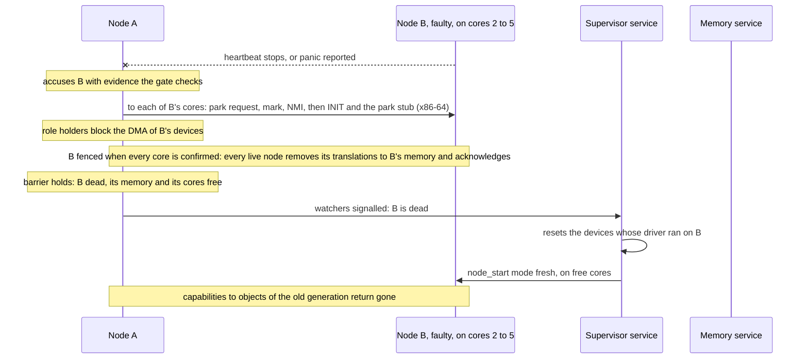

# Kernel

Statuses are defined in the [README](../README.md#status-legend). Verification marks ("from memory", "not cross-checked", check dates) are defined there too.

The kernel is a capability microkernel. A **capability** is a token that designates a kernel object together with the rights its holder has on it; a program can act only through the capabilities it holds. A **microkernel** keeps only capabilities, inter-process communication (IPC), scheduling, memory and IOMMU programming in the kernel; everything else runs in user space.

## Base decisions

| Topic | Position | Status |
|---|---|---|
| Kernel | Capability microkernel, 64-bit only, written from the model and not translated from seL4 | Decided |
| seL4 ABI | No lasting dependency. seL4 serves only as a black-box oracle for differential tests (see [verification](../plan/verification.md#kernel-verification)) | Decided |
| Languages | Kernel in Zig and Rust: Zig for the hardware layer that faces devices and the CPU's entry, Rust for the logic, the gate with its page-table primitives, and the IPC fast path (D-126, [Language split](kernel-interface.md#language-split)). Rust for the system userland. Odin rejected | Decided (D-004); the split proposed (D-126) |
| Zig / Rust boundary | Types are defined once in Rust `repr(C)` in `abi/`; the Rust build prints the constants and offsets the Zig layer needs as a Zig source file, which the Zig layer checks at compile time (no C header is translated). Only `extern`-compatible types cross. The boundary is crossed once per event or per hardware operation, never per table entry. `zig build` drives cargo and does the linking, without cross-language LTO. MMIO registers are written as whole values built in a local, never field by field through a volatile pointer (D-126) | Proposed (D-126), 16 November 2026 |
| System calls | System calls sit behind a code page supplied by the kernel and are never called directly. A system call is accepted only when it comes from that page; this is checked on entry | Decided (the entry check on 14 November 2026) |
| Kernel shape | Event-driven kernel with no per-thread kernel stack, which allows hot replacement | Aligned |
| System call duration | Every system call has a bounded duration, with resumption points, and the bound is verified | Decided, 14 November 2026 |
| Kernel heap | None. See [memory.md](memory.md) | Proposed |

The feasibility of the Zig / Rust boundary and of the event-driven kernel with no per-thread stack is "from memory"; both are trial subjects in weeks 1-2 of the [calendar](../plan/roadmap.md#calendar).

The kernel has its own replacement mechanism, based on versioned object formats (see [Hot replacement](#node-by-node-replacement)).

## Multi-core structure

**Decided by the owners, 16 November 2026 (D-128), reopening D-026, D-028 and D-108.** The rules that follow from it, where no decision spoke, are proposed by the assistant (D-129) and written in the [contract](kernel-interface.md).

- **A node is one kernel, and may cover several cores.** A node is the state of one kernel (its block, with a defined and versioned format) and the set of physical cores it runs on, fixed when it starts and kept until it ends. Inside a node the cores share state, with locks ([A node of several cores](kernel-interface.md#a-node-of-several-cores)). A node of one core is a particular case of the same rules, not a separate design.
- **Between nodes: no mutable kernel state shared**, other than the single-writer words of the living part of the machine table, written through the gates; messages only.
- **Only one-shot operations cross between nodes.** The receiving kernel answers each in one bounded step; nine of the eleven kinds leave nothing at the receiver, and two, a `Revoke` and a `UnitRequest`, leave bounded state there until an invalidation completes, listed with its bound and what ends it in [What a receiver keeps](kernel-interface.md#what-a-receiver-keeps-the-one-shot-rule-as-it-holds) (restated with the owners after the eighth review, D-131). What crosses: the ownership words; grants of frames, with their revocation and release; a remote signal (the doorbell of a frame grant); a stamped, bounded send into a node's mailbox; membership, accusation, the fence and the reclaim barrier R0 to R6; roles; unit requests. Twelve message kinds on two rings per ordered pair of nodes ([What crosses between nodes](kernel-interface.md#what-crosses-between-nodes)). Rule 7 of D-122 (a call on an object of another node works as if it were local) is withdrawn, and with it remote calls and waits held by proxies, the transfer of capabilities other than grants of frames, `thread_move` and carried calls.
- **No node runs on another node's core.** Parking and co-hosting (D-108) are gone. An idle core sleeps in place; an idle node sleeps in place. Sealing remains only to replace a kernel by a new version.
- **A process lives in one node.** A process with threads on several cores lives in a node of several cores; no protocol between nodes serves one process's address space. The core group of the previous text, a process spread over several nodes with a copy of its page tables on each, is gone.
- **Memory ownership invariant.** Nothing that a live kernel depends on is recorded only in another kernel. Every chunk of ordinary memory and every entry of device memory has one owner node, recorded in the living part of the machine table and written only through the owner's write gate; each node slot keeps a small floor that never moves, and the rest moves between nodes by `memory_give` and `memory_take` (D-112 to D-115, [Memory and devices between nodes](kernel-interface.md#memory-and-devices-between-nodes)). A node maps memory it does not own only under a grant of a frame, so every remote mapping is recorded on both sides. No memory of a dead node is reused before every one of its cores is stopped and every live node that could reach it has acknowledged ([The reclaim barrier](kernel-interface.md#the-reclaim-barrier)).
- **Inter-kernel protocol.** It is versioned, and compatible from one version to the next, so that the kernel can be replaced node by node.
- **Formal models** (D-027, restated for this shape in the [contract](kernel-interface.md#changes-for-abi-and-the-model-d-128-d-129)). Three models are checked by state exploration (TLA+ or equivalent): grants, stamped sends, signals and revocation between nodes; the life of a node of several cores (start, seal, fence, restart, at the level of single word accesses); recovery at the level of single word accesses under x86-TSO and the Armv8 memory model, with small models inside one node for the shootdown, the lock-free slot read and the atomic signal.
- **Services.** A service chooses to have one thread or one thread per core of its node.
- **Hardware threads of one physical core.** In version 1 the second hardware thread stays idle (D-028, that part kept). If it is used later, both hardware threads of a core belong to the same node.
- **Prior art to cite.** Hive (SOSP 1995), whose cells of several processors are its units of failure, fixed at boot; the clustered multikernel of seL4 (von Tessin, 2012), nodes of several CPUs with a big lock inside and communication across nodes through shared user memory only, fixed at boot, with no recovery.

### Nodes, cores and load

**Decided by the owners, 16 November 2026 (D-128); the plan below is theirs.** The specification and the model describe a node of *N* cores fixed at its creation, *N* = 1 being a particular case. The kernel is built with *N* = 1 first, then *N* > 1; the contract, `abi/` and the layout of every object are the same for both.

- **A node runs on a set of physical cores recorded by core words.** Each physical core has a word in the living part of the machine table that names the node holding it (free, joining, owned; *leaving* reserved), written through the gates ([Node slots and core words](kernel-interface.md#node-slots-and-core-words)). The machine table has node slots distinct from physical cores, each with its floor; a node starts in a slot, on free cores, and keeps them until it ends.
- **Containment is per node.** A node's kernel maps only its own memory and what it was granted; a panic in a node, or one of its cores that stops answering, ends that node and only it.
- **The floor of physical memory belongs to the node slot** and is fixed at start-up (D-107, amended by D-114); it is enough to restart a node in that slot. The rest of memory is in chunks that change owner, driven by the memory service. A node that is reloaded is rebuilt from its floor and the kept image, then takes memory again with `memory_take`.
- **Shared hardware is driven by roles.** Each IOMMU unit and each IOAPIC has a role held by one node at a time; devices, their DMA tables and their MSI vectors belong to the node of their driver (D-113) and keep working while a role holder is recovered; only changes on that unit wait ([Roles](kernel-interface.md#roles)). A multi-queue device spreads its vectors over the cores of its driver's node.
- **A process lives in one node**, the one its memory and objects come from. If that node is lost, the process is lost; the loss of another node costs it only the frames it mapped from there.
- **No node is necessary to the machine** (D-115 point 3). Every duty that needs one holder is a role that moves after its holder's cores are stopped, and every node starts the same way from the kept image. The supervisor and the memory service run on the nodes that hold the reserve roles (at least two, in distinct nodes, preferably of one core each). A service that must survive the loss of a node does the same.
- **Cores that move between nodes at run time are not in the contract as rules** (D-128): four models broke that protocol in turn, each at a finer grain. The contract holds what must exist from the start so that they are an addition and not a rewrite (the core word and its states, node slots distinct from physical cores, the values of `abi/`), and an open point names the draft, its explorer, the faults found and what must hold before it enters ([Open points](kernel-interface.md#open-points)).

The question this section asked since 14 November 2026, "may a node run on more than one core at the same time?", is answered: yes, in groups sized when the node starts (the second row of the earlier table), with the growth and shrinking of the third row left to the open point above. The measured trial of the three candidates (branch `trial-multicore`, `results-mac-m5.md`) informs the choice of locks inside a node, still open ([Open points](kernel-interface.md#open-points)).

### Hard points

- **A node of several cores is a concurrent kernel.** Suspending, cancelling or destroying a thread that runs on another core of the node needs that core to leave it first (the clustered multikernel's thread-deletion problem: two thread states, eight preemption points and a 1,000-line invariant proof there); the contract places one thread state and one wait state for it.
- **The gate of a node of several cores** must hold its invariant after every store, since the walkers of the node's other cores read the tables while it writes them, and with the other cores' TLBs (G12); the tools for that proof are unfinished ([gate-page-tables.md](../research/drafts/gate-page-tables.md)).
- **The bounds of D-042 grow with *N*** and with the slowest kind of core in a node: a lock held by an efficiency core delays a performance core.
- seL4 also retains a statically partitioned multikernel as its path to verified multi-core, and discourages IPC between cores in it (verified 14 November 2026 by web search, abstracts and official pages).
- An overhead gate is added for IPC between cores of one node and for a request and reply between two nodes (see [gates](../plan/gates.md#overhead-gates)).
- Performance cores and efficiency cores (P and E cores): the placement policy stays in user space (see [scheduling.md](scheduling.md)). A node may hold cores of several kinds that have the same state features and vector lengths; a context is placed on one core of its node and moved inside the node by the placement service ([Unlike cores](kernel-interface.md#unlike-cores)).

### Alternatives kept as comparison points

These variants are no longer candidates. They are measured on the same bench as the retained shape.

| Variant | Description |
|---|---|
| One node per core with the reduced set between nodes | The shape "B" of the drafts: every node of one core. It is the retained shape with *N* = 1 everywhere, and what the first kernel runs |
| Global lock | One lock for the whole kernel of the machine, with no nodes |
| Replicated log | The split is by kind of state, not by core. State of a process spread over several cores is replicated through a shared log. Formerly proposed as a "hybrid structure" |

Precedents for these variants are listed in [research/prior-art.md](../research/prior-art.md#multi-core-structure-precedents).

### Dynamic structure

**Proposed.** The number of active cores and their assignment follow the load. In version 1 this means: idle cores sleep in place inside their nodes, and the placement service creates and ends nodes on free cores (`node_start`, `node_stop`), sized when they start. **Nodes that take and give cores at run time ("cores on demand") stay after the alpha** (**Decided**, 14 November 2026; see [roadmap](../plan/roadmap.md#deferred-after-the-alpha)), and enter the contract only once the conditions of its open point hold (D-128).

## Capabilities and revocation

- Any call on a capability can fail, because a capability is revocable (rule 1 of the [ABI](wasm-abi.md#abi-rules)).
- Revocation walks the derivation tree, a mechanism borrowed from seL4 (see [borrowings](../research/prior-art.md#borrowings)), inside one node. A frame granted to another node is revoked by the two-phase protocol of D-027 (the grant becomes *revoking*, then is freed once the holder has removed its copies and their mappings), with a formal model; no other capability crosses nodes (D-128, [Grants](kernel-interface.md#grants-frames-between-nodes)).
- A right is a capability and a revocable line in a central place; see [security.md](security.md#permissions).
- Capabilities typed by WIT (**Aligned**: retained with the user's agreement, to be designed; from the second delegated study of 14 November 2026, not cross-checked): the compiler emits the manifest, and the WIT keywords `own` and `borrow` become derivation and attenuation. This is already the project's design. The earlier claim that it "does not seem to be published" is softened (**Decided**, 14 November 2026; see [prior art](../research/prior-art.md#novelty-claims-and-verdicts)).

## Recovery of one node

**Decided for version 1, 14 November 2026** (decision of the user); a node covers several cores since D-128. The mechanism below was proposed at the user's request and replaces "stop everything": a kernel that panics restarts alone, with all its cores, and the machine continues.

1. **Containment.** Each kernel maps only its own memory and what it was granted, and validates every message it receives from another kernel. The write gate holds this: the node's page tables, the IOMMU tables, interrupts to other cores, the sensitive ports and firmware calls are written only by it, and it refuses a translation to memory or to a device the node does not own (D-117, D-120; [The gate over page tables](kernel-interface.md#the-gate-over-page-tables)). Without this, a faulty kernel can write into its neighbours and nothing is guaranteed.
2. **Detection.** Evidence checked in shared memory by the gate: a node's own panic record (written by any of its cores, also when one of its cores stops answering the others), a heartbeat of one of its cores that stops while the core is not idle, a ring left unconsumed, a seal held too long; never a vote ([Detection](kernel-interface.md#detection-evidence-not-opinion)).
3. **Recovery.** The order is: isolate the node (accusation, DMA blocked by the role holders, every one of its cores stopped by the cheapest sufficient means of its architecture: D-117), reset the devices whose driver ran on it, reclaim the memory (every live node removes its translations to the dead node's memory and acknowledges; the node is dead when the barrier holds, and its cores are free), reload the kernel (a supervisor calls `node_start`, on free cores). The kernel is reloaded through the normal core start-up path. References to its objects return `gone`, which rule 1 of the ABI already requires callers to handle. A driver follows the [driver restart protocol](drivers.md#restart-of-a-driver). Recovery does not assume process snapshots: what happens to the processes that ran on the core follows [platform.md](platform.md#process-state-suspend-resume-and-snapshots).
4. **Later, research.** Adopt the state of the old kernel after validation, instead of starting again from saved state (Otherworld does this for Linux, with a stated 97 % success rate).
5. **Core with a hardware fault.** Its node is stopped and the core marked unusable (`node_stop` mode retire); the node can be started again on its other cores, and the machine continues.

Further rules:

- A complete stop happens only if containment itself is violated; a node that fails repeatedly is left dead, or one of its cores retired (`node_stop` mode retire). The stop record is written to the crash area in memory, the machine restarts by a warm reset, and the next boot hands the record over; the storage service writes it to the reserved area (see [storage.md](storage.md#partitions) and [The crash record](kernel-interface.md#the-crash-record)).
- Check: the deterministic simulation kills a kernel at random at every merge, and a core of a node of several cores, and verifies that the rest survives. A gate is to be set: the recovery time of a node, as a function of its number of cores (see [gates](../plan/gates.md#overhead-gates)).
- Prior art (web search of 14 November 2026, abstracts only): Barrelfish/DC replaces the kernel of a core at run time, with no failure evaluation found; Quest-V recovers after a failure but isolates its kernels by virtualisation; Kmorph (Linux, out of tree) keeps a spare kernel that takes over the machine in about one second. Hive (SOSP 1995) is to be cited. Recovery was recorded as a candidate research axis to claim, with a strong argument on the server side, to be verified; it is now part of [research axis 2](../research/prior-art.md#kernel-research-axes) (**Decided**, 14 November 2026).

### The write gate: mechanisms

**Proposed, 16 November 2026 (D-117 point 2, D-120 point 1).** The contract states the gate as rules that name no mechanism ([The gate over page tables](kernel-interface.md#the-gate-over-page-tables), rules G1 to G14). These are the first mechanisms to prototype on each architecture, from the research draft [gate-page-tables.md](../research/drafts/gate-page-tables.md), where every figure has its source. **No measure has been made on the project's machines yet**: every cost below was measured by others, on other processors.

**x86-64 (the reference desktop, a Raptor Lake processor).**

| Order | Mechanism | Window open while the gate writes | Cost measured elsewhere | Status |
|---|---|---|---|---|
| 1 | Page tables and gate pages typed as supervisor shadow-stack pages, written only by `WRSSQ`, with CET kept on. An ordinary store to them faults; reads stay ordinary | None | `WRSSQ` 9.3 cycles against 0.8 for a `MOV`, on a Tiger Lake core (CETIS, CCS 2022) | Proposed by CETIS for kernel page tables; built by nobody. **First to prototype** (D-120). `WRSSQ` at ring 0 needs supervisor shadow stacks on, `IA32_S_CET.SH_STK_EN` and `IA32_S_CET.WR_SHSTK_EN` (otherwise `#UD`), and the kernel checks `CPUID.07H.01H:EDX.CET_SSS[18]` before it enables them (Intel SDM, order 325462-093, `WRSSD/WRSSQ` and the CPUID leaf 07H) |
| 2 | A page-table root used only by the gate, with PCID: the gate's root maps the gate pages writable, the kernel's roots map them read-only | Yes | Two writes of CR3, about 200 cycles each (Ren et al., SOSP 2019) | The fallback (D-120) |
| 3 | Protection keys for supervisor pages (PKS) | Yes, for one key | No figure found | `IA32_PKRS` is listed among the MSRs of the 12th and 13th generation hybrid processors (Intel SDM 325462-093, volume 4, Table 2-46); whether the reference processor enables PKS is tested on the machine, since Intel support said 13th-generation parts lack it |
| 4 | Toggling CR0.WP (the Nested Kernel) | Yes, for every read-only page | About 473 cycles per call on a Core i7-3770 (Nested Kernel, ASPLOS 2015) | Only on processors without CET: CR0.WP cannot be cleared while CR4.CET is set (Intel SDM 325462-093, §2.5) |

- With a window (mechanisms 2 to 4), every event that can arrive inside it (NMI, machine check, debug trap) enters through a gate stub that closes the window before any other code runs, saves the interrupted registers in a gate area, and restores them from there. Mechanism 1 has no window; the gate is then a leaf function that keeps its checked values in registers, and re-reads each entry after writing it.
- **Instructions forbidden outside the gate and the start-up code** (the scan, rule G11; the list is generated from Intel XED's instruction data, every class marked `RING0` or writing a system register classified once, D-125, and the names below are the classes the hand-written list of D-124 missed included): writes to CR0, CR3, CR4 and the debug registers, among them `LMSW` and `CLTS`, which write CR0 by other opcodes; `WRMSR`, `WRMSRNS`, `WRMSRLIST` and the MSR forms with an immediate index (XED's `msr-imm`); `XSETBV` (it sets XCR0, the vector state features: the counterpart of `ZCR_EL1` under D-118) and `XRSTORS`; `LGDT`, `LIDT`, `LLDT`, `LTR`; `INVD`; `INVLPGB` and `TLBSYNC` (AMD's broadcast invalidation, which reaches other cores' TLBs); the VMX and SVM instructions (unless the image declares the hardening monitor); `IN`, `OUT` and their string forms; the shadow-stack management instructions, `SETSSBSY`, `CLRSSBSY`, `WRUSSD`, `WRUSSQ` and `WRSSQ` outside the gate's mechanism; `ERETS`, `ERETU` and `LKGS` (FRED, deferred, refused all the same); `LOADIWKEY`; the SEAM and TDX calls; the SEV-SNP instructions (`PVALIDATE`, `RMPADJUST`, `RMPUPDATE`, `PSMASH`); `HRESET`; `ENCLS`, `PCONFIG`; any unintended `ENDBR64` pattern. `WBINVD`, `INVLPG`, `INVPCID` and `RDMSR` are allowed.
- **Written once at start-up, then read-only:** the IDT, the GDT, the TSS, the interrupt shadow-stack table.
- **Gate entries for privileged writes:** loading a root; the x2APIC end of interrupt and timer deadline (both non-serializing writes); interrupts to other cores (INIT, SIPI and NMI only under rule G10); port I/O; the allow-listed firmware calls (none on x86-64 in version 1: the kernel uses no firmware service at run time).
- **Cost on x86-64:** these privileged writes, a root load per switch of address space, and a gate call per mapping change. Not measured on the reference desktop (below).

**ARM64.**

| Order | Mechanism | Window | Cost measured elsewhere | Status |
|---|---|---|---|---|
| 1 | A translation context of the gate, entered by switching `TTBR1_EL1` with its own ASID; the instruction that leaves it is the last one of a page mapped only in the gate's context (SKEE) | Yes | 284 cycles per round trip with an ASID, Exynos 7420 (SKEE, NDSS 2016) | Every Armv8.0 core. The baseline |
| 1' | The same by widening `TCR_EL1.T1SZ` (Hilps) | Yes | 210 to 424 cycles, Juno board (Hilps, NDSS 2017) | Every Armv8.0 core; measured against 1 |
| 2 | Permission overlays (`POR_EL1`, FEAT_S1POE) | Yes, for the table index | No figure on hardware | When present; no shipping core found |
| 3 | Page tables typed as Guarded Control Stack pages, written by `GCSSTR` | None | No figure | When present (Armv9.3 GCS with S1PIE); no shipping core found |

- **Forbidden outside the gate:** writes to `TTBR0_EL1`, `TTBR1_EL1`, `TCR_EL1`, `TCR2_EL1`, `SCTLR_EL1`, `MAIR_EL1`, `VBAR_EL1`, `POR_EL1`, `PIR_EL1`, `PIRE0_EL1`, `GCSCR_EL1`, `GCSPR_EL1` (and their EL2 forms when the kernel runs at EL2, as it does where EL2 exists: [The fence](kernel-interface.md#the-fence-stopping-the-cores-of-a-node)); the interrupt generation registers `ICC_SGI0R_EL1`, `ICC_SGI1R_EL1` and `ICC_ASGI1R_EL1`, writable at EL1 ([`ICC_SGI1R_EL1`](https://df.lth.se/~getz/ARM/SysReg/AArch64-icc_sgi1r_el1.html), mirror of Arm's register description): a fence signal and an ordinary interrupt to another core are the same instruction with different operands, so the scan forbids every write and the gate makes them, checking G10; the debug registers `DBGBCR<n>_EL1`, `DBGBVR<n>_EL1`, `DBGWCR<n>_EL1`, `DBGWVR<n>_EL1` and `MDSCR_EL1`, writable at EL1 ([`DBGWCR<n>_EL1`](https://df.lth.se/~getz/ARM/SysReg/AArch64-dbgwcrn_el1.html)), which could arm a watchpoint on another node's memory; the vector-length registers `ZCR_EL1` and `SMCR_EL1` (and their EL2 forms), which keep one length per kind (D-118), and the `MSR` immediates that change the streaming vector state, `SVCRSM`, `SVCRZA` and `SVCRSMZA` (the forms `SMSTART` and `SMSTOP`), for the same reason; the list is generated from Arm's AARCHMRS, every writable encoding and every `MSR` immediate classified once (D-125); `SMC` and `HVC`; `DC ISW`; implementation-defined system registers; the EL2 translation registers unless the image declares the hardening monitor.
- **Firmware allow-list:** PSCI `CPU_ON` (only to a core whose word reads *joining* for a node the caller starts), `CPU_OFF` (own core), `AFFINITY_INFO`, `CPU_SUSPEND`, `SYSTEM_RESET2`, and at machine start-up `MIGRATE_INFO_TYPE` and `MIGRATE_INFO_UP_CPU` (to find the core of a resident Trusted OS); SDEI registration and enabling of event 0, unmasking, `SDEI_EVENT_COMPLETE_AND_RESUME` (the fence's handler resumes the park routine with it, which then calls `CPU_OFF`), and `SDEI_EVENT_SIGNAL` (only to a core whose word names a node whose fence the caller drives and carries the fence mark); the entry stub registers, enables and unmasks after every `CPU_ON`, and a core unmasks again after every exit from a power-down idle state, since Trusted Firmware-A clears or masks them then (D-131, [The fence](kernel-interface.md#the-fence-stopping-the-cores-of-a-node)). Refused, with every call not listed: `SDEI_PE_MASK` (0xC400002B), which would let a dying kernel mask SDEI event 0, the fence's signal (Arm DEN 0054C; Trusted Firmware-A then refuses the signal and drops the event, as the seventh review's verification read in its sources), and `SDEI_EVENT_DISABLE` and `SDEI_EVENT_UNREGISTER` of event 0, which would do the same.
- **Interrupt routing is by memory-mapped registers, not by system registers.** An SPI is routed to a core by `GICD_IROUTER<n>` of the distributor, an LPI through the commands its ITS reads from a command queue in memory (`MAPD`, `MAPTI`, `MAPC`, `INV`, `SYNC`); both are MMIO regions mapped only in the gate view of the holder of the unit role of the distributor or of that ITS ([Roles](kernel-interface.md#roles)). The `ICC_*` system registers of the CPU interface only acknowledge, end, mask by priority and send SGIs; of those, the SGI registers are forbidden outside the gate (above), and the others act on the calling core only.
- **Cost on ARM64:** every interrupt to another core, and every write of a debug or vector-length register, is a gate call. Not measured.

**RISC-V.**

| Order | Mechanism | Window | Cost measured elsewhere | Status |
|---|---|---|---|---|
| 1 | A `satp` root used only by the gate, with its own ASID; the instruction that leaves it is the last one of a page mapped only by the gate's root | Yes | No figure found | Every core with paging. The baseline |
| 2 | Page tables typed as shadow-stack pages (Zicfiss), written by `SSAMOSWAP` | None | No figure | When present; no silicon found |

- **Forbidden outside the gate** (scanned at every 2-byte offset): writes to `satp`, `stvec`, `ssp`, the hypervisor CSRs and `senvcfg`; `ECALL`; the shadow-stack stores; `CBO.INVAL`; the hypervisor fences and loads. The trigger registers of the debug specification (`tselect`, `tdata1` to `tdata3`) are reachable only from machine mode and debug mode under Sdtrig ([Sdtrig](https://docs.riscv.org/reference/debug/Sdtrig.html)), so supervisor code cannot arm them; where a delegation of triggers to supervisor mode exists, the kernel leaves it disabled. The vector length is a constant of the hart: no register to forbid.
- **A store cannot be told apart by the scan:** an interrupt to another hart is a store to the ACLINT's software-interrupt registers ([ACLINT](https://github.com/riscvarchive/riscv-aclint/blob/main/riscv-aclint.adoc)) or to the target's IMSIC, and the APLIC's registers are a region every hart could store to. These regions are mapped only in the gate's own translation context, so a store to them outside the gate faults; the gate makes the store, checking G10 and the APLIC's unit role.
- **Cost on RISC-V:** every interrupt to another hart is a gate call (a switch of `satp` to the gate's root and back). Not measured.
- **Firmware allow-list:** SBI `hart_start` (only to a hart whose word reads *joining* for a node the caller starts), `hart_stop` (own hart), `hart_get_status`, `hart_suspend`, the timer, the IPI extension, `fence_hart` (only to a hart whose word names a node whose fence the caller drives and carries the fence mark), `SRST`.

**Measures to make before the mechanism is fixed** (gate-page-tables.md, part 9): whether the reference processor really has PKS, CET shadow stacks and IBT on both kinds of core; whether a page-table page typed as a shadow-stack page still serves the page walk and its accessed and dirty bits; the cost of a gate call and of a batch of *E* entries; the cost of CET on the null call, on IPC and on a switch of address space; the false positives of the scanner on the one-core kernel; a functional gate on ARM64 and RISC-V under QEMU, and their cycles on boards (an ARM64 board is bought when measures on ARM64 are wanted, D-120 point 4); fault injection showing that G3 to G7 stop what the check field misses; the cost of the audit of G14 on a node holding 64 GB.

### The machine boundary

**Proposed (D-125), 16 November 2026.** The kernel's architecture-independent core reaches the machine only through these operations ([Architectures](kernel-interface.md#architectures)). Each is bounded and never allocates; each architecture implements them, and a simulated machine implements them on the host for the model's tests. On hardware the boundary is static dispatch, monomorphised per architecture: an inlined call, no indirect branch. An operation is added only by a decision.

| Group | Operation | Contract |
|---|---|---|
| Tables | `write_entry(table, index, value)` | the gate's write of one entry (G1); the value was checked by the common G3 code; re-read after the write where the mechanism needs it |
| | `read_entry(table, index)` | a plain load |
| | `invalidate_page(tag, address)`, `invalidate_tag(tag)`, `invalidate_all()` | done on this core when it returns |
| | `invalidate_broadcast(tag, range)` | ARM64: a broadcast invalidation completed on every core of the inner shareable domain when it returns (`TLBI ...IS`, then `DSB ISH`); not used where the architecture has none: the other cores of the node are then sent the kernel's invalidation interrupt (D-129) |
| | `load_root(table, tag)` | G7 checked by the common code |
| | `type_table_page(page, class)` | where the gate's mechanism types a page (shadow-stack typing on x86-64); nothing elsewhere |
| IOMMU | `iommu_write_context(unit, device, root, domain)`, `iommu_clear_context(unit, device)`, `iommu_invalidate(unit, domain, range)`, `iommu_wait(unit, deadline)` | the operations of a unit role's holder; `iommu_wait` returns "timed out" after the bound |
| | `iommu_write_remap(index, entry)`, `iommu_invalidate_remap(unit, index)` | interrupt remapping |
| Interrupts | `irq_mask(source)`, `irq_unmask(source)`, `irq_eoi(vector)` | constant work |
| | `irq_route(source, core, vector)` | an IOAPIC entry, an APLIC target, an ITS mapping or `GICD_IROUTER<n>` |
| | `send_ipi(core, kind)`, kind ordinary (the kernel's reschedule, leave and invalidation interrupts to the cores of its node, and a ring's interrupt to another node), fence signal or start | G10 checked by the common code |
| Cores | `core_start(core, entry)`, `core_park_self(request)`, `core_stop_confirmed(core, request)` | the stub's start request and an NMI, PSCI, SBI; the confirmation of a park request; the steps of [The fence](kernel-interface.md#the-fence-stopping-the-cores-of-a-node) |
| Firmware | `firmware_call(call, arguments)` | the allow-list above; refused otherwise |
| Time | `clock_now()`, `timer_set(deadline)`, `counter_frequency()` | monotonic |
| Registers | `save_user_state(thread)`, `restore_user_state(thread)`, `save_vector_state(thread, mask)`, `restore_vector_state(thread, mask)`, `write_protected(register, value)` | the save area in the layout of `abi/`; a protected register through the gate (the debug and vector-length registers, ARM64's SGI registers) |
| Memory | `clear(range)`, `copy(from, to, length)` | bounded by the caller's step (64 KB) |
| Ports (x86-64) | `port_in(port, width)`, `port_out(port, width, value)` | executed by the gate ([I/O ports](kernel-interface.md#io-ports)) |
| Entropy | `hardware_random()` | none if the processor has no readable source |
| Debug | `console_write(bytes)`, `breakpoint_set(thread, slot, spec)` | the console only if the image declares one |

### Node-by-node replacement

The same path replaces the kernel node by node: a kernel update without a reboot, by `node_stop` mode seal and `node_start` mode resume with the replacement image, on the same cores (the processes of that node pause meanwhile; a seal held longer than `SEAL_NS` is accused). It relies on the versioned inter-kernel protocol and on versioned object formats.

## Entropy

**Decided, 14 November 2026.** The kernel has a random generator fed by the processor, the interrupts and the TPM (the machine's security chip). The generator is per physical core since D-129 (per node before); user space reads it, and the user-space driver of the TPM feeds it, with `entropy_read` ([Entropy](kernel-interface.md#entropy)).

## Hardware features

From the second delegated study of 14 November 2026 (not cross-checked; figures to re-read in the papers), unless noted.

| Feature | Position | Status |
|---|---|---|
| FRED (new x86 event delivery, with the stack chosen per level) | Suits a kernel with no per-thread stack, and no paper evaluates it. To verify: does the reference processor have it? The classic path through the IDT (interrupt descriptor table) stays mandatory. FRED is deferred until after the alpha | Deferred: Decided, 14 November 2026. Presence on the reference processor: Open |
| APX (32 general registers, announced for Nova Lake) | Plan a wider register-based IPC message format | Not cross-checked |
| LAM | Not to be used (SLAM attack, disabled in Linux) | Not cross-checked |
| CET | To be required: it is what keeps a wild jump out of the middle of the write gate, and the first x86-64 mechanism of the gate types page tables as shadow-stack pages ([The write gate: mechanisms](#the-write-gate-mechanisms)) | Proposed, 16 November 2026 (D-120); present on the reference processor per its CPUID, to confirm on the machine |
| PKS, POE | Optional accelerators of the write gate where present, never required | Proposed, 16 November 2026 |
| Distinct core types | To be treated as lasting: Arm, Apple, Intel and AMD converge on it; the rumour of an Intel "unified core" around 2028 does not change this choice | Decided |
| Per-core-type kernel binary | A node whose cores are all of one kind allows a binary tuned per core type. Low expected gain (kernel time is a small share): to keep only if measured | Aligned (retained) |
| User interrupts (xUI, ASPLOS 2025; Aeolia, SOSP 2025) | Deliver an event to a component without entering the kernel. Not in version 1: no machine of the project has them; the hook is placed in the contract (a feature bit and a word of the register block, [User interrupts](kernel-interface.md#user-interrupts-a-placed-hook)) | Proposed, 16 November 2026 |

Rejected, from the same study: a single address space shared between components and separated by protection keys (it contradicts the rule of one process per publisher, and user-mode keys can be modified by the code); a language model in the kernel.

## Related

- Objects and system calls: [kernel-interface.md](kernel-interface.md).
- Scheduling mechanism: [scheduling.md](scheduling.md).
- Memory mechanism: [memory.md](memory.md).
- IOMMU objects: [drivers.md](drivers.md#iommu).
- Kernel verification, oracle and proofs: [plan/verification.md](../plan/verification.md#kernel-verification).
- Research axes and novelty claims: [research/prior-art.md](../research/prior-art.md#kernel-research-axes).
- Kernel ideas not yet proposed: [research/ideas.md](../research/ideas.md#low-level-and-kernel).
