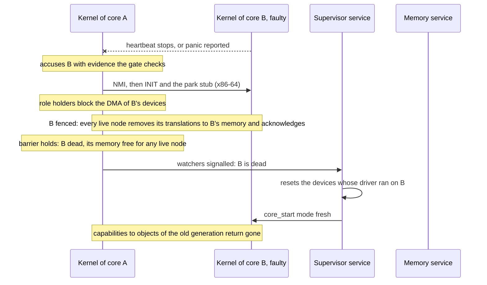

# Kernel

Statuses are defined in the [README](../README.md#status-legend). Verification marks ("from memory", "not cross-checked", check dates) are defined there too.

The kernel is a capability microkernel. A **capability** is a token that designates a kernel object together with the rights its holder has on it; a program can act only through the capabilities it holds. A **microkernel** keeps only capabilities, inter-process communication (IPC), scheduling, memory and IOMMU programming in the kernel; everything else runs in user space.

## Base decisions

| Topic | Position | Status |
|---|---|---|
| Kernel | Capability microkernel, 64-bit only, written from the model and not translated from seL4 | Decided |
| seL4 ABI | No lasting dependency. seL4 serves only as a black-box oracle for differential tests (see [verification](../plan/verification.md#kernel-verification)) | Decided |
| Languages | Kernel in Zig and Rust: Zig for the hardware layer and the IPC fast path, Rust for the logic (capabilities, object life cycle, scheduling policy). Rust for the system userland. Odin rejected | Decided |
| Zig / Rust boundary | Types are defined once in Rust `repr(C)`; a C header is generated and translated for Zig by the build (Zig 0.17 removed `@cImport`; translation goes through the `translate_c` package, checked on Zig 0.17.1 on 14 November 2026). No call crosses the boundary on the fast path. `zig build` drives cargo and does the linking | Aligned |
| System calls | System calls sit behind a code page supplied by the kernel and are never called directly. A system call is accepted only when it comes from that page; this is checked on entry | Decided (the entry check on 14 November 2026) |
| Kernel shape | Event-driven kernel with no per-thread kernel stack, which allows hot replacement | Aligned |
| System call duration | Every system call has a bounded duration, with resumption points, and the bound is verified | Decided, 14 November 2026 |
| Kernel heap | None. See [memory.md](memory.md) | Proposed |

The feasibility of the Zig / Rust boundary and of the event-driven kernel with no per-thread stack is "from memory"; both are trial subjects in weeks 1-2 of the [calendar](../plan/roadmap.md#calendar).

The kernel has its own replacement mechanism, based on versioned object formats (see [Hot replacement](#core-by-core-replacement)).

## Multi-core structure

**Decided, 14 November 2026.** One kernel per core, with no shared state; kernels talk only by messages. The recovery of one core's kernel is part of version 1 (decision of the user), and the points below follow from it.

- **Core group.** The term has one meaning: the per-core kernels that hold, by messages, the address space of one process. How a group is sized and budgeted is in [scheduling.md](scheduling.md#core-group-of-a-multithreaded-process).
- **Page tables.** Each core has its own copy of the page table of a process that is spread over several cores.
- **Capabilities.** The derivation tree (the tree that links a capability to the capabilities derived from it) is kept per node, and a slot never names a slot of another node: a capability that crosses to another node goes through a **grant** written by the owner's write gate, and the holder's copy names the grant ([Grants](kernel-interface.md#grants-capabilities-and-memory-between-nodes)). Revoking a grant is the distributed two-phase protocol of D-027 (the grant becomes *revoking*, then is freed once the holder has removed its copies and their mappings), with a formal model. It removes the capabilities of an agent task once `task_revoke` has stopped its threads; stopping needs no protocol, because a task and its threads are on one node (D-110, proposed; see [Tasks and marks](kernel-interface.md#tasks-and-marks) and the [research axes](../research/prior-art.md#kernel-research-axes)).
- **Memory ownership invariant.** Nothing that a live kernel depends on is recorded only in another kernel. Every chunk of ordinary memory and every entry of device memory has one owner node, recorded in the living part of the machine table and written only through the owner's write gate; each node keeps a small floor that never moves, and the rest moves between nodes by `memory_give` and `memory_take` (D-112 to D-115, [Memory and devices between nodes](kernel-interface.md#memory-and-devices-between-nodes)). A node maps memory it does not own only under a grant, so every remote mapping is recorded on both sides. No memory of a dead node is reused before its core is stopped and every live node that could reach it has acknowledged ([The reclaim barrier](kernel-interface.md#the-reclaim-barrier)).
- **Inter-kernel protocol.** It is versioned, and compatible from one version to the next, so that the kernel can be replaced core by core.
- **Formal models.** Three models are checked by state exploration (TLA+ or equivalent): revocation between cores, change of size of a group, recovery of a kernel.
- **Services.** A service chooses to have one thread or one thread per core.
- **Hardware threads of one physical core.** In version 1: one kernel per physical core, and the second hardware thread stays idle.
- **Prior art to cite.** Hive (SOSP 1995).

### Nodes, cores and load

**Decided, 15 November 2026** (D-108, validated by D-113), except the question of a node on several cores, which the measured trial decides. To design before the one-core kernel is written, for what it fixes in the layout of kernel state.

- **A node is the state of one per-core kernel**, held in one block of memory with a defined, versioned format: the root of its capability tree, its scheduling state, its floor of physical memory and its generation. The kernel code works on the node it is given. (The kernel control block of Barrelfish/DC, cited.)
- **A node is bound to a core at run time, not for ever.** Under low load the nodes of several cores are parked on one core that stays awake and runs them in turn, and the other cores sleep; under load each node gets its core back. Nodes still share no state and talk only by messages, parked or not, so nothing above the kernel sees the difference except in timing.
- **This is not the shared kernel with a short lock.** That variant runs one kernel on several cores at the same time over shared state; it stays a measured comparison point, set aside by D-026 because a panic would take the whole group and a lock makes the duration of a call depend on other cores.
- **Containment is per node.** The kernel maps only the node it is running. A panic while it runs one node does not touch the nodes parked beside it.
- **The floor of physical memory belongs to the node** and is fixed at start-up (D-107, amended by D-114); it is enough to restart the node. The rest of memory is in chunks that change owner, driven by the memory service. A node that is reloaded is rebuilt from its floor and the kept image, then takes memory again with `memory_take`.
- **Shared hardware is driven by roles.** Each IOMMU unit and each IOAPIC has a role held by one node at a time; devices, their DMA tables and their MSI vectors belong to the node of their driver (D-113) and keep working while a role holder is recovered; only changes on that unit wait ([Roles](kernel-interface.md#roles)).
- **A process has a home node**, the one its memory comes from: the memory service moves chunks to that node before it makes the process's frames, so a process does not depend on the nodes whose memory it does not share. Its core group may spread to other nodes, which hold remote mappings recorded on both sides. If the home node is lost the process is lost. If another node of the group is lost the process loses the threads that ran there, which is reported to it, and continues.
- **No node is necessary to the machine** (D-115 point 3). Every duty that needs one holder is a role that moves after its holder's core is stopped, and every node starts the same way from the kept image. The supervisor and the memory service run on the nodes that hold the reserve roles (at least two). A service that must survive the loss of a node does the same.

**The one question that separates the candidates: may a node run on more than one core at the same time?**

| Answer | What it gives | What it costs |
|---|---|---|
| No (the proposal above) | A kernel with no lock; the duration of a call never depends on another core | A process with threads on several cores spans several nodes: page tables and capabilities kept coherent by messages, the hardest point of the project |
| Yes, in groups fixed at start-up (pairs, or the cores that share a cache; the two hardware threads of one core are the smallest group and would use the thread left idle by D-028) | A multithreaded process inside one group has one address space and one capability space, with no protocol between kernels | One lock in the kernel, held by the cores of the group only; two ways of running to verify, locked inside a group and by messages between groups |
| Yes, in groups that change size with the load (idea of the user: six cores under one kernel for a process that needs six, the others kept apart as the safety net) | The same, sized to the process | The same, and moving a running core from one node to another |

In the three cases a panic is contained in one node, a process dies with its home node, and the rest of the machine continues. Precedent for the second, from memory, to verify: the clustered multikernel studied for seL4 (von Tessin, 2012), and the fact that a microkernel spends little time in the kernel, which makes one lock for a few cores cheap. The trial of weeks 1-2 measures the three on the same bench before this is decided.

Open in this proposal: the cost of running a parked node (Barrelfish/DC measures a naive time-sharing of 20 ms slices). Settled since: a survivor tells a reference to a reloaded node from an old one by its generation, recorded in the grant ([Grants](kernel-interface.md#grants-capabilities-and-memory-between-nodes)); what the placement service needs from the kernel is in [Unlike cores](kernel-interface.md#unlike-cores) and [Cores](kernel-interface.md#cores).

Reasons recorded for the messages-only variant: kernels that share no state and talk by messages make the failure of one kernel the failure of one node in a distributed system. A replicated log (the NrOS technique) is state shared between kernels, which is harder to make safe if a kernel dies in the middle of a write.

### Hard points

- A process with several threads on several cores shares one address space, so its page tables and its capabilities must stay coherent between kernels (messages, TLB invalidation; the TLB is the processor's cache of address translations).
- seL4 also retains a statically partitioned multikernel as its path to verified multi-core, and discourages IPC between cores in it (verified 14 November 2026 by web search, abstracts and official pages).
- An overhead gate is added for IPC between cores (see [gates](../plan/gates.md#overhead-gates)).
- Performance cores and efficiency cores (P and E cores): the placement policy stays in user space (see [scheduling.md](scheduling.md)).
- The real gain of one kernel per core for P and E cores, and the compared cost of the alternatives below, are not measured.
- A move of a thread between unlike cores is a move between nodes (`thread_move`, [Unlike cores](kernel-interface.md#unlike-cores)), so placement is by role and class, re-examined every few periods, not phase by phase (see the measurements cited in the research draft on heterogeneous cores).

### Alternatives kept as comparison points

These variants are no longer candidates. They are measured on the same bench as the retained variant.

| Variant | Description |
|---|---|
| Shared kernel with a short lock | One kernel for the core group of a multithreaded process, with a short lock, the group changing size with the load |
| Global lock | One lock for the whole kernel |
| Replicated log | The split is by kind of state, not by core. State that belongs to one core (IPC, scheduling, interrupts) stays local and lock-free. State of a process spread over several cores (address space, capabilities) is replicated through a shared log. Formerly proposed as a "hybrid structure" |

Precedents for these variants are listed in [research/prior-art.md](../research/prior-art.md#multi-core-structure-precedents).

### Dynamic structure

**Proposed.** The number of active cores and their assignment follow the load. Barrelfish/DC adds, removes and replaces a core at run time. The replica of a process exists only on the cores where it has a thread. A core that is not needed is removed, then brought back by the normal core start-up path.

Cores on demand are deferred until after the alpha (**Decided**, 14 November 2026; see [roadmap](../plan/roadmap.md#deferred-after-the-alpha)).

## Capabilities and revocation

- Any call on a capability can fail, because a capability is revocable (rule 1 of the [ABI](wasm-abi.md#abi-rules)).
- Revocation walks the derivation tree, a mechanism borrowed from seL4 (see [borrowings](../research/prior-art.md#borrowings)). With one kernel per core it is the distributed two-phase protocol described above.
- A right is a capability and a revocable line in a central place; see [security.md](security.md#permissions).
- Capabilities typed by WIT (**Aligned**: retained with the user's agreement, to be designed; from the second delegated study of 14 November 2026, not cross-checked): the compiler emits the manifest, and the WIT keywords `own` and `borrow` become derivation and attenuation. This is already the project's design. The earlier claim that it "does not seem to be published" is softened (**Decided**, 14 November 2026; see [prior art](../research/prior-art.md#novelty-claims-and-verdicts)).

## Recovery of one core's kernel

**Decided for version 1, 14 November 2026** (decision of the user). The mechanism below was proposed at the user's request and replaces "stop everything": a kernel that panics restarts alone, and the machine continues.

1. **Containment.** Each kernel maps only its own memory and what it was granted, and validates every message it receives from another kernel. The write gate holds this: the node's page tables, the IOMMU tables, interrupts to other cores, the sensitive ports and firmware calls are written only by it, and it refuses a translation to memory or to a device the node does not own (D-117, D-120; [The gate over page tables](kernel-interface.md#the-gate-over-page-tables)). Without this, a faulty kernel can write into its neighbours and nothing is guaranteed.
2. **Detection.** Evidence checked in shared memory by the gate: a node's own panic record, a heartbeat that stops while the core is not idle, a ring left unconsumed; never a vote ([Detection](kernel-interface.md#detection-evidence-not-opinion)).
3. **Recovery.** The order is: isolate the core (accusation, DMA blocked by the role holders, the core stopped by the cheapest sufficient means of its architecture: D-117), reset the devices whose driver ran on it, reclaim the memory (every live node removes its translations to the dead node's memory and acknowledges; the node is dead when the barrier holds), reload the kernel (a supervisor calls `core_start`). The kernel is reloaded through the normal core start-up path. References to its objects return `gone`, which rule 1 of the ABI already requires callers to handle. A driver follows the [driver restart protocol](drivers.md#restart-of-a-driver). Recovery does not assume process snapshots: what happens to the processes that ran on the core follows [platform.md](platform.md#process-state-suspend-resume-and-snapshots).
4. **Later, research.** Adopt the state of the old kernel after validation, instead of starting again from saved state (Otherworld does this for Linux, with a stated 97 % success rate).
5. **Core with a hardware fault.** It is removed, and the machine continues with the others.

Further rules:

- A complete stop happens only if containment itself is violated; a node that fails repeatedly is left dead, or its core retired (`core_stop` mode retire). The stop record is written to the crash area in memory, the machine restarts by a warm reset, and the next boot hands the record over; the storage service writes it to the reserved area (see [storage.md](storage.md#partitions) and [The crash record](kernel-interface.md#the-crash-record)).
- Check: the deterministic simulation kills a kernel at random at every merge and verifies that the rest survives. A gate is to be set: the recovery time of a core (see [gates](../plan/gates.md#overhead-gates)).
- Prior art (web search of 14 November 2026, abstracts only): Barrelfish/DC replaces the kernel of a core at run time, with no failure evaluation found; Quest-V recovers after a failure but isolates its kernels by virtualisation; Kmorph (Linux, out of tree) keeps a spare kernel that takes over the machine in about one second. Hive (SOSP 1995) is to be cited. Recovery was recorded as a candidate research axis to claim, with a strong argument on the server side, to be verified; it is now part of [research axis 2](../research/prior-art.md#kernel-research-axes) (**Decided**, 14 November 2026).

### The write gate: mechanisms

**Proposed, 16 November 2026 (D-117 point 2, D-120 point 1).** The contract states the gate as rules that name no mechanism ([The gate over page tables](kernel-interface.md#the-gate-over-page-tables), rules G1 to G14). These are the first mechanisms to prototype on each architecture, from the research draft [gate-page-tables.md](../research/drafts/gate-page-tables.md), where every figure has its source. **No measure has been made on the project's machines yet**: every cost below was measured by others, on other processors.

**x86-64 (the reference desktop, a Raptor Lake processor).**

| Order | Mechanism | Window open while the gate writes | Cost measured elsewhere | Status |
|---|---|---|---|---|
| 1 | Page tables and gate pages typed as supervisor shadow-stack pages, written only by `WRSSQ`, with CET kept on. An ordinary store to them faults; reads stay ordinary | None | `WRSSQ` 9.3 cycles against 0.8 for a `MOV`, on a Tiger Lake core (CETIS, CCS 2022) | Proposed by CETIS for kernel page tables; built by nobody. **First to prototype** (D-120) |
| 2 | A page-table root used only by the gate, with PCID: the gate's root maps the gate pages writable, the kernel's roots map them read-only | Yes | Two writes of CR3, about 200 cycles each (Ren et al., SOSP 2019) | The fallback (D-120) |
| 3 | Protection keys for supervisor pages (PKS) | Yes, for one key | No figure found | The reference processor's CPUID says present while Intel support said 13th-generation parts lack it: to test on the machine |
| 4 | Toggling CR0.WP (the Nested Kernel) | Yes, for every read-only page | About 473 cycles per call on a Core i7-3770 (Nested Kernel, ASPLOS 2015) | Only on processors without CET: CR0.WP cannot be cleared while CR4.CET is set (Intel SDM §2.5, cited in the draft) |

- With a window (mechanisms 2 to 4), every event that can arrive inside it (NMI, machine check, debug trap) enters through a gate stub that closes the window before any other code runs, saves the interrupted registers in a gate area, and restores them from there. Mechanism 1 has no window; the gate is then a leaf function that keeps its checked values in registers, and re-reads each entry after writing it.
- **Instructions forbidden outside the gate and the start-up code** (the scan, rule G11): writes to CR0, CR3, CR4 and the debug registers; `WRMSR` and `XRSTORS`; `LGDT`, `LIDT`, `LLDT`, `LTR`; `INVD`; the VMX and SVM instructions (unless the image declares the hardening monitor); `IN`, `OUT` and their string forms; the shadow-stack management instructions; `ENCLS`, `PCONFIG`; any unintended `ENDBR64` pattern. `WBINVD`, `INVLPG`, `INVPCID` and `RDMSR` are allowed.
- **Written once at start-up, then read-only:** the IDT, the GDT, the TSS, the interrupt shadow-stack table.
- **Gate entries for privileged writes:** loading a root; the x2APIC end of interrupt and timer deadline (both non-serializing writes); interrupts to other cores (INIT, SIPI and NMI only under rule G10); port I/O; the allow-listed firmware calls (none on x86-64 in version 1: the kernel uses no firmware service at run time).
- **Cost on x86-64:** these privileged writes, a root load per switch of address space, and a gate call per mapping change. Not measured on the reference desktop (below).

**ARM64.**

| Order | Mechanism | Window | Cost measured elsewhere | Status |
|---|---|---|---|---|
| 1 | A translation context of the gate, entered by switching `TTBR1_EL1` with its own ASID; the instruction that leaves it is the last one of a page mapped only in the gate's context (SKEE) | Yes | 284 cycles per round trip with an ASID, Exynos 7420 (SKEE, NDSS 2016) | Every Armv8.0 core. The baseline |
| 1' | The same by widening `TCR_EL1.T1SZ` (Hilps) | Yes | 210 to 424 cycles, Juno board (Hilps, NDSS 2017) | Every Armv8.0 core; measured against 1 |
| 2 | Permission overlays (`POR_EL1`, FEAT_S1POE) | Yes, for the table index | No figure on hardware | When present; no shipping core found |
| 3 | Page tables typed as Guarded Control Stack pages, written by `GCSSTR` | None | No figure | When present (Armv9.3 GCS with S1PIE); no shipping core found |

- **Forbidden outside the gate:** writes to `TTBR0_EL1`, `TTBR1_EL1`, `TCR_EL1`, `TCR2_EL1`, `SCTLR_EL1`, `MAIR_EL1`, `VBAR_EL1`, `POR_EL1`, `PIR_EL1`, `PIRE0_EL1`, `GCSCR_EL1`, `GCSPR_EL1` (and their EL2 forms when the kernel runs at EL2, as it does where EL2 exists: [The fence](kernel-interface.md#the-fence-stopping-a-core)); the interrupt generation registers `ICC_SGI0R_EL1`, `ICC_SGI1R_EL1` and `ICC_ASGI1R_EL1`, writable at EL1 ([`ICC_SGI1R_EL1`](https://df.lth.se/~getz/ARM/SysReg/AArch64-icc_sgi1r_el1.html), mirror of Arm's register description): a fence signal and an ordinary interrupt to another core are the same instruction with different operands, so the scan forbids every write and the gate makes them, checking G10; the debug registers `DBGBCR<n>_EL1`, `DBGBVR<n>_EL1`, `DBGWCR<n>_EL1`, `DBGWVR<n>_EL1` and `MDSCR_EL1`, writable at EL1 ([`DBGWCR<n>_EL1`](https://df.lth.se/~getz/ARM/SysReg/AArch64-dbgwcrn_el1.html)), which could arm a watchpoint on another node's memory; the vector-length registers `ZCR_EL1` and `SMCR_EL1` (and their EL2 forms), which keep one length per kind (D-118); `SMC` and `HVC`; `DC ISW`; implementation-defined system registers; the EL2 translation registers unless the image declares the hardening monitor.
- **Firmware allow-list:** PSCI `CPU_ON` (only to a core `core_start` starts), `CPU_OFF` (own core), `AFFINITY_INFO`, `CPU_SUSPEND`, `SYSTEM_RESET2`; SDEI registration and `SDEI_EVENT_SIGNAL` (only to a core whose fence the caller drives).
- **Cost on ARM64:** every interrupt to another core, and every write of a debug or vector-length register, is a gate call. Not measured.

**RISC-V.**

| Order | Mechanism | Window | Cost measured elsewhere | Status |
|---|---|---|---|---|
| 1 | A `satp` root used only by the gate, with its own ASID; the instruction that leaves it is the last one of a page mapped only by the gate's root | Yes | No figure found | Every core with paging. The baseline |
| 2 | Page tables typed as shadow-stack pages (Zicfiss), written by `SSAMOSWAP` | None | No figure | When present; no silicon found |

- **Forbidden outside the gate** (scanned at every 2-byte offset): writes to `satp`, `stvec`, `ssp`, the hypervisor CSRs and `senvcfg`; `ECALL`; the shadow-stack stores; `CBO.INVAL`; the hypervisor fences and loads. The trigger registers of the debug specification (`tselect`, `tdata1` to `tdata3`) are reachable only from machine mode and debug mode under Sdtrig ([Sdtrig](https://docs.riscv.org/reference/debug/Sdtrig.html)), so supervisor code cannot arm them; where a delegation of triggers to supervisor mode exists, the kernel leaves it disabled. The vector length is a constant of the hart: no register to forbid.
- **A store cannot be told apart by the scan:** an interrupt to another hart is a store to the ACLINT's software-interrupt registers ([ACLINT](https://github.com/riscvarchive/riscv-aclint/blob/main/riscv-aclint.adoc)) or to the target's IMSIC, and the APLIC's registers are a region every hart could store to. These regions are mapped only in the gate's own translation context, so a store to them outside the gate faults; the gate makes the store, checking G10 and the APLIC's unit role.
- **Cost on RISC-V:** every interrupt to another hart is a gate call (a switch of `satp` to the gate's root and back). Not measured.
- **Firmware allow-list:** SBI `hart_start` (only to a hart `core_start` starts), `hart_stop` (own hart), `hart_get_status`, `hart_suspend`, the timer, the IPI extension, `fence_hart` (only to a hart whose fence the caller drives), `SRST`.

**Measures to make before the mechanism is fixed** (gate-page-tables.md, part 9): whether the reference processor really has PKS, CET shadow stacks and IBT on both kinds of core; whether a page-table page typed as a shadow-stack page still serves the page walk and its accessed and dirty bits; the cost of a gate call and of a batch of *E* entries; the cost of CET on the null call, on IPC and on a switch of address space; the false positives of the scanner on the one-core kernel; a functional gate on ARM64 and RISC-V under QEMU, and their cycles on boards (an ARM64 board is bought when measures on ARM64 are wanted, D-120 point 4); fault injection showing that G3 to G7 stop what the check field misses; the cost of the audit of G14 on a node holding 64 GB.

### Core-by-core replacement

The same path replaces the kernel core by core: a kernel update without a reboot. It relies on the versioned inter-kernel protocol and on versioned object formats.

## Entropy

**Decided, 14 November 2026.** The kernel has a random generator fed by the processor, the interrupts and the TPM (the machine's security chip). The generator is per node; user space reads it, and the user-space driver of the TPM feeds it, with `entropy_read` ([Entropy](kernel-interface.md#entropy)).

## Hardware features

From the second delegated study of 14 November 2026 (not cross-checked; figures to re-read in the papers), unless noted.

| Feature | Position | Status |
|---|---|---|
| FRED (new x86 event delivery, with the stack chosen per level) | Suits a kernel with no per-thread stack, and no paper evaluates it. To verify: does the reference processor have it? The classic path through the IDT (interrupt descriptor table) stays mandatory. FRED is deferred until after the alpha | Deferred: Decided, 14 November 2026. Presence on the reference processor: Open |
| APX (32 general registers, announced for Nova Lake) | Plan a wider register-based IPC message format | Not cross-checked |
| LAM | Not to be used (SLAM attack, disabled in Linux) | Not cross-checked |
| CET | To be required: it is what keeps a wild jump out of the middle of the write gate, and the first x86-64 mechanism of the gate types page tables as shadow-stack pages ([The write gate: mechanisms](#the-write-gate-mechanisms)) | Proposed, 16 November 2026 (D-120); present on the reference processor per its CPUID, to confirm on the machine |
| PKS, POE | Optional accelerators of the write gate where present, never required | Proposed, 16 November 2026 |
| Distinct core types | To be treated as lasting: Arm, Apple, Intel and AMD converge on it; the rumour of an Intel "unified core" around 2028 does not change this choice | Decided |
| Per-core-type kernel binary | One kernel per core allows a binary tuned per core type. Low expected gain (kernel time is a small share): to keep only if measured | Aligned (retained) |
| User interrupts (xUI, ASPLOS 2025; Aeolia, SOSP 2025) | Deliver an event to a component without entering the kernel. Not in version 1: no machine of the project has them; the hook is placed in the contract (a feature bit and a word of the register block, [User interrupts](kernel-interface.md#user-interrupts-a-placed-hook)) | Proposed, 16 November 2026 |

Rejected, from the same study: a single address space shared between components and separated by protection keys (it contradicts the rule of one process per publisher, and user-mode keys can be modified by the code); a language model in the kernel.

## Related

- Objects and system calls: [kernel-interface.md](kernel-interface.md).
- Scheduling mechanism: [scheduling.md](scheduling.md).
- Memory mechanism: [memory.md](memory.md).
- IOMMU objects: [drivers.md](drivers.md#iommu).
- Kernel verification, oracle and proofs: [plan/verification.md](../plan/verification.md#kernel-verification).
- Research axes and novelty claims: [research/prior-art.md](../research/prior-art.md#kernel-research-axes).
- Kernel ideas not yet proposed: [research/ideas.md](../research/ideas.md#low-level-and-kernel).
