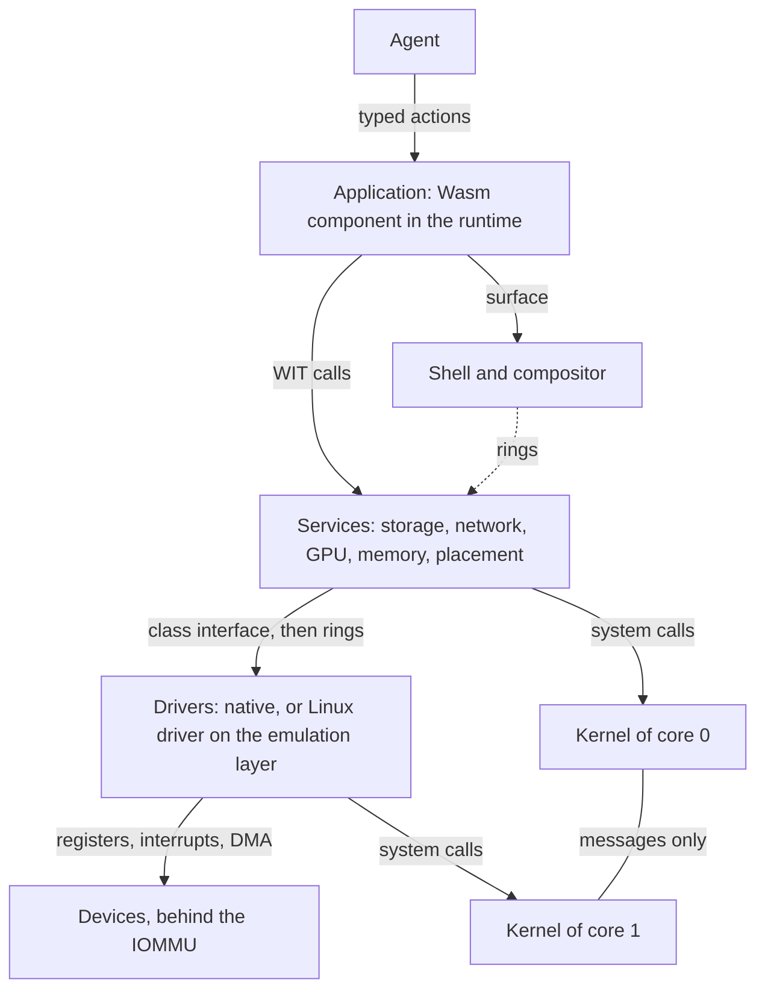

# Architecture overview

Statuses are defined in the [README](../README.md#status-legend).

## Layers

```
Agent, shell, applications        Wasm components, web
---------------------------------------------------------
WIT worlds (os:core)              the only visible ABI
---------------------------------------------------------
System services (Rust)            compositor, GPU service, web engine, storage,
                                  network, audio, rights, keys, inference
Drivers                           Linux API emulation, NVIDIA core
---------------------------------------------------------
Microkernel (Zig, Rust)           capabilities, IPC, scheduling, memory, IOMMU
```

Terms used in the diagram:

- **Wasm component**: a WebAssembly binary in the Component Model format, which declares typed imports and exports.
- **WIT**: the interface description language of the Component Model. A **WIT world** is the full set of interfaces a component imports and exports. `os:core` is the DodOS package of worlds; its contract is [contracts/core.wit](../contracts/README.md).
- **IPC**: inter-process communication, the message passing between processes that the kernel provides.
- **IOMMU**: the hardware unit that restricts which memory a device can reach.

Applications, services and drivers see only stable WIT worlds. Only raw system calls are private, behind the code page supplied by the kernel (see [wasm-abi.md](wasm-abi.md#abi-stability)).

## Processes and boundaries

Each box is a separate process. Solid arrows are IPC (control); dotted arrows are shared-memory rings (data), which never enter the kernel. Every process enters the kernel of the core it runs on; two are drawn.



## How the pieces fit

| Layer | Pieces | Detailed in |
|---|---|---|
| Top | The agent | [agent.md](agent.md) |
| Top | Shell, catalogue, design system | [ui.md](ui.md) |
| Top | Applications as Wasm components, developer tools | [wasm-abi.md](wasm-abi.md) |
| Top | Web content | [web.md](web.md) |
| ABI | WIT worlds, ABI rules, compile service | [wasm-abi.md](wasm-abi.md) |
| Services | Compositor, audio, input, accessibility | [ui.md](ui.md) |
| Services | GPU service | [gpu.md](gpu.md) |
| Services | Web engine | [web.md](web.md) |
| Services | Storage, packages, updates | [storage.md](storage.md) |
| Services | Network, Wi-Fi, Bluetooth | [network.md](network.md) |
| Services | Rights, keys | [security.md](security.md) |
| Services | Inference | [agent.md](agent.md) |
| Services | Memory service | [memory.md](memory.md) |
| Services | Placement service | [scheduling.md](scheduling.md) |
| Services | Platform service, service manager | [platform.md](platform.md) |
| Drivers | Driver framework, Linux emulation, IOMMU | [drivers.md](drivers.md) |
| Drivers | NVIDIA core | [gpu.md](gpu.md) |
| Kernel | Capabilities, IPC, multi-core structure | [kernel.md](kernel.md) |
| Kernel | Scheduling mechanism | [scheduling.md](scheduling.md) |
| Kernel | Memory mechanism | [memory.md](memory.md) |
| Across | Device-to-device communication | [devices.md](devices.md) |
| Across | Media | [media.md](media.md) |

## Modularity

**Proposed.** Each service is defined by its WIT world, so it can be replaced. The wiring of capabilities between components is declarative, and it is part of the system hash (the single hash that designates a system version; see [storage.md](storage.md#updates)).

The same split applies to scheduling and to memory: the mechanism is in the kernel and the policy is in user space.
