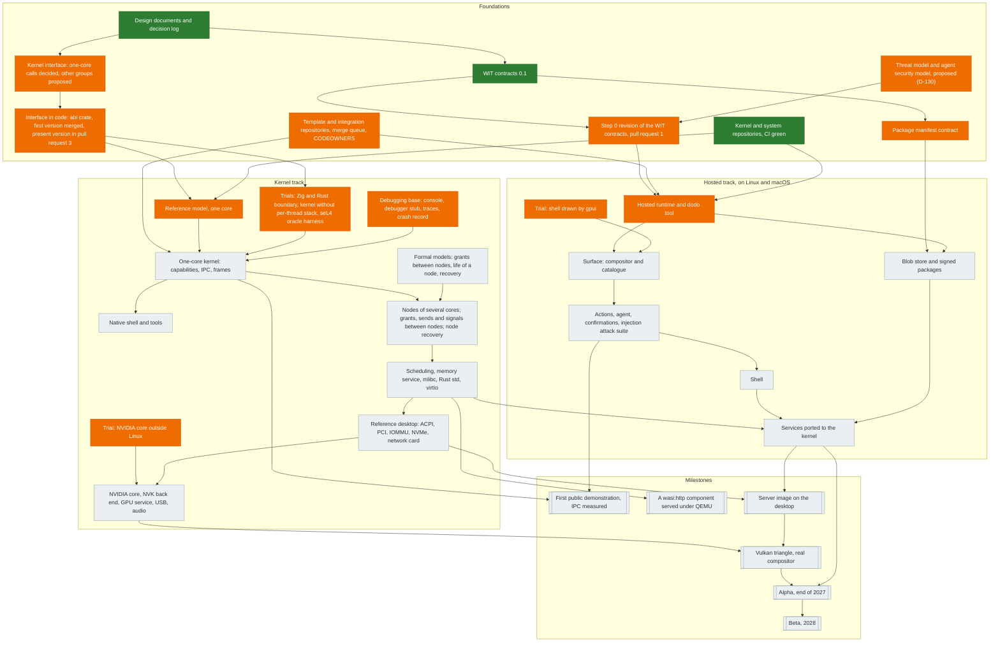

# Progress

The map of the work and where it stands. An arrow means "is needed by". This file is updated in the same change as the work it describes: moving a box is part of "done" (see [verification.md](verification.md#development-workflow)).

Last update: 16 November 2026.

Colours: green is done, orange is in progress or next, grey is later. Double-bordered boxes are public milestones.

## Now

| Item | Who | State |
|---|---|---|
| Reference model | Claude Fable 5.2 (passes 1 to 9), Claude Opus 5.5 (passes 10 to 14) | [Pull request 3](https://github.com/Vehicoule/dodos-kernel/pull/3) of the kernel repository, open, not merged, head `8c2adef`: 1,034 tests (966 in the model, 68 in `abi/`) and 27 Kani proofs in `abi/`; checks green (verify, kani, miri, sanitizer, CodeQL). Pass 14 (16 November 2026) answers the seventh review (D-127), kills the survivors of its mutation campaign, and gives `abi/` the start-up page of the neutral hand-over (D-125, `START_VERSION` 3) and the exception classes of ARM64 and RISC-V. It comes before D-128 and D-129: `abi/` still has `CorePlace` and `ThreadMove`, and the model still follows rule 7, nodes of one core and nodes sharing a core; what the next pass must change is in the contract's [Changes for `abi/` and the model](../architecture/kernel-interface.md#changes-for-abi-and-the-model-d-128-d-129). `abi/Cargo.toml` on this branch still inherits AGPL-3.0-only from the workspace, against D-119. Earlier passes: pass 13 (985 tests, D-124), pass 12 (921, D-123), pass 11 (690, D-122), pass 10 (453, D-109). Reviewed seven times (reports in `reviews/`). To do: the pass for D-128 and D-129, re-reading by the two humans, then merge |
| `abi/` under the Apache License 2.0 (D-119) | | [Pull request 5](https://github.com/Vehicoule/dodos-kernel/pull/5) of the kernel repository, open, not merged, head `f37ca08`, checks green. It changes `abi/Cargo.toml` on `main`, which still holds the first `abi/` (542 lines, 11 tests, 4 Kani proofs). Pull request 3 does not carry the change: whichever of the two merges second must keep Apache-2.0 |
| Kernel interface: every group (capabilities to start-up, memory and devices between nodes, the gate over page tables, unlike cores, cores and roles, debugging, `ioports`, entropy) | Claude Opus 5.5 | On `main` of this repository; 64 calls. Decided: the one-core call reference (D-100 to D-106, and D-109 validated by D-113), the points of D-110 settled by D-111 and D-112, and the shape of nodes and cores (D-128). Proposed by the assistant, to be read by the two owners: the D-110 groups as written, D-122 to D-127, and D-129, which rewrites the contract for D-128 (rule 7 withdrawn; nodes of several cores; frames the only grants; `core_place` and `thread_move` removed, `node_send` and `grant_signal` added). Not reviewed since D-129, no reference model of it yet |
| Step 0 revision of the WIT contracts | Claude Opus 5.5 | [Pull request 1](https://github.com/Vehicoule/DodOS/pull/1) of the system repository, open, not merged, head `aab7417`, checks green (verify, miri, sanitizer). Settles the `OPEN` markers of `8bc6509` except the three other ways to draw and a canvas fed by the GPU; designs `inference`, `memory` and `audio`; adds `manifest.wit`, `input.wit`, `shell.wit`, `agent.wit` and the vendored WASI 0.3.2 packages; four new `OPEN` markers for the two owners. `main` still holds the contracts 0.1 at `8bc6509` |
| Threat model and security model of the agent | Claude Opus 5.5 | Written in [security.md](../architecture/security.md#threat-model) on 16 November 2026, proposed (D-130); fourteen [points for the two owners](../architecture/security.md#points-for-the-two-owners). D-035 asks for it before `core.wit` is frozen |
| Package manifest contract | Claude Opus 5.5 | Proposed as `manifest.wit` (types only) in pull request 1 of the system repository, not merged; no checker yet (hosted step 5) |
| Template and integration repositories, merge queue, `CODEOWNERS` (step 0) | | Not started: no repository has branch protection, a merge queue or `CODEOWNERS` |
| Trials of weeks 1-2 | | Not started. The multicore trial asked by D-113 ran on the Mac (branch `trial-multicore` of the kernel repository, not a pull request) |

## Decisions that block a step

A box below cannot turn orange before its decision is taken and written in the [decision log](../decisions/README.md). The agent that starts the step checks this table first. The questions for the two owners are gathered in [pending-decisions.md](pending-decisions.md).

| Decision to take | Blocks | Notes |
|---|---|---|
| What the assistant proposed: the D-110 groups as written, D-122 to D-127, D-129, D-130 | The next pass of the reference model and the one-core kernel (D-122 to D-129); the freeze of `core.wit` (D-130) | Each is written into its document and waits for the two owners' reading. D-125 (the neutral hand-over) and D-126 (the language split) also fix the Zig and Rust boundary trial |
| Scheduling points of D-110 still open | Reference model of the scheduling group; one-core kernel | Decided by D-112: a lend outlives the caller's wait; the clock does not count suspended time. Still proposed: admission of every context against one core, with slack by class; no signal at exhaustion; the fault *no context*; the numbers. Not decided (D-111): the rule for a busy shared server, the written rule and its two alternatives to be measured. See [Points for the two owners](../architecture/kernel-interface.md#points-for-the-two-owners) |
| Task and marks points of D-110 still open | Reference model of the tasks group; research axis 4 as written in [prior-art.md](../research/prior-art.md#kernel-research-axes) | Decided by D-111: `task_revoke` stops threads in one write and capabilities are then removed in bounded steps; marks flow both ways with capabilities. Decided by D-112: a task lives on one node. Still proposed: the kernel task has no time budget and no log |
| How the root of authority survives the loss of one node | One-core kernel, for what it fixes in `abi/` and in the layout of objects (generation number in a reference, floor of each node slot in the start-up information) | Direction decided (D-107, amended by D-114; the write gate accepted by D-115): the root is rebuilt from a fixed floor, nothing is adopted. Written in the contract (recovery of a node and the reclaim barrier, D-122 to D-129), proposed |
| Locking inside a node of several cores, and nodes that take and give cores at run time (D-128, D-129) | One-core kernel, for the lock and the layout of kernel state | **Decided by the owners on 16 November 2026 (D-128):** a node may cover several cores, fixed when it starts; only one-shot operations cross between nodes; no node runs on another node's core; a process lives in one node. Written into the contract the same day with the assistant's rules (D-129, proposed): node slots and core words, the fence of every core of a node, twelve message kinds on two rings per pair, `node_send` and `grant_signal`, the layout for two locking variants. Still to decide, by measures on the reference desktop: the locking inside a node (one lock per node or a lock per object), the real cost of an interrupt between cores, the hand-over of a lock between performance and efficiency cores. Nodes that take and give cores at run time are an open point of the contract |
| Memory between nodes, and the node that owns each device | One-core kernel, for the start-up page and `abi/` | Directions accepted (D-113): chunks that change owner, devices that follow their driver; the machine table's living part (D-114) and its write gate (D-115) accepted. Written in the contract ([Memory and devices between nodes](../architecture/kernel-interface.md#memory-and-devices-between-nodes), D-122 to D-127, D-129), proposed |
| Who owns the hardware watchdog: the platform service or the kernel | The platform service contract | Not decided, an [open point of the contract](../architecture/kernel-interface.md#open-points): recommended, the platform service arms it and the service manager feeds it; alternative, the kernel arms it, a second exception to D-054. No longer held: the report on stopping a core without its cooperation came, and D-117 stops a core by INIT, a firmware extension or a signal the kernel cannot mask, not by a watchdog. Asked for by the owner on 15 November 2026, not to be forgotten. Also open with it: the debug transport on the reference PC (a serial port, the owner's desktop has none on its case) |
| Measures that need the reference desktop | Locking inside a node of several cores and the real cost of an interrupt between cores (D-128, D-129); forced stop of the bootstrap core (D-117) and what an INIT during SMM does; debug transport | The desktop is out of reach until about 29 November 2026 (said by the owner on 15 November). Until then the work runs in virtual machines and on the Mac; what the Mac can measure is to be explored |
| Does the contract hold on ARM64 and RISC-V, and leave room for later architectures | One-core kernel | Asked by the user on 15 November 2026. One reviewer of the sixth review read the whole contract with this angle only, and D-124 answers its findings; the neutral hand-over and the architecture boundary are D-125, proposed |
| Weaknesses of the design for memory and devices between nodes (trust in the hardware node, changes that wait during its reload, line interrupts stopped, a table every kernel can write, free memory of a node that is down) | Integration of that design into the contract | Treated in the contract of 16 November 2026 (D-122 to D-124, proposed): the hardware node became one role per unit and its context entries are checked by the gate (G9); only changes on one unit wait during a take-over; lines are acknowledged from any node where the IOAPIC has an EOI register (to test); the table is read-only in every kernel and written only through gates; free memory starts unclaimed and a dead node's memory goes to any live node. To re-read by the owners |

Taken since, and removed from this table: who clears frames (the kernel, frames included: D-111); the start-up and hardware points of D-110 (validated by D-112, except the equal split of memory, rejected, and every device on the boot node, replaced by the directions of D-113); whether a node may run on several cores (D-128); cancelling a wait (D-109, validated by D-113; its `abi/` and model are in pull request 3, not merged).

Weeks and dates are in the [calendar](roadmap.md#calendar).
