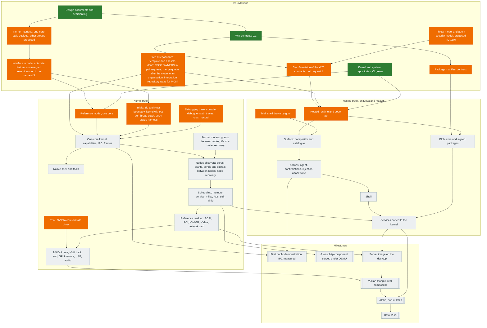

# Progress

The map of the work and where it stands. An arrow means "is needed by". This file is updated in the same change as the work it describes: moving a box is part of "done" (see [verification.md](verification.md#development-workflow)).

Last update: 17 November 2026.

Colours: green is done, orange is in progress or next, grey is later. Double-bordered boxes are public milestones.

## Now

| Item | Who | State |
|---|---|---|
| Reference model | Claude Fable 5.2 (passes 1 to 9), Claude Opus 5.5 (passes 10 to 21) | [Pull request 3](https://github.com/Vehicoule/dodos-kernel/pull/3) of the kernel repository, open, not merged, head `6312868`, checks running: 1,221 tests (1,145 in the model, 76 in `abi/`) and 37 Kani proofs in `abi/`. Pass 21 (17 November 2026) follows D-140: a detach tied to its requester and refused on the wrong unit unless the word reads *detached* with its root, the retired word of each core in the machine table through R6 and the next start (`StartMachine.retired_words`, layout 5), R1 on a failed unit holding only the nodes whose devices sat behind it, the bind's full barrier, a request's start instant read under the lock, the route's target core on ARM64 and RISC-V, a refused detach at a destruction step, and the invalidation of a line's remapping entry at its removal (left out by pass 20); it judges DeepSeek's twelfth model review (findings 1 and 5 to 11 corrected or tested, 2 judged equivalent, 3 refuted, its fifteen surviving mutations killed) and finds one more fault of the model (a unit that never confirmed R1 was never judged failed); 37 mutations, all killed but one shown equivalent in the model's README (m25 of the tenth review). Earlier: Pass 20 (17 November 2026) removes L2 from the model (the order by kind, the tries, `Model::hold`, the escalation, the entry words, `locks::bound`, their tests), models the watermark's barrier, marks under the node lock and the bound of a request, finds a fault older than the pass (a block of a run destroyed on two cores), and follows D-139 (the attach word against every event, a line's mask in its `Report`, an MSI's removal as a request with its retired handle, the stopped time for the fence record, the waits and `idle_until`); every change of the pass shown red under a mutation, 30 mutations of its own, all killed; Mistral's eleventh model review judged (findings 1 to 3 left with L2, the surviving mutations of 4 to 6 killed). Earlier: Pass 19 (17 November 2026) judges the tenth model review (18 findings: 14 confirmed and corrected or tested, findings 7 and 10 refuted as equivalent, 18 a limit of an invariant; its 15 surviving mutations each killed or shown equivalent), with Hydrogen's verification as a second opinion (two more faults corrected: R5 written before R2 ended, a starting node's evidence that could never hold), and follows D-137: a scripted holder is a second core, the escalation waits for entry words, the epoch is checked, iospace classes and attach words, reports with roots and operands, masked arrivals, the four orders, the closed bounds, marks without a lock, the new *k*, a fault as an event, `task_revoke`'s first call, an `irq`'s removal as a request, tables freed after their invalidation, the stopped time; 38 scenarios in `pass19.rs`, each red under a mutation, and 41 mutations of the pass's own changes, all killed. Pass 18 (17 November 2026) judges the ninth model review (21 findings: 16 confirmed and corrected, among them the six surviving mutations, each now killed; three confirmed in part, the rest kept by design; finding 9 corrected, its second half being wasted work with no observable state; finding 15 not reproduced, so not acted on) and follows D-135: the line words, tries that fail under L2 (a lock a test holds for another core across events), the second round, `again`, the quiet word, `signal` and arrivals that never return `again`, the watermark ready to return, the state word of a request, the start's retry at a due event, the `Ping` removed; 39 scenarios in `pass18.rs`, each red under a mutation. Pass 17 (17 November 2026) follows D-134 and the eighth model review: the corrections of the contract, a test for each surviving mutation of Mistral's review, the checker fed a bad state for each invariant, explorations steered and asserted to reach a full ring, a crossing, a core stopping in a request and an applied `Handed`, floors at three quarters of the counts, the core-word proofs at full width. Pass 15 (16 November 2026) rewrote `abi/` and the model for the shape of nodes (D-128, D-129, D-131): a node of *N* cores, the machine of several nodes with their physical cores, the twelve message kinds on two rings, the fence of every core, roles and unit requests; it found sixteen gaps in the contract ([model-15-contract-gaps.md](../research/drafts/model-15-contract-gaps.md)). Pass 16 follows the contract that settles them (D-133): a node's cores in one window (checked after every step), the claim of an MSI asking each IOMMU unit of its segment in turn, the fence record and `START_RETRY_NS` in `abi/`, and no `CONTRACT-GAP` marker left. Checks of `633f6f3` green (verify, kani, miri, sanitizer, CodeQL). `abi/Cargo.toml` on this branch still inherits AGPL-3.0-only from the workspace, against D-119. Earlier passes: pass 14 (1,034 tests, D-127), pass 13 (985, D-124), pass 12 (921, D-123), pass 11 (690, D-122), pass 10 (453, D-109). Reviewed seven times before pass 15 (reports in `reviews/`). To do: a review of passes 15 and 16, re-reading by the two humans, then merge (D-132, P-021) |
| `abi/` under the Apache License 2.0 (D-119) | Claude Opus 5.5 | **Done:** [pull request 5](https://github.com/Vehicoule/dodos-kernel/pull/5) of the kernel repository was merged on 16 November 2026 (merge commit `6683d84`): `abi/` on `main` is under Apache-2.0. Pull request 3 does not carry the change and must keep Apache-2.0 when it merges |
| Kernel interface: every group (capabilities to start-up, memory and devices between nodes, the gate over page tables, unlike cores, cores and roles, debugging, `ioports`, entropy) | Claude Opus 5.5 | On `main` of this repository; 64 calls. Decided: the one-core call reference (D-100 to D-106, and D-109 validated by D-113), the points of D-110 settled by D-111 and D-112, and the shape of nodes and cores (D-128). Proposed by the assistant, to be read by the two owners: the D-110 groups as written, D-122 to D-127, D-129, which rewrites the contract for D-128 (rule 7 in its old form withdrawn; nodes of several cores; frames the only grants; `core_place` and `thread_move` removed, `node_send` and `grant_signal` added), and D-131, which corrects it after the eighth review (two reports, three verifications in `reviews/`): the one-shot rule restated as it holds, the flush epoch replaced by counts held until the invalidation completes, unit waits out of kernel events and failed units, credits and unit request tables, pulled reports, a death table for each protocol of several steps, and the state explorer `research/drafts/node-protocol-explorer.py`; three questions for the owners (P-089 to P-091 of [pending-decisions.md](pending-decisions.md)). Reviewed once since D-129 (the eighth review), not since D-131. Pass 16 (16 November 2026, D-133) settles the sixteen gaps the reference model found, corrects the hardware citations (one SDM edition, 325462-093) and writes in four corrections of the security review; the reference model of pull request 3 follows it. Pass 17 (17 November 2026, D-134) applies the ninth review and its verification: the fence signal parks only a marked word, the start request's layout and writer, the fence record by core number, domain numbers split by node slot with the operands of every unit request (VT-d revision 4.1 read at the source), tries under L2 with at most two rounds, the unit sequence of a claim and the remapped line, the stamp of a sender with no task; the reference model found that the sweep's `Ping` can never be sent (an open point). Pass 18 (17 November 2026, D-135) applies the tenth review and its verification, with the owner's decisions where they differ: an owner word per claimable line, `signal` with no `again` and no write before the last try under L2, the quiet word after two `again` of tries (the open point on `again` for ever closed), the entry word of each core, the start's retry and the sweep at due events, the `Ping` removed (eleven kinds, number 9 reserved), the debugger's stop suspending the clocks of membership, the watermark's return, the state word of an invalidation request, one edition of each specification re-read at the source (Arm DDI 0487 M.d, PSCI DEN0022F.b, VT-d 5.20); and two corrections the model found (G9's root, the resume beside an unfenced peer). Pass 19 (17 November 2026, D-137) applies the eleventh review (Mistral) and Hydrogen's verification with its attack on pass 18, judged by the assistant: an iospace's classes by level and a root class that counts its devices, with an attach word per device identifier written only by gates (two containment holes of G9 closed); unhooked tables freed only after their invalidation; the store-load order of the entry word and the quiet word, interrupts masked while a core waits, the closed bound of an escalation and the start-up checks; marks ORed without a lock, the bound *k* counted again, `task_revoke`'s first call bounded by the cores, the fault delivery out of the calls; the removal of an `irq` as a request and the `Report` of a line; the debugger's stopped time and the sweep of sealed successors. Pass 20 (17 November 2026, D-138 and D-139): the variant L2 leaves version 1 (one node lock, its words kept reserved, its text and known faults in `research/drafts/locking-l2.md`); the watermark returns after a barrier instead of the entry word; marks under the node lock; the slot read checked again under the lock; the bound of a request 2 × *E* + *D*; then the twelfth review (Hydrogen, verified by DeepSeek): the attach word against every event, the tables a change unhooks listed in its request, a line's mask in its `Report`, the handle of a failed invalidation retired, `idle_until` on the clock it is compared on, the sections that could not be opened marked to verify. Pass 21 (17 November 2026, D-140): the thirteenth review (Hydrogen, verified by Mistral): `signal` keeps no lock and the bind's order is written per architecture; the retired word of each core; a detach tied to its requester, every unit request's check listed and an ITS mapping given one; R1 scoped on a failed unit; the attach word's table completed; the start instant of a request under the lock; the route's target core on ARM64 and RISC-V; one wave per barrier and `idle_until` from the hardware timer; the leftovers of D-138 and D-139; the SDM 325462-093, VT-d D51397-019 and Arm DDI 0487 M.d opened from the vendors' servers and every section cited from them read again |
| Step 0 revision of the WIT contracts | Claude Opus 5.5 | [Pull request 1](https://github.com/Vehicoule/DodOS/pull/1) of the system repository, open, not merged, head `5223b78`, checks green (verify, miri, sanitizer). Corrected twice on 16 November 2026 after the reviews of it and of the security page (two reports each round, each verified by another model; `reviews/2026-11-16-wit-review-{1,2}-*`, `security-review-{1,2}-*`); `verify` validates each world with only the features it uses, checks that every right parses and is served or reserved, refuses gated types and worlds outside the list, and runs on macOS. Settles the `OPEN` markers of `8bc6509` except the three other ways to draw and a canvas fed by the GPU; designs `inference`, `memory` and `audio`; adds `manifest.wit`, `input.wit`, `shell.wit`, `agent.wit` and the vendored WASI 0.3.2 packages; nine new `OPEN` markers for the two owners. `main` still holds the contracts 0.1 at `8bc6509` |
| Threat model and security model of the agent | Claude Opus 5.5 | Written in [security.md](../architecture/security.md#threat-model) on 16 November 2026, proposed (D-130); twenty-eight [points for the two owners](../architecture/security.md#points-for-the-two-owners). D-035 asks for it before `core.wit` is frozen |
| Package manifest contract | Claude Opus 5.5 | Proposed as `manifest.wit` (types only) in pull request 1 of the system repository, not merged; no checker yet (hosted step 5) |
| Step 0 repositories: template, rulesets, `CODEOWNERS`, merge queue, integration repository | Claude Opus 5.5 | **Template:** [`dodos-template`](https://github.com/Vehicoule/dodos-template), public, marked as a template repository, CI green (`verify`, `miri`, `sanitizer`) on `c667e85`. It holds the Nix environment (Rust 1.100.0 and lychee, the kernel's pins), `verify` (internal Markdown links, then `cargo fmt`, `clippy` and `test` once there is a `Cargo.toml`), an `AGENTS.md` of 65 lines that the two owners must re-read, the workflow of the system repository, `CODEOWNERS`, the AGPL-3.0, and the skills `dodos-rust` and `rust-1-100`. GitHub does not copy rulesets into a repository made from the template. **Rulesets on `main`**, 16 November 2026: this repository refuses force pushes and deletion and still takes direct pushes; the system repository and the template require a pull request with `verify`, `miri` and `sanitizer` green and up to date with `main`, no approval, and refuse force pushes and deletion; the kernel repository has had the same since 14 November, with `kani` and the CodeQL rules as well. No one bypasses them: in an emergency an owner sets the ruleset's enforcement to Disabled, then back to Active. **`CODEOWNERS`:** on `main` here; in [pull request 7](https://github.com/Vehicoule/dodos-kernel/pull/7) of the kernel repository and [pull request 2](https://github.com/Vehicoule/DodOS/pull/2) of the system repository, not merged. `@Vehicoule` alone until the second owner joins; code owner review is not required while one account opens and approves everything. **Merge queue:** GitHub offers it only to repositories owned by an organisation; to turn on after the move. **Integration repository:** not created, it waits for P-084. Each workflow's check of its own faults (a test that injects a fault into each check) is not done |
| Trials of weeks 1-2 | | Not started. The multicore trial asked by D-113 ran on the Mac (branch `trial-multicore` of the kernel repository, not a pull request) |

## Decisions that block a step

A box below cannot turn orange before its decision is taken and written in the [decision log](../decisions/README.md). The agent that starts the step checks this table first. The questions for the two owners are gathered in [pending-decisions.md](pending-decisions.md).

| Decision to take | Blocks | Notes |
|---|---|---|
| What the assistant proposed: the D-110 groups as written, D-122 to D-127, D-129, D-130, D-131 | The next pass of the reference model and the one-core kernel (D-122 to D-129, D-131); the freeze of `core.wit` (D-130) | Each is written into its document and waits for the two owners' reading. D-125 (the neutral hand-over) and D-126 (the language split) also fix the Zig and Rust boundary trial |
| Scheduling points of D-110 still open | Reference model of the scheduling group; one-core kernel | Decided by D-112: a lend outlives the caller's wait; the clock does not count suspended time. Still proposed: admission of every context against one core, with slack by class; no signal at exhaustion; the fault *no context*; the numbers. Not decided (D-111): the rule for a busy shared server, the written rule and its two alternatives to be measured. See [Points for the two owners](../architecture/kernel-interface.md#points-for-the-two-owners) |
| Task and marks points of D-110 still open | Reference model of the tasks group; research axis 4 as written in [prior-art.md](../research/prior-art.md#kernel-research-axes) | Decided by D-111: `task_revoke` stops threads in one write and capabilities are then removed in bounded steps; marks flow both ways with capabilities. Decided by D-112: a task lives on one node. Still proposed: the kernel task has no time budget and no log |
| How the root of authority survives the loss of one node | One-core kernel, for what it fixes in `abi/` and in the layout of objects (generation number in a reference, floor of each node slot in the start-up information) | Direction decided (D-107, amended by D-114; the write gate accepted by D-115): the root is rebuilt from a fixed floor, nothing is adopted. Written in the contract (recovery of a node and the reclaim barrier, D-122 to D-129), proposed |
| Locking inside a node of several cores after version 1, and nodes that take and give cores at run time (D-128, D-129, D-138) | One-core kernel, for the lock and the layout of kernel state | **Decided by the owners on 16 November 2026 (D-128):** a node may cover several cores, fixed when it starts; only one-shot operations cross between nodes; no node runs on another node's core; a process lives in one node. Written into the contract the same day with the assistant's rules (D-129, proposed): node slots and core words, the fence of every core of a node, twelve message kinds on two rings per pair, `node_send` and `grant_signal`, the layout for two locking variants. Still to decide, by measures on the reference desktop: the locking inside a node (one lock per node or a lock per object), the real cost of an interrupt between cores, the hand-over of a lock between performance and efficiency cores. Nodes that take and give cores at run time are an open point of the contract **D-138 (17 November 2026, one owner, the other to confirm):** version 1 locks a node of several cores by one node lock; the lock per object left the contract, its text in `research/drafts/locking-l2.md`, and the measure on the reference desktop decides what a later version needs |
| Memory between nodes, and the node that owns each device | One-core kernel, for the start-up page and `abi/` | Directions accepted (D-113): chunks that change owner, devices that follow their driver; the machine table's living part (D-114) and its write gate (D-115) accepted. Written in the contract ([Memory and devices between nodes](../architecture/kernel-interface.md#memory-and-devices-between-nodes), D-122 to D-127, D-129), proposed |
| Integration repository, or the system repository's pin of the kernel as the integration point (P-084) | The integration repository of Step 0 | Recommended in the booklet: the system repository's pin (B). Option A, a separate repository that pins every repository, is what [verification.md](verification.md#ci-is-authoritative) and the roadmap write. Nothing is created until the owners answer |
| Who owns the hardware watchdog: the platform service or the kernel | The platform service contract | Not decided, an [open point of the contract](../architecture/kernel-interface.md#open-points): recommended, the platform service arms it and the service manager feeds it; alternative, the kernel arms it, a second exception to D-054. No longer held: the report on stopping a core without its cooperation came, and D-117 stops a core by INIT, a firmware extension or a signal the kernel cannot mask, not by a watchdog. Asked for by the owner on 15 November 2026, not to be forgotten. Also open with it: the debug transport on the reference PC (a serial port, the owner's desktop has none on its case) |
| Measures that need the reference desktop | Locking inside a node of several cores and the real cost of an interrupt between cores (D-128, D-129); forced stop of the bootstrap core (D-117) and what an INIT during SMM does; debug transport | The desktop is out of reach until about 29 November 2026 (said by the owner on 15 November). Until then the work runs in virtual machines and on the Mac; what the Mac can measure is to be explored |
| Does the contract hold on ARM64 and RISC-V, and leave room for later architectures | One-core kernel | Asked by the user on 15 November 2026. One reviewer of the sixth review read the whole contract with this angle only, and D-124 answers its findings; the neutral hand-over and the architecture boundary are D-125, proposed |
| Weaknesses of the design for memory and devices between nodes (trust in the hardware node, changes that wait during its reload, line interrupts stopped, a table every kernel can write, free memory of a node that is down) | Integration of that design into the contract | Treated in the contract of 16 November 2026 (D-122 to D-124, proposed): the hardware node became one role per unit and its context entries are checked by the gate (G9); only changes on one unit wait during a take-over; lines are acknowledged from any node where the IOAPIC has an EOI register (to test); the table is read-only in every kernel and written only through gates; free memory starts unclaimed and a dead node's memory goes to any live node. To re-read by the owners |

Taken since, and removed from this table: who clears frames (the kernel, frames included: D-111); the start-up and hardware points of D-110 (validated by D-112, except the equal split of memory, rejected, and every device on the boot node, replaced by the directions of D-113); whether a node may run on several cores (D-128); cancelling a wait (D-109, validated by D-113; its `abi/` and model are in pull request 3, not merged).

Weeks and dates are in the [calendar](roadmap.md#calendar).
