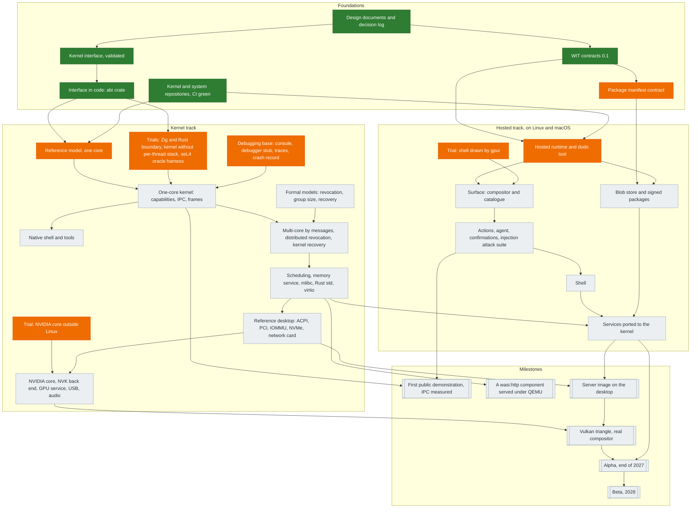

# Progress

The map of the work and where it stands. An arrow means "is needed by". This file is updated in the same change as the work it describes: moving a box is part of "done" (see [verification.md](verification.md#development-workflow)).

Last update: 14 November 2026.

Colours: green is done, orange is in progress or next, grey is later. Double-bordered boxes are public milestones.

## Now

| Item | Who | State |
|---|---|---|
| Reference model, one core | Claude Fable 5.2 (passes 1 to 9), Claude Opus 5.5 (passes 10 and 11) | Written from the settled contract; [pull request 3](https://github.com/Vehicoule/dodos-kernel/pull/3), head `40c6863`. Pass 11 (15 November 2026) models every group of the contract except cores, debugging and `ioports`: 690 tests, CI green, 23 contract problems reported and to settle at the next integration. Before pass 11: Follows D-109 (wait number for `thread_cancel`); 453 tests, CI green; mutation: 176 of 177 killed on the whole model at pass 8 (the last is equivalent), 54 of 54 on what pass 10 changed; the whole-model mutation was not rerun after pass 9. Reviewed five times (seventeen reports in `reviews/`); the fifth review found no wrong behaviour and one design error in D-106, corrected by D-109. Pass 10 is not yet reviewed from outside. To do: pass 11 for what D-110 changes in the reviewed groups, sixth review, re-reading by the two humans, then merge |
| Kernel interface: memory and devices, faults and registers, scheduling and time, interrupts, tasks and marks, start-up state | Claude Opus 5.5 | Written and merged from three drafts (D-110); no reference model yet, not reviewed. The changes it makes to the decided call reference are marked "(D-110)" and need a new pass of the reference model |
| Package manifest contract | | Not started |
| Trials of weeks 1-2 | | Not started |

## Decisions that block a step

A box below cannot turn orange before its decision is taken and written in the [decision log](../decisions/README.md). The agent that starts the step checks this table first.

| Decision to take | Blocks | Notes |
|---|---|---|
| Who clears frames (D-110, proposed) | Reference model of the memory group; one-core kernel | Rule written for validation: the kernel clears every object it creates, frames included, 64 KB per call with `again`. It replaces the earlier choice (the kernel did not clear frames). The memory service still clears pages it moves between processes without the kernel |
| Scheduling points of D-110 (proposed) | Reference model of the scheduling group; one-core kernel | Rules written for validation: admission of every context against one core, with slack by class; no lending to a busy shared server and no entry threshold; no signal at exhaustion; a lend outlives the caller's wait; the clock does not count suspended time; the fault *no context*; the numbers. See [Points for the two owners](../architecture/kernel-interface.md#points-for-the-two-owners) |
| Task and marks points of D-110 (proposed) | Reference model of the tasks group; research axis 4 as written in [prior-art.md](../research/prior-art.md#kernel-research-axes) | Rules written for validation: `task_revoke` stops threads in one write and capabilities are removed by the supervisor; the kernel task has no time budget and no log; a task lives on one node; marks flow both ways with capabilities |
| Start-up and hardware points of D-110 (proposed) | One-core kernel, for the start-up state and the layout of kernel memory | Rules written for validation: equal shares of memory per node; device memory and line interrupts owned by the boot node; the interrupt table as fixed kernel memory (exception to rule 3); the kernel reads the ACPI MADT and DMAR (exception to D-054); 64-byte capability slots; no vector state in the register calls |
| How the root of authority survives the loss of one core's kernel | One-core kernel, for what it fixes in `abi/` and in the layout of objects (generation number in a reference, share of memory per core in the start-up information); multi-core by messages for the rest | Direction decided (D-107): the root is rebuilt from a fixed share, nothing is adopted. To design before the one-core kernel is written |
| Whether a node may run on several cores at once (D-108 is validated otherwise, D-113) | One-core kernel, for the lock and the layout of kernel state | Decided by a measured trial of the three candidates of [kernel.md](../architecture/kernel.md#nodes-cores-and-load): first on the Mac (ARM64, native) as an indication, then on the reference desktop |
| Memory between nodes, and the node that owns each device (D-112, D-113) | One-core kernel, for the start-up page and `abi/` | Directions accepted: chunks that change owner, devices that follow their driver. Design being drafted |
| Who owns the hardware watchdog: the platform service or the kernel | Integration of the debugging draft into the contract | Held until the report on stopping a core without its cooperation (D-116): a watchdog is one way to stop a core. Asked for by the owner on 15 November 2026, not to be forgotten. Also open with it: the debug transport on the reference PC (a serial port, the owner's desktop has none on its case) |
| Measures that need the reference desktop | Choice between one node per core and groups sized to the process (real cost of an interrupt between cores); forced stop of the bootstrap core (D-117); debug transport | The desktop is out of reach until about 29 November 2026 (said by the owner on 15 November). Until then the work runs in virtual machines and on the Mac; what the Mac can measure is to be explored |
| Page size on ARM64 | Integration of the drafts into the contract; the portability angle of the sixth review | The contract fixes pages of 4 KB and chunks of 2 MB. Android moves to 16 KB pages and Apple hardware is built for 16 KB (its IOMMU supports only 16 KB). To settle: whether the page size becomes a value of the machine in the start-up page and in `abi/`, and what a chunk is where the large page is 32 MB (16 KB granule, not checked at the source). Raised by the owner on 15 November 2026 |
| Cancelling a wait | One-core kernel | D-106 corrected by D-109 after the fifth review (a wait number, so that a cancel is neither lost nor hits a later call). Contract, `abi/` and model done (pass 10 of pull request 3); to review by the two humans |
| Does the contract hold on ARM64 and RISC-V, and leave room for later architectures | One-core kernel | Asked by the user on 15 November 2026. One reviewer of the sixth review reads the whole contract with this angle only: every rule that depends on x86-64 without saying so |
| Weaknesses of the design for memory and devices between nodes (trust in the hardware node, changes that wait during its reload, line interrupts stopped, a table every kernel can write, free memory of a node that is down) | Integration of that design into the contract | The user asked that each one be treated, not only listed: each gets a rule, a measure or an explicit acceptance |

Weeks and dates are in the [calendar](roadmap.md#calendar).
