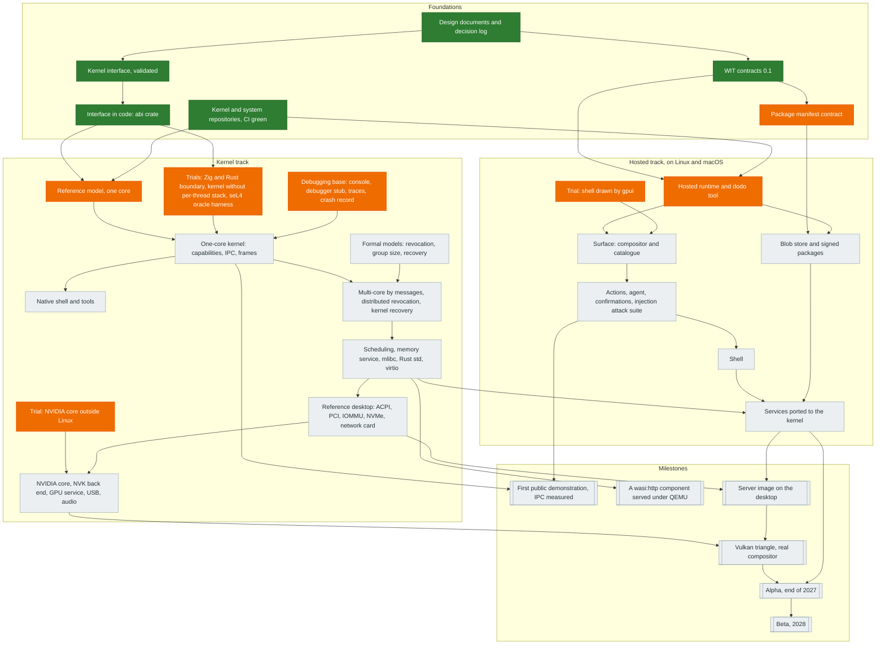

# Progress

The map of the work and where it stands. An arrow means "is needed by". This file is updated in the same change as the work it describes: moving a box is part of "done" (see [verification.md](verification.md#development-workflow)).

Last update: 14 November 2026.

Colours: green is done, orange is in progress or next, grey is later. Double-bordered boxes are public milestones.

## Now

| Item | Who | State |
|---|---|---|
| Reference model, one core | Claude Fable 5.2 | Written from the settled contract; [pull request 3](https://github.com/Vehicoule/dodos-kernel/pull/3). To do: follow the revision D-100, review by Gemini, re-reading by the two humans |
| Package manifest contract | | Not started |
| Trials of weeks 1-2 | | Not started |

Weeks and dates are in the [calendar](roadmap.md#calendar).
