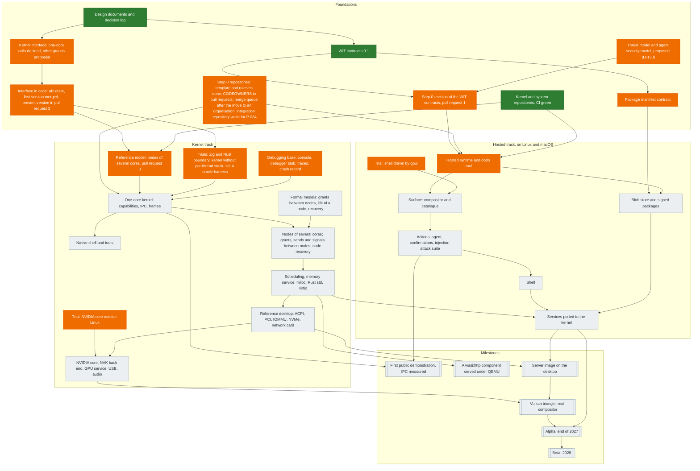

# Progress

The map of the work and where it stands. An arrow means "is needed by". This file is updated in the same change as the work it describes: moving a box is part of "done" (see [verification.md](verification.md#development-workflow)).

Last update: 20 November 2026.

Colours: green is done, orange is in progress or next, grey is later. Double-bordered boxes are public milestones.

## Now

| Item | Who | State |
|---|---|---|
| Reference model | Claude Fable 5.2 (passes 1 to 9, 31 to 33), Claude Opus 5.5 (passes 10 to 29, 34 to 38), Gemini 4 Argon (pass 30, end of 39), Gemini 4 Neon (passes 39, 40) | [Pull request 3](https://github.com/LES-RATS/dodos-kernel/pull/3) of the kernel repository, open, not merged, branch `model`. **Final review and pass 40** (21 and 22 November 2026, head `49b7424`): the final review read the whole pull request in three parts by readers given no background (fresh reads, a line-by-line attack, the contract alone; reports in `/private/tmp/final-review/reports/`, not yet copied here). The contract part became D-168. Pass 40 (Gemini 4 Neon) implements D-168 and judges every code finding: 11 of the 14 majors fixed with a test each, 3 refuted with the reason (two gate functions are hardware or protocol events, one reviewer counted pages for chunks), the minors fixed or skipped with a reason; it raised gaps 61 and 62 (a node that never answers a rebuild's `ReportAsk`, items that fail their check with keys rising for ever), settled by **D-169** (decided by the assistant, **to be reviewed by the two owners**). Checked by the assistant on `49b7424`: `verify`, the long combination run (919 of 919 reached), the directed run of 74 and `many_seeds` pass; three of the new tests (the sweep cursor, `remove_spi`, the OBSERVATION rule) fail without their change. **To do:** pass 41 (D-169 in the model), then the owners' reading of D-158 to D-169. **Passes 32 to 39** (20 and 21 November 2026, head `47fda8e`; D-158 to D-167, each decided by the assistant and **to be reviewed by the two owners**): the model follows the mode without tags on RISC-V and the resume of a *joining* core (D-158), and settles the contract gaps 49 to 60 as it goes (D-159 to D-167), none left open; each pass was reviewed by another model on a private clone and the next pass answered every finding. The last review (Gemini 4 Neon, passes 37 and 38) found that a sealing node answered every kernel message while its cores parked, so a `Revoke` left a request open at the seal: D-167 leaves such a `Revoke` for the resume and answers a stale `ReportAsk` with an empty `Report`; its three tests fail without their change. The combined exploration now reaches **every combination that the contract allows, 919 of 919** (845 by the 858 seeds, 74 by a directed scenario that drives the three states with calls, events and time only, the full check after every step), 27 excluded by a written rule (*release pending* with *first thread before live*), none pinned as not reached. `verify` passes on `47fda8e` (55 test binaries, 5,003 tests, 42 ignored); the long combination run (562 s) and `many_seeds` pass. Not checked by the assistant itself: that the tests of pass 39 for rule 59 and for the send before live fail without their change. Not modelled: the LPI and `its_table` checks of ARM64 in the kernel model, G16, `DB_BIT`. **To do:** the final review of the pull request in three parts (the whole pull request without context, a line-by-line attack, the specification alone), then the owners' reading. **Pass 31** (`78208a2`, review fixes `f186fdd`, D-157 comment cleanup; D-154, D-155, D-156, D-157; independent review and re-check by Gemini 4 Argon): replaces pass 30's split and merge of the kernel's large leaf with dedicated table chunks (bit 58 of `GateWord`, `memory_take` kind 2, `BootFloors.floor_tables` at 40 bytes, 22 object sizes, `aspace`/`iospace` taking a header from an ordinary untyped and root/tables from a table untyped, `its_table` from a table untyped only), adds D-155's reserved words (`IKV_FIRST`/`IKV_LAST` 240–243, `GATE_PCID`, `usable_tags`/`gate_tag`, `dr7_valid` refusing `DR7.GD`), adds F10/F14/M3, and integrates all four independent review findings against D-156 (`R1` ancestor table untyped watermark hold on failed-unit `iospace` destruction, `R2` bounded two-pass sweep of a dying `cspace` with invariant 27, `R3` `holds_frame` refusing table chunks for G6, `R4` invariant 58 checking table chunks directly for G3 (3)); all 7 GitHub CI checks green on `f186fdd` (`verify`, `kani`, `miri`, `sanitizer`, `CodeQL`), 30,000 faulty-kernel gate seeds and 2,000 `many_seeds` green, 858 combined exploration seeds with zero checker violations; pass 30's gaps 40 to 46 closed by D-154 and pass 31's gaps 47 and 48 settled by D-157 (zero open `CONTRACT-GAP` markers left). **Pass 30** (`126b4b6`; D-153): added a faulty node to the combined exploration (`6e86121`) and closed pass 29's gaps 26 to 39 (its seven split/merge gaps 40 to 46 were then retired by D-154 and pass 31). **Pass 28** (head `79d3a6c`; D-143's sleep, the first thread before live, D-146 to D-149): gaps 23 to 25 found and settled by D-147 and D-151, none open. **Pass 29** (head `8a1e646`; D-152): the gate model run from the tables of Gate words, with a faulty-kernel actor (every node calls any gate operation with any arguments in any order and writes any data page it holds); 1,531 tests (and 12 ignored), 57 Kani harnesses, 47 gate-checker rules, 257 kernel-checker rules; 30,000 faulty-kernel seeds × 800 steps clean; it found the contract gaps 26 to 39, each modelled on its most careful reading with a seed, settled by D-153, and answered eight of the ten questions of the suspend draft. **Not modelled after pass 31:** the member, core and role words, the fence records and the observations stay in the kernel model; no two cores race inside one gate call (calls are atomic); the x86-64 mechanisms of the gate lock and of events inside a gate call; the `its_table` ITS word stays in the gate model only. Pass 26 (18 November 2026, D-145): 698 library tests, 626 integration tests, 91 in `abi/` and 53 Kani proofs; 224 checker rules; the combined exploration reaches every pair (323 of 323), triples around a resume 279 of 298 and around a death 149 of 151; it found gap 21 (the seal of the holder of a failed unit never ended), settled by D-145. Pass 27 (18 November 2026, D-145; `7edc185`): the seal of a failed unit and the take-over of a failed role word, with their scenarios; 703 library tests, 626 integration tests, 225 checker rules; over the 1,716 seeds no seed fails and no new gap appears, every pair is reached (325 of 325), triples around a resume 277 of 300 and around a death 151 of 153. Pass 25 (18 November 2026, D-144; five commits, `e88575f` to `f7efdeb`): a seeded exploration of the combined recovery states between nodes (five nodes, two grants, two devices, a line, the IOMMU role handed, every kind of evidence, seals, resumes and fresh starts), 1,716 seeds, pairs 322 of 323 reached, triples around a resume 193 of 298, triples around a death 146 of 151, and 111 combinations not reached yet; six faults of the model fixed; the eleven tests of DeepSeek's verification of pass 24 in the tree; the tables of each VT-d unit kept at start-up; `memory_split` under a grant tested; four contract gaps (17 to 20), settled by D-144 (gap 20 by a resume bit in the member word, bit 9, for `abi/`). At pass 23 (head `b2ed55d`): 1,341 tests (1,254 in the model, 87 in `abi/`) and 50 Kani proofs in `abi/`; a walk of 2,000 more seeds outside `verify` (`many_seeds`) passes. Pass 23 (17 November 2026, no contract change) takes the rest of the final review: the tests that did not test what they named, the coverage floors and the checker's missing rules. Its new tests found three faults of the model (a node accused itself of a silent core while the debugger stub's release word was raised, the due event of a request stayed armed through the stop, and every core's random generator started at 0 instead of from its node's seed and its number); the checker gains the rules the reviews proved absent (the thread and root a core holds, domain numbers, waits on unit requests, a cancelled wait's waiter), accepts a fault of kind 9, judges every index first, and a sweep shows each of its 219 rules made to fail by a test; the merge-stopping E23 and E29 are scenarios; every floor of the random walk is above what its directed cases give; nine more Kani proofs and the layout of every `repr(C)` record. Earlier: Pass 22 (17 November 2026, D-141) follows the final review of the pull request: a message's sender is its ring's writer; a grant is freed only when the holder's use entry counts no leaf, and the holder maps a received frame only after its sender consumed the `SendAnswer`; the remote frame, its rights and depth are read from the anchor in the grant entry; `memory_control` is placed only as the depth rule allows; a debug area or crash header of another boot is faulty data; the credits, the answer's room, the ring's indices and 16 entries per interrupt. It judges every row of the verifications of the code read (lots A to C) and of the attacks, and is the judge of the two attack reports no second model had verified (DeepSeek on lot B: its finding corrected, its four hardening notes judged; Hydrogen on lot C: findings 1 to 14 corrected or tested, finding 2 already refused by the start-up). 68 scenarios in `pass22.rs`; 55 mutations of the pass's changes, all killed (four only after their test was made sharper). Earlier: Pass 21 (17 November 2026) follows D-140: a detach tied to its requester and refused on the wrong unit unless the word reads *detached* with its root, the retired word of each core in the machine table through R6 and the next start (`StartMachine.retired_words`, layout 5), R1 on a failed unit holding only the nodes whose devices sat behind it, the bind's full barrier, a request's start instant read under the lock, the route's target core on ARM64 and RISC-V, a refused detach at a destruction step, and the invalidation of a line's remapping entry at its removal (left out by pass 20); it judges DeepSeek's twelfth model review (findings 1 and 5 to 11 corrected or tested, 2 judged equivalent, 3 refuted, its fifteen surviving mutations killed) and finds one more fault of the model (a unit that never confirmed R1 was never judged failed); 37 mutations, all killed but one shown equivalent in the model's README (m25 of the tenth review). Earlier: Pass 20 (17 November 2026) removes L2 from the model (the order by kind, the tries, `Model::hold`, the escalation, the entry words, `locks::bound`, their tests), models the watermark's barrier, marks under the node lock and the bound of a request, finds a fault older than the pass (a block of a run destroyed on two cores), and follows D-139 (the attach word against every event, a line's mask in its `Report`, an MSI's removal as a request with its retired handle, the stopped time for the fence record, the waits and `idle_until`); every change of the pass shown red under a mutation, 30 mutations of its own, all killed; Mistral's eleventh model review judged (findings 1 to 3 left with L2, the surviving mutations of 4 to 6 killed). Earlier: Pass 19 (17 November 2026) judges the tenth model review (18 findings: 14 confirmed and corrected or tested, findings 7 and 10 refuted as equivalent, 18 a limit of an invariant; its 15 surviving mutations each killed or shown equivalent), with Hydrogen's verification as a second opinion (two more faults corrected: R5 written before R2 ended, a starting node's evidence that could never hold), and follows D-137: a scripted holder is a second core, the escalation waits for entry words, the epoch is checked, iospace classes and attach words, reports with roots and operands, masked arrivals, the four orders, the closed bounds, marks without a lock, the new *k*, a fault as an event, `task_revoke`'s first call, an `irq`'s removal as a request, tables freed after their invalidation, the stopped time; 38 scenarios in `pass19.rs`, each red under a mutation, and 41 mutations of the pass's own changes, all killed. Pass 18 (17 November 2026) judges the ninth model review (21 findings: 16 confirmed and corrected, among them the six surviving mutations, each now killed; three confirmed in part, the rest kept by design; finding 9 corrected, its second half being wasted work with no observable state; finding 15 not reproduced, so not acted on) and follows D-135: the line words, tries that fail under L2 (a lock a test holds for another core across events), the second round, `again`, the quiet word, `signal` and arrivals that never return `again`, the watermark ready to return, the state word of a request, the start's retry at a due event, the `Ping` removed; 39 scenarios in `pass18.rs`, each red under a mutation. Pass 17 (17 November 2026) follows D-134 and the eighth model review: the corrections of the contract, a test for each surviving mutation of Mistral's review, the checker fed a bad state for each invariant, explorations steered and asserted to reach a full ring, a crossing, a core stopping in a request and an applied `Handed`, floors at three quarters of the counts, the core-word proofs at full width. Pass 15 (16 November 2026) rewrote `abi/` and the model for the shape of nodes (D-128, D-129, D-131): a node of *N* cores, the machine of several nodes with their physical cores, the twelve message kinds on two rings, the fence of every core, roles and unit requests; it found sixteen gaps in the contract ([model-15-contract-gaps.md](../research/drafts/model-15-contract-gaps.md)). Pass 16 follows the contract that settles them (D-133): a node's cores in one window (checked after every step), the claim of an MSI asking each IOMMU unit of its segment in turn, the fence record and `START_RETRY_NS` in `abi/`, and no `CONTRACT-GAP` marker left. Checks of `633f6f3` green (verify, kani, miri, sanitizer, CodeQL). `abi/Cargo.toml` on this branch still inherits AGPL-3.0-only from the workspace, against D-119. Earlier passes: pass 14 (1,034 tests, D-127), pass 13 (985, D-124), pass 12 (921, D-123), pass 11 (690, D-122), pass 10 (453, D-109). Reviewed seven times before pass 15 (reports in `reviews/`). To do: a review of passes 15 and 16, re-reading by the two humans, then merge (D-132, P-021) |
| `abi/` under the Apache License 2.0 (D-119) | Claude Opus 5.5 | **Done:** [pull request 5](https://github.com/LES-RATS/dodos-kernel/pull/5) of the kernel repository was merged on 16 November 2026 (merge commit `6683d84`): `abi/` on `main` is under Apache-2.0. Pull request 3 does not carry the change and must keep Apache-2.0 when it merges |
| Kernel interface: every group (capabilities to start-up, memory and devices between nodes, the gate over page tables, unlike cores, cores and roles, debugging, `ioports`, entropy) | Claude Opus 5.5 | On `main` of this repository; 64 calls. Decided: the one-core call reference (D-100 to D-106, and D-109 validated by D-113), the points of D-110 settled by D-111 and D-112, and the shape of nodes and cores (D-128). Proposed by the assistant, to be read by the two owners: the D-110 groups as written, D-122 to D-127, D-129, which rewrites the contract for D-128 (rule 7 in its old form withdrawn; nodes of several cores; frames the only grants; `core_place` and `thread_move` removed, `node_send` and `grant_signal` added), and D-131, which corrects it after the eighth review (two reports, three verifications in `reviews/`): the one-shot rule restated as it holds, the flush epoch replaced by counts held until the invalidation completes, unit waits out of kernel events and failed units, credits and unit request tables, pulled reports, a death table for each protocol of several steps, and the state explorer `research/drafts/node-protocol-explorer.py`; three questions for the owners (P-089 to P-091 of [pending-decisions.md](pending-decisions.md)). Reviewed once since D-129 (the eighth review), not since D-131. Pass 16 (16 November 2026, D-133) settles the sixteen gaps the reference model found, corrects the hardware citations (one SDM edition, 325462-093) and writes in four corrections of the security review; the reference model of pull request 3 follows it. Pass 17 (17 November 2026, D-134) applies the ninth review and its verification: the fence signal parks only a marked word, the start request's layout and writer, the fence record by core number, domain numbers split by node slot with the operands of every unit request (VT-d revision 4.1 read at the source), tries under L2 with at most two rounds, the unit sequence of a claim and the remapped line, the stamp of a sender with no task; the reference model found that the sweep's `Ping` can never be sent (an open point). Pass 18 (17 November 2026, D-135) applies the tenth review and its verification, with the owner's decisions where they differ: an owner word per claimable line, `signal` with no `again` and no write before the last try under L2, the quiet word after two `again` of tries (the open point on `again` for ever closed), the entry word of each core, the start's retry and the sweep at due events, the `Ping` removed (eleven kinds, number 9 reserved), the debugger's stop suspending the clocks of membership, the watermark's return, the state word of an invalidation request, one edition of each specification re-read at the source (Arm DDI 0487 M.d, PSCI DEN0022F.b, VT-d 5.20); and two corrections the model found (G9's root, the resume beside an unfenced peer). Pass 19 (17 November 2026, D-137) applies the eleventh review (Mistral) and Hydrogen's verification with its attack on pass 18, judged by the assistant: an iospace's classes by level and a root class that counts its devices, with an attach word per device identifier written only by gates (two containment holes of G9 closed); unhooked tables freed only after their invalidation; the store-load order of the entry word and the quiet word, interrupts masked while a core waits, the closed bound of an escalation and the start-up checks; marks ORed without a lock, the bound *k* counted again, `task_revoke`'s first call bounded by the cores, the fault delivery out of the calls; the removal of an `irq` as a request and the `Report` of a line; the debugger's stopped time and the sweep of sealed successors. Pass 20 (17 November 2026, D-138 and D-139): the variant L2 leaves version 1 (one node lock, its words kept reserved, its text and known faults in `research/drafts/locking-l2.md`); the watermark returns after a barrier instead of the entry word; marks under the node lock; the slot read checked again under the lock; the bound of a request 2 × *E* + *D*; then the twelfth review (Hydrogen, verified by DeepSeek): the attach word against every event, the tables a change unhooks listed in its request, a line's mask in its `Report`, the handle of a failed invalidation retired, `idle_until` on the clock it is compared on, the sections that could not be opened marked to verify. Pass 21 (17 November 2026, D-140): the thirteenth review (Hydrogen, verified by Mistral): `signal` keeps no lock and the bind's order is written per architecture; the retired word of each core; a detach tied to its requester, every unit request's check listed and an ITS mapping given one; R1 scoped on a failed unit; the attach word's table completed; the start instant of a request under the lock; the route's target core on ARM64 and RISC-V; one wave per barrier and `idle_until` from the hardware timer; the leftovers of D-138 and D-139; the SDM 325462-093, VT-d D51397-019 and Arm DDI 0487 M.d opened from the vendors' servers and every section cited from them read again. Pass 22 (17 November 2026, D-141, decided by the assistant, the two owners to review): the final review of the reference model and of the contract alone (`reviews/2026-11-17-final-*`): a message's sender is its ring's writer, a grant freed only at a count of 0, the holder maps what the anchor says and the gate writes an anchor only over memory its node holds or the global read-only set, `memory_control` restricted by the depth rule, a debug area and a crash header of another boot read as faulty data, the rows of the three tables of the contract-alone review (attack, consistency, hardware), and the sections not opened in the pass marked to verify. Pass 24 (18 November 2026, D-142, decided by the assistant, the two owners to review), the last before the contract is frozen as version 1: the fourteenth contract review (DeepSeek, verified by Opus, `reviews/2026-11-17-contract-review-14-*`): a use entry freed only at a count of 0, and a root removed while a failed unit kept its count pins the grant instead of a revocation that sends `Revoke` for ever; R2 not done while a use entry naming the dead granter counts a leaf, so the granter stays fenced; on x86-64 a #DB at CPL0 can be the thread's (a breakpoint held by `MOV SS`), with the #DB vector on an IST stack and TF in `IA32_FMASK`; the first map's bound for a sealed granter, `FENCE_NS` from 23 ms, the ARM64 debug fields read in DDI 0487 M.d, 1 MB and 4 KB of VT-d tables per unit, VT-d §6.1 cited again, two editorial clauses; the links moved to the `LES-RATS` organisation. What is left at the freeze is [below](#open-points-at-the-freeze-of-the-contract). **After the freeze, decisions D-146 to D-157 (17 to 20 November 2026, decided by the assistant, the two owners to review):** D-146 to D-149, the corrections of the reviews of D-143 to D-145 and D-139 to D-142 (G15, no confirmation from the node judged); D-150, the gate owns every completion and every hook (G16); D-151, gate-written answers of a unit's holder, the seal's park and the GIC's deactivation through the gate; D-152, the section [Gate words](../architecture/kernel-interface.md#gate-words), one table of transitions and one of events per gate word, a check of withdrawn terms in `verify`, and the whole-machine suspend back to a draft, with its complement the same day; D-153, pass 29's gaps 26 to 39; **D-154** (`b607e86`), table chunks for page/IOMMU/ITS tables (`GateWord` bit 58, `memory_take` kind 2, `BootFloors.floor_tables`) closing pass 30's gaps 40 to 46 and applying D-153 review corrections F9–F16, S1, M3; **D-155** (`7ef3d84`), normative transcription of [gate-call-sequence.md](../research/drafts/gate-call-sequence.md) v4 (`9d97159`, promoting `GATE_PCID` to x86-64 mechanism 1, uniform evacuate-and-free IST discipline V1–V13, `IKV_FIRST`–`IKV_LAST`, `DR7.GD`, reserved gate tag); **D-156** (`4b518a0`), all thirteen cross-review findings `F1`–`F13` from Gemini 4 Argon on D-154 and D-155 (V1–V13 verbatim, live-piece wait rule on any table untyped, dying `cspace` bounded two-pass sweep, failed-unit ancestor watermark hold, mechanism 1 vs 2 table-chunk mapping, `#DB`/`DR6`/`DR7` coordination, dual-untyped watermark barrier before `no_memory`, `G3 (3)`, `4,095` usable tags); **D-157**, settles pass 31's gaps 47 (`ASIDLEN = 0` tag table holds entry 0) and 48 (start-up aspace tables stay permanent live pieces of the first table-floor untyped) and records the per-`cspace` boundary of D-156's two-pass sweep |
| Step 0 revision of the WIT contracts | Claude Opus 5.5 | [Pull request 1](https://github.com/LES-RATS/DodOS/pull/1) of the system repository, open, not merged, head `5223b78`, checks green (verify, miri, sanitizer). Corrected twice on 16 November 2026 after the reviews of it and of the security page (two reports each round, each verified by another model; `reviews/2026-11-16-wit-review-{1,2}-*`, `security-review-{1,2}-*`); `verify` validates each world with only the features it uses, checks that every right parses and is served or reserved, refuses gated types and worlds outside the list, and runs on macOS. Settles the `OPEN` markers of `8bc6509` except the three other ways to draw and a canvas fed by the GPU; designs `inference`, `memory` and `audio`; adds `manifest.wit`, `input.wit`, `shell.wit`, `agent.wit` and the vendored WASI 0.3.2 packages; nine new `OPEN` markers for the two owners. `main` still holds the contracts 0.1 at `8bc6509` |
| Threat model and security model of the agent | Claude Opus 5.5 | Written in [security.md](../architecture/security.md#threat-model) on 16 November 2026, proposed (D-130); twenty-eight [points for the two owners](../architecture/security.md#points-for-the-two-owners). D-035 asks for it before `core.wit` is frozen |
| Package manifest contract | Claude Opus 5.5 | Proposed as `manifest.wit` (types only) in pull request 1 of the system repository, not merged; no checker yet (hosted step 5) |
| Step 0 repositories: template, rulesets, `CODEOWNERS`, merge queue, integration repository | Claude Opus 5.5 | **Template:** [`dodos-template`](https://github.com/LES-RATS/dodos-template), public, marked as a template repository, CI green (`verify`, `miri`, `sanitizer`) on `c667e85`. It holds the Nix environment (Rust 1.100.0 and lychee, the kernel's pins), `verify` (internal Markdown links, then `cargo fmt`, `clippy` and `test` once there is a `Cargo.toml`), an `AGENTS.md` of 65 lines that the two owners must re-read, the workflow of the system repository, `CODEOWNERS`, the AGPL-3.0, and the skills `dodos-rust` and `rust-1-100`. GitHub does not copy rulesets into a repository made from the template. **Rulesets on `main`**, 16 November 2026: this repository refuses force pushes and deletion and still takes direct pushes; the system repository and the template require a pull request with `verify`, `miri` and `sanitizer` green and up to date with `main`, no approval, and refuse force pushes and deletion; the kernel repository has had the same since 14 November, with `kani` and the CodeQL rules as well. No one bypasses them: in an emergency an owner sets the ruleset's enforcement to Disabled, then back to Active. **`CODEOWNERS`:** on `main` here; in [pull request 7](https://github.com/LES-RATS/dodos-kernel/pull/7) of the kernel repository and [pull request 2](https://github.com/LES-RATS/DodOS/pull/2) of the system repository, not merged. `@Vehicoule` alone until the second owner joins; code owner review is not required while one account opens and approves everything. **Merge queue:** GitHub offers it only to repositories owned by an organisation; to turn on after the move. **Integration repository:** not created, it waits for P-084. Each workflow's check of its own faults (a test that injects a fault into each check) is not done |
| Trials of weeks 1-2 | | Not started. The multicore trial asked by D-113 ran on the Mac (branch `trial-multicore` of the kernel repository, not a pull request) |

## Open points at the freeze of the contract

What pass 24 (D-142) knowingly leaves open in [kernel-interface.md](../architecture/kernel-interface.md), besides the measures listed in its [open points](../architecture/kernel-interface.md#open-points):

- **Sources opened after pass 24 (18 November 2026).** Arm IHI 0069H.b, the RISC-V AIA 1.0 and ISA manual 20240411, the Intel 700 Series PCH datasheet (743845), the RISC-V debug specification 1.0, PSCI DEN0022F.b, SDEI DEN 0054C, the SDM 325462-093, Arm DDI 0487 M.d and Intel's ISE 319433-063 were opened from their publishers; the sentences they confirm carry their quotations, listed in the contract's [open points](../architecture/kernel-interface.md#open-points) ("Sources opened after pass 24"). The TI PC16550D datasheet (SNLS378C), which ti.com no longer serves, was read in a copy served by cs.unc.edu (D-143). **Not opened:** the Intel 82093AA datasheet (intel.com answers 403; the EOI register rests on the PCH's datasheet).
- **Facts from those sources that touch a rule:** decided by D-143 and its completion the same day (the `setipnum` write of `irq_ack` on RISC-V; the park routine's mask and disable before `CPU_OFF`, the mask before a `CPU_SUSPEND` that loses the context, the read of the park request at every way out of a suspend on ARM64 and RISC-V, the ARM64 round of the fence; each cause of a #DB judged alone, the single step at the system-call entry ignored, DR6 reset). Still open:
  - ARM64: the exit latency of an idle state is declared by the node and cannot be checked; a node whose table understates it can make its own fence miss `FENCE_NS` (the ARM64 floor of 22.4 ms holds while exit latency plus park fit in one round of 11.2 ms, D-143), and it is then unfenced until a late confirmation at a sweep (`SWEEP_NS`), during which the frames other nodes granted it are not reused: a healthy granting node waits up to a sweep longer. Accepted in D-143 (a delay of at most one sweep, no loss); what stays open is the measure of the exit latency and of the park on the board.
  - ARM64: the exit latency of each idle state and the time of the park (three firmware calls and `CPU_OFF`), *E* and *P* of the bound, are not measured; the bound needs *E* + *P* ≤ 11.2 ms for the 22.4 ms floor.
  - Observation for the kernel's trial, on which no rule depends: whether a `SYSCALL` begun with TF set raises a single-step trap on the reference processor.
- **Hardware rules that no model test holds** (the reference model runs on no real hardware): the x86-64 #DB rule of D-142 (the `MOV SS` and system call sequence, the IST stack, the GS base, TF in `IA32_FMASK`), for the kernel's trial; the ARM64 breakpoint and watchpoint mask and `MDSCR_EL1.KDE`; the delays of INIT and SIPI behind `FENCE_NS`; the directed end of interrupt of a level line; the memory orders written per architecture (the rings, the grant's pair of words, the interrupts between cores); the waits on an IOMMU unit and its failure on real hardware.
- **Noticed in pass 24 and not changed:**
  - From [DeepSeek's targeted verification of pass 24](../reviews/2026-11-18-pass24-verify-deepseek.md), which broke none of the claims of D-142: the wait of a first map on a grant not yet *answered*, its bound while the granting node is sealed and its `gone` once accused, have code in the model and no test (its test is in the report); the model refuses a give because a child capability exists, not by reading the grant (`memory_split` under a grant is tested since pass 25).
  - The reference model keeps no memory for the VT-d tables (1 MB and 4 KB per unit): its example machine has no free gap for them below the device range at 2 MB. `abi/` holds the size (`VTD_UNIT_TABLE_BYTES`); the start-up layout and its check are for the kernel's start-up work.
  - The root address 0 of a kept use entry rests on a rule D-142 adds, that the kernel places no capability space at address 0; the start-up has no explicit check of it yet.
  - [Release by the holder](../architecture/kernel-interface.md#grants-frames-between-nodes) sends a `Release` for every root removal not done for a `Revoke` unless the granting node's generation is over; it does not say whether R2's removals toward a fenced granting node, whose generation is not yet over, send one. Harmless either way (a fenced node runs nothing, and R0 drops the pending releases toward it), but the text is silent.

## Decisions that block a step

A box below cannot turn orange before its decision is taken and written in the [decision log](../decisions/README.md). The agent that starts the step checks this table first. The questions for the two owners are gathered in [pending-decisions.md](pending-decisions.md).

| Decision to take | Blocks | Notes |
|---|---|---|
| What the assistant proposed: the D-110 groups as written, D-122 to D-127, D-129, D-130, D-131 | The next pass of the reference model and the one-core kernel (D-122 to D-129, D-131); the freeze of `core.wit` (D-130) | Each is written into its document and waits for the two owners' reading. D-125 (the neutral hand-over) and D-126 (the language split) also fix the Zig and Rust boundary trial |
| Scheduling points of D-110 still open | Reference model of the scheduling group; one-core kernel | Decided by D-112: a lend outlives the caller's wait; the clock does not count suspended time. Still proposed: admission of every context against one core, with slack by class; no signal at exhaustion; the fault *no context*; the numbers. Not decided (D-111): the rule for a busy shared server, the written rule and its two alternatives to be measured. See [Points for the two owners](../architecture/kernel-interface.md#points-for-the-two-owners) |
| Task and marks points of D-110 still open | Reference model of the tasks group; research axis 4 as written in [prior-art.md](../research/prior-art.md#kernel-research-axes) | Decided by D-111: `task_revoke` stops threads in one write and capabilities are then removed in bounded steps; marks flow both ways with capabilities. Decided by D-112: a task lives on one node. Still proposed: the kernel task has no time budget and no log |
| How the root of authority survives the loss of one node | One-core kernel, for what it fixes in `abi/` and in the layout of objects (generation number in a reference, floor of each node slot in the start-up information) | Direction decided (D-107, amended by D-114; the write gate accepted by D-115): the root is rebuilt from a fixed floor, nothing is adopted. Written in the contract (recovery of a node and the reclaim barrier, D-122 to D-129), proposed |
| Locking inside a node of several cores after version 1, and nodes that take and give cores at run time (D-128, D-129, D-138) | One-core kernel, for the lock and the layout of kernel state | **Decided by the owners on 16 November 2026 (D-128):** a node may cover several cores, fixed when it starts; only one-shot operations cross between nodes; no node runs on another node's core; a process lives in one node. Written into the contract the same day with the assistant's rules (D-129, proposed): node slots and core words, the fence of every core of a node, twelve message kinds on two rings per pair, `node_send` and `grant_signal`, the layout for two locking variants. Still to decide, by measures on the reference desktop: the locking inside a node (one lock per node or a lock per object), the real cost of an interrupt between cores, the hand-over of a lock between performance and efficiency cores. Nodes that take and give cores at run time are an open point of the contract **D-138 (17 November 2026, one owner, the other to confirm):** version 1 locks a node of several cores by one node lock; the lock per object left the contract, its text in `research/drafts/locking-l2.md`, and the measure on the reference desktop decides what a later version needs |
| Memory between nodes, and the node that owns each device | One-core kernel, for the start-up page and `abi/` | Directions accepted (D-113): chunks that change owner, devices that follow their driver; the machine table's living part (D-114) and its write gate (D-115) accepted. Written in the contract ([Memory and devices between nodes](../architecture/kernel-interface.md#memory-and-devices-between-nodes), D-122 to D-127, D-129), proposed |
| Integration repository, or the system repository's pin of the kernel as the integration point (P-084) | The integration repository of Step 0 | Recommended in the booklet: the system repository's pin (B). Option A, a separate repository that pins every repository, is what [verification.md](verification.md#ci-is-authoritative) and the roadmap write. Nothing is created until the owners answer |
| Who owns the hardware watchdog: the platform service or the kernel | The platform service contract | Not decided, an [open point of the contract](../architecture/kernel-interface.md#open-points): recommended, the platform service arms it and the service manager feeds it; alternative, the kernel arms it, a second exception to D-054. No longer held: the report on stopping a core without its cooperation came, and D-117 stops a core by INIT, a firmware extension or a signal the kernel cannot mask, not by a watchdog. Asked for by the owner on 15 November 2026, not to be forgotten. Also open with it: the debug transport on the reference PC (a serial port, the owner's desktop has none on its case) |
| Measures that need the reference desktop | Locking inside a node of several cores and the real cost of an interrupt between cores (D-128, D-129); forced stop of the bootstrap core (D-117) and what an INIT during SMM does; debug transport | The desktop is out of reach until about 29 November 2026 (said by the owner on 15 November). Until then the work runs in virtual machines and on the Mac; what the Mac can measure is to be explored |
| Does the contract hold on ARM64 and RISC-V, and leave room for later architectures | One-core kernel | Asked by the user on 15 November 2026. One reviewer of the sixth review read the whole contract with this angle only, and D-124 answers its findings; the neutral hand-over and the architecture boundary are D-125, proposed |
| Weaknesses of the design for memory and devices between nodes (trust in the hardware node, changes that wait during its reload, line interrupts stopped, a table every kernel can write, free memory of a node that is down) | Integration of that design into the contract | Treated in the contract of 16 November 2026 (D-122 to D-124, proposed): the hardware node became one role per unit and its context entries are checked by the gate (G9); only changes on one unit wait during a take-over; lines are acknowledged from any node where the IOAPIC has an EOI register (to test); the table is read-only in every kernel and written only through gates; free memory starts unclaimed and a dead node's memory goes to any live node. To re-read by the owners |

Taken since, and removed from this table: who clears frames (the kernel, frames included: D-111); the start-up and hardware points of D-110 (validated by D-112, except the equal split of memory, rejected, and every device on the boot node, replaced by the directions of D-113); whether a node may run on several cores (D-128); cancelling a wait (D-109, validated by D-113; its `abi/` and model are in pull request 3, not merged).

Weeks and dates are in the [calendar](roadmap.md#calendar).
